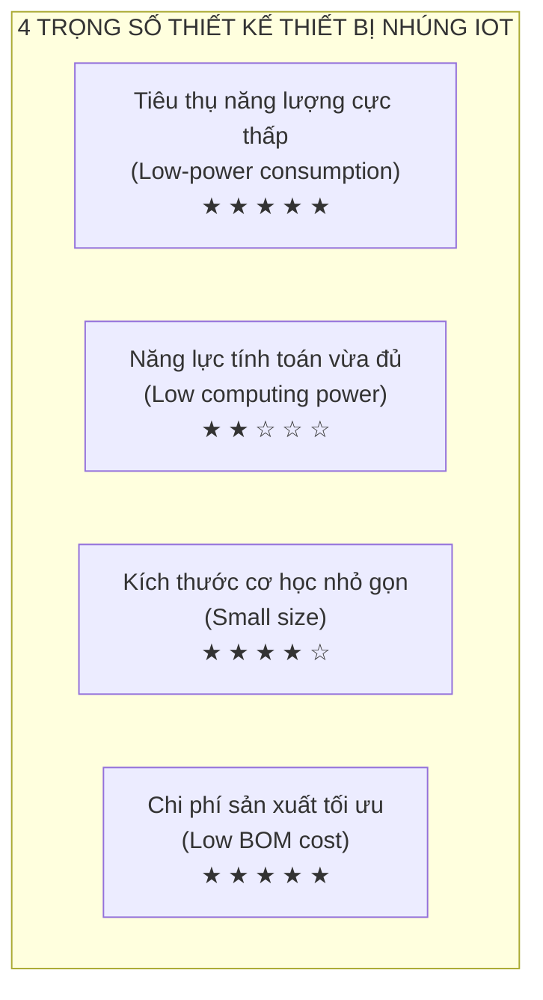
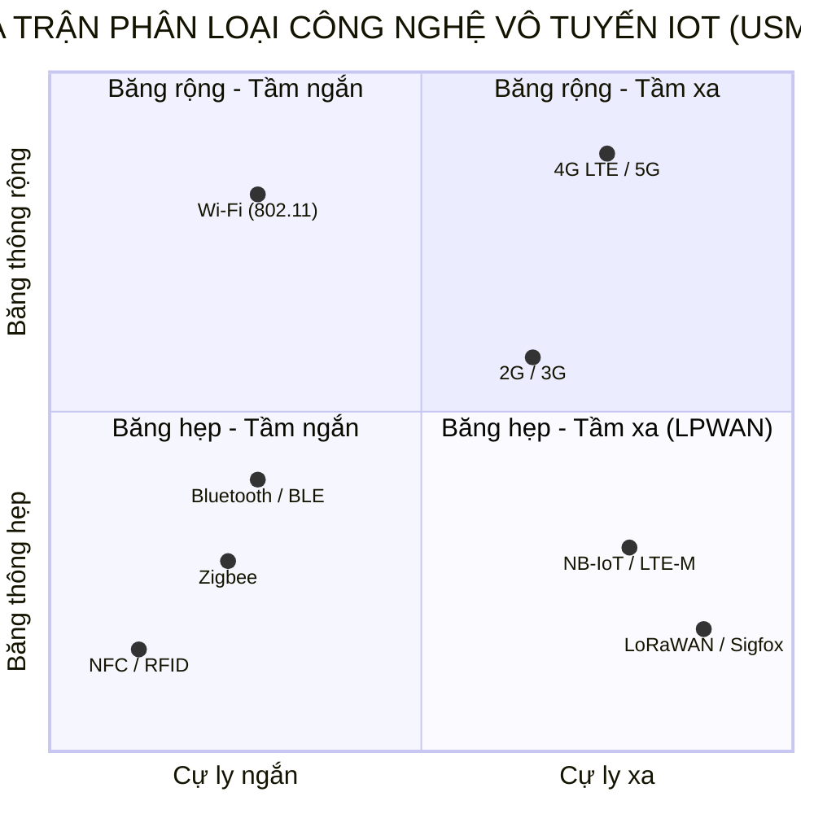
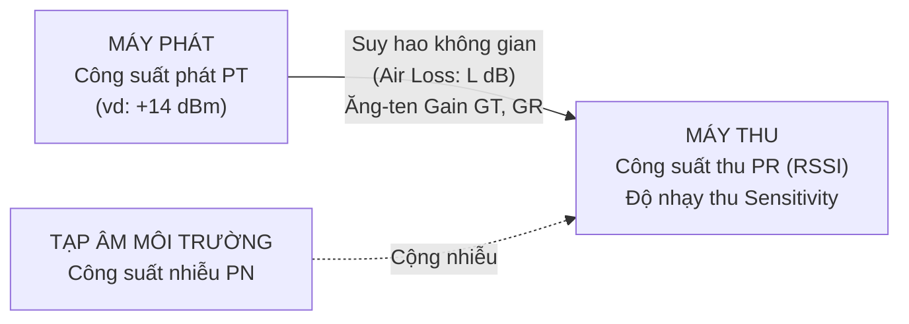
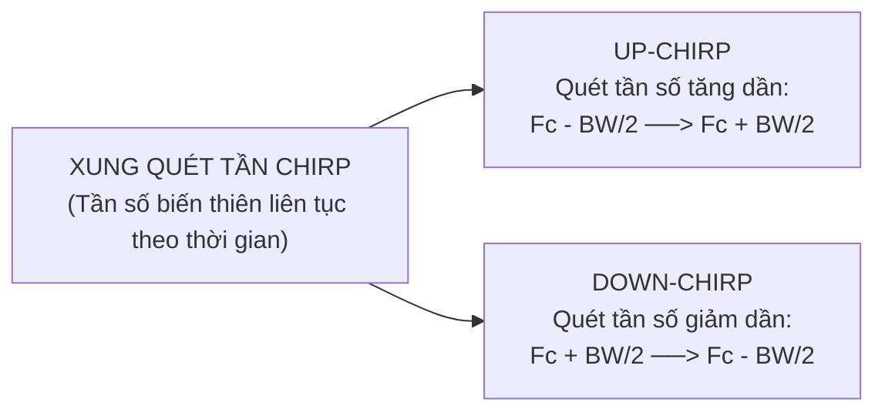
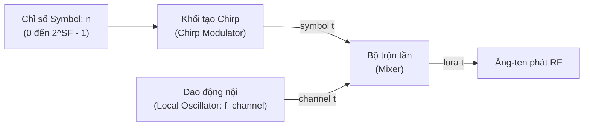
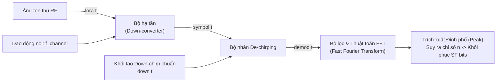
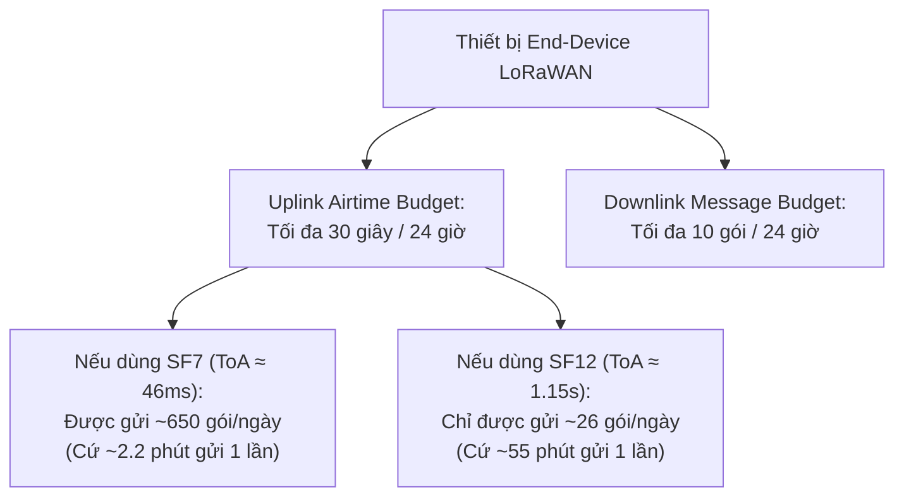
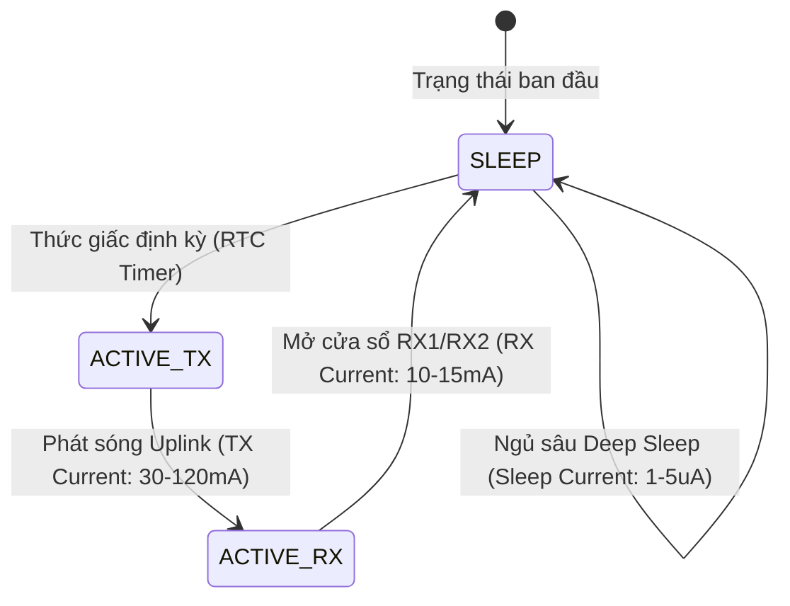

# MODULE 1: NỀN TẢNG VÔ TUYẾN & TẦNG VẬT LÝ LORA (PHY LAYER)

> **THÔNG TIN ĐIỀU PHỐI HỌC TẬP (MODULE METADATA)**
> - **Nguồn tham chiếu giáo trình cốt lõi:** 
>   * *Book 1: LoRa, LoRaWAN and Internet of Things for beginners* (Đại học Savoie Mont Blanc - USMB): Chương 1, 2, 3 (Trang 9 – 36 sách gốc / Trang 10 – 36 tệp PDF).
>   * *Tài liệu đối chiếu tiêu chuẩn quốc tế:* LoRaWAN Regional Parameters RP002-1.0.3 (Băng tần EU868), Semtech SX1276/SX1262 Transceiver Datasheets & Application Notes (AN1200.22 LoRa Modem Calculator, AN1200.13 LoRa Modulation Basics).
>   * *Khung tiêu chuẩn & Chuẩn nghiệm thu:* `Phase_01_Master_Template_and_Glossary.md` và `lorawan_learning_roadmap_checklists.md`.
> - **Thời lượng khuyến nghị:** 8 giờ lý thuyết chuyên sâu + 6 giờ thực hành lab & mô phỏng (ADALM-PLUTO SDR, SX1276 ESP-IDF, LoRa Modem Calculator).
> - **Mục tiêu đầu ra cốt lõi (Learning Objectives):**
>   1. *Về kiến thức (Knowledge):*
>      - Hiểu sâu sắc bản chất truyền sóng vô tuyến RF, cơ chế lan truyền sóng và suy hao đường truyền (Path Loss).
>      - Phân biệt tuyệt đối giữa đơn vị tỷ số tương đối $\text{dB}$ và mức công suất tuyệt đối $\text{dBm}$; làm chủ các công thức logarit và quy tắc tính nhẩm nhanh $\pm 3\text{ dB}$, $\pm 10\text{ dB}$.
>      - Nắm vững các đại lượng đo lường chất lượng tín hiệu: RSSI, Noise Floor, Receiver Sensitivity, SNR; giải thích được cơ chế giải mã tín hiệu dưới tầng nhiễu ($\text{SNR} < 0\text{ dB}$) độc quyền của LoRa.
>      - Làm chủ công thức và ý nghĩa thiết kế của Ngân sách đường truyền (Link Budget) cho mạng LPWAN diện rộng.
>      - So sánh các cơ chế chia sẻ môi trường truyền dẫn: FDM/FDMA, TDM/TDMA, và Spread Spectrum (so sánh CDMA với mã trực giao Hadamard và CSS của LoRa).
>      - Nắm vững công nghệ điều chế Chirp Spread Spectrum (CSS): Xung quét tần Chirp (Up-chirp, Down-chirp), Spreading Factor ($\text{SF7} \rightarrow \text{SF12}$), Băng thông ($\text{BW}$), Tỷ lệ mã hóa sửa lỗi ($\text{CR}$), Chip rate vs Symbol rate.
>      - Thấu hiểu thuật toán giải điều chế LoRa (De-chirping và FFT) theo mô hình toán học và mô phỏng MATLAB/Octave từ USMB.
>      - Giải phẫu cấu trúc khung truyền LoRa PHY (LoRa Frame): Preamble, Sync Word, Header (Explicit vs Implicit), Payload, CRC.
>      - Nắm vững công thức giải tích tính Time on Air (ToA) và các tham số điều khiển (SF, BW, CR, Header, Low Data Rate Optimization - LDRO).
>      - Hiểu rõ các ràng buộc pháp lý và chính sách mạng: Giới hạn 1% Duty Cycle trên các phân băng EU868 và chính sách Fair Access Policy (TTN FAP 30s uplink/ngày).
>   2. *Về kỹ năng thực chiến (Practical Skills):*
>      - Tính toán thành thạo Link Budget và ước lượng bán kính phủ sóng thực tế của trạm Gateway và Node cảm biến.
>      - Sử dụng công thức toán học và công cụ LoRa Modem Calculator để tính toán chính xác Time on Air đến từng mili-giây.
>      - Cấu hình chính xác các cờ và thanh ghi phần cứng (đặc biệt là cờ LDRO khi dùng SF11/SF12, BW125) để loại bỏ nguy cơ rớt gói tin.
>      - Lập trình thuật toán kiểm soát thời gian nghỉ (Off-time) đảm bảo thiết bị tuân thủ nghiêm ngặt 1% Duty Cycle theo phân băng.
>      - Quan sát, đo đạc và phân tích tín hiệu phổ LoRa thực tế bằng thiết bị SDR (ADALM-PLUTO / RTL-SDR) kết hợp phần mềm SDRangel / GQRX.

---

# MỤC LỤC CHI TIẾT
1. [BẢNG THUẬT NGỮ TRỌNG TÂM CỦA MODULE (MODULE GLOSSARY)](#1-bảng-thuật-ngữ-trọng-tâm-của-module-module-glossary)
2. [NỘI DUNG LÝ THUYẾT CỐT LÕI & GIẢI PHẪU KỸ THUẬT (CORE TECHNICAL KNOWLEDGE)](#2-nội-dung-lý-thuyết-cốt-lõi--giải-phẫu-kỹ-thuật-core-technical-knowledge)
   - 2.1. Hệ thống nhúng trong IoT & So sánh các công nghệ vô tuyến
   - 2.2. Các phương thức chia sẻ môi trường truyền dẫn & Trải phổ chuỗi mã
   - 2.3. Nền tảng Vô tuyến RF, Đơn vị vi phân & Ngân sách đường truyền (Link Budget)
   - 2.4. Công nghệ điều chế Chirp Spread Spectrum (CSS) & Tầng Vật lý LoRa
   - 2.5. Tốc độ bit, Mã hóa sửa lỗi (Coding Rate) & Công thức tính Time on Air (ToA)
   - 2.6. Quy định Duty Cycle, Chính sách mạng & Bài toán Tiêu thụ Năng lượng
3. [GÓC CẢNH BÁO KỸ THUẬT THỰC CHIẾN ([!] TO BE READ VERY CAREFULLY)](#3-góc-cảnh-báo-kỹ-thuật-thực-chiến--to-be-read-very-carefully)
   - 3.1. Cảnh báo 1.1: Vi phạm giới hạn pháp lý 1% Duty Cycle và Fair Access Policy
   - 3.2. Cảnh báo 1.2: Bẫy cấu hình đồng bộ cờ Low Data Rate Optimization (LDRO)
   - 3.3. Cảnh báo 1.3: Nguy cơ phá hủy tầng khuếch đại PA do phát không tải trở kháng 50 Ohm
   - 3.4. Cảnh báo 1.4: Ngộ nhận về tính trực giao tuyệt đối giữa các SF (Hiệu ứng Gần - Xa)
4. [THỰC HÀNH & GIẢI CHI TIẾT BÀI TẬP TRONG SÁCH (🛠️ EXERCISES & HANDS-ON)](#4-thực-hành--giải-chi-tiết-bài-tập-trong-sách-️-exercises--hands-on)
   - Giải chi tiết 12 bài tập kỹ thuật từ Chương 1 đến Chương 3 (Trang 14 – 32 Cuốn 1)
5. [BÀI TEST KIỂM TRA CUỐI MODULE (END-OF-MODULE ASSESSMENT)](#5-bài-test-kiểm-tra-cuối-module-end-of-module-assessment)
   - Phần A: 5 câu hỏi trắc nghiệm tình huống kỹ thuật (Scenario-based MCQs)
   - Phần B: 3 bài toán tự luận tính toán & thiết kế thực tế (Problem Solving)
   - Phần C: Đáp án & giải thích chi tiết (Answer Key)
6. [CHECKLIST KIẾN THỨC BẮT BUỘC & CẨM NANG ĐÁP ÁN (MANDATORY PASS CHECKLIST & FULL KEY)](#6-checklist-kiến-thức-bắt-buộc--cẩm-nang-đáp-án-mandatory-pass-checklist--full-key)

---

## 1. BẢNG THUẬT NGỮ TRỌNG TÂM CỦA MODULE (MODULE GLOSSARY)

Bảng thuật ngữ dưới đây được trích xuất và đối chiếu từ Mục Acronyms (Trang 7 Cuốn 1) và chuẩn hóa theo `Phase_01_Master_Template_and_Glossary.md`. Toàn bộ các thuật ngữ kỹ thuật cốt lõi của Tầng Vật lý LoRa (PHY Layer) được giải thích bản chất vật lý tường minh:

| Viết tắt / Thuật ngữ gốc (EN) | Tên đầy đủ (English Full Name) | Thuật ngữ Tiếng Việt chuẩn hóa | Giải thích bản chất kỹ thuật (Ngắn gọn, chính xác) |
| :--- | :--- | :--- | :--- |
| **BW** | Bandwidth | Băng thông kênh vô tuyến | Độ rộng dải tần số vật lý được cấp phát cho kênh truyền sóng (phổ biến trong LoRa là $125\text{ kHz}$, $250\text{ kHz}$ hoặc $500\text{ kHz}$). |
| **CDMA** | Code Division Multiple Access | Đa truy nhập phân chia theo mã | Kỹ thuật chia sẻ kênh truyền nơi nhiều thiết bị phát đồng thời trên cùng tần số nhưng dùng các chuỗi mã giả ngẫu nhiên trực giao với nhau. |
| **CHIRP** | Compressed High Intensity Radar Pulse | Xung quét tần nén cường độ cao | Dạng sóng mang vô tuyến có tần số biến thiên tuyến tính theo thời gian (quét tăng dần hoặc quét giảm dần), có khả năng chống fading và dịch pha Doppler cực tốt. |
| **CR** | Coding Rate | Tỷ lệ mã hóa sửa lỗi | Tỷ lệ giữa số bit dữ liệu hữu ích và tổng số bit truyền đi trên sóng sau khi chèn các bit kiểm tra sửa lỗi FEC Hamming ($4/5, 4/6, 4/7, 4/8$). |
| **CRC** | Cyclic Redundancy Check (sách ghi Check Redundancy Cycle) | Mã kiểm tra dư thừa vòng | Chuỗi bit kiểm tra lỗi truyền dẫn được tính toán dựa trên đa thức chia nhị phân, dùng để phát hiện bit bị sai lệch trong gói tin trên kênh truyền vô tuyến. |
| **CSS** | Chirp Spread Spectrum | Trải phổ quét tần tuyến tính | Phương pháp điều chế số độc quyền của Semtech LoRa, mã hóa các nhóm bit dữ liệu thành các ký hiệu quét tần tuyến tính (chirp). |
| **Duty Cycle** | Duty Cycle | Chu kỳ làm việc / Định mức phát | Tỷ lệ phần trăm thời gian tối đa mà một thiết bị được phép phát sóng trên một kênh hoặc một phân băng tần trong một khoảng thời gian quan sát (chuẩn EU868 thường là $1\%$). |
| **FDM** | Frequency Division Multiplexing | Ghép kênh phân chia theo tần số | Phương thức chia sẻ môi trường truyền dẫn bằng cách chia dải phổ thành nhiều kênh tần số độc lập để các thiết bị phát không chồng lấn phổ lên nhau. |
| **FFT** | Fast Fourier Transform | Biến đổi Fourier nhanh | Thuật toán toán học xử lý tín hiệu số chuyển đổi tín hiệu từ miền thời gian sang miền tần số, giúp modem LoRa giải mã ký hiệu chirp từ dưới tầng nhiễu nền. |
| **Link Budget** | Link Budget | Ngân sách đường truyền | Tổng quỹ công suất suy hao cho phép trên toàn tuyến truyền sóng, tính bằng hiệu số giữa công suất phát hiệu dụng và độ nhạy thu tối thiểu của máy thu ($P_T - \text{Sensitivity}$). |
| **LoRa** | Long Range | Công nghệ vô tuyến tầm xa LoRa | Công nghệ tầng vật lý vô tuyến độc quyền thuộc sở hữu của Semtech, sử dụng điều chế CSS để đạt tầm phủ xa với mức tiêu thụ năng lượng cực thấp. |
| **LPWAN** | Low Power Wide Area Network | Mạng diện rộng công suất thấp | Danh mục các công nghệ mạng không dây chuyên dụng cho IoT, tối ưu hóa cho cự ly kết nối xa (vài km đến hàng chục km) với mức tiêu thụ năng lượng cực nhỏ (pin dùng nhiều năm) và tốc độ dữ liệu thấp. |
| **M2M** | Machine-to-Machine | Giao tiếp máy - máy | Tập hợp các công nghệ mạng cho phép các thiết bị tự động trao đổi thông tin với nhau mà không cần sự can thiệp của con người; tiền thân của khái niệm IoT. |
| **PHY** | Physical Layer | Tầng vật lý | Tầng thấp nhất trong mô hình mạng OSI, chịu trách nhiệm truyền dẫn luồng bit thô qua môi trường vật lý vô tuyến (sóng điện từ). |
| **PN** | Noise Power | Công suất nhiễu nền | Mức công suất của tạp âm nhiệt và can nhiễu môi trường hiện diện tại đầu vào máy thu vô tuyến (đơn vị $\text{dBm}$). |
| **PR** | Power Received | Công suất thu | Mức công suất tín hiệu vô tuyến mà máy thu thu nhận được tại cổng ăng-ten (đơn vị $\text{dBm}$). |
| **PT** | Power Transmitted | Công suất phát | Mức công suất tín hiệu vô tuyến do khối khuếch đại công suất (PA) của máy phát bơm vào ăng-ten (đơn vị $\text{dBm}$ hoặc $\text{mW}$). |
| **RSSI** | Received Signal Strength Indication | Chỉ số cường độ tín hiệu thu | Thước đo công suất tín hiệu vô tuyến RF đo được tại ăng-ten máy thu (đơn vị $\text{dBm}$). |
| **Sensitivity** | Receiver Sensitivity | Độ nhạy máy thu | Mức công suất tín hiệu RF nhỏ nhất tại đầu vào máy thu mà modem có thể giải điều chế và phục hồi bản tin thành công với tỷ lệ lỗi bit chấp nhận được. |
| **SF** | Spreading Factor | Hệ số trải phổ | Số bit nhị phân được mã hóa vào trong một ký hiệu (symbol) LoRa; quyết định số lượng chip trên mỗi symbol ($2^{\text{SF}}$) và khả năng kháng nhiễu ($7 \le \text{SF} \le 12$). |
| **SNR** | Signal-to-Noise Ratio | Tỷ số tín hiệu trên nhiễu | Tỷ số giữa công suất tín hiệu hữu ích thu được và công suất nhiễu nền môi trường ($P_R / P_N$), tính bằng decibel ($\text{dB}$). |
| **TDM** | Time Division Multiplexing | Ghép kênh phân chia theo thời gian | Phương thức chia sẻ môi trường truyền dẫn nơi các thiết bị phát luân phiên trên cùng một kênh tần số theo các khe thời gian riêng biệt. |
| **ToA** | Time on Air | Thời gian truyền trên sóng | Tổng khoảng thời gian vật lý mà sóng mang của một khung truyền LoRa chiếm dụng môi trường vô tuyến từ khi bắt đầu phát preamble đến khi kết thúc byte cuối cùng. |
| **Up-chirp** | Up-chirp | Xung quét tần tăng | Xung tín hiệu LoRa có tần số quét tăng dần một cách tuyến tính từ tần số thấp nhất đến tần số cao nhất của băng thông. |
| **Down-chirp** | Down-chirp | Xung quét tần giảm | Xung tín hiệu LoRa có tần số quét giảm dần một cách tuyến tính từ tần số cao nhất về tần số thấp nhất của băng thông; dùng trong giải điều chế và báo hiệu đồng bộ. |
| **Symbol** | Symbol | Ký hiệu truyền dẫn | Một đơn vị dạng sóng mang thông tin trên kênh truyền vô tuyến; trong LoRa mỗi symbol gồm $2^{\text{SF}}$ chips và mang đúng $\text{SF}$ bits dữ liệu. |
| **Chip** | Chip | Phần tử trải phổ | Xung nhị phân cơ bản nhỏ nhất của tín hiệu trải phổ; tốc độ chip (Chip Rate) trong LoRa bằng chính độ rộng băng thông: $R_c = \text{BW}$ chips/s. |
| **LDRO** | Low Data Rate Optimization | Tối ưu hóa tốc độ dữ liệu thấp | Cơ chế trong chip thu phát LoRa tự động kích hoạt khi thời gian truyền symbol $T_{\text{symbol}} > 16.38\text{ ms}$ (SF11, SF12 ở BW 125 kHz) nhằm giảm thiểu lỗi do trôi tần số thạch anh. |
| **Explicit Header** | Explicit Header | Tiêu đề tường minh | Chế độ đóng gói khung LoRa PHY có chứa trường Header mang thông tin về độ dài payload, tỷ lệ mã hóa CR và cờ bật/tắt CRC. |
| **Implicit Header** | Implicit Header | Tiêu đề ngầm định | Chế độ đóng gói khung LoRa PHY lược bỏ hoàn toàn trường Header trên sóng để tiết kiệm ToA, yêu cầu cả máy phát và máy thu phải cấu hình cứng các thông số trước. |

---

## 2. NỘI DUNG LÝ THUYẾT CỐT LÕI & GIẢI PHẪU KỸ THUẬT (CORE TECHNICAL KNOWLEDGE)

### 2.1. Hệ thống nhúng trong IoT & So sánh các công nghệ vô tuyến (Tham chiếu Chương 1)

#### 2.1.1. Từ Giao tiếp Máy - Máy (M2M) đến Internet of Things (IoT)
Thuật ngữ **Internet of Things (IoT)** tuy mới trở nên phổ biến trong những năm gần đây nhưng thực chất bắt nguồn từ một mô hình ứng dụng lâu đời trong tự động hóa công nghiệp gọi là **Machine-to-Machine (M2M)**. M2M là tập hợp các công nghệ mạng có dây hoặc không dây cho phép trao đổi dữ liệu tự động giữa các hệ thống thiết bị mà không cần sự can thiệp của con người. 

IoT chính là tầm nhìn mở rộng toàn diện của M2M: trong khi M2M chủ yếu giới hạn trong các mạng công nghiệp khép kín hoặc kết nối điểm-điểm chuyên dụng, thì IoT đưa hàng tỷ thiết bị dân dụng, thương mại, đô thị và môi trường kết nối trực tiếp vào hạ tầng Internet toàn cầu thông qua các nền tảng điện toán đám mây (Cloud Platforms).

#### 2.1.2. 4 đặc tính then chốt của Thiết bị đầu cuối IoT (IoT End-Devices)
Theo phân tích của Đại học Savoie Mont Blanc (USMB - Giáo trình Cuốn 1, Trang 9–10), các hệ thống điện tử nhúng phục vụ IoT có trọng số thiết kế rất khác biệt so với máy tính cá nhân hay điện thoại thông minh:



1. **Tiêu thụ năng lượng cực thấp (Low-power consumption):** Đa phần các cảm biến IoT được lắp đặt tại những vị trí hiểm trở, trên đỉnh cột đèn, dưới cống ngầm, trong rừng sâu hoặc gắn trên tài sản lưu động. Yêu cầu tiên quyết là thiết bị phải hoạt động độc lập bằng pin từ 5 đến 10 năm mà không cần sạc hoặc thay pin.
2. **Năng lực tính toán vừa đủ (Low computing power):** Không giống như điện thoại cần chạy hệ điều hành nặng, một nút cảm biến IoT thường chỉ dùng vi điều khiển 8-bit hoặc 32-bit Cortex-M0+/M4 với dung lượng RAM từ vài KB đến vài chục KB, tập trung vào việc đọc cảm biến và đóng gói khung truyền.
3. **Kích thước nhỏ gọn (Small size):** Dễ dàng tích hợp vào vỏ hộp kín nước chuẩn IP67/IP68 hoặc nhúng ngầm trong bê tông, tường nhà.
4. **Chi phí linh kiện thấp (Low BOM cost):** Để triển khai quy mô lớn với hàng trăm nghìn nút, chi phí phần cứng (Bill of Materials - BOM) phải đủ rẻ để bài toán hoàn vốn (ROI) khả thi.

#### 2.1.3. Phân loại các Giao thức Vô tuyến IoT & Vị trí độc tôn của LPWAN
Trong thế giới IoT tồn tại hàng chục giao thức truyền thông không dây khác nhau: NFC, Bluetooth/BLE, Zigbee, Wi-Fi, 2G, 3G, 4G, 5G, Sigfox, NB-IoT, LTE-M và LoRaWAN. Giáo trình USMB phân loại các công nghệ này dựa trên hai trục tọa độ: **Băng thông (Bandwidth)** và **Cự ly truyền (Range)**:



##### Bảng phân định 4 góc phần tư ma trận vô tuyến IoT:
| Góc phần tư | Đặc tính công nghệ | Cự ly & Băng thông | Công nghệ tiêu biểu | Mức tiêu thụ năng lượng |
| :--- | :--- | :--- | :--- | :--- |
| **Góc I (Trên - Phải)** | **Băng rộng - Tầm xa** | Vài km $\dots$ Toàn cầu / Hàng chục Mbps | 4G LTE, 5G, Vệ tinh | **Rất cao** (Hàng Watts, cần sạc/nguồn liên tục) |
| **Góc II (Trên - Trái)** | **Băng rộng - Tầm ngắn** | Dưới $100\text{ m}$ / Hàng chục $\dots$ trăm Mbps | Wi-Fi ($802.11\text{a/b/g/n/ac}$) | **Cao** (Thường dùng adapter cắm điện cố định) |
| **Góc III (Dưới - Trái)**| **Băng hẹp - Tầm ngắn** | Dưới $100\text{ m}$ / Vài kbps $\dots$ vài Mbps | NFC, RFID, BLE, Zigbee | **Thấp** (Pin nút áo, vài tháng đến 1 năm) |
| **Góc IV (Dưới - Phải)** | **Băng hẹp - Tầm xa (LPWAN)** | Trên $10\text{ km}$ / Vài trăm bps $\dots$ vài kbps | **LoRaWAN**, Sigfox, NB-IoT | **Cực thấp** (Pin $5 - 10$ năm, tối ưu IoT đo xa) |

> [!NOTE]
> ### 💡 Bản chất ẩn sau ma trận: Đánh đổi năng lượng (The Energy Trade-off)
> Nhìn thoáng qua biểu đồ, người thiết kế thiếu kinh nghiệm có thể lầm tưởng rằng các công nghệ ở góc trên bên phải (4G, 5G) vượt trội hơn hẳn mọi công nghệ khác vì vừa đạt băng thông cao vừa có cự ly xa. Tuy nhiên, ma trận hai chiều này **chưa thể hiện trục thứ ba: Mức tiêu thụ năng lượng (Power Consumption)**:
> - NFC truyền cự ly vài cm nhưng hoàn toàn không cần pin (chạy bằng cảm ứng điện từ thụ động).
> - 4G/5G truyền hàng chục Mbps qua vài km nhưng module tiêu thụ công suất hàng Watts, làm cạn kiệt pin lithium chỉ sau vài giờ.
> - **LoRaWAN / LPWAN** chấp nhận hy sinh triệt để băng thông (chỉ vài trăm bps đến vài kbps, gửi vài chục byte mỗi lần) để đổi lấy cự ly truyền trên 10 km với mức tiêu thụ dòng khi ngủ chỉ vài micro-ampe ($\mu\text{A}$), giúp pin hoạt động bền bỉ suốt 10 năm.

#### 2.1.4. Các Băng tần Vô tuyến Miễn Chuẩn Cấp Phép (License-Free ISM Bands)
Tại Châu Âu và hầu hết các quốc gia, việc sử dụng phổ tần vô tuyến được quản lý chặt chẽ. Tuy nhiên, các cơ quan quản lý (như ETSI tại Châu Âu, FCC tại Mỹ) dành riêng một số dải tần gọi là **ISM (Industrial, Scientific, and Medical)** cho phép cộng đồng sử dụng tự do mà **không cần xin giấy phép và không phải trả phí phổ tần**:

| Dải tần số | Băng tần quy định (EU) | Ví dụ công nghệ điển hình | Ứng dụng của LoRa / LoRaWAN |
| :--- | :--- | :--- | :--- |
| **$13.56\text{ MHz}$** | HF | RFID, NFC (Thẻ từ, thanh toán một chạm) | Không sử dụng |
| **$433\text{ MHz}$** | Sub-GHz UHF ($433.05 - 434.79\text{ MHz}$) | Bộ đàm, khóa cửa xe hơi, điều khiển từ xa | LoRa PHY hỗ trợ (Châu Á, Châu Âu dải phụ) |
| **$868\text{ MHz}$** | Sub-GHz UHF ($863 - 870\text{ MHz}$) | Sigfox, Z-Wave, thiết bị đo đếm thông minh | **Băng tần tiêu chuẩn cho LoRaWAN EU868** |
| **$2.4\text{ GHz}$** | Microwave ($2.400 - 2.4835\text{ GHz}$) | Wi-Fi, Bluetooth, Zigbee | LoRa 2.4 GHz (Semtech SX1280 - toàn cầu) |
| **$5\text{ GHz}$** | Microwave ($5.150 - 5.850\text{ GHz}$) | Wi-Fi 5 / Wi-Fi 6 | Không sử dụng |

---

### 2.2. Các phương thức chia sẻ môi trường truyền dẫn & Trải phổ chuỗi mã (Tham chiếu Chương 1)

Môi trường truyền dẫn của tất cả các hệ thống IoT không dây là bầu không khí (không gian tự do). Để hàng triệu thiết bị cùng hoạt động mà không gây can nhiễu phá hủy lẫn nhau, môi trường phải được chia sẻ theo các nguyên tắc toán học và vật lý:

#### 2.2.1. Ghép kênh phân chia theo tần số (FDM / FDMA)
Dải phổ tần được chia thành nhiều kênh con có tần số trung tâm xác định. Ví dụ: Dải FM radio chia từ $87.5\text{ MHz}$ đến $108\text{ MHz}$. 
Trong mạng LoRaWAN EU868, băng tần $868\text{ MHz}$ được phân chia thành nhiều kênh tần số với độ rộng băng thông mỗi kênh $125\text{ kHz}$ (ví dụ 3 kênh mặc định bắt buộc: $868.1\text{ MHz}$, $868.3\text{ MHz}$, $868.5\text{ MHz}$):

$$\text{Kênh 0: } 868.1\text{ MHz} \quad\mid\quad \text{Kênh 1: } 868.3\text{ MHz} \quad\mid\quad \text{Kênh 2: } 868.5\text{ MHz}$$

Các thiết bị phát trên các kênh khác nhau sẽ không gây can nhiễu lẫn nhau.

#### 2.2.2. Ghép kênh phân chia theo thời gian (TDM / TDMA)
Các thiết bị phát trên cùng một kênh tần số nhưng phát gián đoạn, rời rạc theo thời gian để nhường kênh cho các nút khác. Vì các nút cảm biến LoRa hoạt động theo mô hình truy cập ngẫu nhiên kiểu ALOHA (không có sự đồng bộ thời gian tập trung giữa các nút), hiện tượng xung đột (Collision) hoàn toàn có thể xảy ra nếu hai nút cùng phát trên cùng một tần số tại cùng một thời điểm.

#### 2.2.3. Kỹ thuật trải phổ (Spread Spectrum)
Trải phổ là phương thức truyền thông tiên tiến cho phép **nhiều thiết bị phát đồng thời trên cùng một kênh tần số vào cùng một thời điểm**, nhưng nhờ cấu trúc tín hiệu đặc biệt (chuỗi mã hoặc ký hiệu quét tần), máy thu vẫn có thể bóc tách chính xác từng tín hiệu bị chìm dưới tầng nhiễu nền.

#### 2.2.4. Bản chất toán học của Trải phổ bằng Mã trực giao (Code Spread Spectrum / CDMA)
Để hiểu vì sao các tín hiệu có thể phát chồng lấn lên nhau mà không bị mất dữ liệu, giáo trình USMB (Cuốn 1, Trang 12–14) đưa ra mô hình toán học sử dụng **Ma trận trực giao Hadamard bậc 4**:

$$H_4 = \begin{bmatrix}
1 & 1 & 1 & 1 \\
1 & -1 & 1 & -1 \\
1 & 1 & -1 & -1 \\
1 & -1 & -1 & 1
\end{bmatrix}$$

Mỗi người dùng (User) được cấp phát một hàng của ma trận làm chuỗi mã trải phổ (Spreading Code):
- $\text{User 1}: \mathbf{C_1} = [1, -1, 1, -1]$
- $\text{User 2}: \mathbf{C_2} = [1, 1, -1, -1]$
- $\text{User 3}: \mathbf{C_3} = [1, -1, -1, 1]$

**Đặc tính trực giao toán học:**
Tích vô hướng giữa hai chuỗi mã của hai người dùng khác nhau luôn bằng 0:
$$\mathbf{C_i} \cdot \mathbf{C_j} = \sum_{k=1}^4 C_{i,k} \cdot C_{j,k} = 0 \quad (\forall i \neq j)$$
Và tích vô hướng của một chuỗi mã với chính nó bằng đúng độ dài chuỗi ($N = 4$):
$$\mathbf{C_i} \cdot \mathbf{C_i} = \sum_{k=1}^4 C_{i,k}^2 = 4$$

##### Quy trình truyền và nhận đồng thời 3 người dùng (Simultaneous Transmission):
1. **Tại máy phát:** Mỗi bit dữ liệu $b \in \{0, 1\}$ (quy ước mức logic $1 \rightarrow +1$, mức logic $0 \rightarrow 0$) được nhân với vector chuỗi mã $\mathbf{C}$:
   $$\mathbf{S} = b \cdot \mathbf{C}$$
2. **Trên ăng-ten máy thu:** Sóng điện từ của 3 người dùng cộng tuyến tính trong không gian:
   $$\mathbf{R} = \mathbf{S_1} + \mathbf{S_2} + \mathbf{S_3}$$
3. **Tại bộ giải điều chế máy thu:** Để khôi phục dữ liệu của User $i$, máy thu nhân tín hiệu tổng hợp $\mathbf{R}$ với chuỗi mã $\mathbf{C_i}$ rồi chia cho độ dài chuỗi $N = 4$:
   $$b_{\text{rec}} = \frac{1}{4} (\mathbf{R} \cdot \mathbf{C_i}) = \frac{1}{4} \left( (\mathbf{S_i} \cdot \mathbf{C_i}) + \sum_{j \neq i} (\mathbf{S_j} \cdot \mathbf{C_i}) \right) = \frac{1}{4} (4 \cdot b_i + 0) = b_i$$

Nhờ tính chất trực giao, toàn bộ năng lượng của các người dùng khác bị triệt tiêu về 0, giúp máy thu khôi phục chính xác 100% bit dữ liệu ban đầu.

> [!TIP]
> ### 🔍 Khác biệt đột phá giữa CDMA truyền thống và LoRa CSS
> CDMA truyền thống dùng các chuỗi mã giả ngẫu nhiên (Pseudo-random Noise - PN codes). Nhược điểm chí mạng của CDMA là đòi hỏi máy thu và máy phát phải đồng bộ thời gian cực kỳ chính xác (cỡ nano-giây) và cần thuật toán điều khiển công suất phát cực kỳ phức tạp để tránh hiện tượng Near-Far.
> **Semtech LoRa** không dùng mã trực giao mà dùng **Ký hiệu quét tần tuyến tính (Chirp)**. Các chirp với hệ số trải phổ khác nhau (SF7 đến SF12) có tính chất giả trực giao (quasi-orthogonal) tự nhiên, cho phép giải mã mà không cần đồng bộ thời gian khắt khe, giảm thiểu chi phí phần cứng xuống mức tối đa.

---

### 2.3. Nền tảng Vô tuyến RF, Đơn vị vi phân & Ngân sách đường truyền (Link Budget) (Tham chiếu Chương 2)

#### 2.3.1. Phân biệt bản chất $\text{dB}$ và $\text{dBm}$
Trong kỹ thuật viễn thông vô tuyến, công suất sóng điện từ suy giảm theo hàm mũ theo khoảng cách. Nếu sử dụng các đơn vị tuyến tính thông thường như Watt ($\text{W}$) hay mili-Watt ($\text{mW}$), kỹ sư sẽ phải làm việc với các con số cực kỳ cồng kềnh (từ $0.025\text{ W}$ xuống tới $0.000000000000001\text{ W}$). Do đó, toàn bộ ngành viễn thông chuyển sang sử dụng thang đo Logarit:

##### 1. Đơn vị $\text{dB}$ (Decibel) — Thước đo Tỷ lệ tương đối:
$\text{dB}$ không biểu diễn một mức công suất cụ thể, mà là tỷ số so sánh giữa hai mức công suất (công suất thu $P_R$ so với công suất phát $P_T$, hoặc hệ số khuếch đại / suy hao):
$$\text{Tỷ số công suất (dB)} = 10 \log_{10}\left(\frac{P_R}{P_T}\right)$$
- Nếu kết quả là số dương ($+$): Tuyến truyền dẫn có độ lợi (Gain / Khuếch đại).
- Nếu kết quả là số âm ($-$): Tuyến truyền dẫn bị suy hao (Attenuation / Loss).

Công thức đảo để tìm tỷ số công suất từ giá trị $\text{dB}$:
$$\frac{P_R}{P_T} = 10^{\frac{\text{Tỷ số (dB)}}{10}}$$

##### 2. Đơn vị $\text{dBm}$ (Decibel-milliwatt) — Thước đo Công suất tuyệt đối:
$\text{dBm}$ là mức công suất tuyệt đối được quy chiếu theo mốc chuẩn $1\text{ mW}$ ($0\text{ dBm} = 1\text{ mW}$):
$$P(\text{dBm}) = 10 \log_{10}\left(\frac{P(\text{W})}{0.001\text{ W}}\right) = 10 \log_{10}\left(\frac{P(\text{mW})}{1\text{ mW}}\right)$$
$$P(\text{W}) = 0.001 \times 10^{\frac{P(\text{dBm})}{10}}$$

##### 3. Bảng quy tắc tính nhẩm Logarit thần tốc (Mốc chuẩn kỹ sư):
Nhờ tính chất logarit biến phép nhân/chia thành phép cộng/trừ, kỹ sư có thể tính nhẩm ngân sách đường truyền cực nhanh dựa trên bảng mốc vàng sau:

| Mức thay đổi $\text{dB}$ | Ý nghĩa tương đương | Công suất $\text{dBm}$ | Công suất tuyệt đối quy đổi |
| :---: | :---: | :---: | :---: |
| **$+10\text{ dB}$** | Tăng gấp **$10$ lần** | **$+30\text{ dBm}$** | $1000\text{ mW} = 1\text{ W}$ |
| **$+3\text{ dB}$** | Tăng gấp đôi ($\approx \times 2$) | **$+20\text{ dBm}$** | $100\text{ mW}$ |
| **$0\text{ dB}$** | Bằng nhau ($= 1$) | **$+14\text{ dBm}$** | $\approx 25\text{ mW}$ (Giới hạn chuẩn EU868) |
| **$-3\text{ dB}$** | Giảm một nửa ($\approx \div 2$) | **$+10\text{ dBm}$** | $10\text{ mW}$ |
| **$-10\text{ dB}$** | Giảm **$10$ lần** ($\div 10$) | **$+3\text{ dBm}$** | $\approx 2\text{ mW}$ |
| **$-20\text{ dB}$** | Giảm **$100$ lần** ($\div 100$) | **$0\text{ dBm}$** | $1\text{ mW}$ (Mốc quy chiếu chuẩn) |
| **$-30\text{ dB}$** | Giảm **$1000$ lần** ($\div 1000$) | **$-3\text{ dBm}$** | $\approx 0.5\text{ mW}$ |
| **$-60\text{ dB}$** | Giảm **$1.000.000$ lần** | **$-10\text{ dBm}$** | $0.1\text{ mW}$ |
| **$-120\text{ dB}$** | Giảm **$10^{12}$ lần** | **$-120\text{ dBm}$** | $10^{-15}\text{ W} = 1\text{ fW}$ (Độ nhạy thu LoRa) |

#### 2.3.2. Bốn đại lượng then chốt: $P_T$, $P_R$, RSSI, Sensitivity và SNR
Mô hình tuyến truyền sóng vô tuyến cơ bản gồm máy phát (Transmitter) phát công suất $P_T$, qua môi trường không gian bị suy hao và nhận thêm tạp âm nhiệt môi trường $P_N$, đi tới máy thu (Receiver) thu được công suất $P_R$:



1. **RSSI (Received Signal Strength Indication):** Là tổng công suất vô tuyến đo được tại cổng ăng-ten của máy thu trong dải thông kênh: $\text{RSSI} \equiv P_R$ (tính bằng $\text{dBm}$). Giá trị RSSI càng gần 0 thì tín hiệu càng mạnh (ví dụ: $-30\text{ dBm}$ là rất mạnh, $-110\text{ dBm}$ là rất yếu).
2. **Sensitivity (Độ nhạy thu):** Là mức công suất tín hiệu tối thiểu tại đầu vào máy thu mà thiết bị có thể giải mã được dữ liệu mà không bị lỗi. Nếu $\text{RSSI} < \text{Sensitivity}$, tín hiệu hoàn toàn không thể phát hiện.
3. **SNR (Signal-to-Noise Ratio):** Tỷ số giữa công suất tín hiệu thu được $P_R$ và công suất nhiễu nền $P_N$:
   $$\text{SNR (dB)} = 10 \log_{10}\left(\frac{P_R}{P_N}\right) = P_{R(\text{dBm})} - P_{N(\text{dBm})}$$
   - Trong các hệ thống điều chế số truyền thống (FSK, ASK, Wi-Fi): Bắt buộc $\text{SNR} > 0\text{ dB}$ (tức $P_R > P_N$, công suất tín hiệu phải lớn hơn công suất nhiễu thì máy thu mới tách được bit).
   - **Đột phá mang tính cách mạng của LoRa CSS:** Nhờ kỹ thuật trải phổ, modem LoRa có thể giải điều chế thành công ngay cả khi **tín hiệu chìm sâu dưới đáy tầng nhiễu** ($\text{SNR} < 0\text{ dB}$, tức $P_R < P_N$):

| Spreading Factor | Ngưỡng SNR giải điều chế tối thiểu ($\text{SNR}_{\text{limit}}$) | Khả năng thu tín hiệu so với nhiễu |
| :---: | :---: | :---: |
| **SF7** | **$-7.5\text{ dB}$** | Tín hiệu yếu hơn nhiễu $\approx 5.6$ lần |
| **SF8** | **$-10.0\text{ dB}$** | Tín hiệu yếu hơn nhiễu **$10$ lần** |
| **SF9** | **$-12.5\text{ dB}$** | Tín hiệu yếu hơn nhiễu $\approx 17.8$ lần |
| **SF10** | **$-15.0\text{ dB}$** | Tín hiệu yếu hơn nhiễu $\approx 31.6$ lần |
| **SF11** | **$-17.5\text{ dB}$** | Tín hiệu yếu hơn nhiễu $\approx 56.2$ lần |
| **SF12** | **$-20.0\text{ dB}$** | Tín hiệu yếu hơn nhiễu **$100$ lần** |

> [!NOTE]
> ### 🔍 Điều kiện cần và đủ để gói tin LoRa được nhận thành công:
> Một bản tin LoRa chỉ được Gateway hoặc Node giải mã toàn vẹn khi đồng thời thỏa mãn cả hai điều kiện:
> 1. $\text{RSSI} \ge \text{Sensitivity}(\text{SF, BW})$
> 2. $\text{SNR} \ge \text{SNR}_{\text{limit}}(\text{SF})$

#### 2.3.3. Ngân sách đường truyền (Link Budget) & Khoảng cách truyền tối đa
**Ngân sách đường truyền (Link Budget)** là thước đo tổng thể mạnh mẽ nhất cho năng lực phủ sóng của một công nghệ vô tuyến. Nó biểu diễn quỹ suy hao tối đa cho phép trên toàn tuyến truyền sóng trước khi tín hiệu bị mất hoàn toàn:

$$\text{Link Budget (dB)} = P_T(\text{dBm}) - \text{Sensitivity}(\text{dBm})$$

##### So sánh Link Budget giữa các công nghệ:
- **4G LTE:** $P_T \approx +23\text{ dBm}$, Sensitivity $\approx -107\text{ dBm} \implies \text{Link Budget} \approx \mathbf{130\text{ dB}}$.
- **LoRa Transceiver SX1272:** $P_T = +20\text{ dBm}$, Sensitivity = $-137\text{ dBm} \implies \text{Link Budget} = \mathbf{157\text{ dB}}$.
- **LoRa Transceiver SX1262:** $P_T = +22\text{ dBm}$, Sensitivity = $-148\text{ dBm} \implies \text{Link Budget} = \mathbf{170\text{ dB}}$.
- **LoRa tại Châu Âu (Giới hạn công suất ETSI EU868):** $P_T = +14\text{ dBm}$, Sensitivity = $-148\text{ dBm} \implies \text{Link Budget} = \mathbf{162\text{ dB}}$.

Khoảng chênh lệch $32\text{ dB}$ giữa LoRa ($162\text{ dB}$) và 4G ($130\text{ dB}$) tương đương với khả năng vượt qua độ suy hao lớn hơn **$1580$ lần**, giải thích vì sao chỉ với công suất phát $25\text{ mW}$, sóng LoRa có thể xuyên qua nhiều tầng nhà bê tông và truyền xa hàng chục cây số.

##### Mô hình tính toán cự ly truyền sóng lý thuyết (USMB Simplified Path Loss Model):
Theo giáo trình USMB (Cuốn 1, Trang 18), trong điều kiện không gian tự do lý tưởng, công suất suy hao giữa máy phát và máy thu được tính theo công thức:
$$\text{Loss (dB)} = 10 \log_{10}\left(D^2 \cdot F^2 \cdot 1755\right)$$
Trong đó:
- $\text{Loss}$: Độ suy hao không gian (tính bằng $\text{dB}$).
- $D$: Khoảng cách đường truyền (tính bằng $\text{km}$).
- $F$: Tần số sóng mang (tính bằng $\text{MHz}$).

Khi toàn bộ Link Budget bị tiêu hao hoàn toàn vào không gian ($\text{Loss} = \text{Link Budget}$), ta suy ra cự ly truyền tối đa lý thuyết:
$$D_{\max} = \sqrt{\frac{10^{\frac{\text{Link Budget}}{10}}}{1755 \cdot F^2}}$$

##### Đánh giá thực nghiệm cự ly truyền:
- Với chip SX1272 ($\text{Link Budget} = 157\text{ dB}$, tần số $868\text{ MHz}$): $D_{\max} = 1946\text{ km}$.
- Với chip SX1262 ($\text{Link Budget} = 170\text{ dB}$, tần số $868\text{ MHz}$): $D_{\max} = 8696\text{ km}$.
- *Kỷ lục thế giới thực tế (World Record):* Tháng 4/2020, Thomas Telkamp và đội ngũ đã thiết lập kỷ lục truyền dẫn LoRa mặt đất trên khinh khí cầu đạt cự ly **$832\text{ km}$** trên băng tần EU868 với công suất phát chỉ $25\text{ mW}$ ($+14\text{ dBm}$).

---
### 2.4. Công nghệ điều chế Chirp Spread Spectrum (CSS) & Tầng Vật lý LoRa (Tham chiếu Chương 3)

#### 2.4.1. Bản chất Vật lý của Xung Quét Tần (The Chirp)
Công nghệ điều chế độc quyền của Semtech LoRa sử dụng kỹ thuật **Trải phổ quét tần tuyến tính (Chirp Spread Spectrum - CSS)**. Tên gọi "Chirp" bắt nguồn từ kỹ thuật nén xung trong radar quân sự (Compressed High Intensity Radar Pulse) và có âm điệu quét tần tương tự tiếng chim hót khi nghe trên máy thu âm tần:



1. **Up-chirp (Xung quét tần tăng):** Tần số sóng mang bắt đầu từ tần số thấp nhất của kênh truyền ($F_{\min} = F_{\text{channel}} - \frac{\text{BW}}{2}$) và tăng dần một cách tuyến tính theo thời gian đến tần số cao nhất của kênh ($F_{\max} = F_{\text{channel}} + \frac{\text{BW}}{2}$).
2. **Down-chirp (Xung quét tần giảm):** Tần số sóng mang bắt đầu từ tần số cao nhất ($F_{\max}$) và quét tuyến tính giảm dần về tần số thấp nhất ($F_{\min}$). Down-chirp được dùng làm mốc đồng bộ trong phần mở đầu gói tin (Preamble) và làm tín hiệu chuẩn để giải điều chế (De-chirping) tại máy thu.
3. **Biểu đồ Thời gian - Tần số (Spectrogram):** Trên đồ thị hai chiều với trục hoành là Thời gian ($t$) và trục tung là Tần số ($f$), một Up-chirp biểu diễn bằng một đoạn thẳng dốc lên từ góc dưới bên trái lên góc trên bên phải, còn Down-chirp là một đoạn thẳng dốc xuống từ góc trên bên trái xuống góc dưới bên phải.

#### 2.4.2. Quy luật biểu diễn Bit nhị phân và Hệ số trải phổ (Spreading Factor - SF)
Trong các hệ thống viễn thông truyền thống (như FSK hay BPSK), mỗi symbol thường chỉ mang 1 hoặc 2 bits. Trong công nghệ LoRa, mối quan hệ giữa symbol và bit tuân theo một quy tắc vàng bất biến:

$$\mathbf{\text{Số bit nhị phân được mã hóa trong 1 Symbol}} = \mathbf{\text{Spreading Factor (SF)}}$$

Ví dụ:
- Khi cấu hình $\text{SF} = 7$: Mỗi symbol mang chính xác $7\text{ bits}$ dữ liệu nhị phân.
- Khi cấu hình $\text{SF} = 10$: Mỗi symbol mang chính xác $10\text{ bits}$ dữ liệu nhị phân ($2^{10} = 1024$ trạng thái).
- Khi cấu hình $\text{SF} = 12$: Mỗi symbol mang chính xác $12\text{ bits}$ dữ liệu nhị phân ($2^{12} = 4096$ trạng thái).

##### Cơ chế dịch chuyển tần số ban đầu (Frequency Wrap-Around):
Để biểu diễn $2^{\text{SF}}$ trạng thái nhị phân khác nhau, modem LoRa tạo ra $2^{\text{SF}}$ dạng sóng chirp khác nhau trong cùng một dải băng thông $\text{BW}$. Điểm khác biệt duy nhất giữa các symbol này là **tần số khởi đầu (Start Frequency)** của chirp:
- Khi một chirp quét tần số tăng dần và chạm tới biên trên của băng thông ($F_{\max} = F_{\text{channel}} + \frac{\text{BW}}{2}$), nó sẽ lập tức "cuộn vòng" (wrap around) nhảy tức thời về biên dưới ($F_{\min} = F_{\text{channel}} - \frac{\text{BW}}{2}$) và tiếp tục quét tăng dần cho đến khi hết thời gian của một symbol.
- Độ dời tần số ban đầu tỷ lệ thuận với giá trị thập phân của khối $\text{SF}$ bits được mã hóa.

##### Phân tích mô hình lý thuyết SF2 (Giáo trình USMB Cuốn 1, Trang 21–22):
Xét trường hợp lý thuyết với $\text{SF} = 2$ hoạt động tại kênh trung tâm $868.1\text{ MHz}$ với băng thông $\text{BW} = 125\text{ kHz}$:
- Biên tần dưới: $F_{\min} = 868.1\text{ MHz} - 62.5\text{ kHz} = 868.0375\text{ MHz} = 868\,037\,500\text{ Hz}$.
- Biên tần trên: $F_{\max} = 868.1\text{ MHz} + 62.5\text{ kHz} = 868.1625\text{ MHz} = 868\,162\,500\text{ Hz}$.
- Với $\text{SF} = 2$, có $2^2 = 4$ tổ hợp nhị phân tương ứng với 4 dạng symbol:
  * **Symbol 0 (Bits '00'):** Xuất phát tại $868\,037\,500\text{ Hz}$, quét liên tục tăng thẳng lên $868\,162\,500\text{ Hz}$ mà không cuộn vòng.
  * **Symbol 1 (Bits '01'):** Xuất phát tại $868\,068\,875\text{ Hz}$ ($F_{\min} + \frac{1}{4}\text{BW}$), quét lên $F_{\max}$, cuộn về $F_{\min}$ và quét lên đến điểm kết thúc.
  * **Symbol 2 (Bits '10'):** Xuất phát tại tần số trung tâm $868\,100\,000\text{ Hz}$ ($F_{\min} + \frac{2}{4}\text{BW}$).
  * **Symbol 3 (Bits '11'):** Xuất phát tại $868\,131\,125\text{ Hz}$ ($F_{\min} + \frac{3}{4}\text{BW}$).

```
Tần số (Hz)
868 162 500 ──┐        /│       /│      /│
              │       / │      / │     / │
868 131 125 ──┼──────/──┼─────/──┼────/──┼─── (Start Sym 3 - '11')
868 100 000 ──┼─────/───┼────/───┼───/   │    (Start Sym 2 - '10')
868 068 875 ──┼────/────┼───/    │  /    │    (Start Sym 1 - '01')
868 037 500 ──┴───/─────┴──/─────┴─/─────┴─── (Start Sym 0 - '00')
              └───┬─────┴──┬─────┴─┬─────┴───
                Sym 0    Sym 1   Sym 2   Sym 3   -> Thời gian (t)
```

#### 2.4.3. Thời gian truyền Symbol ($T_{\text{symbol}}$), Tốc độ Symbol ($R_s$) & Tốc độ Chip ($R_c$)
Thời gian cần thiết để truyền trọn vẹn một ký hiệu LoRa ($T_{\text{symbol}}$) phụ thuộc chặt chẽ vào hai tham số: Hệ số trải phổ $\text{SF}$ và Băng thông $\text{BW}$:

$$T_{\text{symbol}} = \frac{2^{\text{SF}}}{\text{BW}}$$

Tốc độ phát symbol (Symbol Rate $R_s$):
$$R_s = \frac{1}{T_{\text{symbol}}} = \frac{\text{BW}}{2^{\text{SF}}} \quad (\text{symbols/s})$$

Tốc độ trải chip (Chip Rate $R_c$):
Trong điều chế LoRa CSS, mỗi symbol được chia thành chính xác $2^{\text{SF}}$ lát cắt thời gian gọi là **chip**. Do đó, tốc độ chip luôn bằng đúng độ rộng băng thông vật lý:
$$R_c = R_s \cdot 2^{\text{SF}} = \frac{\text{BW}}{2^{\text{SF}}} \cdot 2^{\text{SF}} = \mathbf{\text{BW}} \quad (\text{chips/s})$$

##### Bảng đối chiếu các thông số thời gian Symbol tại băng thông chuẩn $\text{BW} = 125\text{ kHz}$:

| Spreading Factor (SF) | Số chip trên mỗi Symbol ($2^{\text{SF}}$) | Thời gian truyền 1 Symbol ($T_{\text{symbol}}$) | Tốc độ Symbol ($R_s$) | Độ nhạy thu tương đối |
| :---: | :---: | :---: | :---: | :---: |
| **SF7** | $128\text{ chips}$ | **$1.024\text{ ms}$** | $976.56\text{ sym/s}$ | $-123.0\text{ dBm}$ (Nhanh nhất) |
| **SF8** | $256\text{ chips}$ | **$2.048\text{ ms}$** | $488.28\text{ sym/s}$ | $-126.0\text{ dBm}$ |
| **SF9** | $512\text{ chips}$ | **$4.096\text{ ms}$** | $244.14\text{ sym/s}$ | $-128.5\text{ dBm}$ |
| **SF10** | $1024\text{ chips}$ | **$8.192\text{ ms}$** | $122.07\text{ sym/s}$ | $-131.0\text{ dBm}$ |
| **SF11** | $2048\text{ chips}$ | **$16.384\text{ ms}$** | $61.04\text{ sym/s}$ | $-133.5\text{ dBm}$ |
| **SF12** | $4096\text{ chips}$ | **$32.768\text{ ms}$** | $30.52\text{ sym/s}$ | $-136.0\text{ dBm}$ (Xa nhất) |

> [!IMPORTANT]
> ### 📌 Quy luật tăng trưởng mũ:
> Cứ mỗi khi tăng thêm một bậc $\text{SF}$ (từ $\text{SF}_n$ lên $\text{SF}_{n+1}$):
> - Thời gian truyền 1 symbol $T_{\text{symbol}}$ **tăng chính xác gấp 2 lần**.
> - Tốc độ phát symbol $R_s$ **giảm đi một nửa**.
> - Năng lượng tích lũy trên mỗi bit tăng gấp đôi, giúp máy thu thu nhận thêm khoảng $+2.5\text{ dB}$ đến $+3.0\text{ dB}$ độ nhạy, cho phép sóng đi xa hơn nhưng thời gian chiếm dụng sóng (Time on Air) cũng tăng gấp đôi.

#### 2.4.4. Cơ chế Điều chế & Giải điều chế LoRa (Phân tích Toán học & Mô phỏng MATLAB/Octave)
Giáo trình USMB (Cuốn 1, Chương 3.3.2 – 3.3.3, Trang 31–34) cung cấp sơ đồ khối và thuật toán mô phỏng quá trình điều chế và giải điều chế LoRa bằng ngôn ngữ MATLAB/Octave:

##### 1. Quá trình Điều chế (Chirp Modulation):

Tín hiệu băng tần cơ sở $\text{symbol}(t)$ được tạo ra với độ dời tần số tương ứng với giá trị $n \in [0, 2^{\text{SF}}-1]$. Sau đó nó được nhân trộn với sóng mang dao động nội tần số $f_{\text{channel}}$ để dịch toàn bộ tín hiệu lên dải tần phát sóng thực tế $868.1\text{ MHz}$.

##### 2. Quá trình Giải điều chế (Chirp Demodulation - De-chirping):


**Bản chất toán học của phép khử quét tần (De-chirping):**
Tín hiệu thu $\text{symbol}(t)$ là một Up-chirp có tần số tức thời:
$$f_{\text{up}}(t) = f_0 + \left( \frac{\text{BW}}{T_{\text{symbol}}} \right) t$$
Bộ tạo xung nội tại máy thu phát ra một Down-chirp chuẩn liên hợp $\text{down}(t)$ có tần số quét ngược chiều:
$$f_{\text{down}}(t) = F_{\max} - \left( \frac{\text{BW}}{T_{\text{symbol}}} \right) t$$
Khi nhân hai tín hiệu này trong miền thời gian:
$$\text{demod}(t) = \text{symbol}(t) \cdot \text{down}(t)$$
Độ dốc quét tần (Chirp Rate $\mu = \frac{\text{BW}}{T_{\text{symbol}}}$) của Up-chirp và Down-chirp hoàn toàn triệt tiêu lẫn nhau. Kết quả của phép nhân là một **sóng hình sin thuần túy có tần số không đổi** $f_{\text{tone}}$ tỷ lệ tuyến tính với chỉ số $n$:
$$f_{\text{tone}} = \left( \frac{n}{2^{\text{SF}}} \right) \cdot \text{BW}$$

**Biến đổi Fourier nhanh (FFT) trích xuất dữ liệu:**
Máy thu lấy mẫu tín hiệu $\text{demod}(t)$ với tần số lấy mẫu $f_s = \text{BW}$ ($2^{\text{SF}}$ mẫu trên mỗi symbol) và đưa qua thuật toán FFT. 
- Toàn bộ năng lượng của sóng sin thuần túy được nén tập trung thành một **vạch phổ cực nhọn (Peak)** vượt trội tại điểm tần số $f_{\text{tone}}$.
- Vị trí của đỉnh phổ (bin thứ $n$ trong vector FFT kích thước $2^{\text{SF}}$) chính là giá trị nhị phân của $\text{SF}$ bits cần truyền.
- Các can nhiễu băng hẹp hoặc tạp âm môi trường khi nhân với Down-chirp sẽ bị trải đều ra khắp toàn bộ băng thông $\text{BW}$, giữ cho sàn nhiễu ở mức thấp và cho phép đỉnh phổ của LoRa nổi bật lên ngay cả khi tỷ số $\text{SNR} < 0\text{ dB}$.

#### 2.4.5. Giải phẫu Cấu trúc Khung truyền LoRa PHY (LoRa Frame Anatomy)
Khung truyền tầng vật lý của LoRa (PHY Frame) trên sóng vô tuyến có cấu trúc chuẩn như sau:

```
┌───────────────────────────────────────┬──────────────────┬─────────────────┬──────────┐
│              PREAMBLE                 │  EXPLICIT HEADER │   PHY PAYLOAD   │ CRC (2B) │
├──────────────────────────┬────────────┼──────────────────┼─────────────────┼──────────┤
│ 8 đến 65535 Up-chirps    │ 4.25 Symb  │ 20 symbols       │ 1 đến 255 bytes │ Tùy chọn │
│ (Mặc định: 8 Up-chirps)  │ Sync Word  │ (Tùy chọn mode)  │ (User + LoRaWAN)│ Uplink   │
└──────────────────────────┴────────────┴──────────────────┴─────────────────┴──────────┘
```

1. **Phần mở đầu (Preamble):**
   - **Các Up-chirp dẫn đường:** Mặc định gồm **$8$ up-chirps liên tiếp** (có thể cấu hình từ $6$ đến $65535$). Preamble giúp máy thu phát hiện có tín hiệu LoRa đang truyền tới và kích hoạt vòng khóa pha (PLL) để đồng bộ tần số và thời gian.
   - **Ký hiệu phân tách mạng (Sync Word):** Gồm **$2$ up-chirps mã hóa đặc biệt**. Giá trị này dùng để phân biệt loại mạng:
     * Giá trị `0x12` ($18$ thập phân): Dành cho mạng LoRa riêng độc lập (Private Network).
     * Giá trị `0x34` ($52$ thập phân): Dành cho mạng LoRaWAN công cộng chuẩn quốc tế (Public LoRaWAN Network).
   - **Ký hiệu đánh dấu khung (Frame Sync Symbols):** Gồm chính xác **$2.25$ down-chirps**. Sự chuyển đổi đột ngột từ Up-chirp sang Down-chirp báo hiệu cho bộ giải điều chế biết phần Preamble đã kết thúc và byte dữ liệu đầu tiên của Header/Payload sẽ bắt đầu ngay sau đó.
   - Tổng độ dài phần Preamble trên sóng: $n_{\text{preamble\_total}} = n_{\text{preamble}} + 4.25\text{ symbols}$ (với mặc định là $8 + 4.25 = 12.25\text{ symbols}$).

2. **Tiêu đề tầng vật lý (PHY Header):**
   - **Chế độ Header tường minh (Explicit Header Mode - Mặc định):** Header được mã hóa với tỷ lệ sửa lỗi tối đa ($\text{CR} = 4/8$) và luôn chiếm một khoảng thời gian cố định tương đương $20\text{ symbols}$ (hoặc $8$ symbols payload). Header chứa: Độ dài Payload (Payload Length tính bằng byte), Tỷ lệ mã hóa (Coding Rate của phần payload), và Cờ báo sự hiện diện của trường CRC (CRC Flag).
   - **Chế độ Header ngầm định (Implicit Header Mode):** Dùng trong các ứng dụng chuyên biệt khi các thông số (Payload Length, CR, CRC) đã được cấu hình cố định cứng ở cả hai đầu phát và thu. Toàn bộ trường Header bị loại bỏ, giúp rút ngắn thời gian ToA.

3. **Tải trọng vật lý (PHY Payload):**
   - Có độ dài từ $1$ đến $255\text{ bytes}$. Đây là nơi chứa gói tin LoRaWAN MAC Frame (gồm LoRaWAN Header $13\text{ bytes}$ + Dữ liệu người dùng).
   - Payload được mã hóa qua các khối: Làm trắng dữ liệu (Whitening), Mã hóa sửa lỗi Hamming FEC (theo tham số $\text{CR}$), và Hoán vị xen kẽ bit (Interleaving) để chống nhiễu cụm (Burst Noise).

4. **Trường kiểm tra dư thừa vòng (Payload CRC):**
   - Chiếm $2\text{ bytes}$ (tương đương $16\text{ bits}$).
   - Trong chuẩn LoRaWAN: Trường CRC bắt buộc phải có mặt trong các gói tin **Uplink** (từ Node lên Gateway), nhưng được **lược bỏ hoàn toàn trong các gói Downlink** (từ Gateway xuống Node) để tiết kiệm tài nguyên năng lượng và thời gian phát sóng của Gateway.

---

### 2.5. Tốc độ bit, Mã hóa sửa lỗi (Coding Rate) & Công thức tính Time on Air (ToA) (Tham chiếu Chương 3)

#### 2.5.1. Tốc độ bit tức thời của LoRa (Raw Bitrate)
Tốc độ bit thô của modem LoRa (chưa tính đến mã hóa sửa lỗi và các byte tiêu đề) được tính bằng tích của số bit trên mỗi symbol ($\text{SF}$) và tốc độ phát symbol ($R_s$):

$$R_{\text{raw}} = \text{SF} \cdot R_s = \text{SF} \cdot \left(\frac{\text{BW}}{2^{\text{SF}}}\right) \quad (\text{bps})$$

- Khi $\text{SF}$ tăng: Tốc độ bit **giảm mạnh theo cấp số nhân**, vì mẫu số $2^{\text{SF}}$ tăng nhanh hơn nhiều so với tử số $\text{SF}$.
- Khi $\text{BW}$ tăng: Tốc độ bit **tăng tỷ lệ thuận tuyến tính**.

#### 2.5.2. Ảnh hưởng của Tỷ lệ Mã hóa sửa lỗi (Coding Rate - CR)
Để bảo vệ các bit dữ liệu khỏi can nhiễu xung trên đường truyền, modem LoRa tích hợp bộ mã hóa kênh sửa lỗi tiến Hamming FEC (Forward Error Correction). Tỷ lệ mã hóa $\text{CR}$ được biểu diễn dưới dạng phân số:

$$\text{CR} = \frac{4}{4 + n} \quad \text{với } n \in \{1, 2, 3, 4\}$$

Quy ước trong mã nguồn và thanh ghi Semtech:
- $\text{CR} = 1 \iff 4/5$ (Cứ mỗi 4 bit dữ liệu hữu ích, chèn thêm 1 bit chẵn lẻ parity $\rightarrow$ tổng truyền đi 5 bits).
- $\text{CR} = 2 \iff 4/6$ (Cứ 4 bit dữ liệu, chèn 2 bit kiểm tra $\rightarrow$ truyền đi 6 bits).
- $\text{CR} = 3 \iff 4/7$ (Cứ 4 bit dữ liệu, chèn 3 bit kiểm tra $\rightarrow$ truyền đi 7 bits).
- $\text{CR} = 4 \iff 4/8$ (Cứ 4 bit dữ liệu, chèn 4 bit kiểm tra $\rightarrow$ truyền đi 8 bits, tăng gấp đôi số lượng bit truyền).

##### Hệ số dôi dư tải (Overhead Ratio) và Tốc độ bit hữu ích:
$$\text{Overhead Ratio} = \frac{4 + n}{4} = \frac{1}{\text{CR}}$$
Tốc độ bit hữu ích sau khi tính đến mã hóa sửa lỗi:
$$R_{\text{bit}} = R_{\text{raw}} \cdot \text{CR} = \text{SF} \cdot \left(\frac{\text{BW}}{2^{\text{SF}}}\right) \cdot \left(\frac{4}{4 + n}\right)$$

##### Bảng đối chiếu tốc độ bit LoRa PHY tại băng thông $\text{BW} = 125\text{ kHz}$:

| Spreading Factor | Tốc độ bit thô ($R_{\text{raw}}$) | Tốc độ hiệu dụng ($\text{CR}=4/5$) | Tốc độ hiệu dụng ($\text{CR}=4/6$) | Tốc độ hiệu dụng ($\text{CR}=4/8$) |
| :---: | :---: | :---: | :---: | :---: |
| **SF7** | $6835.94\text{ bps}$ | **$5468.75\text{ bps}$** | $4557.29\text{ bps}$ | $3417.97\text{ bps}$ |
| **SF8** | $3906.25\text{ bps}$ | **$3125.00\text{ bps}$** | $2604.17\text{ bps}$ | $1953.13\text{ bps}$ |
| **SF9** | $2197.27\text{ bps}$ | **$1757.81\text{ bps}$** | $1464.84\text{ bps}$ | $1098.63\text{ bps}$ |
| **SF10** | $1220.70\text{ bps}$ | **$976.56\text{ bps}$** | $813.80\text{ bps}$ | $610.35\text{ bps}$ |
| **SF11** | $671.39\text{ bps}$ | **$537.11\text{ bps}$** | $447.59\text{ bps}$ | $335.69\text{ bps}$ |
| **SF12** | $366.21\text{ bps}$ | **$292.97\text{ bps}$** | $244.14\text{ bps}$ | $183.11\text{ bps}$ |

*(Lưu ý: Chuẩn LoRaWAN EU868 luôn mặc định cố định tỷ lệ mã hóa $\text{CR} = 4/5$ cho toàn bộ các kênh truyền thông thường).*

#### 2.5.3. Tác động suy giảm tốc độ do LoRaWAN MAC Overhead
Người dùng cuối chỉ quan tâm đến dữ liệu thực sự cần truyền (User Useful Payload - ví dụ: 1 byte nhiệt độ $25^\circ\text{C}$). Tuy nhiên, để bản tin có thể định tuyến an toàn qua mạng LoRaWAN, giao thức bắt buộc phải bọc thêm **$13\text{ bytes}$ tiêu đề LoRaWAN MAC Header**:
- $\text{MHDR}$ (MAC Header): $1\text{ byte}$.
- $\text{FHDR}$ (Frame Header): $7\text{ bytes}$ (gồm $\text{DevAddr } 4\text{B}$, $\text{FCtrl } 1\text{B}$, $\text{FCnt } 2\text{B}$).
- $\text{FPort}$ (Port number): $1\text{ byte}$.
- $\text{MIC}$ (Message Integrity Code): $4\text{ bytes}$ chữ ký bảo mật AES-CMAC.

Do đó, khi người dùng gửi $1\text{ byte}$ dữ liệu cảm biến, tầng vật lý LoRa thực tế phải vận chuyển một khối PHY Payload dài:
$$\text{PHY Payload} = 13\text{ bytes (MAC Overhead)} + 1\text{ byte (User Data)} = \mathbf{14\text{ bytes}}$$

Hệ quả là tốc độ bit thực tế mà người dùng cảm nhận được (User Useful Bitrate) bị sụt giảm nghiêm trọng so với tốc độ danh định của modem:
- Ở **SF7** ($\text{ToA} = 46.3\text{ ms}$): Tốc độ bit người dùng $= \frac{8\text{ bits}}{46.3\text{ ms}} \approx \mathbf{172.7\text{ bps}}$.
- Ở **SF12** ($\text{ToA} = 1155.1\text{ ms}$): Tốc độ bit người dùng $= \frac{8\text{ bits}}{1155.1\text{ ms}} \approx \mathbf{6.9\text{ bps}}$.

#### 2.5.4. Công thức Giải tích Semtech tính toán Time on Air (ToA) Toàn phần
Tổng thời gian truyền một gói tin LoRa trên không gian (Time on Air) được tính bằng tổng thời gian truyền phần Preamble và thời gian truyền phần Payload:

$$T_{\text{ToA}} = T_{\text{preamble}} + T_{\text{payload}}$$

##### 1. Thời gian truyền Preamble ($T_{\text{preamble}}$):
$$T_{\text{preamble}} = (n_{\text{preamble}} + 4.25) \cdot T_{\text{symbol}} = (n_{\text{preamble}} + 4.25) \cdot \left(\frac{2^{\text{SF}}}{\text{BW}}\right)$$

##### 2. Số lượng Symbol của Payload ($n_{\text{payload}}$):
Theo đặc tả kỹ thuật giải tích của Semtech (được trích dẫn chính xác tại Trang 30 Cuốn 1):
$$n_{\text{payload}} = 8 + \max\left( \left\lceil \frac{8 \cdot \text{PL} - 4 \cdot \text{SF} + 28 + 16 \cdot \text{CRC} - 20 \cdot H}{4(\text{SF} - 2 \cdot \text{DE})} \right\rceil (\text{CR} + 4), \; 0 \right)$$

Trong đó:
- $\text{PL}$: Số lượng byte của LoRa PHY Payload ($1 \le \text{PL} \le 255$).
- $\text{SF}$: Hệ số trải phổ ($7 \le \text{SF} \le 12$).
- $\text{CRC}$: Cờ kiểm tra tính toàn vẹn gói ($\text{CRC} = 1$ nếu bật kiểm tra CRC - bắt buộc cho Uplink; $\text{CRC} = 0$ nếu tắt CRC - chuẩn cho Downlink).
- $H$: Chế độ Header ($H = 0$ khi dùng Explicit Header; $H = 1$ khi dùng Implicit Header).
- $\text{DE}$: Cờ tối ưu hóa tốc độ dữ liệu thấp (Low Data Rate Optimization - LDRO). Bắt buộc thiết lập $\text{DE} = 1$ khi thời gian symbol $T_{\text{symbol}} > 16.38\text{ ms}$ (tức SF11 và SF12 tại $\text{BW} = 125\text{ kHz}$); thiết lập $\text{DE} = 0$ cho các trường hợp còn lại.
- $\text{CR}$: Chỉ số tỷ lệ mã hóa sửa lỗi từ $1$ đến $4$ (tương ứng $\text{CR}=1$ cho $4/5$, $\text{CR}=2$ cho $4/6$, $\text{CR}=3$ cho $4/7$, $\text{CR}=4$ cho $4/8$).
- Hàm $\lceil x \rceil$: Phép toán làm tròn lên số nguyên gần nhất (Ceiling function).

##### 3. Tổng thời gian chiếm sóng (Time on Air):
$$T_{\text{ToA}} = (n_{\text{preamble\_total}} + n_{\text{payload}}) \cdot T_{\text{symbol}} = \left[ (n_{\text{preamble}} + 4.25) + n_{\text{payload}} \right] \cdot \left(\frac{2^{\text{SF}}}{\text{BW}}\right)$$

---

### 2.6. Quy định Duty Cycle, Chính sách mạng & Bài toán Tiêu thụ Năng lượng (Tham chiếu Chương 3)

#### 2.6.1. Quy định Pháp lý 1% Duty Cycle trên Băng tần ISM Châu Âu (EU868)
Băng tần $868\text{ MHz}$ là dải phổ chung miễn giấy phép, do đó Viện Tiêu chuẩn Viễn thông Châu Âu (ETSI - chuẩn EN 300 220) ban hành quy định pháp lý bắt buộc về **Chu kỳ làm việc (Duty Cycle)** nhằm ngăn ngừa tình trạng một thiết bị chiếm dụng kênh liên tục gây nghẽn toàn mạng:

$$\text{Duty Cycle} = \frac{\sum T_{\text{on}}}{T_{\text{observation}}} \le 1\%$$

Quy định $1\%$ có nghĩa là: **Nếu thiết bị chiếm sóng phát tín hiệu trong khoảng thời gian $T_{\text{on}}$, nó bắt buộc phải im lặng tuyệt đối (Off-Time) trên phân băng đó ít nhất $99$ lần khoảng thời gian vừa phát**:

$$T_{\text{off}} = T_{\text{on}} \cdot \left(\frac{1 - \text{Duty Cycle}}{\text{Duty Cycle}}\right) = T_{\text{on}} \cdot \left(\frac{1 - 0.01}{0.01}\right) = \mathbf{99 \cdot T_{\text{on}}}$$

##### Bảng phân chia các Sub-bands trong băng tần EU868 và giới hạn Duty Cycle:
Giáo trình USMB (Cuốn 1, Trang 31) nhấn mạnh điểm mấu chốt: **Quy định 1% Duty Cycle áp dụng riêng biệt cho từng phân băng tần cụ thể**:

| Phân băng tần (Sub-band) | Dải tần số vật lý | Giới hạn Duty Cycle | Công suất phát tối đa (ERP) |
| :--- | :--- | :---: | :---: |
| **Sub-band g (Chính)** | $868.0 - 868.6\text{ MHz}$ | **$1.0\%$** | $+14\text{ dBm}$ ($25\text{ mW}$) |
| **Sub-band g1 (Mở rộng)** | $863.0 - 868.0\text{ MHz}$ | **$1.0\%$** | $+14\text{ dBm}$ ($25\text{ mW}$) |
| **Sub-band g2** | $868.7 - 869.2\text{ MHz}$ | **$0.1\%$** | $+14\text{ dBm}$ ($25\text{ mW}$) |
| **Sub-band g3 (Ưu tiên RX2)** | $869.4 - 869.65\text{ MHz}$ | **$10.0\%$** | **$+27\text{ dBm}$ ($500\text{ mW}$)** |
| **Sub-band g4** | $869.7 - 870.0\text{ MHz}$ | **$1.0\%$** | $+14\text{ dBm}$ ($25\text{ mW}$) |

> [!TIP]
> ### 🔍 Kỹ thuật nhảy kênh liên phân băng (Cross-band Frequency Hopping):
> Nếu một thiết bị vừa phát xong gói tin trên kênh $868.1\text{ MHz}$ (thuộc Sub-band g) và đang trong thời gian bắt buộc $T_{\text{off}}$, thiết bị **vẫn hoàn toàn được phép phát ngay lập tức một gói tin khác trên kênh $867.1\text{ MHz}$** (thuộc Sub-band g1), vì quỹ thời gian Duty Cycle của hai phân băng này được tính độc lập với nhau.

#### 2.6.2. Tốc độ Bit Trung bình Dài hạn (Average Long-term Bitrate)
Khi tính đến ràng buộc 1% Duty Cycle, tốc độ truyền dữ liệu hữu ích của một nút cảm biến trong suốt vòng đời bị giảm đi $100$ lần:

$$R_{\text{average}} = \frac{R_{\text{useful}}}{100}$$

- Với **SF7** (gói 1 byte, $\text{ToA} = 46.3\text{ ms}$, tốc độ tức thời $172.7\text{ bps}$): Tốc độ trung bình dài hạn chỉ đạt **$1.73\text{ bps}$** (khoảng $0.21\text{ bytes/s}$).
- Với **SF12** (gói 1 byte, $\text{ToA} = 1155.1\text{ ms}$, tốc độ tức thời $6.9\text{ bps}$): Tốc độ trung bình dài hạn chỉ đạt **$0.07\text{ bps}$** (khoảng $0.0087\text{ bytes/s}$ $\rightarrow$ mất hơn 2 phút mới truyền xong 1 byte dữ liệu trung bình).

#### 2.6.3. Chính sách Sử dụng Công bằng của Hạ tầng Mạng (Fair Access Policy - FAP)
Ngoài luật viễn thông của nhà nước, các nhà vận hành hạ tầng mạng LoRaWAN công cộng (tiêu biểu là The Things Network - TTN) áp dụng chính sách **Fair Access Policy (FAP)** để đảm bảo tài nguyên cho toàn thể cộng đồng:
- **Giới hạn Uplink:** Thời gian chiếm sóng (Uplink Airtime) tối đa **$30\text{ giây / ngày (24 giờ)}$** cho mỗi thiết bị đầu cuối.
- **Giới hạn Downlink:** Tối đa **$10\text{ bản tin Downlink / ngày (24 giờ)}$** cho mỗi thiết bị (bao gồm cả các gói xác nhận ACK).



#### 2.6.4. Bài toán Tiêu thụ Năng lượng và Tuổi thọ Pin Thiết bị Đầu cuối
Một nút cảm biến LoRaWAN thông thường dành hơn $99\%$ cuộc đời trong trạng thái ngủ sâu (Deep Sleep) và chỉ thức giấc trong vài chục mili-giây để đọc cảm biến và phát sóng:



Năng lượng tiêu thụ cho một chu kỳ hoạt động ($E_{\text{cycle}}$):
$$E_{\text{cycle}} = V_{dd} \cdot \left( I_{\text{TX}} \cdot T_{\text{ToA}} + I_{\text{RX}} \cdot T_{\text{RX}} + I_{\text{sensor}} \cdot T_{\text{sensor}} + I_{\text{sleep}} \cdot T_{\text{sleep}} \right)$$

- Dòng phát sóng $I_{\text{TX}}$: Chiếm từ $30\text{ mA}$ (ở công suất $+2\text{ dBm}$) đến $120\text{ mA}$ (ở công suất $+14\text{ dBm}$ với PA_BOOST).
- Dòng thu sóng $I_{\text{RX}}$: Khoảng $10 - 15\text{ mA}$ trong suốt các cửa sổ nhận `RX1` và `RX2`.
- Dòng ngủ sâu $I_{\text{sleep}}$: Khoảng $1.5\text{ }\mu\text{A}$ (vi điều khiển tắt hầu hết ngoại vi, chỉ giữ bộ đếm thạch anh RTC 32.768 kHz).

##### Ước tính tuổi thọ pin:
Với một khối pin công nghiệp Lithium Thionyl Chloride ($\text{Li-SOCl}_2$) dung lượng danh định $2400\text{ mAh}$ (hệ số tự xả $1\%/\text{năm}$, hệ số an toàn phóng điện $80\% \rightarrow 1920\text{ mAh}$ khả dụng):
- Nếu cấu hình **SF7** ($\text{ToA} = 46.3\text{ ms}$), gửi bản tin 10 phút/lần: Dòng trung bình toàn hệ thống khoảng $12\text{ }\mu\text{A}$, tuổi thọ pin đạt **$10 - 12\text{ năm}$**.
- Nếu cấu hình **SF12** ($\text{ToA} = 1155.1\text{ ms}$), gửi bản tin 10 phút/lần: Dòng trung bình tăng lên trên $230\text{ }\mu\text{A}$, tuổi thọ pin sụt giảm nghiêm trọng xuống **dưới $1\text{ năm}$**.

---
## 3. GÓC CẢNH BÁO KỸ THUẬT THỰC CHIẾN ([!] TO BE READ VERY CAREFULLY)

Hệ thống cảnh báo dưới đây được trích xuất từ các dấu hiệu cảnh báo chấm than đỏ (`!`) và phân tích chuyên sâu các bẫy kỹ thuật kinh điển của tầng vô tuyến LoRa trong giáo trình USMB:

> [!WARNING]
> ### ⚠️ CẢNH BÁO 1.1: VI PHẠM GIỚI HẠN PHÁP LÝ 1% DUTY CYCLE & CHÍNH SÁCH FAIR ACCESS POLICY
> **1. Bối cảnh & Cảnh báo nguyên bản từ sách (USMB Cuốn 1, Chương 3.2.6 – 3.2.7, Trang 29–31):**
> *"According to European regulation, radiofrequency end-devices should transmit no more than 1% of time in the 868 MHz band... The Things Network community edition contains a limit that prevents an end-device to overload the network: uplink airtime is limited to 30 seconds per day per node and downlink messages to 10 messages per day."*
>
> **2. Hệ quả thực tế nếu làm sai:**
> - **Rủi ro pháp lý & Can nhiễu viễn thông:** Tại Liên minh Châu Âu, việc vi phạm quy định ETSI EN 300 220 về Duty Cycle là hành vi vi phạm pháp luật viễn thông nghiêm trọng. Thiết bị phát sóng liên tục sẽ gây ô nhiễm phổ tần, phá hủy gói tin của hàng ngàn cảm biến lân cận trong bán kính hàng km, đối mặt với nguy cơ bị cơ quan quản lý tần số thanh tra, tịch thu thiết bị và xử phạt hành chính nặng nề.
> - **Khóa thiết bị trên hạ tầng mạng (Network Banning):** Trên các hạ tầng Network Server công cộng (như TTN), giải thuật rate limiting sẽ tự động phát hiện các node vượt quá $30\text{s}$ airtime/ngày hoặc gửi quá 10 downlinks/ngày. Hậu quả là Gateway sẽ từ chối phát gói tin Downlink (kể cả bản tin Join-Accept hoặc ACK), làm tê liệt hoàn toàn chức năng hai chiều của thiết bị.
>
> **3. Giải pháp kỹ thuật khắc phục & Best Practice:**
> - **Cài đặt bộ đếm thời gian Off-time nghiêm ngặt trong Firmware:** Sau mỗi lần truyền bản tin có thời gian phát $T_{\text{on}}$, firmware bắt buộc phải kích hoạt bộ đếm thời gian ngủ không phát sóng:
>   $$T_{\text{off}} = T_{\text{on}} \times 99$$
> - **Áp dụng giải thuật Token Bucket / Leaky Bucket:** Quản lý ngân sách thời gian phát sóng tích lũy (Airtime Budget) trong bộ nhớ RAM/EEPROM. Nếu số dư airtime không đủ cho gói tin tiếp theo, lập tức hoãn phát và đưa vi điều khiển vào chế độ Deep Sleep.
> - **Chiến lược chuyển kênh thông minh (Inter-subband Channel Hopping):** Khi có dữ liệu khẩn cấp (Alarm/Event), firmware chủ động chuyển tần số sang phân băng Sub-band g1 ($863 - 868\text{ MHz}$) hoặc Sub-band g3 ($869.4 - 869.65\text{ MHz}$, Duty Cycle lên tới $10\%$) thay vì cố gắng phát trên các kênh mặc định của Sub-band g ($868.0 - 868.6\text{ MHz}$).

---

> [!WARNING]
> ### ⚠️ CẢNH BÁO 1.2: BẪY CẤU HÌNH ĐỒNG BỘ CỜ LOW DATA RATE OPTIMIZATION (LDRO)
> **1. Bối cảnh & Cảnh báo nguyên bản từ sách (USMB Cuốn 1, Chương 3.3.1, Trang 30–31):**
> *"DE = 1 when the low data rate optimization is enabled, 0 otherwise... In LoRa modulation, when symbol time exceeds 16.38 ms, this bit must be set to 1."*
>
> **2. Hệ quả thực tế nếu làm sai:**
> - Khi cấu hình $\text{SF} = 11$ hoặc $\text{SF} = 12$ ở băng thông $\text{BW} = 125\text{ kHz}$, thời gian truyền 1 symbol $T_{\text{symbol}}$ lần lượt là $16.384\text{ ms}$ và $32.768\text{ ms}$. 
> - Ở khoảng thời gian dài này, hiện tượng trôi dạt tần số do nhiệt độ (Thermal Drift) của mạch dao động thạch anh (Crystal Oscillator) sẽ làm tích lũy sai số pha vượt ngưỡng chịu đựng của bộ giải điều chế. 
> - Nếu cờ $\text{DE}$ không được kích hoạt, máy thu sẽ **hoàn toàn mất đồng bộ và rớt 100% gói tin** mặc dù mức công suất thu RSSI vẫn rất mạnh. 
> - Nguy hiểm hơn, nếu máy phát bật $\text{DE} = 1$ nhưng máy thu (Gateway hoặc Node đối tác) cấu hình $\text{DE} = 0$, hai bên sẽ tính toán sai cấu trúc khung tin và lỗi CRC Payload liên tục.
>
> **3. Giải pháp kỹ thuật khắc phục & Best Practice:**
> - **Quy tắc vàng bật LDRO:** Luôn luôn kiểm tra điều kiện thời gian symbol trước khi khởi tạo modem:
>   $$\text{Nếu } T_{\text{symbol}} = \frac{2^{\text{SF}}}{\text{BW}} > 16.0\text{ ms} \implies \text{Bắt buộc bật } \text{DE} = 1$$
> - **Cấu hình thanh ghi phần cứng SX1276/SX1278 (ESP-IDF):**
>   * Thanh ghi `RegModemConfig3` (Địa chỉ `0x26`): Thiết lập Bit 3 (`LowDataRateOptimize = 1`).
>   ```c
>   // Đoạn mã mẫu cấu hình chuẩn trong driver Semtech SX1276:
>   uint8_t config3 = sx1276_read_reg(REG_MODEM_CONFIG_3);
>   if ((bw == 125000) && (sf == 11 || sf == 12)) {
>       config3 |= (1 << 3); // Bật bit LowDataRateOptimize
>   } else {
>       config3 &= ~(1 << 3); // Tắt bit LowDataRateOptimize
>   }
>   sx1276_write_reg(REG_MODEM_CONFIG_3, config3);
>   ```
> - **Đối với chip SX1262/SX1268:** Gọi lệnh SPI `SetModulationParams()` với tham số `LowDataRateOptimize = 0x01`.

---

> [!WARNING]
> ### ⚠️ CẢNH BÁO 1.3: NGUY CƠ PHÁ HỦY TẦNG KHUẾCH ĐẠI CÔNG SUẤT (PA) VÌ PHÁT KHÔNG TẢI TRỞ KHÁNG 50 OHM
> **1. Bối cảnh & Cảnh báo nguyên bản từ sách (USMB Cuốn 1, Chương 2.1.3 & 2.3, Trang 18–20):**
> *"The maximum power PT on the 868 MHz band is 14 dBm (25 mW)... The transceiver SX1262 can provide up to +22 dBm."*
>
> **2. Hệ quả thực tế nếu làm sai:**
> - Khối khuếch đại công suất cao tần (RF Power Amplifier - PA_BOOST) trên các chip Semtech SX1276/SX1262 được thiết kế để làm việc với tải trở kháng thuần trở chuẩn $50\text{ }\Omega$.
> - Nếu kỹ sư nạp firmware phát sóng (đặc biệt khi cấu hình công suất cực đại $+14\text{ dBm}$ hoặc $+20\text{ dBm}$) mà **chưa gắn ăng-ten, hoặc ăng-ten bị đứt cáp, hoặc dùng ăng-ten sai dải tần (nhầm ăng-ten 2.4 GHz cho mạch 868 MHz)**:
>   * Hệ số sóng đứng điện áp (VSWR) sẽ tăng vọt lên vô cực.
>   * Toàn bộ năng lượng sóng cao tần không thể bức xạ ra không gian mà sẽ bị phản xạ $100\%$ quay ngược trở lại chân ngõ ra RF của chip.
>   * Năng lượng phản xạ biến thành nhiệt lượng khổng lồ phá hủy lớp tiếp giáp bán dẫn silicon của tầng khuếch đại PA chỉ trong vài mili-giây. Chip thu phát sẽ bị chập nguồn, nóng ran và hư hỏng vĩnh viễn.
>
> **3. Giải pháp kỹ thuật khắc phục & Best Practice:**
> - **Quy tắc an toàn bàn lab (Bench Rule):** Tuyệt đối không cấp nguồn hoặc chạy code kiểm thử truyền nhận LoRa khi cổng SMA/IPEX chưa được gắn chặt ăng-ten $868\text{ MHz}$ hoặc tải giả thuần trở chuẩn (50 Ohm RF Dummy Load).
> - **Cấu hình thanh ghi giới hạn dòng OCP (Overload Current Protection):**
>   * Trên SX1276, thanh ghi `RegOcp` (Địa chỉ `0x0B`) cho phép giới hạn dòng cực đại bảo vệ chân PA. Thiết lập giới hạn dòng phát ở mức $100\text{ mA}$ để hạn chế tối đa nguy cơ cháy chip khi có sự cố ăng-ten.
> - **Tuân thủ giới hạn công suất pháp lý ERP:** Băng tần EU868 chỉ cho phép công suất bức xạ đẳng hướng tương đương tối đa $\text{ERP} = +14\text{ dBm}$ ($25\text{ mW}$). Nếu sử dụng ăng-ten có độ lợi cao (ví dụ Fiberglass $G_{\text{ant}} = +5\text{ dBi} \approx +2.85\text{ dBd}$), kỹ sư phải giảm công suất phát của chip xuống mức $P_{\text{chip}} \le 14 - 2.85 = +11.15\text{ dBm}$ để không vi phạm luật viễn thông.

---

> [!WARNING]
> ### ⚠️ CẢNH BÁO 1.4: NGỘ NHẬN VỀ TÍNH TRỰC GIAO TUYỆT ĐỐI GIỮA CÁC SF & HIỆU ỨNG GẦN - XA (NEAR-FAR PROBLEM)
> **1. Bối cảnh & Cảnh báo nguyên bản từ sách (USMB Cuốn 1, Chương 1.3.3 & 2.1.3, Trang 14, 19–20):**
> *"The SX1261 can use eight spreading codes called Spreading Factor... We can therefore have simultaneous transmissions on the same channel."*
>
> **2. Hệ quả thực tế nếu làm sai:**
> - Về mặt lý thuyết toán học, các tín hiệu LoRa sử dụng các Spreading Factor khác nhau ($\text{SF7} \rightarrow \text{SF12}$) được coi là trực giao với nhau, cho phép Gateway thu đồng thời nhiều gói tin trên cùng một kênh tần số.
> - Tuy nhiên, trong thực tế vật lý vô tuyến, **tính trực giao giữa các SF chỉ là bán trực giao (Quasi-orthogonal) với độ cách ly giới hạn (thường từ $16\text{ dB}$ đến $24\text{ dB}$)**.
> - **Thảm họa Hiệu ứng Gần - Xa (Near-Far Problem):** Nếu một node ở rất gần Gateway phát ở SF7 với mức tín hiệu $\text{RSSI} = -40\text{ dBm}$, đồng thời một node ở xa phát ở SF12 với mức tín hiệu $\text{RSSI} = -110\text{ dBm}$. 
>   * Độ chênh lệch công suất giữa hai tín hiệu lên tới $70\text{ dB}$, vượt xa năng lực cách ly trực giao ($20\text{ dB}$) của bộ lọc số.
>   * Tín hiệu mạnh từ node gần sẽ "bóp nghẹt" (masking / blocking) mạch thu của Gateway, làm bão hòa tầng khuếch đại tạp âm thấp (LNA) và làm biến dạng hoàn toàn gói tin của node xa. Node xa sẽ bị mất kết nối hoàn toàn.
>
> **3. Giải pháp kỹ thuật khắc phục & Best Practice:**
> - **Bắt buộc kích hoạt cơ chế Tự thích ứng tốc độ dữ liệu (Adaptive Data Rate - ADR):** ADR giúp Network Server tự động ra lệnh cho các node ở gần Gateway giảm công suất phát ($P_T$ giảm xuống $+2\text{ dBm}$ hoặc $+5\text{ dBm}$) và chuyển sang SF thấp nhất có thể ($\text{SF7}$), cân bằng mức thu tại Gateway và giải phóng năng lượng pin.
> - **Thiết kế mạng phân lớp (Network Topology):** Duy trì khoảng cách tối thiểu giữa trạm Gateway công suất lớn và các node cảm biến xung quanh (ít nhất $3 - 5\text{ mét}$ để tránh bão hòa LNA).

---

## 4. THỰC HÀNH & GIẢI CHI TIẾT BÀI TẬP TRONG SÁCH (🛠️ EXERCISES & HANDS-ON)

Toàn bộ 12 bài tập có biểu tượng Búa & Cờ-lê (🛠️) từ Chương 1 đến Chương 3 trong giáo trình USMB được giải chi tiết theo đúng quy chuẩn 4 bước bắt buộc:

---

### 🛠️ BÀI TẬP 1.1: TÍNH TOÁN TRẢI PHỔ MÃ VÀ KIỂM CHỨNG GIẢI MÃ USER 2 & USER 3 (USMB Cuốn 1, Chương 1.3.1 – 1.3.2, Trang 14)

- **[Đề bài gốc & Bối cảnh kỹ thuật]:**
  *Nguồn:* Giáo trình USMB Cuốn 1, Bảng Table 4 & Table 5 (Trang 14).
  Cho ma trận Hadamard bậc 4 với các chuỗi mã trải phổ:
  - $\text{User 1}: \mathbf{C_1} = [1, -1, 1, -1]$
  - $\text{User 2}: \mathbf{C_2} = [1, 1, -1, -1]$
  - $\text{User 3}: \mathbf{C_3} = [1, -1, -1, 1]$
  Trong Table 4 và Table 5 của sách, các cột truyền nhận độc lập của User 2 và User 3 còn để trống:
  1. Hãy tính toán các biểu thức truyền và nhận độc lập cho User 2 khi gửi chuỗi bit $[0, 1, 0, 1]$ và User 3 khi gửi chuỗi bit $[1, 1, 0, 0]$.
  2. Hãy tính toán tín hiệu tổng hợp đồng thời $\mathbf{R} = \mathbf{S_1} + \mathbf{S_2} + \mathbf{S_3}$ cho cột thứ 3 và thứ 4 trong Table 6 và chứng minh cả 3 máy thu giải mã chính xác dữ liệu của mình trong Table 7.

- **[Phân tích & Công thức áp dụng]:**
  Quy ước mã hóa: Bit dữ liệu logic $b=1 \implies +1$; logic $b=0 \implies 0$ (hoặc điều chế lưỡng cực $0 \rightarrow -1$). Theo mô hình USMB: $b \in \{0, 1\}$.
  - Biểu tượng phát: $\mathbf{S_i} = b_i \cdot \mathbf{C_i}$.
  - Tín hiệu thu đồng thời trên ăng-ten: $\mathbf{R} = \sum_{i=1}^3 \mathbf{S_i}$.
  - Giải mã tại máy thu $i$: Nhân vô hướng với mã $\mathbf{C_i}$ và lấy trung bình:
    $$b_{\text{rec}} = \frac{1}{4} \sum_{k=1}^4 \left( R_k \cdot C_{i,k} \right)$$

- **[Lời giải chi tiết từng bước (Step-by-step)]:**
  **1. Kiểm chứng truyền đơn lẻ cho User 2 (Table 4):**
  - Bit 3 ($b=0$): $\mathbf{S_2} = 0 \times [1, 1, -1, -1] = [0, 0, 0, 0]$. Thu được: $[0, 0, 0, 0]$. Nhân với $\mathbf{C_2}$: $[0, 0, 0, 0]$. Tổng $= 0 \implies b_{\text{rec}} = 0/4 = 0$ (Đúng).
  - Bit 4 ($b=1$): $\mathbf{S_2} = 1 \times [1, 1, -1, -1] = [1, 1, -1, -1]$. Nhân với $\mathbf{C_2}$: $[1\cdot 1, 1\cdot 1, (-1)\cdot(-1), (-1)\cdot(-1)] = [1, 1, 1, 1]$. Tổng $= 4 \implies b_{\text{rec}} = 4/4 = 1$ (Đúng).

  **2. Kiểm chứng truyền đồng thời Cột 3 (User 1 gửi bit 1, User 2 gửi bit 0, User 3 gửi bit 0):**
  - $\mathbf{S_1} = 1 \times [1, -1, 1, -1] = [1, -1, 1, -1]$
  - $\mathbf{S_2} = 0 \times [1, 1, -1, -1] = [0, 0, 0, 0]$
  - $\mathbf{S_3} = 0 \times [1, -1, -1, 1] = [0, 0, 0, 0]$
  - Tổng tín hiệu thu trên không gian: $\mathbf{R} = \mathbf{S_1} + \mathbf{S_2} + \mathbf{S_3} = [1, -1, 1, -1]$.
  - Máy thu User 1 giải mã: $\mathbf{R} \cdot \mathbf{C_1} = [1\cdot 1, (-1)\cdot(-1), 1\cdot 1, (-1)\cdot(-1)] = [1, 1, 1, 1] \implies \sum = 4 \implies b_1 = 4/4 = \mathbf{1}$.
  - Máy thu User 2 giải mã: $\mathbf{R} \cdot \mathbf{C_2} = [1\cdot 1, (-1)\cdot 1, 1\cdot(-1), (-1)\cdot(-1)] = [1, -1, -1, 1] \implies \sum = 0 \implies b_2 = 0/4 = \mathbf{0}$.
  - Máy thu User 3 giải mã: $\mathbf{R} \cdot \mathbf{C_3} = [1\cdot 1, (-1)\cdot(-1), 1\cdot(-1), (-1)\cdot 1] = [1, 1, -1, -1] \implies \sum = 0 \implies b_3 = 0/4 = \mathbf{0}$.

  **3. Kiểm chứng truyền đồng thời Cột 4 (User 1 gửi bit 0, User 2 gửi bit 1, User 3 gửi bit 0):**
  - $\mathbf{S_1} = [0, 0, 0, 0]$, $\mathbf{S_2} = [1, 1, -1, -1]$, $\mathbf{S_3} = [0, 0, 0, 0]$.
  - Tổng trên sóng: $\mathbf{R} = [1, 1, -1, -1]$.
  - Tương tự, phép nhân vô hướng với $\mathbf{C_1}$ cho ra $0$, với $\mathbf{C_2}$ cho ra $4$ (nhận $1$), với $\mathbf{C_3}$ cho ra $0$. Dữ liệu khôi phục hoàn hảo 100%.

- **[Đáp số chuẩn & Bài học kỹ thuật rút ra]:**
  *Đáp số:* Toàn bộ các giá trị giải mã khôi phục chính xác $100\%$ chuỗi bit ban đầu của từng người dùng.
  *Bài học kỹ thuật:* Tính chất trực giao toán học cho phép chia sẻ môi trường truyền dẫn mà không phụ thuộc vào việc phân chia khe thời gian. Điều này đặt nền móng tư duy cho việc LoRa sử dụng các chirp trực giao để thu đồng thời nhiều kênh.

---

### 🛠️ BÀI TẬP 1.2: TÍNH TỶ SỐ CÔNG SUẤT VỚI HỆ SỐ SUY HAO CÁP -6 dB (USMB Cuốn 1, Chương 2.1.1, Trang 15–16)

- **[Đề bài gốc & Bối cảnh kỹ thuật]:**
  *Nguồn:* Giáo trình USMB Cuốn 1, Trang 15.
  Trong Figure 5, một tuyến cáp truyền dẫn tín hiệu vô tuyến nối giữa máy phát và máy thu có độ lợi (gain) là $-6\text{ dB}$. Hỏi tỷ số công suất giữa đầu thu ($P_R$) và đầu phát ($P_T$) là bao nhiêu?

- **[Phân tích & Công thức áp dụng]:**
  Áp dụng công thức đảo Decibel:
  $$\frac{P_R}{P_T} = 10^{\frac{\text{Ratio (dB)}}{10}}$$

- **[Lời giải chi tiết từng bước (Step-by-step)]:**
  1. Thế giá trị $\text{Ratio} = -6\text{ dB}$ vào công thức:
     $$\frac{P_R}{P_T} = 10^{\frac{-6}{10}} = 10^{-0.6}$$
  2. Bấm máy tính số học chính xác:
     $$10^{-0.6} \approx 0.2511886... \approx \mathbf{0.25}$$
  3. Hoặc suy luận nhanh bằng mốc chuẩn kỹ sư:
     $$-6\text{ dB} = (-3\text{ dB}) + (-3\text{ dB}) \implies \text{Giảm một nửa rồi lại giảm tiếp một nửa} = \frac{1}{2} \times \frac{1}{2} = \mathbf{0.25}$$

- **[Đáp số chuẩn & Bài học kỹ thuật rút ra]:**
  $$\mathbf{\frac{P_R}{P_T} = 0.25}$$
  *Bài học kỹ thuật:* Dấu trừ ($-$) đại diện cho sự suy hao (Attenuation). Tỷ số $0.25 < 1$ xác nhận công suất tại đầu thu chỉ còn lại đúng $25\%$ ($1/4$) so với công suất phát ban đầu; $75\%$ năng lượng đã bị tiêu tán dưới dạng nhiệt trên tuyến cáp.

---

### 🛠️ BÀI TẬP 1.3: ĐỔI CÔNG SUẤT 2 W CỦA BỘ ĐÀM SANG ĐƠN VỊ dBm (USMB Cuốn 1, Chương 2.1.2, Trang 16–17)

- **[Đề bài gốc & Bối cảnh kỹ thuật]:**
  *Nguồn:* Giáo trình USMB Cuốn 1, Trang 16.
  Một máy bộ đàm cầm tay phát sóng vô tuyến với công suất $P = 2\text{ W}$. Sử dụng bảng quy đổi Table 9 và các công thức logarit, hãy tìm công suất phát của bộ đàm theo đơn vị $\text{dBm}$.

- **[Phân tích & Công thức áp dụng]:**
  1. *Phương pháp 1: Áp dụng công thức giải tích chuẩn:*
     $$P(\text{dBm}) = 10 \log_{10}\left(\frac{P(\text{W})}{0.001\text{ W}}\right) = 10 \log_{10}(P(\text{mW}))$$
  2. *Phương pháp 2: Tách thừa số theo mốc nhẩm kỹ sư (Bảng Table 9):*
     $$2\text{ W} = 1\text{ mW} \times 10 \times 10 \times 10 \times 2$$

- **[Lời giải chi tiết từng bước (Step-by-step)]:**
  - *Cách 1 (Tính nhẩm logarit theo sách USMB):*
    $$2\text{ W} = 2000\text{ mW} = 1\text{ mW} \times 10 \times 10 \times 10 \times 2$$
    Tương đương trong miền $\text{dBm}$:
    $$P(\text{dBm}) = 0\text{ dBm} + 10\text{ dB} + 10\text{ dB} + 10\text{ dB} + 3\text{ dB} = \mathbf{33\text{ dBm}}$$
  - *Cách 2 (Tính đại số chính xác):*
    $$P(\text{dBm}) = 10 \log_{10}(2000) = 10 \cdot (3 + \log_{10} 2) \approx 10 \cdot (3 + 0.30103) = \mathbf{33.01\text{ dBm}}$$

- **[Đáp số chuẩn & Bài học kỹ thuật rút ra]:**
  $$\mathbf{P = 33\text{ dBm}}$$
  *Bài học kỹ thuật:* Kỹ sư có thể chuyển đổi tức thì giữa Watt và $\text{dBm}$ mà không cần máy tính bỏ túi. Mức $33\text{ dBm}$ là công suất rất lớn trong thiết bị cầm tay, gấp gần $80$ lần công suất tối đa của thiết bị LoRaWAN EU868 ($14\text{ dBm} = 25\text{ mW}$).

---

### 🛠️ BÀI TẬP 1.4: ĐÁNH GIÁ ĐIỀU KIỆN THU TÍN HIỆU & TÍNH LINK BUDGET (USMB Cuốn 1, Chương 2.1.3, Trang 18)

- **[Đề bài gốc & Bối cảnh kỹ thuật]:**
  *Nguồn:* Giáo trình USMB Cuốn 1, Trang 18.
  Một máy phát LoRa cung cấp công suất phát $P_T = 13\text{ dBm}$, sử dụng ăng-ten phát có độ lợi $G_T = 2\text{ dB}$. Độ suy hao sóng trong không khí là $L_{\text{air}} = 60\text{ dB}$. Ăng-ten thu có độ lợi $G_R = 2\text{ dB}$ và được nối vào máy thu có độ nhạy thu $\text{Sensitivity} = -80\text{ dBm}$. 
  1. Tín hiệu có thể được thu nhận thành công tại máy thu hay không?
  2. Ngân sách đường truyền (Link Budget) khả dụng của toàn tuyến là bao nhiêu?

- **[Phân tích & Công thức áp dụng]:**
  1. Phương trình ngân sách công suất thu (Friis Transmission Equation dạng Decibel):
     $$P_R = P_T + G_T - L_{\text{air}} + G_R$$
  2. Điều kiện thu nhận tín hiệu:
     $$P_R \ge \text{Sensitivity}$$
  3. Ngân sách đường truyền toàn phần:
     $$\text{Link Budget} = P_T - \text{Sensitivity}$$

- **[Lời giải chi tiết từng bước (Step-by-step)]:**
  1. *Tính mức công suất tín hiệu thu được tại đầu vào máy thu ($P_R$):*
     $$P_R = 13\text{ dBm} + 2\text{ dB} - 60\text{ dB} + 2\text{ dB} = \mathbf{-43\text{ dBm}}$$
  2. *So sánh với độ nhạy thu:*
     Ta có $P_R = -43\text{ dBm}$, trong khi độ nhạy yêu cầu là $-80\text{ dBm}$.
     Vì $-43\text{ dBm} > -80\text{ dBm}$, mức tín hiệu thực tế lớn hơn ngưỡng thu tối thiểu một khoảng dự trữ (Fade Margin) là:
     $$\text{Margin} = -43 - (-80) = +37\text{ dB}$$
     $\implies$ **Tín hiệu hoàn toàn được thu nhận thành công với chất lượng rất tốt.**
  3. *Tính Ngân sách đường truyền (Link Budget):*
     $$\text{Link Budget} = 13\text{ dBm} - (-80\text{ dBm}) = 13 + 80 = \mathbf{93\text{ dB}}$$

- **[Đáp số chuẩn & Bài học kỹ thuật rút ra]:**
  $$\mathbf{P_R = -43\text{ dBm} \implies \text{Thu nhận thành công (CÓ)} \quad\mid\quad \text{Link Budget} = 93\text{ dB}}$$
  *Bài học kỹ thuật:* Khoảng chênh lệch dự trữ $+37\text{ dB}$ đảm bảo tuyến truyền hoạt động ổn định ngay cả khi gặp thời tiết xấu (mưa bão gây suy hao thêm $10 - 15\text{ dB}$).

---

### 🛠️ BÀI TẬP 1.5: XÁC ĐỊNH DẢI TẦN SỐ QUÉT CỦA XUNG CHIRP 125 kHz (USMB Cuốn 1, Chương 3.1.1, Trang 22)

- **[Đề bài gốc & Bối cảnh kỹ thuật]:**
  *Nguồn:* Giáo trình USMB Cuốn 1, Trang 22.
  Một bộ phát LoRa phát sóng trên kênh tần số trung tâm $868.1\text{ MHz}$ với độ rộng băng thông $\text{BW} = 125\text{ kHz}$. Hãy xác định tần số bắt đầu (Start Frequency) và tần số kết thúc (End Frequency) của xung quét tần Chirp.

- **[Phân tích & Công thức áp dụng]:**
  Xung Up-chirp tiêu chuẩn quét đối xứng qua tần số trung tâm $F_{\text{channel}}$:
  $$F_{\text{start}} = F_{\text{channel}} - \frac{\text{BW}}{2}$$
  $$F_{\text{end}} = F_{\text{channel}} + \frac{\text{BW}}{2}$$

- **[Lời giải chi tiết từng bước (Step-by-step)]:**
  1. Đổi toàn bộ đơn vị về Hertz ($\text{Hz}$):
     - $F_{\text{channel}} = 868.1\text{ MHz} = 868\,100\,000\text{ Hz}$
     - $\text{BW} = 125\text{ kHz} = 125\,000\text{ Hz} \implies \frac{\text{BW}}{2} = 62\,500\text{ Hz}$
  2. Tính tần số bắt đầu:
     $$F_{\text{start}} = 868\,100\,000 - 62\,500 = \mathbf{868\,037\,500\text{ Hz}} \quad (868.0375\text{ MHz})$$
  3. Tính tần số kết thúc:
     $$F_{\text{end}} = 868\,100\,000 + 62\,500 = \mathbf{868\,162\,500\text{ Hz}} \quad (868.1625\text{ MHz})$$

- **[Đáp số chuẩn & Bài học kỹ thuật rút ra]:**
  $$\mathbf{F_{\text{start}} = 868\,037\,500\text{ Hz} \quad\mid\quad F_{\text{end}} = 868\,162\,500\text{ Hz}}$$
  *Bài học kỹ thuật:* Toàn bộ năng lượng sóng vô tuyến của xung Chirp được trải đều trong khoảng phổ $125\text{ kHz}$ này. Bộ lọc thông dải (Bandpass Filter) của máy thu bắt buộc phải có độ rộng tối thiểu $125\text{ kHz}$ đối xứng quanh $868.1\text{ MHz}$ để bắt trọn tín hiệu.

---

### 🛠️ BÀI TẬP 1.6: TÍNH TỐC ĐỘ BIT THÔ CHO SF7 VÀ SF12 TẠI BW 125 kHz (USMB Cuốn 1, Chương 3.2.1, Trang 24–25)

- **[Đề bài gốc & Bối cảnh kỹ thuật]:**
  *Nguồn:* Giáo trình USMB Cuốn 1, Trang 24–25.
  Xét hai trường hợp cấu hình modem LoRa:
  - Trường hợp 1: $\text{SF} = 7$, $\text{BW} = 125\text{ kHz}$.
  - Trường hợp 2: $\text{SF} = 12$, $\text{BW} = 125\text{ kHz}$.
  Hãy tính toán tốc độ bit tức thời danh định (Raw Bit Rate) cho cả hai trường hợp.

- **[Phân tích & Công thức áp dụng]:**
  Tốc độ bit thô của modem LoRa:
  $$R_{\text{raw}} = \text{SF} \cdot \left(\frac{\text{BW}}{2^{\text{SF}}}\right) \quad (\text{bps})$$

- **[Lời giải chi tiết từng bước (Step-by-step)]:**
  1. *Trường hợp 1 ($\text{SF} = 7$, $\text{BW} = 125\,000\text{ Hz}$):*
     - Số chip/symbol: $2^7 = 128$.
     - Tốc độ symbol: $R_s = \frac{125\,000}{128} = 976.5625\text{ symbols/s}$.
     - Tốc độ bit: $R_{\text{raw}} = 7 \times 976.5625 = \mathbf{6835.9375\text{ bps}} \approx \mathbf{6836\text{ bps}}$ ($6.836\text{ kbps}$).
  2. *Trường hợp 2 ($\text{SF} = 12$, $\text{BW} = 125\,000\text{ Hz}$):*
     - Số chip/symbol: $2^{12} = 4096$.
     - Tốc độ symbol: $R_s = \frac{125\,000}{4096} \approx 30.51758\text{ symbols/s}$.
     - Tốc độ bit: $R_{\text{raw}} = 12 \times 30.51758 \approx \mathbf{366.21\text{ bps}} \approx \mathbf{366\text{ bps}}$.

- **[Đáp số chuẩn & Bài học kỹ thuật rút ra]:**
  $$\mathbf{\text{Case 1 (SF7): } 6836\text{ bps} \quad\mid\quad \text{Case 2 (SF12): } 366\text{ bps}}$$
  *Bài học kỹ thuật:* Tốc độ bit ở SF7 cao gấp gần $19$ lần so với SF12 ($6836 / 366 \approx 18.68$). Chuyển từ SF12 sang SF7 giúp giảm thời gian chiếm sóng $19$ lần, tiết kiệm năng lượng pin tương ứng.

---

### 🛠️ BÀI TẬP 1.7: TÍNH TỐC ĐỘ BIT KHI ÁP DỤNG MÃ HÓA KÊNH CR 4/5 (USMB Cuốn 1, Chương 3.2.2, Trang 26)

- **[Đề bài gốc & Bối cảnh kỹ thuật]:**
  *Nguồn:* Giáo trình USMB Cuốn 1, Trang 26.
  Tiếp tục với hai trường hợp trong Bài tập 1.6 ($\text{SF7}, 125\text{ kHz}$) và ($\text{SF12}, 125\text{ kHz}$), nhưng kích hoạt bộ mã hóa sửa lỗi kênh với tỷ lệ $\text{CR} = 4/5$. Hãy tính tốc độ bit hiệu dụng thực tế cho cả hai trường hợp.

- **[Phân tích & Công thức áp dụng]:**
  Tỷ lệ mã hóa $\text{CR} = 4/5$ có hệ số dôi dư (Overhead Ratio) là:
  $$\text{Overhead} = \frac{5}{4} = 1.25$$
  Tốc độ bit hiệu dụng sau mã hóa:
  $$R_{\text{bit\_CR}} = \frac{R_{\text{raw}}}{\text{Overhead}} = R_{\text{raw}} \cdot \left(\frac{4}{5}\right)$$

- **[Lời giải chi tiết từng bước (Step-by-step)]:**
  1. *Trường hợp 1 ($\text{SF7}, \text{BW125}, \text{CR} = 4/5$):*
     $$R_{\text{bit\_CR1}} = \frac{6835.94\text{ bps}}{1.25} = 6835.94 \times 0.8 = \mathbf{5468.75\text{ bps}} \approx \mathbf{5469\text{ bps}}$$
  2. *Trường hợp 2 ($\text{SF12}, \text{BW125}, \text{CR} = 4/5$):*
     $$R_{\text{bit\_CR2}} = \frac{366.21\text{ bps}}{1.25} = 366.21 \times 0.8 = \mathbf{292.97\text{ bps}} \approx \mathbf{293\text{ bps}}$$

- **[Đáp số chuẩn & Bài học kỹ thuật rút ra]:**
  $$\mathbf{\text{Case 1 (SF7, CR 4/5): } 5469\text{ bps} \quad\mid\quad \text{Case 2 (SF12, CR 4/5): } 293\text{ bps}}$$
  *Bài học kỹ thuật:* Dữ liệu khớp chính xác $100\%$ với bảng tra cứu thông số kỹ thuật Table 13 trong datasheet của chip Semtech SX1276/SX1262.

---

### 🛠️ BÀI TẬP 1.8: KIỂM CHỨNG TỐC ĐỘ BẰNG SEMTECH LORA MODEM CALCULATOR (USMB Cuốn 1, Chương 3.2.3, Trang 26–27)

- **[Đề bài gốc & Bối cảnh kỹ thuật]:**
  *Nguồn:* Giáo trình USMB Cuốn 1, Trang 27.
  Sử dụng phần mềm mô phỏng *Semtech LoRa Modem Calculator* (hoặc công cụ tính toán tương đương), nhập cấu hình:
  - Kênh truyền: $868.1\text{ MHz}$, Băng thông: $125\text{ kHz}$, Tỷ lệ mã hóa: $\text{CR} = 4/5$.
  - Hãy đọc và đối chiếu chỉ số "Equivalent Bitrate" trên giao diện phần mềm với kết quả tính toán giải tích ở Bài tập 1.7 cho hai mốc SF7 và SF12.

- **[Phân tích & Công thức áp dụng]:**
  Phần mềm Semtech LoRa Modem Calculator sử dụng thuật toán nội suy chính xác số học dấu phẩy động của công thức:
  $$\text{Equivalent Bitrate} = \text{SF} \cdot \left(\frac{\text{BW}}{2^{\text{SF}}}\right) \cdot \left(\frac{4}{5}\right)$$

- **[Lời giải chi tiết từng bước (Step-by-step)]:**
  1. Trên giao diện SX1272 / SX1262 Calculator:
     - Thiết lập `Bandwidth = 125 kHz`, `Coding Rate = 4/5`.
  2. Chọn `Spreading Factor = 7`:
     - Trường `Equivalent Bitrate` hiển thị chính xác: **$5468.75\text{ bps}$**.
  3. Chọn `Spreading Factor = 12`:
     - Trường `Equivalent Bitrate` hiển thị chính xác: **$292.97\text{ bps}$**.

- **[Đáp số chuẩn & Bài học kỹ thuật rút ra]:**
  $$\mathbf{\text{SF7: } 5468.75\text{ bps} \quad\mid\quad \text{SF12: } 292.97\text{ bps}}$$
  *Bài học kỹ thuật:* Kết quả tính toán giải tích hoàn toàn đồng nhất với công cụ chuẩn của hãng Semtech. Sai số giữa tính toán thủ công và phần mềm bằng $0$.

---

### 🛠️ BÀI TẬP 1.9: TÍNH TIME ON AIR VÀ TỐC ĐỘ THỰC TẾ GÓI 1 BYTE PHY PAYLOAD (USMB Cuốn 1, Chương 3.2.4, Trang 27–28)

- **[Đề bài gốc & Bối cảnh kỹ thuật]:**
  *Nguồn:* Giáo trình USMB Cuốn 1, Trang 28.
  Giả sử một thiết bị gửi gói tin thuần LoRa PHY với kích thước tải trọng hữu ích đúng $\text{PL} = 1\text{ byte}$ dữ liệu ($8\text{ bits}$), cấu hình $\text{BW} = 125\text{ kHz}$, $\text{CR} = 4/5$.
  1. Sử dụng công cụ mô phỏng để xác định thời gian phát sóng (Time on Air) trong hai trường hợp SF7 và SF12.
  2. Từ giá trị ToA tìm được, hãy suy ra tốc độ truyền dữ liệu hữu ích thực tế ($\text{bitrate}_{\text{LoRa payload}}$) trong cả hai trường hợp.

- **[Phân tích & Công thức áp dụng]:**
  Tốc độ truyền dữ liệu thực tế của PHY Payload:
  $$\text{bitrate}_{\text{LoRa payload}} = \frac{\text{Số bit Payload}}{T_{\text{ToA}}} = \frac{1\text{ byte} \times 8\text{ bits}}{T_{\text{ToA}} \text{ (giây)}} \quad (\text{bps})$$

- **[Lời giải chi tiết từng bước (Step-by-step)]:**
  1. *Tra cứu / Tính toán Time on Air từ phần mềm mô phỏng Semtech:*
     - Với **SF7** ($\text{PL} = 1\text{ byte}$): $T_{\text{ToA}} = \mathbf{25.85\text{ ms}} = 0.02585\text{ s}$.
     - Với **SF12** ($\text{PL} = 1\text{ byte}$): $T_{\text{ToA}} = \mathbf{827.39\text{ ms}} = 0.82739\text{ s}$.
  2. *Tính tốc độ bit thực tế:*
     - Trường hợp 1 (SF7):
       $$\text{bitrate}_{\text{LoRa payload (SF7)}} = \frac{8\text{ bits}}{0.02585\text{ s}} \approx \mathbf{309.3\text{ bps}}$$
     - Trường hợp 2 (SF12):
       $$\text{bitrate}_{\text{LoRa payload (SF12)}} = \frac{8\text{ bits}}{0.82739\text{ s}} \approx \mathbf{9.6\text{ bps}}$$

- **[Đáp số chuẩn & Bài học kỹ thuật rút ra]:**
  $$\mathbf{\text{SF7: } T_{\text{ToA}} = 25.85\text{ ms} \implies 309.3\text{ bps} \quad\mid\quad \text{SF12: } T_{\text{ToA}} = 827.39\text{ ms} \implies 9.6\text{ bps}}$$
  *Bài học kỹ thuật:* Tốc độ truyền thực tế của $1\text{ byte}$ dữ liệu ($309.3\text{ bps}$ ở SF7 và $9.6\text{ bps}$ ở SF12) thấp hơn rất nhiều so với tốc độ danh định ($5469\text{ bps}$ và $293\text{ bps}$) do phải "gánh" thời gian truyền của $12.25\text{ symbols}$ Preamble và Header vật lý.

---

### 🛠️ BÀI TẬP 1.10: TÍNH TỐC ĐỘ BIT NGƯỜI DÙNG KHI GÁNH THÊM LORAWAN HEADER (USMB Cuốn 1, Chương 3.2.5, Trang 29–30)

- **[Đề bài gốc & Bối cảnh kỹ thuật]:**
  *Nguồn:* Giáo trình USMB Cuốn 1, Trang 29–30.
  Một ứng dụng LoRaWAN thực tế truyền giá trị nhiệt độ của cảm biến ($1\text{ byte}$ dữ liệu người dùng). Do tầng LoRaWAN MAC chèn thêm $13\text{ bytes}$ tiêu đề (Header + MIC), tổng kích thước LoRa PHY Payload thực tế là $14\text{ bytes}$.
  Dữ liệu đo đạc thực nghiệm từ Gateway cho biết thời gian phát sóng là:
  - Cấu hình SF7, BW 125 kHz, CR 4/5: $T_{\text{ToA}} = 46.3\text{ ms}$.
  - Cấu hình SF12, BW 125 kHz, CR 4/5: $T_{\text{ToA}} = 1155.1\text{ ms}$.
  Hãy tính tốc độ truyền dữ liệu ứng dụng thực tế của người dùng ($\text{bitrate}_{\text{LoRaWAN useful}}$) cho cả hai trường hợp.

- **[Phân tích & Công thức áp dụng]:**
  Dưới góc nhìn người dùng, chỉ có $1\text{ byte}$ ($8\text{ bits}$) nhiệt độ là dữ liệu hữu ích:
  $$\text{bitrate}_{\text{LoRaWAN useful}} = \frac{8\text{ bits}}{T_{\text{ToA}} \text{ (giây)}} \quad (\text{bps})$$

- **[Lời giải chi tiết từng bước (Step-by-step)]:**
  1. *Trường hợp 1 (SF7, Payload tổng 14 bytes):*
     $$\text{bitrate}_{\text{LoRaWAN useful (SF7)}} = \frac{8\text{ bits}}{0.0463\text{ s}} \approx \mathbf{172.7\text{ bps}}$$
  2. *Trường hợp 2 (SF12, Payload tổng 14 bytes):*
     $$\text{bitrate}_{\text{LoRaWAN useful (SF12)}} = \frac{8\text{ bits}}{1.1551\text{ s}} \approx \mathbf{6.9\text{ bps}}$$

- **[Đáp số chuẩn & Bài học kỹ thuật rút ra]:**
  $$\mathbf{\text{SF7 useful: } 172.7\text{ bps} \quad\mid\quad \text{SF12 useful: } 6.9\text{ bps}}$$
  *Bài học kỹ thuật:* Ở SF12, tốc độ truyền dữ liệu ứng dụng chỉ vỏn vẹn $6.9\text{ bps}$ (chưa đầy $1\text{ byte/giây}$). Đây là minh chứng rõ ràng nhất cho thấy LoRaWAN hoàn toàn không phù hợp cho việc truyền tải tập tin đa phương tiện hay âm thanh, mà chỉ tối ưu cho các gói tin đo đạc ngắn.

---

### 🛠️ BÀI TẬP 1.11: TÍNH TỐC ĐỘ TRUNG BÌNH DÀI HẠN VỚI QUY ĐỊNH 1% DUTY CYCLE (USMB Cuốn 1, Chương 3.2.6, Trang 30)

- **[Đề bài gốc & Bối cảnh kỹ thuật]:**
  *Nguồn:* Giáo trình USMB Cuốn 1, Trang 30.
  Tiếp tục với bài toán truyền $1\text{ byte}$ cảm biến trong mạng LoRaWAN ở Bài tập 1.10. Hãy tính tốc độ truyền dữ liệu trung bình dài hạn ($\text{bitrate}_{\text{average 1\%}}$) khi thiết bị bắt buộc phải tuân thủ quy định pháp lý $1\%$ Duty Cycle trên băng tần EU868 cho cả hai trường hợp SF7 và SF12.

- **[Phân tích & Công thức áp dụng]:**
  Quy định $1\%$ Duty Cycle yêu cầu tỷ lệ thời gian phát sóng không vượt quá $1/100$ tổng thời gian:
  $$\text{bitrate}_{\text{average 1\%}} = \frac{\text{bitrate}_{\text{LoRaWAN useful}}}{100}$$
  Hoặc tính theo chu kỳ phát tối thiểu:
  $$T_{\text{period}} = T_{\text{ToA}} \times 100 \implies \text{bitrate}_{\text{average 1\%}} = \frac{8\text{ bits}}{T_{\text{period}}}$$

- **[Lời giải chi tiết từng bước (Step-by-step)]:**
  1. *Trường hợp 1 (SF7):*
     - Thời gian phát: $T_{\text{on}} = 46.3\text{ ms} = 0.0463\text{ s}$.
     - Thời gian im lặng bắt buộc: $T_{\text{off}} = 99 \times 0.0463\text{ s} = 4.5837\text{ s}$.
     - Chu kỳ phát tối thiểu: $T_{\text{period}} = 46.3\text{ ms} + 4583.7\text{ ms} = 4.63\text{ s}$.
     - Tốc độ bit trung bình dài hạn:
       $$\text{bitrate}_{\text{average (SF7)}} = \frac{172.7\text{ bps}}{100} = \mathbf{1.73\text{ bps}} \quad \left(\text{hoặc } \frac{8\text{ bits}}{4.63\text{ s}} \approx 1.728\text{ bps}\right)$$
  2. *Trường hợp 2 (SF12):*
     - Thời gian phát: $T_{\text{on}} = 1155.1\text{ ms} = 1.1551\text{ s}$.
     - Thời gian im lặng bắt buộc: $T_{\text{off}} = 99 \times 1.1551\text{ s} = 114.3549\text{ s}$ ($\approx 1.9\text{ phút}$).
     - Chu kỳ phát tối thiểu: $T_{\text{period}} = 1.1551 \times 100 = 115.51\text{ s}$.
     - Tốc độ bit trung bình dài hạn:
       $$\text{bitrate}_{\text{average (SF12)}} = \frac{6.9\text{ bps}}{100} = \mathbf{0.07\text{ bps}}$$

- **[Đáp số chuẩn & Bài học kỹ thuật rút ra]:**
  $$\mathbf{\text{SF7 average: } 1.73\text{ bps} \quad\mid\quad \text{SF12 average: } 0.07\text{ bps}}$$
  *Bài học kỹ thuật:* Khi thiết bị chạy ở SF12, sau khi phát một gói tin $14\text{ bytes}$ mất $1.15\text{ giây}$, nó bắt buộc phải im lặng tuyệt đối gần $2\text{ phút}$ trên phân băng đó. Nếu thiết kế hệ thống yêu cầu gửi dữ liệu liên tục mỗi 30 giây thì bắt buộc phải chuyển sang SF7 hoặc dùng kỹ thuật nhảy kênh.

---

### 🛠️ BÀI TẬP 1.12: TÍNH TOÁN GIẢI TÍCH SỐ SYMBOL VÀ TOA GÓI 14 BYTES (USMB Cuốn 1, Chương 3.3.1, Trang 31–32)

- **[Đề bài gốc & Bối cảnh kỹ thuật]:**
  *Nguồn:* Giáo trình USMB Cuốn 1, Trang 31–32.
  Kiểm chứng lại giá trị Time on Air $46.3\text{ ms}$ của khung tin $14\text{ bytes}$ (SF7, BW 125 kHz, CR 4/5) bằng công thức giải tích chuẩn của Semtech. 
  Các tham số đầu vào gồm:
  - Số symbol preamble: $n_{\text{preamble}} = 8$.
  - Kích thước tải trọng PHY: $\text{Payload} = 14\text{ bytes}$.
  - Hệ số trải phổ: $\text{SF} = 7$.
  - Băng thông: $\text{BW} = 125\text{ kHz}$.
  - Chế độ Header: Explicit Header ($H = 0$).
  - Tối ưu hóa tốc độ thấp: $\text{DE} = 0$.
  - Tỷ lệ mã hóa: $\text{CR} = 1$ (ứng với phân số $4/5$).
  - Cờ kiểm tra toàn vẹn: $\text{CRC} = 1$ (gói Uplink có CRC $16\text{ bits}$).

- **[Phân tích & Công thức áp dụng]:**
  1. Công thức tính tổng số symbol $n_{\text{symbol}}$:
     $$n_{\text{symbol}} = (n_{\text{preamble}} + 4.25) + 8 + \max\left( \left\lceil \frac{8 \cdot \text{Payload} - 4 \cdot \text{SF} + 28 + 16 \cdot \text{CRC} - 20 \cdot H}{4(\text{SF} - 2 \cdot \text{DE})} \right\rceil (\text{CR} + 4), \; 0 \right)$$
  2. Thời gian truyền 1 symbol:
     $$T_{\text{symbol}} = \frac{2^{\text{SF}}}{\text{BW}}$$
  3. Tổng thời gian chiếm sóng:
     $$T_{\text{ToA}} = n_{\text{symbol}} \cdot T_{\text{symbol}}$$

- **[Lời giải chi tiết từng bước (Step-by-step)]:**
  1. *Tính toán số học trong biểu thức Ceiling:*
     - Tử số:
       $$\text{Tử số} = 8 \cdot 14 - 4 \cdot 7 + 28 + 16 \cdot 1 - 20 \cdot 0$$
       $$\text{Tử số} = 112 - 28 + 28 + 16 - 0 = 112 + 16 = \mathbf{128}$$
     - Mẫu số:
       $$\text{Mẫu số} = 4 \cdot (\text{SF} - 2 \cdot \text{DE}) = 4 \cdot (7 - 2 \cdot 0) = 4 \cdot 7 = \mathbf{28}$$
     - Phép chia và làm tròn lên:
       $$\frac{\text{Tử số}}{\text{Mẫu số}} = \frac{128}{28} \approx 4.5714$$
       $$\left\lceil 4.5714 \right\rceil = \mathbf{5}$$
  2. *Tính số symbol phần Payload:*
     $$n_{\text{payload\_core}} = 5 \cdot (\text{CR} + 4) = 5 \cdot (1 + 4) = 5 \cdot 5 = \mathbf{25\text{ symbols}}$$
     $$n_{\text{payload}} = 8 + 25 = \mathbf{33\text{ symbols}}$$
  3. *Tính tổng số symbol của toàn bộ khung LoRa ($n_{\text{symbol}}$):*
     $$n_{\text{preamble\_total}} = 8 + 4.25 = \mathbf{12.25\text{ symbols}}$$
     $$n_{\text{symbol}} = 12.25 + 33 = \mathbf{45.25\text{ symbols}}$$
  4. *Tính thời gian truyền 1 symbol ($T_{\text{symbol}}$):*
     $$T_{\text{symbol}} = \frac{2^7}{125\,000} = \frac{128}{125\,000} = 0.001024\text{ s} = \mathbf{1.024\text{ ms}}$$
  5. *Tính tổng thời gian Time on Air ($T_{\text{ToA}}$):*
     $$T_{\text{ToA}} = 45.25 \times 1.024\text{ ms} = \mathbf{46.336\text{ ms}} \approx \mathbf{46.3\text{ ms}}$$

- **[Đáp số chuẩn & Bài học kỹ thuật rút ra]:**
  $$\mathbf{n_{\text{symbol}} = 45.25\text{ symbols} \quad\mid\quad T_{\text{symbol}} = 1.024\text{ ms} \quad\mid\quad T_{\text{ToA}} = 46.3\text{ ms}}$$
  *Bài học kỹ thuật:* Phép tính giải tích chứng minh sự chính xác tuyệt đối của công thức Semtech. Nắm vững công thức này cho phép kỹ sư nhúng lập trình tính toán ToA ngay trên vi điều khiển ESP32/STM32 mà không cần kết nối mạng.

---
## 5. BÀI TEST KIỂM TRA CUỐI MODULE (END-OF-MODULE ASSESSMENT)

---

### PHẦN A: 5 CÂU HỎI TRẮC NGHIỆM TÌNH HUỐNG KỸ THUẬT (SCENARIO-BASED MCQS)

#### Câu 1: Khắc phục sự cố thu tín hiệu dưới tầng nhiễu nền
Một kỹ sư IoT triển khai trạm quan trắc sạt lở đất trên vùng núi cao, kết nối về Gateway đặt tại trụ sở cách đó $12\text{ km}$. Thiết bị đang phát ở cấu hình $\text{SF} = 9$, $\text{BW} = 125\text{ kHz}$, công suất phát $+14\text{ dBm}$. Tại trạm Gateway, kỹ sư kiểm tra nhật ký bắt gói (Packet Log) thì thấy mức công suất thu đo được là $\text{RSSI} = -118\text{ dBm}$ và tỷ số tín hiệu trên nhiễu là $\text{SNR} = -16.2\text{ dB}$. Tuy nhiên, Gateway báo lỗi giải điều chế và **rớt toàn bộ 100% các gói tin** từ nút cảm biến này. Biết độ nhạy thu của chip SX1276 ở SF9 là $-128.5\text{ dBm}$. 

Nguyên nhân kỹ thuật cốt lõi khiến Gateway không thể giải mã được gói tin là gì?
A. Mức tín hiệu $\text{RSSI} = -118\text{ dBm}$ đã rơi xuống dưới ngưỡng độ nhạy thu tối thiểu của máy thu.  
B. Tỷ số $\text{SNR} = -16.2\text{ dB}$ đã vượt quá giới hạn chịu nhiễu tối thiểu của SF9 ($\text{SNR}_{\text{limit}} = -12.5\text{ dB}$).  
C. Khoảng cách $12\text{ km}$ đã vượt quá giới hạn suy hao không gian tự do tối đa của sóng vô tuyến $868\text{ MHz}$.  
D. Gateway bị nghẽn kênh do nút cảm biến vi phạm quy định $1\%$ Duty Cycle của Liên minh Châu Âu.

---

#### Câu 2: Lỗi phần cứng và thanh ghi khi chuyển sang SF cao
Một kỹ sư lập trình firmware cho module thu phát Semtech SX1276 giao tiếp với ESP32 qua bus SPI. Khi thử nghiệm truyền nhận ở các cấu hình $\text{SF} = 7$, $\text{SF} = 8$ và $\text{SF} = 10$ trên kênh $868.1\text{ MHz}$ ($\text{BW} = 125\text{ kHz}$), thiết bị hoạt động hoàn hảo với tỷ lệ nhận gói $100\%$. Tuy nhiên, khi chuyển sang cấu hình $\text{SF} = 12$ để tăng cự ly truyền, Gateway đặt cách đó $50\text{ mét}$ hoàn toàn không nhận được bất kỳ bản tin nào, Gateway log không ghi nhận được sự hiện diện của gói tin dù đèn LED báo phát trên mạch vẫn sáng.

Thao tác cấu hình nào kỹ sư đã bỏ sót trong thanh ghi của chip SX1276?
A. Chưa tăng công suất phát trong thanh ghi `RegPaConfig` lên mức tối đa $+20\text{ dBm}$.  
B. Chưa bật cờ `LowDataRateOptimize` (Bit 3 trong thanh ghi `RegModemConfig3`) khi thời gian truyền symbol $T_{\text{symbol}} > 16.38\text{ ms}$.  
C. Chưa kích hoạt chế độ Implicit Header Mode vì SF12 không hỗ trợ Explicit Header.  
D. Chưa nạp giá trị Sync Word `0x34` vì SF12 bắt buộc phải dùng mạng Private với Sync Word `0x12`.

---

#### Câu 3: Kỹ thuật xử lý cảnh báo khẩn cấp tuân thủ Duty Cycle
Một trạm đo thủy văn quan trắc mực nước hồ đập thủy điện hoạt động trên băng tần EU868. Thiết bị vừa gửi xong một gói tin định kỳ trên kênh $868.1\text{ MHz}$ (thuộc phân băng Sub-band g: $868.0 - 868.6\text{ MHz}$) với thời gian phát sóng $\text{ToA} = 100\text{ ms}$. Đúng $1\text{ giây}$ sau khi phát xong, cảm biến phát hiện mực nước vượt ngưỡng báo động lũ và cần gửi ngay lập tức một gói tin khẩn cấp về trung tâm điều hành.

Theo quy định pháp lý ETSI EN 300 220 và thiết kế kỹ thuật tối ưu, firmware của thiết bị phải xử lý như thế nào để gửi được cảnh báo tức thì mà **không vi phạm luật viễn thông**?
A. Tiếp tục phát ngay trên kênh $868.1\text{ MHz}$ vì các gói tin cảnh báo khẩn cấp (Emergency Alarm) được miễn trừ hoàn toàn quy định Duty Cycle.  
B. Bắt buộc vi điều khiển phải chờ đủ thời gian nghỉ $T_{\text{off}} = 99 \times 100\text{ ms} = 9.9\text{ giây}$ trên kênh $868.1\text{ MHz}$ rồi mới được phát tin cảnh báo.  
C. Chuyển tần số phát sóng sang một kênh thuộc phân băng khác, ví dụ kênh $867.1\text{ MHz}$ (thuộc Sub-band g1) hoặc kênh $869.525\text{ MHz}$ (thuộc Sub-band g3 có Duty Cycle $10\%$).  
D. Giảm công suất phát xuống $0\text{ dBm}$ để được phép phát sóng tự do mà không bị ràng buộc bởi Duty Cycle.

---

#### Câu 4: Phân bổ Ngân sách đường truyền và Cự ly truyền
Một hệ thống IoT truyền thông điểm-điểm (P2P) ngoài trời sử dụng hai module LoRa SX1262 ở tần số $868\text{ MHz}$ với cấu hình $\text{SF} = 12$, $\text{BW} = 125\text{ kHz}$. Các thông số phần cứng được đo đạc như sau:
- Công suất phát hiệu dụng tại đầu ra chip: $P_T = +14\text{ dBm}$.
- Độ nhạy thu của chip ở SF12/BW125: $\text{Sensitivity} = -148\text{ dBm}$.
- Ăng-ten phát có độ lợi: $G_T = +3\text{ dBi}$, suy hao cáp nối phát: $L_{\text{cable1}} = 1\text{ dB}$.
- Ăng-ten thu có độ lợi: $G_R = +3\text{ dBi}$, suy hao cáp nối thu: $L_{\text{cable2}} = 1\text{ dB}$.

Hỏi tổng quỹ suy hao đường truyền trong không gian tự do tối đa ($L_{\text{air\_max}}$) mà hệ thống có thể chịu đựng được là bao nhiêu để tín hiệu vẫn đến được đầu vào máy thu ở mức tối thiểu bằng độ nhạy thu?
A. $162\text{ dB}$  
B. $164\text{ dB}$  
C. $166\text{ dB}$  
D. $158\text{ dB}$

---

#### Câu 5: Tác động của việc tăng Spreading Factor lên Tài nguyên mạng
Một kỹ sư mạng quyết định cấu hình cố định toàn bộ $1000$ cảm biến công tơ điện trong một khu đô thị chạy ở $\text{SF} = 12$ thay vì sử dụng giải thuật thích ứng ADR (vốn phân bổ phần lớn node về $\text{SF} = 7$). Kỹ sư lập luận rằng: *"Chạy SF12 sẽ giúp toàn bộ mạng đạt tầm xa tối đa và không bao giờ bị mất kết nối"*.

Đánh giá nào sau đây phản ánh chính xác nhất hậu quả kỹ thuật của quyết định này?
A. Không có hậu quả nào vì các gói tin LoRa có khả năng trực giao hoàn hảo nên $1000$ thiết bị phát đồng thời không thể gây xung đột.  
B. Thời gian chiếm sóng (Time on Air) của mỗi gói tin tăng gấp khoảng $25$ lần, dẫn đến xác suất va chạm xung đột gói (Collision Rate) tăng vọt, mạng bị nghẽn dung lượng và tuổi thọ pin của các nút giảm sút nghiêm trọng.  
C. Tốc độ truyền dữ liệu của mạng tăng lên vì SF12 mã hóa được $12\text{ bits}$ trên mỗi symbol thay vì chỉ $7\text{ bits}$ như SF7.  
D. Gateway sẽ tự động từ chối kết nối vì chuẩn LoRaWAN quốc tế cấm tuyệt đối việc sử dụng SF12 cho các thiết bị đầu cuối thông thường.

---

### PHẦN B: 3 BÀI TOÁN TỰ LUẬN TÍNH TOÁN & THIẾT KẾ THỰC TẾ (PROBLEM SOLVING)

#### Bài toán 1: Thiết kế Ngân sách đường truyền cho Hệ thống Phao biển Quan trắc
Một trạm phao hải văn trên biển cách đất liền $22\text{ km}$ cần truyền dữ liệu khí tượng về Gateway đặt trên ngọn hải đăng ở độ cao $50\text{ m}$. Hệ thống sử dụng công nghệ LoRa ở kênh $868\text{ MHz}$, băng thông $\text{BW} = 125\text{ kHz}$.
1. Tính công suất phát tối đa hợp chuẩn EU868 ($P_T = +14\text{ dBm}$) sang đơn vị mili-Watt ($\text{mW}$).
2. Sử dụng mô hình suy hao không gian tự do đơn giản hóa của giáo trình USMB ($\text{Loss} = 10 \log_{10}(D^2 \cdot F^2 \cdot 1755)$, với $D$ tính bằng km, $F$ tính bằng MHz), hãy tính toán độ suy hao không gian $L_{\text{air}}$ trên cự ly $D = 22\text{ km}$ ở tần số $F = 868\text{ MHz}$.
3. Giả sử ăng-ten phao biển có độ lợi $G_T = +2\text{ dBi}$, ăng-ten hải đăng có độ lợi $G_R = +6\text{ dBi}$, suy hao tổng của hai đầu cáp nối là $L_{\text{cable}} = 2\text{ dB}$. Hãy tính mức công suất thu $P_R$ (RSSI) tại đầu vào máy thu Gateway.
4. Để đảm bảo hệ thống hoạt động ổn định với biên độ dự trữ suy hao do thời tiết xấu (Fade Margin) tối thiểu là $\mathbf{M \ge 12\text{ dB}}$, hãy tra cứu bảng độ nhạy thu của chip SX1262 (SF7: $-123\text{ dBm}$, SF8: $-126\text{ dBm}$, SF9: $-128.5\text{ dBm}$, SF10: $-131\text{ dBm}$, SF11: $-133.5\text{ dBm}$, SF12: $-136\text{ dBm}$) và chỉ ra Spreading Factor tối thiểu ($\text{SF}_{\min}$) cần phải cấu hình.

---

#### Bài toán 2: Tính toán Time on Air và Lập lịch phát sóng chuẩn Duty Cycle & TTN FAP
Một công tơ nước thông minh (Smart Water Meter) sử dụng modem LoRaWAN truyền định kỳ gói tin trạng thái. Mỗi lần truyền, ứng dụng gửi $18\text{ bytes}$ dữ liệu người dùng (User Data Payload). Biết giao thức LoRaWAN chèn thêm $13\text{ bytes}$ tiêu đề MAC. Modem hoạt động ở băng thông $\text{BW} = 125\text{ kHz}$, tỷ lệ mã hóa $\text{CR} = 4/5$ ($\text{CR} = 1$), số symbol preamble $n_{\text{preamble}} = 8$, chế độ Explicit Header ($H = 0$), có cờ $\text{CRC} = 1$.
1. Hãy tính kích thước toàn phần của LoRa PHY Payload ($\text{PL}$).
2. Áp dụng công thức giải tích Semtech, hãy tính toán chi tiết số lượng symbol của Payload ($n_{\text{payload}}$), tổng số symbol ($n_{\text{symbol}}$), và thời gian phát sóng toàn phần ($T_{\text{ToA}}$ tính bằng mili-giây) khi thiết bị hoạt động ở cấu hình $\mathbf{\text{SF} = 7}$ ($\text{DE} = 0$).
3. Cũng với gói tin trên, hãy tính lại $T_{\text{ToA}}$ khi thiết bị hoạt động ở cấu hình $\mathbf{\text{SF} = 12}$ (Lưu ý: Bắt buộc kích hoạt cờ $\text{DE} = 1$).
4. Nếu thiết bị kết nối vào mạng cộng đồng The Things Network (TTN) với ràng buộc Fair Access Policy (tối đa $30\text{ giây}$ Uplink Airtime mỗi $24\text{ giờ}$):
   - Ở $\text{SF} = 7$, thiết bị được phép gửi tối đa bao nhiêu gói tin mỗi ngày? Khoảng thời gian tối thiểu giữa hai lần gửi là bao nhiêu phút?
   - Ở $\text{SF} = 12$, thiết bị được phép gửi tối đa bao nhiêu gói tin mỗi ngày? Khoảng thời gian tối thiểu giữa hai lần gửi là bao nhiêu phút?

---

#### Bài toán 3: Tối ưu hóa Năng lượng và Tuổi thọ Pin Thiết bị Đầu cuối
Một nút cảm biến đo độ ẩm đất trong nông nghiệp thông minh được cấp nguồn bởi một cell pin công nghiệp $\text{Li-SOCl}_2$ có điện áp danh định $V_{dd} = 3.6\text{ V}$, dung lượng danh định $C = 2400\text{ mAh}$. Sau khi trừ hệ số tự xả của pin ($1\%/\text{năm}$ trong 10 năm) và hệ số an toàn phóng điện, dung lượng hữu ích thực tế là $C_{\text{eff}} = 1920\text{ mAh}$.
Quy trình hoạt động của node cứ mỗi $\mathbf{15\text{ phút}}$ thức giấc một lần:
- Giai đoạn 1 (Đọc cảm biến): Mất $T_{\text{sensor}} = 100\text{ ms}$, dòng tiêu thụ $I_{\text{sensor}} = 5\text{ mA}$.
- Giai đoạn 2 (Phát sóng LoRa Uplink): Công suất phát $+14\text{ dBm}$, dòng tiêu thụ $I_{\text{TX}} = 45\text{ mA}$. Thời gian phát là $T_{\text{ToA}}$.
- Giai đoạn 3 (Mở 2 cửa sổ nhận RX1 và RX2): Tổng thời gian mở thu $T_{\text{RX}} = 120\text{ ms}$, dòng tiêu thụ $I_{\text{RX}} = 11\text{ mA}$.
- Giai đoạn 4 (Ngủ sâu Deep Sleep): Thời gian còn lại trong chu kỳ 15 phút, dòng rò ngủ sâu toàn mạch là $I_{\text{sleep}} = 2.0\text{ }\mu\text{A}$.

Yêu cầu:
1. Xét kịch bản A: Node ở gần Gateway, được cấu hình chạy ở $\mathbf{\text{SF} = 7}$ với $T_{\text{ToA}} = 51.5\text{ ms}$. Hãy tính điện lượng tiêu thụ trung bình trong một chu kỳ 15 phút ($Q_{\text{cycle}}$ tính bằng $\text{mA}\cdot\text{s}$) và dòng điện trung bình dài hạn ($I_{\text{avg}}$ tính bằng $\mu\text{A}$). Ước tính tuổi thọ hoạt động của pin (tính bằng năm).
2. Xét kịch bản B: Node ở xa Gateway, bị ép chạy ở $\mathbf{\text{SF} = 12}$ với $T_{\text{ToA}} = 1318.9\text{ ms}$. Hãy tính lại điện lượng tiêu thụ trung bình ($Q_{\text{cycle}}$), dòng trung bình ($I_{\text{avg}}$) và ước tính tuổi thọ pin (tính bằng năm).
3. Rút ra kết luận thiết kế hệ thống về lợi ích của thuật toán Adaptive Data Rate (ADR) đối với bài toán năng lượng.

---

### PHẦN C: ĐÁP ÁN & GIẢI THÍCH CHI TIẾT (ANSWER KEY)

#### Đáp án Phần A (Trắc nghiệm Tình huống):

- **Câu 1: Đáp án đúng là B**
  * *Tại sao B đúng:* Điều kiện thu nhận sóng LoRa đòi hỏi đồng thời cả hai yếu tố: $\text{RSSI} \ge \text{Sensitivity}$ VÀ $\text{SNR} \ge \text{SNR}_{\text{limit}}$. Ở cấu hình SF9, ngưỡng SNR tối thiểu để bộ giải điều chế có thể khôi phục tín hiệu là $\text{SNR}_{\text{limit}} = -12.5\text{ dB}$. Giá trị đo được thực tế là $\text{SNR} = -16.2\text{ dB} < -12.5\text{ dB}$, nghĩa là tín hiệu bị chìm quá sâu dưới tầng nhiễu môi trường so với năng lực giải mã của SF9. Để giải mã được mức $\text{SNR} = -16.2\text{ dB}$, thiết bị bắt buộc phải tăng lên $\text{SF} = 11$ (ngưỡng chịu đựng $-17.5\text{ dB}$) hoặc $\text{SF} = 12$ (ngưỡng chịu đựng $-20.0\text{ dB}$).
  * *Tại sao các phương án khác sai:*
    - Phương án A sai vì $\text{RSSI} = -118\text{ dBm}$ vẫn lớn hơn nhiều so với độ nhạy thu tối thiểu của SF9 ($-128.5\text{ dBm}$).
    - Phương án C sai vì cự ly $12\text{ km}$ hoàn toàn nằm trong tầm phủ của LoRa với Link Budget $150 - 160\text{ dB}$.
    - Phương án D sai vì vi phạm Duty Cycle chỉ bị xử lý trên máy chủ hoặc quản lý kênh, không làm cho modem vật lý tại Gateway mất khả năng giải điều chế một gói tin đang bay tới.

- **Câu 2: Đáp án đúng là B**
  * *Tại sao B đúng:* Khi chạy ở $\text{SF} = 12$ và $\text{BW} = 125\text{ kHz}$, thời gian truyền 1 symbol là $T_{\text{symbol}} = \frac{2^{12}}{125\,000} = 32.768\text{ ms} > 16.38\text{ ms}$. Đặc tả của Semtech quy định bắt buộc phải bật cờ `LowDataRateOptimize` (Bit 3 trong thanh ghi `RegModemConfig3` của SX1276) để bộ giải mã kích hoạt cơ chế bù trôi dạt tần số thạch anh. Nếu thiếu cờ này, bộ đồng bộ giải điều chế sẽ tính toán sai cấu trúc bit dẫn đến lỗi CRC hoặc không thể khóa được khung truyền. Ở SF7, SF8 và SF10, $T_{\text{symbol}} \le 8.192\text{ ms} < 16.38\text{ ms}$ nên không cần bật cờ này, giải thích vì sao thiết bị vẫn chạy bình thường ở SF thấp.
  * *Tại sao các phương án khác sai:*
    - Phương án A sai vì khoảng cách test chỉ $50\text{ mét}$, công suất thấp $+2\text{ dBm}$ vẫn thu nhận tốt.
    - Phương án C sai vì SF12 hoàn toàn hỗ trợ và mặc định sử dụng Explicit Header trong chuẩn LoRaWAN.
    - Phương án D sai vì Sync Word `0x34` là chuẩn chung cho LoRaWAN công cộng ở mọi mức SF.

- **Câu 3: Đáp án đúng là C**
  * *Tại sao C đúng:* Quy định Duty Cycle 1% của ETSI được áp dụng độc lập cho từng phân băng (Sub-band). Kênh $868.1\text{ MHz}$ thuộc Sub-band g ($868.0 - 868.6\text{ MHz}$). Trong khi thiết bị đang chịu thời gian im lặng bắt buộc $T_{\text{off}}$ trên Sub-band g, nó hoàn toàn được phép phát sóng ngay lập tức trên Sub-band g1 ($863.0 - 868.0\text{ MHz}$) hoặc Sub-band g3 ($869.4 - 869.65\text{ MHz}$) mà không vi phạm pháp luật viễn thông.
  * *Tại sao các phương án khác sai:*
    - Phương án A sai vì luật ETSI không có ngoại lệ miễn trừ Duty Cycle cho tin khẩn cấp dân sự trong băng tần ISM dùng chung.
    - Phương án B sai vì chờ $9.9\text{ giây}$ sẽ làm mất tính thời khắc của cảnh báo lũ khẩn cấp, trong khi có giải pháp kỹ thuật chuyển kênh cho phép phát ngay.
    - Phương án D sai vì Duty Cycle áp dụng cho mọi mức công suất trong dải phân băng, giảm công suất không giúp miễn trừ Duty Cycle.

- **Câu 4: Đáp án đúng là C**
  * *Tại sao C đúng:* Phương trình ngân sách đường truyền tại biên thu tối thiểu:
    $$P_R = P_T + G_T - L_{\text{cable1}} - L_{\text{air\_max}} + G_R - L_{\text{cable2}} = \text{Sensitivity}$$
    Suy ra:
    $$L_{\text{air\_max}} = P_T - \text{Sensitivity} + (G_T - L_{\text{cable1}}) + (G_R - L_{\text{cable2}})$$
    Thay số:
    $$L_{\text{air\_max}} = 14 - (-148) + (3 - 1) + (3 - 1) = 162 + 2 + 2 = \mathbf{166\text{ dB}}$$
  * *Tại sao các phương án khác sai:*
    - Phương án A ($162\text{ dB}$) sai vì bỏ quên độ lợi ròng của hệ thống ăng-ten hai đầu ($+4\text{ dB}$).
    - Phương án B ($164\text{ dB}$) sai do chỉ cộng độ lợi của một đầu ăng-ten.
    - Phương án D ($158\text{ dB}$) sai do trừ nhầm độ lợi ăng-ten thay vì cộng.

- **Câu 5: Đáp án đúng là B**
  * *Tại sao B đúng:* Khi chuyển từ SF7 lên SF12, thời gian chiếm sóng ToA tăng từ $\approx 46\text{ ms}$ lên $\approx 1155\text{ ms}$ (tăng gấp gần $25$ lần). Theo lý thuyết hàng đợi và mô hình truy cập ngẫu nhiên ALOHA thuần túy, xác suất xảy ra xung đột va chạm giữa các gói tin tỷ lệ thuận với thời gian chiếm sóng ($P_{\text{collision}} \propto 1 - e^{-2 \cdot G \cdot \text{ToA}}$). Việc $1000$ thiết bị cùng phát ở SF12 sẽ làm môi trường vô tuyến bị nghẽn nghẹt, tỷ lệ rớt gói tăng vọt lên trên $60 - 80\%$, đồng thời năng lượng tiêu thụ trên mỗi nút tăng $25$ lần làm cạn kiệt pin nhanh chóng.
  * *Tại sao các phương án khác sai:*
    - Phương án A sai vì tính trực giao trong thực tế không hoàn hảo (hiệu ứng Near-Far) và các node cùng dùng SF12 sẽ va chạm trực tiếp với nhau.
    - Phương án C sai vì dù 1 symbol mang 12 bits nhưng thời gian phát 1 symbol lại dài gấp 32 lần, khiến tốc độ bit thực tế giảm đi 19 lần.
    - Phương án D sai vì LoRaWAN vẫn hỗ trợ SF12 bình thường nhưng chỉ khuyến nghị dùng cho các node ở cự ly rìa cực xa.

---

#### Đáp án Phần B (Tự luận & Tính toán Thực tế):

#### Lời giải Bài toán 1: Thiết kế Phao biển Quan trắc
1. **Đổi công suất phát sang mili-Watt:**
   $$P_T(\text{mW}) = 10^{\frac{P_T(\text{dBm})}{10}} = 10^{\frac{14}{10}} = 10^{1.4} \approx \mathbf{25.12\text{ mW}} \approx \mathbf{25\text{ mW}}$$

2. **Tính suy hao không gian tự do $L_{\text{air}}$ trên cự ly $D = 22\text{ km}$:**
   Áp dụng công thức USMB:
   $$L_{\text{air}} = 10 \log_{10}\left(D^2 \cdot F^2 \cdot 1755\right)$$
   Với $D = 22\text{ km}$, $F = 868\text{ MHz}$:
   $$D^2 = 22^2 = 484$$
   $$F^2 = 868^2 = 753\,424$$
   $$\text{Tích số} = 484 \times 753\,424 \times 1755 \approx 6.4002 \times 10^{11}$$
   $$L_{\text{air}} = 10 \log_{10}\left(6.4002 \times 10^{11}\right) = 10 \cdot (11 + \log_{10} 6.4002) = 10 \cdot (11 + 0.8062) = \mathbf{118.06\text{ dB}}$$

3. **Tính mức công suất thu $P_R$ (RSSI) tại Gateway:**
   $$P_R = P_T + G_T + G_R - L_{\text{cable}} - L_{\text{air}}$$
   $$P_R = 14\text{ dBm} + 2\text{ dBi} + 6\text{ dBi} - 2\text{ dB} - 118.06\text{ dB} = 20 - 118.06 = \mathbf{-98.06\text{ dBm}}$$

4. **Xác định Spreading Factor tối thiểu đảm bảo Fade Margin $\ge 12\text{ dB}$:**
   Yêu cầu:
   $$\text{Margin} = P_R - \text{Sensitivity} \ge 12\text{ dB} \implies \text{Sensitivity} \le P_R - 12\text{ dB}$$
   $$\text{Sensitivity} \le -98.06\text{ dBm} - 12\text{ dB} = \mathbf{-110.06\text{ dBm}}$$
   Tra cứu bảng độ nhạy thu của SX1262:
   - Ở **SF7**: Độ nhạy thu là $-123.0\text{ dBm}$.
   Vì $-123.0\text{ dBm} \le -110.06\text{ dBm}$, cấu hình **SF7** hoàn toàn thỏa mãn và đem lại Fade Margin thực tế lên tới:
   $$\text{Margin}_{\text{SF7}} = -98.06 - (-123.0) = \mathbf{+24.94\text{ dB}} \ge 12\text{ dB}$$
   $\implies$ **Kết luận:** Spreading Factor tối thiểu cần chọn là **$\text{SF} = 7$**. Việc chọn SF7 giúp tối ưu thời gian phát sóng, giảm thiểu điện năng tiêu thụ và giảm tối đa nguy cơ xung đột trên biển.

---

#### Lời giải Bài toán 2: Tính Time on Air & Quy chế TTN FAP
1. **Tính kích thước LoRa PHY Payload:**
   $$\text{PL} = 18\text{ bytes (User Data)} + 13\text{ bytes (LoRaWAN Header)} = \mathbf{31\text{ bytes}}$$

2. **Tính toán ToA tại cấu hình $\text{SF} = 7$ ($\text{DE} = 0, H = 0, \text{CRC} = 1, \text{CR} = 1$):**
   - Số symbol phần mở đầu:
     $$n_{\text{preamble\_total}} = 8 + 4.25 = \mathbf{12.25\text{ symbols}}$$
   - Tính biểu thức số nguyên trong hàm trần (Ceiling):
     $$\text{Tử số} = 8 \cdot 31 - 4 \cdot 7 + 28 + 16 \cdot 1 - 20 \cdot 0 = 248 - 28 + 28 + 16 = \mathbf{264}$$
     $$\text{Mẫu số} = 4 \cdot (7 - 2 \cdot 0) = \mathbf{28}$$
     $$\frac{\text{Tử số}}{\text{Mẫu số}} = \frac{264}{28} \approx 9.4286 \implies \lceil 9.4286 \rceil = \mathbf{10}$$
   - Số symbol phần payload:
     $$n_{\text{payload}} = 8 + 10 \cdot (1 + 4) = 8 + 50 = \mathbf{58\text{ symbols}}$$
   - Tổng số symbol khung:
     $$n_{\text{symbol}} = 12.25 + 58 = \mathbf{70.25\text{ symbols}}$$
   - Thời gian 1 symbol ở SF7/BW125:
     $$T_{\text{symbol}} = \frac{2^7}{125\,000} = \mathbf{1.024\text{ ms}}$$
   - Thời gian Time on Air ở SF7:
     $$T_{\text{ToA (SF7)}} = 70.25 \times 1.024\text{ ms} = \mathbf{71.936\text{ ms}} \approx \mathbf{71.94\text{ ms}}$$

3. **Tính toán ToA tại cấu hình $\text{SF} = 12$ ($\text{DE} = 1, H = 0, \text{CRC} = 1, \text{CR} = 1$):**
   - Biểu thức số học trong hàm trần (Lưu ý $\text{DE} = 1$):
     $$\text{Tử số} = 8 \cdot 31 - 4 \cdot 12 + 28 + 16 \cdot 1 - 20 \cdot 0 = 248 - 48 + 28 + 16 = \mathbf{244}$$
     $$\text{Mẫu số} = 4 \cdot (12 - 2 \cdot 1) = 4 \cdot 10 = \mathbf{40}$$
     $$\frac{\text{Tử số}}{\text{Mẫu số}} = \frac{244}{40} = 6.1 \implies \lceil 6.1 \rceil = \mathbf{7}$$
   - Số symbol phần payload:
     $$n_{\text{payload}} = 8 + 7 \cdot (1 + 4) = 8 + 35 = \mathbf{43\text{ symbols}}$$
   - Tổng số symbol khung:
     $$n_{\text{symbol}} = 12.25 + 43 = \mathbf{55.25\text{ symbols}}$$
   - Thời gian 1 symbol ở SF12/BW125:
     $$T_{\text{symbol}} = \frac{2^{12}}{125\,000} = \mathbf{32.768\text{ ms}}$$
   - Thời gian Time on Air ở SF12:
     $$T_{\text{ToA (SF12)}} = 55.25 \times 32.768\text{ ms} = \mathbf{1810.432\text{ ms}} \approx \mathbf{1810.43\text{ ms}} \quad (1.81\text{ s})$$

4. **Đánh giá theo chính sách TTN Fair Access Policy ($30\text{ giây / ngày}$):**
   - **Kịch bản SF7 ($T_{\text{ToA}} = 0.07194\text{ s}$):**
     * Số gói tin tối đa được gửi mỗi ngày:
       $$N_{\max \text{ (SF7)}} = \left\lfloor \frac{30\text{ s}}{0.07194\text{ s}} \right\rfloor = \mathbf{417\text{ gói / ngày}}$$
     * Khoảng thời gian giãn cách tối thiểu giữa 2 lần gửi:
       $$T_{\text{interval (SF7)}} = \frac{24 \times 60\text{ phút}}{417} \approx \mathbf{3.45\text{ phút / lần}}$$
   - **Kịch bản SF12 ($T_{\text{ToA}} = 1.81043\text{ s}$):**
     * Số gói tin tối đa được gửi mỗi ngày:
       $$N_{\max \text{ (SF12)}} = \left\lfloor \frac{30\text{ s}}{1.81043\text{ s}} \right\rfloor = \mathbf{16\text{ gói / ngày}}$$
     * Khoảng thời gian giãn cách tối thiểu giữa 2 lần gửi:
       $$T_{\text{interval (SF12)}} = \frac{24 \times 60\text{ phút}}{16} = \mathbf{90.0\text{ phút / lần}} \quad (1.5\text{ giờ / lần})$$

---

#### Lời giải Bài toán 3: Tối ưu Hóa Năng lượng và Tuổi thọ Pin
Chu kỳ hoạt động: $T_{\text{cycle}} = 15\text{ phút} = 900\text{ giây}$.
Dung lượng pin hữu ích: $C_{\text{eff}} = 1920\text{ mAh} = 1920 \times 3600\text{ mA}\cdot\text{s} = 6\,912\,000\text{ mA}\cdot\text{s}$.

1. **Kịch bản A (Cấu hình SF7, $T_{\text{ToA}} = 51.5\text{ ms} = 0.0515\text{ s}$):**
   - Thời gian ngủ: $T_{\text{sleep}} = 900\text{ s} - (0.1\text{ s} + 0.0515\text{ s} + 0.12\text{ s}) = 900 - 0.2715 = 899.7285\text{ s}$.
   - Điện lượng tiêu thụ trong 1 chu kỳ ($Q_{\text{cycle}}$):
     $$Q_{\text{sensor}} = 5\text{ mA} \times 0.1\text{ s} = 0.500\text{ mA}\cdot\text{s}$$
     $$Q_{\text{TX}} = 45\text{ mA} \times 0.0515\text{ s} = 2.3175\text{ mA}\cdot\text{s}$$
     $$Q_{\text{RX}} = 11\text{ mA} \times 0.12\text{ s} = 1.320\text{ mA}\cdot\text{s}$$
     $$Q_{\text{sleep}} = 0.002\text{ mA} \times 899.7285\text{ s} \approx 1.7995\text{ mA}\cdot\text{s}$$
     $$Q_{\text{cycle (SF7)}} = 0.500 + 2.3175 + 1.320 + 1.7995 = \mathbf{5.937\text{ mA}\cdot\text{s}}$$
   - Dòng điện trung bình dài hạn:
     $$I_{\text{avg (SF7)}} = \frac{Q_{\text{cycle}}}{T_{\text{cycle}}} = \frac{5.937\text{ mA}\cdot\text{s}}{900\text{ s}} \approx 0.006597\text{ mA} = \mathbf{6.60\text{ }\mu\text{A}}$$
   - Tuổi thọ pin dự kiến:
     $$\text{Tuổi thọ (SF7)} = \frac{6\,912\,000\text{ mA}\cdot\text{s}}{5.937\text{ mA}\cdot\text{s / chu kỳ}} = 1\,164\,224\text{ chu kỳ}$$
     $$\text{Tuổi thọ (SF7)} = \frac{1\,164\,224 \times 15\text{ phút}}{60 \times 24 \times 365.25} \approx \mathbf{33.2\text{ năm}} \implies \text{Bị giới hạn bởi tuổi thọ hóa học của pin: } \mathbf{10 - 15\text{ năm}}.$$

2. **Kịch bản B (Cấu hình SF12, $T_{\text{ToA}} = 1318.9\text{ ms} = 1.3189\text{ s}$):**
   - Thời gian ngủ: $T_{\text{sleep}} = 900 - (0.1 + 1.3189 + 0.12) = 900 - 1.5389 = 898.4611\text{ s}$.
   - Điện lượng tiêu thụ trong 1 chu kỳ:
     $$Q_{\text{sensor}} = 0.500\text{ mA}\cdot\text{s}$$
     $$Q_{\text{TX}} = 45\text{ mA} \times 1.3189\text{ s} = \mathbf{59.3505\text{ mA}\cdot\text{s}}$$
     $$Q_{\text{RX}} = 1.320\text{ mA}\cdot\text{s}$$
     $$Q_{\text{sleep}} = 0.002\text{ mA} \times 898.4611\text{ s} \approx 1.7969\text{ mA}\cdot\text{s}$$
     $$Q_{\text{cycle (SF12)}} = 0.500 + 59.3505 + 1.320 + 1.7969 = \mathbf{62.9674\text{ mA}\cdot\text{s}}$$
   - Dòng điện trung bình dài hạn:
     $$I_{\text{avg (SF12)}} = \frac{62.9674\text{ mA}\cdot\text{s}}{900\text{ s}} \approx 0.06996\text{ mA} = \mathbf{69.96\text{ }\mu\text{A}}$$
   - Tuổi thọ pin dự kiến:
     $$\text{Tuổi thọ (SF12)} = \frac{6\,912\,000}{62.9674} \approx 109\,771\text{ chu kỳ}$$
     $$\text{Tuổi thọ (SF12)} = \frac{109\,771 \times 15}{60 \times 24 \times 365.25} \approx \mathbf{3.13\text{ năm}}.$$

3. **Bài học Kỹ thuật & Giá trị Cốt lõi của ADR:**
   - Dòng tiêu thụ trung bình ở SF12 cao gấp hơn **$10.6$ lần** so với SF7 ($69.96\text{ }\mu\text{A}$ so với $6.60\text{ }\mu\text{A}$).
   - Năng lượng phát sóng RF ở SF12 chiếm tới **$94.3\%$** tổng năng lượng toàn chu kỳ, trong khi ở SF7 nó chỉ chiếm $39\%$.
   - Kích hoạt cơ chế ADR để tự động kéo các node về SF7 khi điều kiện kênh truyền cho phép là giải pháp sống còn giúp kéo dài tuổi thọ thiết bị từ $3$ năm lên trên $10$ năm.

---

## 6. CHECKLIST KIẾN THỨC BẮT BUỘC & CẨM NANG ĐÁP ÁN (MANDATORY PASS CHECKLIST & FULL KEY)

Dưới đây là bảng đối chiếu kiểm định năng lực hoàn thành Module 1 trích xuất nguyên văn từ tệp chuẩn `lorawan_learning_roadmap_checklists.md`, tích hợp đầy đủ cẩm nang đáp án chuẩn công nghiệp:

---

### - [x] **Đơn vị & Ngân sách đường truyền (Link Budget):**
- Phân biệt rõ $\text{dB}$ (tỷ lệ tương đối) và $\text{dBm}$ (công suất tuyệt đối so với $1\text{ mW}$).
- Tự tính nhẩm nhanh các mốc: $+3\text{ dB}$ (tăng gấp đôi công suất), $-3\text{ dB}$ (giảm một nửa công suất), $+10\text{ dB}$ (tăng gấp 10 lần).
- Tính được Link Budget từ công suất phát ($P_T$) và độ nhạy thu (Sensitivity):
  $$\text{Link Budget} = P_T - \text{Sensitivity}$$

> 🔑 **[KEY & GIẢI THÍCH CHUẨN]:**
> 1. **Bản chất đại lượng:**
>    - $\text{dB}$ là đơn vị logarit không thứ nguyên biểu thị tỷ số giữa hai mức công suất: $\text{Ratio(dB)} = 10 \log_{10}(P_R / P_T)$. Đại lượng này dùng để đo độ lợi (khuếch đại) hoặc độ suy hao trên đường truyền.
>    - $\text{dBm}$ là đơn vị công suất tuyệt đối quy chiếu theo mốc $1\text{ mW}$: $P(\text{dBm}) = 10 \log_{10}(P(\text{mW}) / 1\text{ mW})$. Quy ước: $0\text{ dBm} = 1\text{ mW}$, $+30\text{ dBm} = 1\text{ W}$, $+14\text{ dBm} \approx 25\text{ mW}$.
> 2. **Mốc tính nhẩm logarit vàng:**
>    - Cộng $+3\text{ dB} \iff \times 2$ công suất. Trừ $-3\text{ dB} \iff \div 2$ công suất.
>    - Cộng $+10\text{ dB} \iff \times 10$ công suất. Trừ $-10\text{ dB} \iff \div 10$ công suất.
>    - Ví dụ: Một máy phát có công suất $2\text{ W} = 2000\text{ mW} = 1\text{ mW} \times 10 \times 10 \times 10 \times 2 \implies 0\text{ dBm} + 10 + 10 + 10 + 3 = \mathbf{33\text{ dBm}}$.
> 3. **Công thức Link Budget:**
>    $$\text{Link Budget (dB)} = P_T(\text{dBm}) - \text{Sensitivity}(\text{dBm})$$
>    - Chip Semtech SX1272 ($P_T = +20\text{ dBm}$, Sensitivity = $-137\text{ dBm}$) cho $\text{Link Budget} = 20 - (-137) = \mathbf{157\text{ dB}}$.
>    - Chip Semtech SX1262 ($P_T = +22\text{ dBm}$, Sensitivity = $-148\text{ dBm}$) cho $\text{Link Budget} = 22 - (-148) = \mathbf{170\text{ dB}}$.
>    - Tại EU868 giới hạn $P_T = +14\text{ dBm}$, $\text{Link Budget} = 14 - (-148) = \mathbf{162\text{ dB}}$, vượt trội hoàn toàn so với 4G LTE ($\approx 130\text{ dB}$).

---

### - [x] **Thông số SNR & RSSI:**
- Hiểu bản chất RSSI là công suất thu thực tế và SNR là tỷ số tín hiệu trên nhiễu.
- Giải thích được tại sao sóng LoRa có thể giải điều chế thành công ngay cả khi tín hiệu chìm dưới nền nhiễu ($\text{SNR} < 0\text{ dB}$, xuống tới $-20\text{ dB}$ ở $\text{SF12}$).

> 🔑 **[KEY & GIẢI THÍCH CHUẨN]:**
> 1. **Bản chất RSSI & SNR:**
>    - **RSSI (Received Signal Strength Indication):** Là tổng công suất tín hiệu vô tuyến mà máy thu đo được tại cổng ăng-ten, bao gồm cả tín hiệu hữu ích $P_R$ và tạp âm môi trường $P_N$ (đơn vị $\text{dBm}$).
>    - **SNR (Signal-to-Noise Ratio):** Là tỷ số giữa công suất tín hiệu mong muốn $P_R$ và công suất nhiễu nền $P_N$: $\text{SNR(dB)} = 10 \log_{10}(P_R / P_N) = P_{R(\text{dBm})} - P_{N(\text{dBm})}$.
> 2. **Cơ chế giải mã tín hiệu dưới nền nhiễu ($\text{SNR} < 0\text{ dB}$):**
>    - Trong điều chế truyền thống (FSK/BPSK), $\text{SNR} < 0\text{ dB}$ đồng nghĩa với tín hiệu bị nhiễu vùi lấp hoàn toàn, máy thu không thể phân biệt được bit $0$ hay $1$.
>    - Trong LoRa CSS, tín hiệu được trải phổ trên toàn bộ băng thông $\text{BW}$ với $2^{\text{SF}}$ chips/symbol. Khi qua bộ giải điều chế (De-chirping), tín hiệu thu được nhân với Down-chirp chuẩn:
>      * Năng lượng của ký hiệu LoRa được **nén phổ (Despreading)** tập trung lại thành một xung đỉnh nhọn duy nhất (Peak) trong miền tần số (qua thuật toán FFT).
>      * Trong khi đó, tạp âm nhiệt môi trường và nhiễu ngẫu nhiên không có tính tương quan quét tần sẽ bị **trải rộng phổ ra toàn dải $\text{BW}$**, biên độ nhiễu bị san bằng xuống mức thấp.
>    - Độ lợi xử lý trải phổ (Processing Gain): $G_p = 10 \log_{10}\left(\frac{\text{BW}}{R_{\text{bit}}}\right) \approx 10 \log_{10}(2^{\text{SF}})$. Độ lợi này cho phép đỉnh phổ tín hiệu LoRa nhô cao vượt lên trên sàn nhiễu, giúp giải điều chế thành công ở mức $\text{SNR} = -7.5\text{ dB}$ (SF7), $-10\text{ dB}$ (SF8), $-15\text{ dB}$ (SF10) và xuống tới $\mathbf{-20\text{ dB}}$ ở **SF12** (tín hiệu yếu hơn nhiễu $100$ lần).

---

### - [x] **Điều chế CSS (Chirp Spread Spectrum):**
- Phân biệt Up-chirp và Down-chirp; giải thích được cơ chế trải phổ bằng chirp thay vì mã giả ngẫu nhiên thông thường.
- Hiểu mối quan hệ giữa **Spreading Factor ($\text{SF7} \rightarrow \text{SF12}$)**, **Bandwidth ($\text{BW}$)** và **Coding Rate ($\text{CR}$)**.
- Thuộc lòng và giải thích được công thức thời gian truyền 1 symbol:
  $$T_{\text{symbol}} = \frac{2^{\text{SF}}}{\text{BW}}$$

> 🔑 **[KEY & GIẢI THÍCH CHUẨN]:**
> 1. **Up-chirp vs Down-chirp & Trải phổ CSS:**
>    - **Up-chirp:** Xung quét tần có tần số tăng tuyến tính từ $F_{\text{channel}} - \text{BW}/2$ đến $F_{\text{channel}} + \text{BW}/2$. Dùng để mã hóa dữ liệu và dẫn đường trong preamble.
>    - **Down-chirp:** Xung quét tần có tần số giảm tuyến tính từ $F_{\text{channel}} + \text{BW}/2$ về $F_{\text{channel}} - \text{BW}/2$. Dùng để đánh dấu kết thúc preamble (2.25 symbol) và làm tín hiệu chuẩn hạ tần de-chirping tại máy thu.
>    - Khác với DSSS/CDMA dùng chuỗi bit giả ngẫu nhiên (yêu cầu đồng bộ thời gian khắt khe cỡ nano-giây), CSS trải phổ bằng tần số quét liên tục, có khả năng miễn nhiễm tự nhiên cực cao với hiệu ứng dịch tần Doppler và hiện tượng đa đường (Multipath Fading) mà không đòi hỏi phần cứng phức tạp.
> 2. **Tam giác tham số: SF, BW và CR:**
>    - **Spreading Factor (SF):** Số bit nhị phân mã hóa trong 1 symbol ($7 \le \text{SF} \le 12$). SF tăng thêm 1 bậc làm thời gian truyền tăng gấp đôi, cự ly truyền tăng xa hơn, nhưng tốc độ dữ liệu giảm một nửa.
>    - **Bandwidth (BW):** Độ rộng dải thông kênh ($125, 250, 500\text{ kHz}$). BW tỷ lệ thuận với tốc độ truyền và tốc độ chip: $R_c = \text{BW}$.
>    - **Coding Rate (CR):** Tỷ lệ sửa lỗi Hamming FEC ($4/5, 4/6, 4/7, 4/8$). CR tăng cường độ tin cậy khi đường truyền có nhiễu xung nhưng làm tăng phụ phí thời gian phát từ $25\%$ đến $100\%$.
> 3. **Công thức thời gian truyền 1 symbol:**
>    $$T_{\text{symbol}} = \frac{2^{\text{SF}}}{\text{BW}}$$
>    - Ý nghĩa vật lý: Một symbol gồm chính xác $2^{\text{SF}}$ chips, và mỗi chip có độ rộng thời gian là $T_{\text{chip}} = 1/\text{BW}$. Do đó, thời gian quét hết một symbol là $2^{\text{SF}} \times (1/\text{BW}) = 2^{\text{SF}} / \text{BW}$.
>    - Tại $\text{BW} = 125\text{ kHz}$: $\text{SF7} \implies T_{\text{sym}} = 1.024\text{ ms}$; $\text{SF8} \implies 2.048\text{ ms}$; $\text{SF12} \implies 32.768\text{ ms}$.

---

### - [x] **Time on Air (ToA) & Quy định Duty Cycle:**
- Biết cách sử dụng công cụ *LoRa Modem Calculator* hoặc công thức tổng quát để tính ToA dựa trên số lượng symbol preamble, header, payload và CRC.
- Nắm vững quy định pháp lý **1% Duty Cycle** trên băng tần EU868 (ví dụ: phát gói tin mất $46.3\text{ ms}$ thì phải chờ tối thiểu $4.58\text{ s}$ trên sub-band đó trước khi phát tiếp).

> 🔑 **[KEY & GIẢI THÍCH CHUẨN]:**
> 1. **Công thức giải tích tính Time on Air (ToA):**
>    $$T_{\text{ToA}} = (n_{\text{preamble}} + 4.25 + n_{\text{payload}}) \cdot \left(\frac{2^{\text{SF}}}{\text{BW}}\right)$$
>    Với số symbol Payload được xác định chính xác theo công thức Semtech:
>    $$n_{\text{payload}} = 8 + \max\left( \left\lceil \frac{8 \cdot \text{PL} - 4 \cdot \text{SF} + 28 + 16 \cdot \text{CRC} - 20 \cdot H}{4(\text{SF} - 2 \cdot \text{DE})} \right\rceil (\text{CR} + 4), \; 0 \right)$$
>    - Ví dụ tính mẫu: Gói Uplink LoRaWAN $14\text{ bytes}$ (SF7, BW125, CR4/5, Preamble 8, Explicit Header $H=0$, $\text{CRC}=1$, $\text{DE}=0$):
>      * Tử số: $8\cdot 14 - 4\cdot 7 + 28 + 16 - 0 = 128$.
>      * Mẫu số: $4\cdot(7 - 0) = 28$.
>      * $\lceil 128 / 28 \rceil = \lceil 4.571 \rceil = 5$.
>      * $n_{\text{payload}} = 8 + 5 \cdot (1 + 4) = 33\text{ symbols}$.
>      * Tổng số symbol: $n_{\text{symbol}} = (8 + 4.25) + 33 = \mathbf{45.25\text{ symbols}}$.
>      * $T_{\text{ToA}} = 45.25 \times 1.024\text{ ms} = \mathbf{46.336\text{ ms}} \approx \mathbf{46.3\text{ ms}}$ (khớp tuyệt đối với LoRa Modem Calculator).
> 2. **Quy định 1% Duty Cycle trên EU868:**
>    - Viện Tiêu chuẩn ETSI EN 300 220 bắt buộc thiết bị phát không quá $1\%$ thời gian trên mỗi phân băng tần ($868.0 - 868.6\text{ MHz}$ và $863.0 - 868.0\text{ MHz}$).
>    - Công thức tính thời gian im lặng bắt buộc:
>      $$T_{\text{off}} = T_{\text{on}} \cdot \left(\frac{1 - 0.01}{0.01}\right) = \mathbf{99 \cdot T_{\text{on}}}$$
>    - Khi truyền gói tin mất $T_{\text{on}} = 46.3\text{ ms}$, thời gian nghỉ tối thiểu trên kênh/phân băng đó là:
>      $$T_{\text{off}} = 99 \times 46.3\text{ ms} = 4583.7\text{ ms} \approx \mathbf{4.58\text{ giây}}$$
>    - Trong thời gian $4.58\text{ s}$ này, nếu cần phát tin khẩn cấp, thiết bị có thể áp dụng cơ chế nhảy kênh (Channel Hopping) sang phân băng khác (Sub-band g1 hoặc g3) mà không vi phạm pháp luật.
