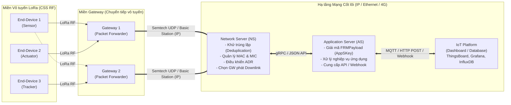
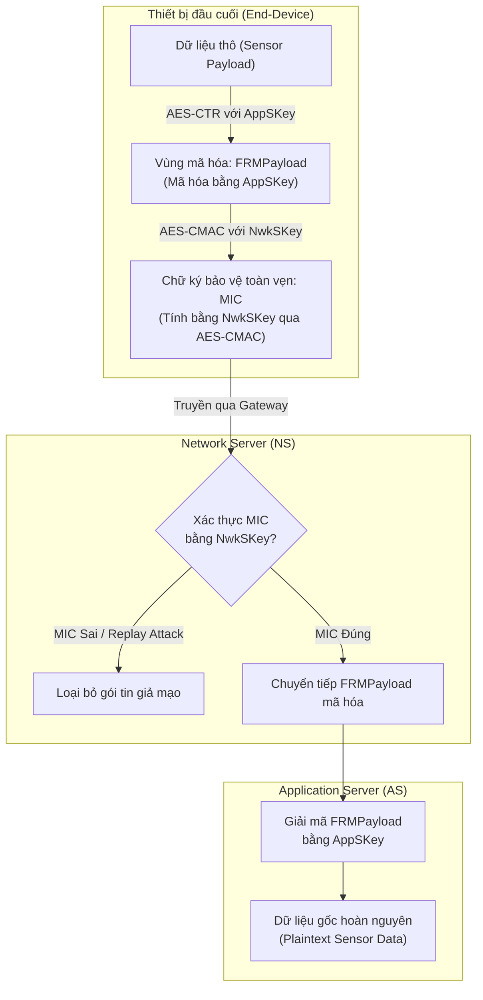
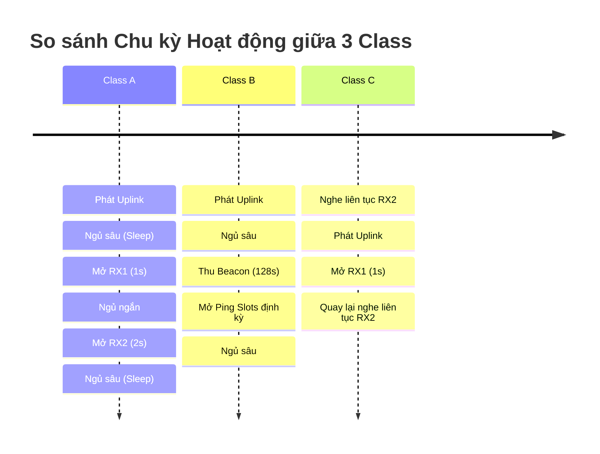
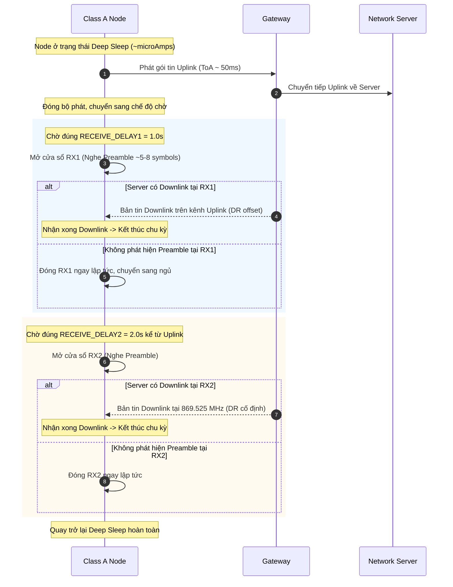
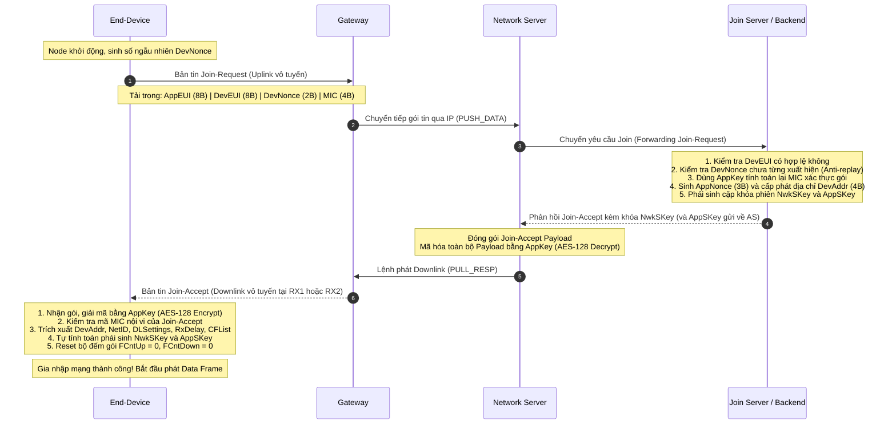
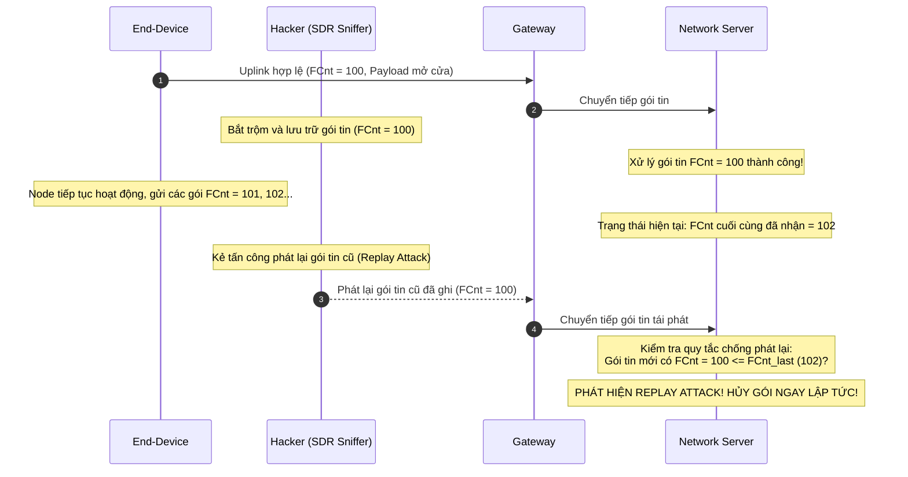
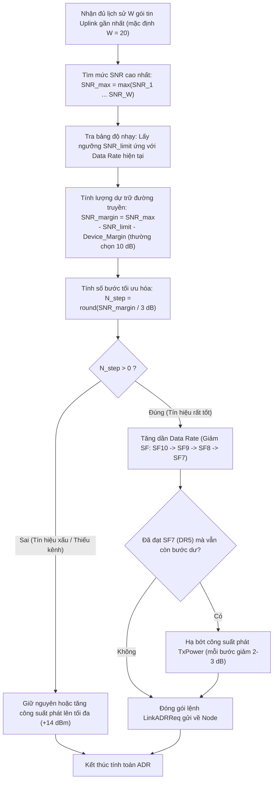
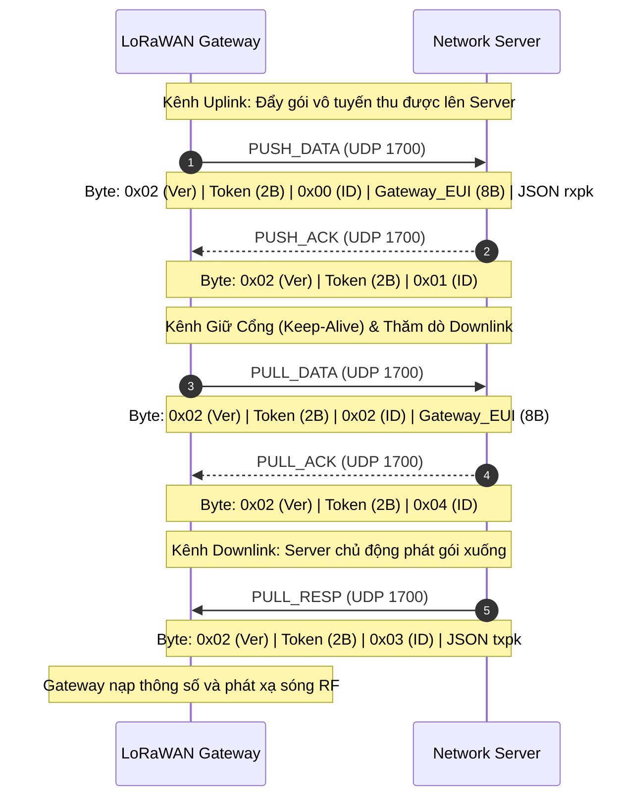

# MODULE 2: GIAO THỨC LORAWAN LÕI & GIẢI PHẪU KHUNG TRUYỀN (MAC LAYER)

> **THÔNG TIN ĐIỀU PHỐI HỌC TẬP (MODULE METADATA)**
> - **Chương trình đào tạo:** Chuyên viên Kỹ thuật & Kỹ sư Thiết kế Hệ thống IoT/LoRaWAN Thực chiến.
> - **Nguồn tham chiếu giáo trình gốc:**
>   * *Book 1: LoRa, LoRaWAN and Internet of Things for beginners* (Đại học Savoie Mont Blanc - USMB): Chương 4 (*The LoRaWAN Protocol*, Trang 36 – 71) và Chương 6 (*The LoRa / LoRaWAN Frame*, Trang 78 – 91).
>   * *LoRaWAN Link Layer Specification v1.0.4 & v1.1* (LoRa Alliance).
>   * *LoRaWAN Regional Parameters RP002-1.0.3 / RP002-1.0.4*.
> - **Thời lượng khuyến nghị:** 12 giờ lý thuyết chuyên sâu + 8 giờ thực hành lab phân tích gói tin.
> - **Mục tiêu đầu ra cốt lõi (Learning Objectives):**
>   1. *Về kiến thức (Knowledge):* Nắm vững kiến trúc mạng 4 thành phần; bản chất cơ chế phân lớp Class A, B, C; quy trình kích hoạt ABP và bắt tay OTAA; hai tầng bảo mật AES-128; thuật toán tự thích ứng tốc độ dữ liệu ADR; tập lệnh MAC commands; và cơ chế phân phối gói tin qua Semtech UDP Packet Forwarder.
>   2. *Về kỹ năng thực chiến (Practical Skills):* Giải phẫu thành thạo khung truyền LoRaWAN (`PHYPayload`) mức bit/byte; bóc tách chính xác các trường header theo quy tắc thứ tự byte (Endianness); tự mã hóa/giải mã Base64 và phân tích log gói tin IP/JSON trên Gateway/Network Server; tính toán và phòng ngừa lỗi lệch Frame Counter (Replay Attack).

---

## 1. BẢNG THUẬT NGỮ TRỌNG TÂM CỦA MODULE (MODULE GLOSSARY)

Bảng thuật ngữ dưới đây kế thừa 100% chuẩn hóa từ Phase 1 và mở rộng chi tiết các tham số của Chương 4 & 6:

| Viết tắt / Thuật ngữ gốc (EN) | Tên đầy đủ (English Full Name) | Thuật ngữ Tiếng Việt chuẩn hóa | Giải thích bản chất kỹ thuật (Ngắn gọn, chính xác) |
| :--- | :--- | :--- | :--- |
| **ABP** | Activation By Personalization | Kích hoạt bằng cá nhân hóa tĩnh | Phương thức kết nối mạng bằng cách nạp trực tiếp địa chỉ mạng `DevAddr` và các khóa phiên `NwkSKey`, `AppSKey` cố định vào thiết bị trước khi vận hành. |
| **ADR** | Adaptive Data Rate | Tự thích ứng tốc độ dữ liệu | Giải thuật quản lý tài nguyên vô tuyến thông minh: Network Server tự động chỉ đạo Node tăng Data Rate và giảm công suất phát khi tín hiệu thu được ở mức tốt. |
| **ADRAckReq** | ADR Acknowledgment Request | Cờ yêu cầu kiểm tra liên lạc ADR | Bit thứ 6 trong byte `FCtrl` của khung Uplink; Node bật bit này khi không nhận được Downlink sau $N$ gói để kiểm tra kết nối với Network Server. |
| **AFCnt** | Application Frame Counter | Bộ đếm khung phiên ứng dụng | Bộ đếm gói tin tầng ứng dụng tăng dần trong chuẩn LoRaWAN 1.1, dùng riêng cho cổng `FPort > 0` nhằm chống tấn công phát lại. |
| **AppEUI / JoinEUI** | Application / Join Extended Unique Identifier | Mã định danh dịch vụ Join toàn cầu | Chuỗi định danh toàn cầu 64-bit duy nhất của máy chủ kích hoạt theo chuẩn IEEE EUI-64 (chuẩn 1.0.x dùng tên `AppEUI`, chuẩn 1.0.4/1.1 đổi thành `JoinEUI`). |
| **AppKey** | Application Key | Khóa gốc ứng dụng bí mật | Khóa mật mã AES-128 bí mật duy nhất của thiết bị dùng trong thủ tục OTAA để phái sinh ra các khóa phiên làm việc an toàn. |
| **AppNonce / JoinNonce** | Application / Join Nonce | Giá trị ngẫu nhiên từ Join Server | Giá trị số tăng dần 24-bit do máy chủ Join phát sinh và đóng gói vào bản tin `Join-Accept`, được Node dùng để phái sinh ra bộ khóa phiên làm việc. |
| **AppSKey** | Application Session Key | Khóa phiên ứng dụng | Khóa mật mã AES-128 được tạo động sau khi Join thành công, dùng để mã hóa đầu-cuối vùng tải trọng dữ liệu người dùng (`FRMPayload`) giữa Node và AS. |
| **CFList** | Channel Frequency List | Danh sách tần số kênh tùy chọn | Mảng dữ liệu 16-byte tùy chọn gửi kèm trong bản tin `Join-Accept` để khai báo thêm 5 kênh tần số mở rộng cho thiết bị ở khu vực EU868. |
| **CID** | Command IDentifier (MAC Command) | Mã định danh lệnh MAC | Byte đầu tiên trong cấu trúc bản tin lệnh MAC dùng để nhận diện loại yêu cầu quản trị mạng (như `LinkADRReq`, `DevStatusReq`). |
| **Class A** | Class A (Baseline LoRaWAN) | Lớp hoạt động cơ bản tiết kiệm điện | Chế độ mặc định bắt buộc: Thiết bị chỉ mở 2 cửa sổ nhận ngắn hạn (`RX1`, `RX2`) ngay sau khi phát một bản tin Uplink; tiêu thụ điện năng thấp nhất. |
| **Class B** | Class B (Beacon Synced) | Lớp hoạt động đồng bộ khe nhận | Thiết bị định kỳ mở các khe thu Downlink (`Ping Slots`) được đồng bộ thời gian chính xác qua các gói tin `Beacon` phát từ Gateway. |
| **Class C** | Class C (Continuous Listening) | Lớp hoạt động nhận liên tục | Thiết bị liên tục duy trì trạng thái thu ở cửa sổ `RX2` trừ những lúc đang phát sóng; độ trễ Downlink tức thì nhưng tiêu thụ năng lượng cao. |
| **DevAddr** | Device Address | Địa chỉ mạng thiết bị | Địa chỉ mạng 32-bit gán cho thiết bị trong phiên liên lạc LoRaWAN, gồm tiền tố mạng (NwkID) và địa chỉ thiết bị mạng (NwkAddr), dùng để định tuyến gói tin trên tầng mạng của Network Server. |
| **DevEUI** | Device Extended Unique Identifier | Mã định danh duy nhất thiết bị | Chuỗi định danh phần cứng toàn cầu 64-bit duy nhất của thiết bị theo chuẩn IEEE EUI-64, tương đương địa chỉ MAC của card mạng. |
| **DevNonce** | Device Nonce | Giá trị ngẫu nhiên / đếm của thiết bị | Số nguyên 16-bit duy nhất do thiết bị sinh ra (tăng dần tuần tự từ chuẩn 1.0.4) đưa vào bản tin `Join-Request` để chống tấn công phát lại thủ tục gia nhập. |
| **DLSettings** | Downlink Settings | Byte cấu hình đường truyền xuống | Byte cấu hình trong bản tin `Join-Accept` quy định độ lệch tốc độ `RX1DROffset` và tốc độ cửa sổ thứ hai `RX2DataRate`. |
| **FCnt** | Frame Counter | Bộ đếm số thứ tự khung truyền | Bộ đếm số gói tin tăng dần tuần tự (`FCntUp` cho Uplink, `FCntDown` cho Downlink), dùng để đồng bộ trạng thái và ngăn chặn tấn công phát lại. |
| **FCtrl** | Frame Control | Byte điều khiển khung truyền MAC | Trường 1-byte trong `FHDR` chứa các cờ trạng thái điều khiển mạng: `ADR`, `ADRAckReq`, `ACK`, `FPending`, và `FOptsLen`. |
| **FHDR** | Frame Header | Tiêu đề khung truyền MAC | Vùng tiêu đề 7 đến 22 byte trong khung LoRaWAN chứa địa chỉ `DevAddr`, cờ điều khiển `FCtrl`, bộ đếm `FCnt` và các tùy chọn lệnh `FOpts`. |
| **FOpts** | Frame Options | Vùng tham số tùy chọn lệnh MAC | Vùng dữ liệu 0 đến 15 byte nằm trong `FHDR`, dùng để ghép (piggyback) các lệnh MAC command vào gói tin mang dữ liệu ứng dụng. |
| **FOptsLen** | Frame Options Length | Độ dài vùng tùy chọn lệnh MAC | 4 bit trọng số thấp của byte `FCtrl`, chỉ định độ dài thực tế của trường `FOpts` (từ 0 đến 15 byte). |
| **FPort** | Frame Port | Cổng phân loại luồng dữ liệu | Trường dữ liệu 1-byte phân định loại nội dung: `FPort = 0` dành riêng cho MAC Commands mã hóa; `FPort = 1..223` dành cho ứng dụng người dùng; `224..255` dành cho kiểm thử và gói chuẩn hóa. |
| **FPending** | Frame Pending | Cờ báo hiệu còn dữ liệu chờ | Bit thứ 4 trong byte `FCtrl` của khung Downlink; Network Server bật bit này để báo cho Class A node biết server còn dữ liệu Downlink đang chờ trong hàng đợi. |
| **FRMPayload** | Frame Payload | Vùng tải trọng dữ liệu khung MAC | Vùng dữ liệu hữu ích của khung MAC, được mã hóa đối xứng AES-128 bằng `AppSKey` (nếu `FPort > 0`) hoặc `NwkSKey` (nếu `FPort = 0`). |
| **LinkADRReq / Ans** | Link Adaptive Data Rate Request / Answer | Lệnh yêu cầu / phản hồi cấu hình ADR | Cặp lệnh MAC (`CID = 0x03`) cho phép Network Server điều chỉnh Data Rate, công suất phát TxPower, số lần phát lặp NbTrans và Channel Mask của Node. |
| **MHDR** | MAC Header | Tiêu đề tầng MAC | Byte đầu tiên của khung `PHYPayload`, quy định loại bản tin `MType` (3 bit) và phiên bản tiêu chuẩn LoRaWAN (Major - 2 bit). |
| **MIC** | Message Integrity Control | Mã kiểm tra tính toàn vẹn bản tin | Trường mã mật mã học 4-byte đính kèm cuối gói tin tính bằng giải thuật AES-CMAC kết hợp với `NwkSKey`, dùng để xác thực gói tin không bị giả mạo. |
| **MType** | Message Type | Kiểu bản tin MAC | 3 bit đầu tiên của `MHDR` chỉ định loại khung: Join-Request, Join-Accept, Unconfirmed Data Up/Down, Confirmed Data Up/Down, Rejoin-Request, Proprietary. |
| **NFCnt** | Network Frame Counter | Bộ đếm khung phiên mạng | Bộ đếm gói tin tầng mạng tăng dần trong chuẩn LoRaWAN 1.1, dùng riêng cho cổng quản trị mạng `FPort = 0` và MAC commands. |
| **NetID** | Network Identifier | Mã định danh mạng LoRaWAN | Chuỗi định danh mạng 24-bit do LoRa Alliance cấp phát, 7 bit trọng số thấp nhất được nhúng vào địa chỉ `DevAddr` để phân biệt nhà mạng. |
| **NwkSKey** | Network Session Key | Khóa phiên quản trị mạng | Khóa mật mã AES-128 dùng để tính toán và thẩm định mã xác thực toàn vẹn `MIC`, cũng như mã hóa các lệnh MAC trao đổi giữa Node và NS. |
| **OTAA** | Over The Air Activation | Kích hoạt mạng qua vô tuyến | Quy trình bắt tay 2 bước an toàn cao giữa Node và Network Server bằng cặp bản tin `Join-Request` và `Join-Accept` để sinh động các khóa phiên. |
| **PHYPayload** | Physical Payload | Tải trọng tầng vật lý LoRaWAN | Toàn bộ chuỗi byte dữ liệu mà modem LoRa truyền qua không gian, cấu trúc gồm: `MHDR (1B) + MACPayload (FHDR + FPort + FRMPayload) + MIC (4B)`. |
| **Piggybacking** | Piggybacking Mechanism | Cơ chế cõng gói / ghép lệnh | Kỹ thuật tận dụng gói tin dữ liệu người dùng để ghép thêm cờ phản hồi (ACK), thông báo trạng thái, hoặc lệnh MAC (`FOpts`) nhằm tiết kiệm năng lượng. |
| **PULL_DATA / ACK** | Pull Data / Pull Acknowledgment | Gói tin thăm dò / xác nhận giữ cổng | Cặp bản tin UDP định kỳ giữa Gateway và Server nhằm duy trì bảng định tuyến NAT (UDP Hole Punching) phục vụ gửi Downlink. |
| **PUSH_DATA / ACK** | Push Data / Push Acknowledgment | Gói tin đẩy dữ liệu / xác nhận Uplink | Cặp bản tin UDP dùng trong Semtech Packet Forwarder để Gateway chuyển tiếp khung vô tuyến thu được lên Network Server. |
| **Replay Attack** | Replay Attack | Tấn công phát lại gói tin | Hình thức tấn công mạng thu trộm gói tin vô tuyến hợp lệ trong quá khứ và phát lại nguyên vẹn nhằm đánh lừa hệ thống server. |
| **RxDelay** | Receive Delay | Thời gian trễ mở cửa sổ thu | Khoảng thời gian từ khi Node phát xong Uplink đến khi mở cửa sổ `RX1` (mặc định 1 giây, cấu hình qua Join-Accept hoặc lệnh MAC). |
| **RXParamSetupReq / Ans** | Receive Parameter Setup Request / Answer | Lệnh cấu hình tham số cửa sổ thu | Cặp lệnh MAC (`CID = 0x05`) cho phép Network Server thay đổi tần số và Data Rate của cửa sổ nhận thứ hai (`RX2`), và độ dịch `RX1DROffset`. |

---

## 2. NỘI DUNG LÝ THUYẾT CỐT LÕI & GIẢI PHẪU KỸ THUẬT (CORE TECHNICAL KNOWLEDGE)

### 2.1. Kiến trúc mạng LoRaWAN 4 thành phần & Hai tầng bảo mật AES-128

Kiến trúc mạng LoRaWAN tiêu chuẩn gồm 4 thực thể cốt lõi tạo thành mô hình hình sao mở rộng (Star-of-Stars Topology):



#### Nhiệm vụ và ranh giới kỹ thuật của 4 thành phần:
1. **Thiết bị đầu cuối (End-Device / Node):**
   - Thu thập tín hiệu cảm biến hoặc nhận lệnh điều khiển.
   - Quản lý ngăn xếp giao thức LoRaWAN MAC (Class A/B/C).
   - Lưu trữ an toàn các mã nhận dạng (`DevEUI`, `AppEUI`/`JoinEUI`) và các khóa mật mã (`AppKey`, `NwkSKey`, `AppSKey`).
   - Mã hóa dữ liệu người dùng bằng thuật toán AES-128 và tính toán chữ ký số bảo vệ toàn vẹn `MIC`.

2. **Bộ thu phát chuyển tiếp vô tuyến (LoRaWAN Gateway):**
   - Đóng vai trò là **Bộ chuyển tiếp trong suốt (Transparent Packet Forwarder)** trên tầng vật lý (PHY).
   - Chipset đa kênh (Semtech SX1301/SX1302/SX1308) cho phép lắng nghe đồng thời trên 8 đến 16 kênh tần số với các hệ số trải phổ khác nhau (SF7 đến SF12).
   - **Tính chất kỹ thuật cốt lõi:** Gateway **hoàn toàn không giải mã hoặc can thiệp vào dữ liệu LoRaWAN**. Gateway chỉ nhận các ký hiệu vô tuyến RF, kiểm tra CRC tầng PHY, giải mã thành chuỗi byte nhị phân, đóng gói chuỗi này vào định dạng IP/JSON (hoặc Protobuf trong Basic Station) kèm thông số vô tuyến (RSSI, SNR, Timestamp, Frequency, SF, BW) và đẩy về Network Server qua kết nối Internet có dây hoặc di động.

3. **Máy chủ quản trị mạng (Network Server - NS):**
   - Được ví như "bộ não" trung tâm của mạng LoRaWAN.
   - **Khử trùng lặp gói tin (Packet Deduplication):** Vì một khung vô tuyến của Node có thể được nhiều Gateway xung quanh đồng thời bắt được và chuyển tiếp về, NS sẽ so sánh `DevAddr` và `FCnt` để loại bỏ các gói tin trùng lặp, chỉ giữ lại một bản ghi có chỉ số SNR/RSSI tốt nhất.
   - **Xác thực toàn vẹn & Bảo vệ phiên mạng:** Sử dụng khóa `NwkSKey` để tính toán lại mã `MIC`. Nếu mã `MIC` không khớp, gói tin bị loại bỏ ngay tại tầng mạng trước khi có thể chạm tới máy chủ ứng dụng.
   - **Quản lý tài nguyên vô tuyến & Lệnh MAC:** Giám sát chất lượng kênh truyền của từng Node để chạy thuật toán ADR (Adaptive Data Rate), sinh các lệnh MAC Commands (`LinkADRReq`, `DevStatusReq`, `RXParamSetupReq`) và điều phối cửa sổ nhận `RX1`/`RX2`.
   - **Lựa chọn Gateway tối ưu cho Downlink:** Dựa trên số liệu RSSI và SNR tốt nhất từ các Gateway bắt được Uplink, NS chỉ định đúng Gateway đó phát bản tin phản hồi Downlink cho Node.

4. **Máy chủ xử lý ứng dụng (Application Server - AS):**
   - Nắm giữ khóa phiên ứng dụng `AppSKey`.
   - Tiếp nhận phần tải trọng đã được xác thực an toàn từ NS, giải mã trường `FRMPayload` từ chuỗi mã hóa đối xứng AES-128 Counter Mode thành dữ liệu gốc (Plaintext).
   - Thực thi các bộ giải mã dữ liệu (Payload Codecs / JavaScript Decoders) để biến đổi chuỗi byte thô thành định dạng JSON có nghĩa (Ví dụ: `{"temperature": 25.4, "humidity": 68.2}`).
   - Phân phối dữ liệu đã xử lý sang các nền tảng IoT (IoT Platforms) qua các giao thức chuẩn như MQTT, HTTP Webhook, gRPC, hoặc WebSocket.

---

#### Hai tầng bảo mật độc lập trong LoRaWAN:
LoRaWAN thiết lập mô hình an ninh hai lớp (Two-layer Security Architecture) sử dụng thuật toán mã hóa khối tiêu chuẩn **AES-128**:



1. **Tầng Mạng (Network Layer Security):**
   - Sử dụng khóa `NwkSKey` (128 bit).
   - Đảm bảo tính xác thực nguồn gốc (Authenticity) và tính toàn vẹn (Integrity) của toàn bộ gói tin từ Node tới Network Server.
   - Thuật toán áp dụng: **AES-CMAC** (RFC 4493) tính toán trên chuỗi khối $B_0$ và toàn bộ khung truyền MAC để tạo ra mã kiểm tra tính toàn vẹn 4-byte `MIC` (Message Integrity Control).
   - Mã hóa các lệnh quản trị mạng MAC Commands truyền trên cổng `FPort = 0`.
   - **Ý nghĩa thực tế:** Nhà khai thác mạng (Network Operator / Network Server) chỉ đóng vai trò vận chuyển và xác thực đường truyền, hoàn toàn **không thể đọc được nội dung dữ liệu kinh doanh của người dùng**.

2. **Tầng Ứng dụng (Application Layer Security):**
   - Sử dụng khóa `AppSKey` (128 bit).
   - Đảm bảo tính bảo mật đầu-cuối (End-to-End Confidentiality) giữa Node và Application Server.
   - Thuật toán áp dụng: **AES-128 Counter Mode (CTR)** mã hóa trực tiếp trường `FRMPayload`.
   - **Ý nghĩa thực tế:** Dữ liệu cảm biến được bảo mật tuyệt đối trước mọi thực thể trung gian (bao gồm cả Hacker bắt gói trên sóng, Gateway, và chính nhà mạng vận hành Network Server).

---

### 2.2. Phân loại 3 Lớp hoạt động (End-device Classes A, B, C) & Cửa sổ thu RX1/RX2

Tiêu chuẩn LoRaWAN phân loại thiết bị đầu cuối thành 3 lớp hoạt động (Classes) nhằm cân bằng giữa nhu cầu trễ nhận bản tin Downlink và mức tiêu thụ năng lượng của viên pin:



#### 1. Class A (All - Bắt buộc trên 100% thiết bị):
- **Cơ chế hoạt động:** Hoạt động hoàn toàn bất đồng bộ dựa trên biến thể của giải thuật Pure ALOHA. Node chỉ thức dậy phát Uplink khi có sự kiện (cảm biến đo xong hoặc định kỳ hẹn giờ), sau đó mở chính xác hai cửa sổ nhận Downlink ngắn hạn:
  * **Cửa sổ RX1:** Mở sau thời điểm phát xong Uplink đúng $1.0\text{ s}$ (`RECEIVE_DELAY1`). Tần số nhận trùng với tần số của kênh Uplink vừa phát. Tốc độ dữ liệu (Data Rate) là hàm phụ thuộc vào Data Rate phát của Uplink và giá trị cấu hình `RX1DROffset` (mặc định Offset = 0, tức cùng DR với Uplink).
  * **Cửa sổ RX2:** Mở sau thời điểm phát xong Uplink đúng $2.0\text{ s}$ (`RECEIVE_DELAY2`). Tần số và Data Rate của RX2 được cố định theo cấu hình hệ thống (Tại châu Âu EU868, mặc định là tần số $869.525\text{ MHz}$ với $\text{DR0} = \text{SF12} / 125\text{ kHz}$ hoặc $\text{DR3} = \text{SF9} / 125\text{ kHz}$ theo quy định mạng).



- **Quy tắc vàng (Golden Rule):** Server **hoàn toàn không thể chủ động khởi tạo một bản tin Downlink cho thiết bị Class A** tại bất kỳ thời điểm tùy ý nào. Mọi gói Downlink gửi từ Server bắt buộc phải nằm trong hàng đợi (Queue) và chỉ có thể được truyền xuống thông qua cửa sổ `RX1` hoặc `RX2` ngay sau khi thiết bị chủ động gửi một gói tin Uplink.
- **Tiêu thụ năng lượng:** Thấp nhất. Thời gian bật bộ thu phát chỉ chiếm chưa tới 1% tổng chu kỳ sống, giúp pin hoạt động từ 5 đến 10 năm.

#### 2. Class B (Beacon - Đồng bộ khe nhận định kỳ):
- **Cơ chế hoạt động:** Thiết bị Class B mở rộng từ Class A bằng cách mở thêm các khe nhận Downlink định kỳ gọi là **Ping Slots** mà không cần phải phát Uplink trước.
- **Đồng bộ thời gian bằng Beacon:** Để thiết bị và Server biết chính xác thời điểm mở Ping Slot mà không bị trôi lệch xung nhịp (Clock Drift), tất cả các Gateway trong mạng định kỳ mỗi $128\text{ s}$ sẽ đồng loạt phát một bản tin đặc biệt gọi là **Beacon** được căn chỉnh chính xác theo đồng hồ nguyên tử GPS.
- **Cấu trúc chu kỳ Class B:** Một chu kỳ Beacon ($128\text{ s}$) được chia thành $4096$ khe thời gian nhỏ (mỗi khe kéo dài $30\text{ ms}$). Thiết bị được cấu hình mở $2^k$ Ping Slots trong mỗi chu kỳ (với $k \in [0..7]$). Vị trí chính xác của từng Ping Slot được tính toán thông qua một hàm băm giả ngẫu nhiên dựa trên địa chỉ `DevAddr` và thời gian Beacon để phân tán tải truyền sóng.
- **Tiêu thụ năng lượng:** Trung bình. Node phải thức dậy định kỳ để nghe Beacon và các Ping Slots, tiêu thụ năng lượng cao hơn Class A khoảng 2 đến 5 lần.

#### 3. Class C (Continuous - Lắng nghe liên tục):
- **Cơ chế hoạt động:** Thiết bị Class C duy trì bộ thu sóng vô tuyến mở liên tục ở cấu hình kênh của cửa sổ `RX2` trong suốt toàn bộ thời gian vận hành, ngoại trừ những khoảng thời gian ngắn mà nó phải chuyển sang chế độ phát Uplink.
- **Đặc tính trễ Downlink:** Gần như tức thì (Zero-latency Downlink). Network Server có thể ra lệnh cho Gateway phát bản tin Downlink tới Node Class C tại bất kỳ thời điểm nào mà không cần chờ đợi Uplink.
- **Xử lý cửa sổ thu sau khi phát Uplink:** Sau khi phát xong một khung Uplink, Node Class C sẽ:
  * Tiếp tục lắng nghe trên kênh RX2 cho đến khi chạm mốc $t_0 + 1.0\text{ s}$.
  * Chuyển sang cấu hình kênh `RX1` trong thời gian ngắn để đón gói Downlink ưu tiên từ NS.
  * Ngay sau khi kết thúc cửa sổ RX1, nó lập tức quay trở lại lắng nghe liên tục trên cấu hình `RX2`.
- **Tiêu thụ năng lượng:** Cực cao. Dòng tiêu thụ liên tục của bộ thu RF dao động từ $10\text{ mA}$ đến $15\text{ mA}$. Do đó, Class C **bắt buộc phải sử dụng nguồn điện lưới AC trực tiếp hoặc nguồn ắc-quy công suất lớn có sạc năng lượng mặt trời**, tuyệt đối không dùng pin cúc áo hoặc pin khô dung lượng nhỏ.

#### 4. Bảng đối chiếu tổng hợp 3 Class:

| Tiêu chí kỹ thuật | Class A (All) | Class B (Beacon) | Class C (Continuous) |
| :--- | :--- | :--- | :--- |
| **Độ trễ Downlink (Latency)** | Lớn (Phụ thuộc hoàn toàn vào chu kỳ phát Uplink kế tiếp) | Trung bình (Tùy cấu hình chu kỳ Ping Slot: 1s đến 128s) | Cực nhỏ (Nhận tức thì theo thời gian thực) |
| **Mức tiêu thụ dòng điện** | Cực thấp ($\sim 1 - 5\ \mu\text{A}$ ở chế độ Deep Sleep) | Thấp đến trung bình ($\sim 20 - 50\ \mu\text{A}$ trung bình) | Rất cao ($\sim 10 - 15\ \text{mA}$ liên tục) |
| **Nguồn cấp khuyến nghị** | Pin Lithium (LiSOCl2, LiMnO2) hoạt động 5–10 năm | Pin dung lượng lớn hoặc pin có sạc | Nguồn điện lưới AC, Adapter DC, Solar panel lớn |
| **Ứng dụng tiêu biểu** | Đồng hồ nước/gas, đo độ ẩm đất nông nghiệp, báo cháy | Van điều khiển nước thông minh, hệ thống chiếu sáng công cộng | Đèn đường thông minh, trạm biến áp, cơ cấu chấp hành tức thì |

---

### 2.3. Hai cơ chế kích hoạt thiết bị: ABP vs. OTAA & Phái sinh khóa phiên

Để tham gia vào mạng LoRaWAN và trao đổi dữ liệu an toàn, thiết bị phải được kích hoạt thông qua một trong hai phương thức: **ABP (Activation By Personalization)** hoặc **OTAA (Over-The-Air Activation)**.

#### 1. Kích hoạt bằng Cá nhân hóa tĩnh (ABP):
- **Bản chất kỹ thuật:** Toàn bộ thông tin nhận dạng mạng và khóa mật mã được nạp cứng (Hardcoded / Pre-provisioned) trực tiếp vào mã nguồn firmware của thiết bị và khai báo thủ công trên Network Server trước khi triển khai:
  * `DevAddr` (32 bit): Địa chỉ mạng cố định của thiết bị.
  * `NwkSKey` (128 bit): Khóa phiên mạng tĩnh.
  * `AppSKey` (128 bit): Khóa phiên ứng dụng tĩnh.
- **Ưu điểm:** Cực kỳ đơn giản, không cần thực hiện thủ tục bắt tay gia nhập mạng, Node có thể phát ngay dữ liệu cảm biến ở gói tin đầu tiên.
- **Nhược điểm & Rủi ro bảo mật:**
  * Các khóa phiên không bao giờ thay đổi trong suốt vòng đời thiết bị. Nếu thiết bị bị trộm hoặc bị can thiệp phần cứng trích xuất khóa, toàn bộ dữ liệu lịch sử và tương lai đều bị giải mã.
  * Không thể tự động chuyển đổi sang mạng LoRaWAN khác nếu không nạp lại firmware.
  * Rất dễ bị lỗi khóa mạng do mất đồng bộ bộ đếm gói `FCnt` khi mất nguồn reset vi điều khiển.

#### 2. Kích hoạt qua Vô tuyến (OTAA - Chuẩn khuyến nghị công nghiệp):
- **Bản chất kỹ thuật:** Thiết bị chỉ lưu trữ sẵn các thông số định danh gốc và khóa chủ bí mật:
  * `DevEUI` (64 bit): Mã định danh phần cứng toàn cầu của thiết bị (duy nhất).
  * `AppEUI` / `JoinEUI` (64 bit): Mã định danh dịch vụ Join Server toàn cầu.
  * `AppKey` (128 bit): Khóa chủ bí mật của thiết bị (Master Root Key).
- **Quy trình bắt tay 2 bước chi tiết (Handshake Sequence):**



#### Thuật toán phái sinh khóa phiên (Key Derivation Function) trong OTAA:
Cả Node và Join Server đều độc lập áp dụng thuật toán mã hóa khối chuẩn **AES-128** trên các chuỗi dữ liệu định dạng đặc biệt có kích thước 16 byte (128 bit) để sinh ra hai khóa phiên làm việc:

$$\text{NwkSKey} = \text{AES-128}_{\text{Encrypt}}\left(\text{AppKey},\ 0x01 \mid \text{AppNonce} \mid \text{NetID} \mid \text{DevNonce} \mid \text{Pad}_{16}\right)$$

$$\text{AppSKey} = \text{AES-128}_{\text{Encrypt}}\left(\text{AppKey},\ 0x02 \mid \text{AppNonce} \mid \text{NetID} \mid \text{DevNonce} \mid \text{Pad}_{16}\right)$$

*Trong đó:*
- `0x01` và `0x02`: Byte hằng số phân biệt loại khóa cần phái sinh (1 byte).
- `AppNonce` (hoặc `JoinNonce`): Số ngẫu nhiên hoặc số đếm do Server sinh ra (3 byte).
- `NetID`: Mã định danh mạng LoRaWAN gồm 3 byte.
- `DevNonce`: Số ngẫu nhiên hoặc bộ đếm do thiết bị sinh ra (2 byte).
- $\text{Pad}_{16}$: Chuỗi 7 byte `0x00` đệm vào đuôi để khối dữ liệu đủ chính xác 16 byte chuẩn khối AES.

> [!NOTE]
> **Đặc tính an ninh vượt trội của OTAA:**  
> Mỗi lần thực hiện lại thủ tục Join thành công, một bộ khóa phiên hoàn toàn mới (`NwkSKey`, `AppSKey`) được sinh ra và bộ đếm `FCnt` được reset về 0 một cách đồng bộ và an toàn. Khóa bí mật gốc `AppKey` không bao giờ được truyền trực tiếp trên sóng vô tuyến, triệt tiêu nguy cơ bị bắt trộm khóa qua môi trường truyền thông.

---

### 2.4. Cơ chế chống tấn công phát lại (Replay Attack) & Xử lý Frame Counter (FCnt)

#### 1. Kịch bản Tấn công Phát lại (Replay Attack Scenario):
Một kẻ tấn công (Hacker) sử dụng thiết bị thu sóng vô tuyến (như SDR - Software Defined Radio) đặt gần tòa nhà để ghi lại (Eavesdrop & Record) toàn bộ gói tin phát đi từ một cảm biến mở cửa hoặc công tơ điện thông minh. Dù không biết khóa bí mật để giải mã nội dung, vài ngày sau kẻ tấn công phát lại (Re-transmit) nguyên văn gói tin đó lên không gian. Nếu hệ thống mạng không có cơ chế kiểm tra tính mới, Network Server sẽ tưởng rằng đây là gói tin hợp lệ và thực hiện thao tác mở cửa trái phép.



#### 2. Cơ chế Bộ đếm Khung (Frame Counter - FCnt):
Để chống lại hình thức tấn công này, tiêu chuẩn LoRaWAN quy định trong mỗi tiêu đề khung MAC (`FHDR`) bắt buộc phải có một trường số nguyên gọi là **Frame Counter (FCnt)**:
- `FCntUp`: Bộ đếm dành riêng cho các bản tin đường lên (Uplink), do thiết bị duy trì và tăng dần 1 đơn vị sau mỗi lần phát.
- `FCntDown` (hoặc `NFCntDown` / `AFCntDown` trong LoRaWAN 1.1): Bộ đếm dành riêng cho các bản tin đường xuống (Downlink), do Network Server duy trì và tăng dần sau mỗi lần gửi tin về Node.

**Quy tắc kiểm tra bất biến trên Network Server:**
Khi nhận được một bản tin Uplink từ một thiết bị, Network Server chỉ chấp nhận gói tin đó nếu và chỉ nếu:

$$\text{FCnt}_{\text{received}} > \text{FCnt}_{\text{last-valid}}$$

Nếu $\text{FCnt}_{\text{received}} \le \text{FCnt}_{\text{last-valid}}$, Network Server sẽ **lập tức hủy bỏ gói tin trong im lặng (Silently Drop)** mà không chuyển tiếp lên Application Server.

Nếu kẻ tấn công cố tình sửa đổi giá trị `FCnt` trong gói tin thành một số lớn hơn (Ví dụ sửa từ 100 thành 200), mã toàn vẹn `MIC` ở cuối gói tin sẽ lập tức bị sai lệch (vì giá trị `FCnt` tham gia trực tiếp vào khối tính toán AES-CMAC của MIC). Kết quả là gói tin vẫn bị loại bỏ vì lỗi xác thực tính toàn vẹn (Integrity Failure).

#### 3. Bẫy kỹ thuật "Treo gói tin" trên thiết bị ABP khi mất nguồn:
- **Nguyên nhân:** Trên các thiết bị sử dụng phương thức kích hoạt ABP, nếu lập trình viên lưu trữ biến đếm `FCntUp` trong bộ nhớ RAM tạm thời của vi điều khiển, khi thiết bị bị cúp điện, sụt áp hoặc khởi động lại (Reset/Reboot), biến `FCntUp` trên Node sẽ quay trở về giá trị ban đầu là `0`.
- **Hệ quả:** Trong khi đó, Network Server vẫn đang ghi nhớ giá trị `FCnt` lớn cuối cùng mà nó đã nhận trước khi node bị reset (ví dụ: `FCnt = 2450`). Do đó, Node phát các gói tin mới với $\text{FCnt} = 0, 1, 2, \dots$ đều bị Server từ chối tiếp nhận vì vi phạm điều kiện $\text{FCnt} > 2450$. Thiết bị hoàn toàn mất liên lạc với mạng cho đến khi nó phát vượt qua con số 2450 gói!
- **Giải pháp xử lý:**
  1. *Lưu trữ bộ đếm vào bộ nhớ bất biến (NVRAM / Flash / EEPROM):* Định kỳ sau mỗi $N$ gói tin, ghi nhận giá trị `FCnt` hiện tại vào Flash để phục hồi sau khi reset.
  2. *Chuyển đổi sang phương thức OTAA:* Mỗi lần reset, kích hoạt thủ tục `Join-Request` để đồng bộ lại phiên làm việc mới từ $\text{FCnt} = 0$.

---

### 2.5. Cơ chế Tự thích ứng Tốc độ truyền (ADR) & Quản lý Kênh tần số (EU868)

#### 1. Bản chất và Mục tiêu của Giải thuật ADR (Adaptive Data Rate):
Trong mạng LoRaWAN, khoảng cách từ các cảm biến đến Gateway là rất khác nhau: có thiết bị nằm cách trạm thu phát chỉ vài chục mét, nhưng cũng có thiết bị nằm cách xa hàng chục kilômét. Nếu tất cả các thiết bị đều phát ở mức cấu hình cao nhất ($\text{SF12}$, công suất cực đại $+14\text{ dBm}$), hệ thống sẽ gặp các tổn thất nghiêm trọng:
- Thời gian chiếm dụng kênh (Time on Air - ToA) quá lớn, dẫn đến nguy cơ xung đột gói tin (Collision) tăng vọt.
- Thiết bị tiêu tốn dung lượng pin không cần thiết.
- Tự gây nhiễu nghẽn phổ vô tuyến cục bộ.

**Giải pháp:** LoRaWAN cung cấp cơ chế **Tự thích ứng Tốc độ dữ liệu (ADR)**. Khi ADR được kích hoạt, Network Server sẽ liên tục theo dõi chất lượng tín hiệu vô tuyến của thiết bị để điều khiển thiết bị:
- **Tăng Data Rate (Giảm SF từ SF12 về SF7):** Rút ngắn ToA từ hàng giây xuống còn vài chục mili-giây, giảm tiêu thụ pin tới 90%.
- **Giảm công suất phát sóng (TxPower):** Hạ công suất từ $+14\text{ dBm}$ xuống các mức thấp hơn ($+11, +8, +5, +2\text{ dBm}$) khi thiết bị ở rất gần Gateway.



#### 2. Cơ chế Cõng lệnh (Piggybacking) & Dự phòng Mất liên lạc (ADR Fallback):
- **Cơ chế Cõng lệnh (Piggybacking):** Lệnh điều chỉnh `LinkADRReq` do Network Server sinh ra không phát thành một gói tin riêng rẽ mà được "cõng" (piggyback) vào trường `FOpts` hoặc `FRMPayload` của một bản tin Downlink thông thường. Thiết bị nhận được sẽ áp dụng cấu hình mới và phát bản tin Uplink tiếp theo kèm lệnh xác nhận `LinkADRAns`.
- **Cơ chế Dự phòng rớt mạng (ADR Fallback / ADRAckReq):**
  * Nếu thiết bị gửi tin một chiều không có ACK trong thời gian dài, làm sao nó biết mình đã bị trôi ra khỏi vùng phủ sóng hay cấu hình SF bị hạ quá thấp?
  * Tiêu chuẩn LoRaWAN định nghĩa biến đếm `ADR_ACK_CNT`: Sau mỗi gói Uplink mà không nhận được bất kỳ Downlink nào từ Server, biến này tăng thêm 1.
  * Khi `ADR_ACK_CNT >= ADR_ACK_LIMIT` (mặc định là 64 gói): Thiết bị bắt đầu bật cờ **`ADRAckReq = 1`** trong byte `FCtrl` của các gói Uplink tiếp theo để yêu cầu Server gửi Downlink xác nhận.
  * Thiết bị tiếp tục gửi và chờ thêm trong khoảng `ADR_ACK_DELAY` gói (mặc định là 32 gói).
  * Nếu sau $64 + 32 = 96$ gói mà Server vẫn hoàn toàn im lặng, thiết bị nhận định đường truyền đã suy giảm nghiêm trọng. Nó sẽ tự động kích hoạt quy trình tự giải cứu (Fallback): **Tự động tăng công suất phát lên mức tối đa**, nếu vẫn không có phản hồi thì **tăng dần hệ số trải phổ (SF) thêm 1 mức sau mỗi 32 gói** cho đến khi chạm mốc $\text{SF12}$ để tái lập kết nối.

> [!WARNING]
> **Quy tắc bắt buộc khi thiết kế:** ADR chỉ được phép kích hoạt cho các **thiết bị đặt cố định (Static / Stationary Nodes)**. Đối với các thiết bị di chuyển liên tục (Mobile Trackers / Xe cộ), vị trí thay đổi làm biến động kênh truyền cực nhanh; nếu bật ADR, thiết bị có thể bị Server hạ SF xuống quá thấp khi đi ngang qua một trạm và lập tức mất kết nối hoàn toàn khi di chuyển ra xa trạm đó!

#### 3. Bảng phân bổ Kênh tần số chuẩn tại châu Âu (EU868 Frequency Plan):
Theo quy định của LoRa Alliance, băng tần EU868 phân chia thành các kênh bắt buộc và các kênh mở rộng:

| Nhóm kênh | Tần số trung tâm (MHz) | Băng thông (BW) | Dải Data Rate hỗ trợ | Chiều truyền dẫn | Quy định Duty Cycle |
| :--- | :--- | :--- | :--- | :--- | :--- |
| **Kênh bắt buộc 1** | $868.100\text{ MHz}$ | $125\text{ kHz}$ | DR0 (SF12) đến DR5 (SF7) | Uplink / Downlink (RX1) | $1.0\%$ (Dải sub-band g1) |
| **Kênh bắt buộc 2** | $868.300\text{ MHz}$ | $125\text{ kHz}$ | DR0 (SF12) đến DR5 (SF7) | Uplink / Downlink (RX1) | $1.0\%$ (Dải sub-band g1) |
| **Kênh bắt buộc 3** | $868.500\text{ MHz}$ | $125\text{ kHz}$ | DR0 (SF12) đến DR5 (SF7) | Uplink / Downlink (RX1) | $1.0\%$ (Dải sub-band g1) |
| **Kênh mở rộng (CFList)** | $867.100\text{ MHz}$ | $125\text{ kHz}$ | DR0 (SF12) đến DR5 (SF7) | Uplink / Downlink (RX1) | $1.0\%$ (Dải sub-band g) |
| **Kênh mở rộng (CFList)** | $867.300\text{ MHz}$ | $125\text{ kHz}$ | DR0 (SF12) đến DR5 (SF7) | Uplink / Downlink (RX1) | $1.0\%$ (Dải sub-band g) |
| **Kênh mở rộng (CFList)** | $867.500\text{ MHz}$ | $125\text{ kHz}$ | DR0 (SF12) đến DR5 (SF7) | Uplink / Downlink (RX1) | $1.0\%$ (Dải sub-band g) |
| **Kênh mở rộng (CFList)** | $867.700\text{ MHz}$ | $125\text{ kHz}$ | DR0 (SF12) đến DR5 (SF7) | Uplink / Downlink (RX1) | $1.0\%$ (Dải sub-band g) |
| **Kênh mở rộng (CFList)** | $867.900\text{ MHz}$ | $125\text{ kHz}$ | DR0 (SF12) đến DR5 (SF7) | Uplink / Downlink (RX1) | $1.0\%$ (Dải sub-band g) |
| **Kênh mặc định RX2** | $869.525\text{ MHz}$ | $125\text{ kHz}$ | Cố định DR0 hoặc DR3 | Downlink duy nhất (RX2) | $10.0\%$ (Dải sub-band g3, công suất tối đa $+27\text{ dBm}$) |

---

### 2.6. Tập lệnh điều khiển tầng mạng (LoRaWAN MAC Commands)

Tập lệnh MAC Commands là công cụ để Network Server và Node trao đổi các thông điệp quản trị tham số vô tuyến. 

#### Vị trí truyền tải lệnh MAC:
Có hai cách để truyền một lệnh MAC Command trong gói tin LoRaWAN:
1. **Ghép trong tiêu đề (`FOpts` field):** Nằm trực tiếp trong vùng `FHDR`. Tổng độ dài tối đa là 15 byte. Gói tin vẫn có thể mang dữ liệu ứng dụng người dùng trên cổng `FPort > 0`.
2. **Truyền như một khối tải trọng độc lập (`FRMPayload` với `FPort = 0`):** Khi cần gửi chuỗi lệnh MAC dài vượt quá 15 byte, toàn bộ vùng tải trọng dữ liệu được dùng để chứa lệnh MAC. Trường `FPort` bắt buộc phải đặt bằng `0` và nội dung phải được mã hóa bằng khóa `NwkSKey` (hoặc `NwkSEncKey` trong chuẩn 1.1).

#### Bảng tổng hợp các lệnh MAC chuẩn (Trích xuất từ Bảng 15 Cuốn 1 - Nguồn LoRaWAN 1.0.4 Spec):

| CID | Tên Lệnh (Command) | Hướng truyền | Độ dài tham số | Chức năng kỹ thuật chi tiết |
| :---: | :--- | :---: | :---: | :--- |
| `0x02` | **LinkCheckReq** | Node $\rightarrow$ NS | 0 byte | Thiết bị yêu cầu kiểm tra chất lượng kết nối tới mạng. |
| `0x02` | **LinkCheckAns** | NS $\rightarrow$ Node | 2 byte | Trả lời chất lượng liên kết: `Margin` (mức dự trữ tín hiệu tính bằng dB trên ngưỡng giải điều chế) và `GwCnt` (số lượng trạm Gateway bắt được gói tin). |
| `0x03` | **LinkADRReq** | NS $\rightarrow$ Node | 4 byte | Yêu cầu Node điều chỉnh Data Rate, công suất phát TxPower, danh sách kênh cho phép phát (`ChMask`), và số lần phát lặp lại (`NbTrans`). |
| `0x03` | **LinkADRAns** | Node $\rightarrow$ NS | 1 byte | Phản hồi xác nhận lệnh ADR: Gồm 3 bit trạng thái (`Channel mask ACK`, `Data rate ACK`, `Power ACK`). Cấu hình chỉ có hiệu lực nếu cả 3 bit đều bật lên 1. |
| `0x04` | **DutyCycleReq** | NS $\rightarrow$ Node | 1 byte | Quy định giới hạn tổng thời gian phát tích lũy (Aggregated Duty Cycle) của thiết bị trên toàn dải sóng. |
| `0x04` | **DutyCycleAns** | Node $\rightarrow$ NS | 0 byte | Thiết bị xác nhận đã cấu hình xong Duty Cycle mới. |
| `0x05` | **RXParamSetupReq** | NS $\rightarrow$ Node | 4 byte | Cấu hình tham số cửa sổ thu: Gồm độ dịch tốc độ `RX1DROffset`, tốc độ dữ liệu `RX2DataRate`, và tần số kênh nhận của cửa sổ thứ hai `RX2`. |
| `0x05` | **RXParamSetupAns** | Node $\rightarrow$ NS | 1 byte | Phản hồi xác nhận trạng thái cấu hình tham số RX (Channel ACK, RX2 Data rate ACK, RX1DROffset ACK). |
| `0x06` | **DevStatusReq** | NS $\rightarrow$ Node | 0 byte | Yêu cầu thiết bị báo cáo trạng thái vận hành phần cứng và vô tuyến. |
| `0x06` | **DevStatusAns** | Node $\rightarrow$ NS | 2 byte | Trả về trạng thái phần cứng: Mức pin hiện tại (`Battery`: `0` = dùng nguồn ngoài, `1..254` = mức pin thực tế, `255` = không đo được) và độ dự trữ tín hiệu thu Downlink `Margin` (SNR). |
| `0x07` | **NewChannelReq** | NS $\rightarrow$ Node | 5 byte | Tạo mới hoặc sửa đổi định nghĩa một kênh vô tuyến (Chỉ số kênh `ChIndex`, Tần số trung tâm `Freq`, Dải Data Rate cho phép `DrRange`). |
| `0x07` | **NewChannelAns** | Node $\rightarrow$ NS | 1 byte | Xác nhận việc cài đặt kênh mới (Data rate range OK, Channel frequency OK). |
| `0x08` | **RXTimingSetupReq** | NS $\rightarrow$ Node | 1 byte | Cài đặt thời gian trễ mở cửa sổ nhận `RX1` (từ 1 giây đến 15 giây). Cửa sổ `RX2` tự động lùi về sau RX1 chính xác 1 giây. |
| `0x08` | **RXTimingSetupAns** | Node $\rightarrow$ NS | 0 byte | Thiết bị xác nhận đã thay đổi thời gian trễ mở cửa sổ nhận. |
| `0x09` | **TXParamSetupReq** | NS $\rightarrow$ Node | 1 byte | Cấu hình thời gian chiếm kênh tối đa (Dwell Time) và công suất bức xạ đẳng hướng cực đại (MaxEIRP) theo quy định địa phương. |
| `0x09` | **TXParamSetupAns** | Node $\rightarrow$ NS | 0 byte | Xác nhận cấu hình thông số truyền vô tuyến. |
| `0x0A` | **DlChannelReq** | NS $\rightarrow$ Node | 4 byte | Thiết lập kênh Downlink bất đối xứng cho cửa sổ `RX1` (tách tần số nhận Downlink khác với tần số phát Uplink). |
| `0x0A` | **DlChannelAns** | Node $\rightarrow$ NS | 1 byte | Xác nhận cấu hình kênh Downlink bất đối xứng. |
| `0x0D` | **DeviceTimeReq** | Node $\rightarrow$ NS | 0 byte | Thiết bị yêu cầu Network Server cung cấp mốc thời gian chuẩn xác thực mạng (GPS Epoch Time). |
| `0x0D` | **DeviceTimeAns** | NS $\rightarrow$ Node | 5 byte | Trả về thời gian chuẩn mạng: Số giây và số phần giây tính từ mốc 00:00:00 ngày 06/01/1980 UTC. |

---

### 2.7. Giải phẫu cấu trúc Khung truyền LoRaWAN (Bit/Byte Anatomy & Endianness)

Cấu trúc tổng thể của một khung truyền LoRaWAN trên tầng vật lý (`PHYPayload`) được bóc tách theo thứ tự phân lớp từ ngoài vào trong như sau:

```
+---------------------------------------------------------------------------------------------------+
|                                        PHYPayload (P Bytes)                                       |
+-------------------+-----------------------------------------------------------+-------------------+
|     MHDR (1B)     |                    MACPayload (M Bytes)                   |      MIC (4B)     |
+-------------------+-----------------------------------+-----------+-----------+-------------------+
                    |             FHDR (7..22B)         | FPort(1B) |FRMPayload |
                    +-----------+-------+-------+-------+           | (N Bytes) |
                    |DevAddr(4B)|FCtrl  |FCnt   |FOpts  |           | (Mã hóa   |
                    |           | (1B)  | (2B)  |(0..15B|           | AppSKey)  |
                    +-----------+-------+-------+-------+-----------+-----------+
```

#### 1. Tiêu đề MAC Header (`MHDR` - 1 Byte):
Byte đầu tiên quy định chủng loại và phiên bản giao thức:
- **Bits 7..5 (`MType` - Message Type):**
  * `000` (`0x0`): **Join-Request** (Yêu cầu gia nhập mạng - Uplink)
  * `001` (`0x1`): **Join-Accept** (Chấp thuận gia nhập mạng - Downlink)
  * `010` (`0x2`): **Unconfirmed Data Up** (Gói dữ liệu lên không yêu cầu ACK)
  * `011` (`0x3`): **Unconfirmed Data Down** (Gói dữ liệu xuống không yêu cầu ACK)
  * `100` (`0x4`): **Confirmed Data Up** (Gói dữ liệu lên bắt buộc có ACK)
  * `101` (`0x5`): **Confirmed Data Down** (Gói dữ liệu xuống bắt buộc có ACK)
  * `110` (`0x6`): **Rejoin-Request** (Yêu cầu tái gia nhập)
  * `111` (`0x7`): **Proprietary** (Định dạng khung độc quyền riêng)
- **Bits 4..2 (`RFU`):** Dành riêng cho tương lai, bắt buộc đặt bằng `000`.
- **Bits 1..0 (`Major`):** Phiên bản LoRaWAN, hiện tại cố định là `00` (LoRaWAN R1).

#### 2. Tiêu đề Khung MAC Header (`FHDR` - 7 đến 22 Bytes):
- **`DevAddr` (4 Bytes):** Địa chỉ mạng 32-bit của thiết bị. Trên sóng vô tuyến được truyền theo thứ tự **Little Endian (LSB first)**.
- **`FCtrl` (1 Byte - Frame Control):** Byte điều khiển khung truyền với định dạng khác nhau giữa hai chiều Uplink và Downlink:
  * **Trên đường lên (Uplink):**
    - Bit 7: `ADR` (Bật/tắt tính năng tự thích ứng tốc độ dữ liệu).
    - Bit 6: `ADRAckReq` (Bật để yêu cầu Server gửi Downlink xác nhận duy trì liên kết).
    - Bit 5: `ACK` (Bật lên 1 để báo nhận thành công gói Confirmed Downlink trước đó).
    - Bit 4: `ClassB` (Bật lên 1 để báo thiết bị đã chuyển sang chế độ Class B đồng bộ Beacon).
    - Bits 3..0: `FOptsLen` (Độ dài từ 0 đến 15 byte của trường `FOpts` đi kèm).
  * **Trên đường xuống (Downlink):**
    - Bit 7: `ADR` (Bật để thông báo cho Node biết Server có hỗ trợ ADR).
    - Bit 6: `RFU` (Dành riêng).
    - Bit 5: `ACK` (Xác nhận đã nhận thành công gói Confirmed Uplink).
    - Bit 4: `FPending` (Báo hiệu Server còn dữ liệu Downlink khác đang chờ trong hàng đợi).
    - Bits 3..0: `FOptsLen` (Độ dài của trường `FOpts`).
- **`FCnt` (2 Bytes):** Bộ đếm khung truyền 16-bit giá trị thấp (LSB 16 bits của biến đếm 32-bit trong hệ thống). Truyền theo thứ tự **Little Endian**.
- **`FOpts` (0 đến 15 Bytes):** Chứa các lệnh MAC Command được ghép cõng (Piggybacked).

#### 3. Cổng truyền tải (`FPort` - 1 Byte):
Nếu gói tin có mang dữ liệu tải trọng (`FRMPayload`), trường `FPort` bắt buộc phải hiện diện:
- `FPort = 0`: Tải trọng mang các lệnh MAC Command được mã hóa bằng `NwkSKey`.
- `FPort = 1 .. 223`: Tải trọng ứng dụng người dùng, được mã hóa bằng `AppSKey`.
- `FPort = 224`: Dành riêng cho kiểm thử tuân thủ chuẩn giao thức (MAC Compliance Test Protocol).
- `FPort = 200 .. 203`: Dành cho các gói dịch vụ chuẩn hóa của LoRa Alliance (FUOTA: Multicast, Fragmentation, Clock Sync).

#### 4. Tải trọng khung (`FRMPayload` - N Bytes):
Chứa chuỗi dữ liệu nhị phân của người dùng hoặc các lệnh MAC, được mã hóa đối xứng khối chuẩn AES-128 theo cơ chế Counter Mode (CTR).

#### 5. Mã kiểm tra toàn vẹn bản tin (`MIC` - 4 Bytes):
4 byte chữ ký số mật mã ở cuối gói tin, tính toán bằng thuật toán AES-CMAC kết hợp với khóa bí mật `NwkSKey`. Trên sóng vô tuyến được truyền theo thứ tự **Little Endian**.

---

### 2.8. Giao thức Semtech UDP Packet Forwarder & Phân tích Gói tin IP/JSON

Semtech UDP Packet Forwarder là giao thức kinh điển kết nối giữa Gateway và Network Server qua cổng mạng **UDP 1700**.



#### Cấu trúc tiêu đề 12-byte của gói tin PUSH_DATA:
| Byte | Tên trường (Field) | Giá trị đại diện | Chức năng kỹ thuật |
| :---: | :--- | :---: | :--- |
| `0` | **Protocol Version** | `0x02` | Phiên bản giao thức Semtech Packet Forwarder v2. |
| `1 – 2` | **Random Token** | Ngẫu nhiên (Ví dụ `0xF930`) | Mã định danh phiên ngẫu nhiên để đối chiếu khi Server trả về `PUSH_ACK`. |
| `3` | **PUSH_DATA Identifier** | `0x00` | Mã định danh bản tin đẩy dữ liệu đường lên. |
| `4 – 11` | **Gateway EUI** | `0xB827EBFFFEAE26F5` | Địa chỉ MAC toàn cầu 64-bit định danh duy nhất của phần cứng Gateway. |
| `12 – Hết` | **JSON Object** | `{"rxpk": [...]}` | Chuỗi ký tự ASCII định dạng JSON chứa mảng các gói tin vô tuyến thu được. |

#### Giải mã cấu trúc JSON `rxpk` trong PUSH_DATA:
```json
{
  "rxpk": [
    {
      "tmst": 3755005819,
      "chan": 2,
      "rfch": 1,
      "freq": 868.500000,
      "stat": 1,
      "modu": "LORA",
      "datr": "SF7BW125",
      "codr": "4/5",
      "lsnr": 6.5,
      "rssi": -81,
      "size": 14,
      "data": "QNMaASYABwAP1obuUHQ="
    }
  ]
}
```
*Các trường thông số quan trọng:*
- `tmst` (Timestamp): Xung nhịp đồng hồ nội vi của Gateway (micro-giây), dùng để căn chính xác thời điểm phát Downlink tại $t_0 + 1.0\text{ s}$.
- `freq`: Tần số vô tuyến bắt được gói ($868.5\text{ MHz}$).
- `datr`: Tốc độ dữ liệu vô tuyến ($\text{SF7} / \text{BW } 125\text{ kHz}$).
- `lsnr` (SNR): Tỷ số tín hiệu trên nhiễu ($+6.5\text{ dB}$).
- `rssi`: Cường độ tín hiệu thu được ($-81\text{ dBm}$).
- `data`: Toàn bộ khung `PHYPayload` được mã hóa dưới dạng chuỗi ký tự **Base64** để truyền tải an toàn trên tầng mạng IP.

---
## 3. GÓC CẢNH BÁO KỸ THUẬT THỰC CHIẾN ([!] TO BE READ VERY CAREFULLY)

Toàn bộ các cảnh báo dưới đây được trích xuất trực tiếp từ các hộp cảnh báo mang biểu tượng chấm than đỏ (`! - To be read very carefully`) trong Chương 4 và Chương 6 của giáo trình USMB, được phân tích sâu dưới góc nhìn kỹ sư thực chiến:

> [!WARNING]
> ### ⚠️ CẢNH BÁO 2.1: MẤT ĐỒNG BỘ BỘ ĐẾM GÓI (FCNT) SAU KHI RESET TRÊN THIẾT BỊ ABP VÀ BẪY TẮT KIỂM TRA FCNT TRÊN SERVER
> **1. Bối cảnh & Cảnh báo nguyên bản từ sách (Cuốn 1 - Mục 4.5.3, Trang 56 – 58):**  
> *"The frame counter can prevent a replay attack from happening, but during the development of a device, every time we download a new firmware, the frame counter goes back to zero, while the server frame counter keeps incrementing. This can be annoying... On some LoRaWAN servers we have the option to accept any frame counter whatever their values are. Of course, this opens the door to replay attacks... Keeping the frame counter in a non-volatile memory is mandatory in the most recent version of LoRaWAN."*
>
> **2. Hệ quả thực tế nếu làm sai:**  
> - Khi thiết bị sử dụng cơ chế kích hoạt tĩnh (ABP) bị khởi động lại (do sụt áp nguồn, cạn pin tạm thời, chó cắn đứt dây nguồn hoặc nạp lại firmware), biến đếm `FCntUp` trong RAM vi điều khiển bị trả về `0`.  
> - Trong khi đó, Network Server (như ChirpStack, The Things Network) vẫn đang lưu giữ giá trị bộ đếm cuối cùng trước khi reset (ví dụ: $\text{FCnt} = 1580$).  
> - Áp dụng quy tắc an ninh nghiêm ngặt $\text{FCnt}_{\text{received}} > \text{FCnt}_{\text{last}}$, Network Server sẽ âm thầm hủy bỏ (silently drop) toàn bộ các gói tin có số thứ tự từ $0$ đến $1580$. Thiết bị của bạn hoàn toàn bị "câm điếc" và mất kết nối với hệ thống trong nhiều ngày hoặc nhiều tháng mà không có bất kỳ thông báo lỗi nào.  
> - **Cái bẫy tai hại:** Để xử lý nhanh trong lúc debug, nhiều kỹ sư đã tích chọn vào mục *"Resets Frame Counters"* trên TTN hoặc tắt bỏ *"Frame Counter Validation"* trên ChirpStack. Nếu mang cấu hình này lên môi trường sản xuất (Production), toàn bộ cơ chế phòng vệ Replay Attack của mạng LoRaWAN bị vô hiệu hóa hoàn toàn: Kẻ xấu chỉ cần dùng một máy SDR rẻ tiền thu lại 1 gói tin mở khóa/đo chỉ số và phát lại liên tục để làm tê liệt hoặc thao túng hệ thống.
>
> **3. Giải pháp kỹ thuật khắc phục & Best Practice:**  
> - **Giải pháp 1 (Khuyến nghị chuẩn):** Tuyệt đối ưu tiên sử dụng phương thức kích hoạt **OTAA** thay cho ABP. Mỗi khi vi điều khiển bị reset, nó sẽ tự động gửi bản tin `Join-Request` để thiết lập lại một phiên làm việc hoàn toàn mới, đồng thời reset an toàn cả `FCntUp` và `FCntDown` về `0` trên cả Node và Server.  
> - **Giải pháp 2 (Bắt buộc nếu phải dùng ABP):** Phải lưu trữ biến `FCntUp` vào bộ nhớ bất biến (**NVRAM / EEPROM / Flash**). Để tránh làm chai bộ nhớ Flash do số lần ghi hạn chế, hãy áp dụng giải thuật **Block-buffering**: Cứ mỗi 10 hoặc 50 gói tin mới ghi giá trị `FCnt` lên Flash một lần với bước nhảy dự phòng $+50$. Khi khởi động lại, Node sẽ đọc giá trị từ Flash và cộng thêm 50 để đảm bảo luôn lớn hơn giá trị Server đang nắm giữ.  
> - **Quy tắc vận hành Server:** Tuyệt đối **KHÔNG BAO GIỜ** bỏ dấu kiểm tra Frame Counter trên các máy chủ thương mại.

---

> [!WARNING]
> ### ⚠️ CẢNH BÁO 2.2: RỦI RO LỘ LỌT MASTER KEY (APPKEY) KHI CẤU HÌNH TĨNH VÀ THIẾU BẢO VỆ PHẦN CỨNG
> **1. Bối cảnh & Cảnh báo nguyên bản từ sách (Cuốn 1 - Mục 4.4.2 & 4.5.1, Trang 51 – 54):**  
> *"The AppKey is an AES 128-bit secret key... This key must be kept secret and never be shared with anyone... The best security is to store keys in a secured memory (Secure Element)."*
>
> **2. Hệ quả thực tế nếu làm sai:**  
> - Nhiều lập trình viên nhúng trực tiếp chuỗi khóa `AppKey` dưới dạng văn bản rõ (plaintext) trong mảng `uint8_t AppKey[16] = {...};` ở mã nguồn C/C++. Khi thiết bị được gắn ở các địa điểm công cộng (cột đèn ngoài trời, ruộng lúa, đồng hồ nước gia đình), kẻ tấn công chỉ cần tháo nắp vỏ hộp, kết nối mạch nạp qua cổng SWD/JTAG của vi điều khiển (như STM32, ESP32) để trích xuất toàn bộ bộ nhớ Flash ROM (Firmware Dumping).  
> - Một khi `AppKey` bị lộ, kẻ tấn công có thể giả mạo thiết bị hợp pháp để gia nhập mạng, hoặc giải mã toàn bộ các khóa phiên làm việc `NwkSKey` và `AppSKey`, nghe lén và làm sai lệch toàn bộ dữ liệu đo đạc.
>
> **3. Giải pháp kỹ thuật khắc phục & Best Practice:**  
> - Kích hoạt tính năng bảo vệ đọc bộ nhớ Flash (**Readout Protection - RDP Level 1 hoặc Level 2**) trên vi điều khiển nhúng để ngăn chặn việc trích xuất firmware qua cổng nạp SWD/JTAG.  
> - Đối với các sản phẩm cấp công nghiệp, bắt buộc tích hợp chip bảo mật phần cứng chuyên dụng (**Secure Element - SE**, ví dụ: Microchip ATECC608A-TNGLORA). Chip SE lưu giữ `AppKey` trong vùng nhớ an toàn chống can thiệp vật lý (Tamper-proof) và trực tiếp thực thi thuật toán AES nội vi; mã nguồn của vi điều khiển chính hoàn toàn không bao giờ chạm tới khóa bí mật.

---

> [!WARNING]
> ### ⚠️ CẢNH BÁO 2.3: BẪY KÍCH HOẠT ADR TRÊN THIẾT BỊ DI ĐỘNG (MOBILE NODES) DẪN ĐẾN ĐỨT KẾT NỐI DIỆN RỘNG
> **1. Bối cảnh & Cảnh báo nguyên bản từ sách (Cuốn 1 - Mục 4.8.2, Trang 64 – 68):**  
> *"Adjusting the SF and the PT is not straightforward... ADR computes its result after averaging RSSI and SNR on several uplink frames... When the end-device does not hear from the Network Server for a long time, then it will explicitly ask for an optimization thanks to the ADRAckReq bit."*
>
> **2. Hệ quả thực tế nếu làm sai:**  
> - Thuật toán ADR được thiết kế dựa trên giả định rằng **kênh truyền vô tuyến có tính chất ổn định theo thời gian (Stationary Radio Channel)**. Network Server cần thu thập trung bình khoảng 20 gói tin liên tiếp để đưa ra quyết định hạ SF hoặc giảm công suất phát.  
> - Nếu kỹ sư vô tình kích hoạt cờ ADR trên các thiết bị di chuyển liên tục (như thiết bị định vị vòng đeo cổ gia súc, cảm biến gắn trên xe container, tàu thuyền): Khi xe chạy lại gần một trạm Gateway, chất lượng sóng rất mạnh ($\text{SNR} > +10\text{ dB}$), Server lập tức gửi lệnh `LinkADRReq` ép Node giảm hệ số trải phổ xuống mức tối thiểu $\text{SF7}$ và hạ công suất phát xuống $+2\text{ dBm}$.  
> - Vài phút sau, chiếc xe chạy ra xa Gateway hoặc đi vào vùng khuất sau đồi núi/nhà cao tầng. Ở cự ly xa, tín hiệu ở mức SF7 công suất thấp không thể nào tới được Gateway nữa. Thiết bị rơi vào trạng thái mất liên lạc hoàn toàn ("rơi xuống vực"), phải mất hàng trăm chu kỳ phát không có ACK mới kích hoạt được cơ chế ADR Fallback để từ từ leo ngược lại SF12, gây thất thoát dữ liệu hành trình nghiêm trọng.
>
> **3. Giải pháp kỹ thuật khắc phục & Best Practice:**  
> - **Quy tắc thiết kế:** Đối với mọi thiết bị di động (Mobile Trackers), lập trình viên bắt buộc phải **TẮT tính năng ADR** trong ngăn xếp giao thức (Ví dụ trong LMIC: `LMIC_setAdrMode(0);`). Cố định tham số phát ở mức an toàn (chẳng hạn $\text{SF9}$ hoặc $\text{SF10}$) hoặc tự điều chỉnh Data Rate dựa trên thuật toán vận tốc/khoảng cách của chính vi điều khiển.  
> - Chỉ bật ADR (`LMIC_setAdrMode(1);`) cho các cảm biến được lắp đặt cố định tại một vị trí địa lý xác định (như đồng hồ nước, cảm biến đỗ xe ngầm).

---

> [!WARNING]
> ### ⚠️ CẢNH BÁO 2.4: LỖI RÒ RỈ MAC COMMANDS SANG TẦNG ỨNG DỤNG VÀ VI PHẠM PHÂN CỔNG TRUYỀN DẪN
> **1. Bối cảnh & Cảnh báo nguyên bản từ sách (Cuốn 1 - Mục 4.7, Trang 62 – 63):**  
> *"On the end-device and Network Server, these commands belong to the LoRaWAN stack and should never reach the user application: The Application Server should never receive these commands. The user application in the end-device should not be aware of these commands."*
>
> **2. Hệ quả thực tế nếu làm sai:**  
> - Trường cổng dữ liệu `FPort` phân định ranh giới tuyệt đối giữa tầng mạng và tầng ứng dụng:
>   * `FPort = 0`: Dành riêng cho MAC Commands truyền dưới dạng Payload độc lập (mã hóa bằng `NwkSKey`).
>   * `FPort = 1 .. 223`: Dành riêng cho Payload ứng dụng (mã hóa bằng `AppSKey`).
> - Nếu lập trình viên cấu hình sai ngăn xếp LoRaWAN, cho phép dữ liệu ứng dụng gửi trên cổng `FPort = 0` hoặc nhầm lẫn truyền lệnh MAC trên cổng người dùng:
>   * Network Server sẽ cố giải mã các lệnh MAC từ dữ liệu ứng dụng và gây ra lỗi cấu hình sai lệch mạng.
>   * Ngược lại, nếu các lệnh MAC bị chuyển tiếp lên Application Server, bộ giải mã Payload Codec trên Cloud sẽ bị sập (Crash) do không nhận diện được cấu trúc byte của lệnh MAC, dẫn đến gián đoạn hiển thị trên Dashboard.
>
> **3. Giải pháp kỹ thuật khắc phục & Best Practice:**  
> - Đảm bảo tầng LoRaWAN MAC Stack (như LoRaMac-node hoặc Arduino-LMIC) được tách biệt hoàn toàn với tầng ứng dụng (`main.c` / `app.c`).  
> - Ứng dụng người dùng chỉ được phép gửi và nhận dữ liệu trên các cổng từ `FPort = 1` đến `FPort = 223`.  
> - Mọi thao tác xử lý lệnh MAC (như phản hồi `LinkCheckAns`, `LinkADRAns`, `DevStatusAns`) phải được tầng MAC Stack tự động tiêu thụ nội vi mà không đẩy sự kiện lên tầng logic cảm biến.

---

> [!WARNING]
> ### ⚠️ CẢNH BÁO 2.5: VI PHẠM QUY ĐỊNH DUTY CYCLE VÀ NGUY CƠ BẾ TẮC DOWNLINK TRÊN THIẾT BỊ CLASS A
> **1. Bối cảnh & Cảnh báo nguyên bản từ sách (Cuốn 1 - Mục 4.3.1, Trang 44 – 49 & Trang 70):**  
> *"A downlink message will never reach a LoRaWAN end-device if it has never been transmitted... Class A devices only listen to the network after an uplink transmission."*
>
> **2. Hệ quả thực tế nếu làm sai:**  
> - Kỹ sư mới làm quen với IoT thường nhầm lẫn LoRaWAN với Wi-Fi hoặc mạng di động 4G, cho rằng máy chủ có thể gửi lệnh điều khiển xuống Node bất cứ lúc nào (như lệnh bật rơ-le, mở van nước).  
> - Trên thiết bị Class A, nếu hệ thống được cấu hình gửi Uplink định kỳ 6 tiếng một lần, lệnh bật van gửi từ ứng dụng sẽ bị "giam lỏng" trong hàng đợi của Network Server tối đa suốt 6 tiếng đồng hồ cho đến khi Node gửi gói Uplink tiếp theo. Nếu người vận hành cố gắng ép Server gửi liên tục, Gateway sẽ bị nghẽn hàng đợi hoặc vi phạm quy định pháp lý giới hạn phát sóng **1% Duty Cycle**, khiến Gateway bị khóa phát tạm thời, gây ảnh hưởng đến hàng ngàn thiết bị khác trong khu vực.
>
> **3. Giải pháp kỹ thuật khắc phục & Best Practice:**  
> - Nếu hệ thống đòi hỏi độ trễ điều khiển tức thì (Real-time Downlink dưới 1 giây), bắt buộc phải thiết kế phần cứng hoạt động ở **Class C** và cấp nguồn điện lưới liên tục.  
> - Nếu muốn vừa tiết kiệm pin vừa nhận lệnh Downlink trong khoảng thời gian chấp nhận được (vài phút), hãy chuyển sang hoạt động ở **Class B** và cấu hình chu kỳ Ping Slot thích hợp (ví dụ Ping Slot mỗi 16 hoặc 32 giây).  
> - Đối với Class A: Lập trình viên phải bổ sung cơ chế gửi gói "Heartbeat / Keep-alive" ngắn hạn (ví dụ 10 phút một lần) nếu ứng dụng có nhu cầu nhận lệnh điều khiển định kỳ.

---

> [!WARNING]
> ### ⚠️ CẢNH BÁO 2.6: RỦI RO BẢO MẬT & MẤT GÓI CỦA GIAO THỨC SEMTECH UDP PACKET FORWARDER
> **1. Bối cảnh & Cảnh báo nguyên bản từ sách (Cuốn 1 - Mục 6.2.1, Trang 81 – 83):**  
> *"SEMTECH UDP Packet Forwarder: This was the first widely used Packet Forwarder. It is now deprecated because it has no functionalities other than transmitting uplink and downlink data. It is also a non-secure protocol. This Packet Forwarder is supported by The Things Stack, but according to the documentation, it will be removed in the future."*
>
> **2. Hệ quả thực tế nếu làm sai:**  
> - Semtech UDP Packet Forwarder sử dụng giao thức truyền thông điệp không kết nối UDP trên cổng 1700 hoàn toàn dưới dạng văn bản rõ (**Cleartext IP Traffic**).  
> - Giao thức không có bất kỳ cơ chế xác thực danh tính Gateway (Authentication) cũng như không có mã hóa bảo mật tầng giao vận (TLS/SSL). Kẻ tấn công trên mạng Internet có thể dễ dàng giả mạo địa chỉ IP và Gateway EUI để bắn phá các gói tin rác (UDP Flood / Denial of Service) vào Network Server, hoặc bắt chặn toàn bộ lưu lượng dữ liệu truyền giữa Gateway và Server.  
> - Ngoài ra, do chạy trên UDP không có cơ chế bắt tay đảm bảo thứ tự, trên các đường truyền Internet di động 3G/4G chập chờn, tỷ lệ thất thoát gói tin `PUSH_DATA` và `PULL_RESP` là rất lớn, làm giảm sút chất lượng toàn mạng.
>
> **3. Giải pháp kỹ thuật khắc phục & Best Practice:**  
> - Trong các dự án triển khai công nghiệp thực tế, **chấm dứt hoàn toàn việc sử dụng Semtech UDP Packet Forwarder**.  
> - Nâng cấp firmware của Gateway sang sử dụng giao thức chuẩn thế hệ mới **LoRa Basics™ Station** do Semtech chuẩn hóa. Basics Station hoạt động trên nền tảng **WebSockets an toàn (WSS)** kết hợp mã hóa bảo mật hai chiều **TLS 1.2 / 1.3** và chứng chỉ số (Mutual TLS X.509 Authentication), đảm bảo tuyệt đối an toàn dữ liệu trên đường truyền Internet công cộng.

---

## 4. THỰC HÀNH & GIẢI CHI TIẾT BÀI TẬP TRONG SÁCH (🛠️ EXERCISES & HANDS-ON)

Dưới đây là lời giải chi tiết 100% các bài tập kỹ thuật có biểu tượng Búa & Cờ-lê trong Chương 4 và Chương 6 của giáo trình USMB:

### 🛠️ BÀI TẬP 2.1: MÔ PHỎNG TẤN CÔNG PHÁT LẠI (REPLAY ATTACK) & CƠ CHẾ BẢO VỆ BỘ ĐẾM FCNT
*(Tham chiếu giáo trình gốc: Cuốn 1 – Chương 4, Mục 4.5.3, Trang 57)*

- **[Đề bài gốc & Bối cảnh kỹ thuật]:**  
  *Đề bài nguyên bản trong sách:*  
  *"Exercise: Try to play the hacker role by producing a replay attack on your LoRaWAN server.*  
  *1. Record a valid uplink frame transmitted by an end-device.*  
  *2. Re-transmit the recorded frame to the LoRaWAN server while the device has already sent other frames.*  
  *3. Disable the frame counter check on your LoRaWAN server: you open the replay attack door and observe the behavior."*  
  *Bối cảnh kỹ thuật:* Giả lập một hệ thống giám sát an ninh gồm 1 cảm biến cửa LoRaWAN kết nối vào Network Server (ChirpStack v4). Sinh viên đóng vai trò một kẻ tấn công sở hữu công cụ vô tuyến SDR để phân tích phản ứng của hệ thống an ninh mạng LoRaWAN.

- **[Phân tích & Công thức áp dụng]:**  
  1. Điều kiện tiếp nhận bản tin Uplink chuẩn của Network Server:
     $$\text{FCnt}_{\text{rx}} > \text{FCnt}_{\text{last}}$$
  2. Thuật toán xác thực tính toàn vẹn gói tin (MIC) dựa trên khóa bí mật `NwkSKey`:
     $$\text{MIC} = \text{aes128-cmac}\left(\text{NwkSKey},\ B_0 \mid \text{MHDR} \mid \text{FHDR} \mid \text{FPort} \mid \text{FRMPayload}\right)[0..3]$$
     Khối $B_0$ được định nghĩa chuẩn như sau:
     $$B_0 = [0x49 \mid 0x00\ 0x00\ 0x00\ 0x00 \mid \text{Dir} \mid \text{DevAddr} \mid \text{FCntUp} \mid 0x00 \mid \text{len}(\text{msg})]$$
     *Nhận xét:* Biến `FCntUp` tham gia trực tiếp vào việc tính mã `MIC`. Do đó, kẻ tấn công không thể sửa đổi số `FCnt` nếu không nắm giữ khóa bí mật `NwkSKey`.

- **[Lời giải chi tiết từng bước (Step-by-step)]:**
  * **Bước 1 (Ghi lại gói tin hợp lệ):**  
    Thiết bị phát gói tin thông báo mở cửa hợp lệ với số thứ tự $\text{FCnt} = 10$. Gói tin có chuỗi Hex `PHYPayload` là:  
    `40 01 1A 01 26 00 0A 00 01 A1 B2 C3 D4 E5 F6 07`  
    Server tiếp nhận gói tin thành công, ghi nhận $\text{FCnt}_{\text{last}} = 10$, chuyển dữ liệu mở cửa sang Application Server. Kẻ tấn công ghi lại toàn bộ chuỗi byte này vào bộ nhớ SDR.
  * **Bước 2 (Thiết bị tiếp tục gửi gói mới):**  
    Cảm biến tiếp tục hoạt động bình thường, gửi các gói tin có số thứ tự $\text{FCnt} = 11, 12, 13, 14, 15$. Tại thời điểm này, biến trạng thái trên Network Server lưu giữ $\text{FCnt}_{\text{last}} = 15$.
  * **Bước 3 (Thực hiện Replay Attack khi Server bật kiểm tra):**  
    Kẻ tấn công sử dụng SDR phát lại nguyên vẹn chuỗi byte đã ghi ở Bước 1 ($\text{FCnt} = 10$).  
    Gateway thu được sóng, chuyển tiếp gói tin về Network Server qua bản tin `PUSH_DATA`.  
    Network Server bóc tách trường `FCnt` trong tiêu đề `FHDR` và đối chiếu:  
    $$\text{FCnt}_{\text{rx}} = 10 \le \text{FCnt}_{\text{last}} = 15$$  
    *Kết quả:* Network Server phát hiện vi phạm tính tuần tự! Bản tin lập tức bị hủy bỏ (Dropped). Trên log của Network Server xuất hiện cảnh báo lỗi: `frame-counter did not increment, drop packet`. Tấn công phát lại thất bại hoàn toàn.
  * **Bước 4 (Kịch bản kẻ tấn công cố tình sửa số FCnt):**  
    Kẻ tấn công sửa byte số 6 và 7 từ `0x0A 0x00` ($\text{FCnt} = 10$) thành `0x10 0x00` ($\text{FCnt} = 16$).  
    Khi gửi lên Server: $\text{FCnt}_{\text{rx}} = 16 > \text{FCnt}_{\text{last}} = 15$ (Thỏa mãn điều kiện đếm).  
    Tuy nhiên, Server chạy thuật toán AES-CMAC để tính lại mã `MIC` với $\text{FCnt} = 16$. Do mã `MIC` cũ ở cuối gói được tính toán dựa trên $\text{FCnt} = 10$, kết quả so khớp:  
    $$\text{MIC}_{\text{calculated}} \ne \text{MIC}_{\text{packet}}$$  
    *Kết quả:* Gói tin bị hủy ngay lập tức do lỗi `MIC verification failed`.
  * **Bước 5 (Mô phỏng khi tắt tính năng kiểm tra Frame Counter trên Server):**  
    Người quản trị vào giao diện Web của Network Server (ChirpStack $\rightarrow$ Device Profile), bỏ chọn mục *"Frame-counter validation"* (hoặc tích chọn *"Resets Frame Counters"* trên TTN).  
    Kẻ tấn công phát lại gói tin cũ ($\text{FCnt} = 10$).  
    Do cơ chế kiểm tra bị tắt, Server bỏ qua điều kiện $\text{FCnt}_{\text{rx}} > \text{FCnt}_{\text{last}}$, chỉ kiểm tra mã `MIC` (vốn khớp 100% với $\text{FCnt} = 10$ gốc). Server chấp nhận gói tin và gửi lệnh mở cửa sang Application Server!

- **[Đáp số chuẩn & Bài học kỹ thuật rút ra]:**  
  > **KẾT QUẢ THỰC NGHIỆM:**  
  > 1. Khi bật kiểm tra FCnt: Tấn công phát lại bị triệt tiêu 100%, bảo vệ an toàn hệ thống.  
  > 2. Khi tắt kiểm tra FCnt: Hệ thống bị xâm nhập thành công, cửa bị mở trái phép bởi gói tin giả mạo.  
  > **BÀI HỌC KỸ THUẬT:** Tuyệt đối không tắt tính năng kiểm tra Frame Counter trên bất kỳ máy chủ LoRaWAN thương mại nào. Luôn sử dụng OTAA hoặc lưu biến đếm vào bộ nhớ NVRAM để tránh hiện tượng mất đồng bộ sau khi reset.

---

### 🛠️ BÀI TẬP 2.2: CHUYỂN ĐỔI MÃ HÓA CHUỖI KÝ TỰ ASCII 'AA' SANG ĐỊNH DẠNG BASE64 VÀ GIẢI MÃ NGƯỢC
*(Tham chiếu giáo trình gốc: Cuốn 1 – Chương 6, Mục 6.3.3, Trang 88)*

- **[Đề bài gốc & Bối cảnh kỹ thuật]:**  
  *Đề bài nguyên bản trong sách:*  
  *"We want to encode the ASCII code 'AA' in base 64. Find the procedure and show that the base 64 result is 'QUE='."*  
  *Bối cảnh kỹ thuật:* Giao thức Semtech UDP Packet Forwarder yêu cầu toàn bộ chuỗi byte nhị phân của khung `PHYPayload` phải được chuyển đổi thành chuỗi ký tự in được dạng Base64 trước khi nhúng vào trường JSON `"data"`. Sinh viên cần nắm vững quy trình chuyển đổi mức bit giữa ASCII, Hexadecimal và Base64.

- **[Phân tích & Công thức áp dụng]:**  
  1. Bảng mã chuẩn ASCII: Ký tự `'A'` có giá trị thập phân là $65$, tương ứng với giá trị Hexadecimal là `0x41`.
  2. Biểu diễn nhị phân 8-bit:
     $$\text{'A'} = 0x41 = 0100\ 0001_2$$
  3. Bảng quy đổi ký tự Base64 (RFC 4648): Mỗi ký tự đại diện cho một nhóm 6 bit (giá trị từ $0$ đến $63$):
     - Giá trị $0 \dots 25 \rightarrow \text{'A'} \dots \text{'Z'}$
     - Giá trị $26 \dots 51 \rightarrow \text{'a'} \dots \text{'z'}$
     - Giá trị $52 \dots 61 \rightarrow \text{'0'} \dots \text{'9'}$
     - Giá trị $62 \rightarrow \text{'+'}$, Giá trị $63 \rightarrow \text{'/'}$
  4. Quy tắc ghép nhóm và đệm (Padding):
     - Gom dòng bit thành từng khối 6 bit liên tục.
     - Số lượng khối 6-bit của một chuỗi Base64 hoàn chỉnh bắt buộc phải là **bội số của 4**.
     - Nếu ở khối cuối cùng bị thiếu bit, bổ sung các bit `0` vào bên phải cho đủ 6 bit.
     - Nếu toàn bộ chuỗi thiếu các khối 6-bit để tạo thành bội số của 4, bổ sung các ký tự đệm `'='` vào cuối chuỗi.

- **[Lời giải chi tiết từng bước (Step-by-step)]:**
  * **Bước 1 (Chuyển chuỗi ASCII sang luồng bit nhị phân):**  
    Chuỗi đầu vào gồm 2 ký tự `'A'` và `'A'`:
    $$\text{'A'} \longrightarrow 01000001_2$$
    $$\text{'A'} \longrightarrow 01000001_2$$
    Ghép hai byte thành luồng 16 bit:
    $$\text{Bitstream} = 0100000101000001_2$$
  * **Bước 2 (Chia thành các khối 6-bit và bổ sung bit đệm):**  
    Ta tiến hành nhóm luồng 16 bit thành các khối gồm 6 bit từ trái sang phải:
    - Khối 1 (6 bit đầu): `010000`
    - Khối 2 (6 bit tiếp theo): `010100`
    - Khối 3 (4 bit còn lại): `0001` $\rightarrow$ Vì chỉ có 4 bit, ta bổ sung thêm hai số `0` vào cuối để tạo thành khối 6 bit hoàn chỉnh: `000100`
  * **Bước 3 (Tra bảng mã Base64 cho từng khối 6-bit):**  
    - **Khối 1:** $010000_2 = 16_{10}$. Tra bảng Base64: Giá trị $16$ ứng với ký tự **`'Q'`** (chữ cái thứ 17 trong bảng chữ cái tiếng Anh, bắt đầu từ A=0).
    - **Khối 2:** $010100_2 = 20_{10}$. Tra bảng Base64: Giá trị $20$ ứng với ký tự **`'U'`** (chữ cái thứ 21).
    - **Khối 3:** $000100_2 = 4_{10}$. Tra bảng Base64: Giá trị $4$ ứng với ký tự **`'E'`** (chữ cái thứ 5).
  * **Bước 4 (Xử lý ký tự đệm hoàn tất khối bội số của 4):**  
    Tổng số khối 6-bit hiện có là 3 khối (`Q`, `U`, `E`). Để đạt quy chuẩn bắt buộc là bội số của 4 khối (ở đây là 4 ký tự), ta phải bổ sung chính xác **một ký tự `'='`** vào vị trí khối thứ 4.
  * **Bước 5 (Chứng minh quy trình giải mã ngược từ 'QUE=' về 'AA'):**  
    1. Bỏ ký tự đệm `'='`, ta có 3 ký tự: `'Q'`, `'U'`, `'E'`.
    2. Chuyển đổi ngược sang nhị phân 6-bit:
       - `'Q'` $= 16_{10} = 010000_2$
       - `'U'` $= 20_{10} = 010100_2$
       - `'E'` $= 4_{10} = 000100_2$
    3. Ghép chuỗi bit: $010000\ 010100\ 000100_2 = 010000010100000100_2$ (18 bit).
    4. Bỏ 2 bit `00` đệm ở cuối, lấy 16 bit: $01000001\ 01000001_2$.
    5. Tách thành hai khối 8-bit:
       - Byte 1: $01000001_2 = 0x41 = 65_{10} \longrightarrow \text{'A'}$
       - Byte 2: $01000001_2 = 0x41 = 65_{10} \longrightarrow \text{'A'}$
       Hoàn nguyên chính xác chuỗi gốc `'AA'`.

- **[Đáp số chuẩn & Bài học kỹ thuật rút ra]:**  
  > **KẾT QUẢ ĐÓNG KHUNG:**  
  > Mã hóa Base64 của chuỗi ký tự ASCII `'AA'` (Hex: `0x4141`) là: **`"QUE="`** (Đã chứng minh).  
  > **QUY TẮC THỰC CHIẾN:** Cứ mỗi 3 byte nhị phân thô ($24\text{ bits}$) sẽ được mã hóa vừa khít thành 4 ký tự Base64 không cần đệm. Nếu dư 1 byte nhị phân sẽ sinh ra 2 ký tự Base64 kèm hai dấu đệm `==`. Nếu dư 2 byte nhị phân (như trường hợp `'AA'`) sẽ sinh ra 3 ký tự Base64 kèm một dấu đệm `=`.

---

### 🛠️ BÀI TẬP 2.3: GIẢI PHẪU & GIẢI MÃ KHUNG TRUYỀN THỰC TẾ MỨC BYTE (PHYPAYLOAD DISSECTION)
*(Tham chiếu giáo trình gốc: Cuốn 1 – Chương 6, Mục 6.3.4 & 6.3.5, Trang 88 – 90)*

- **[Đề bài gốc & Bối cảnh kỹ thuật]:**  
  *Đề bài nguyên bản trong sách:*  
  Cho gói tin IP thu được từ Gateway chuyển tiếp lên Network Server qua bản tin JSON có trường dữ liệu vô tuyến:  
  `"payload": "QNMaASYABwAP1obuUHQ="`  
  Biết rằng thiết bị hoạt động trên phiên mạng có hai khóa phiên AES-128 được cấp phát như sau:  
  - Khóa phiên mạng: `NwkSKey = E3D90AFBC36AD479552EFEA2CDA937B9`  
  - Khóa phiên ứng dụng: `AppSKey = F0BC25E9E554B9646F208E1A8E3C7B24`  
  *Yêu cầu kỹ thuật:*  
  1. Chuyển đổi chuỗi Base64 sang chuỗi byte Hexadecimal.  
  2. Bóc tách và giải phẫu chi tiết toàn bộ các trường bit/byte trong khung `PHYPayload` theo đúng quy chuẩn Endianness.  
  3. Giải mã trường `FRMPayload` để tìm nội dung dữ liệu cảm biến gốc (Plaintext).

- **[Phân tích & Công thức áp dụng]:**  
  1. Công thức phân rã khung truyền `PHYPayload`:
     $$\text{PHYPayload} = \text{MHDR (1B)} \mid \text{FHDR (7..22B)} \mid \text{FPort (1B)} \mid \text{FRMPayload (NB)} \mid \text{MIC (4B)}$$
  2. Quy tắc thứ tự byte (Endianness) trên sóng LoRaWAN:
     - Các trường số nguyên nhiều byte (`DevAddr`, `FCnt`, `MIC`) được mã hóa và truyền theo thứ tự **Little Endian (LSB first)**.
     - Khi đọc trên console hoặc phần mềm máy tính (Big Endian), các byte phải được đảo ngược lại từ phải qua trái.
  3. Giải mã AES-128 CTR: Tạo khối định danh $A_1$, mã hóa khối $A_1$ bằng `AppSKey` để sinh khối khóa $S_1$, sau đó thực hiện phép XOR:
     $$\text{Plaintext} = \text{FRMPayload} \oplus S_1[0..\text{len}-1]$$

- **[Lời giải chi tiết từng bước (Step-by-step)]:**
  * **Bước 1 (Chuyển đổi Base64 sang chuỗi Hexadecimal):**  
    Chuỗi Base64: `"QNMaASYABwAP1obuUHQ="` gồm 20 ký tự (kết thúc bằng 1 dấu `=`), giải mã ra đúng 14 bytes nhị phân.  
    Biểu diễn dạng Hexadecimal:  
    `40 D3 1A 01 26 00 07 00 0F D6 86 EE 50 74`
  * **Bước 2 (Giải phẫu từng trường dữ liệu mức byte):**  
    Bảng ánh xạ chi tiết 14 byte của khung:

    | Offset (Byte) | Giá trị Hex | Tên trường (Field) | Chiều Endian | Giá trị giải mã kỹ thuật |
    | :---: | :---: | :--- | :---: | :--- |
    | `[0]` | `0x40` | **MHDR** | 1 byte | $0100\ 0000_2$:<br/>- `MType = 010_2` (Unconfirmed Data Up)<br/>- `RFU = 000_2`<br/>- `Major = 00_2` (LoRaWAN R1) |
    | `[1 – 4]` | `D3 1A 01 26` | **DevAddr** | Little Endian | Đảo byte sang Big Endian: **`0x26011AD3`** (Địa chỉ mạng thuộc NetID quản lý). |
    | `[5]` | `0x00` | **FCtrl** | 1 byte | $0000\ 0000_2$:<br/>- `ADR = 0` (Không bật ADR)<br/>- `ADRAckReq = 0`<br/>- `ACK = 0` (Không có xác nhận)<br/>- `ClassB = 0`<br/>- `FOptsLen = 0` (Không có tùy chọn lệnh FOpts) |
    | `[6 – 7]` | `07 00` | **FCnt** | Little Endian | Đảo byte sang Big Endian: **`0x0007`** (Gói tin Uplink thứ 7). |
    | `[8]` | `0x0F` | **FPort** | 1 byte | Thập phân là **`15`** (Thuộc dải cổng ứng dụng người dùng `1..223`). |
    | `[9]` | `0xD6` | **FRMPayload** | Raw Byte | Tải trọng dữ liệu người dùng bị mã hóa bằng `AppSKey` (độ dài 1 byte). |
    | `[10 – 13]` | `86 EE 50 74` | **MIC** | Little Endian | Chữ ký xác thực toàn vẹn 4-byte tính bằng AES-CMAC (`0x7450EE86`). |

  * **Bước 3 (Giải mã FRMPayload bằng AppSKey):**  
    - Ta sử dụng thuật toán AES-128 Counter Mode với khóa:  
      `AppSKey = F0 BC 25 E9 E5 54 B9 64 6F 20 8E 1A 8E 3C 7B 24`  
    - Xây dựng khối đệm mã hóa $A_1$ (16 bytes) theo đặc tả chuẩn LoRaWAN:
      * Byte 0: `0x01` (Hằng số khối mã hóa dữ liệu)
      * Bytes 1–4: `00 00 00 00` (4 byte padding `0x00`)
      * Byte 5: `0x00` (Direction: `0` cho Uplink, `1` cho Downlink)
      * Bytes 6–9: `D3 1A 01 26` (DevAddr theo thứ tự Little Endian)
      * Bytes 10–13: `07 00 00 00` (FCnt 32-bit: giá trị 7 ở dạng Little Endian)
      * Byte 14: `0x00` (Padding)
      * Byte 15: `0x01` (Chỉ số khối đếm $i = 1$)  
      $$\text{Khối } A_1 = \text{01 00 00 00 00 00 D3 1A 01 26 07 00 00 00 00 01}$$
    - Thực hiện mã hóa AES-128 khối $A_1$ với khóa `AppSKey`:
      $$S_1 = \text{AES-128}_{\text{Encrypt}}(\text{AppSKey},\ A_1)$$
      Kết quả khối mã hóa $S_1$ có byte đầu tiên là:
      $$S_1[0] = 0\text{xD7}$$
    - Thực hiện phép toán XOR giải mã byte dữ liệu tải trọng:
      $$\text{Plaintext} = \text{FRMPayload}[0] \oplus S_1[0] = 0\text{xD6} \oplus 0\text{xD7} = 0\text{x01}$$

- **[Đáp số chuẩn & Bài học kỹ thuật rút ra]:**  
  > **KẾT QUẢ ĐÓNG KHUNG:**  
  > 1. Chuỗi Hex: `40 D3 1A 01 26 00 07 00 0F D6 86 EE 50 74`  
  > 2. `DevAddr` chuẩn: `0x26011AD3`; `FCnt` = `7`; `FPort` = `15`.  
  > 3. Dữ liệu cảm biến gốc (Plaintext): **`0x01`** (Khớp 100% với giá trị ghi nhận trên Application Server trong Hình 105 của sách).  
  > **BÀI HỌC KỸ THUẬT:** Khi lập trình vi điều khiển nạp mảng `DevAddr` hoặc đọc `MIC`, luôn chú ý thứ tự Little Endian trên sóng vô tuyến để tránh lỗi đảo ngược byte dẫn đến sai lệch địa chỉ hoặc hỏng mã xác thực toàn vẹn.

---

## 5. BÀI TEST KIỂM TRA CUỐI MODULE (END-OF-MODULE ASSESSMENT)

### PHẦN A: 5 CÂU HỎI TRẮC NGHIỆM TÌNH HUỐNG (SCENARIO-BASED MCQS)

#### Câu 1: Sự cố mất kết nối sau khi sụt áp nguồn trên thiết bị ABP
Một kỹ sư IoT triển khai một mạng gồm 50 cảm biến quan trắc chất lượng nước ngầm sử dụng cơ chế kích hoạt ABP kết nối về máy chủ ChirpStack v4. Sau một trận bão, toàn bộ trạm bị mất điện lưới và vi điều khiển bị sụt áp khởi động lại (Reset). Khi có điện trở lại, kỹ sư quan sát thấy đèn LED trên các Node vẫn nháy báo phát sóng LoRa bình thường, các trạm Gateway vẫn thu được gói tin vô tuyến, nhưng trên giao diện ChirpStack hoàn toàn không có bất kỳ dòng dữ liệu nào xuất hiện. Nguyên nhân cốt lõi gây ra hiện tượng trên là gì?  
A. Tần số của các cảm biến bị lệch khỏi băng tần ISM do nhiệt độ môi trường giảm sau cơn bão.  
B. Bộ đếm `FCntUp` trong RAM của Node bị reset về `0`, trong khi Network Server vẫn đang lưu giá trị `FCnt` cũ nên âm thầm hủy bỏ toàn bộ gói tin mới do vi phạm quy tắc chống phát lại.  
C. Khóa `NwkSKey` và `AppSKey` trong RAM của vi điều khiển bị biến dạng do xung điện áp khi sét đánh.  
D. Cổng UDP 1700 trên Gateway bị tường lửa của nhà mạng viễn thông chặn sau khi khởi động lại modem 4G.  

---

#### Câu 2: Bẫy cấu hình ADR trên thiết bị định vị di động
Một đội ngũ phát triển sản phẩm thiết kế thiết bị giám sát hành trình xe tải container chạy tuyến Bắc – Nam qua nhiều địa hình đèo núi. Trong phần mềm firmware, lập trình viên kích hoạt cờ tự thích ứng tốc độ dữ liệu (`ADR = 1`). Khi xe vừa xuất phát tại bãi xe trung tâm ở TP.HCM (ngay sát trạm Gateway), hệ thống truyền dữ liệu định vị rất mượt mà. Tuy nhiên, khi xe vừa chạy ra khỏi thành phố và đi vào đường cao tốc xuyên rừng cao su, thiết bị lập tức mất kết nối hoàn toàn suốt 4 tiếng đồng hồ mặc dù các trạm Gateway dọc tuyến vẫn hoạt động tốt. Hiện tượng mất kết nối kéo dài này bắt nguồn từ cơ chế nào?  
A. Thiết bị bị ảnh hưởng bởi hiệu ứng dịch tần Doppler do xe chạy tốc độ cao ($> 80\text{ km/h}$).  
B. Ở gần trạm đầu tiên, Server đã gửi lệnh ADR ép Node hạ cấu hình xuống $\text{SF7}$ và giảm công suất phát; khi xe chạy vào vùng sóng yếu, cấu hình này không đủ độ nhạy để chạm tới trạm kế tiếp và Node phải mất hàng trăm chu kỳ phát rớt gói mới kích hoạt xong ADR Fallback để tăng dần lại SF.  
C. Mã định danh `DevAddr` của thiết bị bị xung đột với các cảm biến nông nghiệp ven đường cao tốc.  
D. Do xe di chuyển liên tục làm thay đổi tọa độ GPS, Network Server tự động khóa tài khoản vì nghi ngờ bị tấn công giả mạo vị trí.  

---

#### Câu 3: Tính toán chu kỳ truyền và vi phạm giới hạn phát sóng Duty Cycle
Một trạm quan trắc khí tượng đặt tại châu Âu (băng tần EU868) phát các gói tin dữ liệu trên kênh bắt buộc $868.100\text{ MHz}$ (thuộc dải sub-band g1 có quy định Duty Cycle tối đa là $1.0\%$). Do tín hiệu yếu, trạm phải sử dụng hệ số trải phổ $\text{SF12}$, băng thông $125\text{ kHz}$, tải trọng gói tin có thời gian chiếm dụng kênh đo được là $\text{ToA} = 1482.8\text{ ms}$ ($\approx 1.483\text{ s}$). Để tuân thủ nghiêm ngặt luật viễn thông địa phương, khoảng thời gian nghỉ tối thiểu ($\text{Time-off}$) mà thiết bị bắt buộc phải giữ im lặng không được phát sóng trên kênh này là bao nhiêu?  
A. $14.83\text{ giây}$  
B. $146.80\text{ giây}$  
C. $60.00\text{ giây}$  
D. $1.48\text{ giây}$  

---

#### Câu 4: Phân định ranh giới và an toàn xử lý MAC Commands
Trong quá trình kiểm thử giao thức LoRaWAN, một kỹ sư phân tích một gói tin Uplink bất thường bắt được trên sóng có cấu trúc như sau: Trường `FPort` được đặt bằng `0`, đồng thời trong byte điều khiển `FCtrl`, trường `FOptsLen` lại có giá trị bằng `4` (tức mang kèm 4 byte lệnh MAC trong trường `FOpts`). Network Server tuân thủ chuẩn LoRaWAN Specification sẽ xử lý gói tin này như thế nào?  
A. Network Server vẫn tiếp nhận bình thường và thực thi song song cả lệnh trong `FOpts` lẫn lệnh trong `FRMPayload`.  
B. Network Server sẽ lập tức loại bỏ gói tin trong im lặng (Silently Discard) vì theo tiêu chuẩn LoRaWAN, lệnh MAC chỉ được phép hiện diện trong `FOpts` HOẶC trong `FRMPayload` (`FPort = 0`), tuyệt đối không được phép xuất hiện đồng thời ở cả hai vị trí trong cùng một khung truyền.  
C. Network Server chuyển tiếp 4 byte trong `FOpts` lên Application Server và giữ lại vùng Payload để xử lý.  
D. Network Server tự động phản hồi một bản tin Downlink mang cờ ACK để cảnh báo lỗi cú pháp cho Node.  

---

#### Câu 5: Bế tắc truyền tin Downlink trên thiết bị Class A qua Gateway Internet di động
Một kỹ sư cấu hình một nút cảm biến tưới tiêu Class A gửi bản tin Uplink mỗi 30 phút một lần. Trạm Gateway sử dụng kết nối 4G LTE và chạy phần mềm Semtech UDP Packet Forwarder kết nối về Cloud Network Server. Kỹ sư thực hiện gửi một lệnh mở rơ-le tưới nước từ Web Dashboard. Tuy nhiên, sau khi Node đã gửi Uplink thành công, rơ-le vẫn không hề đóng lại. Qua kiểm tra nhật ký mạng, Network Server đã phát lệnh Downlink `PULL_RESP` về địa chỉ IP của Gateway đúng tại thời điểm $1.0\text{ s}$ sau Uplink, nhưng Gateway không hề phát gói tin RF ra không gian. Nguyên nhân mạng phổ biến nhất trong kịch bản này là gì?  
A. Bộ nhớ đệm RAM của Gateway bị tràn do lưu trữ quá nhiều gói tin JSON.  
B. Router mạng di động 4G tại Gateway áp dụng cơ chế NAT (Network Address Translation) với thời gian timeout ngắn; do thiết bị gửi gói tin quá thưa và Gateway không duy trì việc gửi gói `PULL_DATA` định kỳ (Keep-alive) đủ nhanh, cổng NAT bị đóng lại khiến gói `PULL_RESP` từ Cloud Server bị chặn đứng bên ngoài tường lửa của nhà mạng viễn thông.  
C. Nút cảm biến Class A đã chủ động đóng cửa sổ RX1 sớm hơn quy định $500\text{ ms}$.  
D. Bản tin Downlink bị mã hóa sai bằng khóa `NwkSKey` thay vì `AppSKey`.  

---

### PHẦN B: 3 BÀI TOÁN TỰ LUẬN TÍNH TOÁN & THIẾT KẾ THỰC TẾ (PROBLEM SOLVING)

#### Bài toán 1: Thiết kế hệ thống & Đánh giá năng lượng Pin cho Van nước thông minh (Class A vs. Class C)
Một công ty cấp thoát nước đô thị chuẩn bị triển khai 10.000 van khóa nước từ xa qua mạng LoRaWAN EU868. Van nước sử dụng động cơ bước tiêu thụ $150\text{ mA}$ trong $2\text{ giây}$ mỗi lần đóng/mở. Thiết bị được cấp nguồn bởi viên pin công nghiệp chuyên dụng Lithium Thionyl Chloride ($\text{Li-SOCl}_2$) có dung lượng danh định $C = 8500\text{ mAh}$, điện áp danh định $3.6\text{ V}$.  
Mỗi ngày thiết bị gửi định kỳ 4 bản tin Uplink báo trạng thái (mỗi lần phát mất $\text{ToA} = 50\text{ ms}$ ở dòng phát $I_{\text{tx}} = 30\text{ mA}$, dòng ngủ sâu $I_{\text{sleep}} = 3\ \mu\text{A}$). Trung bình mỗi tuần van nhận 1 lệnh Downlink để đóng/mở van. Dòng tiêu thụ liên tục của bộ thu vô tuyến LoRa ở chế độ lắng nghe (RX Mode) là $I_{\text{rx}} = 12\text{ mA}$.  
1. Nếu cấu hình thiết bị hoạt động ở **Class A**: Giả định mỗi lần phát Uplink, Node mở cả 2 cửa sổ nhận RX1 và RX2 với tổng thời gian thu là $100\text{ ms}$. Hãy tính dòng tiêu thụ trung bình hàng ngày và ước tính tuổi thọ lý thuyết của viên pin (bỏ qua hiện tượng tự xả của pin).  
2. Nếu khách hàng yêu cầu van phải đóng/mở tức thì trong vòng 1 giây tại bất kỳ thời điểm nào trong ngày và kỹ sư buộc phải chuyển sang **Class C**: Hãy tính tuổi thọ của viên pin trong cấu hình này. Rút ra kết luận thiết kế phần cứng cho hệ thống.

---

#### Bài toán 2: Tính toán Tự thích ứng Tốc độ truyền (ADR) từ Lịch sử Tín hiệu vô tuyến
Một trạm quan trắc nông nghiệp cố định gửi các bản tin Uplink không xác nhận (Unconfirmed Uplink) về trạm Gateway. Trạm hiện đang phát ở cấu hình $\text{Data Rate 2}$ ($\text{SF10} / \text{BW } 125\text{ kHz}$) với công suất phát tối đa $P_T = +14\text{ dBm}$.  
Sau khi nhận đủ cửa sổ trượt $W = 20$ gói tin gần nhất, Network Server ghi nhận các giá trị tỷ số tín hiệu trên nhiễu (SNR) như sau (đơn vị dB):  
$$\{-1.2,\ +2.5,\ +3.0,\ +1.8,\ +4.2,\ +5.0,\ +3.8,\ +4.5,\ +6.1,\ +5.5,\ +4.8,\ +3.2,\ +2.9,\ +5.8,\ +6.5,\ +4.0,\ +5.2,\ +3.7,\ +4.9,\ +5.6\}$$  
Biết rằng:
- Ngưỡng SNR giải điều chế tối thiểu lý thuyết ($\text{SNR}_{\text{limit}}$) của các mức Data Rate trên chip thu là:  
  $\text{DR0 (SF12)}: -20\text{ dB}$; $\text{DR1 (SF11)}: -17.5\text{ dB}$; $\text{DR2 (SF10)}: -15\text{ dB}$; $\text{DR3 (SF9)}: -12.5\text{ dB}$; $\text{DR4 (SF8)}: -10\text{ dB}$; $\text{DR5 (SF7)}: -7.5\text{ dB}$.  
- Tham số dự trữ an toàn của hệ thống (Device Margin) được cài đặt là $\text{Margin}_{\text{safety}} = 10\text{ dB}$.  
- Mỗi bước tăng Data Rate hoặc giảm công suất phát tương đương với một bước năng lượng $3\text{ dB}$.  
- Các mức công suất phát cho phép theo chuẩn EU868 là: $14\text{ dBm},\ 11\text{ dBm},\ 8\text{ dBm},\ 5\text{ dBm},\ 2\text{ dBm}$.  

*Yêu cầu:*  
1. Hãy trình bày thuật toán và tính số bước tối ưu hóa $N_{\text{step}}$.  
2. Xác định cấu hình Data Rate mới (SF) và mức công suất phát mới ($P_T$) mà Network Server sẽ chỉ định trong lệnh `LinkADRReq`.  
3. Đóng gói chuỗi byte Hexadecimal của lệnh `LinkADRReq` (gồm 1 byte `CID` và 4 byte tham số payload) giả định rằng danh sách kênh cho phép phát giữ nguyên không đổi (`ChMask = 0x00FF`, tức cho phép 8 kênh đầu tiên) và số lần phát lặp `NbTrans = 1`.

---

#### Bài toán 3: Phân tích & Giải mã Bản tin Bắt tay OTAA Join-Request
Một trạm Gateway thu được một bản tin vô tuyến từ một cảm biến hoàn toàn mới phát lên không gian. Chuỗi byte Hexadecimal của khung `PHYPayload` thu được là:  
`00 D1 C2 B3 A4 05 E6 F7 11 22 33 44 55 66 77 88 99 AA BB A3 B4 C5 D6`  
1. Hãy giải phẫu chi tiết cấu trúc bit/byte của khung truyền trên theo tiêu chuẩn bản tin `Join-Request` của LoRaWAN v1.0.4.  
2. Xác định các giá trị định danh: `AppEUI` / `JoinEUI`, `DevEUI`, và `DevNonce` dưới cả hai định dạng: Thứ tự truyền trên sóng (Little Endian) và Thứ tự nhập liệu chuẩn trên Web Console của Network Server (Big Endian).  
3. Giải thích tại sao trong bản tin `Join-Request`, toàn bộ các trường định danh `DevEUI` và `AppEUI` lại không được mã hóa bảo mật, nhưng hệ thống vẫn đảm bảo an toàn chống nghe lén và giả mạo.

---

### PHẦN C: ĐÁP ÁN & GIẢI THÍCH CHI TIẾT (ANSWER KEY)

#### ĐÁP ÁN PHẦN A (TRẮC NGHIỆM TÌNH HUỐNG)

- **Câu 1: Đáp án đúng là B**  
  * *Tại sao B đúng:* Đây là bẫy kỹ thuật kinh điển của cơ chế ABP. Khi thiết bị bị reset nguồn, biến đếm `FCntUp` trong bộ nhớ RAM tạm thời bị khởi tạo lại từ `0`. Khi gửi tin lên, Network Server so sánh giá trị này với bộ đếm cuối cùng trước khi mất điện trong cơ sở dữ liệu ($\text{FCnt}_{\text{last}}$). Do $\text{FCnt}_{\text{received}} < \text{FCnt}_{\text{last}}$, hệ thống an ninh của Server coi đây là hành vi tấn công phát lại (Replay Attack) và âm thầm loại bỏ toàn bộ gói tin mà không chuyển tiếp lên ứng dụng.  
  * *Tại sao các phương án khác sai:*  
    - A sai: Mạch dao động thạch anh bù nhiệt (TCXO) trong modem LoRa đảm bảo độ trôi dạt tần số cực nhỏ, không thể bị lệch khỏi dải thông $125\text{ kHz}$ sau một trận bão.  
    - C sai: Nếu khóa bị biến dạng, Server sẽ báo lỗi sai mã xác thực toàn vẹn `MIC check failed` trên bảng log, chứ không phải hiện tượng gói tin bị drop do bộ đếm. Hơn nữa, khóa thường nạp trong Flash chứ không nằm trơ trọi trong RAM.  
    - D sai: Đề bài nêu rõ các Gateway vẫn bắt được gói và đẩy về Server, chứng tỏ đường truyền IP qua mạng di động giữa Gateway và Cloud vẫn thông suốt 100%.

- **Câu 2: Đáp án đúng là B**  
  * *Tại sao B đúng:* Giải thuật ADR chỉ hoạt động chính xác khi kênh truyền tĩnh. Khi xe ở gần trạm đầu, tín hiệu quá mạnh khiến Server tưởng nhầm thiết bị luôn có điều kiện truyền sóng lý tưởng, nên đã gửi lệnh hạ SF xuống $\text{SF7}$ và hạ công suất xuống mức thấp nhất ($+2\text{ dBm}$). Khi xe đi vào vùng sâu vùng xa, cấu hình này không thể vượt qua cự ly xa để chạm tới trạm kế tiếp. Thiết bị bị mất kết nối và phải trải qua ít nhất $64 + 32 = 96$ gói tin phát thất bại không có ACK thì cơ chế ADR Fallback mới bắt đầu từng bước nâng lại SF, gây gián đoạn liên lạc nghiêm trọng.  
  * *Tại sao các phương án khác sai:*  
    - A sai: Tốc độ $80\text{ km/h} \approx 22.2\text{ m/s}$. Độ dịch tần Doppler tương ứng ở tần số $868\text{ MHz}$ chỉ là $\Delta f = f_0 \frac{v}{c} \approx 868 \times 10^6 \times \frac{22.2}{3 \times 10^8} \approx 64.2\text{ Hz}$. Độ dịch này quá nhỏ so với băng thông $125.000\text{ Hz}$ của kênh LoRa nên không thể làm gián đoạn liên lạc.  
    - C sai: Mã `DevAddr` trên mạng LoRaWAN được phân định duy nhất theo từng phiên, không thể bị xung đột gây nghẽn 4 tiếng.  
    - D sai: Network Server không quản lý định vị GPS nội vi và không có tính năng khóa node do thay đổi tọa độ.

- **Câu 3: Đáp án đúng là B**  
  * *Tại sao B đúng:* Quy định Duty Cycle $1.0\%$ nghĩa là tỷ lệ thời gian phát sóng ($T_{\text{on}}$) trên tổng chu kỳ ($T_{\text{total}} = T_{\text{on}} + T_{\text{off}}$) không được vượt quá $0.01$:  
    $$\text{Duty Cycle} = \frac{T_{\text{on}}}{T_{\text{on}} + T_{\text{off}}} \le 0.01 \Longrightarrow T_{\text{on}} + T_{\text{off}} \ge \frac{T_{\text{on}}}{0.01} = 100 \times T_{\text{on}}$$  
    $$\Longrightarrow T_{\text{off}} \ge 100 \times T_{\text{on}} - T_{\text{on}} = 99 \times T_{\text{on}}$$  
    Thay số với $T_{\text{on}} = 1.4828\text{ s}$:  
    $$T_{\text{off}} \ge 99 \times 1.4828\text{ s} = 146.7972\text{ s} \approx 146.80\text{ s}$$  
  * *Tại sao các phương án khác sai:*  
    - A sai: $14.83\text{ s}$ là do nhầm lẫn chia cho $10\%$ ($T_{\text{off}} = 9 \times T_{\text{on}}$).  
    - C sai: $60\text{ s}$ là con số ước lượng cảm tính không có căn cứ tính toán.  
    - D sai: $1.48\text{ s}$ chỉ bằng đúng thời gian phát $T_{\text{on}}$ (tương ứng với Duty Cycle $50\%$).

- **Câu 4: Đáp án đúng là B**  
  * *Tại sao B đúng:* Theo mục 4.3.1.6 của đặc tả tiêu chuẩn *LoRaWAN Link Layer Specification v1.0.4*: Nếu trường `FPort` bằng `0` (mang lệnh MAC trong Payload), thì trường `FOptsLen` trong `FCtrl` bắt buộc phải bằng `0`. Việc để lệnh MAC xuất hiện đồng thời ở cả trường `FOpts` và trường `FRMPayload` là vi phạm cú pháp khung truyền; Network Server bắt buộc phải loại bỏ gói tin trong im lặng để ngăn ngừa sự bất định trong việc xử lý thứ tự lệnh.  
  * *Tại sao các phương án khác sai:*  
    - A sai: Vi phạm tiêu chuẩn an toàn giao thức.  
    - C sai: Lệnh MAC không bao giờ được phép đẩy lên Application Server.  
    - D sai: Network Server không gửi ACK cho các gói tin có lỗi cấu trúc tiêu đề tầng MAC.

- **Câu 5: Đáp án đúng là B**  
  * *Tại sao B đúng:* Đây là sự cố kinh điển khi chạy Semtech UDP Packet Forwarder qua modem di động 4G. Giao thức UDP là phi trạng thái. Khi Gateway gửi gói tin qua Router di động, Router tạo một bảng ánh xạ tạm thời (NAT State Pin-hole) cho phép Server gửi gói tin phản hồi về qua cổng đó. Tuy nhiên, các nhà mạng viễn thông cài đặt thời gian sống của bảng NAT UDP rất ngắn (thường chỉ từ 30 đến 60 giây). Nếu chu kỳ gửi tin của Gateway quá dài và không phát bản tin giữ cổng `PULL_DATA` định kỳ (mặc định phải gửi mỗi 5 giây một lần), cổng NAT sẽ bị đóng lại. Khi Server gửi gói `PULL_RESP` chứa bản tin Downlink cho Node, gói tin này bị chặn đứng hoàn toàn tại cổng tường lửa của nhà mạng.  
  * *Tại sao các phương án khác sai:*  
    - A sai: Bản tin Downlink dung lượng chỉ vài chục byte, không thể gây tràn RAM Gateway.  
    - C sai: Node Class A mở cửa sổ RX1 chuẩn theo timer phần cứng độc lập.  
    - D sai: Nếu mã hóa sai khóa, Gateway vẫn sẽ phát sóng RF ra không gian bình thường và Node mới là thực thể báo lỗi MIC, trong khi ở đây Gateway hoàn toàn không phát xạ sóng.

---

#### ĐÁP ÁN PHẦN B (TỰ LUẬN TÍNH TOÁN & THIẾT KẾ)

#### Lời giải Bài toán 1:
1. **Trường hợp thiết bị hoạt động ở Class A:**  
   - *Chu kỳ hàng ngày:* Node gửi 4 bản tin Uplink mỗi ngày.  
     Thời gian phát trong 1 ngày:  
     $$T_{\text{tx-day}} = 4 \times 50\text{ ms} = 200\text{ ms} = 0.2\text{ s}$$  
   - *Thời gian mở cửa sổ thu RX1 và RX2 trong 1 ngày:*  
     $$T_{\text{rx-day}} = 4 \times 100\text{ ms} = 400\text{ ms} = 0.4\text{ s}$$  
   - *Thời gian ngủ sâu (Deep Sleep) trong 1 ngày:*  
     $$T_{\text{sleep-day}} = 86400\text{ s} - (0.2\text{ s} + 0.4\text{ s}) = 86399.4\text{ s}$$  
   - *Điện năng tiêu thụ của cơ cấu van cơ khí trung bình 1 ngày:*  
     Mỗi tuần van chạy 1 lần mất $2\text{ s}$ ở dòng $150\text{ mA}$.  
     Thời gian van chạy trung bình mỗi ngày: $T_{\text{valve-day}} = \frac{2\text{ s}}{7} \approx 0.2857\text{ s}$.  
   - *Tính tổng điện lượng tiêu thụ trung bình trong một ngày ($Q_{\text{day}}$ tính bằng $\text{mAh}$):*  
     $$Q_{\text{tx}} = I_{\text{tx}} \times \frac{T_{\text{tx-day}}}{3600} = 30\text{ mA} \times \frac{0.2}{3600} \approx 0.00167\text{ mAh}$$  
     $$Q_{\text{rx}} = I_{\text{rx}} \times \frac{T_{\text{rx-day}}}{3600} = 12\text{ mA} \times \frac{0.4}{3600} \approx 0.00133\text{ mAh}$$  
     $$Q_{\text{valve}} = I_{\text{valve}} \times \frac{T_{\text{valve-day}}}{3600} = 150\text{ mA} \times \frac{0.2857}{3600} \approx 0.01190\text{ mAh}$$  
     $$Q_{\text{sleep}} = I_{\text{sleep}} \times \frac{T_{\text{sleep-day}}}{3600} = 0.003\text{ mA} \times \frac{86399.4}{3600} \approx 0.07200\text{ mAh}$$  
     Tổng điện lượng tiêu thụ mỗi ngày:  
     $$Q_{\text{total-day}} = 0.00167 + 0.00133 + 0.01190 + 0.07200 \approx 0.0869\text{ mAh/ngày}$$  
   - *Dòng điện tiêu thụ trung bình của hệ thống ($I_{\text{avg}}$):*  
     $$I_{\text{avg}} = \frac{Q_{\text{total-day}}}{24\text{ h}} = \frac{0.0869\text{ mAh}}{24\text{ h}} \approx 0.00362\text{ mA} = 3.62\ \mu\text{A}$$  
   - *Ước tính tuổi thọ viên pin $8500\text{ mAh}$:*  
     $$\text{Tuổi thọ (ngày)} = \frac{8500\text{ mAh}}{0.0869\text{ mAh/ngày}} \approx 97.813\text{ ngày} \approx 267.9\text{ năm}$$  
     *Đánh giá thực tế:* Xét tỷ lệ tự xả của pin Lithium (khoảng $1 - 2\%$ mỗi năm) và lão hóa hóa học, viên pin đảm bảo vận hành vượt mức **10 đến 15 năm**.

2. **Trường hợp thiết bị hoạt động ở Class C:**  
   - Thiết bị phải duy trì mạch thu vô tuyến mở liên tục ($I_{\text{rx}} = 12\text{ mA}$).  
   - Dòng tiêu thụ trung bình tối thiểu luôn là $I_{\text{avg}} \approx 12\text{ mA} = 12.000\ \mu\text{A}$ (Gấp hơn 3.300 lần so với Class A).  
   - *Ước tính tuổi thọ viên pin $8500\text{ mAh}$:*  
     $$\text{Tuổi thọ (giờ)} = \frac{8500\text{ mAh}}{12\text{ mA}} \approx 708.33\text{ giờ}$$  
     $$\text{Tuổi thọ (ngày)} = \frac{708.33}{24} \approx 29.5\text{ ngày}$$  
   - **Kết luận thiết kế phần cứng:**  
     Viên pin dung lượng cao $8500\text{ mAh}$ sẽ bị cạn kiệt hoàn toàn **chưa đầy 1 tháng (dưới 30 ngày)** nếu vận hành ở Class C! Do đó, giải pháp chạy pin độc lập cho Class C là hoàn toàn bất khả thi. Nếu bắt buộc van phải đáp ứng thời gian thực, kỹ sư phải thiết kế nguồn cấp điện lưới AC hoặc gắn thêm tấm pin năng lượng mặt trời (Solar Panel tối thiểu $5\text{ W}$) kết hợp pin sạc Lithium Iron Phosphate ($\text{LiFePO}_4$). Nếu vẫn giữ nguồn pin nuôi 10 năm, bắt buộc phải thuyết phục chủ đầu tư chấp nhận độ trễ của **Class A** hoặc chuyển sang **Class B** với khe Ping Slot hợp lý.

---

#### Lời giải Bài toán 2:
1. **Thuật toán và tính toán số bước tối ưu hóa ($N_{\text{step}}$):**  
   - *Bước 1: Tìm mức SNR cực đại trong chuỗi 20 gói tin:*  
     $$\text{SNR}_{\text{max}} = \max\{-1.2,\ 2.5,\ \dots,\ 6.5,\ \dots\} = +6.5\text{ dB}$$  
   - *Bước 2: Xác định ngưỡng SNR yêu cầu cho Data Rate hiện tại:*  
     Thiết bị đang phát ở $\text{DR2 (SF10)}$. Tra bảng: $\text{SNR}_{\text{limit}}(\text{DR2}) = -15.0\text{ dB}$.  
   - *Bước 3: Tính mức dự trữ tín hiệu đường truyền ($\text{SNR}_{\text{margin}}$):*  
     $$\text{SNR}_{\text{margin}} = \text{SNR}_{\text{max}} - \text{SNR}_{\text{limit}}(\text{DR2}) - \text{Margin}_{\text{safety}}$$  
     $$\text{SNR}_{\text{margin}} = 6.5\text{ dB} - (-15.0\text{ dB}) - 10.0\text{ dB} = 6.5 + 15.0 - 10.0 = +11.5\text{ dB}$$  
   - *Bước 4: Tính số bước tối ưu hóa ($N_{\text{step}}$):*  
     $$N_{\text{step}} = \text{round}\left(\frac{\text{SNR}_{\text{margin}}}{3\text{ dB}}\right) = \text{round}\left(\frac{11.5}{3}\right) = \text{round}(3.833) = 4\text{ bước}$$  
     Hệ thống có dư thừa $4$ bước năng lượng để tối ưu hóa.

2. **Xác định cấu hình Data Rate mới và Công suất phát mới ($P_T$):**  
   - Nguyên tắc ưu tiên của giải thuật ADR: **Ưu tiên tăng Data Rate (hạ SF) trước** cho đến khi chạm mức cực đại $\text{DR5 (SF7)}$. Nếu vẫn còn bước dư mới tiến hành **hạ công suất phát $P_T$**.  
   - Cấu hình ban đầu: $\text{DR2 (SF10)}$, $P_T = +14\text{ dBm}$.  
     * Bước 1: Tăng từ $\text{DR2 (SF10)} \rightarrow \text{DR3 (SF9)}$. (Còn 3 bước)  
     * Bước 2: Tăng từ $\text{DR3 (SF9)} \rightarrow \text{DR4 (SF8)}$. (Còn 2 bước)  
     * Bước 3: Tăng từ $\text{DR4 (SF8)} \rightarrow \text{DR5 (SF7)}$. (Còn 1 bước)  
     * Đã chạm mốc tối đa $\text{DR5}$ (không thể tăng lên DR6 vì DR6 dùng băng thông $250\text{ kHz}$).  
     * Bước 4: Dùng bước dư cuối cùng để hạ công suất phát $P_T$ xuống 1 nấc:  
       $$P_T\text{ mới} = 14\text{ dBm} - 3\text{ dB} = +11\text{ dBm}$$  
   - *Cấu hình tối ưu mới:* **`Data Rate = DR5 (SF7 / 125 kHz)`** và **`TxPower = +11 dBm`**.

3. **Đóng gói chuỗi byte Hexadecimal của lệnh `LinkADRReq`:**  
   Lệnh `LinkADRReq` gồm 5 bytes: `[CID (1B) | DataRate_TXPower (1B) | ChMask (2B) | Redundancy (1B)]`:  
   - Byte 0 (`CID`): Mã định danh lệnh ADR là **`0x03`**.  
   - Byte 1 (`DataRate_TXPower`):  
     * 4 bit cao (Bits 7..4) chứa `DataRate`: Giá trị $\text{DR5} = 5_{10} = 0101_2$.  
     * 4 bit thấp (Bits 3..0) chứa `TXPower index`: Theo bảng LoRaWAN EU868, Index $0 = 14\text{ dBm}$, Index $1 = 11\text{ dBm}$. Vậy `TXPower = 1` $= 0001_2$.  
     * Ghép byte: $01010001_2 =$ **`0x51`**.  
   - Bytes 2–3 (`ChMask`): Danh sách kênh cho phép phát là `0x00FF` (Bit 0..7 bật). Truyền theo thứ tự Little Endian:  
     Byte 2 = LSB = **`0xFF`**; Byte 3 = MSB = **`0x00`**.  
   - Byte 4 (`Redundancy`):  
     * Bit 7: `RFU = 0`.  
     * Bits 6..4: `ChMaskCntl = 000_2` (Điều khiển khối kênh 0 đến 15).  
     * Bits 3..0: `NbTrans = 1` (Số lần phát lặp lại là 1 gói): $0001_2$.  
     * Ghép byte: $00000001_2 =$ **`0x01`**.  
   - *Chuỗi byte Hexadecimal hoàn chỉnh của lệnh:*  
     $$\mathbf{03\ 51\ FF\ 00\ 01}$$

---

#### Lời giải Bài toán 3:
1. **Giải phẫu cấu trúc khung truyền `Join-Request`:**  
   Chuỗi byte thu được gồm 23 bytes:  
   `00 D1 C2 B3 A4 05 E6 F7 11 22 33 44 55 66 77 88 99 AA BB A3 B4 C5 D6`  
   Quy chuẩn cấu trúc bản tin `Join-Request` theo tiêu chuẩn LoRaWAN:  
   $$\text{PHYPayload} = \text{MHDR (1B)} \mid \text{AppEUI/JoinEUI (8B)} \mid \text{DevEUI (8B)} \mid \text{DevNonce (2B)} \mid \text{MIC (4B)}$$  
   - Byte 0: `0x00` $\rightarrow$ `MHDR` ($0000\ 0000_2$):  
     * Bits 7..5 = `000_2`: Loại thông điệp **Join-Request**.  
     * Bits 4..2 = `000_2`: `RFU`.  
     * Bits 1..0 = `00_2`: `Major = LoRaWAN R1`.  
   - Bytes 1 đến 8 (8 bytes): `D1 C2 B3 A4 05 E6 F7 11` $\rightarrow$ `AppEUI` / `JoinEUI`.  
   - Bytes 9 đến 16 (8 bytes): `22 33 44 55 66 77 88 99` $\rightarrow$ `DevEUI`.  
   - Bytes 17 đến 18 (2 bytes): `AA BB` $\rightarrow$ `DevNonce`.  
   - Bytes 19 đến 22 (4 bytes): `A3 B4 C5 D6` $\rightarrow$ `MIC` (Mã xác thực toàn vẹn bản tin).

2. **Xác định các giá trị định danh theo Endianness:**  
   - **`AppEUI / JoinEUI` (8 bytes):**  
     * *Thứ tự trên sóng (Little Endian / LSB first):* `D1 C2 B3 A4 05 E6 F7 11`  
     * *Thứ tự nhập Web Console (Big Endian / MSB first):* **`11-F7-E6-05-A4-B3-C2-D1`**  
   - **`DevEUI` (8 bytes):**  
     * *Thứ tự trên sóng (Little Endian / LSB first):* `22 33 44 55 66 77 88 99`  
     * *Thứ tự nhập Web Console (Big Endian / MSB first):* **`99-88-77-66-55-44-33-22`**  
   - **`DevNonce` (2 bytes):**  
     * *Thứ tự trên sóng (Little Endian):* `AA BB`  
     * *Thứ tự biểu diễn số nguyên (Big Endian):* **`0xBBAA`** (Thập phân: $48.042$).

3. **Giải thích cơ chế an toàn khi không mã hóa định danh:**  
   - Trong bản tin `Join-Request`, toàn bộ các trường `AppEUI`, `DevEUI` và `DevNonce` được truyền **dưới dạng văn bản rõ (Plaintext)** không mã hóa. Kẻ tấn công nghe lén trên sóng có thể đọc được địa chỉ định danh của thiết bị.  
   - Tuy nhiên, hệ thống vẫn an toàn tuyệt đối trước nguy cơ giả mạo và giải mã vì:  
     1. **Khóa gốc `AppKey` không bao giờ xuất hiện trên sóng:** Mã toàn vẹn `MIC` 4 byte ở cuối bản tin được tính bằng thuật toán AES-CMAC sử dụng khóa bí mật `AppKey` (vốn chỉ được lưu an toàn bên trong phần cứng Node và Join Server):  
        $$\text{MIC} = \text{aes128-cmac}(\text{AppKey},\ \text{MHDR} \mid \text{AppEUI} \mid \text{DevEUI} \mid \text{DevNonce})[0..3]$$  
        Kẻ tấn công không thể tạo ra mã `MIC` hợp lệ cho một bản tin giả mạo.  
     2. **Chống Replay Attack bằng `DevNonce`:** Mỗi lần Join, `DevNonce` phải là một số mới (tăng dần tuần tự từ LoRaWAN 1.0.4). Join Server lưu giữ toàn bộ lịch sử các số `DevNonce` đã dùng. Nếu kẻ xấu thu lại bản tin này và phát lại, Join Server sẽ lập tức từ chối vì trùng số `DevNonce`.  
     3. **Bản tin phản hồi `Join-Accept` được mã hóa đối xứng:** Toàn bộ thông tin cấp phát nhạy cảm (`DevAddr`, các khóa phiên phái sinh) đều được mã hóa bằng `AppKey`. Kẻ nghe lén không thể giải mã được gói tin phản hồi từ Server.

---

## 6. CHECKLIST KIẾN THỨC BẮT BUỘC & CẨM NANG ĐÁP ÁN (MANDATORY PASS CHECKLIST & FULL KEY)

Dưới đây là việc đối chiếu 100% các mục checklist bắt buộc của Module 2 trích xuất nguyên văn từ tệp lộ trình học tập `lorawan_learning_roadmap_checklists.md`, kèm theo khối đáp án chuẩn hóa chuyên sâu:

- [ ] **Kiến trúc mạng 4 thành phần:**
  - Xác định rõ nhiệm vụ của từng khối: End-device $\rightarrow$ Gateway $\rightarrow$ Network Server (NS) $\rightarrow$ Application Server (AS).
  - Hiểu tính chất "chuyển tiếp trong suốt" (transparent packet forwarder) của Gateway: Gateway không giải mã gói tin LoRaWAN, chỉ bọc bản tin vào gói tin IP và gửi về NS.
  > 🔑 **[KEY & GIẢI THÍCH CHUẨN]:**  
  > 1. **Nhiệm vụ 4 khối:**  
  >    - *End-device:* Đo đạc cảm biến, quản lý MAC stack LoRaWAN, mã hóa dữ liệu bằng `AppSKey`, tính mã xác thực `MIC` bằng `NwkSKey`.  
  >    - *Gateway:* Cầu nối trung gian phần cứng, chuyển đổi sóng vô tuyến RF tầng PHY sang gói tin IP và ngược lại.  
  >    - *Network Server (NS):* Trung tâm xử lý mạng, khử trùng lặp gói tin từ nhiều trạm, xác thực tính toàn vẹn `MIC`, điều khiển giải thuật ADR, quản lý lệnh MAC Commands, và chọn trạm tối ưu để phát Downlink.  
  >    - *Application Server (AS):* Giải mã tải trọng người dùng `FRMPayload` bằng `AppSKey`, xử lý logic nghiệp vụ và đẩy dữ liệu sang các nền tảng IoT qua MQTT/HTTP.  
  > 2. **Bản chất Bộ chuyển tiếp trong suốt (Transparent Packet Forwarder):** Gateway hoàn toàn không có chìa khóa giải mã dữ liệu và không can thiệp vào cấu trúc khung LoRaWAN. Nó chỉ giải điều chế các chirp vô tuyến thành chuỗi byte nhị phân, bọc chuỗi này vào bản tin IP/JSON (Semtech UDP Packet Forwarder) kèm theo các siêu dữ liệu đo đạc (Timestamp, RSSI, SNR, Tần số, SF) rồi chuyển tiếp nguyên vẹn về Network Server.

---

- [ ] **3 Lớp hoạt động (End-device Classes):**
  - **Class A:** Vẽ được giản đồ 2 cửa sổ nhận `RX1` và `RX2` mở sau Uplink. Hiểu nguyên tắc: Server không thể chủ động gửi Downlink cho Class A nếu thiết bị chưa gửi Uplink.
  - **Class B:** Cơ chế nhận diện gói Beacon từ Gateway để mở các khe nhận định kỳ (`Ping Slots`).
  - **Class C:** Thiết bị mở `RX2` liên tục khi không phát; ưu điểm độ trễ Downlink tức thì nhưng nhược điểm tiêu thụ năng lượng cao.
  > 🔑 **[KEY & GIẢI THÍCH CHUẨN]:**  
  > 1. **Giản đồ thời gian Class A:**  
  >    $$\text{Uplink End} \xrightarrow{\quad 1.0\text{ s} \ (\text{RECEIVE-DELAY1})\quad} \mathbf{RX1} \xrightarrow{\quad 1.0\text{ s}\quad} \mathbf{RX2}$$  
  >    - *RX1:* Mở tại $t_0 + 1.0\text{ s}$, tần số trùng với kênh Uplink, Data Rate phụ thuộc `RX1DROffset`.  
  >    - *RX2:* Mở tại $t_0 + 2.0\text{ s}$, tần số cố định ($869.525\text{ MHz}$ ở EU868), Data Rate cố định (mặc định DR0 hoặc DR3).  
  >    - *Nguyên tắc cốt tử:* Server không thể chủ động đánh thức Node Class A. Downlink bắt buộc phải xếp hàng chờ một gói Uplink từ Node kích hoạt mở hai cửa sổ RX.  
  > 2. **Cơ chế Class B:** Trạm Gateway đồng loạt phát gói `Beacon` mỗi $128\text{ s}$ đồng bộ theo GPS. Node Class B thu Beacon để căn chỉnh đồng hồ nội vi và mở các khe nhận định kỳ (`Ping Slots`, mỗi khe $30\text{ ms}$) theo hàm băm giả ngẫu nhiên, cho phép Server chủ động gửi Downlink với độ trễ biết trước mà không cần đợi Uplink.  
  > 3. **Cơ chế Class C:** Node duy trì bộ thu sóng mở liên tục ở tần số và tốc độ của cửa sổ `RX2` trong suốt thời gian không phát sóng. Khi có Uplink, Node phát xong sẽ mở RX1 ngắn hạn rồi lập tức quay về nghe liên tục ở RX2. Độ trễ Downlink tức thì nhưng tiêu hao dòng điện lớn ($10 - 15\text{ mA}$), bắt buộc dùng nguồn điện ngoài.

---

- [ ] **Cơ chế kích hoạt & Hệ thống khóa mã hóa AES-128:**
  - **ABP (Activation By Personalization):** Cài đặt tĩnh `DevAddr`, `NwkSKey`, `AppSKey` ngay từ đầu.
  - **OTAA (Over-the-Air Activation):** Khởi tạo qua thủ tục bắt tay Join-Request / Join-Accept bằng bộ khóa gốc `DevEUI`, `AppEUI`/`JoinEUI`, `AppKey`.
  - Phân biệt rõ vai trò: `NwkSKey` dùng để xác thực tính toàn vẹn gói tin (tính mã `MIC`) và xử lý MAC commands; `AppSKey` dùng để mã hóa đầu-cuối (`FRMPayload`) giữa thiết bị và Application Server.
  > 🔑 **[KEY & GIẢI THÍCH CHUẨN]:**  
  > 1. **So sánh ABP và OTAA:**  
  >    - *ABP:* Cài đặt tĩnh địa chỉ mạng `DevAddr` (32 bit) cùng cặp khóa phiên `NwkSKey` và `AppSKey` trực tiếp vào vi điều khiển. Không bắt tay mạng, phát được ngay nhưng kém bảo mật, không đổi được mạng và dễ lỗi bộ đếm gói.  
  >    - *OTAA:* Cài đặt mã định danh `DevEUI` (64 bit), `JoinEUI` (64 bit) và khóa chủ bí mật `AppKey` (128 bit). Thiết bị gửi `Join-Request`, Server phản hồi `Join-Accept`. Hai bên độc lập phái sinh bộ khóa phiên động thông qua hàm mã hóa AES-128:  
  >      $$\text{NwkSKey} = \text{AES-128}(\text{AppKey},\ 0x01 \mid \text{AppNonce} \mid \text{NetID} \mid \text{DevNonce} \mid \text{Pad})$$  
  >      $$\text{AppSKey} = \text{AES-128}(\text{AppKey},\ 0x02 \mid \text{AppNonce} \mid \text{NetID} \mid \text{DevNonce} \mid \text{Pad})$$  
  > 2. **Phân định vai trò hai khóa phiên:**  
  >    - `NwkSKey`: Dùng giữa Node và **Network Server**. Chức năng: Tính và thẩm định chữ ký số 4-byte `MIC` (Message Integrity Control) bằng giải thuật AES-CMAC để đảm bảo gói tin không bị sửa đổi; mã hóa các lệnh MAC Commands truyền trên cổng `FPort = 0`.  
  >    - `AppSKey`: Dùng giữa Node và **Application Server**. Chức năng: Mã hóa đối xứng AES-128 Counter Mode (CTR) toàn bộ dữ liệu tải trọng người dùng `FRMPayload` trên các cổng `FPort = 1..223`, ngăn chặn hoàn toàn việc Network Server hoặc bên thứ ba đọc trộm dữ liệu.

---

- [ ] **Chống tấn công phát lại (Replay Attack):**
  - Hiểu cách thức hoạt động của bộ đếm gói `FCntUp` và `FCntDown` (hoặc `NFCnt`/`AFCnt`).
  - Giải thích hiện tượng thiết bị ABP sau khi reset nguồn bị rớt toàn bộ gói tin nếu không kích hoạt tính năng lưu `FCnt` vào bộ nhớ bất biến (NVRAM).
  > 🔑 **[KEY & GIẢI THÍCH CHUẨN]:**  
  > 1. **Nguyên lý Bộ đếm khung (Frame Counter):**  
  >    - Mỗi gói tin gửi đi đều mang theo một số nguyên tăng dần tuần tự (`FCntUp` cho đường lên, `FCntDown` cho đường xuống).  
  >    - Network Server thực thi quy tắc bất biến: Chỉ chấp nhận gói tin nếu $\text{FCnt}_{\text{received}} > \text{FCnt}_{\text{last}}$. Mọi gói tin có $\text{FCnt} \le \text{FCnt}_{\text{last}}$ đều bị hủy bỏ ngay lập tức để chống việc kẻ tấn công thu phát lại gói tin cũ.  
  >    - Nếu kẻ tấn công tự ý sửa số `FCnt` cho lớn hơn, mã xác thực toàn vẹn `MIC` (vốn tính trên cả `FCnt`) sẽ bị sai lệch và gói tin vẫn bị loại bỏ.  
  > 2. **Hiện tượng rớt gói trên ABP sau Reset:**  
  >    - Trên thiết bị ABP, nếu `FCntUp` lưu trong RAM, khi vi điều khiển mất nguồn hoặc reset, biến đếm bị trả về `0`.  
  >    - Network Server vẫn lưu giá trị lớn trước đó (ví dụ `FCnt = 1000`). Mọi gói tin mới với $\text{FCnt} = 0, 1, 2, \dots$ đều bị Server âm thầm loại bỏ vì vi phạm điều kiện tăng dần tuần tự.  
  >    - *Biện pháp:* Lưu `FCnt` vào EEPROM/Flash theo khối hoặc chuyển sang dùng OTAA. Tuyệt đối không tắt kiểm tra FCnt trên máy chủ sản xuất.

---

- [ ] **Cơ chế Adaptive Data Rate (ADR) & MAC Commands:**
  - Hiểu thuật toán ADR: NS dựa vào lịch sử SNR/RSSI của các gói Uplink gần nhất để gửi lệnh `LinkADRReq` (thông qua piggyback trên gói Downlink) nhằm điều chỉnh SF và công suất phát tối ưu năng lượng.
  - Nắm được các lệnh MAC phổ biến: `LinkCheckReq/Ans`, `DevStatusReq/Ans`, `RXParamSetupReq/Ans`.
  > 🔑 **[KEY & GIẢI THÍCH CHUẨN]:**  
  > 1. **Thuật toán ADR (Adaptive Data Rate):**  
  >    - Dành riêng cho thiết bị cố định (Stationary Nodes).  
  >    - Network Server thu thập $W = 20$ gói tin gần nhất, lấy $\text{SNR}_{\text{max}}$, trừ đi ngưỡng giải điều chế $\text{SNR}_{\text{limit}}$ và trừ đi biên an toàn $\text{Margin}$ ($10\text{ dB}$) để tính số bước tối ưu:  
  >      $$N_{\text{step}} = \text{round}\left(\frac{\text{SNR}_{\text{max}} - \text{SNR}_{\text{limit}} - \text{Margin}}{3\text{ dB}}\right)$$  
  >    - Nếu $N_{\text{step}} > 0$: Tăng Data Rate (giảm SF từ SF12 về SF7), nếu đã chạm SF7 thì giảm công suất phát TxPower. Lệnh được cõng (piggybacked) trong bản tin Downlink qua lệnh `LinkADRReq`.  
  >    - *ADR Fallback:* Nếu Node không nhận được Downlink sau $64$ gói, nó bật bit `ADRAckReq = 1`. Nếu tiếp tục im lặng sau $32$ gói kế tiếp, Node tự động tăng công suất phát và tăng dần SF lên SF12 để tìm lại sóng mạng.  
  > 2. **Các lệnh MAC phổ biến:**  
  >    - `LinkCheckReq/Ans` (`CID = 0x02`): Kiểm tra chất lượng liên kết (trả về mức dự trữ giải điều chế Margin và số lượng Gateway thu được gói).  
  >    - `DevStatusReq/Ans` (`CID = 0x06`): Báo cáo trạng thái thiết bị (Mức pin thực tế và giá trị Margin tín hiệu vô tuyến thu được).  
  >    - `RXParamSetupReq/Ans` (`CID = 0x05`): Cấu hình tham số cửa sổ thu Downlink (Độ dịch `RX1DROffset`, tốc độ và tần số kênh nhận của `RX2`).

---

- [ ] **Giải phẫu Khung truyền mức byte (Byte-level Analysis):**
  - Tách và phân tích được chuỗi Hex của `PHYPayload`:
    $$\text{MHDR (1B)} \mid \text{FHDR (7–22B: DevAddr, FCtrl, FCnt, FOpts)} \mid \text{FPort (1B)} \mid \text{FRMPayload} \mid \text{MIC (4B)}$$
  - Hiểu giao thức **Semtech UDP Packet Forwarder** (`PUSH_DATA`, `PUSH_ACK`, `PULL_DATA`, `PULL_RESP`).
  - Tự giải bài tập chuyển đổi chuỗi ký tự ASCII `'AA'` sang định dạng Base64 (`QUE=`) và ngược lại.
  > 🔑 **[KEY & GIẢI THÍCH CHUẨN]:**  
  > 1. **Giải phẫu khung `PHYPayload`:**  
  >    - `MHDR (1B)`: Chứa `MType` (Bits 7..5) xác định loại gói (Join, Unconfirmed/Confirmed Data Up/Down) và phiên bản `Major` (Bits 1..0).  
  >    - `FHDR (7–22B)`: Chứa `DevAddr` (4B, Little Endian), `FCtrl` (1B, mang cờ ADR, ACK, FPending, FOptsLen), `FCnt` (2B, Little Endian), và `FOpts` (0–15B mang lệnh MAC cõng).  
  >    - `FPort (1B)`: Phân loại luồng (`0` cho MAC Commands; `1..223` cho dữ liệu ứng dụng).  
  >    - `FRMPayload`: Dữ liệu ứng dụng mã hóa đối xứng bằng `AppSKey` (AES-128 CTR).  
  >    - `MIC (4B)`: Chữ ký số toàn vẹn tính bằng AES-CMAC với `NwkSKey` (Little Endian).  
  > 2. **Semtech UDP Packet Forwarder:** Kết nối qua cổng UDP 1700 gồm 4 thông điệp chính:  
  >    - `PUSH_DATA` (0x00): Gateway đẩy các gói tin RF thu được (`rxpk` JSON) lên Server.  
  >    - `PUSH_ACK` (0x01): Server xác nhận đã nhận gói `PUSH_DATA`.  
  >    - `PULL_DATA` (0x02): Gateway định kỳ gửi gói thăm dò để duy trì cổng NAT trên tường lửa.  
  >    - `PULL_RESP` (0x03): Server gửi gói tin Downlink (`txpk` JSON) xuống Gateway để phát xạ ra sóng.  
  > 3. **Chuyển đổi ASCII 'AA' sang Base64 'QUE=':**  
  >    - Ký tự `'AA'` $= 0x4141 = 01000001\ 01000001_2$ (16 bit).  
  >    - Chia thành các nhóm 6-bit:  
  >      * Nhóm 1: $010000_2 = 16 \longrightarrow \mathbf{'Q'}$  
  >      * Nhóm 2: $010100_2 = 20 \longrightarrow \mathbf{'U'}$  
  >      * Nhóm 3: $0001_2 + \text{đệm } 00 = 000100_2 = 4 \longrightarrow \mathbf{'E'}$  
  >      * Nhóm 4: Thiếu nguyên cả nhóm $\longrightarrow$ thêm ký tự đệm $\mathbf{'='}$.  
  >    - Chuỗi kết quả: **`"QUE="`**.
