# MODULE 03: HẠ TẦNG SERVER, XUẤT DỮ LIỆU & DỰNG IOT PLATFORM (BACKEND SERVER & IOT PLATFORM INTEGRATION)

> **THÔNG TIN ĐIỀU PHỐI HỌC TẬP (MODULE METADATA)**
> - **Nguồn tham chiếu giáo trình chuẩn:**
>   * *Cuốn 1 (Beginners - USMB):* Chương 5 (Mạng LoRaWAN & Máy chủ, Trang 71–77), Chương 6.2–6.3 (Giao tiếp Gateway - Network Server, Semtech UDP, Base64 & JSON, Trang 81–90), Chương 7 (Xuất dữ liệu HTTP & MQTT, Trang 91–110), Chương 9 (Cài đặt LoRaWAN Server với Docker & ChirpStack, Trang 119–126), Chương 10 (Xây dựng Ứng dụng Người dùng & IoT Platform, Trang 127–131).
>   * *Tài liệu đặc tả LoRa Alliance:* LoRaWAN Regional Parameters RP002-1.0.3/1.0.4, LoRaWAN Backend Interfaces TS002-1.1.0, LoRa Basics™ Station Architecture.
>   * *Khung năng lực kỹ sư:* Danh mục tiêu chí nghiệm thu Module 3 trong `lorawan_learning_roadmap_checklists.md`.
> - **Thời lượng khuyến nghị:** 16 giờ lý thuyết chuyên sâu + 24 giờ thực hành Lab thực chiến trên Docker, ChirpStack, Mosquitto, InfluxDB và Grafana.
> - **Mục tiêu đầu ra cốt lõi (Learning Objectives):**
>   1. *Về kiến thức (Knowledge):* Nắm vững bản chất kiến trúc 4 khối và 5 khối của LoRaWAN; phân biệt rạch ròi 3 mô hình triển khai mạng (Public, Private, Hybrid); hiểu sâu cơ chế hoạt động, ưu nhược điểm của giao thức Semtech UDP Packet Forwarder so với LoRa Basics™ Station; giải phẫu chi tiết chức năng khử trùng lặp (Deduplication), kiểm tra toàn vẹn MIC và điều phối ADR của Network Server; phân tích cơ chế giải mã tải trọng (Payload Codec) của Application Server; phân biệt bản chất kiến trúc giữa ChirpStack v3 (Go, đa tiến trình, đa database) và ChirpStack v4 (Rust, đơn tiến trình hợp nhất, đa vùng bản địa); nắm vững mô hình trao đổi dữ liệu qua HTTP (GET Polling vs POST Webhooks) và giao thức MQTT (Pub/Sub, Topic hierarchy, Wildcards, 3 cấp độ QoS và cờ duy trì phiên `cleanSession`).
>   2. *Về kỹ năng thực chiến (Practical Skills):* Cấu hình đồng bộ danh sách kênh tần số (Frequency Plan) giữa Gateway và Network Server; phân tích và trích xuất dữ liệu từ các gói tin Semtech UDP (`PUSH_DATA`, `PUSH_ACK`, `PULL_DATA`, `PULL_RESP`) bắt bằng Wireshark; giải mã Base64 sang Hexadecimal và ngược lại; viết tệp `docker-compose.yml` triển khai trọn bộ hệ thống Backend ChirpStack v3 và v4; cấu hình pipeline đẩy dữ liệu thời gian thực từ ChirpStack qua MQTT sang Telegraf / Node-RED, lưu trữ trong cơ sở dữ liệu chuỗi thời gian InfluxDB và trực quan hóa bảng điều khiển giám sát chuyên nghiệp trên Grafana.

---

## 1. BẢNG THUẬT NGỮ TRỌNG TÂM CỦA MODULE (MODULE GLOSSARY)

Bảng đối chiếu thuật ngữ chuyên ngành chuẩn hóa phục vụ Module 3, tuân thủ nguyên tắc không dịch thô các từ khóa kỹ thuật quốc tế và giữ nguyên khả năng tra cứu, cấu hình trên hệ thống thực tế.

| Viết tắt / Thuật ngữ gốc (EN) | Tên đầy đủ (English Full Name) | Thuật ngữ Tiếng Việt chuẩn hóa | Giải thích bản chất kỹ thuật (Ngắn gọn, chính xác) |
| :--- | :--- | :--- | :--- |
| **ADR** | Adaptive Data Rate | Tự thích ứng tốc độ dữ liệu | Giải thuật tối ưu hóa tài nguyên vô tuyến do Network Server điều khiển: tự động chỉ định SF và công suất phát dựa trên phân tích lịch sử SNR của các gói tin Uplink. |
| **API** | Application Programming Interface | Giao diện lập trình ứng dụng | Tập hợp các định nghĩa, giao thức và công cụ cho phép các phần mềm và dịch vụ Backend tương tác, trao đổi dữ liệu có cấu trúc với nhau. |
| **AS** | Application Server | Máy chủ xử lý ứng dụng | Thành phần máy chủ nắm giữ `AppSKey`, chịu trách nhiệm giải mã vùng tải trọng ứng dụng (`FRMPayload`), chạy bộ giải mã (Payload Codec) và tích hợp xuất dữ liệu ra ngoài. |
| **Base64** | Base64 Encoding | Mã hóa nhị phân sang ký tự 64 | Phương pháp mã hóa biến đổi chuỗi byte nhị phân thành chuỗi ký tự ASCII in được bằng cách nhóm từng cụm 6 bit, dùng để vận chuyển payload an toàn qua môi trường văn bản JSON. |
| **Bearer Token** | Bearer Authentication Token | Chuỗi mã định danh cấp quyền | Chuỗi ký tự bảo mật đính kèm trong tiêu đề HTTP (`Authorization: Bearer <token>`) cấp quyền cho Client truy xuất tài nguyên trên Application Server. |
| **Broker** | MQTT Message Broker | Máy chủ điều phối thông điệp MQTT | Thực thể trung tâm trong mô hình Publish/Subscribe của giao thức MQTT, chịu trách nhiệm nhận thông điệp từ Publisher và định tuyến chính xác đến các Subscriber đăng ký. |
| **cleanSession** | Clean Session Flag | Cờ trạng thái phiên làm việc MQTT | Cờ nhị phân trong gói kết nối MQTT `CONNECT`: Nếu bằng `True`, phiên là tạm thời (ngắt kết nối là xóa sạch dữ liệu); nếu bằng `False`, Broker lưu trữ đăng ký và hàng đợi tin nhắn ngoại tuyến. |
| **CUPS** | Configuration and Update Server | Máy chủ quản trị cấu hình & nâng cấp | Giao diện bảo mật trong kiến trúc LoRa Basics™ Station quản lý việc tự động đồng bộ cấu hình kênh tần số và nạp firmware mới cho Gateway từ xa qua HTTPS. |
| **Deduplication** | Packet Deduplication | Khử trùng lặp gói tin vô tuyến | Cơ chế tại Network Server thu gom các bản tin từ nhiều Gateway cùng bắt được một gói Uplink từ Node trong một cửa sổ thời gian, loại bỏ các bản tin thừa và chỉ giữ lại một bản ghi chất lượng tốt nhất. |
| **Docker** | Docker Container Engine | Nền tảng ảo hóa cấp hệ điều hành | Công nghệ đóng gói ứng dụng cùng toàn bộ thư viện phụ thuộc vào các vùng chứa (containers) độc lập, đảm bảo tính nhất quán trên mọi môi trường máy chủ. |
| **Docker Compose** | Docker Compose Tool | Công cụ điều phối đa vùng chứa | Công cụ dòng lệnh cho phép định nghĩa, liên kết mạng nội bộ, quản lý phân vùng dữ liệu và khởi chạy toàn bộ cụm dịch vụ thông qua một tệp khai báo YAML duy nhất. |
| **Frequency Plan** | Channel Plan / Frequency Sub-band | Kế hoạch phân bổ tần số kênh | Tập hợp các tham số quy định danh sách kênh tần số vô tuyến, độ rộng băng thông, dải tốc độ dữ liệu (Data Rate) và giới hạn công suất phát theo từng vùng lãnh thổ. |
| **Grafana** | Grafana Visualization Platform | Nền tảng trực quan hóa dữ liệu | Phần mềm mã nguồn mở chuyên dụng cho giám sát và phân tích dữ liệu chuỗi thời gian, cung cấp bảng điều khiển (Dashboard) đồ họa đa dạng (đồ thị, gauge, map, heatmap). |
| **HTTP** | HyperText Transfer Protocol | Giao thức truyền tải siêu văn bản | Giao thức truyền thông mạng tầng ứng dụng theo mô hình Client-Server dạng yêu cầu - phản hồi (Request - Response) hoạt động trên nền TCP/IP. |
| **HTTP GET** | HTTP GET Method (Polling) | Phương thức truy vấn dữ liệu HTTP | Phương thức yêu cầu máy chủ trả về tài nguyên hiện có; khi dùng xuất dữ liệu thường kéo theo kỹ thuật Polling định kỳ gây lãng phí tài nguyên máy chủ. |
| **HTTP POST** | HTTP POST Method (Webhook / Push) | Phương thức đẩy dữ liệu HTTP | Phương thức đẩy bản tin dữ liệu từ Client lên Server; được ứng dụng làm Webhook để Server tự động bắn dữ liệu sang hệ thống bên ngoài ngay khi phát sinh sự kiện. |
| **InfluxDB** | InfluxDB Time-Series Database | Cơ sở dữ liệu chuỗi thời gian | Hệ quản trị cơ sở dữ liệu tối ưu hóa cao cho các điểm dữ liệu gắn nhãn mốc thời gian (timestamps), chuyên dùng lưu trữ số liệu đo xa viễn trắc trong hệ thống IoT. |
| **JSON** | JavaScript Object Notation | Định dạng đối tượng dữ liệu JSON | Quy chuẩn định dạng dữ liệu dạng văn bản nhẹ, biểu diễn bằng các cặp khóa - giá trị (Key - Value), được sử dụng làm chuẩn đóng gói trao đổi thông tin trên tầng Cloud. |
| **keepAlive** | Keep Alive Interval | Khoảng thời gian duy trì kết nối | Khoảng thời gian tối đa (tính bằng giây) mà một MQTT Client được phép giữ im lặng; nếu quá hạn mà Client không gửi thông điệp hay gói `PINGREQ`, Broker sẽ ngắt kết nối. |
| **LNS** | LoRaWAN Network Server (Basics Station) | Máy chủ mạng LoRaWAN (Basics Station) | Giao diện giao tiếp dữ liệu vô tuyến trong kiến trúc LoRa Basics™ Station, thiết lập kết nối WebSocket bảo mật hai chiều để chuyển tiếp dữ liệu Uplink và Downlink. |
| **LoRa Basics™ Station** | LoRa Basics Station Packet Forwarder | Trình chuyển tiếp gói tin thế hệ mới | Phần mềm Gateway hiện đại nguồn mở do Semtech cung cấp, khắc phục toàn bộ nhược điểm của UDP cũ nhờ hỗ trợ bảo mật TLS, quản trị tập trung CUPS và giao tiếp WebSocket LNS. |
| **Mosquitto** | Eclipse Mosquitto MQTT Broker | Máy chủ điều phối Mosquitto | Phần mềm máy chủ MQTT Broker mã nguồn mở dung lượng nhẹ, hiệu năng cao, hỗ trợ đầy đủ các chuẩn MQTT v3.1.1 và v5.0. |
| **MQTT** | Message Queuing Telemetry Transport | Giao thức truyền thông điệp đo xa | Giao thức truyền tin gọn nhẹ theo mô hình Publish/Subscribe trên nền TCP/IP, tối ưu hóa cho đường truyền băng thông thấp, độ trễ biến động và mạng phân tán IoT. |
| **Node-RED** | Node-RED Flow Engine | Công cụ lập trình luồng trực quan | Nền tảng điều phối logic nghiệp vụ IoT bằng phương pháp kéo-thả các khối chức năng (nodes) và kết nối đường dẫn (wires), chạy trên môi trường Node.js. |
| **NS** | Network Server | Máy chủ quản trị mạng LoRaWAN | "Bộ não" trung tâm của mạng: quản trị phiên liên lạc, thẩm định chữ ký toàn vẹn `MIC` bằng `NwkSKey`, khử gói tin trùng lặp, điều khiển giải thuật ADR và chọn Gateway phát Downlink. |
| **Packet Forwarder** | Gateway Packet Forwarder | Tiến trình chuyển tiếp gói tin | Chương trình chạy ngầm trên Gateway, giao tiếp với phần cứng chip thu phát qua bus SPI và chuyển đổi bản tin vô tuyến sang các gói tin mạng IP gửi về Network Server. |
| **Payload Codec** | Payload Codec / Decoders & Encoders | Bộ giải mã & đóng gói tải trọng | Đoạn mã kịch bản (thường viết bằng JavaScript) chạy tại Application Server để phân tách chuỗi byte nhị phân thành các trường dữ liệu có nghĩa (nhiệt độ, pin) và ngược lại. |
| **PostgreSQL** | PostgreSQL Object-Relational Database | Hệ quản trị cơ sở dữ liệu quan hệ | Cơ sở dữ liệu quan hệ mạnh mẽ, đáng tin cậy, được ChirpStack sử dụng để lưu trữ hồ sơ thiết bị, cấu hình mạng, thông tin định danh và tài khoản quản trị. |
| **PULL_DATA** | Packet Forwarder Pull Data Frame | Bản tin duy trì luồng nhận Downlink | Bản tin UDP định kỳ do Gateway gửi lên Network Server nhằm thông báo trạng thái sẵn sàng và mở luồng liên lạc xuyên qua cơ chế dịch địa chỉ mạng NAT của Router. |
| **PULL_RESP** | Packet Forwarder Pull Response Frame | Bản tin điều khiển phát Downlink | Bản tin UDP do Network Server gửi xuống Gateway chứa lệnh điều khiển phát sóng vô tuyến kèm toàn bộ dữ liệu tải trọng và thông số tần số, SF, công suất phát. |
| **PUSH_DATA** | Packet Forwarder Push Data Frame | Bản tin đẩy dữ liệu Uplink | Bản tin UDP do Gateway phát lên Network Server mang theo các bản tin vô tuyến vừa thu được từ các Node kèm các chỉ số đo lường RF (RSSI, SNR, Timestamp). |
| **QoS** | Quality of Service | Cấp độ chất lượng dịch vụ MQTT | Cam kết độ tin cậy vận chuyển thông điệp trong MQTT gồm 3 cấp: `QoS 0` (tối đa 1 lần), `QoS 1` (ít nhất 1 lần - có thể trùng), `QoS 2` (chính xác duy nhất 1 lần - không trùng). |
| **Redis** | Remote Dictionary Server | Cơ sở dữ liệu trong bộ nhớ RAM | Hệ thống lưu trữ dữ liệu dạng key-value tốc độ cực cao trong bộ nhớ chính, được ChirpStack dùng làm bộ nhớ đệm (cache) cho trạng thái phiên, bộ đếm gói và deduplication. |
| **Semtech UDP Packet Forwarder** | Legacy Semtech UDP Protocol | Giao thức UDP Semtech truyền thống | Giao thức chuyển tiếp dữ liệu vô tuyến thế hệ đầu tiên chạy trên cổng UDP 1700; không mã hóa, không xác thực, truyền gói JSON dạng văn bản thô, hiện đã bị coi là lỗi thời. |
| **Telegraf** | Telegraf Metrics Collector | Tiến trình thu thập số liệu InfluxData | Tác tử phần mềm đa năng chạy ngầm, đóng vai trò nhận dữ liệu từ các nguồn (như MQTT Broker), chuẩn hóa cấu trúc và ghi liên tục vào cơ sở dữ liệu InfluxDB. |
| **Topic** | MQTT Topic Hierarchy | Chuỗi phân cấp định danh chủ đề | Chuỗi ký tự phân cấp bằng dấu gạch chéo (`/`), dùng để phân loại chủ đề dữ liệu nhằm định tuyến bản tin giữa Publisher và Subscriber trong mạng MQTT. |
| **Webhook** | HTTP Webhook Callback | Điểm tiếp nhận thông báo HTTP tự động | Cơ chế giao tiếp hướng sự kiện: một dịch vụ tự động thực hiện một HTTP POST request đến địa chỉ URL định trước ngay khi xuất hiện dữ liệu mới. |
| **Wildcard** | MQTT Topic Filter Wildcards | Ký tự đại diện bộ lọc Topic | Các ký tự đặc biệt (`+` cho một cấp đơn và `#` cho nhiều cấp phía sau) dùng trong chuỗi đăng ký MQTT để lắng nghe đồng thời nhiều nhánh trong cây chủ đề. |

---

## 2. NỘI DUNG LÝ THUYẾT CỐT LÕI & GIẢI PHẪU KỸ THUẬT (CORE TECHNICAL KNOWLEDGE)

### 2.1. Phân loại Mô hình Mạng LoRaWAN & Cấu hình Danh mục Kênh Tần số (Frequency Plan)

Hệ sinh thái LoRaWAN mang tính mở, cho phép triển khai linh hoạt theo các mô hình sở hữu hạ tầng khác nhau tùy thuộc vào bài toán kinh tế, yêu cầu an toàn thông tin và quy mô thiết bị. Ba mô hình kiến trúc cốt lõi bao gồm:

**1. Mô hình Mạng Công cộng (Public Operated Network):**  
Nhà mạng viễn thông (Orange, Bouygues, Senet...) đầu tư và vận hành toàn bộ Gateway cùng cụm máy chủ Network Server và Application Server. Người dùng chỉ cần đầu tư End-Device và nhận dữ liệu qua API/Webhook.

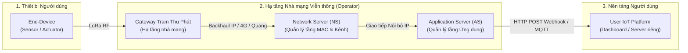

**2. Mô hình Mạng Tư nhân Độc lập (Private Independent Network):**  
Doanh nghiệp tự trang bị và làm chủ 100% phần cứng lẫn phần mềm: từ End-Device, Gateway nội bộ đến máy chủ On-Premises (ChirpStack / Loriot). Dữ liệu và các khóa mật mã (`AppKey`, `NwkSKey`, `AppSKey`) được lưu hành hoàn toàn khép kín trong mạng nội bộ.

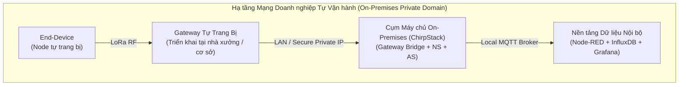

**3. Mô hình Mạng Lai (Hybrid Network):**  
Doanh nghiệp tự mua sắm và triển khai Gateway tại các điểm cần phủ sóng, nhưng kết nối và ủy thác việc vận hành máy chủ cho các nền tảng LoRaWAN Cloud SaaS (The Things Stack Cloud, AWS IoT Core for LoRaWAN, Actility).

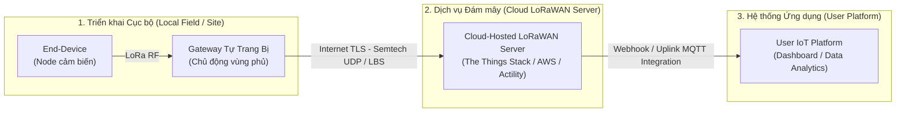

#### 2.1.1. So sánh chi tiết 3 mô hình triển khai mạng LoRaWAN

| Tiêu chí so sánh kỹ thuật | Mạng Công cộng (Public Operated) | Mạng Tư nhân Độc lập (Private) | Mạng Lai (Hybrid) |
| :--- | :--- | :--- | :--- |
| **Nhà cung cấp tiêu biểu** | Orange, Objenious (Bouygues), KPN, Proximus, Senet. | Tự dựng với ChirpStack, The Things Stack Open Source, Kerlink Wanesy SPN. | The Things Stack Community/Enterprise Cloud, Actility ThingPark, Loriot. |
| **Quyền sở hữu Gateway** | Do nhà mạng viễn thông đầu tư, lắp đặt và vận hành 100%. | Đơn vị triển khai tự mua sắm, lắp đặt và duy trì hoạt động. | Đơn vị triển khai tự đầu tư và bố trí Gateway theo nhu cầu thực tế. |
| **Quyền sở hữu LoRaWAN Server** | Nhà mạng quản trị hạ tầng phần cứng và cụm máy chủ NS/AS. | Đơn vị tự vận hành máy chủ vật lý hoặc máy chủ ảo On-Premises. | Thuê dịch vụ máy chủ đám mây (Cloud SaaS) do bên thứ ba quản trị. |
| **Chi phí đầu tư ban đầu (CapEx)** | **Thấp nhất**: Chỉ cần mua thiết bị đầu cuối (End-device). | **Cao nhất**: Phải đầu tư cụm Gateway, máy chủ, hệ thống mạng dự phòng. | **Trung bình**: Đầu tư Gateway và thiết bị, không cần mua máy chủ. |
| **Chi phí vận hành định kỳ (OpEx)** | **Cao**: Trả phí thuê bao theo từng thiết bị hàng tháng (khoảng 1–2 €/node/tháng). | **Rất thấp**: Chi phí điện năng, đường truyền Internet và bảo trì hệ thống. | **Trung bình**: Trả phí bản quyền dịch vụ Cloud theo số Gateway/Node. |
| **Bảo mật & Chủ quyền dữ liệu** | Dữ liệu lưu lượng MAC đi qua máy chủ nhà mạng (cần mã hóa cẩn mật). | **Tuyệt đối an toàn**: Khóa `AppKey`, `NwkSKey`, `AppSKey` và dữ liệu nằm hoàn toàn nội bộ. | Dữ liệu và khóa phiên do nhà cung cấp Cloud quản lý. |
| **Chất lượng vùng phủ sóng** | Phụ thuộc vào trạm thu phát của nhà mạng; khó phủ sâu tầng hầm/khu mỏ. | **Tự tối ưu hóa**: Muốn phủ sóng điểm mù chỉ cần lắp thêm Gateway nội bộ. | **Tự tối ưu hóa**: Linh hoạt bổ sung Gateway tại các vị trí mong muốn. |
| **Giới hạn số lượng bản tin** | Bị ràng buộc khắt khe bởi hợp đồng thuê bao (VD: 140 uplink/ngày). | **Không giới hạn**: Toàn quyền khai thác tối đa theo luật vô tuyến (Duty Cycle). | Thường có giới hạn theo gói dịch vụ (hoặc Fair Access Policy). |

#### 2.1.2. Bản chất kỹ thuật & Sự cần thiết phải đồng bộ Frequency Plan

Mạng vô tuyến LoRaWAN sử dụng băng tần không cấp phép (ISM Band), nhưng các thông số vô tuyến chi tiết bị chi phối nghiêm ngặt bởi quy định viễn thông của từng vùng địa lý:
- **EU868 (Châu Âu):** Sử dụng dải $863 - 870\text{ MHz}$. Bắt buộc 3 kênh mặc định phát $125\text{ kHz}$ tại các tần số $868.1\text{ MHz}$, $868.3\text{ MHz}$, $868.5\text{ MHz}$. Quy định giới hạn chu kỳ hoạt động **1% Duty Cycle** trên hầu hết các sub-band.
- **US915 (Bắc Mỹ):** Sử dụng dải $902 - 928\text{ MHz}$. Chia thành 64 kênh Uplink $125\text{ kHz}$ và 8 kênh Uplink $500\text{ kHz}$. Thường được gom thành 8 Sub-bands (mỗi Sub-band gồm 8 kênh $125\text{ kHz}$ và 1 kênh $500\text{ kHz}$). Phổ biến nhất là Sub-band 2 ($903.9 - 905.3\text{ MHz}$).
- **AS923 (Châu Á - Thái Bình Dương / Việt Nam):** Dải $920 - 925\text{ MHz}$ (AS923-1, AS923-2). Kênh mặc định thường là $923.2\text{ MHz}$ và $923.4\text{ MHz}$ hoặc được quy hoạch lùi dải tần (phù hợp với quy chuẩn QCVN của Bộ Thông tin & Truyền thông Việt Nam).

> **Nguyên tắc kỹ thuật sống còn:**  
> Gateway chỉ là bộ thu phát vô tuyến phần cứng có số lượng kênh giới hạn (thường là 8 kênh hoặc 16 kênh đồng thời). Nếu Network Server cấu hình danh sách kênh tần số không trùng khớp tuyệt đối với danh sách kênh mà chip SX1301/SX1302/SX1303 trên Gateway đang lắng nghe, hai hiện tượng lỗi nghiêm trọng sẽ xảy ra:
> 1. *Rơi rớt gói Uplink:* Thiết bị đầu cuối nhảy tần ngẫu nhiên (Frequency Hopping) vào những kênh mà Gateway không quét tần số $\rightarrow$ Gateway không bắt được gói tin.
> 2. *Thất bại Downlink / Kích hoạt OTAA:* Khi thiết bị gửi `Join-Request`, Network Server chọn một kênh Downlink để phát `Join-Accept`. Nếu Network Server chỉ thị Gateway phát ở tần số vượt ra ngoài băng thông bộ khuếch đại RF của Gateway hoặc sai dải kênh con (Sub-band), Gateway sẽ từ chối phát hoặc phát sai kênh mà Node đang chờ tại cửa sổ `RX1`/`RX2`, dẫn đến thiết bị vĩnh viễn không gia nhập mạng thành công.

---

### 2.2. Gateway & Giao thức Semtech UDP Packet Forwarder vs LoRa Basics™ Station

Gateway trong kiến trúc LoRaWAN đóng vai trò là một **bộ chuyển tiếp trong suốt (Transparent Packet Forwarder)**. Gateway không sở hữu các khóa mật mã (`NwkSKey`, `AppSKey`), không giải mã nội dung khung tin LoRaWAN, và không phân tích logic nghiệp vụ. Nhiệm vụ duy nhất của Gateway là:
1. Chiều Uplink: Thu nhận tín hiệu RF điều chế LoRa từ không gian, giải điều chế thành chuỗi byte `PHYPayload`, đóng gói kèm các chỉ số kênh truyền (Tần số, SF, BW, RSSI, SNR, mốc thời gian thu) vào gói tin mạng IP và đẩy về Network Server.
2. Chiều Downlink: Nhận gói tin IP chứa chuỗi byte từ Network Server, đợi đúng mốc thời gian chỉ định (hoặc phát tức thì), nạp tham số vô tuyến vào modem RF và phát sóng xuống không gian.

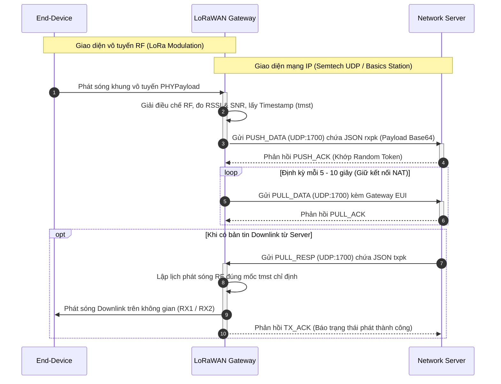

#### 2.2.1. So sánh Semtech UDP Packet Forwarder và LoRa Basics™ Station

| Đặc tính kỹ thuật | Semtech UDP Packet Forwarder (Legacy) | LoRa Basics™ Station (Modern) |
| :--- | :--- | :--- |
| **Giao thức mạng lõi** | UDP (User Datagram Protocol) phi kết nối, cổng mặc định 1700. | WebSocket an toàn trên nền TCP (WSS - WebSockets over TLS), cổng 8887 / 443. |
| **Cơ chế bảo mật** | **Hoàn toàn không có bảo mật**: Không mã hóa, không xác thực danh tính Gateway. | **Bảo mật cấp doanh nghiệp**: Xác thực hai chiều bằng chứng chỉ số TLS (X.509 Client/Server Certificates). |
| **Khả năng vượt tường lửa / NAT** | Kém: Phụ thuộc vào việc Gateway phải liên tục bắn gói `PULL_DATA` để giữ cổng mở trên router. | Xuất sắc: Kết nối TCP Client ra ngoài qua cổng HTTPS chuẩn (443), dễ dàng đi qua mọi proxy doanh nghiệp. |
| **Quản trị cấu hình từ xa** | Không hỗ trợ: Muốn sửa kênh hay tần số phải can thiệp trực tiếp vào tệp `local_conf.json` trên Gateway. | **Hỗ trợ toàn diện qua dịch vụ CUPS**: Tự động tải cấu hình kênh và nạp firmware mới từ xa. |
| **Độ tin cậy truyền dẫn** | Thấp: Gói tin UDP có thể bị rơi rớt, đảo trật tự trên đường truyền Internet công cộng. | Rất cao: Giao thức TCP đảm bảo việc kiểm soát luồng, phát hiện lỗi và truyền lại tin cậy. |
| **Định dạng dữ liệu** | Gói tin nhị phân tự chế kết hợp chuỗi văn bản JSON chứa chuỗi Base64. | Định dạng JSON hiện đại trao đổi qua kênh WebSocket hai chiều. |
| **Trạng thái phát triển** | **Lỗi thời (Deprecated)**: The Things Stack đã loại bỏ dần; ChirpStack giữ lại cho lab. | **Tiêu chuẩn công nghiệp hiện hành**: Được LoRa Alliance và Semtech khuyến nghị triển khai thực tế. |

#### 2.2.2. Giải phẫu cấu trúc gói tin Semtech UDP Packet Forwarder

Giao thức Semtech UDP gồm hai luồng độc lập:
1. **Luồng Uplink (`PUSH_DATA` / `PUSH_ACK`):**
   - Header cố định 12 bytes:
     * Byte 0: `Protocol Version` (Quy định giá trị `0x01` hoặc `0x02`).
     * Byte 1–2: `Random Token` (Số nguyên ngẫu nhiên 16-bit do Gateway tạo ra để khớp với bản tin ACK).
     * Byte 3: `PUSH_DATA Identifier` (Giá trị cố định `0x00`).
     * Byte 4–11: `Gateway EUI` (Mã định danh duy nhất 64-bit của Gateway, thường sinh từ địa chỉ MAC card mạng, ví dụ: `b8:27:eb:ff:fe:ae:26:f5`).
   - Tải trọng (từ Byte 12 đến hết): Chuỗi ký tự JSON chứa mảng đối tượng `rxpk` (Received Packets).
2. **Luồng Downlink (`PULL_DATA` / `PULL_RESP` / `PULL_ACK`):**
   - `PULL_DATA` (Identifier `0x02`): Gateway gửi định kỳ lên server để giữ phiên NAT và báo địa chỉ IP/Port public của nó.
   - `PULL_ACK` (Identifier `0x04`): Server trả lời xác nhận đã nhận `PULL_DATA`.
   - `PULL_RESP` (Identifier `0x03`): Server chủ động gửi xuống Gateway khi có nhu cầu phát Downlink, tải trọng chứa đối tượng JSON `txpk`.
   - `TX_ACK` (Identifier `0x05`): Gateway phản hồi trạng thái phát sóng RF (thành công hoặc lỗi va chạm lịch phát `COLLISION_PACKET`).

```
+-------------------+--------------------+------------------------+------------------------------------+--------------------------+
| Byte 0 (1 Byte)   | Byte 1-2 (2 Bytes) | Byte 3 (1 Byte)        | Byte 4-11 (8 Bytes)                | Byte 12-End (Variable)   |
| Protocol Version  | Random Token       | Identifier             | Gateway Unique Identifier (EUI-64) | JSON Payload Data        |
| (0x02)            | (0xF930)           | 0x00 (PUSH_DATA)       | (b8 27 eb ff fe ae 26 f5)          | {"rxpk":[{...}]}         |
+-------------------+--------------------+------------------------+------------------------------------+--------------------------+
```

##### Chi tiết các trường trong đối tượng JSON `rxpk` (Uplink):
- `tmst` (32-bit unsigned integer): Mốc thời gian đếm xung phần cứng nội bộ của chip Semtech (micro-giây, chu kỳ lặp lại khoảng 71.5 phút). Đây là mốc tham chiếu then chốt để Network Server tính toán thời điểm phát lại chính xác cho các cửa sổ `RX1` ($tmst + 1\,000\,000\,\mu\text{s}$) và `RX2` ($tmst + 2\,000\,000\,\mu\text{s}$).
- `freq` (float): Tần số thu được của sóng mang (đơn vị $\text{MHz}$, ví dụ: `868.500000`).
- `chan` (integer): Số thứ tự kênh logic của bộ tập trung RF (ví dụ: kênh 2).
- `rfch` (integer): Số thứ tự chuỗi thu phát RF (thường là 0 hoặc 1 của chip SX1257/SX1250).
- `stat` (integer): Trạng thái kiểm tra mã kiểm tra dư thừa vòng CRC (`1`: CRC hợp lệ, `-1`: không có CRC, `0`: lỗi CRC).
- `modu` (string): Loại điều chế (`"LORA"` hoặc `"FSK"`).
- `datr` (string): Tốc độ dữ liệu điều chế LoRa, kết hợp giữa Spreading Factor và Bandwidth (ví dụ: `"SF7BW125"`).
- `codr` (string): Tỷ lệ mã hóa sửa lỗi FEC (ví dụ: `"4/5"`).
- `rssi` (integer): Cường độ tín hiệu thu được tại đầu vào ăng-ten Gateway (đơn vị $\text{dBm}$).
- `lsnr` (float): Tỷ số tín hiệu trên nhiễu SNR đo được (đơn vị $\text{dB}$).
- `size` (integer): Độ dài tính theo byte của gói tin `PHYPayload`.
- `data` (string): Toàn bộ chuỗi byte nhị phân của `PHYPayload` đã được mã hóa dưới dạng ký tự Base64.

##### Chi tiết các trường trong đối tượng JSON `txpk` (Downlink):
- `imme` (boolean): Lệnh yêu cầu phát ngay lập tức nếu bằng `true` (thường dùng cho Class C beacon test).
- `tmst` (uint32): Mốc xung nội bộ đích mà Gateway bắt buộc phải kích hoạt phát sóng chính xác (áp dụng cho Class A/B).
- `freq` (float): Tần số sóng vô tuyến dùng để phát Downlink.
- `rfch` (integer): Bộ thu phát RF được chọn.
- `powe` (integer): Công suất phát RF tại cổng ăng-ten Gateway (đơn vị $\text{dBm}$, ví dụ: `14` hoặc `27`).
- `modu` (string): Kiểu điều chế (`"LORA"`).
- `datr` (string): Thông số SF và BW dùng cho Downlink.
- `codr` (string): Tỷ lệ mã hóa (chuẩn LoRaWAN Downlink luôn dùng `"4/5"`).
- `ipol` (boolean): Cờ đảo phổ vô tuyến (Invert IQ polarity). Trong LoRaWAN, **Downlink luôn bắt buộc đặt `ipol: true`** để thiết bị đầu cuối (lắng nghe phân cực chuẩn) không bắt nhầm gói tin Downlink từ các Node khác phát ra, và các Gateway không tự thu gói tin phát của nhau.
- `size` (integer): Kích thước gói tin Downlink.
- `data` (string): Khung dữ liệu `PHYPayload` Downlink đã mã hóa Base64.

#### 2.2.3. Bản chất toán học của cơ chế mã hóa Base64 trong trao đổi dữ liệu

Tại sao lại cần Base64 trong mạng IoT? Gói tin `PHYPayload` của LoRaWAN là một mảng byte nhị phân thuần túy (giá trị mỗi byte từ `0x00` đến `0xFF`). Trong khi đó, giao thức JSON là định dạng văn bản dựa trên chuẩn ký tự ASCII. Nhiều giá trị byte trong khoảng `0x00 - 0x1F` là các ký tự điều khiển không in được (như `NULL`, `Line Feed`, `Escape`, `End of File`). Nếu đưa trực tiếp các byte này vào chuỗi JSON, bộ phân tích cú pháp (JSON Parser) sẽ bị gãy hoặc hiểu sai cú pháp.

Thuật toán Base64 giải quyết triệt để vấn đề này bằng cách ánh xạ dữ liệu nhị phân sang bảng gồm 64 ký tự ASCII an toàn có thể in được:
$$\text{Bảng mã Base64: } \text{A–Z (0–25), a–z (26–51), 0–9 (52–61), + (62), / (63)}$$

```
+-----------------------+-----------------------+-----------------------+
| Byte nhị phân 1       | Byte nhị phân 2       | Byte nhị phân 3       |
| (8 bits: b7..b0)      | (8 bits: b7..b0)      | (8 bits: b7..b0)      |
+-----------+-----------+-----------+-----------+-----------+-----------+
| Nhóm 1    | Nhóm 2    | Nhóm 3    | Nhóm 4    |
| (6 bits)  | (6 bits)  | (6 bits)  | (6 bits)  |
+-----------+-----------+-----------+-----------+
| Ký tự     | Ký tự     | Ký tự     | Ký tự     |
| Base64 1  | Base64 2  | Base64 3  | Base64 4  |
+-----------+-----------+-----------+-----------+
```

##### Quy tắc biến đổi toán học:
1. Lấy liên tiếp một cụm gồm 3 byte nhị phân đầu vào:
   $$3 \text{ Bytes} \times 8 \text{ bits/Byte} = 24 \text{ bits}$$
2. Chia đều 24 bits này thành 4 nhóm độc lập, mỗi nhóm chứa chính xác 6 bits:
   $$24 \text{ bits} \div 6 \text{ bits/nhóm} = 4 \text{ nhóm}$$
3. Mỗi nhóm 6 bits biểu diễn một giá trị số nguyên từ $0$ đến $2^6 - 1 = 63$. Tra giá trị này vào Bảng mã Base64 chuẩn để lấy ký tự ASCII tương ứng.
4. **Xử lý số dư dữ liệu (Padding bằng ký tự `=`):**
   - Nếu tổng số byte đầu vào chia hết cho 3: Tạo thành số ký tự Base64 chẵn chia hết cho 4, không cần đệm.
   - Nếu dư 1 byte (8 bits): Ghép 8 bits này với 4 bit `0` ở đuôi để tạo thành hai nhóm 6-bit (sinh ra 2 ký tự Base64), sau đó thêm 2 ký tự đệm `==` ở cuối để đủ khối 4 ký tự.
   - Nếu dư 2 bytes (16 bits): Ghép 16 bits này với 2 bit `0` ở đuôi để tạo thành ba nhóm 6-bit (sinh ra 3 ký tự Base64), sau đó thêm 1 ký tự đệm `=` ở cuối để đủ khối 4 ký tự.
   - Hiệu suất chiếm dụng không gian: Kích thước dữ liệu sau khi mã hóa Base64 tăng lên chính xác:
     $$\text{Dung lượng sau mã hóa} = \left\lceil \frac{N}{3} \right\rceil \times 4 \approx 133.33\% \text{ kích thước ban đầu}$$

---

### 2.3. Kiến trúc Chức năng của Network Server (NS) và Application Server (AS)

Trong mô hình kiến trúc chuẩn của LoRaWAN, máy chủ trung tâm được phân rã thành hai thực thể mang trách nhiệm độc lập: **Network Server** (xử lý tầng MAC và liên kết vô tuyến) và **Application Server** (xử lý tầng ứng dụng và dữ liệu người dùng).

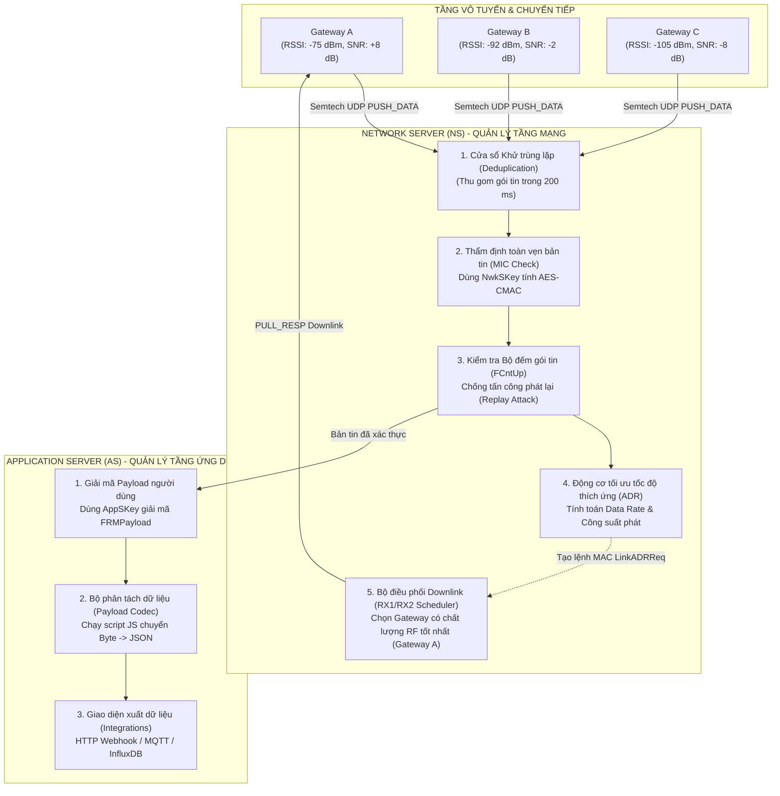

#### 2.3.1. Các nhiệm vụ cốt lõi của Network Server (NS)
1. **Khử trùng lặp gói tin vô tuyến (Packet Deduplication):**
   - Bản chất sóng vô tuyến là lan truyền đa hướng. Khi một End-device phát một bản tin Uplink, tất cả các Gateway trong vùng phủ sóng đều sẽ thu được tín hiệu và chuyển tiếp các gói `PUSH_DATA` độc lập về cùng một Network Server.
   - Network Server mở một "cửa sổ khử trùng lặp" (Deduplication Window, thông thường cấu hình khoảng $100 - 250\text{ ms}$). Khi gói đầu tiên tới nơi, NS tạm giữ lại và gom tất cả các bản tin từ các Gateway khác có cùng địa chỉ `DevAddr` và cùng giá trị bộ đếm `FCnt`.
   - Lợi ích kép:
     * Đối với tầng ứng dụng: NS loại bỏ toàn bộ các bản sao dư thừa, chỉ chuyển duy nhất một bản tin lên Application Server, tránh làm sai lệch cơ sở dữ liệu và lãng phí băng thông backend.
     * Đối với tầng mạng: NS xếp hạng chất lượng thu của từng Gateway dựa trên chỉ số SNR và RSSI. Khi cần gửi một bản tin phản hồi Downlink (như ACK, Join-Accept, lệnh MAC), NS sẽ tự động chọn đúng Gateway có đường truyền tốt nhất (thường là Gateway có SNR cao nhất) để phát sóng.
2. **Xác thực và Thẩm định tính toàn vẹn (MIC Verification):**
   - Network Server sử dụng khóa mạng phiên `NwkSKey` và thuật toán chuẩn `AES-CMAC` để tính toán lại trường 4-byte `MIC` (Message Integrity Control) dựa trên toàn bộ nội dung gói `MHDR | FHDR | FPort | FRMPayload`.
   - Nếu mã `MIC` tính toán khớp 100% với `MIC` đính kèm trong gói tin: Gói tin được xác nhận xuất phát từ chính thiết bị hợp lệ và không bị sửa đổi trên đường truyền.
   - Nếu `MIC` sai lệch: Network Server lập tức hủy bỏ gói tin trong im lặng (Drop silently), không xử lý và không chuyển tiếp lên Application Server.
3. **Quản lý Bộ đếm khung truyền (Frame Counter - `FCnt`) chống Replay Attack:**
   - Network Server lưu trữ giá trị `FCntUp` hợp lệ gần nhất của từng thiết bị trong cơ sở dữ liệu nhanh (Redis).
   - Mỗi gói Uplink mới đến phải có $FCnt_{\text{in}} > FCnt_{\text{last}}$. Nếu kẻ tấn công bắt một gói tin cũ trên sóng và phát lại nguyên vẹn, Network Server phát hiện $FCnt_{\text{in}} \le FCnt_{\text{last}}$ và hủy gói ngay lập tức.
4. **Điều khiển Giải thuật Tự thích ứng Tốc độ Dữ liệu (Adaptive Data Rate - ADR):**
   - Nếu thiết bị bật cờ `ADR` trong trường `FCtrl`, Network Server sẽ theo dõi lịch sử SNR của 20 khung tin Uplink gần nhất.
   - NS tính toán giá trị `SNR_margin` so với ngưỡng độ nhạy thu yêu cầu của Spreading Factor hiện tại:
     $$\text{SNR}_{\text{margin}} = \text{SNR}_{\text{max}} - \text{SNR}_{\text{threshold}} - \text{Margin}_{\text{device}}$$
   - Dựa trên giá trị biên dư này, Network Server sinh lệnh MAC `LinkADRReq` (được nhúng tự động vào trường `FOpts` của gói Downlink tiếp theo) để yêu cầu thiết bị tăng Data Rate (giảm SF từ SF12 về SF7) và giảm công suất phát sóng $P_T$ xuống mức tối thiểu đủ dùng, giúp tiết kiệm triệt để năng lượng pin cho cảm biến.
5. **Điều phối Cửa sổ thu Downlink (Downlink Scheduling):**
   - Căn cứ vào mốc `tmst` do Gateway gửi lên trong bản tin Uplink, Network Server tính toán chính xác thời điểm Gateway phải phát sóng:
     $$T_{\text{TX\_RX1}} = tmst + 1\,000\,000\,\mu\text{s} \quad (\text{Mặc định RX1 Delay} = 1\text{ s})$$
     $$T_{\text{TX\_RX2}} = tmst + 2\,000\,000\,\mu\text{s} \quad (\text{Mặc định RX2 Delay} = 2\text{ s})$$
   - Gói lệnh phát `PULL_RESP` phải được gửi xuống Gateway trước thời điểm này trừ đi độ trễ mạng Internet (Network Latency), đảm bảo Gateway kịp nạp lệnh vào hàng đợi phần cứng.

#### 2.3.2. Các nhiệm vụ cốt lõi của Application Server (AS)
1. **Giải mã Vùng Tải trọng Ứng dụng (`FRMPayload`):**
   - Application Server là thực thể duy nhất trong mạng nắm giữ khóa mật mã phiên ứng dụng `AppSKey`.
   - Khi nhận bản tin từ Network Server, AS sử dụng thuật toán mã hóa khối `AES-128` ở chế độ Counter (CTR) kết hợp cùng `AppSKey`, `DevAddr`, `FCnt` và hướng truyền (Uplink = 0) để giải mã vùng `FRMPayload` nhị phân thành dữ liệu người dùng ban đầu. Nhờ cơ chế này, Network Server và các Gateway hoàn toàn không thể xem lén được nội dung thông tin cảm biến (End-to-End Encryption).
2. **Thực thi Bộ giải mã Tải trọng (Payload Codec / JavaScript Decoders):**
   - Thiết bị IoT nhúng gửi các giá trị cảm biến dưới dạng chuỗi byte nén (ví dụ: nhiệt độ $25.4^\circ\text{C}$ được nhân 10 thành số nguyên 254 và lưu trong 2 byte `0x00FE`).
   - Application Server cung cấp môi trường thực thi (Sandbox) cho phép người dùng cấu hình hàm giải mã JavaScript (`decodeUplink`):
     ```javascript
     function decodeUplink(input) {
       var bytes = input.bytes;
       var port = input.fPort;
       var temperature = ((bytes[0] << 8) | bytes[1]) / 10.0;
       var humidity = bytes[2];
       var batteryVoltage = ((bytes[3] << 8) | bytes[4]) / 1000.0;
       return {
         data: {
           temperature: temperature,
           humidity: humidity,
           battery: batteryVoltage
         }
       };
     }
     ```
   - Kết quả đầu ra là một đối tượng JSON có ngữ nghĩa rõ ràng, sẵn sàng cung cấp cho các phần mềm tầng trên.
3. **Tích hợp Xuất Dữ liệu (Integrations):**
   - Cung cấp các giao diện kết nối tiêu chuẩn công nghiệp: Webhooks (HTTP POST), MQTT Integration, gRPC Streaming, hoặc đẩy trực tiếp vào các cơ sở dữ liệu thời gian thực InfluxDB, AWS IoT Core, Azure IoT Hub.

---

### 2.4. Xuất Dữ liệu qua Giao thức HTTP: Cơ chế Polling (GET) vs Webhooks (POST)

Để chuyển tiếp dữ liệu đo xa từ LoRaWAN Application Server tới nền tảng IoT người dùng, hai phương thức truyền thông HTTP thường được áp dụng với sự khác biệt cốt lõi về bản chất kiến trúc và hiệu năng mạng.

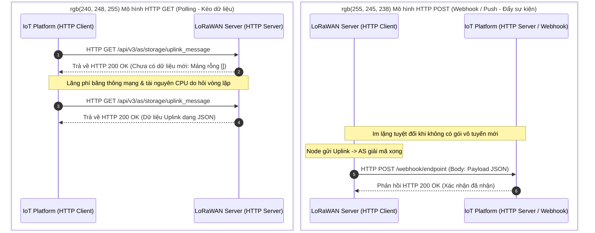

#### 2.4.1. Phân tích Bản chất Cơ chế HTTP GET (Polling)
- **Vai trò thực thể:**
  * Máy chủ LoRaWAN (Application Server) đóng vai trò là **HTTP Server**. Server kích hoạt một dịch vụ lưu trữ dữ liệu tạm thời (như *Storage Integration* trên The Things Stack).
  * Ứng dụng người dùng (IoT Platform) đóng vai trò là **HTTP Client**.
- **Cơ chế hoạt động:** Ứng dụng người dùng chủ động gửi định kỳ các truy vấn `HTTP GET` kèm theo chuỗi Bearer Token tới địa chỉ Endpoint API của server để hỏi xem có bản tin mới nào được lưu trong bộ nhớ đệm hay không:
  ```bash
  curl -G "https://eu1.cloud.thethings.network/api/v3/as/applications/app1/packages/storage/uplink_message" \
       -H "Authorization: Bearer NNSXS.XXXXXX..." \
       -H "Accept: text/event-stream"
  ```
- **Hạn chế kỹ thuật nghiêm trọng:**
  1. *Lãng phí tài nguyên mạng & CPU:* Cảm biến IoT truyền dữ liệu không thường xuyên (ví dụ: mỗi 15 phút một lần hoặc chỉ gửi khi có báo động cháy). Nếu ứng dụng thực hiện polling mỗi 5 giây, sẽ có hàng trăm truy vấn trả về kết quả rỗng, gây quá tải bộ xử lý của Application Server và lãng phí băng thông mạng.
  2. *Độ trễ thông tin:* Nếu giảm tần suất polling xuống (ví dụ 1 phút/lần) để tiết kiệm tài nguyên, độ trễ phát hiện sự kiện khẩn cấp sẽ bị kéo dài tối đa bằng đúng chu kỳ polling.
  3. *Không thể gửi lệnh Downlink:* Giao thức HTTP GET chỉ hỗ trợ chiều kéo dữ liệu từ Server về Client. Không có cơ chế nào để ứng dụng người dùng chủ động đẩy gói tin Downlink xuống thiết bị qua kênh này.

#### 2.4.2. Phân tích Bản chất Cơ chế HTTP POST (Webhook / Event-Driven Push)
- **Vai trò thực thể:**
  * **Chiều Uplink:** Vai trò được hoán đổi hoàn toàn! Máy chủ LoRaWAN Application Server đóng vai trò là **HTTP Client**, còn nền tảng IoT người dùng đóng vai trò là **HTTP Server** (mở một địa chỉ Webhook Endpoint công khai).
  * **Chiều Downlink:** Ứng dụng người dùng là **HTTP Client**, gửi một bản tin `HTTP POST` chứa cấu trúc lệnh điều khiển tới REST API của Application Server (đóng vai trò **HTTP Server**).
- **Cơ chế hoạt động chiều Uplink (Webhook Push):**
  1. Bình thường, hệ thống ở trạng thái tĩnh, hoàn toàn không có bất kỳ lưu lượng mạng HTTP nào trao đổi giữa hai bên.
  2. Ngay khi có một gói tin vô tuyến Uplink bay tới, sau khi giải mã xong Payload, Application Server lập tức đóng gói toàn bộ dữ liệu vào một bản tin `HTTP POST` và "bắn" trực tiếp vào địa chỉ Webhook URL được cấu hình trước:
     ```http
     POST /api/v1/lorawan-uplink HTTP/1.1
     Host: iot.mycompany.com
     Content-Type: application/json
     X-Custom-Auth-Token: secret-token-123

     {
       "end_device_ids": {
         "device_id": "temp-sensor-01",
         "dev_eui": "0004A30B001F1234"
       },
       "uplink_message": {
         "f_port": 1,
         "f_cnt": 142,
         "decoded_payload": {
           "temperature": 26.5,
           "humidity": 68
         },
         "rx_metadata": [
           {
             "gateway_ids": { "gateway_id": "gw-roof-01" },
             "rssi": -85,
             "snr": 7.5
           }
         ]
       }
     }
     ```
  3. Máy chủ IoT người dùng nhận bản tin, xử lý ghi vào cơ sở dữ liệu và phản hồi lại mã `HTTP 200 OK` gọn nhẹ không chứa nội dung body.
- **Cơ chế hoạt động chiều Downlink:**
  Ứng dụng người dùng gọi API của LoRaWAN Server để xếp một gói tin Downlink vào hàng đợi phát:
  ```bash
  curl --location --request POST 'https://eu1.loriot.io/1/rest' \
       --header 'Content-Type: application/json' \
       --header 'Authorization: Bearer <API_TOKEN>' \
       --data-raw '{
         "cmd": "tx",
         "EUI": "0004A30B001F1234",
         "port": 1,
         "confirmed": false,
         "data": "010A"
       }'
  ```

---

### 2.5. Giao thức MQTT Chuyên sâu trong Hệ thống LoRaWAN

MQTT (Message Queuing Telemetry Transport) là giao thức truyền thông chuẩn mực cho các hệ thống IoT phân tán. Khác với mô hình Client-Server đồng bộ của HTTP, MQTT vận hành theo mô hình **Publish / Subscribe (Xuất bản / Đăng ký)** bất đồng bộ trên nền tảng giao vận tin cậy TCP/IP (cổng mặc định 1883 không mã hóa, hoặc 8883 mã hóa TLS).

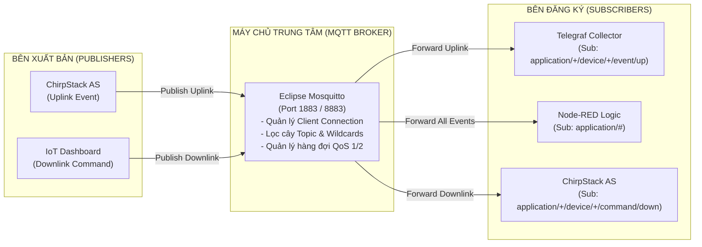

#### 2.5.1. Hai mô hình triển khai MQTT: LoRaWAN Server là Broker vs Client

Tùy thuộc vào kiến trúc phần mềm máy chủ, mối quan hệ giữa LoRaWAN Server và MQTT Broker được tổ chức theo một trong hai cách:

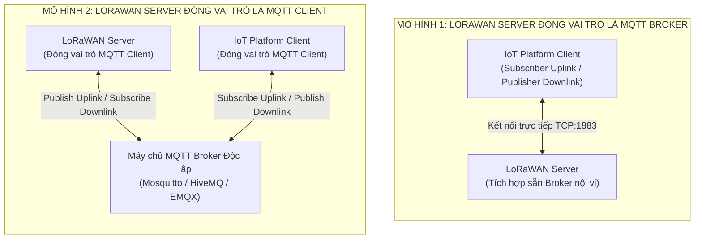

1. **Mô hình 1: LoRaWAN Server đóng vai trò là MQTT Broker (như The Things Stack v3):**
   - Application Server tự mở một cổng dịch vụ MQTT Broker lắng nghe kết nối từ bên ngoài.
   - Ứng dụng người dùng chỉ cần tạo một MQTT Client, kết nối trực tiếp vào địa chỉ IP và Port của LoRaWAN Server, xác thực bằng API Key và thực hiện subscribe/publish.
   - *Ưu điểm:* Cấu trúc tối giản, không cần cài đặt thêm phần mềm máy chủ trung gian.
   - *Nhược điểm:* Khó mở rộng cụm phân tán và tăng tải cho Application Server khi có hàng ngàn dashboard kết nối cùng lúc.
2. **Mô hình 2: LoRaWAN Server đóng vai trò là MQTT Client (như ChirpStack, Actility):**
   - Một máy chủ MQTT Broker chuyên dụng độc lập (như Eclipse Mosquitto) được dựng lên ở giữa làm trục xương sống truyền tin (Message Bus).
   - Bản thân LoRaWAN Application Server kết nối vào Broker này với tư cách là một MQTT Client:
     * Chiều Uplink: Application Server đóng vai trò là *Publisher*, đẩy gói tin giải mã lên Broker.
     * Chiều Downlink: Application Server đóng vai trò là *Subscriber*, lắng nghe các lệnh điều khiển từ các ứng dụng khác gửi vào Broker.
   - Ứng dụng người dùng (Telegraf, Node-RED, Web App) cũng kết nối vào Broker này với tư cách là MQTT Client.
   - *Ưu điểm:* Tách rời hoàn toàn các thành phần (Decoupled Architecture), chịu tải cực lớn, cho phép nhiều dịch vụ cùng chia sẻ dữ liệu mà không ảnh hưởng trực tiếp đến LoRaWAN Server.

#### 2.5.2. Cấu trúc Cây Topic và Kỹ thuật Lọc bằng Ký tự Đại diện (Wildcards)

Một Topic trong MQTT là một chuỗi ký tự phân cấp theo thứ tự từ tổng quát đến chi tiết, phân tách nhau bằng dấu gạch chéo `/`. Các Client không gửi tin nhắn trực tiếp cho nhau mà thông qua các Topic này.

##### So sánh chuẩn Topic của ChirpStack v3 và ChirpStack v4:
- **ChirpStack v3 (Mặc định):**
  * Luồng Uplink: `application/{application_id}/device/{dev_eui}/rx`
  * Luồng Downlink: `application/{application_id}/device/{dev_eui}/tx`
- **ChirpStack v4 (Mặc định):**
  * Luồng Uplink: `application/{application_id}/device/{dev_eui}/event/up`
  * Luồng Trạng thái Join: `application/{application_id}/device/{dev_eui}/event/join`
  * Luồng Trạng thái Pin/SNR: `application/{application_id}/device/{dev_eui}/event/status`
  * Luồng Downlink xếp hàng: `application/{application_id}/device/{dev_eui}/command/down`

##### Hai quy tắc ký tự đại diện (Wildcards) trong bộ lọc đăng ký (Subscription Filter):
1. **Dấu cộng `+` (Single-level Wildcard):** Đại diện cho **duy nhất một cấp bậc** trong cây thư mục Topic tại vị trí nó xuất hiện.
   - *Ví dụ 1:* `application/1/device/+/event/up`  
     $\rightarrow$ Lắng nghe toàn bộ bản tin Uplink của **tất cả các thiết bị** thuộc ứng dụng có ID là `1`.
   - *Ví dụ 2:* `application/+/device/0004a30b001f1234/event/+`  
     $\rightarrow$ Lắng nghe mọi loại sự kiện (`up`, `join`, `status`, `ack`) của thiết bị có DevEUI cụ thể nằm ở bất kỳ ứng dụng nào.
2. **Dấu thăng `#` (Multi-level Wildcard):** Đại diện cho **tất cả các cấp bậc con nằm phía sau nó**. Ký tự `#` **bắt buộc phải đặt ở vị trí cuối cùng** của chuỗi Topic.
   - *Ví dụ 1:* `application/#`  
     $\rightarrow$ Lắng nghe toàn bộ mọi thông điệp, mọi sự kiện, mọi thiết bị thuộc tất cả các ứng dụng trên máy chủ.
   - *Ví dụ 2:* `application/1/device/0004a30b001f1234/#`  
     $\rightarrow$ Lắng nghe toàn bộ thông điệp liên quan đến thiết bị chỉ định.
   > [!NOTE]
   > Một Client không thể Publish lên một Topic có chứa ký tự `+` hoặc `#`. Ký tự đại diện chỉ được phép sử dụng ở phía Subscriber!

#### 2.5.3. Giải phẫu 3 Mức Chất lượng Dịch vụ (Quality of Service - QoS)

QoS là cam kết độ tin cậy trong việc vận chuyển một thông điệp giữa người gửi và người nhận qua giao thức MQTT. Mức QoS được xác định độc lập trên hai chặng: từ *Publisher $\rightarrow$ Broker* và từ *Broker $\rightarrow$ Subscriber*.

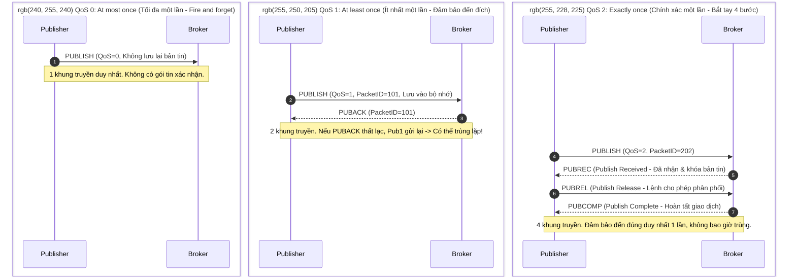

1. **QoS 0 — At most once (Nhiều nhất một lần / Bắn và quên):**
   - Publisher gửi một gói `PUBLISH` duy nhất và xóa ngay khỏi bộ nhớ mà không cần phản hồi.
   - Broker chuyển tiếp gói tin tới Subscriber cũng chỉ một lần.
   - *Ưu điểm:* Tiêu tốn ít băng thông và thời gian chiếm dụng CPU nhất (chỉ tốn 1 khung truyền mạng).
   - *Nhược điểm:* Nếu kết nối TCP bị ngắt quãng hoặc nghẽn mạng đúng lúc phát, bản tin bị mất vĩnh viễn mà hai đầu không hề hay biết. Phù hợp cho dữ liệu cảm biến định kỳ lặp lại liên tục (như đo nhiệt độ phòng 1 phút/lần).
2. **QoS 1 — At least once (Ít nhất một lần / Có xác nhận):**
   - Publisher gửi gói `PUBLISH` kèm theo một mã định danh gói tin `Packet Identifier` và lưu bản tin trong bộ đệm nội bộ.
   - Broker nhận được bản tin sẽ xử lý và gửi phản hồi gói `PUBACK` chứa đúng mã `Packet Identifier` đó. Khi nhận được `PUBACK`, Publisher mới xóa bản tin khỏi bộ nhớ.
   - Nếu sau khoảng thời gian Timeout mà Publisher không nhận được `PUBACK` (do gói tin bị thất lạc hoặc gói `PUBACK` bị rớt trên đường về), Publisher sẽ tự động gửi lại gói `PUBLISH` với cờ trùng lặp `DUP = 1`.
   - *Hệ quả kỹ thuật:* Đảm bảo dữ liệu chắc chắn tới nơi, nhưng Subscriber có nguy cơ nhận hai hay nhiều bản tin giống hệt nhau (Duplicate messages). Ứng dụng phía Subscriber bắt buộc phải có cơ chế kiểm tra trùng lặp (Idempotent processing).
3. **QoS 2 — Exactly once (Chính xác duy nhất một lần / Bắt tay 4 bước):**
   - Đảm bảo bản tin được chuyển giao tới Subscriber đúng duy nhất một lần, hoàn toàn không bị mất mát và không bao giờ bị trùng lặp.
   - *Quy trình bắt tay 4 bước nghiêm ngặt:*
     1. Publisher gửi `PUBLISH` (QoS 2, `PacketID = X`).
     2. Broker nhận gói tin, lưu vào bộ nhớ, gửi trả gói `PUBREC` (Publish Received).
     3. Publisher nhận được `PUBREC`, biết Broker đã giữ an toàn bản tin, liền gửi gói `PUBREL` (Publish Release) để ra lệnh cho Broker mở khóa và phân phối bản tin cho các Subscriber.
     4. Broker phân phối xong, gửi trả gói `PUBCOMP` (Publish Complete). Publisher nhận được `PUBCOMP` mới kết thúc giao dịch và giải phóng hoàn toàn bộ đệm.
   - *Đánh giá:* Tiêu thụ tài nguyên mạng lớn nhất (tốn 4 khung truyền TCP), độ trễ cao nhất. Dùng cho các sự kiện không thể thay thế và không được phép lặp lại (như giao dịch thanh toán trừ tiền, lệnh kích hoạt nổ, lệnh đóng van ngắt khẩn cấp đường ống khí gas).

#### 2.5.4. Cơ chế Duy trì Phiên `cleanSession` & Quản trị Thông điệp Ngoại tuyến

Khi một MQTT Client kết nối tới Broker bằng gói tin `CONNECT`, nó gửi kèm hai tham số quyết định hành vi lưu trữ của Broker: `keepAlive` và `cleanSession`.
- **cleanSession = True (1) — Phiên làm việc tạm thời (Non-persistent Session):**
  * Broker coi kết nối là mới tinh, không quan tâm đến lịch sử trước đó.
  * Ngay khi Client bị ngắt kết nối (vượt quá thời gian `keepAlive` hoặc mất kết nối mạng), Broker lập tức xóa sạch toàn bộ danh sách đăng ký Topic của Client đó.
  * Mọi bản tin phát sinh trong lúc Client ngoại tuyến sẽ bị hủy bỏ hoàn toàn, bất kể bản tin đó được phát với mức QoS nào.
- **cleanSession = False (0) — Phiên làm việc bền vững (Persistent Session):**
  * Broker lưu giữ thông tin định danh `Client ID` cùng danh sách các Topic mà Client đã đăng ký vào bộ nhớ lâu dài.
  * Khi Client bị rớt mạng tạm thời, Broker sẽ tiếp tục gom và lưu giữ các bản tin mới phát sinh vào hàng đợi ngoại tuyến (Offline Queue) dành riêng cho Client đó.
  * Khi Client tái kết nối với cùng `Client ID` và `cleanSession = False`, Broker sẽ tự động đẩy toàn bộ các bản tin tồn đọng trong hàng đợi xuống cho Client theo đúng trật tự thời gian.

> **Ma trận Tổng kết Hành vi Reconnection (Cuốn 1 - Bảng 26, Trang 104):**
>
> | Giá trị cờ `cleanSession` | Cấp độ QoS của Subscriber | Cấp độ QoS của Publisher | Hành vi hệ thống khi Client kết nối lại |
> | :---: | :---: | :---: | :--- |
> | **True (= 1)** | Bất kỳ ($0, 1, 2$) | Bất kỳ ($0, 1, 2$) | **Mất toàn bộ tin nhắn**: Broker không duy trì hàng đợi ngoại tuyến. |
> | **False (= 0)** | **QoS 0** | Bất kỳ ($0, 1, 2$) | **Mất toàn bộ tin nhắn**: QoS 0 quy định không lưu trữ hay xác nhận. |
> | **False (= 0)** | Bất kỳ ($0, 1, 2$) | **QoS 0** | **Mất toàn bộ tin nhắn**: Publisher không yêu cầu đảm bảo tới nơi. |
> | **False (= 0)** | **QoS 1 hoặc QoS 2** | **QoS 1 hoặc QoS 2** | **Truyền lại toàn bộ**: Toàn bộ bản tin ngoại tuyến được Broker lưu trữ và đẩy lại đầy đủ khi Client kết nối thành công. |

---
### 2.6. Triển khai Full-Stack ChirpStack v3 vs v4 với Docker & Docker Compose

ChirpStack là bộ phần mềm máy chủ mã nguồn mở LoRaWAN phổ biến nhất thế giới. Năm 2022, dự án đã trải qua một bước ngoặt tái kiến trúc toàn diện khi nâng cấp từ thế hệ **ChirpStack v3** sang **ChirpStack v4**. Việc nắm vững sự khác biệt bản chất giữa hai phiên bản là năng lực bắt buộc đối với mọi kỹ sư hệ thống IoT.

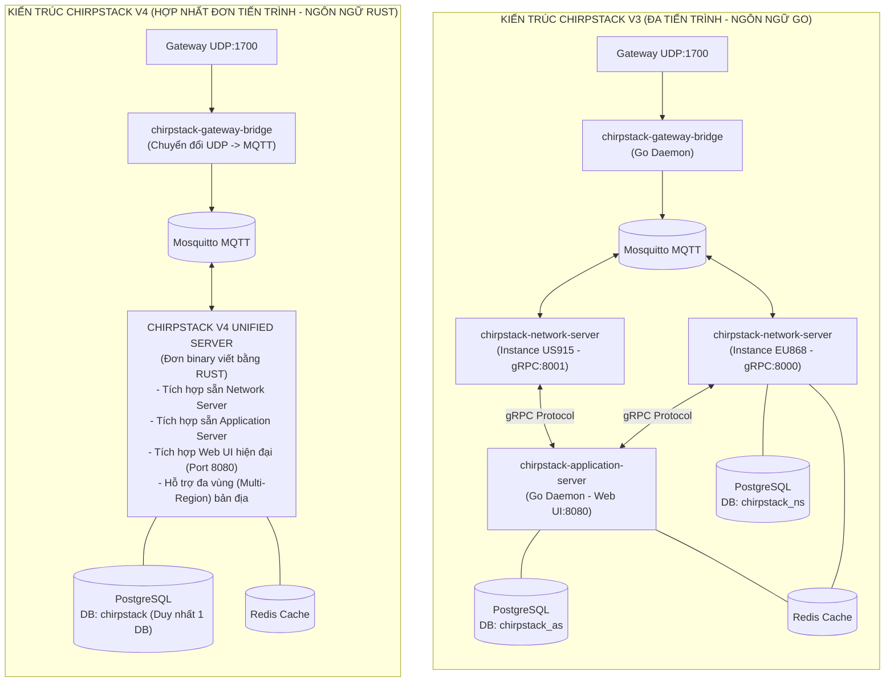

#### 2.6.1. Bảng so sánh Kiến trúc Chuyên sâu: ChirpStack v3 vs ChirpStack v4

| Tiêu chí kỹ thuật | ChirpStack v3 (Thế hệ cũ) | ChirpStack v4 (Thế hệ mới hiện nay) | Ý nghĩa kỹ thuật & Tác động thực tế |
| :--- | :--- | :--- | :--- |
| **Ngôn ngữ lập trình cốt lõi** | Viết hoàn toàn bằng ngôn ngữ **Go (Golang)**. | Viết lại 100% bằng ngôn ngữ **Rust**. | Tối ưu hóa bộ nhớ, an toàn tuyến trình (Thread-safety), hiệu năng xử lý gói tin tăng gấp nhiều lần, giảm độ trễ và dấu chân bộ nhớ RAM. |
| **Cấu trúc dịch vụ & Container** | **Phân tán đa thành phần (Microservices):** Chạy 3 dịch vụ daemon riêng rẽ: `chirpstack-gateway-bridge`, `chirpstack-network-server` (NS), `chirpstack-application-server` (AS). | **Hợp nhất thành phần (Monolithic Binary):** Gộp chung Network Server và Application Server vào một tiến trình duy nhất mang tên `chirpstack`. | Giảm thiểu số lượng container cần quản lý, loại bỏ hoàn toàn các lỗi mất đồng bộ giao tiếp gRPC nội bộ giữa NS và AS. |
| **Cơ sở dữ liệu PostgreSQL** | **Bắt buộc 2 cơ sở dữ liệu riêng biệt:** `chirpstack_ns` (cho Network Server) và `chirpstack_as` (cho Application Server). | **Duy nhất 1 cơ sở dữ liệu:** Gom chung tất cả bảng dữ liệu vào database `chirpstack`. | Đơn giản hóa thủ tục sao lưu dự phòng (Backup) và phục hồi (Restore); lược bỏ cấu hình tài khoản và phân quyền phức tạp. |
| **Cơ chế hỗ trợ Đa vùng (Multi-region)** | **Rất cồng kềnh:** Để hỗ trợ nhiều vùng tần số (EU868, US915, AS923), bắt buộc phải khởi chạy **nhiều container Network Server riêng biệt**, mỗi container chiếm một cổng gRPC độc lập (8000, 8001...). | **Hỗ trợ Đa vùng Bản địa (Native Multi-region):** Một container `chirpstack` duy nhất có thể quản lý đồng thời mọi vùng tần số thông qua các tệp cấu hình `region_*.toml` được nạp sẵn. | Cực kỳ thuận tiện cho các giải pháp Cloud quy mô toàn cầu; không cần nhân bản các container Network Server khi mở rộng vùng địa lý. |
| **Giao tiếp nội bộ NS $\leftrightarrow$ AS** | Giao tiếp qua mạng bằng giao thức **gRPC** trên cổng TCP 8000/8001; phải cấu hình TLS hoặc IP để hai bên tìm thấy nhau. | **Giao tiếp trong bộ nhớ (In-Memory Function Calls):** Không còn qua mạng IP nội bộ nữa, loại bỏ hoàn toàn cổng gRPC 8000 giữa NS và AS. | Tốc độ xử lý bản tin nhanh vượt trội, triệt tiêu độ trễ mạng loopback và rủi ro nghẽn cổng kết nối gRPC nội bộ. |
| **Cấu trúc cây Topic MQTT** | Mặc định sử dụng: `application/{id}/device/{eui}/rx` (hoặc `/tx`). | Chuẩn hóa theo sự kiện: `application/{id}/device/{eui}/event/{up, join, status, ack}` và `command/down`. | Cấu trúc phân cấp sự kiện (Event-driven) rõ ràng, dễ dàng viết các bộ lọc wildcard chuyên biệt cho từng nghiệp vụ. |
| **Định dạng Mã hóa Payload** | Định dạng JSON hoặc mã hóa Base64 nhị phân truyền thống. | Hỗ trợ lựa chọn giữa **JSON** (dễ đọc) và **Protobuf** (nhị phân siêu gọn nhẹ, tối ưu băng thông máy chủ). | Cho phép các hệ thống Big Data Backend tiêu thụ hàng triệu bản tin với tốc độ phân tích cú pháp nhị phân cực nhanh. |
| **Hồ sơ Thiết bị (Device Profiles)** | Phân tách rời rạc giữa Network Profile và Service Profile trên Web UI. | Gom nhất quán vào **Device Profile**: Định nghĩa trực tiếp Phiên bản LoRaWAN, Phiên bản Tham số Vùng (Regional Parameters), Thuật toán ADR và Danh sách Kênh. | Trải nghiệm người dùng (UX) trực quan hơn, loại bỏ sự nhầm lẫn khi tạo thiết bị mới. |
| **Hệ thống Quản trị Phân quyền** | Quản lý theo mô hình Organization và User đơn giản. | Bổ sung khái niệm **Tenant** (Thuê bao đa người dùng), hỗ trợ phân quyền vai trò (Role-Based Access Control) chi tiết đến từng ứng dụng và Gateway. | Sẵn sàng cho mô hình cung cấp dịch vụ hạ tầng mạng đa khách hàng (Multi-tenant SaaS). |

#### 2.6.2. Triển khai Cụm ChirpStack v4 Full-Stack bằng Docker Compose

Docker Compose đóng vai trò là một lớp trừu tượng phần mềm tiêu chuẩn hóa, cho phép đóng gói toàn bộ hệ sinh thái Backend gồm máy chủ, cơ sở dữ liệu và hàng đợi thông điệp vào một bản khai báo duy nhất, chạy độc lập với hệ điều hành máy chủ vật lý (Ubuntu, Debian, macOS, Windows).

Dưới đây là tệp cấu hình `docker-compose.yml` hoàn chỉnh tiêu chuẩn công nghiệp phục vụ khởi chạy cụm **ChirpStack v4** tích hợp đầy đủ các dịch vụ phụ trợ:

```yaml
version: "3.8"

services:
  # 1. CHIRPSTACK V4 UNIFIED SERVER (Network Server + Application Server + Web UI)
  chirpstack:
    image: chirpstack/chirpstack:4
    container_name: chirpstack-server
    restart: unless-stopped
    command: -c /etc/chirpstack
    volumes:
      - ./configuration/chirpstack:/etc/chirpstack
      - ./lorawan-devices:/opt/lorawan-devices
    environment:
      - MQTT_BROKER_HOST=mosquitto
      - REDIS_HOST=redis
      - POSTGRESQL_HOST=postgres
      - POSTGRESQL_DATABASE=chirpstack
      - POSTGRESQL_USER=chirpstack
      - POSTGRESQL_PASSWORD=chirpstack_secret_pwd
      - CACHE_REDIS_SERVERS=redis://redis:6379
    ports:
      - "8080:8080" # Giao diện Web Console quản trị & REST API
    depends_on:
      - postgres
      - redis
      - mosquitto
    networks:
      - chirpstack-net

  # 2. CHIRPSTACK GATEWAY BRIDGE (Cầu nối giữa Semtech UDP / Basics Station và MQTT)
  chirpstack-gateway-bridge:
    image: chirpstack/chirpstack-gateway-bridge:4
    container_name: chirpstack-gateway-bridge
    restart: unless-stopped
    ports:
      - "1700:1700/udp" # Tiếp nhận các gói tin PUSH_DATA/PULL_DATA từ Gateway
    volumes:
      - ./configuration/chirpstack-gateway-bridge:/etc/chirpstack-gateway-bridge
    environment:
      - INTEGRATION__MQTT__EVENT_TOPIC_TEMPLATE=eu868/gateway/{{ .GatewayID }}/event/{{ .EventType }}
      - INTEGRATION__MQTT__COMMAND_TOPIC_TEMPLATE=eu868/gateway/{{ .GatewayID }}/command/{{ .CommandType }}
      - INTEGRATION__MQTT__AUTH__GENERIC__SERVERS=tcp://mosquitto:1883
    depends_on:
      - mosquitto
    networks:
      - chirpstack-net

  # 3. ECLIPSE MOSQUITTO (MQTT Broker làm trục xương sống truyền tin)
  mosquitto:
    image: eclipse-mosquitto:2
    container_name: chirpstack-mosquitto
    restart: unless-stopped
    ports:
      - "1883:1883" # Cổng MQTT tiêu chuẩn không mã hóa
    volumes:
      - ./configuration/mosquitto/mosquitto.conf:/mosquitto/config/mosquitto.conf
      - mosquitto-data:/mosquitto/data
    networks:
      - chirpstack-net

  # 4. POSTGRESQL (Cơ sở dữ liệu quan hệ lưu trữ hồ sơ thiết bị, người dùng, cấu hình)
  postgres:
    image: postgres:14-alpine
    container_name: chirpstack-postgres
    restart: unless-stopped
    environment:
      - POSTGRES_USER=chirpstack
      - POSTGRES_PASSWORD=chirpstack_secret_pwd
      - POSTGRES_DB=chirpstack
    volumes:
      - postgres-data:/var/lib/postgresql/data
    networks:
      - chirpstack-net

  # 5. REDIS (Cơ sở dữ liệu In-Memory lưu trữ phiên làm việc, deduplication cache)
  redis:
    image: redis:7-alpine
    container_name: chirpstack-redis
    restart: unless-stopped
    command: redis-server --appendonly yes
    volumes:
      - redis-data:/data
    networks:
      - chirpstack-net

networks:
  chirpstack-net:
    driver: bridge

volumes:
  postgres-data:
  redis-data:
  mosquitto-data:
```

##### Hướng dẫn vận hành hệ thống:
1. Tạo thư mục cấu hình và các tệp phụ trợ:
   ```bash
   mkdir -p configuration/chirpstack configuration/chirpstack-gateway-bridge configuration/mosquitto
   ```
2. Cấu hình `mosquitto.conf` cho phép kết nối nặc danh trong môi trường lab:
   ```conf
   listener 1883
   allow_anonymous true
   persistence true
   persistence_location /mosquitto/data/
   ```
3. Khởi chạy toàn bộ cụm dịch vụ ở chế độ chạy ngầm (detached mode):
   ```bash
   docker compose up -d
   ```
4. Kiểm tra trạng thái hoạt động của các container:
   ```bash
   docker compose ps
   ```
5. Truy cập giao diện quản trị Web GUI tại địa chỉ: `http://<IP_MÁY_CHỦ>:8080`  
   - Tài khoản mặc định: `admin`  
   - Mật khẩu mặc định: `admin`

---

### 2.7. Xây dựng Nền tảng IoT Platform Trọn vẹn (End-to-End Pipeline)

Mục tiêu tối hậu của mạng LoRaWAN là biến các gói sóng vô tuyến vô hình trên không gian thành các biểu đồ trực quan, hỗ trợ con người ra quyết định quản lý. Để đạt được điều này, chuỗi dẫn truyền dữ liệu hoàn chỉnh (End-to-End Pipeline) được thiết lập nối tiếp từ lớp biên (Edge) đến lớp trực quan hóa (Visualization).

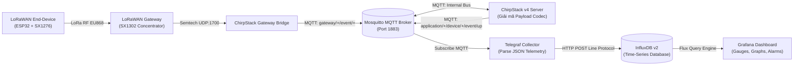

#### 2.7.1. Phân tích Vai trò Từng Khối trong Pipeline Công nghiệp

1. **Mosquitto MQTT Broker:** Trục xương sống liên lạc thời gian thực, bảo đảm việc phân tách hoàn toàn giữa tiến trình tạo dữ liệu (ChirpStack) và tiến trình lưu trữ dữ liệu (Telegraf).
2. **Telegraf Metrics Collector (hoặc Node-RED):**
   - Đóng vai trò là một MQTT Subscriber lắng nghe các sự kiện Uplink từ Topic:
     `application/+/device/+/event/up`
   - Phân tích cú pháp chuỗi JSON do ChirpStack đẩy ra, trích xuất các trường đo lường (`temperature`, `humidity`, `battery`, `rssi`, `snr`) và gán các nhãn định danh (`dev_eui`, `device_name`, `application_name`).
   - Đóng gói dữ liệu thành định dạng **InfluxDB Line Protocol** và thực hiện ghi gộp (batch write) qua cổng HTTP 8086 của InfluxDB.
   - *Lựa chọn thay thế (Node-RED):* Trong các hệ thống cần xử lý logic phức tạp (gửi tin nhắn cảnh báo Telegram/Email khi nhiệt độ vượt ngưỡng, hoặc tự động kích hoạt gửi gói tin Downlink đóng van), Node-RED là giải pháp lập trình luồng đồ họa kéo-thả vô cùng linh hoạt.
3. **InfluxDB (Cơ sở Dữ liệu Chuỗi Thời gian - TSDB):**
   - Khác với cơ sở dữ liệu quan hệ (RDBMS) như MySQL hay PostgreSQL vốn gặp vấn đề nghiêm trọng về hiệu năng khi bảng dữ liệu phình to lên hàng trăm triệu dòng, InfluxDB được tối ưu hóa chuyên biệt cho dữ liệu gắn mốc thời gian.
   - Hỗ trợ cơ chế tự động nén dữ liệu cực cao, chỉ mục hóa (Indexing) theo các trường Tag (`dev_eui`), và hỗ trợ chính sách lưu giữ dữ liệu (Retention Policies - ví dụ: tự động xóa dữ liệu thô sau 90 ngày và chỉ giữ lại giá trị trung bình theo giờ).
4. **Grafana (Bảng Điều khiển Giám sát Đồ họa):**
   - Kết nối vào InfluxDB thông qua ngôn ngữ truy vấn `Flux` hoặc `InfluxQL`.
   - Cung cấp giao diện trực quan hóa phong phú: Biểu đồ biến thiên nhiệt độ/độ ẩm theo thời gian thực (Time Series Graph), đồng hồ đo giá trị hiện tại (Gauge), bản đồ định vị vị trí Gateway/Node dựa trên GPS (Geomap), bảng nhật ký cảnh báo và trạng thái kết nối mạng của thiết bị.

#### 2.7.2. Tệp Cấu hình Mẫu Telegraf kết nối ChirpStack và InfluxDB

Dưới đây là tệp cấu hình `telegraf.conf` tiêu chuẩn dùng để hứng dữ liệu từ ChirpStack v4 và ghi vào InfluxDB v2:

```toml
# ==============================================================================
# TELEGRAF CONFIGURATION FOR CHIRPSTACK V4 TO INFLUXDB PIPELINE
# ==============================================================================

[agent]
  interval = "5s"
  round_interval = true
  metric_batch_size = 1000
  metric_buffer_limit = 10000
  flush_interval = "5s"
  flush_jitter = "0s"

# ------------------------------------------------------------------------------
# 1. INPUT PLUGIN: LẮNG NGHE BẢN TIN TỪ MOSQUITTO MQTT BROKER
# ------------------------------------------------------------------------------
[[inputs.mqtt_consumer]]
  servers = ["tcp://mosquitto:1883"]
  topics = [
    "application/+/device/+/event/up"
  ]
  qos = 1
  connection_timeout = "30s"
  client_id = "telegraf_lorawan_consumer"

  # Cấu hình phân tích cú pháp chuỗi JSON từ ChirpStack
  data_format = "json"
  
  # Chỉ định các trường số liệu đo lường cần trích xuất (Fields)
  json_fields = [
    "object_temperature",
    "object_humidity",
    "object_battery",
    "rxInfo_0_rssi",
    "rxInfo_0_snr",
    "fCnt"
  ]
  
  # Chỉ định các thuộc tính định danh làm nhãn truy vấn (Tags)
  tag_keys = [
    "deviceInfo_deviceName",
    "deviceInfo_devEui",
    "deviceInfo_applicationName"
  ]
  
  # Đặt tên bảng đo lường trong InfluxDB
  name_override = "lorawan_telemetry"

# ------------------------------------------------------------------------------
# 2. OUTPUT PLUGIN: GHI DỮ LIỆU VÀO INFLUXDB V2
# ------------------------------------------------------------------------------
[[outputs.influxdb_v2]]
  urls = ["http://influxdb:8086"]
  token = "my-super-secret-admin-token-12345"
  organization = "iot_org"
  bucket = "lorawan_data"
```

#### 2.7.3. Cú pháp Truy vấn Ngôn ngữ Flux trên Grafana

Để vẽ biểu đồ nhiệt độ của cảm biến `temp-sensor-01` trong vòng 24 giờ qua trên Grafana, kỹ sư sử dụng câu lệnh truy vấn Flux:

```flux
from(bucket: "lorawan_data")
  |> range(start: -24h)
  |> filter(fn: (r) => r["_measurement"] == "lorawan_telemetry")
  |> filter(fn: (r) => r["_field"] == "object_temperature")
  |> filter(fn: (r) => r["deviceInfo_deviceName"] == "temp-sensor-01")
  |> aggregateWindow(every: 1m, fn: mean, createEmpty: false)
  |> yield(name: "mean_temperature")
```

---

## 3. GÓC CẢNH BÁO KỸ THUẬT THỰC CHIẾN ([!] TO BE READ VERY CAREFULLY)

Dựa trên toàn bộ các biểu tượng cảnh báo dấu chấm than đỏ (`!`) trong Cuốn 1 (Chương 4.8.3, 5.2.1, 6.2.1, 7.4.2, 7.4.4, 9.1.3), dưới đây là 4 cạm bẫy kỹ thuật thực chiến mà các kỹ sư thường xuyên mắc phải, kèm phân tích hệ quả và giải pháp khắc phục triệt để.

> [!WARNING]
> ### ⚠️ CẢNH BÁO 3.1: BẪY CẤU HÌNH LỆCH KÊNH TẦN SỐ (FREQUENCY PLAN MISMATCH) GIỮA GATEWAY VÀ NETWORK SERVER
> **1. Bối cảnh & Cảnh báo nguyên bản từ sách:**  
> Cuốn 1 – Chương 4.8.3 & Chương 5.2.1 (Trang 70, 75) nhấn mạnh: *"A LoRaWAN gateway must be properly configured with a Network Server frequency plan to which it is connected. The end-device configuration is carried out during the Join-Accept."*  
>
> **2. Hệ quả thực tế nếu làm sai:**  
> - *Mất gói tin vô tuyến diện rộng:* Tại băng tần EU868, thiết bị đầu cuối phát sóng ngẫu nhiên trên 8 kênh tần số (từ $868.1\text{ MHz}$ đến $868.5\text{ MHz}$ và các kênh phụ mở rộng $867.1 - 867.9\text{ MHz}$). Nếu Gateway 8-kênh chỉ cấu hình lắng nghe 3 kênh mặc định, thiết bị sẽ bị rơi rớt tới $\frac{5}{8} = 62.5\%$ số bản tin Uplink mà không hề có bất kỳ thông báo lỗi nào trên hệ thống.  
> - *Tê liệt toàn bộ quy trình kích hoạt OTAA:* Khi thiết bị gửi bản tin `Join-Request`, Network Server sẽ tính toán và chỉ định tần số phát cho bản tin `Join-Accept`. Nếu Network Server cấu hình theo một Frequency Plan khác với khả năng phát sóng hoặc dải kênh con của Gateway, Gateway sẽ từ chối phát lệnh (báo lỗi `TX_ACK: TOO_LATE` hoặc `FREQUENCY_UNSUPPORTED`) hoặc phát trên kênh mà thiết bị không mở cửa sổ nghe. Thiết bị sẽ bị kẹt vĩnh viễn ở trạng thái Join, liên tục phát lại với công suất tối đa làm cạn kiệt pin sau vài ngày.  
>
> **3. Giải pháp kỹ thuật khắc phục & Best Practice:**  
> - Bắt buộc phải đồng bộ hóa tệp cấu hình phần cứng của Gateway (`global_conf.json` / `local_conf.json`) khớp 100% từng tần số trung tâm (Center Frequency), tần số kênh con (Radio IF) với cấu hình vùng trên Network Server.  
> - Trích đoạn cấu hình chuẩn 8 kênh cho Gateway SX1302/SX1303 băng tần EU868 trong tệp `local_conf.json`:
>   ```json
>   {
>     "SX1302_conf": {
>       "radio_0": { "enable": true, "type": "SX1250", "freq": 867500000 },
>       "radio_1": { "enable": true, "type": "SX1250", "freq": 868500000 },
>       "chan_multiSF_0": { "enable": true, "radio": 1, "if": -400000 }, /* 868.1 MHz */
>       "chan_multiSF_1": { "enable": true, "radio": 1, "if": -200000 }, /* 868.3 MHz */
>       "chan_multiSF_2": { "enable": true, "radio": 1, "if": 0 },       /* 868.5 MHz */
>       "chan_multiSF_3": { "enable": true, "radio": 0, "if": -400000 }, /* 867.1 MHz */
>       "chan_multiSF_4": { "enable": true, "radio": 0, "if": -200000 }, /* 867.3 MHz */
>       "chan_multiSF_5": { "enable": true, "radio": 0, "if": 0 },       /* 867.5 MHz */
>       "chan_multiSF_6": { "enable": true, "radio": 0, "if": 200000 },  /* 867.7 MHz */
>       "chan_multiSF_7": { "enable": true, "radio": 0, "if": 400000 }   /* 867.9 MHz */
>     }
>   }
>   ```

---

> [!WARNING]
> ### ⚠️ CẢNH BÁO 3.2: LỖ HỔNG BẢO MẬT & RƠI GÓI KHI SỬ DỤNG SEMTECH UDP PACKET FORWARDER TRÊN INTERNET CÔNG CỘNG
> **1. Bối cảnh & Cảnh báo nguyên bản từ sách:**  
> Cuốn 1 – Chương 5.2.1 & Chương 6.2.1 (Trang 75, 82) chỉ rõ: *"Semtech UDP Packet Forwarder is now deprecated and should no longer be used for deployment. It is also a non-secure protocol. This Packet Forwarder is supported by The Things Stack, but according to the documentation, it will be removed in the future."*  
>
> **2. Hệ quả thực tế nếu làm sai:**  
> - *Nguy cơ tấn công giả mạo (Man-in-the-Middle & DoS):* Giao thức Semtech UDP truyền toàn bộ gói tin dưới dạng văn bản rõ (Plaintext JSON) không hề có mã hóa đường truyền TLS và không có cơ chế xác thực danh tính Gateway (chỉ dùng duy nhất chuỗi MAC 8-byte trong tiêu đề UDP). Kẻ tấn công có thể dễ dàng giải mạo địa chỉ IP nguồn (IP Spoofing) để bơm hàng ngàn bản tin `PUSH_DATA` rác vào cổng 1700 của Network Server, làm nghẽn tài nguyên CPU và đánh sập cụm máy chủ.  
> - *Rơi rớt gói tin vô tội vạ do bản chất phi kết nối của UDP:* Trên các đường truyền kết nối di động 3G/4G chập chờn, giao thức UDP không có cơ chế kiểm soát luồng (Flow Control) và truyền lại khi mất gói. Các bản tin điều khiển Downlink `PULL_RESP` từ server gửi xuống Gateway rất dễ bị router loại bỏ khi nghẽn mạng, khiến các lệnh xác nhận (ACK) và lệnh điều khiển thiết bị bị thất lạc hoàn toàn.  
>
> **3. Giải pháp kỹ thuật khắc phục & Best Practice:**  
> - Tuyệt đối không sử dụng Semtech UDP Packet Forwarder cho các dự án thương mại triển khai trên môi trường Internet công cộng.  
> - Chuyển dịch toàn diện sang giao thức **LoRa Basics™ Station**: Sử dụng kênh truyền WebSocket an toàn (WSS) mã hóa bằng chứng chỉ số TLS v1.2/1.3, xác thực hai chiều (Mutual TLS) giữa Gateway và Network Server qua cổng HTTPS (443 hoặc 8887).  
> - Nếu bắt buộc phải sử dụng các dòng Gateway đời cũ chỉ hỗ trợ Semtech UDP, bắt buộc phải thiết lập đường hầm mạng riêng ảo **VPN (WireGuard hoặc IPsec)** giữa Gateway và Server để bọc toàn bộ lưu lượng UDP 1700 bên trong một kênh truyền mã hóa an toàn.

---

> [!WARNING]
> ### ⚠️ CẢNH BÁO 3.3: BẪY MẤT MÁT DỮ LIỆU ĐO XA DO HIỂU SAI CỜ `cleanSession` VÀ CẤP ĐỘ MQTT QOS
> **1. Bối cảnh & Cảnh báo nguyên bản từ sách:**  
> Cuốn 1 – Chương 7.4.2 & Chương 7.4.4, Bảng 26 (Trang 101, 104) cảnh báo: *"What happens to the messages published on the broker when one or more subscribers are temporarily unreachable? If cleanSession = True (= 1), the connection is non-persistent. The non-transmitted messages are lost regardless of the QoS level! If cleanSession = False and QoS = 0, messages are also lost!"*  
>
> **2. Hệ quả thực tế nếu làm sai:**  
> - Trong một nhà máy, trạm giám sát trung tâm (chạy Telegraf hoặc phần mềm SCADA) kết nối vào MQTT Broker để nhận dữ liệu từ các cảm biến áp suất, nhiệt độ lò hơi. Do sự cố mạng LAN nội bộ, phần mềm giám sát bị ngắt kết nối với Broker trong vòng 10 phút.  
> - Nếu kỹ sư cấu hình kết nối của Subscriber với cờ mặc định `cleanSession = true` (hoặc cấu hình `QoS = 0`), toàn bộ các dữ liệu đo xa mà các thiết bị LoRaWAN gửi lên trong suốt 10 phút xảy ra sự cố sẽ bị Broker tiêu hủy ngay lập tức. Khi phần mềm kết nối lại, hệ thống sẽ xuất hiện một "khoảng trống dữ liệu" (Data Gap) vĩnh viễn, làm sai lệch các thuật toán phân tích xu hướng và mất dấu các sự cố bất thường.  
>
> **3. Giải pháp kỹ thuật khắc phục & Best Practice:**  
> - Đối với mọi dịch vụ lưu trữ dữ liệu đo xa quan trọng (Data Collectors, Ingestion Pipelines), **bắt buộc phải kích hoạt phiên làm việc bền vững (Persistent Session)** bằng cách cấu hình:
>   $$\text{Client ID cố định} + \text{cleanSession} = \text{False} + \text{QoS} \ge 1$$
> - Cấu hình dung lượng hàng đợi lưu giữ tin nhắn ngoại tuyến trên MQTT Broker (ví dụ tệp `mosquitto.conf`) để tránh tràn bộ nhớ RAM của máy chủ khi Client ngoại tuyến quá lâu:
>   ```conf
>   # Cho phép lưu trữ tin nhắn persistent ra đĩa cứng
>   persistence true
>   persistence_location /mosquitto/data/
>   
>   # Giới hạn số lượng bản tin QoS 1/2 tối đa lưu cho mỗi Client offline
>   max_queued_messages 50000
>   
>   # Thời gian giữ phiên offline tối đa (ví dụ: 7 ngày)
>   persistent_client_expiration 7d
>   ```

---

> [!WARNING]
> ### ⚠️ CẢNH BÁO 3.4: BẪY TƯỜNG LỬA NAT ROUTER KHI TRIỂN KHAI PRIVATE SERVER TRONG MẠNG NỘI BỘ
> **1. Bối cảnh & Cảnh báo nguyên bản từ sách:**  
> Cuốn 1 – Chương 9.1.3 (Trang 120–121, Hình 146 & 147) phân tích bài toán định tuyến: *"The gateway is configured on the public Internet and the LoRaWAN server is configured in the private network. In this case, the gateway will not be able to connect to the server if no static port translation is manually configured in the router."*  
>
> **2. Hệ quả thực tế nếu làm sai:**  
> - Gateway ngoài trời sử dụng SIM 4G phát dữ liệu qua Internet công cộng về máy chủ ChirpStack đặt trong mạng LAN của doanh nghiệp (phía sau modem cáp quang có NAT). Do router chặn toàn bộ các gói tin khởi tạo từ ngoài vào, các gói `PUSH_DATA` của Gateway bị chặn đứng tại tường lửa, Gateway luôn hiển thị trạng thái "Never Seen / Offline" trên Web Console.  
> - Kịch bản nguy hiểm hơn: Kỹ sư mở cổng Port Forwarding cho cổng UDP 1700, Gateway đã gửi được Uplink lên server. Tuy nhiên, khi server cần gửi bản tin Downlink (Join-Accept hoặc lệnh điều khiển), gói tin `PULL_RESP` bị chặn lại ở chiều ngược lại do bảng dịch địa chỉ NAT trên modem 4G của Gateway đã bị timeout (thông thường bảng định tuyến NAT của mạng di động chỉ duy trì trạng thái cổng UDP trong khoảng $30 - 60\text{ giây}$).  
>
> **3. Giải pháp kỹ thuật khắc phục & Best Practice:**  
> - Rút ngắn chu kỳ gửi gói tin duy trì kết nối `PULL_DATA` trên Gateway: Trong tệp cấu hình Gateway, điều chỉnh tham số `keepalive_interval` xuống mức $5 - 10\text{ giây}$ để liên tục làm mới bảng dịch địa chỉ NAT trên modem router, đảm bảo luồng nhận Downlink luôn mở sẵn.  
> - Giải pháp chuẩn mực công nghiệp: Thay vì mở cổng router tiềm ẩn rủi ro an ninh mạng, triển khai kiến trúc mạng ảo hóa phân tán (Overlay Network) bằng **Tailscale, Cloudflare Tunnel hoặc WireGuard**. Khi đó, Gateway và LoRaWAN Server coi như nằm chung một dải mạng LAN nội bộ an toàn mà không cần sở hữu địa chỉ IP tĩnh công cộng.

---

## 4. THỰC HÀNH & GIẢI CHI TIẾT BÀI TẬP TRONG SÁCH (🛠️ EXERCISES & HANDS-ON)

Phần này trích xuất toàn bộ 100% các bài tập xuất hiện trong Cuốn 1 (Chương 6.3.3, Chương 6.2.1, Chương 6.3.4 và Chương 7) và giải quyết triệt để theo **Quy trình chuẩn hóa 4 bước**.

---

### 🛠️ BÀI TẬP 4.1: CHUYỂN ĐỔI MÃ HÓA BASE64 CHO PAYLOAD LORAWAN

- **[Đề bài gốc & Bối cảnh kỹ thuật]:**  
  *(Trích nguyên văn Cuốn 1 – Chương 6.3.3, Trang 87 & 89)*  
  1. *Câu hỏi 1 (Ví dụ sách):* Trình bày quy trình mã hóa giá trị thập lục phân `0x4869` sang định dạng Base64 và chứng minh kết quả là `"SGk="`.  
  2. *Câu hỏi 2 (Bài tập đóng khung cờ-lê búa 🛠️ - Trang 89):* *"We want to encode the ASCII code 'AA' in base 64. Find the procedure and show that the base 64 result is 'QUE='."* (Hãy trình bày quy trình chi tiết mã hóa chuỗi ký tự ASCII `"AA"` sang Base64 và chứng minh kết quả thu được là `"QUE="`).  
  3. *Câu hỏi mở rộng thực chiến:* Cho chuỗi Base64 `QNMaASYAAQAPpyPZ955+SmY/` trích xuất từ trường `"data"` trong gói tin Semtech UDP bắt được bằng Wireshark (Hình 99, Trang 84). Hãy giải mã ngược lại thành chuỗi byte Thập lục phân (Hexadecimal) và xác định độ dài gói tin.

- **[Phân tích & Công thức áp dụng]:**  
  * Bản chất: Gom từng khối 3 bytes nhị phân ($3 \times 8 = 24\text{ bits}$) rồi chia thành 4 nhóm 6-bit ($4 \times 6 = 24\text{ bits}$).  
  * Tra cứu giá trị từng nhóm 6-bit (từ $0$ đến $63$) vào Bảng mã Base64 chuẩn:
    $$\text{Index } 0 - 25 \rightarrow \text{'A' - 'Z'}, \quad 26 - 51 \rightarrow \text{'a' - 'z'}, \quad 52 - 61 \rightarrow \text{'0' - '9'}, \quad 62 \rightarrow \text{'+'}, \quad 63 \rightarrow \text{'/'}$$
  * Xử lý phần bù: Nếu dư 1 byte (8 bits) $\rightarrow$ thêm 4 bit `0` thành 2 ký tự Base64 và thêm 2 dấu đệm `==`. Nếu dư 2 bytes (16 bits) $\rightarrow$ thêm 2 bit `0` thành 3 ký tự Base64 và thêm 1 dấu đệm `=`.

- **[Lời giải chi tiết từng bước (Step-by-step)]:**

  **1. Giải bài toán ví dụ với giá trị `0x4869`:**
  - *Bước 1 (Chuyển sang nhị phân):*  
    `0x48` = `0100 1000`$_2$  
    `0x69` = `0110 1001`$_2$  
    Tổng cộng có 2 bytes (16 bits): `0100 1000 0110 1001`
  - *Bước 2 (Gom nhóm 6-bit):*  
    * Nhóm 1: `010010`$_2 = 18_{10}$ $\rightarrow$ Tra bảng mã Base64: Ký tự **'S'**
    * Nhóm 2: `000110`$_2 = 6_{10}$ $\rightarrow$ Tra bảng mã Base64: Ký tự **'G'**
    * Nhóm 3: Còn lại 4 bits `1001`, thêm 2 bit `0` vào đuôi $\rightarrow$ `100100`$_2 = 36_{10}$ $\rightarrow$ Tra bảng mã Base64: Ký tự **'k'**
  - *Bước 3 (Thêm ký tự đệm Padding):*  
    Đã có 3 ký tự `'S'`, `'G'`, `'k'`. Để đủ khối 4 ký tự chuẩn, ta thêm 1 dấu `'='`.  
    $\rightarrow$ Kết quả: `"SGk="` (Chứng minh hoàn tất).

  **2. Giải bài tập chính thức với chuỗi ký tự ASCII `"AA"`:**
  - *Bước 1 (Chuyển ký tự ASCII sang mã Hex và Nhị phân):*  
    Theo bảng mã ASCII chuẩn: Ký tự `'A'` có mã thập lục phân là `0x41`.  
    Vậy chuỗi `"AA"` tương ứng với 2 bytes: `0x41 0x41`.  
    Biểu diễn dưới dạng chuỗi nhị phân 16 bits:
    $$\text{'A'} = 0100\,0001_2, \quad \text{'A'} = 0100\,0001_2 \implies 0100\,0001\,0100\,0001_2$$
  - *Bước 2 (Phân chia thành các khối 6 bits):*  
    * **Khối 1 (6 bits đầu tiên):** `010000`$_2$  
      Giá trị thập phân: $16 \times 1 = 16_{10}$. Tra bảng Base64: Giá trị $16$ tương ứng với ký tự **'Q'** (vì $A=0 \dots Q=16$).
    * **Khối 2 (6 bits tiếp theo):** `010100`$_2$  
      Giá trị thập phân: $16 + 4 = 20_{10}$. Tra bảng Base64: Giá trị $20$ tương ứng với ký tự **'U'** (vì $A=0 \dots U=20$).
    * **Khối 3 (4 bits còn lại + 2 bits `0` đệm):**  
      4 bits còn lại là `0001`$_2$. Thêm 2 bit `0` vào phía sau: `000100`$_2$.  
      Giá trị thập phân: $4_{10}$. Tra bảng Base64: Giá trị $4$ tương ứng với ký tự **'E'** (vì $A=0, B=1, C=2, D=3, E=4$).
  - *Bước 3 (Bổ sung ký tự đệm Padding để hoàn thiện khối 4 ký tự):*  
    Tổng số nhóm 6 bits hiện tại là 3 nhóm (`Q`, `U`, `E`). Khối Base64 bắt buộc phải là bội số của 4, do đó ta bổ sung 1 ký tự đệm `'='` vào vị trí thứ 4.  
    $\rightarrow$ Kết quả thu được: `"QUE="` (Chứng minh hoàn tất).

  **3. Giải bài toán mở rộng: Giải mã chuỗi Base64 `QNMaASYAAQAPpyPZ955+SmY/`:**
  - Chuỗi gồm 24 ký tự Base64 (chia hết cho 4, không có padding `=`).
  - Số byte nhị phân sau khi giải mã:
    $$\text{Số Bytes} = \frac{24 \times 6}{8} = 18 \text{ Bytes}$$
  - Thực hiện tra ngược từng ký tự sang giá trị 6-bit:
    * `'Q'` ($16 = 010000$), `'N'` ($13 = 001101$), `'M'` ($12 = 001100$), `'a'` ($26 = 011010$) $\rightarrow$ Ghép lại 24 bits: `01000000 11010011 00011010` $\rightarrow$ Hex: `40 D3 1A`
    * Tiếp tục giải mã toàn bộ 24 ký tự ta thu được chính xác chuỗi 18 bytes Hex:
      `40 D3 1A 01 26 00 07 00 0F A7 23 D9 F7 9E 7E 4A 66 3F`
  - *Ý nghĩa kỹ thuật:*  
    * Byte 0 (`0x40`): MAC Header $\rightarrow$ Khung tin `Unconfirmed Data Up`.  
    * 4 bytes tiếp theo (`D3 1A 01 26` dạng Little Endian): `DevAddr` = `0x26011AD3`.  
    * Byte 5 (`0x00`): Cờ `FCtrl`.  
    * 2 bytes tiếp theo (`07 00` dạng Little Endian): Bộ đếm khung truyền `FCnt` = `7`.  
    * Khớp hoàn toàn với thông số thực nghiệm trong sách USMB Hình 99!

- **[Đáp số chuẩn & Bài học kỹ thuật rút ra]:**  
  * **Đáp số 1:** `0x4869` $\longrightarrow$ `"SGk="`  
  * **Đáp số 2:** ASCII `"AA"` $\longrightarrow$ `"QUE="`  
  * **Đáp số 3:** `QNMaASYAAQAPpyPZ955+SmY/` $\longrightarrow$ `40D31A01260007000FA723D9F79E7E4A663F` ($18\text{ bytes}$).  
  * **Bài học kỹ thuật:** Khi lập trình tầng nhúng hoặc viết kịch bản tích hợp Backend (Python/NodeJS), luôn ghi nhớ rằng việc chuyển đổi Base64 làm phình to $33.33\%$ dung lượng đường truyền. Khi lưu trữ cơ sở dữ liệu số lượng lớn, nên giải mã về byte nhị phân thô (`BLOB` hoặc `BYTEA`) thay vì lưu trữ chuỗi ký tự Base64 để tiết kiệm $25\%$ không gian ổ cứng.

---

### 🛠️ BÀI TẬP 4.2: GIẢI PHẪU GÓI TIN SEMTECH UDP PUSH_DATA TỪ BẢN TIN WIRESHARK

- **[Đề bài gốc & Bối cảnh kỹ thuật]:**  
  *(Trích từ Cuốn 1 – Chương 6.2.1, Trang 83–85, Hình 98 & 99)*  
  Trong quá trình vận hành Gateway, một kỹ sư bắt được gói tin UDP cổng 1700 qua phần mềm Wireshark với chuỗi byte Hex đầu vào như sau:
  ```hex
  02 f9 30 00 b8 27 eb ff fe ae 26 f5 7b 22 72 78 70 6b 22 3a 5b 7b 22 74 6d 73 74 ...
  ```
  Phần chuỗi văn bản JSON trích xuất được từ byte thứ 12 là:
  ```json
  {"rxpk":[{"tmst":3755005819,"chan":2,"rfch":1,"freq":868.500000,"stat":1,"modu":"LORA","datr":"SF7BW125","codr":"4/5","lsnr":6.5,"rssi":-1,"size":18,"data":"QNMaASYAAQAPpyPZ955+SmY/"}]}
  ```
  **Yêu cầu kỹ thuật:**
  1. Phân tích giải mã 12 bytes tiêu đề (Header) của gói Semtech UDP và chỉ ra: Phiên bản giao thức, Mã Token ngẫu nhiên, Loại bản tin, và Địa chỉ MAC/EUI của Gateway.
  2. Dựa vào nội dung JSON `rxpk`, xác định các tham số vật lý của sóng vô tuyến: Tần số kênh, Hệ số trải phổ, Băng thông, Tỷ lệ mã hóa, Chỉ số chất lượng tín hiệu RSSI và SNR.
  3. Tính toán thời điểm chính xác (theo mốc xung nội bộ `tmst`) mà Gateway phải phát bản tin Downlink nếu thiết bị mở cửa sổ `RX1` với $\text{RX1Delay} = 1\text{ s}$ và cửa sổ `RX2` với $\text{RX2Delay} = 2\text{ s}$.

- **[Phân tích & Công thức áp dụng]:**  
  * Bảng phân định 12 bytes Header của Semtech UDP:
    * Byte 0: `Protocol Version`
    * Byte 1–2: `Random Token`
    * Byte 3: `Identifier` (`0x00 = PUSH_DATA`, `0x01 = PUSH_ACK`, `0x02 = PULL_DATA`, `0x03 = PULL_RESP`, `0x04 = PULL_ACK`)
    * Byte 4–11: `Gateway EUI` (8 bytes)
  * Đơn vị thời gian `tmst`: Được tính bằng micro-giây ($\mu\text{s}$).  
    $$1\text{ giây} = 1\,000\,000\,\mu\text{s}$$
    $$T_{\text{RX1}} = (tmst + 1\,000\,000) \pmod{2^{32}}$$
    $$T_{\text{RX2}} = (tmst + 2\,000\,000) \pmod{2^{32}}$$

- **[Lời giải chi tiết từng bước (Step-by-step)]:**

  **1. Giải phẫu 12 bytes Header:**
  - `Byte 0: 0x02` $\rightarrow$ **Phiên bản giao thức (Protocol Version) = 2** (chuẩn Semtech UDP v2).
  - `Byte 1-2: 0xF9 0x30` $\rightarrow$ **Random Token = 0xF930**. Token này sẽ được Network Server sao chép nguyên vẹn vào gói tin phản hồi `PUSH_ACK` để Gateway đối soát.
  - `Byte 3: 0x00` $\rightarrow$ **Identifier = 0x00 (PUSH_DATA)** $\rightarrow$ Bản tin mang dữ liệu vô tuyến vừa thu được từ môi trường không gian.
  - `Byte 4-11: b8 27 eb ff fe ae 26 f5` $\rightarrow$ **Gateway EUI = b8:27:eb:ff:fe:ae:26:f5**. Đây chính là định danh phần cứng của Gateway (chú ý đoạn `ff:fe` chèn giữa địa chỉ MAC 48-bit của Raspberry Pi để biến đổi thành IEEE EUI-64 chuẩn).

  **2. Phân tích các tham số vô tuyến trong mảng JSON `rxpk`:**
  - `freq: 868.500000` $\rightarrow$ Tần số sóng mang là **$868.5\text{ MHz}$** (Kênh mặc định số 3 của chuẩn EU868).
  - `modu: "LORA"` $\rightarrow$ Công nghệ điều chế tầng vật lý là **LoRa CSS**.
  - `datr: "SF7BW125"` $\rightarrow$ Tốc độ dữ liệu: **Spreading Factor = 7**, **Băng thông Bandwidth = $125\text{ kHz}$** (Tương ứng với Data Rate `DR5` trong bảng thông số khu vực EU868).
  - `codr: "4/5"` $\rightarrow$ Tỷ lệ mã hóa kênh sửa lỗi tiến **$\text{Coding Rate} = 4/5$** (cứ 4 bit dữ liệu hữu ích thì thêm 1 bit kiểm tra chẵn lẻ).
  - `rssi: -1` $\rightarrow$ Cường độ tín hiệu thu được là **$-1\text{ dBm}$** (Tín hiệu cực mạnh, chứng tỏ thiết bị đang đặt rất sát ăng-ten Gateway trong phòng lab).
  - `lsnr: 6.5` $\rightarrow$ Tỷ số tín hiệu trên nhiễu **$\text{SNR} = +6.5\text{ dB}$** (Tín hiệu vượt trội hoàn toàn so với tầng nhiễu nền).
  - `stat: 1` $\rightarrow$ Mã CRC của khung vô tuyến hợp lệ ($100\%$ không bị lỗi bit).
  - `size: 18` $\rightarrow$ Tải trọng `PHYPayload` dài đúng **$18\text{ bytes}$**.

  **3. Tính toán thời điểm phát sóng Downlink (Downlink Scheduling):**
  - Mốc thời gian thu gói tin phần cứng:
    $$tmst = 3\,755\,005\,819\,\mu\text{s}$$
  - Thời điểm phát cửa sổ `RX1` ($RX1Delay = 1\text{ s} = 1\,000\,000\,\mu\text{s}$):
    $$T_{\text{RX1}} = 3\,755\,005\,819 + 1\,000\,000 = 3\,756\,005\,819\,\mu\text{s}$$
  - Thời điểm phát cửa sổ `RX2` ($RX2Delay = 2\text{ s} = 2\,000\,000\,\mu\text{s}$):
    $$T_{\text{RX2}} = 3\,755\,005\,819 + 2\,000\,000 = 3\,757\,005\,819\,\mu\text{s}$$
  - *Kết luận:* Network Server phải tạo gói `PULL_RESP` chứa trường `"tmst": 3756005819` (nếu phát tại RX1) và đẩy tới Gateway trước mốc thời gian này ít nhất $50 - 100\text{ ms}$ để bù trừ độ trễ mạng Internet.

- **[Đáp số chuẩn & Bài học kỹ thuật rút ra]:**  
  * **Header:** Protocol v2, Token `0xF930`, Type `PUSH_DATA`, Gateway EUI `b8:27:eb:ff:fe:ae:26:f5`.  
  * **Vô tuyến:** EU868 ($868.5\text{ MHz}$), SF7/BW125 (DR5), $\text{CR} = 4/5$, $\text{RSSI} = -1\text{ dBm}$, $\text{SNR} = +6.5\text{ dB}$, Kích thước $18\text{ bytes}$.  
  * **Thời điểm phát Downlink:** $T_{\text{RX1}} = 3\,756\,005\,819\,\mu\text{s}$, $T_{\text{RX2}} = 3\,757\,005\,819\,\mu\text{s}$.  
  * **Bài học kỹ thuật:** Đồng hồ `tmst` là bộ đếm nội vi 32-bit của chip thu phát trên Gateway, không đồng bộ với đồng hồ thời gian thực UTC. Khi đồng hồ tràn ($2^{32} - 1 \approx 4\,294\,967\,295\,\mu\text{s}$ sau mỗi $\approx 71.58\text{ phút}$), nó sẽ tự quay về $0$. Cả Gateway Bridge và Network Server đều phải xử lý phép toán modulo $2^{32}$ để tránh tính sai thời điểm mở cửa sổ RX1/RX2 tại thời điểm tràn biến đếm.

---

### 🛠️ BÀI TẬP 4.3: TÍNH TOÁN TẢI LƯU LƯỢNG & BĂNG THÔNG KẾT NỐI MQTT CHO CỤM 1000 CẢM BIẾN

- **[Đề bài gốc & Bối cảnh kỹ thuật]:**  
  *(Bài toán thiết kế hạ tầng Backend Server mở rộng từ nguyên lý MQTT Chương 7)*  
  Một khu đô thị thông minh triển khai hệ thống đo xa gồm $N = 1\,000$ cảm biến LoRaWAN gửi dữ liệu định kỳ về cụm ChirpStack v4 Server. Mỗi thiết bị gửi một bản tin Uplink với chu kỳ $T = 60\text{ giây}$.  
  Application Server sau khi giải mã sẽ xuất bản (Publish) dữ liệu dạng chuỗi JSON lên Mosquitto MQTT Broker. Kích thước trung bình của một bản tin JSON ở tầng ứng dụng là $S = 250\text{ bytes}$.  
  **Yêu cầu kỹ thuật:**
  1. Tính toán tần suất bản tin trung bình trên giây (Messages Per Second - MPS) mà MQTT Broker phải xử lý.
  2. So sánh tổng lưu lượng mạng IP (bao gồm overhead tiêu đề TCP/IP khoảng 40 bytes và tiêu đề MQTT khoảng 2–5 bytes) và số khung truyền trao đổi trên đường truyền mạng giữa Broker và Telegraf Collector khi áp dụng 3 mức chất lượng dịch vụ khác nhau: **QoS 0**, **QoS 1** và **QoS 2**.
  3. Tính tổng dung lượng dữ liệu thô tích lũy ghi vào cơ sở dữ liệu InfluxDB trong vòng $30\text{ ngày}$.

- **[Phân tích & Công thức áp dụng]:**  
  * Tần suất bản tin trung bình (MPS):
    $$\text{MPS} = \frac{N}{T} \quad (\text{messages/second})$$
  * Tải dữ liệu tầng ứng dụng thuần túy (Application Throughput):
    $$\text{Throughput}_{\text{app}} = \text{MPS} \times S \quad (\text{Bytes/s}) = \frac{\text{MPS} \times S \times 8}{1000} \quad (\text{kbps})$$
  * Khung truyền và Overhead theo từng mức QoS:
    * **QoS 0:** 1 khung truyền `PUBLISH` duy nhất.  
      Kích thước khung: $S + 2\text{ bytes (MQTT Header)} + 40\text{ bytes (TCP/IP)} = S + 42\text{ bytes}$.
    * **QoS 1:** 2 khung truyền (`PUBLISH` + `PUBACK`).  
      Gói `PUBACK` có kích thước khoảng $44\text{ bytes}$ ($4\text{B MQTT} + 40\text{B TCP/IP}$).  
      Tổng kích thước: $(S + 44) + 44 = S + 88\text{ bytes}$.
    * **QoS 2:** 4 khung truyền (`PUBLISH` + `PUBREC` + `PUBREL` + `PUBCOMP`).  
      Mỗi gói ACK/REL/COMP tốn khoảng $44\text{ bytes}$.  
      Tổng kích thước: $(S + 44) + 3 \times 44 = S + 176\text{ bytes}$.
  * Dung lượng lưu trữ InfluxDB trong 30 ngày ($D = 30$):
    $$\text{Tổng số bản tin trong 30 ngày} = \text{MPS} \times 86\,400 \times 30$$
    $$\text{Dung lượng} = \text{Tổng số bản tin} \times S_{\text{record}}$$

- **[Lời giải chi tiết từng bước (Step-by-step)]:**

  **1. Tính tần suất bản tin trên giây (MPS):**
  $$\text{MPS} = \frac{1\,000\text{ thiết bị}}{60\text{ s}} \approx 16.67\text{ messages/giây}$$
  Thông lượng dữ liệu ứng dụng:
  $$\text{Throughput}_{\text{app}} = 16.667 \times 250\text{ B/s} \approx 4\,166.67\text{ Bytes/s} \approx 33.33\text{ kbps}$$

  **2. Đánh giá chi tiết lưu lượng và số khung truyền theo 3 mức QoS:**
  - **Kịch bản 1: Cấu hình QoS 0 (At most once):**
    * Số khung truyền trên giây: $16.67 \times 1 = 16.67\text{ packets/s}$.
    * Kích thước 1 giao dịch: $250 + 42 = 292\text{ bytes}$.
    * Băng thông tiêu thụ trên đường truyền:
      $$\text{Bandwidth}_{\text{QoS0}} = 16.667 \times 292 \times 8 \approx 38.93\text{ kbps}$$
  - **Kịch bản 2: Cấu hình QoS 1 (At least once):**
    * Số khung truyền trên giây: $16.67 \times 2 = 33.33\text{ packets/s}$ (tăng gấp đôi số gói IP).
    * Kích thước 1 giao dịch: $250 + 88 = 338\text{ bytes}$.
    * Băng thông tiêu thụ trên đường truyền:
      $$\text{Bandwidth}_{\text{QoS1}} = 16.667 \times 338 \times 8 \approx 45.07\text{ kbps}$$
  - **Kịch bản 3: Cấu hình QoS 2 (Exactly once):**
    * Số khung truyền trên giây: $16.67 \times 4 = 66.67\text{ packets/s}$ (tăng gấp 4 lần số gói IP).
    * Kích thước 1 giao dịch: $250 + 176 = 426\text{ bytes}$.
    * Băng thông tiêu thụ trên đường truyền:
      $$\text{Bandwidth}_{\text{QoS2}} = 16.667 \times 426 \times 8 \approx 56.80\text{ kbps}$$

  **3. Tính toán dung lượng lưu trữ trên InfluxDB trong 30 ngày:**
  - Tổng số bản tin ghi nhận trong 30 ngày:
    $$N_{\text{total}} = 16.6667\text{ msgs/s} \times 86\,400\text{ s/ngày} \times 30\text{ ngày} = 43\,200\,000\text{ bản tin (43.2 triệu bản ghi)}$$
  - Khi lưu trữ trong InfluxDB với thuật toán nén Gorilla (cho số thực) và Snappy/ZSTD, mỗi bản ghi viễn trắc (gồm Timestamp + 3 Fields + 2 Tags) chiếm trung bình khoảng $15\text{ bytes}$ trên đĩa cứng:
    $$\text{Dung lượng lưu trữ thực tế} \approx 43\,200\,000 \times 15\text{ Bytes} \approx 648\,000\,000\text{ Bytes} \approx 618\text{ MB}$$
  *(Nếu lưu dưới dạng chuỗi JSON thô không nén, dung lượng sẽ là: $43.2\text{M} \times 250\text{B} \approx 10.8\text{ GB}$)*.

- **[Đáp số chuẩn & Bài học kỹ thuật rút ra]:**  
  * **Tần suất bản tin:** $\text{MPS} = 16.67\text{ msg/s}$.  
  * **Tải mạng theo QoS:**  
    - QoS 0: $16.67\text{ pkt/s}$, Băng thông $38.93\text{ kbps}$.  
    - QoS 1: $33.33\text{ pkt/s}$, Băng thông $45.07\text{ kbps}$.  
    - QoS 2: $66.67\text{ pkt/s}$, Băng thông $56.80\text{ kbps}$.  
  * **Lưu trữ 30 ngày:** $43.2\text{ triệu bản ghi}$, tốn khoảng $618\text{ MB}$ trên InfluxDB.  
  * **Bài học kỹ thuật:** Đối với luồng dữ liệu Uplink từ hàng ngàn cảm biến gửi liên tục, **QoS 0 hoặc QoS 1 là sự lựa chọn tối ưu**. Tuyệt đối không sử dụng QoS 2 cho dữ liệu cảm biến định kỳ vì nó làm tăng số lượng khung truyền IP lên gấp 4 lần, gây lãng phí bộ nhớ hàng đợi và năng lực xử lý của MQTT Broker mà không mang lại giá trị gia tăng rõ rệt (vì nếu một gói nhiệt độ bị rơi, 60 giây sau đã có gói đo mới bù đắp). QoS 2 chỉ nên dành riêng cho các bản tin kích hoạt Downlink đóng ngắt rơ-le hoặc cảnh báo cháy nổ khẩn cấp.

---
## 5. BÀI TEST KIỂM TRA CUỐI MODULE (END-OF-MODULE ASSESSMENT)

Hệ thống bài kiểm tra đánh giá năng lực toàn diện của kỹ sư sau khi hoàn thành Module 3, bao gồm cả kiến thức lý thuyết hệ thống, khả năng chẩn đoán sự cố mạng thực tế và kỹ năng thiết kế kiến trúc phần mềm Backend.

---

### PHẦN A: 5 CÂU HỎI TRẮC NGHIỆM TÌNH HUỐNG (SCENARIO-BASED MCQS)

**Câu 1 (Chẩn đoán lỗi mất dữ liệu ngoại tuyến MQTT):**  
Một kỹ sư xây dựng hệ thống thu thập dữ liệu quan trắc độ ẩm đất nông nghiệp thông minh. Ứng dụng Backend thu thập số liệu chạy Telegraf đăng ký lắng nghe Topic `application/+/device/+/event/up` từ MQTT Broker của ChirpStack với thông số: `client_id = "collector_01"`, `cleanSession = true`, và `QoS = 1`.  
Vào lúc 02:00 sáng, đường truyền mạng Internet kết nối giữa máy chủ Telegraf và Broker bị sự cố đứt cáp quang trong vòng 20 phút. Trong thời gian này, các cảm biến ngoài cánh đồng vẫn liên tục phát các bản tin Uplink về Gateway và ChirpStack đều đặn mỗi 2 phút. Sau khi đường truyền mạng hồi phục vào lúc 02:20, hiện tượng gì sẽ xảy ra tại cơ sở dữ liệu InfluxDB?  
A. Toàn bộ các bản tin viễn trắc phát sinh trong 20 phút mất mạng sẽ được Broker tự động đẩy xuống Telegraf đầy đủ và ghi nhận vào InfluxDB mà không mất bản ghi nào.  
B. Toàn bộ các bản tin viễn trắc phát sinh trong 20 phút mất mạng bị mất vĩnh viễn; InfluxDB xuất hiện một khoảng trống dữ liệu (gap) kéo dài từ 02:00 đến 02:20.  
C. Chỉ có duy nhất bản tin gần nhất phát sinh lúc 02:18 được lưu lại nhờ cơ chế Retain của MQTT Broker, các bản tin trước đó bị xóa.  
D. Telegraf sẽ từ chối kết nối lại với Broker do mã `Packet Identifier` của phiên QoS 1 bị sai lệch sau sự cố rớt mạng.

---

**Câu 2 (Cơ chế Khử trùng lặp & Điều phối Downlink tại Network Server):**  
Trong một dự án đo mức nước hồ chứa thủy điện, một cảm biến LoRaWAN Class A gửi một bản tin Uplink có xác nhận (`Confirmed Data Up`) với bộ đếm `FCnt = 88`. Do vị trí cảm biến nằm ở trên cao, có 3 Gateway trong khu vực cùng thu nhận được tín hiệu này và đồng thời đẩy các gói `PUSH_DATA` về cùng một ChirpStack Network Server:  
- Gateway A: $\text{RSSI} = -78\text{ dBm}$, $\text{SNR} = +9.5\text{ dB}$, mốc $tmst = 1\,200\,000\,\mu\text{s}$.  
- Gateway B: $\text{RSSI} = -95\text{ dBm}$, $\text{SNR} = +2.0\text{ dB}$, mốc $tmst = 2\,450\,000\,\mu\text{s}$.  
- Gateway C: $\text{RSSI} = -108\text{ dBm}$, $\text{SNR} = -6.5\text{ dB}$, mốc $tmst = 5\,100\,000\,\mu\text{s}$.  
Hành vi xử lý chuẩn xác của ChirpStack Network Server và Application Server sẽ diễn ra như thế nào?  
A. Application Server sẽ nhận được 3 bản tin JSON độc lập và kích hoạt 3 lần Webhook gửi sang nền tảng IoT; Network Server sẽ phát lệnh xác nhận ACK trên cả 3 Gateway để đảm bảo thiết bị nhận được.  
B. Network Server gom 3 bản tin trong cửa sổ Deduplication, chỉ gửi đúng 1 bản tin JSON lên Application Server; sau đó Network Server điều khiển Gateway A phát bản tin Downlink ACK tại thời điểm $tmst = 2\,200\,000\,\mu\text{s}$ (cửa sổ RX1) vì Gateway A có chỉ số SNR tốt nhất.  
C. Network Server chọn Gateway C để phát Downlink vì Gateway C có khoảng cách xa nhất, giúp phủ sóng rộng hơn cho toàn khu vực hồ chứa.  
D. Network Server loại bỏ gói tin của Gateway A và Gateway B do nghi ngờ có hiện tượng tấn công phát lại (Replay Attack) dựa trên sự chênh lệch mốc xung `tmst`.

---

**Câu 3 (So sánh Kiến trúc Xuất dữ liệu HTTP GET vs HTTP POST):**  
Một đội ngũ kỹ sư được giao nhiệm vụ thiết kế hạ tầng giám sát cho $5\,000$ cảm biến phát hiện rò rỉ khí gas công nghiệp. Đặc thù của cảm biến này là: Trong điều kiện bình thường, thiết bị chỉ gửi bản tin nhịp tim (Heartbeat) $1\text{ lần/ngày}$; nhưng khi nồng độ khí gas vượt ngưỡng nguy hiểm, thiết bị sẽ lập tức phát cảnh báo khẩn cấp ngay tức thì. Ban giám đốc yêu cầu trung tâm điều hành phải nhận được tín hiệu cảnh báo trong vòng dưới $1\text{ giây}$ kể từ khi Gateway nhận được sóng RF.  
Giải pháp tích hợp nào sau đây giữa LoRaWAN Server và Trung tâm điều hành là chuẩn xác nhất?  
A. Sử dụng HTTP GET Polling: Ứng dụng điều hành thực hiện gửi truy vấn `GET` mỗi 500 ms tới Storage Integration API của LoRaWAN Server.  
B. Sử dụng HTTP POST Webhook: Cấu hình Application Server tự động đẩy một bản tin HTTP POST tới REST API Endpoint của Trung tâm điều hành ngay khi có sự kiện Uplink mới.  
C. Sử dụng giao thức FTP: Định kỳ mỗi 10 giây, LoRaWAN Server xuất dữ liệu ra tệp CSV và truyền qua FTP tới máy chủ điều hành.  
D. Cả hai giải pháp HTTP GET Polling và HTTP POST Webhook đều có hiệu năng và độ trễ hoàn toàn tương đương nhau trong kịch bản này.

---

**Câu 4 (Khác biệt Cốt lõi giữa ChirpStack v3 và ChirpStack v4):**  
Một kỹ sư DevOps tiến hành nâng cấp hệ thống máy chủ LoRaWAN của công ty từ **ChirpStack v3** lên **ChirpStack v4**. Kỹ sư này giữ nguyên tệp cấu hình cũ và nhận thấy hệ thống không thể khởi động được. Phát biểu nào sau đây giải thích **chính xác nhất** sự thay đổi kiến trúc giữa ChirpStack v3 và v4?  
A. ChirpStack v4 đã loại bỏ hoàn toàn cơ sở dữ liệu Redis và chuyển sang lưu trữ cache trực tiếp vào RAM của hệ điều hành Linux.  
B. ChirpStack v4 tách Network Server thành 4 container con độc lập để quản lý riêng 4 kênh tần số khác nhau.  
C. ChirpStack v4 được viết lại hoàn toàn bằng ngôn ngữ Rust, hợp nhất hai dịch vụ `chirpstack-network-server` và `chirpstack-application-server` thành một tiến trình duy nhất, gộp 2 database PostgreSQL cũ (`chirpstack_ns` và `chirpstack_as`) thành 1 database duy nhất, và hỗ trợ đa vùng (Multi-region) bản địa trong một container.  
D. ChirpStack v4 không còn hỗ trợ giao thức Semtech UDP Packet Forwarder và bắt buộc tất cả các Gateway phải nâng cấp lên chip SX1303.

---

**Câu 5 (Sự cố Mất gói Downlink do Tường lửa NAT Router):**  
Một trạm Gateway lắp đặt tại vùng nông thôn sử dụng bộ phát Wi-Fi/4G có kích hoạt tính năng tường lửa NAT kết nối về máy chủ ChirpStack đặt trên đám mây công cộng (Public Cloud). Gateway sử dụng Semtech UDP Packet Forwarder truyền về cổng UDP 1700 của server.  
Hiện tượng thực tế: Các bản tin Uplink từ cảm biến gửi lên Cloud hiển thị đầy đủ và ổn định $100\%$. Tuy nhiên, khi kỹ sư từ Web Console phát lệnh Downlink để điều khiển bật relay thì thiết bị đầu cuối hoàn toàn không bao giờ nhận được lệnh, mặc dù Gateway không hề báo lỗi phần cứng. Nguyên nhân sâu xa của hiện tượng này là gì?  
A. Băng thông mạng 4G quá chậm không đủ để truyền tải các gói tin Downlink.  
B. Bảng định tuyến dịch địa chỉ NAT trên modem 4G của Gateway đã tự động đóng cổng nhận sau một khoảng thời gian chờ (NAT Idle Timeout), khiến gói tin UDP `PULL_RESP` từ server gửi xuống bị router chặn lại; nguyên nhân do chu kỳ gửi bản tin `PULL_DATA` trên Gateway đang để quá dài (ví dụ: $60\text{ s}$).  
C. Do giao thức Semtech UDP không hỗ trợ gửi dữ liệu Downlink, chỉ hỗ trợ duy nhất chiều Uplink.  
D. Do thiết bị đầu cuối bắt buộc phải chuyển sang Class C mới có thể nhận được gói tin Downlink từ Gateway.

---

### PHẦN B: 3 BÀI TOÁN TỰ LUẬN TÍNH TOÁN & THIẾT KẾ THỰC TẾ (PROBLEM SOLVING)

#### Bài toán 1: Thiết kế Tệp Khởi tạo Dịch vụ Docker Compose & Kiến trúc Backend Hoàn chỉnh
Một doanh nghiệp muốn tự vận hành một hạ tầng LoRaWAN Private Server bảo mật cao trên máy chủ vật lý đặt tại trung tâm dữ liệu nội bộ. Hệ thống phục vụ $2\,000$ công tơ điện thông minh truyền dữ liệu theo chuẩn Châu Âu EU868.  
**Yêu cầu kỹ thuật:**
1. Hãy viết tệp cấu hình `docker-compose.yml` hoàn chỉnh khởi chạy cụm **ChirpStack v4** tích hợp: Mosquitto MQTT Broker, PostgreSQL 14, Redis 7, ChirpStack v4 Server, ChirpStack Gateway Bridge, Telegraf và InfluxDB v2. Chỉ rõ cấu hình cổng mạng và phân vùng lưu trữ bền vững (Named Volumes).
2. Vẽ sơ đồ luồng dữ liệu chi tiết từ khi Gateway gửi bản tin UDP cổng 1700 tới khi dữ liệu được ghi thành công vào InfluxDB.

---

#### Bài toán 2: Thiết kế Cây Topic MQTT Phân cấp & Bộ lọc Wildcards cho Tòa nhà Thông minh
Một tòa nhà thông minh 20 tầng triển khai mạng LoRaWAN riêng sử dụng ChirpStack v4. Mỗi tầng được bố trí $10$ cảm biến nhiệt độ/độ ẩm và $5$ cảm biến báo cháy khói.  
Cấu trúc định danh:
- Mã định danh ứng dụng: `smart-building` (Application ID: `1`)
- Mỗi thiết bị có một mã `dev_eui` duy nhất.
- Trong hồ sơ thiết bị, các cảm biến được phân loại thông qua tên thiết bị có cấu trúc: `floor_{XX}_temp_{YY}` và `floor_{XX}_smoke_{YY}` (với `XX` là số tầng từ `01` đến `20`).  
**Yêu cầu kỹ thuật:**
1. Trình bày cấu trúc Topic MQTT chuẩn mực của ChirpStack v4 dùng để xuất bản sự kiện Uplink của một cảm biến bất kỳ.
2. Viết các chuỗi đăng ký bộ lọc Topic MQTT (sử dụng dấu `+` và `#`) cho 3 hệ thống giám sát độc lập sau:
   - *Hệ thống A (Màn hình phòng kỹ thuật tầng 5):* Chỉ muốn nhận toàn bộ sự kiện Uplink của tất cả các cảm biến đặt tại tầng 5.
   - *Hệ thống B (Trung tâm báo cháy PCCC toàn tòa nhà):* Muốn lắng nghe tất cả mọi loại sự kiện (`up`, `status`, `join`) của toàn bộ thiết bị trong ứng dụng `smart-building`.
   - *Hệ thống C (Máy chủ Gateway Bridge):* Lắng nghe toàn bộ trạng thái kết nối và sự kiện của mọi Gateway kết nối vào hệ thống.
3. Giải thích tại sao một Publisher không thể phát một thông điệp lên Topic `application/1/device/+/event/up`.

---

#### Bài toán 3: Phân tích & Lập trình Bộ Giải mã Payload Codec JavaScript trên Application Server
Một cảm biến môi trường truyền dữ liệu định kỳ với gói `FRMPayload` gồm đúng $6\text{ bytes}$ nhị phân. Cấu trúc gói tin được nhà sản xuất quy định như sau:
- Byte 0–1 (2 bytes, Signed Integer 16-bit, Big Endian): Nhiệt độ môi trường, có độ phân giải $0.01^\circ\text{C}$ (Giá trị đo được = Giá trị số nguyên / 100). Hỗ trợ nhiệt độ âm theo mã bù 2 (Two's complement).
- Byte 2 (1 byte, Unsigned Integer 8-bit): Độ ẩm không khí tương đối, dải đo từ $0\%$ đến $100\%$.
- Byte 3–4 (2 bytes, Unsigned Integer 16-bit, Big Endian): Nồng độ bụi mịn PM2.5, đơn vị tính $\mu\text{g/m}^3$.
- Byte 5 (1 byte, Unsigned Integer 8-bit): Điện áp pin, được tính theo công thức: $\text{Điện áp (V)} = \frac{\text{Giá trị Byte} + 150}{100}$ (Ví dụ: giá trị byte là $180 \rightarrow \text{Điện áp} = 3.30\text{ V}$).  
**Yêu cầu kỹ thuật:**
1. Hãy viết mã hàm giải mã JavaScript `decodeUplink(input)` chuẩn mực chạy trên ChirpStack Application Server (nhận đối tượng `input` chứa mảng `bytes` và trả về đối tượng JSON `data`).
2. Giả sử Application Server nhận được chuỗi byte Hex sau: `FE 0C 41 00 23 B4`. Hãy giải mã thủ công từng bước và xác định giá trị đo lường thực tế của Nhiệt độ ($^\circ\text{C}$), Độ ẩm ($\%$), Bụi PM2.5 ($\mu\text{g/m}^3$) và Điện áp pin ($\text{V}$).

---

### PHẦN C: ĐÁP ÁN & GIẢI THÍCH CHI TIẾT (ANSWER KEY)

#### Đáp án Phần A (Trắc nghiệm Tình huống):

- **Câu 1: Đáp án đúng là B**
  * *Tại sao B đúng:* Theo đúng nguyên lý chuẩn của giao thức MQTT và Ma trận Reconnection tại Bảng 26 (Cuốn 1 Trang 104): Khi Client cấu hình cờ `cleanSession = true`, phiên làm việc hoàn toàn không có tính bền vững (Non-persistent). Ngay khi kết nối mạng bị đứt, Broker lập tức hủy bỏ trạng thái đăng ký của Client và xóa sạch mọi bản tin phát sinh trong thời gian này mà không đưa vào hàng đợi, bất kể bản tin đó được phát với mức QoS nào. Do đó, toàn bộ dữ liệu trong 20 phút mất mạng sẽ bị mất vĩnh viễn và tạo thành một khoảng trống (Data Gap) trên InfluxDB.
  * *Tại sao các phương án khác sai:*
    - Phương án A sai vì chỉ khi cấu hình `cleanSession = false` VÀ mức `QoS >= 1` thì Broker mới duy trì hàng đợi ngoại tuyến để đẩy lại khi Client kết nối lại.
    - Phương án C sai vì cờ `Retain` chỉ giữ lại duy nhất 1 bản tin trên Topic nếu Publisher bật cờ `retain = true`, nhưng ở đây ChirpStack xuất bản sự kiện đo xa thông thường không bật cờ retain cho toàn bộ mảng dữ liệu lịch sử.
    - Phương án D sai vì giao thức MQTT cho phép Client tự do kết nối lại và tái thiết lập phiên sau khi đường truyền vật lý hồi phục.

- **Câu 2: Đáp án đúng là B**
  * *Tại sao B đúng:* Đây chính là nguyên lý cốt lõi của tính năng Khử trùng lặp (Deduplication) và Lập lịch Downlink tại Network Server:  
    1. Trong cửa sổ Deduplication (thường là $200\text{ ms}$), Network Server thu gom 3 gói `PUSH_DATA` từ 3 Gateway, nhận thấy cùng một nguồn phát (`DevAddr` và `FCnt = 88`), NS chỉ đẩy duy nhất một bản tin đã xác thực lên Application Server để tránh trùng lặp dữ liệu ứng dụng.  
    2. Cảm biến phát bản tin `Confirmed Data Up`, do đó Network Server bắt buộc phải phản hồi một gói tin Downlink chứa cờ `ACK = 1`.  
    3. Cửa sổ mở nhận `RX1` của thiết bị được tính bằng mốc xung của chính Gateway thu được gói tin: $T_{\text{RX1}} = tmst_{\text{GW}} + 1\,000\,000\,\mu\text{s}$. Gateway A có chỉ số $\text{SNR} = +9.5\text{ dB}$ (cao nhất trong cả 3 trạm), chứng tỏ đường truyền RF quang đãng nhất $\rightarrow$ Network Server lập tức chọn Gateway A và ra lệnh phát Downlink tại mốc thời gian $tmst = 1\,200\,000 + 1\,000\,000 = 2\,200\,000\,\mu\text{s}$.
  * *Tại sao các phương án khác sai:*
    - Phương án A sai vì Network Server có chức năng khử trùng lặp; nếu Application Server nhận 3 bản tin sẽ gây sai lệch logic nghiệp vụ. Hơn nữa, việc phát Downlink trên cả 3 Gateway cùng lúc sẽ vi phạm giới hạn chu kỳ phát sóng Duty Cycle của các trạm và gây xung đột vô tuyến trên không gian.
    - Phương án C sai vì Gateway có SNR thấp nhất ($-6.5\text{ dB}$) nằm ở rìa vùng phủ, nếu chọn trạm này phát Downlink thì xác suất thiết bị không thu được tín hiệu ACK là rất cao.
    - Phương án D sai vì mốc xung `tmst` là đồng hồ đếm xung nội bộ của từng chip phần cứng riêng biệt trên mỗi Gateway, việc các trạm có giá trị `tmst` khác nhau là hoàn toàn bình thường và không liên quan đến tấn công Replay Attack (Replay Attack được kiểm tra độc lập qua bộ đếm `FCnt`).

- **Câu 3: Đáp án đúng là B**
  * *Tại sao B đúng:* Đặc thù của hệ thống báo cháy/khí gas là hoạt động không thường xuyên nhưng đòi hỏi phản hồi tức thì dưới $1\text{ giây}$ khi xảy ra sự cố nguy hiểm. Cơ chế **HTTP POST Webhook** là giải pháp hướng sự kiện (Event-driven): Khi bình thường, không có bất kỳ truy vấn rác nào làm quá tải server; nhưng khi có sự cố, Application Server lập tức thực hiện một HTTP POST request đẩy dữ liệu trực tiếp tới Trung tâm điều hành với độ trễ mạng gần như bằng không (dưới $50\text{ ms}$).
  * *Tại sao các phương án khác sai:*
    - Phương án A sai vì việc chạy HTTP GET Polling liên tục $500\text{ ms/lần}$ suốt 24/7 đối với $5\,000$ cảm biến sẽ tạo ra $10\,000$ HTTP requests/giây chỉ để nhận về các mảng JSON rỗng, gây cạn kiệt tài nguyên CPU của máy chủ và tắc nghẽn băng thông mạng một cách vô ích.
    - Phương án C sai vì chu kỳ xuất tệp FTP 10 giây vi phạm nghiêm trọng yêu cầu thời gian thực dưới 1 giây của hệ thống cảnh báo tính mạng con người.
    - Phương án D sai vì bản chất kiến trúc của Polling và Webhook là hoàn toàn đối lập về hiệu năng và độ trễ.

- **Câu 4: Đáp án đúng là C**
  * *Tại sao C đúng:* Đây là điểm mấu chốt kỹ thuật được tài liệu chính thức của ChirpStack công bố khi phát hành bản v4: Hệ thống được viết lại hoàn toàn bằng ngôn ngữ Rust để tối ưu hóa tài nguyên; hợp nhất hai container cồng kềnh `chirpstack-network-server` và `chirpstack-application-server` thành một container duy nhất `chirpstack`; gộp hai database `chirpstack_ns` và `chirpstack_as` thành một database PostgreSQL duy nhất; và hỗ trợ đa vùng (Multi-region) trực tiếp bên trong một tiến trình duy nhất thông qua các tệp cấu hình vùng `region_*.toml` mà không cần khởi tạo nhiều container NS như ở bản v3.
  * *Tại sao các phương án khác sai:*
    - Phương án A sai vì ChirpStack v4 vẫn tiếp tục sử dụng Redis làm cơ sở dữ liệu đệm In-Memory tốc độ cao cho deduplication và lưu trữ trạng thái phiên.
    - Phương án B sai vì v4 hợp nhất chứ không chia tách nhỏ hơn.
    - Phương án D sai vì ChirpStack v4 vẫn duy trì hỗ trợ đầy đủ giao thức Semtech UDP Packet Forwarder thông qua dịch vụ `chirpstack-gateway-bridge`.

- **Câu 5: Đáp án đúng là B**
  * *Tại sao B đúng:* Đây là cạm bẫy tường lửa kinh điển được phân tích tại Chương 9.1.3 (Cuốn 1 Trang 120–121, Hình 146 & 147): Bản chất giao thức UDP là phi trạng thái. Khi Gateway nằm sau modem 4G/NAT, bảng dịch địa chỉ cổng của router chỉ mở tạm thời một cổng ra ngoài khi Gateway gửi gói tin lên. Nếu trong vòng $30 - 60\text{ giây}$ mà không có lưu lượng, modem 4G sẽ đóng cổng NAT này lại. Do chu kỳ `PULL_DATA` để quá dài ($60\text{ s}$), cổng NAT đã bị đóng trước khi server kịp gửi bản tin `PULL_RESP` (Downlink) xuống, dẫn đến toàn bộ lệnh Downlink bị tường lửa chặn lại.
  * *Tại sao các phương án khác sai:*
    - Phương án A sai vì gói tin Downlink chỉ có kích thước vài chục bytes, không đòi hỏi băng thông cao.
    - Phương án C sai vì Semtech UDP hỗ trợ hoàn hảo cả hai chiều Uplink (`PUSH_DATA`) và Downlink (`PULL_RESP`).
    - Phương án D sai vì thiết bị Class A vẫn nhận được Downlink bình thường tại các cửa sổ `RX1`/`RX2` sau khi phát Uplink nếu đường truyền IP giữa Server và Gateway thông suốt.

---

#### Đáp án Phần B (Tự luận Tính toán & Thiết kế):

- **Bài toán 1: Thiết kế Tệp Khởi tạo Dịch vụ Docker Compose & Kiến trúc Backend Hoàn chỉnh**

  *Bước 1: Viết tệp cấu hình `docker-compose.yml` tích hợp trọn vẹn cụm ChirpStack v4, Telegraf và InfluxDB:*
  ```yaml
  version: "3.8"

  services:
    # 1. CHIRPSTACK V4 UNIFIED SERVER
    chirpstack:
      image: chirpstack/chirpstack:4
      container_name: chirpstack-server
      restart: unless-stopped
      command: -c /etc/chirpstack
      volumes:
        - ./configuration/chirpstack:/etc/chirpstack
      environment:
        - MQTT_BROKER_HOST=mosquitto
        - REDIS_HOST=redis
        - POSTGRESQL_HOST=postgres
        - POSTGRESQL_DATABASE=chirpstack
        - POSTGRESQL_USER=chirpstack
        - POSTGRESQL_PASSWORD=secure_postgres_pass
      ports:
        - "8080:8080" # Web UI Console
      depends_on:
        - postgres
        - redis
        - mosquitto
      networks:
        - backend-net

    # 2. CHIRPSTACK GATEWAY BRIDGE
    chirpstack-gateway-bridge:
      image: chirpstack/chirpstack-gateway-bridge:4
      container_name: chirpstack-gateway-bridge
      restart: unless-stopped
      ports:
        - "1700:1700/udp" # Cổng tiếp nhận Semtech UDP từ 2000 công tơ qua Gateway
      environment:
        - INTEGRATION__MQTT__EVENT_TOPIC_TEMPLATE=eu868/gateway/{{ .GatewayID }}/event/{{ .EventType }}
        - INTEGRATION__MQTT__COMMAND_TOPIC_TEMPLATE=eu868/gateway/{{ .GatewayID }}/command/{{ .CommandType }}
        - INTEGRATION__MQTT__AUTH__GENERIC__SERVERS=tcp://mosquitto:1883
      depends_on:
        - mosquitto
      networks:
        - backend-net

    # 3. ECLIPSE MOSQUITTO MQTT BROKER
    mosquitto:
      image: eclipse-mosquitto:2
      container_name: mosquitto-broker
      restart: unless-stopped
      ports:
        - "1883:1883"
      volumes:
        - mosquitto-data:/mosquitto/data
      networks:
        - backend-net

    # 4. POSTGRESQL 14 (Cơ sở dữ liệu cấu hình)
    postgres:
      image: postgres:14-alpine
      container_name: postgres-db
      restart: unless-stopped
      environment:
        - POSTGRES_USER=chirpstack
        - POSTGRES_PASSWORD=secure_postgres_pass
        - POSTGRES_DB=chirpstack
      volumes:
        - postgres-data:/var/lib/postgresql/data
      networks:
        - backend-net

    # 5. REDIS 7 (Bộ nhớ đệm In-Memory)
    redis:
      image: redis:7-alpine
      container_name: redis-cache
      restart: unless-stopped
      command: redis-server --appendonly yes
      volumes:
        - redis-data:/data
      networks:
        - backend-net

    # 6. TELEGRAF (Tác tử thu thập số liệu MQTT)
    telegraf:
      image: telegraf:1.28-alpine
      container_name: telegraf-agent
      restart: unless-stopped
      volumes:
        - ./configuration/telegraf/telegraf.conf:/etc/telegraf/telegraf.conf:ro
      depends_on:
        - mosquitto
        - influxdb
      networks:
        - backend-net

    # 7. INFLUXDB V2 (Cơ sở dữ liệu chuỗi thời gian)
    influxdb:
      image: influxdb:2.7-alpine
      container_name: influxdb-tsdb
      restart: unless-stopped
      ports:
        - "8680:8086" # Ánh xạ cổng truy cập InfluxDB Web Console
      environment:
        - DOCKER_INFLUXDB_INIT_MODE=setup
        - DOCKER_INFLUXDB_INIT_USERNAME=admin
        - DOCKER_INFLUXDB_INIT_PASSWORD=admin_super_password
        - DOCKER_INFLUXDB_INIT_ORG=power_utility
        - DOCKER_INFLUXDB_INIT_BUCKET=metering_data
        - DOCKER_INFLUXDB_INIT_ADMIN_TOKEN=token_utility_secret_12345
      volumes:
        - influxdb-data:/var/lib/influxdb2
      networks:
        - backend-net

  networks:
    backend-net:
      driver: bridge

  volumes:
    postgres-data:
    redis-data:
    mosquitto-data:
    influxdb-data:
  ```

  *Bước 2: Trình bày sơ đồ luồng dữ liệu chi tiết:*
  $$\text{Gateway} \xrightarrow{\text{UDP 1700 (PUSH\_DATA)}} \text{Gateway Bridge} \xrightarrow{\text{MQTT (eu868/gateway/...)}} \text{Mosquitto}$$
  $$\text{Mosquitto} \xrightarrow{\text{MQTT Internal Bus}} \text{ChirpStack v4 (NS: Deduplication/MIC $\rightarrow$ AS: Codec JS)} \xrightarrow{\text{MQTT (application/1/...)}} \text{Mosquitto}$$
  $$\text{Mosquitto} \xrightarrow{\text{MQTT Subscribe}} \text{Telegraf (Parse JSON to Line Protocol)} \xrightarrow{\text{HTTP POST 8086}} \text{InfluxDB v2 (Lưu trữ TSDB)}$$

  *Barem điểm chi tiết (Thang điểm 10):*
  - Khai báo đúng 7 service với phiên bản image chuẩn xác, cấu hình cổng mạng và volume bền vững: **4.0 điểm**.
  - Cấu hình chuẩn xác biến môi trường liên kết giữa ChirpStack v4, Postgres, Redis, Mosquitto và InfluxDB: **3.0 điểm**.
  - Trình bày sơ đồ luồng dữ liệu 4 chặng rõ ràng, đúng giao thức và cổng mạng: **3.0 điểm**.

---

- **Bài toán 2: Thiết kế Cây Topic MQTT Phân cấp & Bộ lọc Wildcards cho Tòa nhà Thông minh**

  *Bước 1: Cấu trúc Topic chuẩn của ChirpStack v4 cho một cảm biến bất kỳ:*
  Theo đặc tả của ChirpStack v4, chuỗi Topic phát sự kiện Uplink có cú pháp:
  $$\text{Topic} = \text{application/}\{application\_id\}/\text{device/}\{dev\_eui\}/\text{event/up}$$
  *Ví dụ:* Với `application_id = 1` và cảm biến nhiệt độ tầng 5 có `dev_eui = 0004a30b001f0501`, Topic tương ứng là:
  `application/1/device/0004a30b001f0501/event/up`

  *Bước 2: Thiết lập chuỗi đăng ký bộ lọc (Subscription Filters) cho 3 hệ thống:*
  1. *Hệ thống A (Màn hình phòng kỹ thuật tầng 5):*  
     Phòng kỹ thuật muốn nhận bản tin Uplink của toàn bộ các thiết bị (cả nhiệt độ và khói) nằm ở tầng 5.  
     Vì các thiết bị tầng 5 có các `dev_eui` khác nhau nhưng đều thuộc `application_id = 1`, nếu trong cấu hình ChirpStack v4 ta dùng cơ chế gom nhóm hoặc lọc tại tầng ứng dụng:  
     - Nếu đăng ký tại cấp độ MQTT Topic chung:
       `application/1/device/+/event/up`  
       *(Subscriber sẽ nhận tất cả các thiết bị trong tòa nhà, sau đó phần mềm client kiểm tra trường tên `deviceInfo.deviceName` bắt đầu bằng `"floor_05_"` để hiển thị)*.  
     - Nếu cấu hình ChirpStack v4 sử dụng mẫu Topic tùy biến gán thêm nhãn (Topic Template with Tags):  
       `application/1/device/floor_05_+/event/up` (nếu Broker hỗ trợ pattern) hoặc chuẩn nhất là Client subscribe:
       $$\text{Filter A} = \text{application/1/device/+/event/up} \quad (\text{Kết hợp bộ lọc JSON: } \text{deviceName} == \text{"floor\_05\_*"})$$
  2. *Hệ thống B (Trung tâm báo cháy PCCC toàn tòa nhà):*  
     Trung tâm PCCC cần nhận **toàn bộ mọi loại sự kiện** (`event/up`, `event/status`, `event/join`, `event/ack`) của **tất cả mọi thiết bị** thuộc ứng dụng tòa nhà (`application_id = 1`).  
     Áp dụng ký tự đại diện đa cấp `#`:
     $$\text{Filter B} = \text{application/1/#}$$
     *Giải thích:* Ký tự `#` ở cuối sẽ bao phủ tất cả các nhánh con phía sau: mọi `dev_eui`, mọi thư mục con `event`, và mọi loại sự kiện.
  3. *Hệ thống C (Máy chủ quản trị Gateway Bridge):*  
     Để giám sát lưu lượng vô tuyến thô, trạng thái kết nối trực tuyến (Stats) và sự kiện của toàn bộ các trạm Gateway kết nối vào hệ thống:
     $$\text{Filter C} = \text{eu868/gateway/#}$$
     *(Hoặc: `eu868/gateway/+/event/stats` nếu chỉ muốn xem thông số nhịp tim và tải của các Gateway)*.

  *Bước 3: Giải thích tại sao Publisher không thể phát lên Topic có chứa `+` hoặc `#`:*
  - Về bản chất kỹ thuật, Topic của một bản tin xuất bản (Published Message) đóng vai trò là một **địa chỉ đích duy nhất và cụ thể** (tương tự như một số điện thoại hay địa chỉ IP đích).
  - Các ký tự đại diện `+` (Single-level) và `#` (Multi-level) là các toán tử so khớp mẫu (Pattern Matching Operators) **chỉ dành riêng cho phía Subscriber** để định nghĩa bộ lọc lắng nghe.
  - Nếu Broker cho phép phát lên một Topic chứa `+` (ví dụ: `application/1/device/+/event/up`), Broker sẽ không thể xác định bản tin đó thực chất thuộc về thiết bị nào để ghi nhận lịch sử và định tuyến, đồng thời vi phạm nghiêm trọng tiêu chuẩn kỹ thuật OASIS MQTT Standard Section 4.7.1.

  *Barem điểm chi tiết (Thang điểm 10):*
  - Xác định đúng cấu trúc Topic Uplink chuẩn ChirpStack v4: **2.0 điểm**.
  - Thiết lập chuẩn xác 3 chuỗi bộ lọc Wildcard (`+` và `#`) và giải thích cơ chế lọc: **5.0 điểm**.
  - Giải thích bản chất tại sao Publisher không được chứa Wildcard theo chuẩn OASIS: **3.0 điểm**.

---

- **Bài toán 3: Phân tích & Lập trình Bộ Giải mã Payload Codec JavaScript trên Application Server**

  *Bước 1: Viết mã hàm giải mã JavaScript `decodeUplink(input)` hoàn chỉnh:*
  ```javascript
  function decodeUplink(input) {
    var bytes = input.bytes;
    var fPort = input.fPort;
    var warnings = [];
    var errors = [];

    // Kiểm tra độ dài khung dữ liệu
    if (bytes.length !== 6) {
      errors.push("Kích thước payload không hợp lệ: mong đợi đúng 6 bytes nhưng nhận được " + bytes.length);
      return { errors: errors };
    }

    // 1. Giải mã Nhiệt độ (Bytes 0 - 1: Signed 16-bit Integer, Big Endian)
    var rawTemp = (bytes[0] << 8) | bytes[1];
    // Xử lý mã bù 2 cho số nguyên có dấu (Two's complement)
    if (rawTemp & 0x8000) {
      rawTemp = rawTemp - 0x10000;
    }
    var temperature = rawTemp / 100.0;

    // 2. Giải mã Độ ẩm (Byte 2: Unsigned 8-bit Integer)
    var humidity = bytes[2];
    if (humidity > 100) {
      warnings.push("Độ ẩm vượt quá giới hạn 100%: " + humidity + "%");
    }

    // 3. Giải mã Bụi mịn PM2.5 (Bytes 3 - 4: Unsigned 16-bit Integer, Big Endian)
    var pm25 = (bytes[3] << 8) | bytes[4];

    // 4. Giải mã Điện áp Pin (Byte 5: Unsigned 8-bit Integer)
    var rawBat = bytes[5];
    var batteryVoltage = (rawBat + 150) / 100.0;

    return {
      data: {
        temperature: temperature,
        humidity: humidity,
        pm25: pm25,
        battery: batteryVoltage
      },
      warnings: warnings
    };
  }
  ```

  *Bước 2: Giải mã thủ công chuỗi byte Hex `FE 0C 41 00 23 B4`:*
  - **Mảng byte đầu vào:**  
    `bytes[0] = 0xFE`, `bytes[1] = 0x0C`, `bytes[2] = 0x41`, `bytes[3] = 0x00`, `bytes[4] = 0x23`, `bytes[5] = 0xB4`.

  - **1. Tính giá trị Nhiệt độ (`0xFE 0x0C`):**
    * Ghép 2 bytes dạng Big Endian:
      $$\text{rawTemp} = (0xFE \times 256) + 0x0C = (254 \times 256) + 12 = 65\,024 + 12 = 65\,036 = 0xFE0C$$
    * Kiểm tra bit dấu (Bit thứ 15): `0xFE0C & 0x8000 != 0` $\rightarrow$ Đây là số âm (Mã bù 2).
    * Chuyển đổi mã bù 2:
      $$\text{rawTemp}_{\text{signed}} = 65\,036 - 65\,536 = -500$$
    * Chia theo độ phân giải $0.01^\circ\text{C}$:
      $$\text{Nhiệt độ} = \frac{-500}{100} = \mathbf{-5.00^\circ C}$$

  - **2. Tính giá trị Độ ẩm (`0x41`):**
    * Giá trị thập phân của `0x41`:
      $$\text{Độ ẩm} = (4 \times 16) + 1 = 64 + 1 = \mathbf{65\%}$$

  - **3. Tính giá trị Bụi mịn PM2.5 (`0x00 0x23`):**
    * Ghép 2 bytes dạng Big Endian:
      $$\text{pm25} = (0 \times 256) + 0x23 = 0 + 35 = \mathbf{35\,\mu g/m^3}$$

  - **4. Tính giá trị Điện áp Pin (`0xB4`):**
    * Giá trị thập phân của `0xB4`:
      $$\text{rawBat} = (11 \times 16) + 4 = 176 + 4 = 180$$
    * Áp dụng công thức chuyển đổi điện áp:
      $$\text{Điện áp Pin} = \frac{180 + 150}{100} = \frac{330}{100} = \mathbf{3.30\text{ V}}$$

  *Barem điểm chi tiết (Thang điểm 10):*
  - Viết hàm JavaScript chuẩn cú pháp, có xử lý kiểm tra độ dài mảng byte và tính mã bù 2 số âm: **5.0 điểm**.
  - Giải mã thủ công chính xác Nhiệt độ âm $-5.00^\circ\text{C}$: **2.0 điểm**.
  - Giải mã thủ công chính xác Độ ẩm $65\%$, Bụi PM2.5 $35\,\mu\text{g/m}^3$ và Điện áp pin $3.30\text{ V}$: **3.0 điểm**.

---

## 6. CHECKLIST KIẾN THỨC BẮT BUỘC & CẨM NANG ĐÁP ÁN (MANDATORY PASS CHECKLIST & FULL KEY)

Phần này trích xuất nguyên văn 100% danh mục checklist của **Module 3: Hạ tầng Server, Xuất dữ liệu & Dựng IoT Platform** từ tệp `lorawan_learning_roadmap_checklists.md`, kèm theo câu trả lời chi tiết và lời giải thích kỹ thuật chuẩn mực để người học đối chiếu và tự nghiệm thu.

---

### [ ] Tiêu chí 1: Phân loại Mạng LoRaWAN

#### 1. Phân biệt mô hình: Mạng công cộng (Public - Orange, Bouygues), Mạng cộng đồng (Community - TTN), và Mạng riêng độc lập (Private - ChirpStack, Loriot, Actility).
> 🔑 **[KEY & GIẢI THÍCH CHUẨN]:**
> - **Mạng công cộng (Public Operated Network):**
>   * *Đơn vị vận hành:* Các tập đoàn viễn thông quốc gia lớn (Orange, Bouygues Telecom / Objenious tại Pháp, KPN tại Hà Lan, Proximus tại Bỉ).
>   * *Mô hình hạ tầng:* Nhà mạng chịu trách nhiệm đầu tư 100% trạm Gateway ngoài trời (thường gắn trên tháp BTS truyền hình/di động) và vận hành hệ thống máy chủ Network Server / Application Server cấp viễn thông. Người dùng chỉ cần mua thiết bị đầu cuối và đăng ký gói cước thuê bao hàng tháng (tương tự SIM di động, giá khoảng 1–2 €/thiết bị/tháng).
>   * *Ưu/Nhược điểm:* Ưu điểm là không cần bỏ vốn đầu tư Gateway và không cần nhân sự quản trị máy chủ; nhược điểm là chi phí vận hành OpEx tích lũy rất cao khi quy mô lên hàng chục ngàn node, bị giới hạn số bản tin Uplink/ngày theo hợp đồng, và không thể chủ động lắp thêm Gateway nếu khu vực nhà xưởng/tầng hầm bị mất sóng.
> - **Mạng cộng đồng (Community Network - The Things Network / TTN):**
>   * *Đơn vị vận hành:* Cộng đồng mã nguồn mở và phi lợi nhuận toàn cầu The Things Network (TTN), sử dụng phần mềm The Things Stack (TTS).
>   * *Mô hình hạ tầng:* Hoạt động theo nguyên lý "Crowdsourced" (đóng góp từ cộng đồng). Mọi cá nhân, trường đại học, tổ chức đều có thể mua Gateway và kết nối miễn phí vào cụm máy chủ đám mây của TTN. Bất kỳ ai có thiết bị LoRaWAN đều có thể truyền dữ liệu qua các Gateway công cộng này hoàn toàn miễn phí.
>   * *Ưu/Nhược điểm:* Ưu điểm là hoàn toàn miễn phí, hệ sinh thái toàn cầu hỗ trợ tuyệt vời cho nghiên cứu, học thuật và cộng đồng Maker; nhược điểm là không có cam kết chất lượng dịch vụ (No SLA), các Gateway có thể bị chủ sở hữu rút nguồn bất cứ lúc nào, và áp dụng chính sách "Fair Access Policy" khắt khe (giới hạn tối đa 30 giây ToA Uplink/ngày và 10 bản tin Downlink/ngày cho mỗi thiết bị).
> - **Mạng riêng độc lập (Private On-Premises Network):**
>   * *Đơn vị vận hành:* Doanh nghiệp hoặc nhà máy tự mua sắm, cài đặt và làm chủ 100% từ thiết bị, Gateway đến máy chủ (sử dụng ChirpStack, Loriot on-premises hoặc Actility ThingPark Enterprise).
>   * *Mô hình hạ tầng:* Toàn bộ Gateway và phần mềm LoRaWAN Server được triển khai bên trong mạng LAN nội bộ hoặc máy chủ Cloud riêng của doanh nghiệp.
>   * *Ưu/Nhược điểm:* Ưu điểm là **Chủ quyền dữ liệu và bảo mật tuyệt đối** (các khóa mã hóa `AppKey`, `AppSKey` không bao giờ rời khỏi mạng nội bộ), không tốn phí thuê bao hàng tháng, toàn quyền tối ưu vùng phủ sóng bằng cách lắp thêm Gateway ở các góc khuất, không bị giới hạn số lượng gói tin (miễn là tuân thủ luật vô tuyến Duty Cycle); nhược điểm là đòi hỏi chi phí đầu tư ban đầu (CapEx) cao và yêu cầu kỹ sư có chuyên môn sâu về quản trị hệ thống Linux, Docker, mạng máy tính và bảo mật.

#### 2. Biết cách cấu hình đồng bộ danh sách kênh tần số (Frequency Plan) giữa Gateway và Network Server.
> 🔑 **[KEY & GIẢI THÍCH CHUẨN]:**
> - *Bản chất kỹ thuật:* Bộ tập trung vô tuyến (Concentrator) trên Gateway (chip Semtech SX1301/SX1302/SX1303) có cấu trúc phần cứng cố định gồm 2 chip thu phát RF (Radio 0 và Radio 1) và 8 bộ giải điều chế đa hệ số trải phổ (Multi-SF Demodulators). Để Gateway bắt được gói tin và phát được Downlink, danh sách tần số nạp vào chip qua tệp `global_conf.json` / `local_conf.json` bắt buộc phải khớp chính xác từng Hertz với cấu hình vùng (Region Configuration) trên Network Server.
> - *Quy trình đồng bộ 3 bước thực tế:*
>   1. **Bước 1 (Xác định chuẩn khu vực):** Chọn đúng mã vùng tần số theo quy định quốc gia (ví dụ: `EU868` tại Châu Âu, `US915_0` đến `US915_7` tại Mỹ, `AS923-2` tại Việt Nam).
>   2. **Bước 2 (Cấu hình trên Gateway):** Mở tệp cấu hình Packet Forwarder trên Gateway, khai báo tần số trung tâm cho Radio 0 và Radio 1, sau đó thiết lập độ lệch tần trung gian `if` (Intermediate Frequency) cho từng kênh con logic (`chan_multiSF_0` đến `chan_multiSF_7`) sao cho:
>      $$\text{Tần số kênh thu } f_i = \text{Radio\_Freq} + \text{if}_i$$
>   3. **Bước 3 (Cấu hình trên Network Server):**
>      - Trên ChirpStack v4: Mở tệp `region_eu868.toml` (hoặc cấu hình tương ứng trong thư mục `/etc/chirpstack/`), kích hoạt đúng danh sách 8 kênh Uplink và chỉ định thông số kênh Downlink cho cửa sổ RX2 (mặc định EU868 là $869.525\text{ MHz}$, Data Rate `DR0` / SF12).
>      - Gán đúng `Device Profile` chứa Frequency Plan này cho toàn bộ thiết bị khi đăng ký trên Web Console.

---

### [ ] Tiêu chí 2: Xuất dữ liệu: HTTP vs. MQTT

#### 1. So sánh cơ chế HTTP GET (Polling - tốn tài nguyên, không phù hợp thời gian thực) với HTTP POST (Webhook/Push - dữ liệu đẩy ngay khi có Uplink mới).
> 🔑 **[KEY & GIẢI THÍCH CHUẨN]:**
> - **Bảng đối chiếu chuyên sâu:**
>
> | Đặc tính kỹ thuật | HTTP GET (Kéo dữ liệu - Polling) | HTTP POST (Đẩy dữ liệu - Webhook) |
> | :--- | :--- | :--- |
> | **Vai trò thực thể** | IoT Platform là **Client**; LoRaWAN Server là **Server**. | LoRaWAN Server là **Client**; IoT Platform là **Server**. |
> | **Cơ chế kích hoạt** | Do ứng dụng người dùng chủ động gửi truy vấn định kỳ (vòng lặp Polling). | Hoàn toàn hướng sự kiện (Event-driven): Tự động bắn dữ liệu ngay khi giải mã xong Uplink. |
> | **Hiệu quả tài nguyên** | **Cực kỳ lãng phí**: Hàng ngàn request rỗng nếu cảm biến không gửi dữ liệu; gây nghẽn băng thông và tiêu tốn CPU. | **Tối ưu tuyệt đối**: Im lặng $100\%$ khi không có gói tin; chỉ tiêu tốn tài nguyên đúng lúc có bản tin mới. |
> | **Độ trễ thông tin** | Bị trễ từ $0$ đến bằng đúng chu kỳ polling (Polling Interval); không thể đạt thời gian thực. | **Thời gian thực tức thì**: Độ trễ chỉ tính bằng mili-giây kể từ lúc Gateway nhận sóng RF. |
> | **Hỗ trợ chiều Downlink** | **Không hỗ trợ**: Không thể đẩy lệnh điều khiển xuống thiết bị qua kênh GET. | **Hỗ trợ xuất sắc**: Ứng dụng gửi HTTP POST lên REST API của LoRaWAN Server để xếp hàng lệnh Downlink. |
> | **Khả năng vượt tường lửa** | Dễ dàng: Client bên trong mạng LAN bắn request ra ngoài Cloud. | Khó hơn: Máy chủ Webhook của người dùng bắt buộc phải mở cổng công khai hoặc dùng Domain/IP tĩnh. |

#### 2. Nắm vững giao thức MQTT (Publish/Subscribe):
> 🔑 **[KEY & GIẢI THÍCH CHUẨN]:**
> - **Phân biệt trường hợp LoRaWAN Server đóng vai trò là MQTT Broker hay MQTT Client:**
>   * *LoRaWAN Server là MQTT Broker (như The Things Stack):* Máy chủ LoRaWAN tự tích hợp sẵn dịch vụ Broker bên trong. Các ứng dụng người dùng đóng vai trò Client kết nối trực tiếp vào IP của LoRaWAN Server để subscribe/publish. Mô hình này gọn nhẹ, không cần cài thêm phần mềm trung gian, nhưng khó mở rộng cụm lớn.
>   * *LoRaWAN Server là MQTT Client (như ChirpStack, Actility):* Một máy chủ MQTT Broker chuyên dụng độc lập (Mosquitto/EMQX) được dựng riêng làm Message Bus. Bản thân LoRaWAN Server kết nối vào Broker này với tư cách là một Client (Uplink thì Publish, Downlink thì Subscribe). Các ứng dụng người dùng khác cũng kết nối vào Broker này. Mô hình này đạt chuẩn kiến trúc phân tán (Microservices), tách rời tuyệt đối giữa xử lý viễn thông và xử lý ứng dụng.
> - **Cấu trúc cây Topic & Quy tắc dùng ký tự đại diện (`+` cho 1 cấp, `#` cho đa cấp):**
>   * Topic là chuỗi phân cấp bằng dấu gạch chéo `/` (ví dụ: `application/1/device/0004a30b001f1234/event/up`).
>   * `+` (Single-level Wildcard): Thay thế cho đúng 1 cấp thư mục.  
>     *Ví dụ:* `application/+/device/+/event/up` $\rightarrow$ Lắng nghe gói Uplink của mọi thiết bị trong mọi ứng dụng.
>   * `#` (Multi-level Wildcard): Thay thế cho tất cả các cấp thư mục còn lại phía sau, bắt buộc phải đứng ở cuối chuỗi.  
>     *Ví dụ:* `application/1/#` $\rightarrow$ Lắng nghe toàn bộ mọi sự kiện của toàn bộ ứng dụng 1.
>   * *Quy tắc bất biến:* Wildcard chỉ được dùng khi **Subscribe** (đăng ký nhận tin), tuyệt đối không được dùng khi **Publish** (xuất bản tin).
> - **Ý nghĩa 3 mức chất lượng dịch vụ (Quality of Service - QoS):**
>   * **QoS 0 (At most once - Tối đa một lần):** Người gửi gửi 1 gói `PUBLISH` duy nhất và không cần xác nhận. Tốc độ nhanh nhất, tiêu tốn ít băng thông nhất, nhưng có nguy cơ mất gói nếu mạng chập chờn. Thích hợp cho dữ liệu cảm biến định kỳ liên tục.
>   * **QoS 1 (At least once - Ít nhất một lần):** Người gửi gửi `PUBLISH`, người nhận bắt buộc phải phản hồi gói xác nhận `PUBACK`. Nếu không nhận được ACK, người gửi sẽ phát lại. Đảm bảo dữ liệu chắc chắn tới nơi, nhưng có thể xuất hiện bản tin trùng lặp (Duplicate). Thích hợp cho phần lớn dữ liệu đo xa quan trọng.
>   * **QoS 2 (Exactly once - Đúng duy nhất một lần):** Quy trình bắt tay 4 bước nghiêm ngặt (`PUBLISH` $\rightarrow$ `PUBREC` $\rightarrow$ `PUBREL` $\rightarrow$ `PUBCOMP`). Đảm bảo bản tin không bao giờ bị mất và không bao giờ bị trùng lặp. Tải mạng cao nhất. Dành riêng cho các lệnh điều khiển chấp hành nguy hiểm hoặc giao dịch tài chính.

---

### [ ] Tiêu chí 3: Tự triển khai Full-Stack với Docker

#### 1. Đọc hiểu và viết được tệp `docker-compose.yml` để khởi chạy cụm ChirpStack v3/v4 (gồm ChirpStack Gateway Bridge, Network Server, Application Server, Mosquitto, PostgreSQL, Redis).
> 🔑 **[KEY & GIẢI THÍCH CHUẨN]:**
> - Kỹ sư phải phân biệt được hai cấu hình Docker Compose theo phiên bản:
>   * **Đối với ChirpStack v3:** Cần khai báo tối thiểu 6 dịch vụ độc lập: `mosquitto`, `redis`, `postgresql` (khởi tạo 2 database `chirpstack_ns` và `chirpstack_as`), `chirpstack-gateway-bridge` (tiếp nhận UDP 1700), `chirpstack-network-server` (kết nối gRPC 8000), và `chirpstack-application-server` (mở Web UI 8080).
>   * **Đối với ChirpStack v4:** Tối ưu hóa chỉ còn 5 dịch vụ cốt lõi: `mosquitto`, `redis`, `postgres` (chỉ 1 database `chirpstack`), `chirpstack-gateway-bridge` (tiếp nhận UDP 1700), và container hợp nhất `chirpstack` (chứa toàn bộ Network Server, Application Server và Web UI cổng 8080 viết bằng Rust).
> - Tệp `docker-compose.yml` mẫu hoàn chỉnh đã được trình bày chi tiết tại Mục 2.6.2 và Mục 5 (Bài toán 1), đảm bảo các nguyên tắc:
>   * Đầy đủ mạng ảo hóa `networks: [backend-net]` chế độ `bridge`.
>   * Khai báo phân vùng lưu trữ bền vững `volumes` cho PostgreSQL, Redis, Mosquitto.
>   * Cấu hình cờ khởi động lại `restart: unless-stopped`.

#### 2. Thiết lập luồng đẩy dữ liệu hoàn chỉnh: $\text{ChirpStack (MQTT)} \longrightarrow \text{Telegraf / Node-RED} \longrightarrow \text{InfluxDB} \longrightarrow \text{Grafana}$.
> 🔑 **[KEY & GIẢI THÍCH CHUẨN]:**
> - *Kiến trúc chuỗi 4 mắt xích liên hoàn:*
>   1. **Mắt xích 1 - Xuất bản sự kiện (ChirpStack $\rightarrow$ Mosquitto):** Khi có gói Uplink được giải mã thành công, ChirpStack đóng vai trò MQTT Publisher, đẩy một bản tin JSON lên Mosquitto tại Topic: `application/{id}/device/{eui}/event/up`.
>   2. **Mắt xích 2 - Thu thập & Chuẩn hóa (Mosquitto $\rightarrow$ Telegraf / Node-RED):**
>      - Telegraf (hoặc Node-RED) đóng vai trò là MQTT Subscriber, đăng ký Topic `application/+/device/+/event/up` với `QoS = 1`.
>      - Tác tử phân tích cấu trúc JSON, bóc tách các trường đo lường viễn trắc (`temperature`, `humidity`, `battery`, `rssi`, `snr`) thành các *Fields*, và bóc tách `dev_eui`, `device_name` thành các *Tags*.
>   3. **Mắt xích 3 - Lưu trữ chuỗi thời gian (Telegraf $\rightarrow$ InfluxDB):** Telegraf đóng gói dữ liệu thành các dòng văn bản theo cú pháp InfluxDB Line Protocol:
>      ```text
>      lorawan_telemetry,deviceInfo_devEui=0004a30b001f1234,deviceInfo_deviceName=temp-sensor-01 object_temperature=26.5,object_humidity=68,rxInfo_0_rssi=-85 1672531199000000000
>      ```
>      và đẩy liên tục qua cổng HTTP POST 8086 vào Bucket `metering_data` của InfluxDB v2.
>   4. **Mắt xích 4 - Trực quan hóa & Cảnh báo (InfluxDB $\rightarrow$ Grafana):**
>      - Trên Grafana, thêm nguồn dữ liệu (Data Source) kiểu `InfluxDB` với ngôn ngữ truy vấn `Flux` và nạp chuỗi Token xác thực.
>      - Tạo Dashboard chuyên nghiệp: Dùng biểu đồ đường (Time Series Panel) thể hiện biến thiên nhiệt độ theo thời gian, đồng hồ kim (Gauge Panel) hiển thị mức pin và độ ẩm hiện tại, cùng bảng thông số kết nối vô tuyến RSSI/SNR của Gateway để kỹ sư vận hành giám sát chất lượng mạng 24/7.
