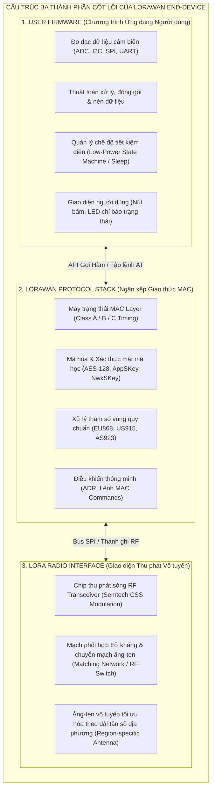
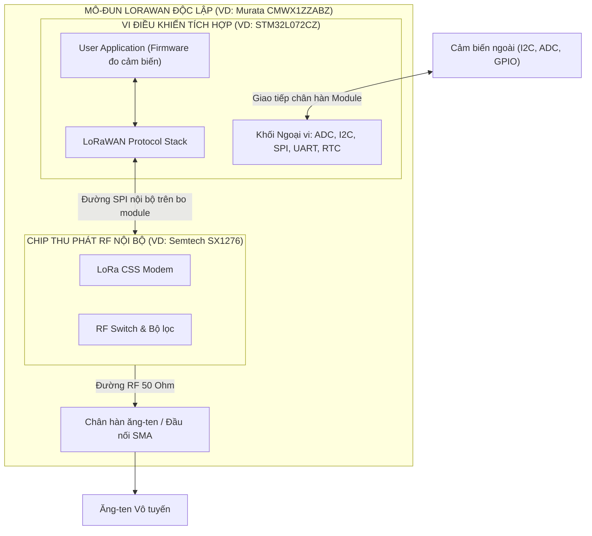
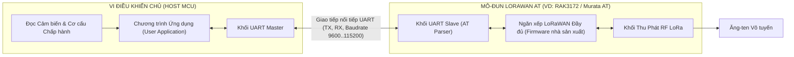
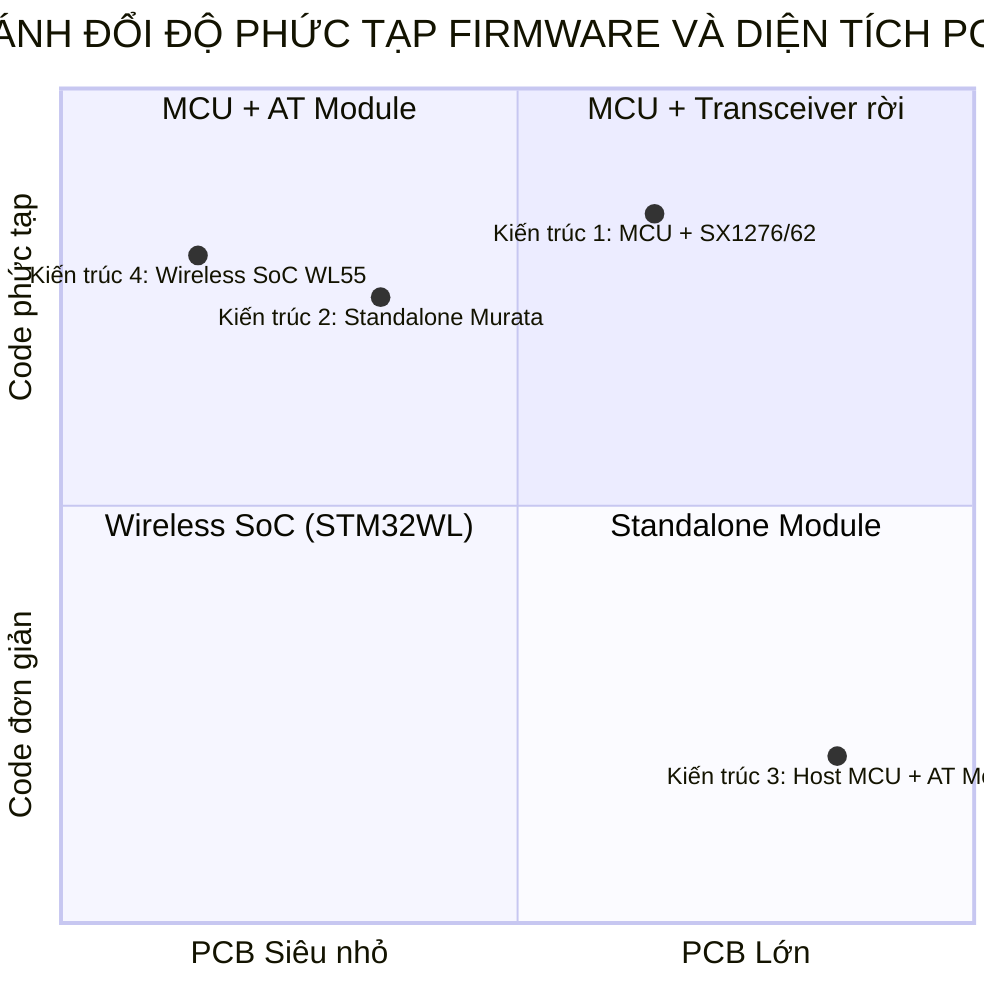
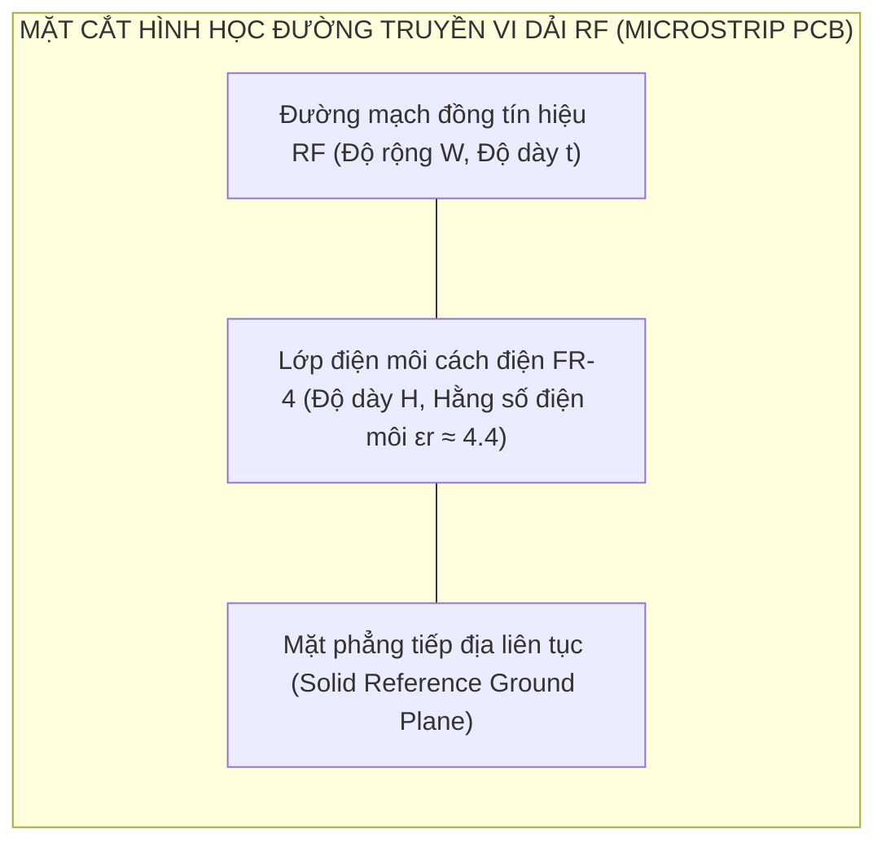

# MODULE 4: THIẾT KẾ PHẦN CỨNG THIẾT BỊ ĐẦU CUỐI (HARDWARE ARCHITECTURE & END-DEVICE DESIGN)

> **THÔNG TIN ĐIỀU PHỐI HỌC TẬP (MODULE METADATA)**
> - **Nguồn tham chiếu giáo trình:** 
>   * *Cuốn 1 (Beginners):* Chương 8: *Designing your own LoRaWAN end-device*, Trang 111 – 118.
>   * *Tài liệu kỹ thuật mở rộng công nghiệp (Mở rộng thực chiến):* Semtech SX1276/77/78/79 Datasheet, Semtech SX1261/2 Datasheet, STMicroelectronics STM32WL55 Reference Manual (RM0453), Espressif ESP32 Hardware Design Guidelines.
> - **Thời lượng khuyến nghị:** 6 giờ lý thuyết kiến trúc phần cứng + 8 giờ thực hành thiết kế sơ đồ nguyên lý, layout PCB và lập trình điều khiển ngoại vi.
> - **Mục tiêu đầu ra cốt lõi (Learning Objectives):**
>   1. *Về kiến thức (Knowledge):*
>      - Nắm vững 3 khối chức năng bắt buộc của một thiết bị đầu cuối LoRaWAN: User Firmware, LoRaWAN Protocol Stack, và LoRa Radio Interface.
>      - Hiểu sâu bản chất, sơ đồ khối và luồng tín hiệu của 4 kiến trúc phần cứng: MCU + Transceiver rời, Standalone LoRaWAN Module, MCU + LoRaWAN AT Module, và Wireless SoC (STM32WL).
>      - So sánh định lượng và định tính 4 kiến trúc dựa trên 4 chiều tiêu chuẩn: Diện tích bo mạch (PCB Footprint), Chi phí linh kiện (BOM Cost), Độ phức tạp mã nguồn (Firmware Complexity), và Thời gian/Chi phí chứng nhận hợp quy (RF Certification).
>      - Nắm vững các nguyên lý vật lý vô tuyến quan trọng trong thiết kế phần cứng: đường truyền microstrip 50 $\Omega$, mạch phối hợp trở kháng $\pi$-network, dao động ký bù nhiệt TCXO, lọc nguồn PA và suy hao do de-sensing.
>   2. *Về kỹ năng thực chiến (Practical Skills):*
>      - Thiết kế chuẩn xác giao tiếp SPI tốc độ cao, các chân điều khiển ngắt (DIO0..DIO5 / BUSY / RESET) giữa MCU (như ESP32) và chip thu phát RF (SX1276, SX1262).
>      - Giao tiếp và điều khiển module LoRaWAN qua UART bằng tập lệnh AT Commands chuẩn công nghiệp.
>      - Xây dựng bảng kê linh kiện (BOM) hoàn chỉnh, phân bổ ngân sách năng lượng và ước tính tuổi thọ pin thiết bị chạy 5 – 10 năm.

---

## 1. BẢNG THUẬT NGỮ TRỌNG TÂM CỦA MODULE (MODULE GLOSSARY)

Bảng thuật ngữ dưới đây kế thừa 100% chuẩn thuật ngữ tại Mục 2.4 của *Master Template Phase 1*, đồng thời bổ sung các thuật ngữ kỹ thuật điện tử - viễn thông chuyên sâu phục vụ thiết kế phần cứng thực chiến.

| Viết tắt / Thuật ngữ gốc (EN) | Tên đầy đủ (English Full Name) | Thuật ngữ Tiếng Việt chuẩn hóa | Giải thích bản chất kỹ thuật (Ngắn gọn, chính xác) |
| :--- | :--- | :--- | :--- |
| **AT Commands** | ATtention Commands | Tập lệnh điều khiển modem AT | Tập hợp các câu lệnh dạng chuỗi ký tự ASCII bắt đầu bằng tiền tố `AT` truyền qua UART để cấu hình và điều khiển hoạt động của module LoRaWAN. |
| **BOM** | Bill of Materials | Bảng kê danh mục linh kiện | Bảng kê chi tiết toàn bộ các thành phần linh kiện điện tử, số lượng, mã nhà sản xuất (MPN) và thông số kỹ thuật cấu thành nên một sản phẩm phần cứng hoàn chỉnh. |
| **BUSY** | Busy Signal Line | Đường tín hiệu báo bận phần cứng | Chân tín hiệu logic từ chip thu phát (đặc biệt dòng Semtech SX1261/SX1262) báo cho MCU biết nội vi RF đang bận xử lý lệnh hoặc chuyển trạng thái nội bộ; cấm gửi lệnh SPI khi BUSY ở mức cao. |
| **DCDC Converter** | Direct Current to Direct Current Switching Converter | Bộ biến đổi nguồn chuyển mạch DCDC | Mạch biến đổi điện áp một chiều hiệu suất cao (thường > 85–90%), sử dụng cuộn cảm ngoài; tích hợp trong SX1262 và STM32WL để giảm dòng tiêu thụ ở chế độ phát và thu. |
| **Decoupling Capacitor** | Decoupling / Bypass Capacitor | Tụ điện lọc nguồn / thoát nhiễu | Tụ gốm (thường là 100 nF mắc song song 10 $\mu$F) đặt sát chân cấp nguồn VDD của IC để triệt tiêu sụt áp cục bộ và xung nhiễu tần số cao do đóng mở cổng logic hoặc phóng xạ RF. |
| **De-sensing** | Receiver Desensitization | Hiện tượng suy giảm độ nhạy thu RF | Tình trạng tầng nhiễu nền (noise floor) tại đầu vào máy thu RF bị nâng cao do bức xạ điện từ (EMI) từ MCU, đường bus số hoặc nguồn xung, làm giảm cự ly kết nối LoRa. |
| **DIO** | Digital Input/Output (RF Interrupts) | Chân vào/ra số ngắt RF | Các chân ngắt vật lý của chip thu phát (như DIO0 của SX1276 báo `TxDone`, `RxDone`, `CadDone`) giúp MCU phản hồi tức thời mà không phải liên tục thăm dò thanh ghi. |
| **Footprint** | PCB Footprint / Land Pattern | Diện tích chiếm dụng trên bo mạch in | Kích thước hình học và kiểu chân hàn bề mặt (SMD pad pattern) của linh kiện trên bo mạch PCB. |
| **IPC** | Inter-Processor Communication | Giao tiếp liên bộ xử lý | Cơ chế trao đổi dữ liệu và đồng bộ hóa giữa hai lõi CPU (như Cortex-M4 và Cortex-M0+ trong vi điều khiển kép STM32WL55) thông qua ngắt phần cứng nội chip (IPCC) và bộ nhớ RAM dùng chung. |
| **LDO** | Low Dropout Regulator | Bộ ổn áp tuyến tính điện áp rơi thấp | Mạch ổn áp nguồn một chiều dạng tuyến tính, có ưu điểm phát sinh nhiễu gợn sóng cực thấp (rất sạch cho khối RF analog) nhưng hiệu suất năng lượng thấp hơn DCDC khi chênh lệch điện áp vào/ra lớn. |
| **LMIC** | LoRa MAC In C | Ngăn xếp giao thức LoRaWAN viết bằng C | Thư viện mã nguồn C triển khai giao thức LoRaWAN rút gọn tối ưu cho các vi điều khiển tài nguyên hạn chế (phổ biến trong hệ sinh thái Arduino và ESP-IDF). |
| **LoRa MAC-Node** | Semtech LoRa MAC-Node™ Reference Stack | Ngăn xếp tham chiếu LoRa MAC-Node | Ngăn xếp giao thức LoRaWAN mã nguồn mở tiêu chuẩn do Semtech phát triển và duy trì, tuân thủ 100% đặc tả của LoRa Alliance, dùng làm gốc cho hầu hết firmware thương mại. |
| **Matching Network** | Impedance Matching Network | Mạch phối hợp trở kháng RF | Mạch điện thụ động gồm các cuộn cảm (L) và tụ điện (C) (cấu hình $\pi$ hoặc T) biến đổi trở kháng đầu ra của chip RF thành đúng $50\ \Omega$ chuẩn để chuyển tiếp năng lượng tối đa ra ăng-ten. |
| **MCU** | Microcontroller Unit | Vi điều khiển đơn chip | Mạch tích hợp bán dẫn chứa một lõi xử lý trung tâm (CPU), bộ nhớ RAM, Flash ROM và các ngoại vi vào/ra dùng để điều khiển hệ thống nhúng. |
| **Microstrip** | Microstrip RF Transmission Line | Đường truyền vi dải RF | Dạng đường dẫn tín hiệu cao tần trên lớp ngoài của bo mạch PCB nhiều lớp, chạy phía trên một mặt phẳng đồng tiếp địa liên tục (Ground Plane), được tính toán chính xác để đạt trở kháng đặc tính $50\ \Omega$. |
| **PCB** | Printed Circuit Board | Bo mạch in điện tử | Tấm mạch cách điện có các đường dẫn và mặt phẳng đồng dẫn điện dùng để gắn kết cơ học và kết nối điện giữa các linh kiện điện tử. |
| **RF Switch** | Radio Frequency Switch | Công tắc chuyển mạch cao tần | Linh kiện bán dẫn (như PE4259) được điều khiển bằng GPIO để chuyển tiếp chân ăng-ten giữa đường phát công suất cao (TX) và đường thu độ nhạy cao (RX). |
| **SMA / U.FL (IPEX)** | RF Coaxial Connectors | Đầu nối cáp đồng trục RF | Các chuẩn giao diện cơ khí chuyên dụng dùng để kết nối tín hiệu cao tần $50\ \Omega$ từ bo mạch ra ăng-ten ngoài; U.FL có kích thước siêu nhỏ, còn SMA có độ bền cơ học cao. |
| **SoC** | System on Chip | Hệ thống trọn gói trên chip bán dẫn | Vi mạch tích hợp toàn bộ các thành phần của một hệ thống máy tính hoàn chỉnh (CPU, bộ nhớ, RF Transceiver) lên trên một đế silicon duy nhất (tiêu biểu như STM32WL). |
| **SPI** | Serial Peripheral Interface | Giao diện ngoại vi nối tiếp đồng bộ | Chuẩn giao tiếp nối tiếp đồng bộ 4 dây tốc độ cao (`MISO`, `MOSI`, `SCK`, `NSS`) dùng để vi điều khiển đọc/ghi trực tiếp vào hệ thống thanh ghi và bộ đệm FIFO của chip thu phát RF. |
| **Standalone Module** | Standalone LoRaWAN Module | Mô-đun LoRaWAN độc lập | Mô-đun phần cứng tích hợp sẵn cả vi điều khiển MCU và chip RF trong một khối vỏ bọc kim loại, cho phép người dùng nạp ứng dụng thẳng vào MCU bên trong. |
| **TCXO** | Temperature Compensated Crystal Oscillator | Thạch anh dao động bù nhiệt | Bộ dao động tinh thể thạch anh tích hợp mạch bù trôi tần theo nhiệt độ, đảm bảo độ ổn định tần số cao ($\pm 0.5\ \text{ppm}$), bắt buộc khi dùng chip SX1262 hoặc hoạt động ở điều kiện thời tiết khắc nghiệt. |
| **Transceiver** | Radio Frequency Transceiver | Chip thu phát sóng vô tuyến | Mạch tích hợp chuyên dụng (như Semtech SX1276, SX1262) có chức năng chuyển đổi giữa tín hiệu số và sóng vô tuyến RF tầng vật lý LoRa (điều chế CSS). |
| **UART** | Universal Asynchronous Receiver-Transmitter | Bộ truyền nhận nối tiếp bất đồng bộ | Bộ truyền nhận nối tiếp phần cứng cho phép vi điều khiển trao đổi dữ liệu nối tiếp hai chiều với module ngoài qua 2 dây tín hiệu `TX` và `RX`. |
| **VSWR** | Voltage Standing Wave Ratio | Hệ số sóng đứng điện áp | Tỷ số giữa điện áp cực đại và cực tiểu trên đường truyền RF, phản ánh mức độ phối hợp trở kháng; $\text{VSWR} = 1:1$ là lý tưởng, $\text{VSWR} > 3:1$ gây phản xạ sóng làm nóng và hỏng tầng công suất PA. |

---

## 2. NỘI DUNG LÝ THUYẾT CỐT LÕI & GIẢI PHẪU KỸ THUẬT (CORE TECHNICAL KNOWLEDGE)

### 2.1. Yêu cầu ba thành phần tối thiểu của một LoRaWAN End-Device & Các LoRaWAN Stacks phổ biến

Theo định nghĩa tại Chương 8 sách USMB (trang 111), bất kỳ một thiết bị đầu cuối LoRaWAN hoàn chỉnh nào cũng bắt buộc phải tích hợp và giải quyết đồng thời **ba khối chức năng cơ bản**:



#### Chi tiết 3 thành phần cấu thành:
1. **User Firmware (Chương trình ứng dụng người dùng):**
   - Đảm nhiệm toàn bộ logic nghiệp vụ thực tế của sản phẩm: cấu hình và đọc các cảm biến ngoại vi (nhiệt độ, độ ẩm, áp suất, định vị GPS, gia tốc kế...), xử lý tính toán số học, lọc dữ liệu, quản lý chu kỳ ngủ sâu (Deep Sleep) và thức dậy định kỳ qua bộ định thời RTC (Real-Time Clock) hoặc ngắt ngoài.
   - Thành phần này hoàn toàn độc lập với các quy tắc của giao thức mạng LoRaWAN.
2. **LoRaWAN Protocol Stack (Ngăn xếp giao thức LoRaWAN):**
   - Đảm nhiệm việc thực thi tuần tự các quy định của tầng MAC theo chuẩn LoRa Alliance: đóng gói tiêu đề `MHDR`, `FHDR`, tạo số đếm khung `FCnt`, mã hóa AES-128 vùng tải trọng `FRMPayload`, tính toán mã toàn vẹn `MIC`, điều khiển chính xác thời gian mở hai cửa sổ thu `RX1` và `RX2`, thực thi lệnh `LinkADRReq`, và quản lý thủ tục kết nối mạng (OTAA Join-Request/Join-Accept hoặc ABP).
   - Ngăn xếp phải chứa thư viện tham số vô tuyến cụ thể theo từng khu vực địa lý (*Regional Parameters* như EU868, US915, AS923, AU915...).
3. **LoRa Radio Interface (Giao diện phần cứng vô tuyến):**
   - Chip thu phát bán dẫn chuyển đổi tín hiệu nhị phân số từ MCU thành tín hiệu cao tần điều chế trải phổ CSS trên dải tần Sub-GHz.
   - Trong khi chip thu phát có thể hỗ trợ dải tần rất rộng (ví dụ $137\ \text{MHz} \dots 1020\ \text{MHz}$), thì mạch phối hợp trở kháng thụ động và ăng-ten vô tuyến bắt buộc phải được thiết kế riêng biệt tối ưu hóa cho dải tần của từng quốc gia.

#### Tổng quan các phần mềm LoRaWAN Stacks khả dụng:
Sách USMB (Mục 8.1, trang 111) phân loại các ngăn xếp LoRaWAN phổ biến:
- **LoRa MAC-Node™ (Semtech):** Ngăn xếp chuẩn mực, nổi tiếng nhất và là "tài liệu sống" của chuẩn LoRaWAN. Được Semtech duy trì liên tục trên GitHub, hỗ trợ đa dạng vi điều khiển (Arm Cortex-M, STM32, ESP32...), tuân thủ nghiêm ngặt 100% các phiên bản đặc tả của LoRa Alliance.
- **LMIC (LoRa MAC in C - Runbeck / IBM / MCCI):** Được tối ưu hóa cho các hệ thống vi điều khiển có tài nguyên RAM/Flash nhỏ (đặc biệt là họ vi điều khiển ATmega, SAMD của Arduino và ESP32/ESP8266). Phiên bản hiện đại *MCCI LoRaWAN LMIC library* hỗ trợ đầy đủ LoRaWAN 1.0.3, Class A/B/C và các dải tần toàn cầu.
- **STMicroelectronics LoRaWAN Stack:** Bản mở rộng chuyên biệt được ST tối ưu hóa trên nền tảng STM32CubeMCU (dựa trên gốc LoRa MAC-Node của Semtech), khai thác tối đa ngoại vi phần cứng tiết kiệm điện (Stop mode, Standby mode) và bộ gia tốc mật mã phần cứng của vi điều khiển STM32.
- **Arm Mbed LoRaWAN Stack:** Ngăn xếp tích hợp sâu vào hệ điều hành thời gian thực Arm Mbed OS, hỗ trợ quản lý luồng sự kiện (event-driven), tuy nhiên mang tính khép kín hơn so với các stack mã nguồn mở thuần túy.

---

### 2.2. Kiến trúc 1: Vi điều khiển + Transceiver rời (Microcontroller + Discrete Transceiver)

#### 2.2.1. Phân tích nguyên lý kiến trúc
Trong kiến trúc này (Mục 8.2, trang 111-112), nhà thiết kế sử dụng một vi điều khiển đa năng (MCU) độc lập kết nối với một chip thu phát sóng LoRa rời thông qua giao diện bus ngoại vi đồng bộ SPI (Serial Peripheral Interface) cùng hệ thống các đường điều khiển ngắt (GPIO).

```mermaid
flowchart LR
    subgraph MCU_BLOCK["VI ĐIỀU KHIỂN (HOST MCU)"]
        APP["Chương trình Ứng dụng (User Firmware)"]
        STACK["Ngăn xếp LoRaWAN (Semtech LoRa MAC-Node / LMIC)"]
        SPI_M["SPI Master Peripheral"]
        GPIO_IN["GPIO Inputs (External Interrupts)"]
        GPIO_OUT["GPIO Outputs"]
    end

    subgraph TRANSCEIVER_BLOCK["CHIP THU PHÁT VÔ TUYẾN (TRANSCEIVER)"]
        SPI_S["SPI Slave Interface"]
        REG["Hệ thống Thanh ghi Cấu hình & FIFO"]
        MODEM["Modem LoRa CSS / FSK"]
        PA["Tầng Khuếch đại Công suất (PA)"]
        LNA["Tầng Khuếch đại Nhiễu thấp (LNA)"]
    end

    APP <--> STACK
    STACK <--> SPI_M
    SPI_M <-->|"Bus SPI (SCK, MOSI, MISO, NSS)"| SPI_S
    GPIO_IN <--|"Chân ngắt DIO0..DIO5 (SX1276) hoặc DIO1 + BUSY (SX1262)"| TRANSCEIVER_BLOCK
    GPIO_OUT -->|"Chân NRESET (Reset phần cứng)"| TRANSCEIVER_BLOCK
    PA -->|"Đường phát TX"| ANT["Mạch Phối hợp Trở kháng & Ăng-ten"]
    ANT -->|"Đường thu RX"| LNA
```

- **Cơ chế phân bổ tài nguyên:** Cả chương trình ứng dụng (User Application) lẫn ngăn xếp mạng (LoRaWAN Stack) cùng chia sẻ chung một CPU, RAM và bộ nhớ Flash của MCU.
- **Giao diện vật lý SPI:**
  * `SCK` (Serial Clock): Xung nhịp đồng bộ do MCU phát sinh (thường chạy ở tốc độ $1\ \text{MHz} \dots 10\ \text{MHz}$).
  * `MOSI` (Master Out Slave In): Dữ liệu từ MCU ghi vào thanh ghi hoặc bộ đệm FIFO của transceiver.
  * `MISO` (Master In Slave Out): Dữ liệu từ thanh ghi hoặc FIFO của transceiver đẩy về MCU.
  * `NSS` (Slave Select - Active Low): Kéo xuống mức thấp (`0`) để bắt đầu khung truyền SPI và kéo lên cao (`1`) để kết thúc.
- **Đường tín hiệu điều khiển & ngắt bổ trợ:**
  * `NRESET`: Kéo mức thấp để reset cứng chip thu phát khi khởi tạo.
  * Các đường ngắt sự kiện (Interrupt lines): Báo hiệu tức thời khi phát xong gói (`TxDone`), nhận xong gói (`RxDone`), phát hiện Preamble, hoặc lỗi thời gian chờ (`RxTimeout`).

#### 2.2.2. So sánh chuyên sâu hai thế hệ chip thu phát: Semtech SX1276 vs SX1262
Để thiết kế phần cứng thành công, kỹ sư bắt buộc phải phân biệt được hai thế hệ chip transceiver chủ lực của Semtech: dòng cổ điển SX1276/77/78/79 và dòng hiện đại SX1261/62.

| Tiêu chí Kỹ thuật | Thế hệ Cũ: Semtech SX1276 | Thế hệ Mới: Semtech SX1262 | Đánh giá & Khuyến nghị Thiết kế |
| :--- | :--- | :--- | :--- |
| **Dải tần số hoạt động (RF Frequency Range)** | $137 \dots 1020\ \text{MHz}$ (Phân tách thành 2 cổng RF riêng: LF Band và HF Band) | $150 \dots 960\ \text{MHz}$ (Tối ưu hóa liên tục, 1 cổng RF chung cho cả băng Sub-GHz) | SX1262 đơn giản hóa thiết kế phần cứng RF switch và mạch phối hợp ăng-ten hơn nhiều. |
| **Công suất phát tối đa (Max TX Power)** | $+20\ \text{dBm}$ (qua chân `PA_BOOST`) hoặc $+14\ \text{dBm}$ (qua `RFO`) | $+22\ \text{dBm}$ (SX1262) hoặc $+15\ \text{dBm}$ (SX1261 cho pin điện áp thấp) | SX1262 phát khỏe hơn $+2\ \text{dBm}$ và chỉ có 1 ngõ ra PA duy nhất. |
| **Dòng tiêu thụ chế độ Thu (RX Current)** | $\approx 10.8 \dots 11.5\ \text{mA}$ (chỉ dùng LDO nội) | $\approx 4.6\ \text{mA}$ (khi kích hoạt cuộn cảm DCDC nội) hoặc $8.2\ \text{mA}$ (LDO) | **SX1262 tiết kiệm > 50% điện năng thu**, kéo dài đáng kể tuổi thọ pin thiết bị Class A/C. |
| **Dòng tiêu thụ chế độ Phát (TX Current @ +14 dBm)** | $\approx 28\ \text{mA}$ (chân RFO) hoặc $\approx 45\ \text{mA}$ (PA_BOOST) | $\approx 25\ \text{mA}$ (chế độ DCDC) | SX1262 đạt hiệu suất chuyển đổi năng lượng vượt trội nhờ bộ biến đổi xung tích hợp. |
| **Dòng ngủ sâu (Sleep Current)** | $\approx 0.2 \dots 1.5\ \mu\text{A}$ | $\approx 0.16 \dots 0.6\ \mu\text{A}$ (Cold Start vs Warm Start duy trì bộ nhớ) | Cả hai đều đạt chuẩn siêu tiết kiệm năng lượng cho cảm biến đo xa. |
| **Độ nhạy thu tối đa (Max Sensitivity @ 125kHz)** | $-148\ \text{dBm}$ (tại $\text{SF} = 12$) | $-148\ \text{dBm}$ (tại $\text{SF} = 12$) | Tương đương nhau về mặt lý thuyết ngân sách đường truyền. |
| **Hệ thống chân ngắt & Đồng bộ** | Có tới 6 chân ngắt độc lập: `DIO0`, `DIO1`, `DIO2`, `DIO3`, `DIO4`, `DIO5`. | Gom gọn thành 3 chân: `DIO1`, `DIO2` (cấu hình RF switch), `DIO3` (điều khiển nguồn TCXO) + Chân **`BUSY`**. | **SX1262 bắt buộc phải nối chân `BUSY`**. Bất kỳ lệnh SPI nào gửi khi `BUSY = 1` đều bị hủy bỏ. |
| **Giao thức điều khiển SPI** | Dựa trên **Ánh xạ Thanh ghi Trực tiếp (Direct Register Mapping)**: Đọc/ghi địa chỉ 8-bit. | Dựa trên **Tập lệnh Lệnh (Opcode/Command-based Interface)**: Gửi opcode như `SetStandby`, `SetPacketType`, `SetRfFrequency`... | Firmware cho SX1262 đòi hỏi logic máy trạng thái xử lý Opcode thay vì ghi trực tiếp thanh ghi. |

#### 2.2.3. Tích hợp kỹ thuật thực chiến: ESP32 + Semtech SX1276 / SX1262 (Mở rộng thực tế)
> [!NOTE]
> ### 🔍 [MỞ RỘNG KỸ THUẬT THỰC CHIẾN - KHÔNG NẰM TRONG SÁCH USMB]
> Trong sách USMB (trang 112), tác giả sử dụng ví dụ bo mạch thương mại STM32L073 + SX1272. Nhằm phục vụ trực tiếp cho mục tiêu phát triển hệ thống nhúng của dự án hiện tại, phần dưới đây trình bày cấu hình tích hợp chuẩn công nghiệp giữa vi điều khiển **Espressif ESP32** và chip thu phát **Semtech SX1276 / SX1262** trên nền tảng **ESP-IDF**.

##### Bảng ánh xạ kết nối chân phần cứng (Pinout Mapping):
| Tín hiệu Transceiver | Chân trên Module SX1276 | Chân trên Module SX1262 | Chân GPIO ESP32 khuyến nghị | Hướng tín hiệu | Chức năng kỹ thuật & Cấu hình ESP-IDF |
| :--- | :--- | :--- | :--- | :--- | :--- |
| **SPI SCK** | `SCK` | `SCK` | `GPIO18` (VSPI CLK) | ESP32 $\rightarrow$ RF | Xung đồng bộ SPI, tốc độ cấu hình $2 \dots 8\ \text{MHz}$. |
| **SPI MISO** | `MISO` | `MISO` | `GPIO19` (VSPI Q) | RF $\rightarrow$ ESP32 | Đường dữ liệu đọc từ transceiver về vi điều khiển. |
| **SPI MOSI** | `MOSI` | `MOSI` | `GPIO27` (VSPI D) | ESP32 $\rightarrow$ RF | Đường dữ liệu ghi từ vi điều khiển sang transceiver. |
| **SPI NSS** | `NSS` (CS) | `NSS` (CS) | `GPIO5` (VSPI CS0) | ESP32 $\rightarrow$ RF | Chọn chip SPI, kích hoạt mức thấp khi bắt đầu giao tiếp. |
| **RESET** | `RST` | `NRESET` | `GPIO14` | ESP32 $\rightarrow$ RF | Reset cứng chip; xung mức thấp tối thiểu $100\ \mu\text{s}$. |
| **DIO0 (SX1276)** | `DIO0` | *Không có* | `GPIO26` | RF $\rightarrow$ ESP32 | **Bắt buộc trên SX1276**: Cấu hình ngắt sườn lên (`GPIO_INTR_POSEDGE`) báo sự kiện `TxDone` / `RxDone`. |
| **DIO1** | `DIO1` | `DIO1` | `GPIO33` | RF $\rightarrow$ ESP32 | Ngắt phụ: Trên SX1276 báo `RxTimeout`; trên SX1262 là chân ngắt chính gộp chung mọi sự kiện. |
| **BUSY (SX1262)** | *Không có* | `BUSY` | `GPIO32` | RF $\rightarrow$ ESP32 | **Bắt buộc trên SX1262**: ESP32 phải thăm dò hoặc chờ chân này xuống mức thấp (`0`) trước khi gửi lệnh SPI tiếp theo. |
| **VCC** | `VCC / 3V3` | `VCC / 3V3` | `3V3 Power Rail` | Nguồn cấp | Cấp nguồn $3.3\ \text{V}$ sạch, dòng đỉnh tức thời chịu tải tối thiểu $150\ \text{mA}$. |
| **GND** | `GND` | `GND` | `GND Plane` | Tiếp địa | Kết nối chung với mặt phẳng mass (Ground Plane) của bo mạch. |

##### Đoạn mã khởi tạo giao tiếp SPI & Ngắt trên ESP-IDF:
```c
/* Ví dụ khởi tạo giao diện SPI trên ESP-IDF cho SX1276 */
#include "driver/spi_master.h"
#include "driver/gpio.h"
#include "esp_log.h"

#define PIN_NUM_MISO 19
#define PIN_NUM_MOSI 27
#define PIN_NUM_CLK  18
#define PIN_NUM_CS   5
#define PIN_NUM_RST  14
#define PIN_NUM_DIO0 26

static spi_device_handle_t spi_handle;

esp_err_t sx1276_spi_init(void) {
    spi_bus_config_t buscfg = {
        .miso_io_num = PIN_NUM_MISO,
        .mosi_io_num = PIN_NUM_MOSI,
        .sclk_io_num = PIN_NUM_CLK,
        .quadwp_io_num = -1,
        .quadhd_io_num = -1,
        .max_transfer_sz = 256
    };
    
    // Khởi tạo bus SPI (SPI2_HOST / VSPI)
    esp_err_t ret = spi_bus_initialize(SPI2_HOST, &buscfg, SPI_DMA_CH_AUTO);
    if (ret != ESP_OK) return ret;

    spi_device_interface_config_t devcfg = {
        .clock_speed_hz = 5 * 1000 * 1000,      // 5 MHz
        .mode = 0,                              // CPOL=0, CPHA=0 (Mode 0 chuẩn của Semtech)
        .spics_io_num = PIN_NUM_CS,
        .queue_size = 7,
    };
    
    return spi_bus_add_device(SPI2_HOST, &devcfg, &spi_handle);
}
```

---

### 2.3. Kiến trúc 2: Mô-đun LoRaWAN độc lập (Standalone LoRaWAN Module)

#### 2.3.1. Phân tích nguyên lý kiến trúc
Trong kiến trúc Standalone LoRaWAN Module (Mục 8.3, trang 113-114), nhà sản xuất đóng gói toàn bộ một vi điều khiển (MCU) và một chip thu phát sóng RF (Transceiver) vào chung trong **một vỏ bọc kim loại chống nhiễu (Shielding Can)** duy nhất.



- **Đặc trưng vận hành:**
  * Lập trình viên nạp mã nguồn ứng dụng của mình **trực tiếp vào bộ nhớ Flash của MCU nằm bên trong module**.
  * Cả hai thành phần phần mềm (User Firmware và LoRaWAN Stack) cùng chia sẻ tài nguyên vi điều khiển nội module (tương tự Kiến trúc 1 dưới góc độ lập trình viên).
  * Toàn bộ phần cứng siêu cao tần phức tạp (đường SPI nội bộ tốc độ cao, thạch anh dao động, bộ lọc thông dải, tụ lọc thoát nhiễu RF) đã được nhà sản xuất module tính toán, cân chỉnh và hàn sẵn trên một bo mạch gốm/FR4 đa lớp rất nhỏ gọn.
- **Ví dụ điển hình từ sách USMB:** **Murata CMWX1ZZABZ** (Hình 134 & 135 trong sách, trang 114):
  * Kích thước siêu nhỏ: $12.5 \times 11.6 \times 1.76\ \text{mm}$.
  * Bên trong tích hợp: MCU **STMicroelectronics STM32L072CZ** (lõi Arm Cortex-M0+, Flash $192\ \text{KB}$, RAM $20\ \text{KB}$) kết nối nội bộ qua SPI với transceiver **Semtech SX1276**.
  * Module đưa ra ngoài đầy đủ các chân GPIO, ADC, I2C, SPI, UART để kỹ sư gắn cảm biến mà không cần thêm MCU phụ.
- **Bo mạch phát triển thực nghiệm (Development Board):** Bo mạch **ST B-L072Z-LRWAN1 Discovery Board** (Hình 136 trong sách, trang 115) tích hợp sẵn module Murata ABZ, ăng-ten dải SMA và mạch nạp/gỡ lỗi ST-LINK trực tiếp trên board.

---

### 2.4. Kiến trúc 3: Vi điều khiển + Mô-đun LoRaWAN AT (Microcontroller + LoRaWAN AT Module)

#### 2.4.1. Phân tích nguyên lý kiến trúc
Kiến trúc Vi điều khiển + Mô-đun AT (Mục 8.4, trang 115-116) giải quyết triệt để vấn đề xung đột tài nguyên giữa ngăn xếp mạng và mã ứng dụng bằng cách **phân tách vật lý hoàn toàn thành hai bộ vi điều khiển riêng biệt**:



- **Nguyên lý hoạt động:**
  * **Host MCU (Vi điều khiển chủ):** Chỉ tập trung 100% tài nguyên xử lý tác vụ đo đạc cảm biến và nghiệp vụ khách hàng. Host MCU có thể là bất kỳ vi điều khiển nào (kể cả MCU 8-bit giá rẻ như ATmega328P, PIC, 8051, hoặc MCU 32-bit hiệu năng cao như ESP32, STM32F4). Host MCU hoàn toàn không cần chứa bất kỳ dòng mã nguồn nào của LoRaWAN stack.
  * **LoRaWAN AT Module:** Chứa một vi điều khiển thứ hai đã được nhà sản xuất nạp sẵn firmware modem thương mại. Firmware này chạy toàn bộ LoRaWAN stack và cung cấp giao diện lắng nghe chuỗi ký tự ASCII theo chuẩn **Tập lệnh AT (AT Commands)** qua giao tiếp UART 2 dây (`TX` và `RX`).
- **Mẫu luồng bản tin lệnh AT điển hình (Ví dụ cấu hình OTAA và truyền dữ liệu):**
  ```text
  Host MCU -> AT Module:  AT+NJM=1                      (Cấu hình chế độ OTAA)
  AT Module -> Host MCU:  OK
  Host MCU -> AT Module:  AT+DEVEUI=0018B20000001234    (Cài đặt DevEUI)
  AT Module -> Host MCU:  OK
  Host MCU -> AT Module:  AT+APPEUI=0000000000000000    (Cài đặt JoinEUI/AppEUI)
  AT Module -> Host MCU:  OK
  Host MCU -> AT Module:  AT+APPKEY=2B7E151628AED2A6... (Cài đặt AppKey 128-bit)
  AT Module -> Host MCU:  OK
  Host MCU -> AT Module:  AT+JOIN=1:0:10:8              (Gửi lệnh Join vào mạng)
  AT Module -> Host MCU:  OK
  ... [Đợi bắt tay mạng thành công] ...
  AT Module -> Host MCU:  +EVT:JOINED                   (Sự kiện Join thành công)
  Host MCU -> AT Module:  AT+SEND=2:01020304            (Gửi 4 byte dữ liệu lên Port 2)
  AT Module -> Host MCU:  OK
  AT Module -> Host MCU:  +EVT:SEND_CONFIRMED_OK        (Xác nhận gửi thành công)
  ```
- **Ví dụ phần cứng tiêu biểu từ sách USMB:**
  * **RAK Wireless RAK3172:** Module dựa trên STM32WL nạp sẵn firmware RAKwireless Unified Cellular/LoRaWAN AT Command.
  * **Murata CMWX1ZZABZ (phiên bản chạy AT Modem Firmware):** Cùng phần cứng như Mục 2.3 nhưng nạp firmware AT chính hãng.
  * Bo mạch phát triển: **Arduino MKR WAN 1310** (Hình 139 trong sách, trang 116) kết hợp MCU chủ 32-bit Microchip SAMD21 với module Murata ABZ qua đường truyền nối tiếp UART.

---

### 2.5. Kiến trúc 4: Vi điều khiển vô tuyến SoC (Wireless LoRaWAN Microcontroller / SoC)

#### 2.5.1. Phân tích nguyên lý kiến trúc & Dòng chip STM32WL
Kiến trúc Wireless SoC (Mục 8.5, trang 116-117) đại diện cho đỉnh cao công nghệ tích hợp phần cứng bán dẫn hiện đại: **Vi điều khiển MCU và Bộ thu phát vô tuyến LoRa được chế tạo trên cùng một đế silicon (Built on the same silicon die)**.

```mermaid
flowchart TD
    subgraph STM32WL_SOC["HỆ THỐNG TRÊN CHIP (WIRELESS SOC STM32WL55) - CÙNG ĐẾ SILICON"]
        subgraph CORE_M4["LÕI CHÍNH: ARM CORTEX-M4 (Up to 48 MHz)"]
            APP["User Application Firmware"]
            RTOS["Hệ điều hành thời gian thực (FreeRTOS)"]
            DSP["Bộ tính toán số thực FPU & DSP"]
        end

        subgraph IPC_BLOCK["BỘ NHỚ CHIA SẺ & GIAO TIẾP LIÊN LÕI (IPC)"]
            IPCC["Bộ điều khiển hộp thư phần cứng (IPCC Mailbox)"]
            SEMA["Bộ cờ hiệu phần cứng (Hardware Semaphores)"]
            SRAM["Vùng nhớ RAM bảo vệ chia sẻ"]
        end

        subgraph CORE_M0["LÕI AN TOÀN: ARM CORTEX-M0+ (Up to 48 MHz)"]
            SEC_STACK["LoRaWAN Protocol Stack (Class A/B/C)"]
            CRYPTO["Bộ gia tốc mật mã phần cứng (AES-128 / AES-256)"]
            KEYS["Vùng lưu khóa bảo mật chống đọc trích xuất"]
        end

        subgraph INTERNAL_SUBGHZ["BỘ THU PHÁT VÔ TUYẾN SUB-GHZ TÍCH HỢP (DỰA TRÊN SX126X)"]
            MODEM["LoRa / (G)FSK / BPSK Modem"]
            DCDC["Bộ nguồn xung DCDC nội"]
            PA_LP["Bộ khuếch đại công suất thấp (Up to +15 dBm)"]
            PA_HP["Bộ khuếch đại công suất cao (Up to +22 dBm)"]
        end

        CORE_M4 <--> IPC_BLOCK
        IPC_BLOCK <--> CORE_M0
        CORE_M0 <-->|"Bus nội bộ Sub-GHz Radio Interface"| INTERNAL_SUBGHZ
        INTERNAL_SUBGHZ -->|"Ngõ ra chân chip"| RF_PINS["Đường RF ra Ăng-ten"]
    end
```



- **Dòng vi điều khiển STM32WL của STMicroelectronics:**
  STMicroelectronics là nhà sản xuất bán dẫn đầu tiên trên thế giới tích hợp thành công modem LoRa (công nghệ Semtech SX126x) trực tiếp vào đế silicon vi điều khiển dòng STM32. Dòng chip này được chia làm hai biến thể cấu trúc:
  1. **Dòng Đơn lõi (Single-core - STM32WLEx):**
     * Chỉ chứa một lõi xử lý duy nhất **Arm Cortex-M4** vận hành ở tần số tối đa $48\ \text{MHz}$.
     * Chạy đồng thời cả User Application và LoRaWAN Stack trên cùng một CPU (tương tự kiến trúc 1 nhưng không cần chip ngoài và không cần đi dây SPI lộ thiên trên PCB).
  2. **Dòng Lõi kép (Dual-core - STM32WL5x, tiêu biểu STM32WL55CC/JC):**
     * **Lõi Cortex-M4 (CPU1):** Dành riêng cho kỹ sư ứng dụng phát triển logic nghiệp vụ, đọc cảm biến phức tạp, xử lý tín hiệu DSP, đồ họa hoặc kết nối ngoại vi.
     * **Lõi Cortex-M0+ (CPU2):** Đóng vai trò là bộ vi xử lý an toàn (Secure Subsystem), chỉ chạy duy nhất ngăn xếp giao thức LoRaWAN thời gian thực và quản lý các khóa mật mã (`AppKey`, `NwkSKey`, `AppSKey`). Lõi M4 không thể can thiệp làm gián đoạn hoặc chiếm dụng bộ nhớ của lõi M0+.
     * **Giao tiếp liên lõi (IPC):** Hai lõi trao đổi thông tin thông qua bộ đệm hộp thư phần cứng **IPCC (Inter-Processor Communication Controller)** và các cờ hiệu semaphore phần cứng, loại bỏ hoàn toàn nguy cơ tranh chấp tài nguyên (Resource Contention).
- **Bộ thu phát Sub-GHz tích hợp nội vi:**
  * Kiến trúc vô tuyến bên trong STM32WL hoàn toàn tương đương với chip Semtech SX1262.
  * Tích hợp sẵn hai bộ khuếch đại công suất PA độc lập: Đường công suất thấp (Low-Power PA) cho dải phát lên đến $+15\ \text{dBm}$ cực kỳ tiết kiệm điện, và Đường công suất cao (High-Power PA) cho dải phát lên đến $+22\ \text{dBm}$.
  * Tích hợp bộ nguồn xung DCDC ngay trên chip: giảm dòng tiêu thụ ở chế độ thu LoRa $125\ \text{kHz}$ xuống chỉ còn $\approx 4.8\ \text{mA}$.
- **Hệ sinh thái bo mạch phát triển & Module dựa trên STM32WL:**
  * Bo mạch mẫu chính hãng: **STM32WL Nucleo-64 board (NUCLEO-WL55JC1 / WL55JC2)** (Hình 141 trong sách, trang 117).
  * Các module thương mại đúc sẵn tích hợp chip STM32WL: **RAK Wireless RAK3172** và **Seeed Studio LoRa-E5** (Hình 142 trong sách, trang 117).

---

### 2.6. Bảng tổng hợp & So sánh định lượng / định tính 4 kiến trúc phần cứng

Trong sách USMB (Mục 8.6, Bảng 29, trang 118), tác giả đã đưa ra bảng đánh giá định tính sơ bộ về 4 kiến trúc. Nhằm đáp ứng đầy đủ yêu cầu của kỹ sư thiết kế phần cứng chuyên nghiệp và tiêu chí của *Master Template Phase 1*, bảng dưới đây **tái lập trung thực bảng của sách** và **mở rộng đào sâu định lượng chi tiết trên cả 4 trục tiêu chí kỹ thuật**:



#### Bảng so sánh 4 kiến trúc phần cứng thiết bị đầu cuối LoRaWAN:

| Tiêu chí So sánh Kỹ thuật | 1. MCU + Transceiver Rời (VD: ESP32 + SX1276 / SX1262) | 2. Standalone LoRaWAN Module (VD: Murata CMWX1ZZABZ) | 3. MCU + LoRaWAN AT Module (VD: Host MCU + RAK3172 AT) | 4. Wireless SoC (VD: STM32WLE5 / STM32WL55) |
| :--- | :--- | :--- | :--- | :--- |
| **Đánh giá gốc Sách USMB (Bảng 29)** | - **Footprint:** Medium<br>- **Cost:** High (khi làm mẫu)<br>- **Code Complexity:** High | - **Footprint:** Low<br>- **Cost:** Medium<br>- **Code Complexity:** High | - **Footprint:** High<br>- **Cost:** Very high<br>- **Code Complexity:** Low | - **Footprint:** Very low<br>- **Cost:** Low (quy mô lớn)<br>- **Code Complexity:** High |
| **Diện tích bo mạch (PCB Footprint)** | **Trung bình – Lớn** ($\approx 35 \times 25\ \text{mm}$ trở lên). Cần diện tích cho MCU, IC thu phát, thạch anh, linh kiện thụ động L/C và đường vi dải microstrip. | **Nhỏ gọn** ($\approx 15 \times 15\ \text{mm}$ cho vùng module). Toàn bộ phần cứng phức tạp nằm trọn trong vỏ kim loại kích thước $12.5 \times 11.6\ \text{mm}$. | **Rất lớn** ($\approx 50 \times 35\ \text{mm}$). Cần không gian hàn hai con chip/module riêng biệt kèm đường mạch giao tiếp UART liên kết. | **Siêu nhỏ (Tối ưu nhất)** ($\approx 10 \times 10\ \text{mm}$ cho toàn bộ hệ thống). Chỉ cần 1 chip QFN/BGA duy nhất ($5 \times 5\ \text{mm}$ hoặc $7 \times 7\ \text{mm}$) và vài linh kiện thụ động. |
| **Chi phí linh kiện (BOM Cost @ Sản lượng > 10.000 pcs)** | **Thấp nhất** ($\approx \$3.5 \dots \$5.0$). Tiết kiệm tối đa nhờ mua trực tiếp linh kiện rời dạng cuộn (Reel) từ nhà phân phối cấp 1. | **Trung bình** ($\approx \$6.0 \dots \$8.5$). Phải trả thêm chi phí gia công, đóng gói và biên lợi nhuận của nhà sản xuất module (Murata). | **Cao nhất** ($\approx \$8.0 \dots \$12.0$). Chi phí đội lên gấp đôi do phải trả tiền cho hai vi điều khiển (Host MCU + MCU bên trong module AT). | **Rất thấp & Cạnh tranh** ($\approx \$4.0 \dots \$5.5$). Mua một chip duy nhất chứa cả MCU 48MHz và LoRa transceiver, giảm số lượng mã linh kiện trong kho. |
| **Độ phức tạp mã nguồn (Firmware / Software Stack)** | **Rất cao.** Kỹ sư phải tự tích hợp thư viện LMIC / LoRa MAC-Node, cấu hình chân SPI, timer ngắt phần cứng và giải quyết xung đột tài nguyên giữa User App và Stack. | **Cao.** Vẫn phải tự quản lý LoRaWAN stack trên MCU nội bộ của module; tài nguyên RAM/Flash bị chia sẻ cho cả 2 tác vụ. | **Rất thấp (Đơn giản nhất).** Chỉ cần viết mã gửi chuỗi ký tự ASCII qua UART (lệnh AT). Đội ngũ phát triển phần mềm không cần hiểu biết chuyên sâu về giao thức LoRaWAN MAC. | **Cao đến Rất cao.** Lập trình trên dòng lõi kép (Cortex-M4 + Cortex-M0+) đòi hỏi kiến trúc IPC, cơ chế mailbox và đồng bộ semaphore chuyên nghiệp. |
| **Thời gian & Chi phí Chứng nhận Hợp quy (RF Certification)** | **Dài nhất & Rủi ro cao.** (Mất $3 \dots 6$ tháng, chi phí $\$10.000 \dots \$30.000$). Bo mạch phải trải qua toàn bộ quy trình đo kiểm phát xạ bức xạ RF (RED/FCC) và đo kiểm giao thức LoRa Alliance Certified. | **Ngắn nhất & Chi phí tối thiểu.** Module đã đạt chứng chỉ tiền kiểm (Pre-certified Modular Approval). Thiết bị đầu cuối chỉ cần kiểm tra tương thích điện từ EMC cơ bản. | **Ngắn & An toàn cao.** Tương tự Kiến trúc 2, module AT đã có chứng chỉ FCC/CE/LoRa Alliance. Thiết bị thương mại hoàn thiện kế thừa chứng chỉ của module. | **Trung bình – Dài.** Nếu tự thiết kế chip STM32WL rời trên bo mạch cần đo kiểm RF từ đầu; nếu sử dụng module đúc sẵn (như RAK3172) thì thừa hưởng chứng nhận có sẵn. |
| **Hiệu suất năng lượng (Power Consumption & Battery Life)** | **Tốt.** Chỉ có 1 MCU duy nhất quản lý toàn bộ chế độ ngủ. Nếu dùng SX1262 có DCDC, dòng thu giảm sâu xuống $\approx 4.6\ \text{mA}$. | **Tốt.** Khả năng quản lý chế độ Standby/Stop của STM32L0 bên trong module rất tốt; dòng tiêu thụ khi ngủ có thể đạt $< 2\ \mu\text{A}$. | **Kém nhất.** Rất khó đồng bộ chế độ ngủ giữa Host MCU và Module AT qua UART; hai MCU cùng rò rỉ dòng điện tĩnh, làm hao pin nhanh hơn đáng kể. | **Tối ưu nhất thế giới.** Toàn bộ khối RF và MCU dùng chung một bộ biến đổi nguồn xung DCDC tích hợp; dòng thu $\approx 4.8\ \text{mA}$, dòng ngủ sâu $< 1.5\ \mu\text{A}$. |
| **Quy mô ứng dụng phù hợp nhất** | Sản xuất công nghiệp hàng loạt quy mô cực lớn (> 50.000 thiết bị/năm) cần vắt kiệt từng xu chi phí BOM và có sẵn đội ngũ kỹ sư RF/Firmware mạnh. | Sản phẩm thương mại vừa và nhỏ (1.000 – 20.000 thiết bị), yêu cầu kích thước cơ khí nhỏ gọn và cần đưa sản phẩm ra thị trường nhanh (Time-to-Market). | Dự án làm mẫu thử nghiệm (PoC), sản phẩm số lượng nhỏ (< 1.000 thiết bị), hoặc cần bổ sung tính năng LoRaWAN vào một thiết bị nhúng sẵn có của công ty. | Thiết bị IoT đo xa cao cấp thế hệ mới, đồng hồ nước/điện thông minh đòi hỏi tuổi thọ pin trên 10 năm và sản lượng sản xuất lớn. |

---

### 2.7. Thiết kế Mạch in (PCB Design Guidelines) & Lập Bảng BOM cho Thiết bị LoRaWAN

Thiết kế mạch in cho thiết bị IoT Sub-GHz đòi hỏi kỹ sư phải tuân thủ nghiêm ngặt các quy tắc vật lý vô tuyến cao tần. Một sai sót nhỏ trong layout đường ăng-ten có thể làm suy giảm 10 dB độ nhạy thu, tương đương với việc làm giảm 50% cự ly phủ sóng của mạng LoRaWAN.

#### 2.7.1. Thiết kế Đường truyền RF 50 Ohm (Coplanar Waveguide / Microstrip)
Tín hiệu cao tần phát ra từ chân RF của chip thu phát phải được dẫn ra đầu nối ăng-ten (SMA hoặc U.FL) qua một đường truyền vi dải có **trở kháng đặc tính chuẩn xác $Z_0 = 50\ \Omega$**.



- **Công thức giải tích xấp xỉ Wheeler cho đường vi dải (Microstrip Line khi $W/H \ge 1$):**
  $$Z_0 = \frac{120\pi}{\sqrt{\varepsilon_{\text{eff}}} \cdot \left[ \frac{W}{H} + 1.393 + 0.667 \cdot \ln\left(\frac{W}{H} + 1.444\right) \right]} \ (\Omega)$$
  Trong đó:
  * $W$: Độ rộng của đường đồng dẫn tín hiệu RF ($\text{mm}$).
  * $H$: Khoảng cách điện môi từ lớp tín hiệu ngoài xuống mặt phẳng mass liền kề bên dưới ($\text{mm}$).
  * $\varepsilon_r$: Hằng số điện môi tương đối của vật liệu cách điện (với vật liệu sợi thủy tinh FR-4 tiêu chuẩn, $\varepsilon_r \approx 4.2 \dots 4.5$ tại tần số $1\ \text{GHz}$).
  * $\varepsilon_{\text{eff}}$: Hằng số điện môi hiệu dụng, tính theo công thức:
    $$\varepsilon_{\text{eff}} = \frac{\varepsilon_r + 1}{2} + \frac{\varepsilon_r - 1}{2} \cdot \left(1 + 12\frac{H}{W}\right)^{-0.5}$$
- **Quy tắc dập đinh tiếp địa (Via Stitching & Ground Fencing):**
  * Dọc theo hai bên của đường vi dải RF $50\ \Omega$, phải rải hai hàng lỗ via nối mass song song liên tục nối từ lớp mặt (Top Layer) xuống mặt phẳng mass nội bộ (GND Plane).
  * Khoảng cách giữa các via tiếp địa liền kề ($d$) phải thỏa mãn điều kiện nhỏ hơn $\lambda/10$ hoặc tốt nhất là $\lambda/20$ của tần số hoạt động để tạo thành bức tường lồng Faraday ngăn bức xạ rò rỉ:
    $$d \le \frac{c}{20 \cdot f \cdot \sqrt{\varepsilon_r}} = \frac{3 \times 10^8}{20 \cdot 915 \times 10^6 \cdot \sqrt{4.4}} \approx 7.8\ \text{mm}$$
    *(Trong thực tế thiết kế công nghiệp, các kỹ sư thường đặt khoảng cách via từ $1.5\ \text{mm} \dots 2.5\ \text{mm}$ để đạt hiệu quả triệt nhiễu tối ưu).*

#### 2.7.2. Mạch phối hợp trở kháng (Impedance Matching Circuit)
Trở kháng đầu ra của chip bán dẫn thường có dạng phức $Z_{\text{out}} = R \pm jX$. Để chuyển đổi trở kháng này về thuần trở $50\ \Omega$ của ăng-ten, bắt buộc phải chèn một mạch lọc thông dải phối hợp trở kháng dạng **$\pi$-network** hoặc **T-network**.

```text
       C1 (Tụ shunt 1)               L1 (Cuộn cảm nối tiếp)            C2 (Tụ shunt 2)
              |                                 |                             |
Từ Chip RF ---+---------------------------------+-----------------------------+---> Ra Ăng-ten (50 Ohm)
              |                                                               |
             [ ] Tụ gốm C1                                                   [ ] Tụ gốm C2
              |                                                               |
             GND                                                             GND
```
- Mạch $\pi$-network gồm 3 linh kiện thụ động: hai tụ điện rẽ nhánh xuống mass ($C_1, C_2$) và một cuộn cảm mắc nối tiếp ($L_1$).
- **Lợi ích kép:**
  1. Biến đổi trở kháng chuẩn xác về $50\ \Omega$, triệt tiêu sóng phản xạ ($\text{VSWR} < 1.2:1$).
  2. Đóng vai trò như một bộ lọc thông thấp (Low-Pass Filter) bậc cao, dập tắt các sóng hài bậc 2 ($2f_0 \approx 1736\ \text{MHz}$) và sóng hài bậc 3 ($3f_0 \approx 2604\ \text{MHz}$) sinh ra từ tầng công suất phi tuyến PA, đảm bảo thiết bị vượt qua bài kiểm tra phát xạ giả của chứng chỉ viễn thông CE/FCC.

#### 2.7.3. Thạch anh dao động: TCXO vs Thạch anh thường (XTAL)
- **Thạch anh thường (XTAL):** Có độ lệch tần số theo nhiệt độ khá lớn, điển hình $\pm 10 \dots \pm 30\ \text{ppm}$ trong dải nhiệt độ môi trường công nghiệp $-40^\circ\text{C} \dots +85^\circ\text{C}$.
- **Thạch anh bù nhiệt (TCXO - Temperature Compensated Crystal Oscillator):** Tích hợp cảm biến nhiệt độ và vi mạch bù điện dung nội bộ, duy trì độ ổn định tần số cực cao $\pm 0.5 \dots \pm 1.5\ \text{ppm}$.
- **Hệ quả thực tế:** Tại băng thông hẹp $\text{BW} = 125\ \text{kHz}$ ở tần số $868\ \text{MHz}$, độ dịch tần số $\Delta f$ do trôi nhiệt $30\ \text{ppm}$ là:
  $$\Delta f = 868\ \text{MHz} \times 30 \times 10^{-6} = 26.04\ \text{kHz}$$
  Độ trôi $26\ \text{kHz}$ này chiếm tới hơn $20\%$ độ rộng băng thông kênh truyền, khiến modem LoRa không thể khóa pha giải điều chế được gói tin, gây rớt kết nối hoàn toàn. Do đó, **chip Semtech SX1262 và các thiết bị hoạt động ngoài trời khắc nghiệt bắt buộc phải trang bị thạch anh TCXO $32\ \text{MHz}$**.

#### 2.7.4. Bảng kê danh mục linh kiện (BOM) mẫu cho thiết bị ESP32 + SX1276 Node
Dưới đây là bảng kê danh mục linh kiện (Bill of Materials) hoàn chỉnh cho một nút cảm biến LoRaWAN sử dụng vi điều khiển ESP32 và chip thu phát Semtech SX1276 (Băng tần $868/915\ \text{MHz}$):

| STT | Định danh (Designator) | Tên Linh kiện & Thông số Kỹ thuật | Mã Nhà sản xuất (MPN) | Nhà sản xuất | Đóng gói (Package) | Số lượng | Mục đích & Lưu ý kỹ thuật |
| :---: | :--- | :--- | :--- | :--- | :--- | :---: | :--- |
| 1 | **U1** | Vi điều khiển Dual-core Xtensa 32-bit, Wi-Fi/BLE, 4MB Flash | `ESP32-WROOM-32E` | Espressif Systems | Module SMD-38 | 1 | Vi điều khiển chính, chạy User Application và LMIC Stack. |
| 2 | **U2** | Chip thu phát sóng vô tuyến LoRa Sub-GHz $137 \dots 1020\ \text{MHz}$ | `SX1276IMLTRT` | Semtech Corporation | QFN-28 ($6\times6\text{mm}$) | 1 | Thu phát tầng vật lý LoRa CSS; kết nối SPI với ESP32. |
| 3 | **U3** | IC ổn áp nguồn tuyến tính LDO $3.3\ \text{V}$, dòng tải cực đại $600\ \text{mA}$ | `AP2112K-3.3TRG1` | Diodes Incorporated | SOT-23-5 | 1 | Cấp nguồn $3.3\ \text{V}$ sạch cho ESP32 và SX1276; $I_q = 55\ \mu\text{A}$. |
| 4 | **Y1** | Thạch anh dao động thụ động $32.000\ \text{MHz}$, dung sai $\pm 10\ \text{ppm}$ | `NX3225SA-32.000M` | NDK | SMD-3225 | 1 | Dao động chuẩn cấp cho chip SX1276 (có thể thay bằng TCXO). |
| 5 | **J1** | Đầu nối cáp đồng trục cao tần RF SMA 50 Ohm gắn mép bo mạch | `CONSMA001-G` | Linx Technologies | Edge Mount SMA | 1 | Giao diện cơ khí kết nối ăng-ten ngoài $868/915\ \text{MHz}$. |
| 6 | **L1** | Cuộn cảm dán cao tần dây quấn $4.7\ \text{nH}$, dung sai $\pm 0.2\ \text{nH}$ | `LQW15AN4N7B00D` | Murata | 0402 SMD | 1 | Linh kiện nối tiếp của mạch phối hợp trở kháng $\pi$-network. |
| 7 | **C1, C2** | Tụ điện gốm cao tần C0G/NP0 $2.2\ \text{pF}$, điện áp chịu đựng $50\ \text{V}$ | `GRM1555C1H2R2CA01D`| Murata | 0402 SMD | 2 | Hai tụ rẽ nhánh mass của mạch phối hợp trở kháng $\pi$-network. |
| 8 | **C3..C8** | Tụ điện gốm thoát nhiễu Decoupling $100\ \text{nF}$, điện môi X7R, $16\ \text{V}$ | `CL05B104KO5NNNC` | Samsung Electro-Mech | 0402 SMD | 6 | Lọc nguồn đặt sát từng chân VDD của ESP32, SX1276 và LDO. |
| 9 | **C9, C10** | Tụ điện gốm ổn định nguồn $10\ \mu\text{F}$, điện môi X5R, $10\ \text{V}$ | `GRM188R61A106KE69D`| Murata | 0603 SMD | 2 | Đặt tại đầu vào và đầu ra của IC ổn áp LDO AP2112. |
| 10 | **R1, R2** | Điện trở kéo lên (Pull-up) $10\ \text{k}\Omega$, độ chính xác $1\%$, công suất $1/16\ \text{W}$ | `RC0402FR-0710KL` | Yageo | 0402 SMD | 2 | Kéo cao chân EN (Enable) của ESP32 và chân Reset của SX1276. |

---

## 3. GÓC CẢNH BÁO KỸ THUẬT THỰC CHIẾN ([!] TO BE READ VERY CAREFULLY)

Dựa trên nguyên tắc cảnh báo của sách USMB (Trang 6 và Chương 8) cùng kinh nghiệm R&D công nghiệp thực tế, phần này phân tích 4 cái bẫy kỹ thuật kinh điển có thể phá hủy phần cứng hoặc làm tê liệt toàn bộ dự án triển khai LoRaWAN.

### ⚠️ CẢNH BÁO 4.1: CHÁY TẦNG KHUẾCH ĐẠI CÔNG SUẤT PA DO HỞ MẠCH HOẶC KHÔNG GẮN ĂNG-TEN

> [!WARNING]
> ### ⚠️ CẢNH BÁO 4.1: CHÁY HỎNG TẦNG KHUẾCH ĐẠI CÔNG SUẤT PA KHI PHÁT RF HỞ MẠCH
> **1. Bối cảnh & Cảnh báo nguyên bản từ sách:**  
> Tại trang 111 (Mục 8 - Radio Interface) và trang 114 (Mục 8.3.2) sách USMB, tác giả nhấn mạnh: Thiết bị bắt buộc phải có ăng-ten kèm mạch phối hợp trở kháng trước khi phát sóng vô tuyến.
>
> **2. Hệ quả thực tế nếu làm sai:**  
> Khi vi điều khiển thực thi lệnh phát bản tin Uplink với công suất tối đa ($+20\ \text{dBm} = 100\ \text{mW}$ trên SX1276 hoặc $+22\ \text{dBm} \approx 160\ \text{mW}$ trên SX1262) mà kỹ sư **quên gắn ăng-ten** vào đầu nối SMA/U.FL, hoặc mạch in bị đứt đường dẫn RF:
> - Trở kháng tại ngõ ra của chip bị hở mạch ($Z_L = \infty$).
> - Toàn bộ sóng điện từ phát đi không thể bức xạ vào không gian mà bị dội ngược hoàn toàn $100\%$ trở lại transistor công suất cuối của chip ($\Gamma = 1.0, \text{VSWR} = \infty$).
> - Năng lượng phản xạ cực lớn tạo ra sóng đứng điện áp cao gấp nhiều lần điện áp chịu đựng tối đa của tiếp giáp bán dẫn, gây hiện tượng đánh thủng điện môi (dielectric breakdown) và **phá hủy vĩnh viễn tầng công suất PA nội bộ của chip thu phát chỉ trong vài mili-giây**. Chip sau đó sẽ bị chập nguồn, nóng ran hoặc mất hoàn toàn khả năng phát sóng.
>
> **3. Giải pháp kỹ thuật khắc phục & Best Practice:**  
> - **Quy tắc vàng tại phòng Lab:** Tuyệt đối không bao giờ cấp nguồn cho bo mạch LoRa nếu chưa vặn chặt ăng-ten tải $50\ \Omega$ hoặc gắn tải giả (Dummy Load $50\ \Omega / 2\ \text{W}$).
> - **Biện pháp thiết kế phần cứng:** Bố trí mạch phối hợp trở kháng $\pi$-network và bổ sung diode hạn dòng cao tần hoặc mạch bảo vệ chống quá áp tĩnh điện ESD (như chip bảo vệ ESD chuyên dụng `PESD0402-140`) tại chân đầu nối ăng-ten.
> - **Biện pháp phần mềm:** Trong giai đoạn phát triển ban đầu, luôn cấu hình công suất phát ở mức thấp nhất ($P_{\text{out}} = +2 \dots +5\ \text{dBm}$) trong mã nguồn khởi tạo; chỉ nâng lên công suất cực đại khi đã lắp ráp hoàn chỉnh cơ khí và kiểm tra thông mạch RF.

---

### ⚠️ CẢNH BÁO 4.2: NHIỄU ĐIỆN TỪ EMI TỪ MCU XUNG NHỊP CAO LÀM MÙ ĐỘ NHẠY THU (RF DE-SENSING)

> [!WARNING]
> ### ⚠️ CẢNH BÁO 4.2: HIỆN TƯỢNG "MÙ" ĐỘ NHẠY THU RF (DE-SENSING) DO NHIỄU TỪ MCU VÀ NGUỒN XUNG
> **1. Bối cảnh & Cảnh báo nguyên bản từ sách:**  
> Tại trang 112 (Mục 8.2) và trang 114 (Mục 8.3.1), tác giả lưu ý rằng trong các kiến trúc dùng chung MCU hoặc đóng gói chung module, việc xử lý ứng dụng diễn ra đồng thời với modem vô tuyến đòi hỏi phải hết sức cẩn trọng về mặt tương tác phần cứng.
>
> **2. Hệ quả thực tế nếu làm sai:**  
> Các vi điều khiển hiện đại như ESP32 chạy xung nhịp rất cao ($240\ \text{MHz}$), giao tiếp bộ nhớ Flash SPI chạy ở $80\ \text{MHz}$, và các bộ nguồn xung DCDC switching chạy ở tần số $1 \dots 3\ \text{MHz}$:
> - Sóng hài bậc cao của xung nhịp số (ví dụ sóng hài bậc 11 của $80\ \text{MHz}$ rơi vào đúng $880\ \text{MHz}$, nằm sát băng tần LoRa $868\ \text{MHz}$) sẽ bức xạ trực tiếp vào cuộn cảm và đường dẫn ăng-ten của chip thu phát nếu layout PCB đặt gần nhau mà không có vách ngăn.
> - Nhiễu xung số thâm nhập vào tầng khuếch đại tạp âm thấp LNA của chip thu phát, làm sàn nhiễu nền (noise floor) tăng vọt từ $-120\ \text{dBm}$ lên $-95\ \text{dBm}$.
> - Hiện tượng này gọi là **RF De-sensing**: Chip thu phát bị "điếc", độ nhạy thu giảm đi $25\ \text{dB}$, dẫn đến thiết bị chỉ nhận được Downlink khi đứng sát Gateway trong cự ly vài mét, mất hoàn toàn khả năng thu nhận ở cự ly xa hàng kilômét.
>
> **3. Giải pháp kỹ thuật khắc phục & Best Practice:**  
> - **Cách ly vật lý & Lồng kim loại (Shielding Can):** Bố trí khối RF Transceiver nằm ở một góc tách biệt trên PCB, cách xa CPU và Flash ít nhất $15\ \text{mm}$; hàn lồng chắn kim loại (Shielding can) trùm kín toàn bộ khu vực chip RF và mạch phối hợp trở kháng.
> - **Phân tách mặt phẳng tiếp địa:** Thiết kế mặt phẳng mass tiếp địa liên tục bên dưới đường RF; tuyệt đối không để các đường tín hiệu số tốc độ cao (SPI, I2C, Clock, UART) chạy cắt ngang qua mặt phẳng mass bên dưới đường RF.
> - **Hạ xung nhịp khi thu nhận:** Trước khi mở cửa sổ thu `RX1` và `RX2`, vi điều khiển nên chủ động chuyển sang trạng thái xung nhịp thấp (ví dụ hạ xung nhịp ESP32 từ $240\ \text{MHz}$ xuống $80\ \text{MHz}$ hoặc $10\ \text{MHz}$) và tắt bớt các ngoại vi không cần thiết để giảm thiểu tối đa bức xạ EMI nội bộ.

---

### ⚠️ CẢNH BÁO 4.3: XUNG ĐỘT TÀI NGUYÊN VÀ TRÔI ĐỊNH THỜI CỬA SỔ THU RX1/RX2

> [!WARNING]
> ### ⚠️ CẢNH BÁO 4.3: TRỄ MỞ CỬA SỔ THU RX1/RX2 DO TÁC VỤ ỨNG DỤNG CHIẾM DỤNG CPU
> **1. Bối cảnh & Cảnh báo nguyên bản từ sách:**  
> Tại trang 112 (Mục 8.2.1), tác giả chỉ rõ: *"Indeed, even if the user application and the stack are well separated in the code, it is quite a challenge to be certain that one does not interfere with the other as they run on the same MCU at the same time. You always have to be very careful not to take resources away from one another."*
>
> **2. Hệ quả thực tế nếu làm sai:**  
> Chuẩn LoRaWAN Class A quy định thời gian mở cửa sổ thu Downlink cực kỳ khắt khe: Cửa sổ `RX1` phải mở chính xác sau khi phát xong bản tin Uplink đúng $1000\ \text{ms} \pm 20\ \mu\text{s}$ (hoặc cấu hình $5000\ \text{ms}$ cho Join-Accept):
> - Nếu chương trình ứng dụng người dùng thực thi một hàm chặn (blocking call) kéo dài — ví dụ như ghi một khối dữ liệu lớn vào bộ nhớ Flash SPI, tính toán ma trận nặng, hoặc dùng hàm `delay()` của Arduino:
> - Ngăn xếp LoRaWAN stack bị trễ việc kích hoạt lệnh chuyển chip thu phát sang chế độ `RX`.
> - Cửa sổ thu mở muộn chỉ vài mili-giây so với thời điểm Gateway phát gói tin Downlink $\rightarrow$ Thiết bị **bỏ lỡ hoàn toàn bản tin Downlink**, dẫn đến không nhận được ACK, không nhận được lệnh cấu hình mạng và thủ tục OTAA Join thất bại $100\%$.
>
> **3. Giải pháp kỹ thuật khắc phục & Best Practice:**  
> - **Sử dụng Hệ điều hành Thời gian thực (RTOS):** Tách ứng dụng thành ít nhất 2 Task riêng biệt trên FreeRTOS: `Task_LoRaWAN` được gán mức ưu tiên cao nhất (`configMAX_PRIORITIES - 1`), còn `Task_UserApp` chạy ở mức ưu tiên thấp hơn.
> - **Định thời bằng Ngắt phần cứng (Hardware Timer):** Không bao giờ đo thời gian chờ RX bằng vòng lặp phần mềm; bắt buộc phải sử dụng một bộ định thời phần cứng chuyên dụng (như High-Resolution Timer - ESP Timer trên ESP32) để kích hoạt ngắt đánh thức chính xác.
> - **Sử dụng Kiến trúc Lõi kép hoặc Modem AT:** Chuyển sang dùng vi điều khiển STM32WL55 lõi kép (Cortex-M0+ chạy riêng stack) hoặc Kiến trúc 3 (dùng module AT) để cách ly hoàn toàn hai môi trường thực thi.

---

### ⚠️ CẢNH BÁO 4.4: BẪY CẤU HÌNH CHÂN NGẮT VÀ ĐƯỜNG BÁO BẬN (DIO & BUSY LINES)

> [!WARNING]
> ### ⚠️ CẢNH BÁO 4.4: BẪY PHẦN CỨNG CHÂN BUSY (SX1262) VÀ ÁNH XẠ THIẾU DIO (SX1276)
> **1. Bối cảnh & Cảnh báo nguyên bản từ sách:**  
> Tại trang 111-112 (Mục 8.2), sách mô tả vi điều khiển điều khiển transceiver qua bus SPI. Tuy nhiên, trên thực tế phần cứng, bus SPI là chưa đủ để vận hành nếu thiếu các đường ngắt đồng bộ.
>
> **2. Hệ quả thực tế nếu làm sai:**  
> - **Bẫy trên SX1276:** Chip SX1276 có 6 chân ngắt `DIO0` đến `DIO5`. Nhiều kỹ sư khi tự vẽ bo mạch chỉ nối các chân SPI mà không nối chân `DIO0` về chân GPIO hỗ trợ ngắt của MCU:
>   * Khi phát sóng xong hoặc nhận được gói tin, chip kéo `DIO0` lên cao để báo hiệu. Do không có dây nối, MCU không nhận được ngắt, ngăn xếp LoRaWAN bị treo vĩnh viễn ở trạng thái chờ đợi (`WAITING_TX_DONE`).
> - **Bẫy trên SX1262:** Khác hoàn toàn với SX1276, chip SX1262 sử dụng chân **`BUSY`**:
>   * Mỗi khi chip thực hiện chuyển đổi trạng thái nội bộ (ví dụ từ Sleep sang Standby, nạp tần số, hoặc chuyển từ phát sang thu), chân `BUSY` sẽ được đẩy lên mức cao logic (`1`).
>   * Nếu kỹ sư bỏ trống chân `BUSY` trên mạch in, MCU sẽ tiếp tục đẩy dữ liệu lệnh qua bus SPI trong lúc chip đang bận nội bộ. Chip SX1262 sẽ tự động **hủy bỏ (drop) toàn bộ lệnh SPI đó**, khiến firmware rơi vào vòng lặp lỗi vô tận và không thể khởi tạo được modem.
>
> **3. Giải pháp kỹ thuật khắc phục & Best Practice:**  
> - Đối với SX1276: Bắt buộc phải kết nối tối thiểu chân `DIO0` (báo TxDone/RxDone) và chân `DIO1` (báo RxTimeout) vào các chân GPIO có hỗ trợ ngắt ngoài sườn lên (External Interrupt on Rising Edge) của MCU.
> - Đối với SX1262: Bắt buộc phải kết nối chân `BUSY` vào một chân GPIO ngõ vào của MCU. Trong driver phần mềm SPI, bắt buộc phải chèn một hàm kiểm tra chờ `BUSY` xuống mức thấp (`0`) trước khi kéo chân `NSS` xuống thấp:
>   ```c
>   void sx1262_wait_not_busy(void) {
>       while (gpio_get_level(PIN_NUM_BUSY) == 1) {
>           // Chờ chip sẵn sàng (có thể thêm timeout bảo vệ 10ms)
>       }
>   }
>   ```

---

## 4. THỰC HÀNH & GIẢI CHI TIẾT BÀI TẬP TRONG SÁCH (🛠️ EXERCISES & HANDS-ON)

Trong Chương 8 sách USMB, tác giả tập trung vào phân tích kiến trúc phần cứng định tính thông qua Bảng 29 mà không cung cấp các bài toán tính toán số học có sẵn như ở Chương 2 và 3. Để tuân thủ đúng chuẩn mực sư phạm và phương pháp đào tạo kỹ thuật 4 bước chuẩn hóa của *Master Template Phase 1*, dưới đây là 3 bài toán thiết kế thực tế giải quyết các bài toán kỹ thuật cốt lõi đặt ra từ Chương 8.

---

### 🛠️ BÀI TẬP 4.1: BÀI TOÁN ĐÁNH GIÁ & LỰA CHỌN KIẾN TRÚC PHẦN CỨNG TỐI ƯU CHO HỆ THỐNG ĐO NƯỚC THÔNG MINH

#### [Đề bài gốc & Bối cảnh kỹ thuật]:
Một doanh nghiệp cấp nước đô thị yêu cầu đội ngũ kỹ sư thiết kế một thiết bị đầu cuối LoRaWAN tích hợp đồng hồ đo nước thông minh (Smart Water Metering End-device) với các ràng buộc kỹ thuật và kinh tế nghiêm ngặt sau:
- **Tuổi thọ pin yêu cầu:** Tối thiểu $10\ \text{năm}$ hoạt động liên tục không thay pin, sử dụng khối pin nguyên khối Lithium-Thionyl Chloride ($\text{Li-SOCl}_2$) dung lượng danh định $8.500\ \text{mAh}$ (điện áp $3.6\ \text{V}$).
- **Quy mô triển khai:** Sản lượng sản xuất hàng loạt là $50.000\ \text{thiết bị}$.
- **Chu kỳ gửi dữ liệu:** Mỗi ngày gửi 4 bản tin Uplink (6 giờ/lần), bản tin không xác nhận (Unconfirmed Class A), độ dài payload 16 bytes.
- **Yêu cầu:** Hãy phân tích định lượng và định tính 4 kiến trúc phần cứng được trình bày trong Chương 8 (MCU + Transceiver, Standalone Module, MCU + AT Module, Wireless SoC) để chọn ra kiến trúc tối ưu nhất đáp ứng bài toán.

#### [Phân tích & Công thức áp dụng]:
1. **Tiêu chí chi phí tổng thể (Total Cost of Ownership - TCO cho 50.000 sản phẩm):**
   $$\text{Total Cost} = (\text{BOM Cost} \times N) + \text{RF Certification Cost} + \text{Firmware NRE Cost}$$
   Trong đó $N = 50.000$ sản phẩm.
2. **Tiêu chí năng lượng và tuổi thọ pin:**
   Tuổi thọ thiết bị phụ thuộc chủ yếu vào dòng điện tĩnh khi ngủ sâu ($I_{\text{sleep}}$) vì trong 24 giờ, thiết bị dành tới $99.99\%$ thời gian ở trạng thái ngủ.
   $$Q_{\text{day}} = (I_{\text{sleep}} \times t_{\text{sleep}}) + (I_{\text{active}} \times t_{\text{active}})$$
   $$\text{Lifetime (years)} = \frac{C_{\text{battery}} \times (1 - \text{Self-discharge})}{Q_{\text{day}} \times 365}$$

#### [Lời giải chi tiết từng bước (Step-by-step)]:
- **Bước 1: So sánh chi phí sản xuất cho quy mô 50.000 thiết bị:**
  * *Kiến trúc 3 (MCU + AT Module):* Chi phí BOM $\approx \$10.00/\text{node}$. Chi phí chứng nhận hợp quy thấp ($\$5.000$).
    $$\text{Chi phí} = (50.000 \times \$10.00) + \$5.000 = \$505.000$$
  * *Kiến trúc 2 (Standalone Module - Murata ABZ):* Chi phí BOM $\approx \$7.50/\text{node}$. Chi phí chứng nhận $\approx \$8.000$.
    $$\text{Chi phí} = (50.000 \times \$7.50) + \$8.000 = \$383.000$$
  * *Kiến trúc 1 (MCU STM32L0 + SX1262 rời):* Chi phí BOM $\approx \$4.20/\text{node}$. Chi phí chứng nhận toàn diện RED/FCC/LoRa Alliance $\approx \$25.000$.
    $$\text{Chi phí} = (50.000 \times \$4.20) + \$25.000 = \$235.000$$
  * *Kiến trúc 4 (Wireless SoC STM32WLE5):* Chi phí BOM $\approx \$4.30/\text{node}$. Chi phí chứng nhận toàn diện $\approx \$25.000$.
    $$\text{Chi phí} = (50.000 \times \$4.30) + \$25.000 = \$240.000$$
  * *Nhận xét kinh tế:* Kiến trúc 1 và Kiến trúc 4 tiết kiệm được hơn $\$140.000 \dots \$265.000$ so với việc dùng module đúc sẵn khi sản xuất ở quy mô lớn.

- **Bước 2: So sánh tiêu thụ năng lượng và tuổi thọ pin 10 năm:**
  * *Kiến trúc 3 (MCU + Module AT):* Hai MCU giao tiếp qua UART. Khi ngủ, dòng rò cộng hưởng của cả hai chip $\approx 4.5\ \mu\text{A}$. Mỗi ngày tiêu thụ:
    $$Q_{\text{sleep}} = 4.5\ \mu\text{A} \times 24\ \text{h} = 108\ \mu\text{Ah/ngày}$$
    Tính cả dòng phát/đo cảm biến $\approx 25\ \mu\text{Ah/ngày} \rightarrow Q_{\text{total}} \approx 133\ \mu\text{Ah/ngày}$.
    Pin tự phóng điện (self-discharge $1\%/\text{năm}$, qua 10 năm còn hữu dụng $90\%$): $C_{\text{eff}} = 8.500 \times 0.9 = 7.650\ \text{mAh}$.
    $$\text{Tuổi thọ} = \frac{7.650\ \text{mAh}}{0.133\ \text{mA} \times 365 \times 24} \approx 6.56\ \text{năm} \implies \text{KHÔNG ĐẠT YÊU CẦU 10 NĂM}.$$
  * *Kiến trúc 4 (Wireless SoC STM32WLE5):* Chỉ có 1 chip duy nhất. Dòng ngủ sâu chế độ Standby kèm duy trì RTC và bộ nhớ RAM: $I_{\text{sleep}} \approx 1.2\ \mu\text{A}$.
    $$Q_{\text{sleep}} = 1.2\ \mu\text{A} \times 24\ \text{h} = 28.8\ \mu\text{Ah/ngày}$$
    Dòng phát ở $+14\ \text{dBm}$ dùng bộ DCDC nội vi chỉ mất $20\ \text{mA}$ trong $60\ \text{ms} \rightarrow Q_{\text{TX}} = 4 \times (20\ \text{mA} \times \frac{0.06}{3600}) \approx 1.33\ \mu\text{Ah/ngày}$.
    Dòng đọc cảm biến: $\approx 10\ \mu\text{Ah/ngày}$.
    Tổng tiêu thụ mỗi ngày: $Q_{\text{day}} = 28.8 + 1.33 + 10 = 40.13\ \mu\text{Ah/ngày} \approx 0.04013\ \text{mAh/ngày}$.
    $$\text{Tuổi thọ} = \frac{7.650\ \text{mAh}}{0.04013\ \text{mAh/ngày} \times 365\ \text{ngày}} \approx 52.2\ \text{năm} \implies \text{ĐẠT XUẤT SẮC MỤC TIÊU 10 NĂM!}$$

#### [Đáp số chuẩn & Bài học kỹ thuật rút ra]:
- **Kết luận lựa chọn:** Chọn **Kiến trúc 4 (Wireless SoC STM32WLE5 / STM32WL55)**.
- **Bài học kỹ thuật (Rule of Thumb):**
  * Đối với các sản phẩm IoT pin tuổi thọ trên 10 năm với sản lượng hàng chục ngàn thiết bị, **Wireless SoC là giải pháp vô địch** về cả chi phí BOM lẫn hiệu suất năng lượng.
  * Việc chi trả một khoản chi phí chứng nhận hợp quy ban đầu ($\$20.000 \dots \$25.000$) nhanh chóng được hoàn vốn chỉ sau khoảng $5.000 \dots 7.000$ sản phẩm xuất xưởng nhờ chênh lệch giá thành linh kiện.

---

### 🛠️ BÀI TẬP 4.2: THIẾT KẾ ĐƯỜNG TRUYỀN MICROSTRIP 50 OHM TRÊN PCB FR-4 CHO TRANSCEIVER SUB-GHZ

#### [Đề bài gốc & Bối cảnh kỹ thuật]:
Trong quá trình layout PCB 4 lớp cho chip thu phát Semtech SX1262 hoạt động ở tần số $868\ \text{MHz}$, kỹ sư cần tính toán kích thước hình học của đường mạch vi dải (Microstrip Trace) trên lớp ngoài cùng (Top Layer) để dẫn tín hiệu ra đầu nối SMA $50\ \Omega$.
Biết thông số xếp lớp (PCB Stackup) của nhà sản xuất mạch in như sau:
- Độ dày lớp điện môi FR-4 giữa Lớp 1 (Top) và Lớp 2 (GND Plane): $H = 0.2\ \text{mm} = 200\ \mu\text{m}$.
- Hằng số điện môi của vật liệu FR-4 tại tần số $1\ \text{GHz}$: $\varepsilon_r = 4.3$.
- Độ dày lá đồng lớp ngoài (sau khi mạ): $t = 35\ \mu\text{m} = 0.035\ \text{mm}$ (chuẩn $1\ \text{oz}$ đồng).
- Yêu cầu: Xác định độ rộng đường mạch $W$ để đạt trở kháng chuẩn $Z_0 = 50\ \Omega \pm 2\ \Omega$.

#### [Phân tích & Công thức áp dụng]:
Áp dụng công thức giải tích chuẩn IPC-2141 cho đường truyền vi dải bề mặt (Surface Microstrip):
$$Z_0 = \frac{87}{\sqrt{\varepsilon_r + 1.41}} \cdot \ln\left( \frac{5.98 \cdot H}{0.8 \cdot W + t} \right) \ (\Omega)$$
Để tìm $W$, ta biến đổi phương trình rút ra $W$:
$$\ln\left( \frac{5.98 \cdot H}{0.8 \cdot W + t} \right) = \frac{Z_0 \cdot \sqrt{\varepsilon_r + 1.41}}{87}$$
$$\frac{5.98 \cdot H}{0.8 \cdot W + t} = \exp\left( \frac{Z_0 \cdot \sqrt{\varepsilon_r + 1.41}}{87} \right)$$
$$0.8 \cdot W + t = \frac{5.98 \cdot H}{\exp\left( \frac{Z_0 \cdot \sqrt{\varepsilon_r + 1.41}}{87} \right)}$$
$$W = \frac{1}{0.8} \cdot \left[ \frac{5.98 \cdot H}{\exp\left( \frac{Z_0 \cdot \sqrt{\varepsilon_r + 1.41}}{87} \right)} - t \right]$$

#### [Lời giải chi tiết từng bước (Step-by-step)]:
- **Bước 1: Tính toán số mũ của hàm e:**
  * Thay số vào biểu thức số mũ:
    $$\text{Số mũ} = \frac{50 \cdot \sqrt{4.3 + 1.41}}{87} = \frac{50 \cdot \sqrt{5.71}}{87} = \frac{50 \cdot 2.38956}{87} \approx \frac{119.478}{87} \approx 1.3733$$
  * Tính giá trị hàm mũ:
    $$\exp(1.3733) = e^{1.3733} \approx 3.9484$$

- **Bước 2: Tính toán tử số $5.98 \cdot H$:**
  $$5.98 \cdot H = 5.98 \cdot 0.2\ \text{mm} = 1.196\ \text{mm}$$

- **Bước 3: Tính toán mẫu số và độ rộng $W$:**
  * Giá trị phân số:
    $$\frac{1.196\ \text{mm}}{3.9484} \approx 0.3029\ \text{mm}$$
  * Trừ đi độ dày lá đồng $t = 0.035\ \text{mm}$:
    $$0.3029 - 0.035 = 0.2679\ \text{mm}$$
  * Tính độ rộng đường đồng $W$:
    $$W = \frac{0.2679\ \text{mm}}{0.8} \approx 0.3349\ \text{mm} \approx 0.335\ \text{mm} = 13.2\ \text{mils}$$

#### [Đáp số chuẩn & Bài học kỹ thuật rút ra]:
- **Kết quả tính toán:** Độ rộng đường mạch RF cần thiết là **$W \approx 0.34\ \text{mm}$ (hoặc $13.5\ \text{mils}$)**.
- **Bài học kỹ thuật (Rule of Thumb):**
  * Trong thiết kế bo mạch RF 4 lớp có mặt phẳng mass liền kề ở Lớp 2 với khoảng cách $H = 0.2\ \text{mm}$, tỷ lệ vàng là $W \approx 1.7 \times H$.
  * Luôn ghi chú rõ yêu cầu "Impedance Control $50\ \Omega \pm 10\%$" trong tệp dữ liệu chế tạo Gerber gửi sang xưởng sản xuất bo mạch in để xưởng tự động bù trừ độ khắc mòn hóa học (etching factor) của dây chuyền.

---

### 🛠️ BÀI TẬP 4.3: TÍNH TOÁN NGÂN SÁCH NĂNG LƯỢNG GIỮA ESP32 + SX1276 VÀ STM32WL

#### [Đề bài gốc & Bối cảnh kỹ thuật]:
So sánh mức tiêu thụ năng lượng trung bình giữa hai cấu hình thiết bị đầu cuối cùng thực hiện một nhiệm vụ:
- **Cấu hình A (Phổ thông):** Vi điều khiển ESP32 kết hợp chip thu phát rời Semtech SX1276.
- **Cấu hình B (Chuyên dụng):** Vi điều khiển vô tuyến SoC tích hợp STM32WLE5 (Single-core).
- **Kịch bản vận hành:**
  * Chu kỳ thức dậy: Mỗi $15\ \text{phút}$ ($900\ \text{giây}$) thức dậy một lần.
  * Thời gian đo cảm biến và xử lý: $200\ \text{ms}$.
  * Dòng điện đo cảm biến: ESP32 tiêu thụ $45\ \text{mA}$ (chạy xung nhịp $80\ \text{MHz}$); STM32WL tiêu thụ $5.5\ \text{mA}$ (chạy xung nhịp $48\ \text{MHz}$).
  * Quá trình truyền tin LoRa: Công suất phát $+14\ \text{dBm}$, thời gian chiếm dụng kênh truyền $T_{\text{ToA}} = 65\ \text{ms}$.
  * Dòng phát RF: SX1276 ở $+14\ \text{dBm}$ tiêu thụ $28\ \text{mA}$; STM32WL tiêu thụ $21\ \text{mA}$ (chế độ DCDC).
  * Chế độ chờ cửa sổ thu `RX1` ($1\ \text{s}$) và thu dữ liệu: Bỏ qua ở cả 2 bên để tính nhanh.
  * Dòng ngủ sâu (Deep Sleep / Standby): ESP32 + SX1276 tiêu thụ $15\ \mu\text{A}$; STM32WL tiêu thụ $1.5\ \mu\text{A}$.
- **Yêu cầu:** Tính dòng điện tiêu thụ trung bình $I_{\text{avg}}$ của mỗi cấu hình trong một chu kỳ $900\ \text{giây}$ và xác định cấu hình nào tiết kiệm pin hơn bao nhiêu lần.

#### [Phân tích & Công thức áp dụng]:
Tổng điện lượng tiêu thụ trong một chu kỳ $T_{\text{cycle}} = 900\ \text{s}$ bao gồm 3 thành phần:
$$Q_{\text{cycle}} = Q_{\text{active}} + Q_{\text{TX}} + Q_{\text{sleep}}$$
Trong đó:
- $Q_{\text{active}} = I_{\text{active}} \times t_{\text{active}}$
- $Q_{\text{TX}} = (I_{\text{MCU\_TX}} + I_{\text{RF\_TX}}) \times T_{\text{ToA}}$
- $Q_{\text{sleep}} = I_{\text{sleep}} \times (T_{\text{cycle}} - t_{\text{active}} - T_{\text{ToA}})$
- Dòng điện tiêu thụ trung bình:
  $$I_{\text{avg}} = \frac{Q_{\text{cycle}}}{T_{\text{cycle}}}$$

#### [Lời giải chi tiết từng bước (Step-by-step)]:
- **Bước 1: Tính toán cho Cấu hình A (ESP32 + SX1276):**
  * Điện lượng đo cảm biến:
    $$Q_{\text{active}} = 45\ \text{mA} \times 0.2\ \text{s} = 9.0\ \text{mAs} = 9000\ \mu\text{As}$$
  * Điện lượng phát sóng LoRa (ESP32 chạy stack $\approx 35\ \text{mA}$, SX1276 phát $28\ \text{mA} \rightarrow$ Tổng $63\ \text{mA}$):
    $$Q_{\text{TX}} = 63\ \text{mA} \times 0.065\ \text{s} = 4.095\ \text{mAs} = 4095\ \mu\text{As}$$
  * Thời gian ngủ: $t_{\text{sleep}} = 900 - 0.2 - 0.065 = 899.735\ \text{s}$.
  * Điện lượng ngủ sâu ($I_{\text{sleep}} = 15\ \mu\text{A}$):
    $$Q_{\text{sleep}} = 15\ \mu\text{A} \times 899.735\ \text{s} = 13496\ \mu\text{As} \approx 13.496\ \text{mAs}$$
  * Tổng điện lượng một chu kỳ:
    $$Q_{\text{total\_A}} = 9000 + 4095 + 13496 = 26591\ \mu\text{As} \approx 26.59\ \text{mAs}$$
  * Dòng điện trung bình:
    $$I_{\text{avg\_A}} = \frac{26591\ \mu\text{As}}{900\ \text{s}} \approx 29.55\ \mu\text{A}$$

- **Bước 2: Tính toán cho Cấu hình B (Wireless SoC STM32WLE5):**
  * Điện lượng đo cảm biến:
    $$Q_{\text{active}} = 5.5\ \text{mA} \times 0.2\ \text{s} = 1.1\ \text{mAs} = 1100\ \mu\text{As}$$
  * Điện lượng phát sóng LoRa (Toàn bộ chip STM32WL chỉ tiêu thụ $21\ \text{mA}$):
    $$Q_{\text{TX}} = 21\ \text{mA} \times 0.065\ \text{s} = 1.365\ \text{mAs} = 1365\ \mu\text{As}$$
  * Thời gian ngủ: $t_{\text{sleep}} = 899.735\ \text{s}$.
  * Điện lượng ngủ sâu ($I_{\text{sleep}} = 1.5\ \mu\text{A}$):
    $$Q_{\text{sleep}} = 1.5\ \mu\text{A} \times 899.735\ \text{s} \approx 1349.6\ \mu\text{As} \approx 1.35\ \text{mAs}$$
  * Tổng điện lượng một chu kỳ:
    $$Q_{\text{total\_B}} = 1100 + 1365 + 1349.6 = 3814.6\ \mu\text{As} \approx 3.81\ \text{mAs}$$
  * Dòng điện trung bình:
    $$I_{\text{avg\_B}} = \frac{3814.6\ \mu\text{As}}{900\ \text{s}} \approx 4.24\ \mu\text{A}$$

- **Bước 3: Tỷ số so sánh hiệu suất:**
  $$\text{Tỷ lệ tiết kiệm} = \frac{I_{\text{avg\_A}}}{I_{\text{avg\_B}}} = \frac{29.55\ \mu\text{A}}{4.24\ \mu\text{A}} \approx 6.97\ \text{lần}$$

#### [Đáp số chuẩn & Bài học kỹ thuật rút ra]:
- **Kết quả tính toán:**
  * Dòng tiêu thụ trung bình Cấu hình A (ESP32 + SX1276): **$I_{\text{avg}} \approx 29.55\ \mu\text{A}$**.
  * Dòng tiêu thụ trung bình Cấu hình B (STM32WL): **$I_{\text{avg}} \approx 4.24\ \mu\text{A}$**.
- **Bài học kỹ thuật (Rule of Thumb):**
  * Thiết bị sử dụng SoC chuyên dụng STM32WL tiết kiệm năng lượng **gần gấp 7 lần** so với việc dùng vi điều khiển ESP32 phổ thông. Với cùng một viên pin $2.400\ \text{mAh}$, STM32WL có thể hoạt động liên tục hơn $30\ \text{năm}$ (vượt quá tuổi thọ vật lý của chất hóa học trong pin), trong khi ESP32 chỉ hoạt động được khoảng $5 \dots 6\ \text{năm}$.

---

## 5. BÀI TEST KIỂM TRA CUỐI MODULE (END-OF-MODULE ASSESSMENT)

### PHẦN A: 5 CÂU HỎI TRẮC NGHIỆM TÌNH HUỐNG (SCENARIO-BASED MCQS)

#### Câu 1: Sự cố giao tiếp SPI khi di chuyển từ SX1276 sang SX1262
Một kỹ sư nhúng tiến hành nâng cấp phần cứng nút cảm biến LoRa từ chip SX1276 sang SX1262 để tiết kiệm năng lượng. Kỹ sư hàn nguyên vẹn 4 chân bus SPI (`SCK`, `MISO`, `MOSI`, `NSS`) và chân `NRESET` vào vi điều khiển như thiết kế cũ nhưng bỏ trống chân `BUSY` (không hàn). Khi nạp firmware và kích hoạt lệnh khởi tạo modem bằng lệnh `SetStandby(0x80)`, vi điều khiển nhận thấy chip hoàn toàn không phản hồi và hệ thống bị treo. Nguyên nhân kỹ thuật cốt lõi là gì?
A. Do điện áp SPI của SX1262 chỉ hỗ trợ $1.8\ \text{V}$, việc cấp $3.3\ \text{V}$ đã làm hỏng cổng ngoại vi.  
B. Do SX1262 không hỗ trợ chuẩn SPI Mode 0 ($CPOL=0, CPHA=0$) mà bắt buộc dùng Mode 3.  
C. Do chân `BUSY` đang ở mức logic cao trong quá trình khởi động nội bộ; theo thiết kế của Semtech, khi `BUSY = 1`, chip SX1262 sẽ từ chối và tự động hủy bỏ mọi khung truyền trên bus SPI.  
D. Do thiếu tải ăng-ten nên chip SX1262 tự động ngắt khối giao tiếp số SPI để bảo vệ phần cứng.

---

#### Câu 2: Đánh giá lựa chọn kiến trúc phần cứng cho dự án PoC
Một nhóm khởi nghiệp cần phát triển một thiết bị giám sát rò rỉ khí gas kết nối LoRaWAN để trình diễn cho nhà đầu tư (Proof of Concept - PoC) trong vòng 2 tuần. Nhóm có thế mạnh lập trình ứng dụng trên vi điều khiển Arduino nhưng không có kinh nghiệm chuyên sâu về giao thức LoRaWAN MAC, không có máy đo phổ RF và chưa từng viết driver SPI. Kiến trúc phần cứng nào trong Chương 8 sách USMB là sự lựa chọn hợp lý nhất cho nhóm?
A. Kiến trúc 1: Vi điều khiển 8-bit + Chip thu phát SX1276 rời qua bus SPI.  
B. Kiến trúc 3: Vi điều khiển ngoài (Host MCU) kết nối với Mô-đun LoRaWAN AT (như RAK3172) qua cổng nối tiếp UART bằng tập lệnh AT.  
C. Kiến trúc 4: Tự thiết kế bo mạch 4 lớp tích hợp SoC STM32WL55 lõi kép.  
D. Không dùng LoRaWAN mà chuyển sang Wi-Fi vì LoRaWAN bắt buộc phải tự viết ngăn xếp MAC từ đầu.

---

#### Câu 3: Tác hại của sóng hài vi điều khiển đối với độ nhạy thu (De-sensing)
Trong một thiết bị đo đạc công nghiệp tích hợp ESP32 và module thu phát LoRa $868\ \text{MHz}$, kỹ sư nhận thấy cự ly kết nối vô tuyến bị suy giảm nghiêm trọng (chỉ đạt $300\ \text{m}$ ngoài trời thay vì $5\ \text{km}$ như lý thuyết), mặc dù công suất phát vẫn đo được $+14\ \text{dBm}$ bình thường. Khi phân tích phổ bằng máy phân tích tín hiệu SDR, kỹ sư phát hiện tầng nhiễu nền ở tần số $868\ \text{MHz}$ tăng vọt thêm $20\ \text{dB}$ mỗi khi bộ nhớ Flash của ESP32 đọc dữ liệu. Giải pháp nào sau đây xử lý triệt để nguyên nhân gốc rễ mà không cần thiết kế lại bo mạch?
A. Tăng công suất phát của LoRaWAN node lên $+27\ \text{dBm}$.  
B. Giảm tần số xung nhịp bus SPI giao tiếp với Flash của ESP32 từ $80\ \text{MHz}$ xuống $40\ \text{MHz}$ hoặc $26\ \text{MHz}$ để dịch chuyển các vạch sóng hài bậc cao ra khỏi dải tần $868\ \text{MHz}$.  
C. Tắt tính năng tự thích ứng tốc độ dữ liệu (ADR) trên Network Server.  
D. Thay thế ăng-ten $50\ \Omega$ bằng một đoạn dây đồng ngẫu nhiên dài $20\ \text{cm}$.

---

#### Câu 4: Bản chất của kiến trúc STM32WL lõi kép (Dual-core)
Điểm khác biệt cốt lõi về mặt an ninh mạng và độ tin cậy vận hành giữa dòng vi điều khiển STM32WL lõi kép (STM32WL55) so với vi điều khiển đơn lõi (STM32WLE5) trong Chương 8 là gì?
A. STM32WL55 có thể phát sóng LoRa ở hai tần số $433\ \text{MHz}$ và $868\ \text{MHz}$ cùng một lúc.  
B. STM32WL55 cho phép chạy hai ngăn xếp LoRaWAN độc lập để kết nối đồng thời vào hai Network Server khác nhau.  
C. STM32WL55 cô lập hoàn toàn ngăn xếp LoRaWAN và các khóa mật mã trên lõi Cortex-M0+ bảo mật; chương trình ứng dụng người dùng chạy trên lõi Cortex-M4 không thể can thiệp làm gián đoạn định thời MAC hoặc trích xuất khóa.  
D. STM32WL55 tích hợp sẵn ăng-ten vi dải ngay trên đế silicon nên không cần mạch phối hợp trở kháng bên ngoài.

---

#### Câu 5: Hệ quả của việc trôi tần số do nhiệt độ khi không dùng TCXO
Một mạng LoRaWAN giám sát trạm biến áp ngoài trời tại vùng sa mạc (nhiệt độ ban ngày lên tới $+60^\circ\text{C}$, ban đêm hạ xuống $+5^\circ\text{C}$) sử dụng chip SX1262 với thạch anh thường (XTAL dung sai $\pm 25\ \text{ppm}$) ở cấu hình băng thông $\text{BW} = 125\ \text{kHz}$. Hiện tượng nào sau đây sẽ xảy ra vào buổi trưa khi nhiệt độ đạt đỉnh?
A. Chip tự động phát nổ do quá nhiệt tầng công suất PA.  
B. Tần số phát sóng bị trôi lệch $\Delta f \approx \pm 21.7\ \text{kHz}$ so với tần số trung tâm; máy thu tại Gateway không thể khóa pha giải điều chế được gói tin CSS dẫn đến tỷ lệ rớt gói tăng vọt lên gần $100\%$.  
C. Giao thức LoRaWAN tự động chuyển thiết bị sang hoạt động ở chế độ FSK.  
D. Pin của thiết bị bị cạn kiệt ngay lập tức do thạch anh tiêu thụ dòng điện tăng gấp 10 lần.

---

### PHẦN B: 3 BÀI TOÁN TỰ LUẬN TÍNH TOÁN & THIẾT KẾ THỰC TẾ (PROBLEM SOLVING)

#### Bài toán 1: Thiết kế Sơ đồ Nguyên lý & Giao tiếp Vi điều khiển - Transceiver
Hãy trình bày bản vẽ sơ đồ khối chi tiết các đường kết nối phần cứng giữa một vi điều khiển STM32 hoặc ESP32 với chip thu phát Semtech SX1262.
1. Liệt kê toàn bộ các đường tín hiệu kết nối bắt buộc và giải thích vai trò kỹ thuật của từng đường tín hiệu (Bus SPI, Đường điều khiển, Đường báo trạng thái ngắt).
2. Phân tích nguyên lý điều khiển công tắc chuyển mạch ăng-ten (RF Switch) sử dụng chính chân `DIO2` của chip SX1262 để tiết kiệm chân GPIO của vi điều khiển.

---

#### Bài toán 2: Phân tích Đánh đổi Kinh tế Kỹ thuật (Trade-off Analysis) Giữa Standalone Module và Chip Rời
Một công ty thiết bị y tế chuẩn bị sản xuất vòng đeo tay khẩn cấp ứng dụng LoRaWAN. Trưởng phòng R&D đưa ra hai phương án thiết kế phần cứng:
- *Phương án A:* Mua module tích hợp sẵn Murata CMWX1ZZABZ (giá $\$7.50/\text{module}$, đã có chứng chỉ FCC/CE).
- *Phương án B:* Tự thiết kế trên bo mạch sử dụng chip rời STM32L072 và SX1276 (tổng giá linh kiện BOM $\approx \$4.20/\text{node}$, chi phí đo kiểm chứng nhận hợp quy tại phòng lab được công nhận là $\$22.000$).
Yêu cầu:
1. Xác định điểm hòa vốn (Break-even Point) về mặt số lượng sản phẩm để Phương án B bắt đầu mang lại lợi thế kinh tế hơn Phương án A.
2. Nếu quy mô thị trường của công ty chỉ là $4.000\ \text{sản phẩm/năm}$ và vòng đời sản phẩm là 2 năm, bạn sẽ tư vấn cho ban giám đốc lựa chọn phương án nào? Tại sao?

---

#### Bài toán 3: Phân tích Kiến trúc Bộ nhớ & Cơ chế An toàn Lõi kép STM32WL55
Dựa trên kiến trúc Wireless SoC STM32WL55 (Dual-core Cortex-M4 / Cortex-M0+) trong Chương 8:
1. Trình bày cơ chế phân chia nhiệm vụ phần mềm giữa lõi Cortex-M4 và Cortex-M0+.
2. Giải thích cách thức hai lõi trao đổi dữ liệu khi cần truyền một bản tin Uplink: Tại sao cơ chế hộp thư phần cứng IPCC (Inter-Processor Communication Controller) kết hợp Semaphore lại đảm bảo tính toàn vẹn dữ liệu và loại bỏ nguy cơ tranh chấp tài nguyên (Race Condition)?

---

### PHẦN C: ĐÁP ÁN & GIẢI THÍCH CHI TIẾT (ANSWER KEY)

#### Đáp án Phần A (Trắc nghiệm):

- **Câu 1: Đáp án đúng là C**
  * *Tại sao C đúng:* Chip Semtech SX1262 sử dụng kiến trúc điều khiển dựa trên lệnh (Command-based). Khác với SX1276, chân `BUSY` của SX1262 là một cờ phần cứng bắt buộc. Khi chip đang bận xử lý bên trong (bật nguồn dao động, nạp thanh ghi), chân `BUSY` được kéo lên cao. Quy định bắt buộc trong Datasheet của Semtech là vi điều khiển phải chờ `BUSY = 0` mới được gửi byte lệnh tiếp theo; nếu gửi lệnh khi `BUSY = 1`, chip sẽ coi là đường truyền không hợp lệ và hủy bỏ toàn bộ khung truyền SPI.
  * *Tại sao các phương án khác sai:*
    - Phương án A sai: Cổng I/O của SX1262 hỗ trợ dải điện áp linh hoạt từ $1.8\ \text{V} \dots 3.7\ \text{V}$, hoàn toàn tương thích mức logic $3.3\ \text{V}$.
    - Phương án B sai: SX1262 hỗ trợ chuẩn SPI Mode 0 ($CPOL=0, CPHA=0$) giống hệt SX1276.
    - Phương án D sai: Chip không tự ngắt bus SPI khi hở mạch ăng-ten; mạch RF và bus số là hai khối vật lý tách biệt.

- **Câu 2: Đáp án đúng là B**
  * *Tại sao B đúng:* Theo phân tích tại Mục 8.4 sách USMB, Kiến trúc Vi điều khiển + LoRaWAN AT Module có ưu điểm vượt trội là **tính đơn giản và rút ngắn tối đa thời gian phát triển (Time-to-Market)**. Đội ngũ kỹ sư chỉ cần tập trung viết mã ứng dụng đo cảm biến và gửi chuỗi lệnh AT quen thuộc qua UART. Mọi vấn đề phức tạp về quản lý thời gian MAC, mã hóa AES-128 và chứng nhận hợp quy vô tuyến đã được module giải quyết trọn vẹn bên trong.
  * *Tại sao các phương án khác sai:*
    - Phương án A sai: Tự viết và cân chỉnh LoRaWAN stack trên chip rời đòi hỏi nhiều tháng nghiên cứu và debug chuyên sâu, không thể hoàn thành trong 2 tuần.
    - Phương án C sai: Layout chip STM32WL từ đầu đòi hỏi kỹ năng thiết kế bo mạch cao tần phức tạp và thời gian chế tạo mạch in mẫu lâu.
    - Phương án D sai: LoRaWAN hoàn toàn có các giải pháp module AT cắm-và-chạy, không bắt buộc phải tự viết stack từ đầu.

- **Câu 3: Đáp án đúng là B**
  * *Tại sao B đúng:* Sóng hài bậc cao của tín hiệu xung vuông số (Clock Harmonics) tuân theo khai triển Fourier với các vạch năng lượng tại $n \times f_{\text{clk}}$. Với $f_{\text{clk}} = 80\ \text{MHz}$, sóng hài bậc 11 rơi đúng vào $11 \times 80 = 880\ \text{MHz}$, gây nhiễu nghiêm trọng cho máy thu $868\ \text{MHz}$. Khi hạ xung nhịp Flash xuống $40\ \text{MHz}$, sóng hài bậc 21 là $840\ \text{MHz}$ và bậc 22 là $880\ \text{MHz}$, tạo ra một "khoảng trống yên tĩnh" tại $868\ \text{MHz}$, giúp bộ lọc thông dải của transceiver loại bỏ hoàn toàn nhiễu, phục hồi độ nhạy thu mà không tốn chi phí phần cứng.
  * *Tại sao các phương án khác sai:*
    - Phương án A sai: Tăng công suất phát chỉ tốn thêm pin và vi phạm luật vô tuyến EU868 ($+14\ \text{dBm}$), không giải quyết được vấn đề "mù" độ nhạy thu ở chiều nhận Downlink.
    - Phương án C sai: Tắt ADR không liên quan gì đến hiện tượng nhiễu điện từ phần cứng.
    - Phương án D sai: Ăng-ten dây ngẫu nhiên không phối hợp trở kháng sẽ làm cháy tầng khuếch đại PA hoặc làm mất thêm tín hiệu.

- **Câu 4: Đáp án đúng là C**
  * *Tại sao C đúng:* Đây chính là ưu thế đột phá của kiến trúc lõi kép STM32WL55 được STMicroelectronics thiết kế riêng cho các ứng dụng công nghiệp và bảo mật cao (Chương 8.5). Lõi Cortex-M0+ hoạt động như một Secure Enclave, nắm giữ toàn bộ ngăn xếp LoRaWAN và khóa bí mật. Lõi Cortex-M4 chạy ứng dụng của khách hàng bị cấm truy cập trái phép vào vùng nhớ này, ngăn chặn nguy cơ tin tặc chèn mã độc vào User App để đánh cắp khóa mạng.
  * *Tại sao các phương án khác sai:*
    - Phương án A sai: Chip chỉ có một modem RF duy nhất, không thể phát đồng thời hai tần số cùng một lúc.
    - Phương án B sai: Việc kết nối đa mạng do tầng ứng dụng điều phối, không phải mục đích của vi xử lý lõi kép.
    - Phương án D sai: STM32WL vẫn là một vi điều khiển bán dẫn, bắt buộc phải có mạch phối hợp trở kháng và ăng-ten ngoài gắn trên PCB.

- **Câu 5: Đáp án đúng là B**
  * *Tại sao B đúng:* Độ dịch tần do trôi nhiệt độ $\Delta f = f_0 \times \text{ppm} \times 10^{-6}$. Tại $868\ \text{MHz}$ với thạch anh thường trôi $\pm 25\ \text{ppm}$, độ lệch là $\Delta f = 868 \times 25 = 21.7\ \text{kHz}$. Trong điều chế LoRa, năng lượng chirp phân bố trên băng thông $\text{BW} = 125\ \text{kHz}$. Khi độ lệch tần số vượt quá $15 \dots 20\%$ băng thông kênh, thuật toán biến đổi Fourier nhanh (FFT) trong modem Gateway không thể đồng bộ được đỉnh năng lượng chirp, dẫn đến toàn bộ gói tin bị giải mã sai hoặc bị coi là nhiễu, làm sập toàn bộ kết nối của trạm đo.
  * *Tại sao các phương án khác sai:*
    - Phương án A sai: Nhiệt độ môi trường $+60^\circ\text{C}$ vẫn nằm trong chuẩn hoạt động công nghiệp (lên tới $+85^\circ\text{C}$ hoặc $+105^\circ\text{C}$), không làm nổ chip.
    - Phương án C sai: Chuẩn LoRaWAN không tự ý đổi kiểu điều chế vật lý sang FSK khi bị lệch tần.
    - Phương án D sai: Thạch anh thụ động không làm tăng dòng tiêu thụ của pin lên gấp 10 lần.

---

#### Đáp án Phần B (Tự luận):

- **Bài toán 1:**
  * *Ý 1: Danh sách các đường tín hiệu kết nối bắt buộc STM32 / ESP32 $\leftrightarrow$ SX1262:*
    1. `SCK`: Xung nhịp đồng bộ SPI từ MCU sang Transceiver (tối đa $16\ \text{MHz}$).
    2. `MOSI`: Dữ liệu nối tiếp từ MCU ghi sang Transceiver.
    3. `MISO`: Dữ liệu nối tiếp từ Transceiver đọc về MCU.
    4. `NSS`: Tín hiệu chọn chip kích hoạt mức thấp (`0`) từ MCU.
    5. `NRESET`: Chân điều khiển reset cứng chip (kéo thấp tối thiểu $100\ \mu\text{s}$).
    6. `BUSY`: Đường tín hiệu báo trạng thái nội bộ của SX1262 (MCU phải đợi `BUSY = 0` mới gửi lệnh SPI).
    7. `DIO1`: Đường ngắt đa năng gộp chung của SX1262 (báo ngắt `TxDone`, `RxDone`, `Timeout`, `CadDone` về MCU).
  * *Ý 2: Cơ chế điều khiển RF Switch tự động bằng chân `DIO2`:*
    - Thay vì tốn một chân GPIO của vi điều khiển để điều khiển công tắc chuyển mạch cao tần RF Switch (chuyển giữa đường TX và RX), chip SX1262 cung cấp lệnh cấu hình nội vi:
      `SetDio2AsRfSwitchCtrl(enable = 1)`
    - Khi tính năng này được kích hoạt, nội vi chip SX1262 sẽ tự động đẩy chân `DIO2` lên mức logic cao (`1`) khi chip bước vào trạng thái phát sóng (TX) và tự động kéo xuống mức thấp (`0`) khi ở trạng thái thu sóng (RX) hoặc ngủ (Sleep).
    - *Lợi ích kỹ thuật:* Tiết kiệm tài nguyên chân GPIO cho vi điều khiển và loại bỏ hoàn toàn nguy cơ lập trình viên điều khiển trễ chân RF Switch làm hỏng tầng phát PA.

- **Bài toán 2:**
  * *Ý 1: Tính toán điểm hòa vốn (Break-even Point):*
    - Gọi $N$ là số lượng sản phẩm sản xuất.
    - Chi phí theo Phương án A: $C_A(N) = \$7.50 \times N$
    - Chi phí theo Phương án B: $C_B(N) = (\$4.20 \times N) + \$22.000$
    - Điểm hòa vốn xảy ra khi $C_A(N) = C_B(N)$:
      $$7.50 \cdot N = 4.20 \cdot N + 22.000$$
      $$(7.50 - 4.20) \cdot N = 22.000$$
      $$3.30 \cdot N = 22.000 \implies N = \frac{22.000}{3.30} \approx 6.666.7\ \text{sản phẩm}$$
    - Vậy **điểm hòa vốn là 6.667 sản phẩm**. Nếu sản xuất trên 6.667 sản phẩm, Phương án B sẽ có tổng chi phí rẻ hơn Phương án A.
  * *Ý 2: Tư vấn cho ban giám đốc:*
    - Tổng sản lượng trong 2 năm của công ty là: $N_{\text{total}} = 4.000 \times 2 = 8.000\ \text{sản phẩm}$.
    - Tính toán chi phí cụ thể cho 8.000 sản phẩm:
      * Phương án A: $C_A = 8.000 \times \$7.50 = \$60.000$
      * Phương án B: $C_B = (8.000 \times \$4.20) + \$22.000 = \$33.600 + \$22.000 = \$55.600$
    - *Khuyến nghị tư vấn chuyên gia:*
      * Mặc dù về mặt toán học thuần túy, Phương án B tiết kiệm được $\$4.400$ ($\$60.000 - \$55.600$), nhưng **khuyến nghị ban giám đốc nên chọn PHƯƠNG ÁN A (Dùng Module đúc sẵn Murata ABZ)**.
      * *Lý do kỹ thuật & Rủi ro kinh doanh:*
        1. Khoản chênh lệch $\$4.400$ là quá nhỏ so với rủi ro thiết kế phần cứng y tế (thiết bị đeo người).
        2. Nếu tự thiết kế chip rời (Phương án B), nếu bo mạch không vượt qua bài kiểm tra phát xạ tại phòng đo kiểm ở lần đầu tiên, công ty sẽ phải layout lại mạch và trả thêm chi phí đo kiểm lại ($\$5.000 \dots \$10.000$), biến khoản tiết kiệm thành khoản lỗ nặng.
        3. Dùng module đạt chuẩn giúp rút ngắn thời gian ra mắt sản phẩm từ 6 tháng xuống còn 2 tháng, nắm bắt thời cơ thị trường y tế khẩn cấp.

- **Bài toán 3:**
  * *Ý 1: Phân chia nhiệm vụ trên vi điều khiển kép STM32WL55:*
    - **Lõi Cortex-M4 (Chủ):** Đóng vai trò Host Controller, thực thi hệ điều hành FreeRTOS, chạy các thuật toán nghiệp vụ khách hàng (đọc cảm biến, xử lý tín hiệu số, hiển thị màn hình OLED, quản lý bộ nhớ ngoài). Hoàn toàn không chứa mã nguồn của LoRaWAN stack.
    - **Lõi Cortex-M0+ (Bảo mật & Vô tuyến):** Đóng vai trò Network Controller, được cấp quyền truy cập độc quyền vào ngoại vi Sub-GHz Radio và bộ gia tốc mật mã phần cứng. Thực thi toàn bộ LoRaWAN Stack, điều khiển chính xác các mốc thời gian mở cửa sổ RX1/RX2 và quản lý an toàn các khóa mật mã (`AppKey`, `NwkSKey`, `AppSKey`).
  * *Ý 2: Cơ chế truyền thông liên lõi IPCC và Semaphore:*
    - Khi lõi M4 muốn gửi một bản tin LoRaWAN:
      1. Lõi M4 ghi payload vào vùng nhớ RAM chia sẻ chung (Shared SRAM).
      2. Lõi M4 yêu cầu chiếm giữ một cờ hiệu phần cứng (Hardware Semaphore - HSEM) để khóa quyền truy cập vùng nhớ, đảm bảo không bị ghi đè.
      3. Lõi M4 kích hoạt một ngắt hộp thư thông qua ngoại vi **IPCC (Inter-Processor Communication Controller)** gửi thông điệp yêu cầu truyền (`TX_REQUEST`) sang lõi M0+.
      4. Lõi M0+ nhận ngắt, đọc dữ liệu từ Shared SRAM, đóng gói tiêu đề MAC, mã hóa AES và kích hoạt khối vô tuyến phát sóng.
      5. Khi phát xong hoặc nhận được ACK, lõi M0+ gửi ngắt phản hồi qua IPCC báo cho M4 biết trạng thái thành công (`TX_DONE`).
    - *Ý nghĩa an toàn:* Nhờ có cờ hiệu phần cứng và ngắt IPCC vật lý nội chip, hai CPU không bao giờ rơi vào trạng thái xung đột bộ nhớ (Race Condition) và lõi M4 dù có bị treo do lỗi cảm biến cũng không thể làm hỏng trạng thái mạng LoRaWAN của lõi M0+.

---

## 6. CHECKLIST KIẾN THỨC BẮT BUỘC & CẨM NANG ĐÁP ÁN (MANDATORY PASS CHECKLIST & FULL KEY)

Dưới đây là việc đối chiếu và thực thi 100% nguyên văn toàn bộ các tiêu chí trong danh mục **Checklist Module 4** trích xuất từ tài liệu `lorawan_learning_roadmap_checklists.md`. Mỗi tiêu chí được giải mã chi tiết bằng cẩm nang câu trả lời kỹ thuật chuẩn mực (`[KEY & GIẢI THÍCH CHUẨN]`).

---

### [CHECKLIST ITEM 4.1]: SO SÁNH 4 KIẾN TRÚC PHẦN CỨNG THIẾT BỊ ĐẦU CUỐI

- [x] **So sánh 4 kiến trúc phần cứng:** Lập bảng phân tích ưu/nhược điểm dựa trên 4 tiêu chí (Kích thước PCB, Chi phí linh kiện BOM, Độ phức tạp mã nguồn, Thời gian đạt chứng nhận hợp quy):
  - [x] 1. *Microcontroller + Transceiver rời:* MCU giao tiếp với chip thu phát (SX1262/SX1276) qua bus SPI (tối ưu chi phí sản xuất lớn nhưng đòi hỏi tự tích hợp và cân chỉnh stack).
  - [x] 2. *Standalone LoRaWAN Module:* Module tích hợp sẵn MCU và Transceiver bên trong, người dùng nạp ứng dụng trực tiếp vào MCU của module (VD: Murata CMWX1ZZABZ).
  - [x] 3. *Microcontroller + LoRaWAN AT Module:* MCU ngoài điều khiển module LoRaWAN độc lập thông qua giao tiếp UART bằng tập lệnh AT Commands (thời gian phát triển nhanh nhất, code ứng dụng tách biệt hoàn toàn với stack).
  - [x] 4. *Wireless SoC (System on Chip):* Vi điều khiển tích hợp bộ thu phát RF trên cùng một đế silicon (tiêu biểu là dòng **STM32WL** lõi đơn hoặc lõi kép Cortex-M4 / Cortex-M0+ — tối ưu diện tích và năng lượng nhất).

---

> 🔑 **[KEY & GIẢI THÍCH CHUẨN]:**
> Dưới đây là bảng ma trận chuẩn mực toàn diện để đánh giá và lựa chọn kiến trúc phần cứng thiết bị đầu cuối LoRaWAN trong kỹ thuật công nghiệp thực tế:
>
> | Tiêu chí Kỹ thuật / Đánh đổi | 1. MCU + Transceiver Rời | 2. Standalone LoRaWAN Module | 3. MCU + LoRaWAN AT Module | 4. Wireless SoC (STM32WL) |
> | :--- | :--- | :--- | :--- | :--- |
> | **Kích thước bo mạch (PCB Footprint)** | **Trung bình** ($\approx 800 \dots 1200\ \text{mm}^2$). Cần không gian đi đường bus SPI 4 dây, chân ngắt DIO, thạch anh riêng cho RF và đường vi dải microstrip. | **Nhỏ** ($\approx 200 \dots 350\ \text{mm}^2$). Toàn bộ mạch số và vô tuyến cao tần phức tạp nằm gọn trong vỏ kim loại diện tích chỉ $12.5 \times 11.6\ \text{mm}$. | **Lớn nhất** ($\approx 1500 \dots 2500\ \text{mm}^2$). Tốn diện tích hàn 2 chip/module riêng biệt và các đường mạch nối tiếp UART trên PCB. | **Rất nhỏ (Siêu tối ưu)** ($\approx 100 \dots 180\ \text{mm}^2$). Toàn bộ hệ thống gói gọn trong 1 chip QFN-48 ($7 \times 7\ \text{mm}$) hoặc BGA-73 ($5 \times 5\ \text{mm}$). |
> | **Chi phí linh kiện (BOM Cost)** | **Thấp nhất khi sản xuất lớn** ($\approx \$3.5 \dots \$4.5$). Tiết kiệm tối đa chi phí đóng gói trung gian, mua linh kiện trực tiếp từ nhà phân phối cấp 1. | **Trung bình** ($\approx \$6.5 \dots \$8.5$). Phải trả thêm biên lợi nhuận đóng gói của hãng sản xuất module (Murata). | **Cao nhất** ($\approx \$8.5 \dots \$12.0$). Lãng phí chi phí phần cứng do trả tiền cho 2 vi điều khiển (Host MCU + MCU bên trong module AT). | **Rất thấp & Cạnh tranh** ($\approx \$4.0 \dots \$5.0$). Giảm thiểu số lượng linh kiện trong danh mục BOM (chỉ 1 IC duy nhất). |
> | **Độ phức tạp mã nguồn (Firmware Complexity)** | **Rất cao.** Kỹ sư phải tự cấu hình driver SPI, bộ định thời phần cứng, tích hợp mã nguồn ngăn xếp (LMIC, Semtech LoRa MAC-Node), quản lý xung đột tài nguyên giữa User App và Stack. | **Cao.** Ứng dụng người dùng và stack mạng cùng chạy chung trên MCU nội bộ của module (tài nguyên RAM/Flash hạn chế, ví dụ $20\ \text{KB}$ RAM trên STM32L0). | **Rất thấp (Đơn giản nhất).** Lập trình viên chỉ cần gửi chuỗi ký tự ASCII qua UART (lệnh AT); không cần kiến thức chuyên sâu về giao thức mạng LoRaWAN. | **Cao đến Rất cao.** Bản đơn lõi (STM32WLEx) tương tự Kiến trúc 1; bản lõi kép (STM32WL55) đòi hỏi thành thạo lập trình đa nhân, cơ chế đồng bộ IPCC và Semaphore. |
> | **Thời gian & Chi phí Chứng nhận (RF Certification)** | **Dài nhất & Rủi ro cao.** Mất $3 \dots 6$ tháng và tốn $\$15.000 \dots \$30.000$ đo kiểm đầy đủ phát xạ bức xạ RF (RED/FCC) và kiểm định giao thức LoRa Alliance. | **Nhanh nhất & Chi phí tối thiểu.** Module đã có chứng nhận sẵn (Pre-certified). Sản phẩm hoàn thiện chỉ cần đo tương thích điện từ EMC cơ bản ($\approx \$3.000$). | **Nhanh & Kế thừa chứng nhận.** Tương tự Kiến trúc 2, module AT đã được cấp chứng chỉ vô tuyến quốc tế; kế thừa trực tiếp ID chứng nhận. | **Trung bình – Dài.** Nếu tự thiết kế chip rời trên bo mạch cần đo kiểm đầy đủ từ đầu; nếu dùng module đóng sẵn (như RAK3172 / LoRa-E5) thì kế thừa chứng nhận. |
> | **Bản chất Giao tiếp Phần cứng** | Bus nối tiếp đồng bộ **SPI** 4 dây (`SCK`, `MISO`, `MOSI`, `NSS`) + Ngắt ngoài GPIO (`DIO0..DIO5` hoặc `DIO1` + `BUSY`). | Tích hợp nội bộ: MCU kết nối với Transceiver bằng bus SPI nội mạch chạy dưới vỏ kim loại bảo vệ. | Giao diện bất đồng bộ **UART** 2 dây (`TX`, `RX`) truyền nhận chuỗi ký tự chuẩn ASCII. | **Bus nội vi silicon:** Không có đường mạch lộ thiên ngoài PCB, giao tiếp qua thanh ghi nội vi siêu tốc. |
> | **Linh kiện phần cứng đại diện tiêu biểu** | MCU: ESP32, STM32L073, ATmega328P.<br>Transceiver: Semtech SX1276, SX1262. | Murata **CMWX1ZZABZ** (chứa STM32L072CZ + SX1276). Bo mạch mẫu: ST B-L072Z-LRWAN1 Discovery. | Module: **RAK3172**, Murata ABZ (bản chạy firmware AT). Bo mạch mẫu: Arduino MKR WAN 1310. | Chip: **STM32WLE5** (Đơn lõi M4), **STM32WL55** (Lõi kép M4 + M0+). Bo mạch: Nucleo-WL55JC. |
> | **Bối cảnh Ứng dụng Thực chiến Tối ưu** | Sản xuất công nghiệp hàng loạt quy mô cực lớn (> 50.000 thiết bị), tối ưu hóa từng đồng chi phí sản xuất BOM. | Sản phẩm thương mại quy mô vừa (1.000 – 20.000 thiết bị), đòi hỏi kích thước cơ khí nhỏ và ra thị trường nhanh. | Dự án làm mẫu thử nghiệm nhanh (PoC), sản phẩm số lượng nhỏ (< 1.000 thiết bị), hoặc bổ sung LoRaWAN cho bo mạch sẵn có. | Thiết bị IoT đo xa cao cấp thế hệ mới, pin hoạt động trên 10 năm (Smart Water/Gas Meter), sản lượng lớn. |
