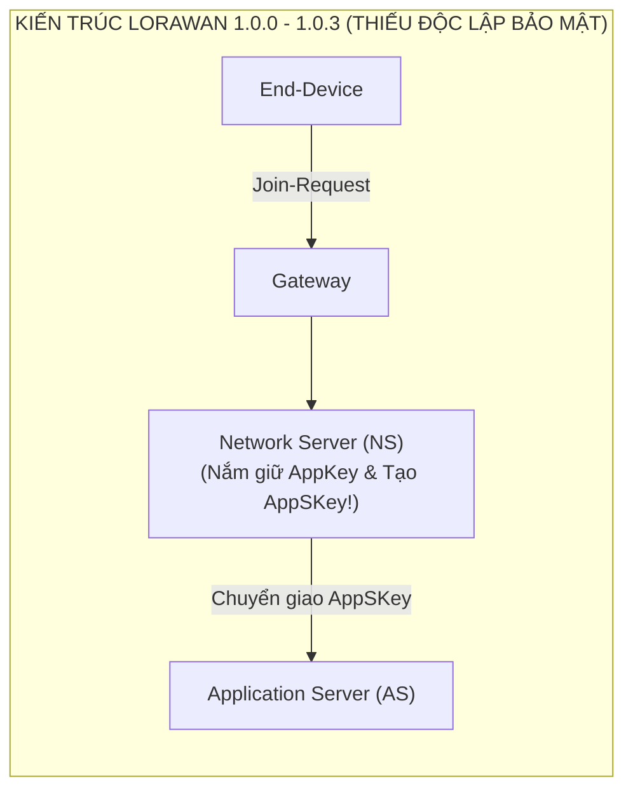
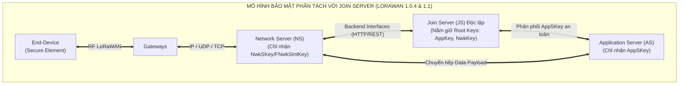
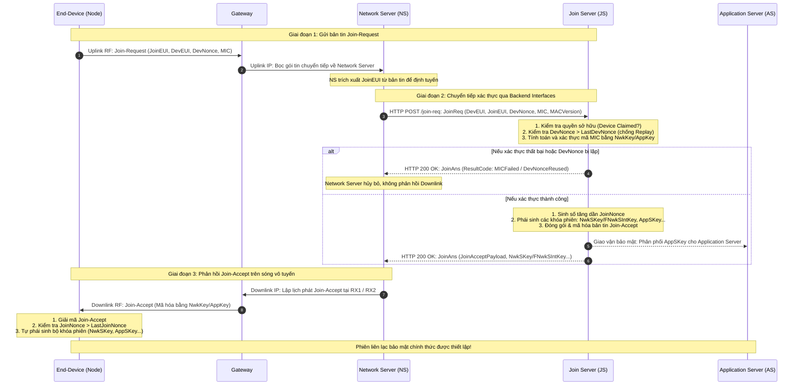
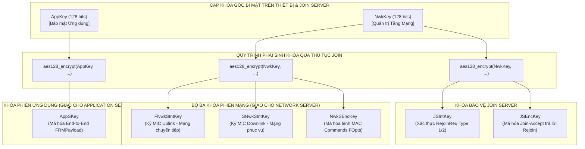
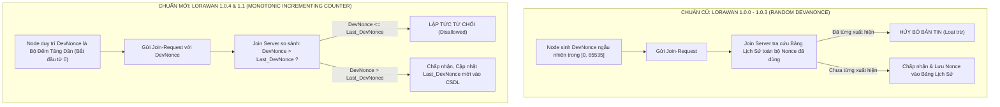
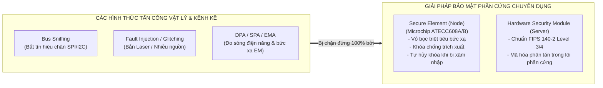
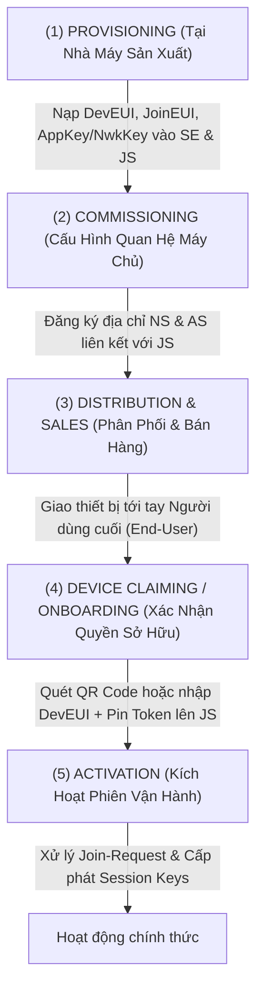
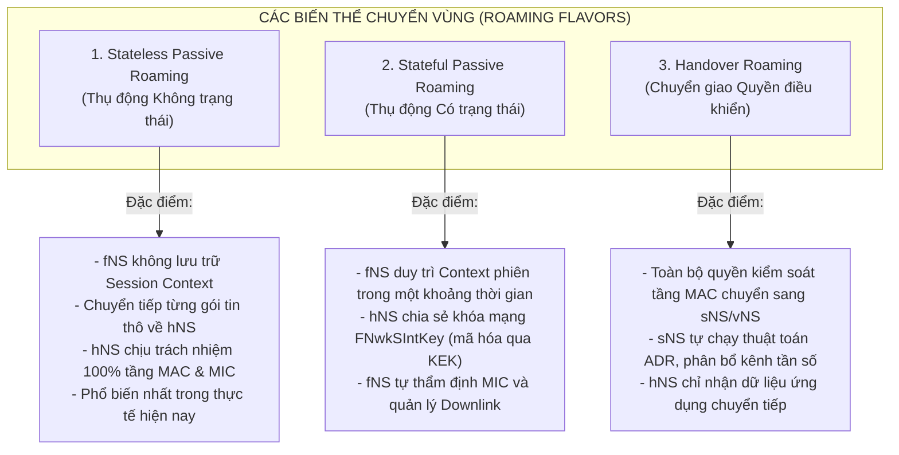
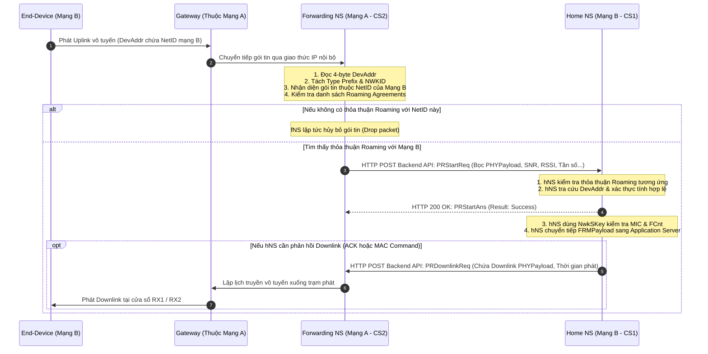

# MODULE 05: BẢO MẬT CHUYÊN SÂU & CHUYỂN VÙNG MẠNG (SECURITY & ROAMING)

> **THÔNG TIN ĐIỀU PHỐI HỌC TẬP (MODULE METADATA)**
> - **Nguồn tham chiếu giáo trình:** 
>   * *Cuốn 2 (LoRaWAN for advanced users):* Chương 5 (Trang 34 – 40), Chương 6 (Trang 41 – 54).
>   * *Đặc tả kỹ thuật tham chiếu bổ trợ:* LoRaWAN Core Specification v1.0.4, v1.1; LoRaWAN Backend Interfaces TS002-1.1.0; NetID Policy and Terms (LoRa Alliance).
> - **Thời lượng khuyến nghị:** 12 giờ lý thuyết chuyên sâu + 10 giờ thực hành lab/mô phỏng.
> - **Mục tiêu đầu ra cốt lõi (Learning Objectives):**
>   1. *Về kiến thức (Knowledge):* Làm chủ kiến trúc Join Server độc lập, hiểu rõ nguyên lý phân tách các ranh giới bảo mật giữa nhà khai thác mạng (Network Operator) và nhà cung cấp dịch vụ ứng dụng (Application Provider). Nắm vững sự tiến hóa của hệ thống khóa mật mã AES-128 giữa LoRaWAN 1.0.x và 1.1 (`AppKey`, `NwkKey`, `NwkSKey`, `AppSKey`, `FNwkSIntKey`, `SNwkSIntKey`, `NwkSEncKey`, `JSIntKey`, `JSEncKey`). Hiểu tường tận cơ chế chống Replay Attack trên thủ tục Join bằng `DevNonce` tăng dần và `JoinNonce`. Nắm vững nguyên lý bảo mật phần cứng bằng Secure Element (SE) và Hardware Security Module (HSM), quy trình Device Claiming / Onboarding. Làm chủ nguyên lý chuyển vùng (Passive Roaming Stateless/Stateful, Handover Roaming) và thuật toán phân bổ dải địa chỉ `DevAddr` từ 24-bit `NetID`.
>   2. *Về kỹ năng thực chiến (Practical Skills):* Có khả năng tính toán chuẩn xác dải mạng Subnet `DevAddr` từ bất kỳ mã `NetID` (Type 0 đến Type 7). Thiết lập và gỡ lỗi cấu hình Stateless Passive Roaming giữa các cụm Network Server (ChirpStack v4). Thiết kế quy trình nạp khóa an toàn (Key Provisioning) cho thiết bị đầu cuối sử dụng chip Secure Element (ATECC608A/B), ngăn ngừa triệt để lỗi khóa cứng thiết bị (DevNonce lockout) khi khởi động lại.

---

## 1. BẢNG THUẬT NGỮ TRỌNG TÂM CỦA MODULE (MODULE GLOSSARY)

Bảng thuật ngữ dưới đây chuẩn hóa 100% các từ viết tắt và khái niệm chuyên sâu trong Chương 5 & 6 của Cuốn 2, kết hợp các định danh mật mã theo đặc tả kỹ thuật LoRaWAN Backend Interfaces TS002.

| Viết tắt / Thuật ngữ gốc (EN) | Tên đầy đủ (English Full Name) | Thuật ngữ Tiếng Việt chuẩn hóa | Giải thích bản chất kỹ thuật (Ngắn gọn, chính xác) |
| :--- | :--- | :--- | :--- |
| **AppEUI** | Application Extended Unique Identifier | Mã định danh ứng dụng toàn cầu (1.0.x) | Chuỗi số 64-bit theo chuẩn IEEE EUI-64 dùng trong LoRaWAN 1.0.0–1.0.3 để định danh máy chủ ứng dụng, được thay thế hoàn toàn bởi `JoinEUI` từ bản 1.0.4. |
| **AppKey** | Application Key | Khóa gốc ứng dụng bí mật | Khóa mật mã gốc AES-128 bí mật của thiết bị; trong 1.0.x dùng để phái sinh cả `NwkSKey` và `AppSKey`, trong 1.1 chỉ dùng riêng để phái sinh `AppSKey`. |
| **AppNonce** | Application Nonce (1.0.x) | Giá trị ngẫu nhiên từ máy chủ (1.0.x) | Giá trị số ngẫu nhiên 24-bit do máy chủ phát sinh gửi trong bản tin `Join-Accept` (1.0.x) để cùng với `DevNonce` tạo khóa phiên; được thay bằng `JoinNonce`. |
| **AppSKey** | Application Session Key | Khóa phiên ứng dụng | Khóa AES-128 dẫn xuất sau khi Join thành công, dùng để mã hóa đầu-cuối tải trọng dữ liệu người dùng (`FRMPayload`) giữa Node và Application Server. |
| **Device Claiming** | Device Claiming / Onboarding | Xác nhận quyền sở hữu thiết bị | Thủ tục bảo mật chuyển giao quyền sở hữu và ủy quyền kích hoạt thiết bị từ nhà sản xuất sang tài khoản người dùng cuối trên máy chủ Join Server. |
| **DevNonce** | Device Nonce | Giá trị đếm kích hoạt của thiết bị | Số nguyên 16-bit do thiết bị phát sinh trong bản tin `Join-Request`; từ bản 1.0.4 trở đi bắt buộc là bộ đếm tăng dần tuần tự lưu trong NVRAM để chống Replay Attack. |
| **fNS** | Forwarding Network Server | Máy chủ mạng chuyển tiếp gói tin | Máy chủ mạng đóng vai trò trung gian thu nhận gói tin vô tuyến từ thiết bị lưu lạc và chuyển tiếp về cho mạng quản lý gốc qua giao diện Roaming. |
| **FNwkSIntKey** | Forwarding Network Session Integrity Key | Khóa phiên toàn vẹn mạng chuyển tiếp | Khóa AES-128 trong chuẩn LoRaWAN 1.1 dùng để tính toán và kiểm tra 2 byte đầu của mã toàn vẹn `MIC` cho khung Uplink giữa Node và mạng chuyển tiếp. |
| **Handover Roaming** | Handover Roaming | Chuyển vùng bàn giao quyền kiểm soát | Cơ chế chuyển vùng mạng hoàn toàn: quyền điều khiển phiên MAC và tham số vô tuyến của thiết bị được bàn giao hẳn sang máy chủ mạng khách đang phục vụ. |
| **hNS** | Home Network Server | Máy chủ mạng quản lý gốc | Máy chủ mạng nơi thiết bị được đăng ký hồ sơ thuê bao chính thức, chịu trách nhiệm lưu trữ phiên làm việc lâu dài và xử lý dữ liệu cuối cùng. |
| **HSM** | Hardware Security Module | Mô-đun phần cứng bảo mật chuyên dụng | Thiết bị máy chủ vật lý chuyên dụng đạt chuẩn FIPS 140-2/3 Level 3/4 chống giả mạo vật lý, dùng để lưu trữ khóa gốc và thực thi các phép toán mã hóa tại Join Server. |
| **JoinEUI** | Join Extended Unique Identifier | Mã định danh toàn cầu của Join Server | Chuỗi định danh toàn cầu 64-bit theo chuẩn IEEE EUI-64 dùng để định tuyến bản tin `Join-Request` từ Network Server đến đúng máy chủ quản lý khóa `Join Server`. |
| **JoinNonce** | Join Nonce | Bộ đếm kích hoạt của Join Server (1.1 / 1.0.4) | Giá trị số nguyên 24-bit tăng dần nghiêm ngặt do Join Server sinh ra đóng gói vào `Join-Accept`, giúp thiết bị ngăn chặn tấn công phát lại gói phản hồi Join. |
| **JS** | Join Server | Máy chủ kích hoạt & quản lý khóa | Thực thể máy chủ bảo mật độc lập lưu trữ các khóa gốc (`AppKey`/`NwkKey`), chịu trách nhiệm xác thực `Join-Request` và phân phối các khóa phiên cho NS và AS. |
| **JSEncKey / JSIntKey** | Join Server Encryption / Integrity Key | Cặp khóa bảo mật của Join Server (1.1) | Các khóa mật mã AES-128 dẫn xuất từ `NwkKey` dùng để bảo vệ tính toàn vẹn và mã hóa các bản tin trao đổi Rejoin giữa NS và Join Server. |
| **KEK** | Key Encryption Key | Khóa mã hóa khóa phiên Roaming | Khóa mật mã đối xứng dùng giữa các Network Server trên giao diện Backend Interfaces để bọc (wrap/encrypt) các khóa phiên khi chuyển giao qua mạng công cộng. |
| **NetID** | Network Identifier | Mã định danh mạng LoRaWAN | Chuỗi số 24-bit duy nhất do liên minh LoRa Alliance cấp phát cho các nhà mạng nhằm phân định không gian địa chỉ và phục vụ định tuyến Roaming. |
| **NwkAddr** | Network Address | Địa chỉ thiết bị nội bộ mạng | Phần bit trọng số thấp trong cấu trúc `DevAddr` 32-bit (độ dài từ 7 đến 25 bit tùy loại NetID), dùng để gán định danh duy nhất cho từng thiết bị trong một mạng. |
| **NwkID** | Network Identifier Bits | Các bit định danh mạng trong DevAddr | Phần bit trích xuất từ `NetID` đặt ở phần đầu của `DevAddr` (sau Type Prefix), dùng để nhận diện mạng trên không gian vô tuyến. |
| **NwkKey** | Network Key | Khóa gốc quản trị mạng (1.1 / 1.0.4) | Khóa gốc AES-128 bí mật dùng riêng cho tầng mạng trong LoRaWAN 1.1, do Join Server và thiết bị nắm giữ, dùng để phái sinh toàn bộ các khóa phiên mạng. |
| **NwkSEncKey** | Network Session Encryption Key | Khóa phiên mã hóa lệnh MAC (1.1) | Khóa AES-128 trong LoRaWAN 1.1 dùng riêng để mã hóa và giải mã các lệnh MAC Commands truyền trong trường `FOpts` hoặc trên cổng `FPort = 0`. |
| **NwkSKey** | Network Session Key | Khóa phiên quản trị mạng (1.0.x) | Khóa AES-128 trong 1.0.x dùng cho cả hai mục đích: tính mã kiểm tra toàn vẹn `MIC` cho khung truyền và mã hóa các lệnh MAC Commands. |
| **Passive Roaming** | Passive Roaming | Chuyển vùng mạng thụ động | Cơ chế chuyển vùng trong đó thiết bị hoàn toàn không biết mình đang roaming; mạng khách chỉ nhận và chuyển tiếp gói tin về mạng gốc (gồm Stateless và Stateful). |
| **PRStartReq / PRStartAns** | Passive Roaming Start Request / Answer | Bản tin yêu cầu / phản hồi khởi tạo Roaming | Cặp thông điệp giao tiếp chuẩn hóa trong LoRaWAN Backend Interfaces giữa fNS và hNS để bắt đầu luồng chuyển tiếp dữ liệu cho thiết bị chuyển vùng. |
| **SE** | Secure Element | Phần tử bảo mật phần cứng | Vi mạch bán dẫn chuyên dụng chống can thiệp vật lý (như Microchip ATECC608A/B) tích hợp trên Node để lưu trữ khóa gốc và tính toán mật mã tại chỗ. |
| **Side-Channel Attack** | Side-Channel Attack | Tấn công kênh kề mật mã | Kỹ thuật tấn công phân tích các đại lượng vật lý rò rỉ khi vi điều khiển đang tính toán mã hóa (như điện năng tiêu thụ SPA/DPA, bức xạ điện từ EMA, thời gian thực thi). |
| **SNwkSIntKey** | Serving Network Session Integrity Key | Khóa phiên toàn vẹn mạng phục vụ | Khóa AES-128 trong chuẩn LoRaWAN 1.1 dùng để tính toán và thẩm định mã `MIC` cho gói Downlink và 2 byte sau của mã `MIC` cho gói Uplink. |
| **sNS** | Serving Network Server | Máy chủ mạng phục vụ trực tiếp | Máy chủ mạng đang trực tiếp kiểm soát tầng MAC (lập lịch Downlink, ADR, kênh truyền) của thiết bị trong kịch bản Handover Roaming hoặc Stateful Roaming. |
| **Type Prefix** | DevAddr Type Prefix | Tiền tố phân loại địa chỉ DevAddr | Chuỗi bit từ 1 đến 8 bit nằm ở đầu địa chỉ `DevAddr`, xác định cấu trúc phân bổ bit giữa `NWKID` và `NwkAddr` tương ứng với từng loại `NetID`. |
| **vNS** | Visited Network Server | Máy chủ mạng khách ghé thăm | Thuật ngữ chỉ máy chủ mạng của bên thứ ba nơi thiết bị đang hiện diện tạm thời trong quá trình di chuyển chuyển vùng. |

---

## 2. NỘI DUNG LÝ THUYẾT CỐT LÕI & GIẢI PHẪU KỸ THUẬT (CORE TECHNICAL KNOWLEDGE)

### 2.1. Kiến trúc Join Server (JS) độc lập & Mô hình Bảo mật Phân tách

#### 2.1.1. Bối cảnh lịch sử và Lý do phân tách Join Server
Trong các phiên bản sơ khai của giao thức LoRaWAN (từ v1.0.0 đến v1.0.3), kiến trúc mạng chỉ bao gồm 4 thành phần cơ bản:
$$\text{End-Device} \longleftrightarrow \text{Gateway} \longleftrightarrow \text{Network Server (NS)} \longleftrightarrow \text{Application Server (AS)}$$

Trong mô hình này, thủ tục kích hoạt vô tuyến (OTAA) được xử lý trực tiếp bởi Network Server. Điều này đồng nghĩa với việc Network Server phải lưu trữ khóa gốc bí mật của thiết bị (`AppKey`). Khi một thiết bị gửi bản tin `Join-Request`, Network Server sẽ dùng `AppKey` để giải mã và phái sinh ra hai khóa phiên:
1. `NwkSKey` (Network Session Key) giữ lại cho chính nó để kiểm tra tính toàn vẹn dữ liệu (mã `MIC`) và xử lý MAC Commands.
2. `AppSKey` (Application Session Key) được Network Server gửi tiếp sang cho Application Server qua giao diện mạng backend.



Mô hình này bộc lộ **ba lỗ hổng kiến trúc và rào cản thương mại nghiêm trọng**:
1. **Vi phạm nguyên tắc Bảo mật Đầu-Cuối (End-to-End Confidentiality):** Nhà mạng vận hành Network Server có khả năng nắm giữ hoặc can thiệp vào `AppSKey`. Do đó, về mặt lý thuyết mật mã học, nhà mạng hoàn toàn có thể giải mã được toàn bộ nội dung dữ liệu cảm biến nhạy cảm (`FRMPayload`) của khách hàng doanh nghiệp.
2. **Khóa chặt nhà mạng (Vendor Lock-in):** Khi khóa gốc `AppKey` đã được nạp tĩnh vào cơ sở dữ liệu của một Network Server cụ thể, khách hàng rất khó khăn nếu muốn chuyển dịch thiết bị sang một nhà mạng LoRaWAN khác mà không phải thu hồi thiết bị để nạp lại khóa.
3. **Nguy cơ rò rỉ khóa diện rộng:** Một lỗ hổng an ninh trên máy chủ Network Server công cộng có thể làm lộ khóa gốc `AppKey` của hàng triệu thiết bị IoT thuộc nhiều tổ chức khác nhau.

Để giải quyết triệt để vấn đề này, từ phiên bản **LoRaWAN 1.0.4** và **LoRaWAN 1.1**, liên minh LoRa Alliance đã chính thức chuẩn hóa thực thể **Join Server (JS)** như một máy chủ bảo mật hoàn toàn độc lập với Network Server và Application Server.



#### 2.1.2. Phân định ranh giới tin cậy (Trust Boundaries)
Với sự xuất hiện của Join Server:
- **Join Server là Điểm tựa Tin cậy Duy nhất (Single Root of Trust):** Chỉ duy nhất Join Server và bản thân thiết bị đầu cuối nắm giữ các khóa bí mật gốc (`AppKey` trong 1.0.x hoặc `NwkKey` và `AppKey` trong 1.1).
- **Network Server không biết nội dung ứng dụng:** Network Server chỉ nhận được các khóa phiên quản trị mạng (`NwkSKey` hoặc `FNwkSIntKey`, `SNwkSIntKey`, `NwkSEncKey`). Network Server hoàn toàn không được tiếp cận `AppKey` hay `AppSKey`.
- **Application Server không can thiệp hạ tầng mạng:** Application Server chỉ nhận `AppSKey` từ Join Server để giải mã `FRMPayload`. Application Server không cần biết chi tiết hạ tầng truyền sóng vô tuyến.
- **Khả năng đa kết nối (Interoperability):** Một nhà mạng (NS) có thể phục vụ các thiết bị có khóa quản lý ở nhiều Join Server khác nhau (ví dụ: ChirpStack NS kết nối đồng thời với Actility Join Server và The Things Industries Join Server). Ngược lại, một Join Server có thể phục vụ và kích hoạt thiết bị chạy trên nhiều hạ tầng mạng khác nhau.

#### 2.1.3. Chuyển dịch từ `AppEUI` sang `JoinEUI`
- Trong chuẩn **LoRaWAN 1.0.3 trở về trước**, bản tin `Join-Request` mang trường `AppEUI` (8 bytes). Trường này ban đầu dự định định danh ứng dụng, nhưng trên thực tế gây nhầm lẫn vì Network Server không biết phải định tuyến yêu cầu kích hoạt đi đâu nếu ứng dụng nằm phân tán.
- Từ chuẩn **LoRaWAN 1.0.4 và 1.1**, trường này chính thức được đổi tên và quy định chức năng thành **`JoinEUI`** (8 bytes, tức 64 bits theo chuẩn IEEE EUI-64).
- **Cơ chế định tuyến DNS toàn cầu:** `JoinEUI` được sử dụng làm khóa tra cứu hệ thống phân giải tên miền (DNS) theo chuẩn LoRaWAN Backend Interfaces:
  $$\text{Domain Tra cứu} = \text{<JoinEUI-in-reverse-nibbles>}.\text{joineuis.lora-alliance.org}$$
  Nhờ đó, khi một Gateway bắt được bản tin `Join-Request`, Network Server trích xuất `JoinEUI`, thực hiện truy vấn DNS để tìm ra địa chỉ IP/URI chính xác của máy chủ Join Server quản lý thiết bị đó trên phạm vi toàn cầu.

#### 2.1.4. Trình tự luồng bản tin kích hoạt OTAA với Join Server độc lập
Dưới đây là sơ đồ tuần tự biểu diễn chi tiết quy trình bắt tay kích hoạt OTAA chuẩn hóa theo LoRaWAN Backend Interfaces:



---

### 2.2. Hệ thống Khóa Mật mã & So sánh Toàn diện LoRaWAN 1.0.x và 1.1

#### 2.2.1. Ma trận so sánh cấu trúc khóa giữa LoRaWAN 1.0.x và 1.1
Sự khác biệt quan trọng nhất giữa hai thế hệ giao thức nằm ở mức độ chuyên biệt hóa của các khóa mật mã. Bảng dưới đây so sánh toàn diện hệ thống khóa:

| Đặc tính / Loại khóa | Chuẩn LoRaWAN 1.0.x (1.0.0 – 1.0.3) | Chuẩn LoRaWAN 1.1 (và bản chuyển tiếp 1.0.4) | Ý nghĩa bảo mật & Cải tiến kỹ thuật |
| :--- | :--- | :--- | :--- |
| **Khóa gốc tầng mạng (Network Root Key)** | Không có riêng (dùng chung `AppKey`) | **`NwkKey`** (128-bit AES) | Tách biệt hoàn toàn quyền quản trị mạng khỏi ứng dụng. Được lưu ở Join Server và Node. |
| **Khóa gốc tầng ứng dụng (Application Root Key)** | **`AppKey`** (128-bit AES) dùng cho cả mạng & app | **`AppKey`** (128-bit AES) chỉ dùng cho tầng ứng dụng | Trong 1.1, `AppKey` chỉ dùng để sinh `AppSKey`, nhà mạng hoàn toàn không thể chạm tới. |
| **Khóa toàn vẹn bản tin mạng (Integrity Key)** | **`NwkSKey`** (128-bit AES): dùng cho cả MIC Uplink và Downlink | **`FNwkSIntKey`** (Forwarding) & **`SNwkSIntKey`** (Serving) | Phân tách trách nhiệm kiểm tra MIC giữa mạng chuyển tiếp (fNS) và mạng phục vụ (sNS) trong Roaming. |
| **Khóa mã hóa lệnh MAC (MAC Encryption Key)** | Dùng chung **`NwkSKey`** để mã hóa FOpts / FPort 0 | **`NwkSEncKey`** (128-bit AES) chuyên trách | Tránh việc dùng chung một khóa cho cả việc ký xác thực (MAC/MIC) lẫn mã hóa dữ liệu (Encryption). |
| **Khóa mã hóa ứng dụng (App Encryption Key)** | **`AppSKey`** (128-bit AES) | **`AppSKey`** (128-bit AES) | Mã hóa đầu-cuối `FRMPayload` trên các cổng `FPort = 1..223`. |
| **Khóa bảo vệ Join Server (JS Security Keys)** | Không có | **`JSIntKey`** & **`JSEncKey`** (128-bit AES) | Dùng để bảo vệ tính toàn vẹn và mã hóa các thông điệp `Rejoin-Request` trao đổi với Join Server. |
| **Cơ chế bắt tay tái kết nối (Re-keying)** | Không hỗ trợ (phải thực hiện lại toàn bộ thủ tục Join) | Hỗ trợ 3 kiểu bản tin **`Rejoin-Request`** (Type 0, 1, 2) | Cho phép khôi phục kết nối, cập nhật tham số mạng hoặc đổi bộ khóa phiên mà không làm đứt quãng phiên ứng dụng. |

#### 2.2.2. Cây phái sinh khóa (Key Derivation Tree) trong LoRaWAN 1.1
Trong LoRaWAN 1.1, quy trình phái sinh khóa từ hai khóa gốc `NwkKey` và `AppKey` được chuẩn hóa bằng thuật toán mã hóa khối AES-128 ở chế độ mã hóa cơ bản (AES-128 Encryption Function, ký hiệu là $\text{aes128\_encrypt}(K, \text{Block})$):



#### 2.2.3. Công thức toán học phái sinh các khóa phiên
Các khóa phiên được phái sinh từ một chuỗi khối đầu vào $16\text{ bytes}$ chuẩn hóa như sau:

1. **Khóa phiên toàn vẹn chuyển tiếp (`FNwkSIntKey`):**
   $$\text{FNwkSIntKey} = \text{aes128\_encrypt}(\text{NwkKey}, 0x01 \mid \text{JoinNonce} \mid \text{JoinEUI} \mid \text{DevNonce} \mid \text{pad}_{16})$$
2. **Khóa phiên ứng dụng (`AppSKey`):**
   - Trong LoRaWAN 1.0.x:
     $$\text{AppSKey} = \text{aes128\_encrypt}(\text{AppKey}, 0x02 \mid \text{AppNonce} \mid \text{NetID} \mid \text{DevNonce} \mid \text{pad}_{16})$$
   - Trong LoRaWAN 1.1:
     $$\text{AppSKey} = \text{aes128\_encrypt}(\text{AppKey}, 0x02 \mid \text{JoinNonce} \mid \text{JoinEUI} \mid \text{DevNonce} \mid \text{pad}_{16})$$
3. **Khóa phiên toàn vẹn mạng phục vụ (`SNwkSIntKey`):**
   $$\text{SNwkSIntKey} = \text{aes128\_encrypt}(\text{NwkKey}, 0x03 \mid \text{JoinNonce} \mid \text{JoinEUI} \mid \text{DevNonce} \mid \text{pad}_{16})$$
4. **Khóa phiên mã hóa quản trị mạng (`NwkSEncKey`):**
   $$\text{NwkSEncKey} = \text{aes128\_encrypt}(\text{NwkKey}, 0x04 \mid \text{JoinNonce} \mid \text{JoinEUI} \mid \text{DevNonce} \mid \text{pad}_{16})$$
5. **Cặp khóa phụ trợ của Join Server (`JSEncKey` và `JSIntKey`):**
   $$\text{JSIntKey} = \text{aes128\_encrypt}(\text{NwkKey}, 0x06 \mid \text{DevEUI} \mid \text{pad}_{16})$$
   $$\text{JSEncKey} = \text{aes128\_encrypt}(\text{NwkKey}, 0x05 \mid \text{DevEUI} \mid \text{pad}_{16})$$

*Trong đó:* Byte đầu tiên ($0x01 \dots 0x06$) đóng vai trò là hằng số phân biệt mục đích phái sinh (Domain Separator); $\text{pad}_{16}$ là chuỗi các byte $0x00$ chèn vào đuôi để đảm bảo độ dài khối vừa đủ $16\text{ bytes}$ ($128\text{ bits}$).

#### 2.2.4. Cơ chế tính mã toàn vẹn MIC và mã hóa FRMPayload
- **Mã kiểm tra tính toàn vẹn bản tin (MIC - Message Integrity Control):**
  * Trong LoRaWAN 1.0.x: MIC là $4\text{ bytes}$ đầu của thuật toán AES-CMAC tính toán trên toàn bộ khung tin bằng `NwkSKey`:
    $$\text{cmac} = \text{AES128-CMAC}(\text{NwkSKey}, B_0 \mid \text{msg})$$
    $$\text{MIC} = \text{cmac}[0..3]$$
  * Trong LoRaWAN 1.1: Để hỗ trợ Roaming an toàn giữa hai nhà mạng (fNS và sNS), mã MIC $4\text{ bytes}$ của khung Uplink được ghép từ hai phần chữ ký:
    $$\text{cmac}_S = \text{AES128-CMAC}(\text{SNwkSIntKey}, B_1 \mid \text{msg})$$
    $$\text{cmac}_F = \text{AES128-CMAC}(\text{FNwkSIntKey}, B_0 \mid \text{msg})$$
    $$\text{MIC} = \text{cmac}_F[0..1] \mid \text{cmac}_S[0..1]$$
    *Ý nghĩa:* Mạng chuyển tiếp (fNS) có thể thẩm định ngay lập tức $2\text{ bytes}$ đầu của MIC bằng khóa `FNwkSIntKey` mà không cần biết khóa riêng tư `SNwkSIntKey` của mạng phục vụ gốc (sNS).
- **Mã hóa vùng dữ liệu người dùng (`FRMPayload`):**
  Thực hiện bằng giải thuật **AES-128 ở chế độ đếm (CTR mode)** sử dụng `AppSKey` (đối với dữ liệu ứng dụng trên $FPort \ge 1$) hoặc `NwkSEncKey` (đối với các lệnh MAC trên $FPort = 0$). Chuỗi khối đếm $A_i$ ($16\text{ bytes}$) được tạo ra cho từng khối dữ liệu $i = 1 \dots k$, sau đó mã hóa qua AES và XOR với bản rõ để tạo thành bản mã:
  $$S_i = \text{aes128\_encrypt}(K, A_i)$$
  $$\text{Ciphertext}_i = \text{Plaintext}_i \oplus S_i$$

---

### 2.3. Cơ chế Chống Tấn công Phát lại (Replay Protection) & Sự Tiến hóa của DevNonce

#### 2.3.1. Bản chất của Tấn công Phát lại (Replay Attack) trên thủ tục Join
Trong mạng vô tuyến diện rộng LoRaWAN, sóng vô tuyến truyền lan trong không gian mở. Kẻ tấn công (Attacker / Eavesdropper) có thể dùng máy thu SDR (Software Defined Radio) ghi lại trọn vẹn bản tin `Join-Request` hợp lệ của một thiết bị cảm biến và bản tin `Join-Accept` phản hồi từ Gateway.

Nếu không có cơ chế ngăn chặn phát lại:
1. Kẻ tấn công có thể phát lại bản tin `Join-Request` cũ vào một thời điểm khác.
2. Network Server tưởng rằng thiết bị đang xin kết nối lại, sẽ xử lý và khởi tạo phiên mới, đồng thời hủy bỏ phiên làm việc hiện tại của thiết bị thật $\rightarrow$ Thiết bị thật bị mất liên lạc (Denial of Service - DoS).
3. Nguy hiểm hơn, nếu kẻ tấn công thu thập được các bản tin dữ liệu cũ và phát lại, hệ thống backend có thể ghi nhận các giá trị đo đạc sai lệch (ví dụ: phát lại trạng thái báo cháy giả hoặc báo mở khóa cửa kho).

#### 2.3.2. Sự tiến hóa của `DevNonce`: LoRaWAN 1.0.0–1.0.3 so với 1.0.4 & 1.1
Để chống Replay Attack trên bản tin `Join-Request`, LoRaWAN sử dụng giá trị số nguyên $2\text{ bytes}$ mang tên **`DevNonce`** ($0 \dots 65535$). Quy tắc bảo mật cốt lõi: **Một giá trị `DevNonce` không bao giờ được phép xuất hiện hai lần đối với cùng một thiết bị (`DevEUI`).**

Tuy nhiên, cách thức hiện thực hóa quy tắc này đã trải qua một sự thay đổi mang tính cách mạng:



##### Phân tích chi tiết hai cơ chế:
1. **Trong LoRaWAN 1.0.0 – 1.0.3 (Cơ chế Ngẫu nhiên - Pseudo-random):**
   - Thiết bị sinh ngẫu nhiên một số 16-bit.
   - Join Server phải lưu trữ một danh sách (Table / History Array) chứa toàn bộ các giá trị `DevNonce` đã từng sử dụng của từng thiết bị.
   - **Nhược điểm nghiêm trọng:** 
     * Tốn kém bộ nhớ lưu trữ tại máy chủ Join Server khi quản lý hàng triệu thiết bị qua nhiều năm.
     * Khi số lần Join tăng lên, nguy cơ xung đột ngẫu nhiên (Birthday Paradox) tăng cao, khiến thiết bị gửi Join hợp lệ nhưng lại ngẫu nhiên trùng với một giá trị đã dùng từ 2 năm trước $\rightarrow$ Bị loại bỏ vô lý.
     * Nếu thiết bị bị mất nguồn và không nhớ các giá trị đã phát, nó chỉ có thể "cầu may" sinh một số ngẫu nhiên mới chưa có trong danh sách của Server.
2. **Từ LoRaWAN 1.0.4 và 1.1 trở đi (Cơ chế Bộ đếm Tăng dần - Monotonic Counter):**
   - Đặc tả quy định: **`DevNonce` là một bộ đếm tăng dần nghiêm ngặt (Strictly Incrementing Counter)**, bắt đầu từ $0$ khi xuất xưởng và tăng thêm $1$ sau mỗi lần phát `Join-Request`.
   - Phía Join Server chỉ cần lưu trữ duy nhất **một giá trị số nguyên**: `Last_DevNonce`. Khi nhận được `Join-Request` mới, Join Server chỉ kiểm tra một điều kiện toán học duy nhất:
     $$\text{DevNonce}_{\text{mới}} > \text{Last\_DevNonce}$$
   - **Cải tiến vượt bậc:** Phía Server tối ưu hóa tuyệt đối bộ nhớ (chỉ tốn $2\text{ bytes}$ lưu biến trạng thái thay vì bảng lịch sử khổng lồ). Xóa bỏ hoàn toàn hiện tượng xung đột ngẫu nhiên.
   - **BẪY KỸ THUẬT BẮT BUỘC:** Thiết bị đầu cuối **bắt buộc phải lưu trữ giá trị `DevNonce` hiện tại vào bộ nhớ bất biến (NVRAM / EEPROM / Flash)**. Nếu thiết bị khởi động lại mà quên mất `DevNonce` và quay trở về $0$, toàn bộ các bản tin `Join-Request` tiếp theo sẽ vĩnh viễn bị Join Server từ chối vì không thỏa mãn điều kiện lớn hơn `Last_DevNonce` đã lưu trên hệ thống!

#### 2.3.3. Bảo vệ chiều Downlink: Cơ chế của `JoinNonce`
Không chỉ bảo vệ chiều Uplink, chiều Downlink của thủ tục Join cũng được bảo vệ chống Replay Attack:
- Trong bản tin phản hồi `Join-Accept`, Join Server đóng gói một trường số nguyên $3\text{ bytes}$ ($24\text{ bits}$) mang tên **`JoinNonce`** (thay thế cho `AppNonce` ngẫu nhiên trong 1.0.x).
- `JoinNonce` cũng là một bộ đếm tăng dần do Join Server quản lý.
- Thiết bị đầu cuối lưu trữ giá trị `Last_JoinNonce` trong bộ nhớ bất biến. Khi nhận được bản tin `Join-Accept`, sau khi giải mã thành công, thiết bị sẽ kiểm tra:
  $$\text{JoinNonce} > \text{Last\_JoinNonce}$$
- Nếu điều kiện trên thỏa mãn, thiết bị mới chấp nhận cập nhật khóa phiên và ghi nhận `Last_JoinNonce` mới. Nếu kẻ tấn công ghi âm bản tin `Join-Accept` cũ và phát lại, thiết bị sẽ lập tức phát hiện và loại bỏ.

---

### 2.4. Bảo mật Phần cứng & Vòng đời Thiết bị (Hardware Security & Life Cycle)

#### 2.4.1. Các vector tấn công vật lý và Phân tích kênh kề (Side-Channel Attacks)
Khi các thiết bị LoRaWAN được triển khai hàng loạt ngoài thực địa (đồng hồ nước ngầm, cảm biến nông nghiệp, trạm khí tượng rừng núi), kẻ tấn công hoàn toàn có thể tiếp cận vật lý trực tiếp với phần cứng của thiết bị (Physical Access).

Các hình thức tấn công nguy hiểm bao gồm:
1. **Can thiệp vi mạch trực tiếp (Direct Probing / Bus Sniffing):** Kẻ tấn công gắn que đo logic (Logic Analyzer) lên đường mạch SPI hoặc đường nạp nạp chương trình JTAG/SWD để đọc trộm khóa mật mã khi vi điều khiển đang truyền dữ liệu vào bộ nhớ Flash.
2. **Trích xuất bộ nhớ tĩnh (Firmware Extraction):** Bỏ qua cơ chế bảo vệ đọc (Readout Protection - RDP) của vi điều khiển bằng kỹ thuật chiếu tia laser (Fault Injection) hoặc hạ điện áp xung nhịp (Clock Glitching) để dump toàn bộ file nhị phân trong Flash, từ đó tìm ra khóa `AppKey`.
3. **Tấn công kênh kề (Side-Channel Attacks - SCA):** Kẻ tấn công không cần phá chip mà sử dụng máy hiện sóng độ chính xác cao đo lường dòng điện tiêu thụ tức thời của vi điều khiển khi nó đang thực thi phép toán AES-128:
   - **Simple Power Analysis (SPA):** Nhìn dạng sóng tiêu thụ điện để đoán các nhánh rẽ điều kiện `if/else` của thuật toán mật mã.
   - **Differential Power Analysis (DPA):** Sử dụng các mô hình phân tích thống kê trên hàng ngàn vết sóng điện năng để trích xuất chính xác từng bit của khóa mật mã gốc.
   - **Electromagnetic Analysis (EMA):** Thu nhận bức xạ điện từ phát ra từ chân chip trong lúc tính toán mã hóa để giải mã khóa.



#### 2.4.2. Phần tử bảo mật Secure Element (SE) và Hardware Security Module (HSM)
Để chống lại các nguy cơ trên, kiến trúc bảo mật cấp công nghiệp của LoRaWAN yêu cầu triển khai các mô-đun phần cứng chuyên dụng ở cả hai đầu:

1. **Trên Thiết bị Đầu cuối: Sử dụng Secure Element (SE):**
   - Là một vi mạch silicon bảo mật độc lập kích thước siêu nhỏ (như **Microchip ATECC608A / ATECC608B-TNGACT**, **STMicroelectronics STSAFE-A110**) được hàn ngay cạnh vi điều khiển chính (MCU) và giao tiếp qua bus I2C bảo mật.
   - **Đặc tính kỹ thuật vượt trội:**
     * Khóa gốc `AppKey` và `NwkKey` được nạp trực tiếp trong nhà máy sản xuất an toàn (Secure Factory Provisioning) vào vùng nhớ chống đọc được bảo vệ bởi lớp lưới kim loại chủ động (Active Shield).
     * Khi thực hiện thuật toán AES-128 hoặc phái sinh khóa phiên, toàn bộ phép tính được thực thi **ngay bên trong lõi phần cứng của Secure Element**. Vi điều khiển chính chỉ nhận kết quả đã mã hóa; khóa gốc **không bao giờ xuất hiện trên đường bus I2C hay thanh ghi của MCU**.
     * Tích hợp mạch cân bằng dòng điện tiêu thụ (Power Jitter & Internal Noise Generator) để xóa bỏ hoàn toàn dấu vết dao động điện áp, miễn nhiễm 100% trước các cuộc tấn công DPA/EMA.
     * Trang bị cảm biến phát hiện xâm nhập vật lý (nhiệt độ, điện áp bất thường, ánh sáng lọt vào khi cạy vỏ chip) $\rightarrow$ Tự động kích hoạt cơ chế xóa trắng dữ liệu khẩn cấp (Zeroization / Self-Destruction).
2. **Trên Máy chủ Join Server: Sử dụng Hardware Security Module (HSM):**
   - Là thiết bị phần cứng máy chủ chuyên dụng đạt chứng chỉ bảo mật quốc tế **FIPS 140-2 Level 3 hoặc Level 4**.
   - Chịu trách nhiệm bảo vệ cơ sở dữ liệu hàng triệu khóa gốc của các nhà mạng, thực hiện hàng chục ngàn phép tính xác thực `Join-Request` mỗi giây trong một môi trường phần cứng biệt lập tuyệt đối.

#### 2.4.3. Quy trình Vòng đời Thiết bị 5 Bước & Device Claiming (Onboarding)
Vòng đời quản lý khóa và quyền sở hữu thiết bị được chuẩn hóa qua 5 giai đoạn như trong Hình 29 & 30 của Cuốn 2:



1. **Bước 1 - Nạp khóa gốc (Key Provisioning):** Trong quá trình chế tạo bo mạch, nhà sản xuất thiết bị nạp an toàn bộ định danh `DevEUI`, `JoinEUI` và các khóa gốc bí mật vào chip Secure Element của thiết bị. Đồng thời, danh sách khóa này được chuyển giao sang máy chủ Join Server thông qua kênh truyền bảo mật cao (như tệp tin mã hóa PGP hoặc kết nối API trực tiếp giữa HSM của nhà máy và Join Server).
2. **Bước 2 - Khởi tạo ủy quyền máy chủ (Commissioning):** Nhà sản xuất thiết lập cấu hình định tuyến trên Join Server, chỉ định Network Server và Application Server nào sẽ phục vụ thiết bị này.
3. **Bước 3 - Phân phối thương mại (Sales):** Thiết bị được đóng hộp và bán ra thị trường đến tay người dùng cuối (End-User).
4. **Bước 4 - Xác nhận quyền sở hữu (Device Claiming / Onboarding):**
   - Khi thiết bị mới xuất xưởng, dù đã có khóa trên Join Server, nhưng **Join Server vẫn ở trạng thái khóa (Locked)**, từ chối mọi yêu cầu kích hoạt vì chưa có người dùng nào chứng minh quyền sở hữu hợp pháp.
   - Người dùng cuối thực hiện thủ tục **Device Claiming** trên cổng Web Console của Join Server bằng một trong hai phương thức:
     * **Quét mã QR chuẩn LoRa Alliance (TR005):** Mã QR in trên vỏ hộp chứa chuỗi định danh:
       `LW:PR:JoinEUI:DevEUI:ProfileID:ClaimToken:Checksum`
     * **Nhập thủ công cặp `DevEUI` kèm chuỗi mã PIN bí mật (Claiming Token):** Chuỗi ký tự ngẫu nhiên dùng một lần do nhà sản xuất in trên nhãn cào bảo mật của thiết bị.
   - Sau khi xác nhận thành công, Join Server chính thức liên kết thiết bị với tài khoản của người dùng và mở khóa quyền xử lý `Join-Request`.
5. **Bước 5 - Chuyển giao quyền sở hữu (Offboarding / Re-claiming):**
   - Khi người dùng muốn bán lại thiết bị hoặc chuyển sang tổ chức khác, họ thực hiện thao tác **Offboarding** để giải phóng thiết bị khỏi tài khoản của mình.
   - **LƯU Ý CỐT LÕI:** Việc Claiming chỉ chuyển giao **quyền sở hữu thiết bị trên Join Server**, tuyệt đối **không chuyển giao các khóa phiên (`NwkSKey`, `AppSKey`) đang hoạt động**. Do đó, sau khi một thiết bị được Claim bởi chủ sở hữu mới, thiết bị **bắt buộc phải thực hiện lại toàn bộ thủ tục Join-Request** để sinh ra một bộ khóa phiên hoàn toàn mới, đảm bảo chủ sở hữu cũ không thể nghe lén dữ liệu của chủ mới!

---

### 2.5. Cơ chế Chuyển vùng Mạng LoRaWAN (Roaming Architecture)

#### 2.5.1. Tại sao cần Roaming trong LoRaWAN?
Trong viễn thông di động tế bào (Cellular), Roaming là khả năng điện thoại di động duy trì liên lạc khi đi ra ngoài vùng phủ sóng của nhà mạng đăng ký SIM. Trong LoRaWAN, Roaming mang ý nghĩa mở rộng mạng lưới ở cấp độ công nghiệp với hai lợi ích chiến lược:

##### 1. Mở rộng vùng phủ sóng (Coverage Extension)
- Thiết bị theo dõi container hàng hải, vận tải xuyên quốc gia (Asset Tracking) di chuyển qua nhiều vùng địa lý hoặc biên giới giữa các quốc gia.
- Không có một nhà mạng LoRaWAN đơn lẻ nào có thể phủ sóng 100% diện tích toàn cầu. Thông qua thỏa thuận chuyển vùng (Roaming Agreement), thiết bị đăng ký tại mạng A (Pháp) khi di chuyển sang mạng B (Đức) vẫn truyền dữ liệu bình thường nhờ các Gateway của mạng B bắt sóng và chuyển tiếp về.

##### 2. Tăng cường mật độ trạm thu phát (Gateway Densification)
Đây là lợi ích kỹ thuật độc đáo của LoRaWAN mà nhiều kỹ sư thường bỏ qua: Ngay cả khi hai nhà mạng hoạt động trên **cùng một vùng địa lý chồng lấn (Overlapping Area)**, việc thiết lập Roaming vẫn mang lại 3 giá trị khổng lồ:
- **Ngăn ngừa mất mát dữ liệu (Connectivity Loss Prevention / Resilience):** Nếu một trạm Gateway của mạng A gặp sự cố đứt cáp quang hoặc sập nguồn điện, gói tin phát ra từ cảm biến vẫn được các Gateway lân cận của mạng B thu nhận và chuyển tiếp về Network Server A qua Roaming.
- **Tăng dung lượng phát Downlink (Network Capacity Improvement):** Các Gateway LoRaWAN phải tuân thủ nghiêm ngặt quy định pháp lý về chu kỳ phát sóng (1% hoặc 10% Duty Cycle). Khi mạng lưới có thêm các Gateway từ đối tác Roaming cùng hỗ trợ phát Downlink, năng lực phản hồi bản tin ACK và truyền MAC Commands của hệ thống tăng lên gấp nhiều lần.
- **Tối ưu hóa thời lượng pin cho thiết bị (Low-power Improvement):**
  * Khi mật độ Gateway dày đặc hơn, khoảng cách vật lý trung bình giữa cảm biến và Gateway gần nhất sẽ giảm đi đáng kể.
  * Tín hiệu thu được sẽ có chỉ số $RSSI$ cao hơn và $SNR$ vượt trội.
  * Giải thuật điều chỉnh tốc độ dữ liệu thích ứng (**ADR - Adaptive Data Rate**) của Network Server sẽ chỉ đạo thiết bị:
    $$\text{Tăng Data Rate} \ (\text{chuyển từ SF12 về SF7}) \quad \text{và} \quad \text{Giảm Công suất Phát} \ (\text{giảm từ 14 dBm về 2 dBm})$$
  * Khi chuyển từ $\text{SF12}$ về $\text{SF7}$, thời gian chiếm dụng kênh truyền ($ToA$) giảm gần $15 - 20$ lần, giúp dòng năng lượng tiêu thụ của thiết bị giảm đi hàng chục lần, kéo dài tuổi thọ pin từ 2 năm lên tới trên 10 năm!

#### 2.5.2. Các mô hình Roaming theo chuẩn LoRaWAN Backend Interfaces
Tài liệu đặc tả *LoRaWAN Backend Interfaces TS002* định nghĩa 3 phân loại Roaming chính:



1. **Stateless Passive Roaming (Chuyển vùng Thụ động Không trạng thái):**
   - **Đặc trưng:** Thiết bị hoàn toàn không biết mình đang ở chế độ Roaming. Máy chủ mạng chuyển tiếp (fNS) không lưu trữ bất kỳ trạng thái phiên làm việc nào của thiết bị (thời gian sống của phiên `passive_roaming_lifetime = 0s`).
   - **Luồng xử lý:** Khi Gateway của fNS bắt được một gói tin, fNS nhìn vào trường `DevAddr` để xác định mã `NetID`. Nếu khớp với thỏa thuận Roaming, fNS lập tức bọc gói tin và đẩy thẳng sang máy chủ mạng gốc (hNS) qua lệnh `PRStartReq`. hNS tự giải mã, tự kiểm tra `FCnt`, tự kiểm tra `MIC`.
   - **Ứng dụng:** Là giải pháp chuẩn mực, dễ triển khai nhất và đang được áp dụng rộng rãi nhất trên toàn cầu (giữa các nền tảng như ChirpStack, The Things Network, Actility).
2. **Stateful Passive Roaming (Chuyển vùng Thụ động Có trạng thái):**
   - **Đặc trưng:** Máy chủ fNS thiết lập một phiên chuyển vùng có thời hạn xác định (`passive_roaming_lifetime > 0s`).
   - **Bảo mật:** Máy chủ gốc hNS sẽ đóng gói và chia sẻ khóa mạng `FNwkSIntKey` cho fNS (được mã hóa bảo vệ bằng khóa chia sẻ trước `KEK - Key Encryption Key`). Nhờ đó, fNS có thể tự thẩm định tính toàn vẹn `MIC` của các gói tin tiếp theo ngay tại biên mạng mà không cần gửi mọi gói tin rác về hNS.
3. **Handover Roaming (Chuyển vùng Bàn giao Kiểm soát):**
   - **Đặc trưng:** Quyền quản trị điều khiển thiết bị được bàn giao hẳn từ hNS sang một máy chủ mạng phục vụ khách (**sNS - Serving Network Server**).
   - **Hoạt động:** sNS trực tiếp gửi các lệnh MAC Commands, tự điều khiển giải thuật ADR và quản lý kênh truyền vô tuyến phù hợp với địa phương nơi thiết bị đang lưu lạc. hNS chỉ đóng vai trò trung tâm thanh toán cước và chuyển dữ liệu về Application Server.

#### 2.5.3. Các thực thể tham gia quy trình Roaming
- **Home Network Server (hNS):** Máy chủ mạng gốc nơi thiết bị được cấu hình và quản lý thuê bao chính thức.
- **Forwarding Network Server (fNS):** Máy chủ mạng trung gian tại vùng phủ sóng nơi thiết bị phát sóng, chịu trách nhiệm nhận gói tin và chuyển tiếp.
- **Serving Network Server (sNS):** Máy chủ mạng đang trực tiếp kiểm soát tham số MAC vô tuyến của thiết bị. Trong Stateless Passive Roaming, chính hNS kiêm nhiệm luôn vai trò sNS.

#### 2.5.4. Sơ đồ tuần tự trao đổi bản tin Stateless Passive Roaming
Quy trình trao đổi giữa hai máy chủ mạng thông qua các API chuẩn hóa của LoRaWAN Backend Interfaces:



---

### 2.6. Giải phẫu NetID và Cấu trúc Địa chỉ Mạng DevAddr

#### 2.6.1. Khái niệm và Vai trò của `NetID`
Trong mạng LoRaWAN, mỗi thiết bị khi hoạt động được định danh bằng một địa chỉ mạng $32\text{ bits}$ gọi là **`DevAddr`** (tương tự địa chỉ IP trong mạng máy tính). Để các Gateway và Network Server trên toàn cầu có thể nhìn vào `DevAddr` và biết ngay thiết bị này thuộc về nhà mạng nào nhằm phục vụ định tuyến Roaming, liên minh LoRa Alliance đã thiết lập hệ thống định danh mạng **`NetID`** ($24\text{ bits}$).

Mỗi tổ chức, doanh nghiệp hoặc nhà mạng viễn thông khi triển khai LoRaWAN thương mại đều phải đăng ký mua một hoặc nhiều mã `NetID` từ LoRa Alliance theo tài liệu *NetID Policy and Terms*.

#### 2.6.2. Cấu trúc nội tại của `NetID` (24 bits)
Mã `NetID` gồm $24\text{ bits}$ được phân chia thành 3 trường thành phần:

$$\text{NetID (24 bits)} = \text{TYPE (3 bits: bits 23..21)} + \text{RFU (21 - N bits)} + \text{ID (N bits)}$$

```text
+-----------------------------------------------------------------------+
|                         CẤU TRÚC NetID (24 BITS)                      |
+-------------------+---------------------------+-----------------------+
|   Bits 23 .. 21   |     Bits 20 .. N          |    Bits (N-1) .. 0    |
|   TYPE (3 bits)   |  RFU (21 - N bits = 0)    |     ID (N bits)       |
+-------------------+---------------------------+-----------------------+
```

- **Trường `TYPE` (3 bits MSB):** Nằm ở 3 bit có trọng số cao nhất (từ bit 21 đến bit 23), có giá trị thập phân từ $0$ đến $7$. Giá trị này phản ánh **hạng thành viên của tổ chức trong LoRa Alliance** và quyết định quy mô không gian địa chỉ được cấp.
- **Trường `ID` (N bits LSB):** Là chuỗi số nhận diện duy nhất do LoRa Alliance trực tiếp phân bổ cho đơn vị đăng ký. Độ dài $N$ thay đổi tùy theo loại `TYPE`.
- **Trường `RFU` (Reserved for Future Use):** Là các bit dự phòng nằm xen giữa `TYPE` và `ID` (được lấp đầy bằng các bit $0$).

#### 2.6.3. Bảng phân loại 8 Loại NetID (Type 0 đến Type 7)
Tài liệu *LoRaWAN Backend Interfaces TS002* quy định chi tiết 8 loại NetID như sau:

| NetID Type | 3 bit MSB | Độ dài trường ID ($N$) | Độ dài trường RFU | Quy định cấp phát của LoRa Alliance | Số lượng địa chỉ DevAddr khả dụng của mạng |
| :---: | :---: | :---: | :---: | :--- | :--- |
| **Type 0** | `000` | 6 bits | 15 bits | Dành cho Thành viên Sáng lập (Sponsor Members) | **25 bits** ($\approx 33.5$ triệu thiết bị) |
| **Type 1** | `001` | 6 bits | 15 bits | Dự phòng cho tương lai (Reserved for Future Use) | **24 bits** ($\approx 16.7$ triệu thiết bị) |
| **Type 2** | `010` | 9 bits | 12 bits | Dự phòng cho tương lai (Reserved for Future Use) | **20 bits** ($\approx 1.04$ triệu thiết bị) |
| **Type 3** | `011` | 21 bits | 0 bits (Không có) | Thành viên Sponsor & Đóng góp (Contributor Members) | **17 bits** ($131,072$ thiết bị) |
| **Type 4** | `100` | 21 bits | 0 bits (Không có) | Dự phòng cho tương lai (Reserved for Future Use) | **15 bits** ($32,768$ thiết bị) |
| **Type 5** | `101` | 21 bits | 0 bits (Không có) | Dự phòng cho tương lai (Reserved for Future Use) | **13 bits** ($8,192$ thiết bị) |
| **Type 6** | `110` | 21 bits | 0 bits (Không có) | Thành viên Áp dụng & Học viện (Adopter & Institutional) | **10 bits** ($1,024$ thiết bị) |
| **Type 7** | `111` | 21 bits | 0 bits (Không có) | Cấp cho đơn vị phi thành viên (Non-members, tối đa 2 block x 16) | **7 bits** ($128$ thiết bị / NetID) |

#### 2.6.4. Công thức toán học và Quy tắc cấu tạo `DevAddr` (32 bits)
Từ mã `NetID` đã có, cấu trúc địa chỉ thiết bị `DevAddr` ($32\text{ bits}$) được phân tách thành 3 thành phần liên hoàn:

$$\text{DevAddr (32 bits)} = \underbrace{\text{TYPE PREFIX (L bits)} + \text{NWKID (M bits)}}_{\text{Network Identifier (Định danh Mạng)}} + \underbrace{\text{NWK ADDR (P bits)}}_{\text{Địa chỉ Thiết bị}}$$

Điều kiện ràng buộc độ dài:
$$L + M + P = 32 \text{ bits}$$

```text
+-----------------------------------------------------------------------+
|                        CẤU TRÚC DevAddr (32 BITS)                     |
+-----------------------+-----------------------+-----------------------+
|   TYPE PREFIX (L b)   |     NWKID (M bits)    |   NWK ADDR (P bits)   |
|  (L = Type + 1 bits)  |  (Lấy từ LSB NetID)   | (Gán cho End-Device)  |
+-----------------------+-----------------------+-----------------------+
```

##### Quy tắc toán học xác định các trường:
1. **Tiền tố phân loại `TYPE PREFIX` ($L$ bits):**
   - Độ dài $L$ được tính chính xác bằng công thức:
     $$L = \text{NetID Type} + 1$$
   - Chuỗi nhị phân của `TYPE PREFIX` luôn có cấu trúc: **Gồm $L - 1$ bit $1$ nối tiếp nhau và kết thúc bằng một bit $0$ ở vị trí LSB**.
     *(Ngoại lệ duy nhất: Khi Type = 0 thì $L = 1$, chuỗi nhị phân chỉ gồm duy nhất một bit `0`).*
2. **Định danh mạng trên không `NWKID` ($M$ bits):**
   - Độ dài $M$ bits được xác định theo bảng chuẩn hóa của LoRaWAN Backend Interfaces.
   - Giá trị $M$ bits này chính là **$M$ bit có trọng số thấp nhất (LSB) trích xuất từ trường `ID` của mã `NetID`**.
3. **Địa chỉ mạng gán cho thiết bị `NWK ADDR` ($P$ bits):**
   - Độ dài $P = 32 - (L + M)$ bits.
   - Đây là không gian bit mà nhà mạng được toàn quyền phân bổ tự do cho các thiết bị đầu cuối của mình (chạy từ $0$ đến $2^P - 1$).

##### Bảng đối chiếu tham số cấu tạo DevAddr từ NetID:
| NetID Type | Giá trị thập phân Prefix | Chuỗi nhị phân TYPE PREFIX | Độ dài $L$ (Prefix) | Độ dài $M$ (NWKID) | Độ dài $P$ (NWK ADDR) | Tổng số thiết bị ($2^P$) |
| :---: | :---: | :---: | :---: | :---: | :---: | :---: |
| **0** | $0$ | `0` | 1 bit | 6 bits | 25 bits | $33,554,432$ |
| **1** | $2$ | `10` | 2 bits | 6 bits | 24 bits | $16,777,216$ |
| **2** | $6$ | `110` | 3 bits | 9 bits | 20 bits | $1,048,576$ |
| **3** | $14$ | `1110` | 4 bits | 11 bits | 17 bits | $131,072$ |
| **4** | $30$ | `11110` | 5 bits | 12 bits | 15 bits | $32,768$ |
| **5** | $62$ | `111110` | 6 bits | 13 bits | 13 bits | $8,192$ |
| **6** | $126$ | `1111110` | 7 bits | 15 bits | 10 bits | $1,024$ |
| **7** | $254$ | `11111110` | 8 bits | 17 bits | 7 bits | $128$ |

#### 2.6.5. Dải NetID dùng riêng và Thử nghiệm (Private & Experimental NetIDs)
Đối với các mạng LoRaWAN độc lập, hệ thống phòng thí nghiệm của trường đại học hoặc các doanh nghiệp triển khai mạng đóng nội bộ (không tham gia hệ thống Roaming toàn cầu), LoRa Alliance cung cấp sẵn hai mã `NetID` đặc biệt được miễn trừ đăng ký:
1. **NetID `0x000000` (Type 0):**
   - Cung cấp dải địa chỉ `DevAddr` từ `0x00000000` đến `0x01FFFFFF` ($2^{25} = 33,554,432$ địa chỉ khả dụng).
2. **NetID `0x000001` (Type 0):**
   - Cung cấp dải địa chỉ `DevAddr` từ `0x02000000` đến `0x03FFFFFF` ($2^{25} = 33,554,432$ địa chỉ khả dụng).

#### 2.6.6. Cấu hình thực tế Stateless Passive Roaming trên ChirpStack v4
Dưới đây là đoạn mã cấu hình thực tế trong tệp `chirpstack-network-server.toml` để thiết lập thỏa thuận chuyển vùng Stateless Passive Roaming giữa máy chủ Home (CS1) và máy chủ Forwarding (CS2):

```toml
[roaming]
# Hậu tố phân giải tên miền NetID qua DNS chính thức của LoRa Alliance
resolve_netid_domain_suffix = ".netids.lora-alliance.org"

[roaming.api]
# Địa chỉ IP và cổng dịch vụ lắng nghe API Roaming Backend
bind = "0.0.0.0:9000"
ca_cert = ""
tls_cert = ""
tls_key = ""

# Khai báo cấu hình riêng cho từng đối tác Roaming
[[roaming.servers]]
# Mã NetID của máy chủ đối tác (ví dụ: NetID của CS2)
net_id = "000002"

# Sử dụng mô hình gọi API bất đồng bộ
async = true
async_timeout = "1s"

# Kích hoạt tính năng Passive Roaming
passive_roaming = true

# Đặt thời gian sống của phiên bằng 0s để kích hoạt chế độ STATELESS
passive_roaming_lifetime = "0s"

# Địa chỉ IP/URI trực tiếp của máy chủ đối tác (bỏ qua tra cứu DNS)
server = "http://192.168.1.100:9000"
```

---

## 3. GÓC CẢNH BÁO KỸ THUẬT THỰC CHIẾN ([!] TO BE READ VERY CAREFULLY)

Mục này phân tích chuyên sâu 4 bẫy kỹ thuật kinh điển liên quan đến bảo mật và chuyển vùng, xuất phát trực tiếp từ các cảnh báo chấm than đỏ trong Chương 5 và 6 của Cuốn 2.

> [!WARNING]
> ### ⚠️ CẢNH BÁO 5.1: MẤT BỘ ĐẾM DEVANONCE KHI RESET NGUỒN TRÊN LORAWAN 1.0.4 / 1.1 GÂY KHÓA THIẾT BỊ VĨNH VIỄN (DEVICE LOCKOUT)
> **1. Bối cảnh & Cảnh báo nguyên bản từ sách:**
> *(Dẫn chiếu Cuốn 2 – Chương 5, Trang 36 – 37)*  
> Tác giả nhấn mạnh: *"From LoRaWAN version 1.0.4 onwards, the Join Server accepts the Join-Request only if the value used is higher than the one used previously. If the end-device reboots, it must keep the last value of the DevNonce in a non-volatile memory. Otherwise, the Join-Request will be discarded."*
>
> **2. Hệ quả thực tế nếu làm sai:**
> - Nếu kỹ sư nhúng khai báo biến `uint16_t devNonce = 0;` trong bộ nhớ RAM thông thường mà không lưu vào bộ nhớ bất biến (EEPROM hoặc Flash NVRAM), mỗi khi cảm biến bị hết pin đột ngột, chập chờn nguồn hoặc reset vi điều khiển (Watchdog Reset), biến `devNonce` sẽ quay về giá trị $0$.
> - Thiết bị phát bản tin `Join-Request` với `DevNonce = 0`, sau đó là $1, 2, 3\dots$ Trong khi đó, trên máy chủ Join Server, giá trị `Last_DevNonce` đã ghi nhận ở phiên trước đó là $150$.
> - Do điều kiện bảo mật bắt buộc $\text{DevNonce} > 150$, Join Server sẽ **lập tức từ chối và âm thầm hủy bỏ (silently discard) 100% bản tin Join-Request** của thiết bị.
> - Hậu quả: Cảm biến bị cô lập hoàn toàn khỏi mạng vô tuyến (Bricked / Lockout). Kỹ sư buộc phải tới tận hiện trường thu hồi thiết bị hoặc phải xóa thủ công thiết bị trên Web Console của Join Server để reset lại bộ đếm từ đầu.
>
> **3. Giải pháp kỹ thuật khắc phục & Best Practice:**
> - **Lưu trữ NVRAM an toàn:** Luôn lưu trữ `DevNonce` vào bộ nhớ bất biến (Flash NVS trên ESP32 hoặc Data EEPROM trên STM32L/WL) trước khi phát sóng `Join-Request`:
>   ```c
>   // Đoạn mã mẫu quản lý DevNonce trên ESP-IDF (NVS Flash)
>   uint16_t dev_nonce = 0;
>   nvs_handle_t nvs_h;
>   nvs_open("lorawan_sec", NVS_READWRITE, &nvs_h);
>   nvs_get_u16(nvs_h, "dev_nonce", &dev_nonce);
>   dev_nonce++; // Tăng dần tuần tự
>   nvs_set_u16(nvs_h, "dev_nonce", dev_nonce);
>   nvs_commit(nvs_h);
>   nvs_close(nvs_h);
>   // Gửi bản tin Join-Request với dev_nonce mới
>   LoRaWAN_Send_Join_Request(dev_nonce);
>   ```
> - **Giải pháp chống mòn bộ nhớ Flash (Wear Leveling):** Vì bộ nhớ Flash có số lần ghi giới hạn (~$10,000 - 100,000$ lần), kỹ sư nên áp dụng kỹ thuật nhảy bước (Step Jump): ghi vào Flash giá trị $\text{DevNonce} + 10$. Trong quá trình hoạt động bình thường, biến đếm tăng trong RAM. Nếu bất ngờ mất nguồn, giá trị đọc lại từ Flash vẫn đảm bảo lớn hơn giá trị cuối cùng máy chủ ghi nhận.

---

> [!WARNING]
> ### ⚠️ CẢNH BÁO 5.2: NGUY CƠ LỘ KHÓA GỐC QUA TẤN CÔNG PHÂN TÍCH ĐIỆN NĂNG (DPA) VÀ RÒ RỈ CHUỖI CUNG ỨNG KHI KHÔNG DÙNG SECURE ELEMENT
> **1. Bối cảnh & Cảnh báo nguyên bản từ sách:**
> *(Dẫn chiếu Cuốn 2 – Chương 5, Trang 38 – 40)*  
> Tác giả cảnh báo: *"How do we provision the same root key (AppKey) in the end-device and in the JS without exposing them? LoRaWAN end-device manufacturers are not necessarily to be trusted... Physical access to the memories storing the keys must be as limited as possible... Calculations performed during encryption should not leave any clues to the values used, such as voltage variations or current draws."*
>
> **2. Hệ quả thực tế nếu làm sai:**
> - Nhiều đơn vị phát triển IoT chọn giải pháp giá rẻ: "Hardcode" trực tiếp khóa `AppKey` dưới dạng mảng hằng số `const uint8_t AppKey[16] = {...}` trong mã nguồn C nạp vào Flash của MCU (như ESP32 hoặc STM32F1).
> - **Nguy cơ chuỗi cung ứng:** Nhà máy gia công nạp firmware hộ có thể sao chép trộm danh sách khóa này và bán cho bên thứ ba hoặc tạo ra các thiết bị giả mạo (Clone devices).
> - **Nguy cơ bẻ khóa vật lý:** Khi đối thủ cạnh tranh mua một thiết bị về, họ có thể dùng kỹ thuật DPA (Differential Power Analysis) đo dòng tiêu thụ qua một điện trở shunt nhỏ trên đường nguồn của MCU trong lúc chip đang tính toán mã hóa AES. Khóa gốc 128-bit có thể bị giải mã chỉ sau vài giờ đo đạc mà không để lại bất kỳ dấu vết can thiệp vật lý nào!
>
> **3. Giải pháp kỹ thuật khắc phục & Best Practice:**
> - Bắt buộc tích hợp chip **Secure Element (như ATECC608A/B hoặc STSAFE-A110)** cho các sản phẩm thương mại quy mô lớn.
> - Đặt hàng các dòng chip Secure Element đã được nạp sẵn khóa gốc từ nhà máy tin cậy của Microchip hoặc Actility (**Pre-provisioned SE**, ví dụ dòng `ATECC608B-TNGACT`).
> - Khóa được nạp ngay trong dây chuyền bảo mật cao của nhà sản xuất bán dẫn. Cả nhà máy gia công bo mạch bo dán (SMT factory) lẫn kỹ sư viết code ứng dụng đều hoàn toàn không biết giá trị thực của khóa `AppKey`.
> - Vi điều khiển chỉ gửi lệnh `Sign` hoặc `DeriveKey` qua bus I2C, Secure Element sẽ tự thực hiện phép toán trong buồng bảo vệ chống phân tích điện năng.

---

> [!WARNING]
> ### ⚠️ CẢNH BÁO 5.3: BẪY XUNG ĐỘT ĐỊA CHỈ DEVADDR KHI DÙNG NETID THỬ NGHIỆM TRONG HẠ TẦNG ROAMING
> **1. Bối cảnh & Cảnh báo nguyên bản từ sách:**
> *(Dẫn chiếu Cuốn 2 – Chương 6, Trang 43 – 45, Trang 49)*  
> Tác giả nhấn mạnh: *"DevAddr are not unique. An operator can re-use them as many times it wants... If an operator buys a network identifier, only then can it be sure to be the only one using this network... Private infrastructures can use 2 NetIDs available for private and experimental purposes (0x000000 and 0x000001)."*
>
> **2. Hệ quả thực tế nếu làm sai:**
> - Hai mã `NetID = 0x000000` và `0x000001` là tài nguyên dùng chung miễn phí cho toàn thế giới. Hàng ngàn mạng LoRaWAN tư nhân (Private networks) đều đang cấu hình dải `DevAddr` ngẫu nhiên trong dải này.
> - Nếu một doanh nghiệp cấu hình Roaming giữa hai mạng nội bộ nhưng lại sử dụng `NetID = 0x000000`, khi Gateway thu được gói tin của một thiết bị lạ thuộc một công ty khác gần đó (cũng dùng `NetID 0x000000`), Network Server sẽ:
>   * Nhận nhầm gói tin là của thiết bị nội bộ mình quản lý.
>   * Chuyển tiếp liên tục các gói tin rác (Ghost Packets) qua giao diện Roaming, gây quá tải băng thông đường truyền backend.
>   * Gây xung đột trạng thái giải mã MIC và làm tăng đột biến tỷ lệ rớt gói tin hợp lệ.
>
> **3. Giải pháp kỹ thuật khắc phục & Best Practice:**
> - Đối với các hệ thống IoT công nghiệp có nhu cầu Roaming, bắt buộc phải đăng ký mua một mã **`NetID` chính thức** từ LoRa Alliance (ví dụ: NetID Type 6 hoặc Type 7 với chi phí thấp cho thành viên học viện/doanh nghiệp).
> - Trong trường hợp bắt buộc phải dùng Private NetID, phải thiết lập bộ lọc danh sách trắng (Whitelist Filtering) dựa trên `DevEUI` tại tầng ứng dụng trước khi xử lý chuyển vùng, không được dựa duy nhất vào địa chỉ `DevAddr`.

---

> [!WARNING]
> ### ⚠️ CẢNH BÁO 5.4: CHI PHÍ KÉP (DOUBLE BILLING) DO GATEWAY TRÙNG LẶP TRONG CƠ CHẾ PASSIVE ROAMING THƯƠNG MẠI
> **1. Bối cảnh & Cảnh báo nguyên bản từ sách:**
> *(Dẫn chiếu Cuốn 2 – Chương 6, Trang 44)*  
> Tác giả lưu ý: *"In the case of overlapping coverage areas, both fNS and hNS can receive the same frame. As usual, the duplication matter is carried out by the hNS. However, commercially speaking, when you use passive roaming, the fNS can charge you even if you already received a frame by yourself."*
>
> **2. Hệ quả thực tế nếu làm sai:**
> - Trong khu vực đô thị có vùng phủ sóng chồng lấn giữa mạng nhà (hNS) và mạng đối tác chuyển vùng (fNS), khi một cảm biến phát một gói Uplink, cả Gateway của hNS và Gateway của fNS đều thu được gói tin này.
> - Gateway của hNS đẩy gói về máy chủ mạng nhà (không mất phí). Đồng thời, fNS cũng thu được và chuyển tiếp gói tin đó sang hNS thông qua bản tin `PRStartReq`.
> - Máy chủ hNS có tính năng khử trùng lặp (Deduplication), gói tin trùng lặp thứ hai sẽ bị loại bỏ.
> - **CẠM BẪY TÀI CHÍNH:** Theo hợp đồng viễn thông Roaming thương mại quốc tế, **nhà mạng fNS tính cước trên mỗi bản tin `PRStartReq` chuyển tiếp thành công**, bất kể việc máy chủ hNS có sử dụng bản tin đó hay đã tự thu được trước đó!
> - Hậu quả: Doanh nghiệp vận hành hệ thống bị tính cước dịch vụ viễn thông tăng gấp đôi hoặc gấp ba ngoài dự kiến (Double/Triple Billing) cho cùng một dữ liệu cảm biến phát ra.
>
> **3. Giải pháp kỹ thuật khắc phục & Best Practice:**
> - Cấu hình bộ lọc ngưỡng chất lượng tín hiệu RSSI/SNR trên giao diện Roaming của fNS (ví dụ: chỉ chuyển tiếp gói tin nếu chất lượng tín hiệu vượt qua một ngưỡng nhất định hoặc thỏa mãn danh sách thiết bị được chỉ định).
> - Đàm phán điều khoản hợp đồng Roaming thương mại theo mô hình thanh toán cước theo gói thuê bao thiết bị hoạt động (Active Device per Month) thay vì tính phí trên từng gói tin chuyển tiếp đơn lẻ (Per-message Fee).

---

## 4. THỰC HÀNH & GIẢI CHI TIẾT BÀI TẬP TRONG SÁCH (🛠️ EXERCISES & HANDS-ON)

Phần này chuẩn hóa toàn bộ các bài toán kỹ thuật từ Chương 5 và Chương 6 của Cuốn 2, tuân thủ nghiêm ngặt quy chuẩn 4 bước giải chi tiết.

### 🛠️ BÀI TẬP 5.1: TÍNH TOÁN CẤU TRÚC DEVADDR SUBNET TỪ MÃ NETID CỦA ĐẠI HỌC SAVOIE MONT BLANC (USMB)

- **[Đề bài gốc & Bối cảnh kỹ thuật]:**
  *(Dẫn chiếu Cuốn 2 – Chương 6, Trang 48 – 50)*  
  Đại học Savoie Mont Blanc (USMB) nộp hồ sơ xin cấp phát định danh mạng lên tổ chức LoRa Alliance và nhận được mã định danh mạng chính thức:
  $$\text{NetID} = \text{0xC00052}$$
  **Yêu cầu kỹ thuật:**
  1. Hãy phân tích cấu trúc nhị phân của mã $\text{NetID}$ trên và xác định hạng thành viên (`TYPE`), độ dài trường định danh mạng (`ID`) và trường dự phòng (`RFU`).
  2. Xác định cấu trúc tiền tố `TYPE PREFIX` và độ dài định danh mạng trên không `NWKID`.
  3. Tính toán chính xác dải địa chỉ mạng thiết bị `DevAddr` (dưới dạng biểu diễn Subnet ký hiệu CIDR) và xác định dải địa chỉ từ giá trị nhỏ nhất đến giá trị lớn nhất mà trường đại học có thể cấp phát cho các thiết bị của mình.

- **[Phân tích & Công thức áp dụng]:**
  1. Chuyển đổi mã $\text{NetID}$ từ Hexadecimal sang chuỗi nhị phân $24\text{ bits}$:
     $$\text{NetID (24 bits)} = \text{TYPE (3 bits)} \mid \text{RFU (21-N bits)} \mid \text{ID (N bits)}$$
  2. Tra cứu Bảng 2 & Bảng 3 chuẩn LoRaWAN Backend Interfaces để xác định:
     - Độ dài tiền tố: $L = \text{Type} + 1$.
     - Tiền tố nhị phân: gồm $L-1$ bit `1` và kết thúc bằng bit `0`.
     - Độ dài trường định danh: $M$ bits cho `NWKID` và $P = 32 - (L + M)$ bits cho `NWK ADDR`.
  3. Dải địa chỉ mạng Subnet ký hiệu CIDR:
     $$\text{DevAddr Subnet} = \text{Base\_Address} \ / \ (L + M)$$

- **[Lời giải chi tiết từng bước (Step-by-step)]:**

  * **Bước 1: Phân rã mã NetID `0xC00052` sang hệ nhị phân 24 bits:**
    $$\text{0xC00052} = \text{0b} \underbrace{1100}_{\text{C}} \ \underbrace{0000}_{0} \ \underbrace{0000}_{0} \ \underbrace{0000}_{0} \ \underbrace{0101}_{5} \ \underbrace{0010}_{2}$$
    Nhóm lại theo cấu trúc trường của NetID:
    - **Trường `TYPE` (3 bits MSB đầu tiên):** $\text{0b}110_2 = 1 \times 2^2 + 1 \times 2^1 + 0 \times 2^0 = 6$ (Hạng thành viên **Type 6** - Adopter / Institutional Member).
    - Tra cứu Bảng 2 với $\text{Type} = 6 \rightarrow$ Độ dài trường `ID` là $N = 21\text{ bits}$.
    - Do tổng số bit còn lại là $24 - 3 = 21\text{ bits}$, nên độ dài trường `RFU` là $21 - 21 = 0\text{ bit}$ (Không có trường RFU).
    - **Trường `ID` (21 bits còn lại):**
      $$\text{ID} = \text{0b} 0 \ 0000 \ 0000 \ 0000 \ 0101 \ 0010_2 = \text{0x00052}$$

  * **Bước 2: Xác định các thành phần cấu tạo nên DevAddr 32 bits:**
    Tra cứu Bảng 3 (DevAddr Construction) ứng với $\text{NetID Type} = 6$:
    - **Độ dài `TYPE PREFIX`:** $L = \text{Type} + 1 = 6 + 1 = 7\text{ bits}$.
    - **Giá trị nhị phân `TYPE PREFIX`:** Gồm $7 - 1 = 6$ bit `1` và $1$ bit `0`:
      $$\text{TYPE PREFIX} = \text{0b} 1111110_2 \quad (\text{Giá trị thập phân là } 126)$$
    - **Độ dài `NWKID`:** $M = 15\text{ bits}$.
    - **Giá trị nhị phân `NWKID`:** Là $15\text{ bit}$ LSB của trường `ID` ($21\text{ bits}$):
      $$\text{ID (21 bits)} = \text{0b} \underbrace{000000}_{\text{Bỏ 6 bit cao}} \ \underbrace{000 \ 0000 \ 0101 \ 0010}_{\text{15 bit LSB}}$$
      $$\Rightarrow \text{NWKID} = \text{0b} 000 \ 0000 \ 0101 \ 0010_2$$
    - **Độ dài `NWK ADDR` (Không gian gán cho thiết bị):**
      $$P = 32 - (L + M) = 32 - (7 + 15) = 32 - 22 = 10\text{ bits}$$
      Tổng số địa chỉ thiết bị khả dụng: $2^{10} = 1024\text{ thiết bị}$.

  * **Bước 3: Tổng hợp chuỗi 32 bits của DevAddr Subnet:**
    Ghép các trường lại với nhau:
    $$\text{DevAddr} = \underbrace{1111110}_{L=7 \text{ (Prefix)}} \ \underbrace{000000001010010}_{M=15 \text{ (NWKID)}} \ \underbrace{xx \ xxxx \ xxxx}_{P=10 \text{ (NWK ADDR)}}$$
    Biểu diễn $22\text{ bits}$ phần mạng cố định dưới dạng nhóm 4 bits (Nibbles):
    $$\text{0b} \underbrace{1111}_{\text{F}} \ \underbrace{1100}_{\text{C}} \ \underbrace{0000}_{0} \ \underbrace{0001}_{1} \ \underbrace{0100}_{4} \ \underbrace{10}_{\text{2 bit MSB của byte cuối}} \ \underbrace{xx \ xxxx \ xxxx}_{10 \text{ bit thiết bị}}$$
    - Khi $10\text{ bits}$ thiết bị đều bằng $0$ (Địa chỉ khởi đầu Base Address):
      $$\text{0b} 1111 \ 1100 \ 0000 \ 0001 \ 0100 \ 10\mathbf{00} \ \mathbf{0000} \ \mathbf{0000} = \text{0xFC014800}$$
    - Do phần mạng chiếm đúng $22\text{ bits}$, định dạng Subnet Mask CIDR là:
      $$\text{DevAddr Subnet} = \mathbf{0xFC014800/22}$$
    - Khi $10\text{ bits}$ thiết bị đều bằng $1$ (Địa chỉ kết thúc Max Address):
      $$\text{0b} 1111 \ 1100 \ 0000 \ 0001 \ 0100 \ 10\mathbf{11} \ \mathbf{1111} \ \mathbf{1111} = \text{0xFC014BFF}$$

- **[Đáp số chuẩn & Bài học kỹ thuật rút ra]:**
  > **KẾT QUẢ NGHIỆM THU:**
  > - **Hạng thành viên:** NetID Type 6 (Institutional / Academic).
  > - **Ký hiệu Subnet CIDR:** `0xFC014800/22`.
  > - **Dải địa chỉ gán cho thiết bị:** Từ `0xFC014800` đến `0xFC014BFF`.
  > - **Quy mô địa chỉ khả dụng:** $1,024$ thiết bị độc nhất.

  *Bài học kỹ thuật rút ra:* Khi một Gateway của mạng bên ngoài bắt được một gói tin có `DevAddr` bắt đầu bằng tiền tố $22\text{ bits}$ trùng với `0xFC014800/22`, Network Server của họ sẽ tra cứu bảng Roaming và biết chính xác $100\%$ gói tin này xuất xứ từ trường Đại học USMB để chuyển tiếp về máy chủ của trường.

---

### 🛠️ BÀI TẬP 5.2: TÍNH TOÁN BÀI TOÁN SUY KIỆT KHÔNG GIAN DEVANONCE VÀ PHÒNG CHỐNG TẤN CÔNG TỪ CHỐI DỊCH VỤ (DOS)

- **[Đề bài gốc & Bối cảnh kỹ thuật]:**
  Một thiết bị cảm biến quan trắc chất lượng nước ngầm hoạt động theo chuẩn LoRaWAN 1.0.4. Do lắp đặt tại vùng trũng có sóng yếu, thiết bị thường xuyên bị rớt kết nối. Mỗi khi mất liên lạc quá 24 giờ, firmware được lập trình tự động phát lại bản tin `Join-Request`. Kẻ xấu muốn làm tê liệt thiết bị này bằng cách đặt một máy phát gây nhiễu định kỳ nhằm kích động thiết bị liên tục phát lại `Join-Request` để làm cạn kiệt không gian `DevNonce` 16-bit.
  **Thông số kỹ thuật:**
  * Kích thước trường `DevNonce`: $16\text{ bits}$ (không gian tối đa $2^{16} = 65,536$ giá trị).
  * Giả sử kẻ xấu kích động khiến thiết bị gửi trung bình $1$ bản tin `Join-Request` mỗi $2\text{ phút}$.
  **Yêu cầu:**
  1. Tính toán thời gian (tính theo ngày) để không gian giá trị `DevNonce` của thiết bị bị cạn kiệt hoàn toàn về mặt lý thuyết.
  2. Sau khi `DevNonce` chạm ngưỡng tối đa ($65535$), điều gì sẽ xảy ra với thiết bị khi nó cố gắng gửi `Join-Request` tiếp theo?
  3. Đề xuất giải pháp kiến trúc firmware để bảo vệ thiết bị chống lại hình thức tấn công này.

- **[Phân tích & Công thức áp dụng]:**
  1. Tổng số lần Join tối đa trong vòng đời của thiết bị:
     $$N_{\text{max}} = 2^{16} = 65,536 \text{ lần}$$
  2. Thời gian để cạn kiệt không gian:
     $$T_{\text{exhaust}} = \frac{N_{\text{max}} \times \Delta t_{\text{join}}}{60 \times 24} \quad (\text{ngày})$$
     *Trong đó:* $\Delta t_{\text{join}} = 2\text{ phút}$.
  3. Theo chuẩn LoRaWAN 1.0.4/1.1: `DevNonce` không bao giờ được phép quay vòng (wrap around) về $0$. Khi đạt $65535$, thiết bị không thể tăng thêm giá trị nào lớn hơn nữa.

- **[Lời giải chi tiết từng bước (Step-by-step)]:**

  * **Bước 1: Tính toán thời gian cạn kiệt không gian DevNonce:**
    Tổng số phút cần để phát hết $65,536$ giá trị:
    $$T_{\text{minutes}} = 65,536 \times 2 = 131,072 \text{ phút}$$
    Chuyển đổi sang giờ:
    $$T_{\text{hours}} = \frac{131,072}{60} \approx 2,184.53 \text{ giờ}$$
    Chuyển đổi sang ngày:
    $$T_{\text{days}} = \frac{2,184.53}{24} \approx \mathbf{91.02} \text{ ngày} \quad (\approx 3 \text{ tháng})$$

  * **Bước 2: Phân tích trạng thái thiết bị khi chạm ngưỡng:**
    - Khi `DevNonce` đạt giá trị lớn nhất $65535$ ($0xFFFF$), nếu thiết bị tiếp tục tăng biến đếm, hiện tượng tràn số nguyên nhị phân $16\text{ bits}$ sẽ xảy ra:
      $$65535 + 1 \equiv 0 \pmod{2^{16}}$$
    - Nếu thiết bị phát bản tin `Join-Request` với $\text{DevNonce} = 0$, Join Server đang lưu giữ $\text{Last\_DevNonce} = 65535$ sẽ kiểm tra:
      $$0 > 65535 \implies \text{FALSE (Sai)}$$
    - Join Server sẽ từ chối bản tin. Kể từ thời điểm này, thiết bị **vĩnh viễn không thể gia nhập mạng được nữa**, rơi vào trạng thái "chết lâm sàng" (Permanent Denial of Service).

  * **Bước 3: Giải pháp phòng chống kỹ thuật trong thiết kế Firmware:**
    1. **Thuật toán Exponential Backoff:** Tuyệt đối không cho phép thiết bị Join liên tục với chu kỳ cố định $2\text{ phút}$. Sau mỗi lần Join thất bại, thời gian chờ phải tăng theo cấp số nhân: $2\text{m} \rightarrow 4\text{m} \rightarrow 8\text{m} \rightarrow 16\text{m} \dots$ và đạt cận trên tối thiểu $12 - 24\text{ giờ}$ giữa các lần thử.
    2. **Cơ chế Fallback & Giữ phiên (Session Preservation):** Không vội vàng hủy bỏ bộ khóa phiên hiện tại khi chỉ mới mất liên lạc tạm thời một vài gói tin. Chỉ thực hiện Join lại khi có lệnh cưỡng chế tại chỗ qua nút bấm vật lý hoặc giao tiếp BLE cấu hình.
    3. **Áp dụng Rejoin-Request Type 1 (LoRaWAN 1.1):** Trong chuẩn 1.1, thiết bị có thể dùng bản tin `Rejoin-Request` với bộ đếm `RJcount1` độc lập để xin cấp phát lại phiên mà không làm hao mòn không gian `DevNonce` gốc.

- **[Đáp số chuẩn & Bài học kỹ thuật rút ra]:**
  > **KẾT QUẢ ĐÓNG KHUNG:**
  > - **Thời gian cạn kiệt:** $\approx 91$ ngày (hơn 3 tháng phát liên tục ở chu kỳ 2 phút).
  > - **Hệ quả khi tràn số:** Thiết bị bị khóa mạng vĩnh viễn trên Join Server.
  > - **Nguyên tắc vàng:** Bắt buộc áp dụng Exponential Backoff cho thủ tục Join trong mọi firmware IoT thực chiến!

---

### 🛠️ BÀI TẬP 5.3: TÍNH TOÁN ĐỊNH TUYẾN CHUYỂN VÙNG VÀ PHÂN BẢNG SUB-BAND CỦA NHÀ MẠNG TYPE 3

- **[Đề bài gốc & Bối cảnh kỹ thuật]:**
  Một nhà cung cấp giải pháp đo xa công tơ điện thông minh tham gia liên minh LoRa Alliance với tư cách Thành viên Đóng góp (Contributor Member) và được cấp phát một mã mạng:
  $$\text{NetID} = \text{0x60012A}$$
  **Yêu cầu kỹ thuật:**
  1. Xác định hạng thành viên (`TYPE`), độ dài tiền tố `TYPE PREFIX`, độ dài `NWKID` và độ dài `NWK ADDR`.
  2. Tính toán tiền tố nhị phân `TYPE PREFIX` và giá trị `NWKID` của nhà mạng này.
  3. Viết địa chỉ mạng Subnet CIDR tương ứng và tính tổng số công tơ điện tối đa mà nhà mạng này có thể cấp phát địa chỉ.

- **[Phân tích & Công thức áp dụng]:**
  Áp dụng quy chuẩn từ Bảng 2 & Bảng 3:
  - $\text{NetID (24 bits)} \rightarrow$ Tách 3 bit MSB ra để tìm Type.
  - $L = \text{Type} + 1$.
  - $\text{Prefix}$ gồm $L-1$ bit 1 và 1 bit 0.
  - $M$ tra cứu theo Type.
  - $P = 32 - (L + M)$.

- **[Lời giải chi tiết từng bước (Step-by-step)]:**

  * **Bước 1: Phân tích mã NetID `0x60012A`:**
    $$\text{0x60012A} = \text{0b} \underbrace{0110}_{\text{6}} \ \underbrace{0000}_{0} \ \underbrace{0000}_{0} \ \underbrace{0001}_{1} \ \underbrace{0010}_{2} \ \underbrace{1010}_{\text{A}}$$
    - Lấy 3 bit MSB đầu tiên: $\text{0b}011_2 = 3$ ($\text{NetID Type} = 3$ - Contributor Member).
    - Tra Bảng 2: Với $\text{Type} = 3 \rightarrow N = 21\text{ bits}$, trường `RFU` có độ dài $0\text{ bit}$.
    - Trường `ID` (21 bits còn lại):
      $$\text{ID} = \text{0b} 0 \ 0000 \ 0000 \ 0001 \ 0010 \ 1010_2 = \text{0x0012A}$$

  * **Bước 2: Xác định các trường DevAddr tương ứng:**
    Tra Bảng 3 ứng với $\text{NetID Type} = 3$:
    - **Độ dài `TYPE PREFIX`:** $L = \text{Type} + 1 = 3 + 1 = 4\text{ bits}$.
    - **Giá trị `TYPE PREFIX`:** Gồm $4 - 1 = 3$ bit 1 và 1 bit 0:
      $$\text{TYPE PREFIX} = \text{0b} 1110_2 \quad (\text{Thập phân là } 14)$$
    - **Độ dài `NWKID`:** $M = 11\text{ bits}$.
    - **Giá trị `NWKID`:** Là $11\text{ bit}$ LSB của trường `ID` ($21\text{ bits}$):
      $$\text{ID} = \text{0b} 0000000000 \ \underbrace{100 \ 1010 \ 1010}_{\text{11 bit LSB}} \Rightarrow \text{NWKID} = \text{0b} 100 \ 1010 \ 1010_2$$
    - **Độ dài `NWK ADDR`:**
      $$P = 32 - (L + M) = 32 - (4 + 11) = 32 - 15 = 17\text{ bits}$$
      Tổng số thiết bị khả dụng:
      $$2^{17} = 131,072 \text{ thiết bị}$$

  * **Bước 3: Xác định DevAddr Subnet CIDR:**
    Ghép các trường lại với nhau:
    $$\text{DevAddr} = \underbrace{1110}_{L=4 \text{ (Prefix)}} \ \underbrace{10010101010}_{M=11 \text{ (NWKID)}} \ \underbrace{x \ xxxx \ xxxx \ xxxx \ xxxx}_{P=17 \text{ (NWK ADDR)}}$$
    Nhóm lại theo từng Nibble 4 bits:
    $$\text{0b} \underbrace{1110}_{\text{E}} \ \underbrace{1001}_{9} \ \underbrace{0101}_{5} \ \underbrace{0100}_{4} \ \underbrace{0}_{\text{bit MSB của NWK ADDR}} \dots$$
    Địa chỉ Base Address (khi 17 bits thiết bị bằng 0):
    $$\text{0b} 1110 \ 1001 \ 0101 \ 0100 \ 0000 \ 0000 \ 0000 \ 0000 = \text{0xE9540000}$$
    Độ dài phần mạng cố định: $L + M = 4 + 11 = 15\text{ bits}$.
    $$\Rightarrow \text{DevAddr Subnet} = \mathbf{0xE9540000/15}$$

- **[Đáp số chuẩn & Bài học kỹ thuật rút ra]:**
  > **KẾT QUẢ ĐÓNG KHUNG:**
  > - **NetID Type:** Type 3.
  > - **Cấu trúc bit:** $L = 4\text{ bits}$, $M = 11\text{ bits}$, $P = 17\text{ bits}$.
  > - **Địa chỉ mạng Subnet CIDR:** `0xE9540000/15`.
  > - **Dung lượng mạng:** $131,072$ công tơ điện thông minh.

---

## 5. BÀI TEST KIỂM TRA CUỐI MODULE (END-OF-MODULE ASSESSMENT)

### PHẦN A: 5 CÂU HỎI TRẮC NGHIỆM TÌNH HUỐNG (SCENARIO-BASED MCQS)

**Câu 1: [Bảo vệ Khóa Mật mã & Ranh giới Tin cậy]**  
Một doanh nghiệp hậu cần vận tải triển khai 5,000 cảm biến giám sát nhiệt độ container đông lạnh trên hạ tầng mạng công cộng của một nhà mạng viễn thông. Doanh nghiệp muốn đảm bảo rằng nhà mạng viễn thông hoàn toàn không có khả năng đọc được dữ liệu nhiệt độ trong các container, ngay cả khi nhà mạng nắm giữ quyền vận hành toàn bộ Gateway và Network Server. Giải pháp kiến trúc nào sau đây là **đúng đắn và an toàn nhất** theo chuẩn LoRaWAN?  
A. Sử dụng chế độ kích hoạt ABP tĩnh và gửi khóa `NwkSKey` cùng `AppSKey` cho nhà mạng nạp lên Network Server.  
B. Sử dụng chuẩn LoRaWAN 1.0.3, giao khóa `AppKey` cho Network Server của nhà mạng và yêu cầu nhà mạng ký cam kết không can thiệp vào Application Server.  
C. Sử dụng chuẩn LoRaWAN 1.0.4 hoặc 1.1, tự vận hành một máy chủ Join Server độc lập (hoặc thuê máy chủ Join Server của bên thứ ba tin cậy), chỉ cung cấp `JoinEUI` cho thiết bị và cấu hình Join Server phân phối khóa `NwkSKey` cho nhà mạng, còn `AppSKey` được gửi thẳng về Application Server của doanh nghiệp.  
D. Sử dụng chuẩn LoRaWAN 1.1 nhưng nạp chung một giá trị ngẫu nhiên cho cả hai khóa `NwkKey` và `AppKey` để đơn giản hóa quy trình sản xuất phần cứng.

---

**Câu 2: [Sự cố Kích hoạt & Cơ chế Quản lý DevNonce]**  
Một kỹ sư IoT lập trình cho bo mạch ESP32 chạy thư viện LoRaWAN mã nguồn mở tuân thủ chuẩn LoRaWAN 1.0.4. Thiết bị kết nối thành công với The Things Stack (TTS) và truyền dữ liệu bình thường. Sau khi thay pin mới cho thiết bị, kỹ sư quan sát thấy thiết bị gửi bản tin `Join-Request` nhưng The Things Stack liên tục từ chối bản tin với mã lỗi `DevNonce has already been used or is too small`. Nguyên nhân kỹ thuật cốt lõi là gì?  
A. Pin mới có điện áp cao hơn làm sai lệch tần số phát của bộ dao động thạch anh trên transceiver SX1276.  
B. Kỹ sư lưu biến `DevNonce` trong bộ nhớ RAM tạm thời; khi tháo pin, biến `DevNonce` bị reset về `0`, vi phạm quy tắc bắt buộc $\text{DevNonce} > \text{Last\_DevNonce}$ của chuẩn LoRaWAN 1.0.4.  
C. The Things Stack yêu cầu phải nạp lại khóa `AppKey` mới sau mỗi lần thiết bị ngắt nguồn điện.  
D. Bộ đếm khung truyền `FCntUp` của thiết bị chưa được xóa về `0` trước khi gửi bản tin `Join-Request`.

---

**Câu 3: [Cơ chế Chuyển vùng Thụ động & Định tuyến DevAddr]**  
Một thiết bị cảm biến thuộc sở hữu của mạng A (`NetID = 0xC00052`, Type 6) di chuyển sang vùng phủ sóng của mạng B (`NetID = 0x60012A`, Type 3). Hai nhà mạng đã ký kết thỏa thuận chuyển vùng Stateless Passive Roaming. Khi Gateway của mạng B nhận được bản tin Uplink từ cảm biến này, Network Server B (fNS) sẽ thực hiện hành động nào đầu tiên để xử lý gói tin?  
A. Dùng khóa bí mật `AppKey` của mình để giải mã toàn bộ gói tin và kiểm tra nội dung cảm biến.  
B. Phân tích 7 bit đầu tiên (`TYPE PREFIX`) và 15 bit tiếp theo (`NWKID`) trong trường `DevAddr` 32-bit của gói tin để nhận diện mã `NetID = 0xC00052`, sau đó tra cứu bảng Roaming và gửi bản tin `PRStartReq` sang Network Server A.  
C. Lập tức phát bản tin Downlink yêu cầu thiết bị phải thực hiện lại thủ tục Join vào mạng B.  
D. Giữ gói tin trong hàng đợi bộ nhớ đệm và chờ thiết bị gửi tiếp 3 gói tin nữa mới tiến hành xử lý chuyển vùng.

---

**Câu 4: [Bảo vệ Phần cứng & Tấn công Kênh kề]**  
Trong quy trình đánh giá an ninh phần cứng của một thiết bị đo đếm khí gas thông minh LoRaWAN, chuyên gia bảo mật sử dụng một máy hiện sóng có độ phân giải cao kết nối qua đầu đo vi sai để ghi lại đồ thị biến thiên dòng điện tiêu thụ tức thời của vi điều khiển chính khi đang thực thi thuật toán mã hóa AES-128. Sau khi thu thập 5,000 mẫu đồ thị và chạy thuật toán phân tích thống kê DPA (Differential Power Analysis), chuyên gia đã tìm ra toàn bộ 16 byte của khóa gốc `AppKey`. Điểm yếu phần cứng nào của thiết bị đã dẫn đến sự cố này?  
A. Thiết bị không kích hoạt tính năng kiểm tra dư thừa vòng CRC trên tầng vật lý LoRa.  
B. Thiết bị lưu khóa và tính toán mã hóa trực tiếp trong phần mềm trên vi điều khiển thông thường thay vì tích hợp chip bảo mật chuyên dụng Secure Element (SE).  
C. Ăng-ten của thiết bị có hệ số tăng ích Gain quá nhỏ khiến bức xạ điện từ bị suy giảm.  
D. Thiết bị sử dụng cổng `FPort = 1` thay vì cổng `FPort = 0` để truyền dữ liệu đo xa.

---

**Câu 5: [Quy trình Device Claiming & Chuyển nhượng Thiết bị]**  
Một công ty nông nghiệp công nghệ cao mua lại 200 trạm cảm biến độ ẩm đất cũ từ một nông trường phá sản. Các trạm cảm biến này tích hợp chip Secure Element ATECC608A đã được nạp sẵn khóa gốc liên kết với Join Server của Actility. Công ty nông nghiệp muốn đưa 200 cảm biến này vào hệ thống máy chủ ChirpStack của riêng mình. Quy trình nào sau đây là **bắt buộc và chính xác** để hoàn tất việc chuyển giao?  
A. Cạy vỏ chip ATECC608A trên từng bo mạch để nạp lại khóa `AppKey` mới bằng mạch nạp I2C.  
B. Chủ sở hữu cũ thực hiện Offboarding trên Join Server; chủ sở hữu mới dùng mã QR hoặc cặp DevEUI/Claim Token thực hiện Device Claiming trên Join Server của Actility, sau đó kích hoạt thiết bị gửi lại bản tin `Join-Request` để tạo bộ khóa phiên mới cấp phát cho ChirpStack.  
C. Chỉ cần cấu hình lại địa chỉ IP của ChirpStack trên Gateway mà không cần thực hiện bất kỳ thao tác nào trên Join Server.  
D. Đổi chế độ kích hoạt của thiết bị từ OTAA sang ABP tĩnh để bỏ qua sự quản lý của Join Server.

---

### PHẦN B: 3 BÀI TOÁN TỰ LUẬN TÍNH TOÁN & THIẾT KẾ THỰC TẾ (PROBLEM SOLVING)

#### 📝 BÀI TOÁN 1: THIẾT KẾ PHÂN BỔ ĐỊA CHỈ DEVADDR VÀ CẤU TRÚC ĐỊNH TUYẾN MẠNG CHO TỔ HỢP ĐÔ THỊ THÔNG MINH
Một liên doanh công nghệ được LoRa Alliance cấp mã định danh mạng:
$$\text{NetID} = \text{0x00002A}$$
Họ triển khai dự án Smart City cho một đô thị với 4 phân khu chức năng:
* Phân khu 1 (Đo đếm điện nước sinh hoạt): Cần tối thiểu $5,000,000$ địa chỉ thiết bị.
* Phân khu 2 (Hệ thống đèn chiếu sáng thông minh): Cần tối thiểu $2,000,000$ địa chỉ thiết bị.
* Phân khu 3 (Cảm biến quan trắc môi trường & ngập úng): Cần tối thiểu $1,000,000$ địa chỉ thiết bị.
* Phân khu 4 (Hệ thống bãi đỗ xe thông minh): Cần tối thiểu $500,000$ địa chỉ thiết bị.

**Yêu cầu:**
1. Hãy xác định hạng thành viên (`TYPE`), độ dài tiền tố `TYPE PREFIX`, độ dài `NWKID`, độ dài `NWK ADDR` và tổng số địa chỉ thiết bị tối đa mà mã $\text{NetID}$ này có thể cung cấp.
2. Xác định tiền tố nhị phân `TYPE PREFIX`, giá trị `NWKID` và viết địa chỉ Subnet CIDR gốc của toàn bộ dự án.
3. Hãy đề xuất phương án chia mạng con (Subnetting) trên trường `NWK ADDR` để phân chia không gian địa chỉ cho 4 phân khu chức năng trên, đảm bảo mỗi phân khu có một dải Subnet CIDR độc lập, không chồng lấn và đáp ứng đủ quy mô phát triển mở rộng trong tương lai.

---

#### 📝 BÀI TOÁN 2: PHÂN TÍCH AN TOÀN MẬT MÃ TRONG THỦ TỤC REJOIN VÀ CHUYỂN VÙNG STATEFUL PASSIVE ROAMING
Một thiết bị theo dõi hành trình xe tải container chạy chuẩn LoRaWAN 1.1 hoạt động trên mạng gốc hNS (Home Network Server). Khi xe tải di chuyển vào khu công nghiệp thuộc vùng phủ sóng của mạng đối tác fNS (Forwarding Network Server), hai bên kích hoạt chế độ **Stateful Passive Roaming** với thời gian sống của phiên là `passive_roaming_lifetime = 86400s` ($24\text{ giờ}$).
Trong giao thức Backend Interfaces, hNS chia sẻ khóa phiên `FNwkSIntKey` cho fNS, được mã hóa dưới khóa chia sẻ trước $\text{KEK} = \text{0x0123456789ABCDEF0123456789ABCDEF}$.

**Yêu cầu:**
1. Tại sao trong mô hình LoRaWAN 1.1, hNS có thể tự tin chuyển giao khóa `FNwkSIntKey` cho fNS mà không vi phạm tính an toàn bí mật của dữ liệu người dùng? Nếu là chuẩn LoRaWAN 1.0.x thì rủi ro bảo mật nào sẽ xảy ra khi thực hiện việc này?
2. Giả sử thiết bị phát một gói tin Uplink không xác nhận (Unconfirmed Uplink) có độ dài $12\text{ bytes}$ dữ liệu. Trình bày chi tiết cách thức fNS và hNS cùng phối hợp để thẩm định $4\text{ bytes}$ mã `MIC` của gói tin này theo đặc tả LoRaWAN 1.1.
3. Kẻ tấn công đứng giữa đường truyền backend giữa fNS và hNS có thể giải mã được khóa `FNwkSIntKey` hay không nếu không có khóa $\text{KEK}$? Giải thích nguyên lý thuật toán Key Wrapping.

---

#### 📝 BÀI TOÁN 3: TÍNH TOÁN HIỆU QUẢ NĂNG LƯỢNG VÀ THỜI LƯỢNG PIN NHỜ GATEWAY DENSIFICATION TRONG ROAMING
Một nút cảm biến môi trường truyền thông tin đo đạc định kỳ mỗi $15\text{ phút}$ một lần ($96$ lần/ngày), mỗi gói mang tải trọng hữu ích $16\text{ bytes}$ trên băng tần EU868 ($BW = 125\text{ kHz}$, Coding Rate $4/5$, Preamble $8\text{ symbols}$). Nút cảm biến sử dụng viên pin công nghiệp $\text{Li-SOCl}_2$ dung lượng thực tế khả dụng là $2,400\text{ mAh}$ (điện áp danh định $3.6\text{ V}$).

* Khi chưa có Roaming (Chỉ có Gateway của mạng nhà ở rất xa):
  - Do khoảng cách xa và vật cản, thuật toán ADR buộc thiết bị phải hoạt động ở cấu hình: **SF12**, công suất phát $+14\text{ dBm}$ (Dòng tiêu thụ khi phát sóng là $I_{\text{TX}} = 45\text{ mA}$).
  - Thời gian chiếm dụng kênh truyền lý thuyết của 1 gói tin là: $ToA_{\text{SF12}} = 1,482.8\text{ ms}$.
* Khi thiết lập thỏa thuận Roaming (Có thêm Gateway của đối tác ở cự ly rất gần):
  - Nhờ mật độ trạm dày đặc, ADR nhanh chóng hạ tham số về: **SF7**, công suất phát $+2\text{ dBm}$ (Dòng tiêu thụ khi phát sóng giảm xuống còn $I_{\text{TX}} = 20\text{ mA}$).
  - Thời gian chiếm dụng kênh truyền lý thuyết của 1 gói tin giảm xuống: $ToA_{\text{SF7}} = 61.7\text{ ms}$.
* Giả thiết chung: Dòng điện tiêu thụ ở trạng thái ngủ sâu (Deep Sleep) của bo mạch là $I_{\text{sleep}} = 5\text{ }\mu\text{A}$ ($0.005\text{ mA}$); bỏ qua năng lượng tiêu thụ trong các cửa sổ nhận RX1/RX2.

**Yêu cầu:**
1. Tính toán tổng điện năng tiêu thụ trung bình mỗi ngày (tính bằng $\text{mAh/ngày}$) của nút cảm biến trong hai trường hợp: Khi chưa có Roaming (SF12) và Khi có Roaming (SF7).
2. Tính toán tuổi thọ pin ước tính (tính bằng Năm) của nút cảm biến trong cả hai trường hợp.
3. Rút ra kết luận chuyên môn về vai trò của việc tăng mật độ trạm thu phát (Gateway Densification) đối với bài toán kinh tế vận hành mạng IoT diện rộng.

---

### PHẦN C: ĐÁP ÁN & GIẢI THÍCH CHI TIẾT (ANSWER KEY)

#### Đáp án Phần A (Trắc nghiệm):

- **Câu 1: Đáp án đúng là C**
  * *Tại sao C đúng:* Chuẩn LoRaWAN 1.0.4 và 1.1 chính thức tách riêng Join Server độc lập. Doanh nghiệp tự kiểm soát Join Server nắm giữ các khóa gốc (`AppKey`/`NwkKey`). Join Server chỉ chuyển giao các khóa quản trị mạng (`NwkSKey` hoặc `FNwkSIntKey`) cho nhà mạng viễn thông, còn khóa giải mã dữ liệu nội dung (`AppSKey`) được chuyển thẳng về Application Server của doanh nghiệp. Nhà mạng viễn thông hoàn toàn không có `AppSKey` nên không thể đọc được dữ liệu nhiệt độ.
  * *Tại sao các phương án khác sai:*
    - Phương án A sai vì: Chế độ ABP yêu cầu giao `AppSKey` cho máy chủ mạng để cấu hình, nhà mạng sẽ đọc được dữ liệu.
    - Phương án B sai vì: Trong LoRaWAN 1.0.3, giao `AppKey` cho Network Server đồng nghĩa với việc Network Server tự sinh ra và nắm giữ `AppSKey`, cam kết giấy tờ không đảm bảo về mặt mật mã học.
    - Phương án D sai vì: Nạp chung một khóa cho cả `NwkKey` và `AppKey` trong 1.1 làm mất hoàn toàn ý nghĩa phân tách bảo mật, biến 1.1 quay trở lại lỗ hổng của 1.0.x.

- **Câu 2: Đáp án đúng là B**
  * *Tại sao B đúng:* Theo đặc tả LoRaWAN 1.0.4 và 1.1, `DevNonce` là bộ đếm tăng dần tuần tự nghiêm ngặt và bắt buộc phải lưu trong bộ nhớ bất biến (NVRAM/EEPROM). Khi kỹ sư lưu trong RAM, việc tháo pin làm mất nguồn khiến biến quay về $0$. Do phía máy chủ đã ghi nhận giá trị `Last_DevNonce > 0` từ trước khi tháo pin, nên mọi bản tin `Join-Request` có `DevNonce` nhỏ hơn giá trị này đều bị máy chủ loại bỏ lập tức để chống Replay Attack.
  * *Tại sao các phương án khác sai:*
    - Phương án A sai vì: Mạch ổn áp LDO trên bo mạch luôn duy trì điện áp ổn định ($3.3\text{ V}$) cho chip vô tuyến; sự cố lệch tần số không sinh ra mã lỗi cụ thể về `DevNonce` từ máy chủ.
    - Phương án C sai vì: Khóa gốc `AppKey` là vĩnh viễn, không bao giờ phải nạp lại sau mỗi lần reset nguồn.
    - Phương án D sai vì: Khi thực hiện lại thủ tục Join, các bộ đếm `FCntUp` và `FCntDown` của phiên cũ tự động bị vô hiệu hóa, không liên quan đến lỗi `DevNonce`.

- **Câu 3: Đáp án đúng là B**
  * *Tại sao B đúng:* Cấu trúc địa chỉ `DevAddr` 32-bit chứa trường `TYPE PREFIX` ($7\text{ bits}$) và `NWKID` ($15\text{ bits}$) mang thông tin định danh của mạng gốc. Khi fNS nhận được gói tin, nó trích xuất phần định danh mạng này, nhận diện thiết bị thuộc `NetID = 0xC00052` của Mạng A. Sau đó fNS tra cứu danh sách Roaming Agreements và phát bản tin `PRStartReq` chuyển tiếp gói tin sang cho Mạng A qua giao thức Backend Interfaces.
  * *Tại sao các phương án khác sai:*
    - Phương án A sai vì: fNS không nắm giữ khóa của mạng đối tác và không có quyền giải mã nội dung gói tin.
    - Phương án C sai vì: Đây là chuyển vùng thụ động (Passive Roaming), thiết bị hoàn toàn không biết mình đang roaming và không cần Join lại.
    - Phương án D sai vì: Gói tin phải được chuyển tiếp ngay lập tức để hNS kịp lập lịch phát Downlink tại các cửa sổ nhận thời gian thực RX1/RX2.

- **Câu 4: Đáp án đúng là B**
  * *Tại sao B đúng:* Các vi điều khiển đa năng thông thường (General Purpose MCU) không có các lớp lưới kim loại bảo vệ và mạch chống phân tích điện năng chuyên dụng. Khi thực thi các phép toán nhân ma trận và thay thế byte (SubBytes) của thuật toán AES trong phần mềm, dòng tiêu thụ biến thiên rõ rệt theo các bit dữ liệu của khóa, dẫn đến việc bị bẻ khóa hoàn toàn qua tấn công DPA. Chỉ có chip phần cứng chuyên dụng Secure Element (SE) mới có mạch tạo nhiễu dòng điện và che dấu dấu vết mật mã (Masking & Hiding).
  * *Tại sao các phương án khác sai:*
    - Phương án A sai vì: Mã CRC chỉ bảo vệ gói tin chống lỗi ngẫu nhiên trên đường truyền RF, không có tính năng bảo vệ mật mã.
    - Phương án C sai vì: Độ lợi ăng-ten chỉ quyết định cự ly phát sóng RF, không liên quan đến rò rỉ điện năng nội vi chip.
    - Phương án D sai vì: Lựa chọn FPort là logic giao thức tầng ứng dụng, không ảnh hưởng đến mức độ an toàn vật lý của phần cứng.

- **Câu 5: Đáp án đúng là B**
  * *Tại sao B đúng:* Theo đúng quy trình chuẩn hóa của LoRa Alliance trong Chương 5 Cuốn 2: Khóa gốc trong chip Secure Element không thể và không được phép can thiệp bằng mắt thường hay que hàn. Để chuyển quyền quản lý, chủ cũ phải Offboard thiết bị trên Join Server; chủ mới thực hiện thủ tục Onboarding / Claiming thông qua QR Code hoặc Token. Sau khi Claim thành công, Join Server mở quyền kích hoạt, thiết bị gửi `Join-Request` để sinh ra bộ khóa phiên mới và bàn giao cho hệ thống ChirpStack.
  * *Tại sao các phương án khác sai:*
    - Phương án A sai vì: Cạy chip Secure Element sẽ kích hoạt mạch bảo vệ tự hủy dữ liệu (Tamper-proofing) và làm hỏng vĩnh viễn linh kiện.
    - Phương án C sai vì: Thay đổi trên Gateway không có tác dụng nếu Join Server chưa mở khóa ủy quyền cho thiết bị.
    - Phương án D sai vì: Chip Secure Element tiền cấu hình chỉ hỗ trợ OTAA để đảm bảo an toàn tuyệt đối, không thể chuyển sang ABP tùy tiện.

---

#### Đáp án Phần B (Tự luận):

#### 📝 Lời giải Bài toán 1:
- **Bước 1: Phân tích mã NetID `0x00002A`:**
  $$\text{0x00002A} = \text{0b} \underbrace{0000}_{\text{0}} \ \underbrace{0000}_{0} \ \underbrace{0000}_{0} \ \underbrace{0000}_{0} \ \underbrace{0010}_{2} \ \underbrace{1010}_{\text{A}}$$
  - 3 bit MSB đầu tiên: $\text{0b}000_2 = 0 \implies \mathbf{NetID \ Type \ 0}$ (Thành viên Sáng lập - Sponsor Member).
  - Tra Bảng 3: 
    * Độ dài tiền tố `TYPE PREFIX`: $L = \text{Type} + 1 = 0 + 1 = \mathbf{1 \ bit}$.
    * Giá trị tiền tố: $L = 1 \implies \mathbf{TYPE \ PREFIX = 0b0}$.
    * Độ dài định danh mạng trên không: $M = \mathbf{6 \ bits}$.
    * Độ dài trường địa chỉ thiết bị: $P = 32 - (1 + 6) = \mathbf{25 \ bits}$.
    * Tổng số địa chỉ thiết bị tối đa: $2^{25} = \textbf{33,554,432 thiết bị}$.

- **Bước 2: Xác định NWKID và Subnet CIDR gốc:**
  - Tra Bảng 2: Với Type 0, trường `ID` có độ dài $N = 6\text{ bits}$.
  - $6\text{ bit}$ LSB của `0x00002A` là: $\text{0b}101010_2 = \text{0x2A}$ ($42$ thập phân).
  - Vậy $\text{NWKID} = \text{0b}101010_2$ ($6\text{ bits}$).
  - Cấu trúc phần mạng cố định ($1 + 6 = 7\text{ bits}$ đầu của `DevAddr`):
    $$\text{Phần mạng (7 bits)} = \underbrace{0}_{\text{Prefix}} \ \underbrace{101010}_{\text{NWKID}} = \text{0b}0101010_2$$
  - Điền $25\text{ bit}$ $0$ vào phần thiết bị để tìm Base Address:
    $$\text{0b} \underbrace{0101}_{\text{5}} \ \underbrace{0100}_{4} \ \underbrace{0000}_{0} \ \underbrace{0000}_{0} \ \underbrace{0000}_{0} \ \underbrace{0000}_{0} \ \underbrace{0000}_{0} \ \underbrace{0000}_{0} = \text{0x54000000}$$
  - Địa chỉ Subnet CIDR gốc của dự án: $\mathbf{0x54000000/7}$.

- **Bước 3: Thiết kế phân bổ mạng con (Subnetting) cho 4 phân khu:**
  Trường `NWK ADDR` có $25\text{ bits}$ ($P = 25$). Ta mượn các bit cao của trường `NWK ADDR` để tạo mạng con:
  - **Phân khu 1 (Đo đếm điện nước - Cần $\ge 5$ triệu địa chỉ):**
    * Chọn không gian $2^{23} = 8,388,608$ địa chỉ (Mượn $2\text{ bits}$ làm prefix phân khu: bit 24 và 23).
    * Subnet Mask: $7 + 2 = 9\text{ bits}$ ($\mathbf{/9}$).
    * Dải địa chỉ: $\mathbf{0x54000000/9}$ (Từ `0x54000000` đến `0x547FFFFF`). Thỏa mãn dư dả $5$ triệu node.
  - **Phân khu 2 (Đèn chiếu sáng - Cần $\ge 2$ triệu địa chỉ):**
    * Chọn không gian $2^{22} = 4,194,304$ địa chỉ.
    * Subnet Mask: $7 + 3 = 10\text{ bits}$ ($\mathbf{/10}$).
    * Dải địa chỉ: $\mathbf{0x54800000/10}$ (Từ `0x54800000` đến `0x54BFFFFF`). Thỏa mãn $2$ triệu node.
  - **Phân khu 3 (Môi trường & Ngập úng - Cần $\ge 1$ triệu địa chỉ):**
    * Chọn không gian $2^{21} = 2,097,152$ địa chỉ.
    * Subnet Mask: $7 + 4 = 11\text{ bits}$ ($\mathbf{/11}$).
    * Dải địa chỉ: $\mathbf{0x54C00000/11}$ (Từ `0x54C00000` đến `0x54DFFFFF`). Thỏa mãn $1$ triệu node.
  - **Phân khu 4 (Bãi đỗ xe thông minh - Cần $\ge 500,000$ địa chỉ):**
    * Chọn không gian $2^{20} = 1,048,576$ địa chỉ.
    * Subnet Mask: $7 + 5 = 12\text{ bits}$ ($\mathbf{/12}$).
    * Dải địa chỉ: $\mathbf{0x54E00000/12}$ (Từ `0x54E00000` đến `0x54EFFFFF`). Thỏa mãn $500,000$ node.
  - Không gian còn lại từ `0x54F00000` đến `0x55FFFFFF` ($2^{20} \approx 1$ triệu địa chỉ) được dự phòng cho các ứng dụng tương lai.

---

#### 📝 Lời giải Bài toán 2:
- **Ý 1: Tính an toàn mật mã của việc chia sẻ `FNwkSIntKey` trong LoRaWAN 1.1:**
  * Trong LoRaWAN 1.1, hệ thống khóa được tách bạch tuyệt đối: Khóa `FNwkSIntKey` chỉ có chức năng duy nhất là thẩm định $2\text{ bytes}$ đầu của mã xác thực tính toàn vẹn bản tin `MIC` trên chiều Uplink. Khóa này hoàn toàn **không có khả năng giải mã dữ liệu người dùng (`FRMPayload`)**. Tải trọng ứng dụng được mã hóa độc lập bằng khóa `AppSKey` giữa Node và Application Server. Do đó, hNS chia sẻ `FNwkSIntKey` cho fNS hoàn toàn không làm lộ bí mật thông tin của khách hàng.
  * *Rủi ro nếu là chuẩn 1.0.x:* Trong LoRaWAN 1.0.x chỉ có duy nhất một khóa mạng `NwkSKey`. Khóa này vừa dùng để tính mã MIC, vừa dùng để mã hóa các lệnh quản trị mạng. Nguy hiểm hơn, nếu người dùng vô tình gửi dữ liệu ứng dụng trên cổng `FPort = 0`, toàn bộ nội dung dữ liệu sẽ bị fNS giải mã sạch. Hơn nữa, việc chia sẻ `NwkSKey` trong 1.0.x cho phép fNS có thể giả mạo chữ ký để phát các gói tin Downlink giả mạo nhân danh thiết bị.

- **Ý 2: Quy trình phối hợp thẩm định mã MIC 4 bytes:**
  Theo đặc tả LoRaWAN 1.1, khi Node phát khung Uplink, mã `MIC` $4\text{ bytes}$ được tính theo công thức:
  $$\text{cmac}_F = \text{AES128-CMAC}(\text{FNwkSIntKey}, B_0 \mid \text{msg}) \implies \text{MIC}_F = \text{cmac}_F[0..1] \ (2 \text{ bytes đầu})$$
  $$\text{cmac}_S = \text{AES128-CMAC}(\text{SNwkSIntKey}, B_1 \mid \text{msg}) \implies \text{MIC}_S = \text{cmac}_S[0..1] \ (2 \text{ bytes sau})$$
  $$\text{MIC} = \text{MIC}_F \mid \text{MIC}_S$$
  1. Khi fNS nhận được gói tin vô tuyến từ Gateway, nó sử dụng khóa `FNwkSIntKey` đã nhận từ trước để tính toán $\text{cmac}_F$ và so sánh với $2\text{ bytes}$ đầu của trường MIC. Nếu khớp, fNS xác nhận gói tin này là thật, không phải nhiễu vô tuyến, và chuyển tiếp sang hNS qua bản tin `PRStartReq`.
  2. Khi hNS nhận được bản tin chuyển tiếp, nó sử dụng khóa riêng của mình là `SNwkSIntKey` (khóa này không bao giờ chia sẻ cho fNS) để tính toán $\text{cmac}_S$ và đối chiếu với $2\text{ bytes}$ sau của trường MIC. Nếu khớp, gói tin chính thức được công nhận toàn vẹn và đẩy sang Application Server.

- **Ý 3: Khả năng bẻ khóa và Cơ chế Key Wrapping:**
  * Kẻ tấn công đứng giữa đường truyền backend hoàn toàn **không thể giải mã** được `FNwkSIntKey` nếu không nắm giữ khóa đối xứng $\text{KEK}$ (Key Encryption Key).
  * Chuẩn LoRaWAN Backend Interfaces sử dụng giải thuật **AES Key Wrap (NIST SP 800-38F)**. Khóa `FNwkSIntKey` ($16\text{ bytes}$) được bọc bởi khóa $\text{KEK}$ ($16\text{ bytes}$) cùng với một giá trị khởi tạo toàn vẹn (Integrity Value $IV = \text{0xA6A6A6A6A6A6A6A6}$), tạo thành một khối dữ liệu bọc có độ dài $24\text{ bytes}$. Thuật toán này đảm bảo cả hai yếu tố: Bảo mật dữ liệu (Confidentiality) và Xác thực tính toàn vẹn khóa (Authenticity). Kẻ tấn công nếu sửa đổi dù chỉ 1 bit trên đường truyền, khi hNS giải bọc (unwrap), giá trị $IV$ sẽ bị sai lệch và khóa lập tức bị hủy bỏ.

---

#### 📝 Lời giải Bài toán 3:
- **Bước 1: Tính toán điện năng tiêu thụ trung bình mỗi ngày:**
  Mỗi ngày có $24\text{ giờ} = 86,400\text{ giây}$. Số lần phát: $N = 96\text{ lần/ngày}$.

  * **Trường hợp 1: Khi chưa có Roaming (Hoạt động ở SF12, $P_T = +14\text{ dBm}$):**
    - Thời gian phát sóng mỗi ngày:
      $$T_{\text{TX\_daily\_1}} = 96 \times 1.4828\text{ s} = 142.3488\text{ giây} = \frac{142.3488}{3600} \approx 0.03954\text{ giờ}$$
    - Điện lượng tiêu thụ cho việc phát sóng:
      $$Q_{\text{TX\_1}} = I_{\text{TX\_1}} \times T_{\text{TX\_1}} = 45\text{ mA} \times 0.03954\text{ h} \approx 1.7793\text{ mAh/ngày}$$
    - Thời gian ngủ sâu mỗi ngày:
      $$T_{\text{sleep\_1}} = 86,400\text{ s} - 142.35\text{ s} = 86,257.65\text{ giây} = \frac{86,257.65}{3600} \approx 23.9605\text{ giờ}$$
    - Điện lượng tiêu thụ ở chế độ ngủ:
      $$Q_{\text{sleep\_1}} = 0.005\text{ mA} \times 23.9605\text{ h} \approx 0.1198\text{ mAh/ngày}$$
    - Tổng điện năng tiêu thụ mỗi ngày ở SF12:
      $$Q_{\text{daily\_SF12}} = 1.7793 + 0.1198 = \textbf{1.8991 mAh/ngày}$$

  * **Trường hợp 2: Khi có Roaming (Hoạt động ở SF7, $P_T = +2\text{ dBm}$):**
    - Thời gian phát sóng mỗi ngày:
      $$T_{\text{TX\_daily\_2}} = 96 \times 0.0617\text{ s} = 5.9232\text{ giây} = \frac{5.9232}{3600} \approx 0.001645\text{ giờ}$$
    - Điện lượng tiêu thụ cho việc phát sóng:
      $$Q_{\text{TX\_2}} = I_{\text{TX\_2}} \times T_{\text{TX\_2}} = 20\text{ mA} \times 0.001645\text{ h} \approx 0.0329\text{ mAh/ngày}$$
    - Thời gian ngủ sâu mỗi ngày:
      $$T_{\text{sleep\_2}} = 86,400\text{ s} - 5.92\text{ s} = 86,394.08\text{ giây} = \frac{86,394.08}{3600} \approx 23.9984\text{ giờ}$$
    - Điện lượng tiêu thụ ở chế độ ngủ:
      $$Q_{\text{sleep\_2}} = 0.005\text{ mA} \times 23.9984\text{ h} \approx 0.1200\text{ mAh/ngày}$$
    - Tổng điện năng tiêu thụ mỗi ngày ở SF7:
      $$Q_{\text{daily\_SF7}} = 0.0329 + 0.1200 = \textbf{0.1529 mAh/ngày}$$

- **Bước 2: Tính toán tuổi thọ pin ước tính:**
  Dung lượng pin khả dụng: $C = 2,400\text{ mAh}$.
  * **Tuổi thọ pin khi ở SF12 (Không có Roaming):**
    $$\text{Life}_{\text{SF12}} = \frac{2,400\text{ mAh}}{1.8991\text{ mAh/ngày}} \approx 1,263.75\text{ ngày} = \frac{1,263.75}{365} \approx \textbf{3.46 Năm}$$
  * **Tuổi thọ pin khi ở SF7 (Có Roaming):**
    $$\text{Life}_{\text{SF7}} = \frac{2,400\text{ mAh}}{0.1529\text{ mAh/ngày}} \approx 15,696.53\text{ ngày} = \frac{15,696.53}{365} \approx \textbf{43.00 Năm}$$
    *(Xét trên thực tế tuổi thọ tự xả hóa học của pin $\text{Li-SOCl}_2$ tối đa là $10 - 15$ năm, thiết bị ở SF7 sẽ hoạt động bền bỉ trọn vẹn theo niên hạn vật lý của pin mà không lo cạn năng lượng).*

- **Bước 3: Kết luận chuyên môn về kinh tế vận hành (OPEX):**
  * Nhờ Roaming giúp tăng mật độ Gateway (Gateway Densification), thiết bị được giải thuật ADR kéo từ SF12 về SF7, giúp điện năng tiêu thụ khi truyền sóng giảm tới **hơn 12 lần** ($1.8991\text{ mAh}$ so với $0.1529\text{ mAh}$).
  * Tuổi thọ pin lý thuyết tăng từ $3.46\text{ năm}$ lên vượt ngưỡng $15\text{ năm}$. Điều này giúp doanh nghiệp tiết kiệm hàng triệu USD chi phí nhân công thay pin ngoài hiện trường (Field Maintenance OPEX), biến dự án IoT từ rủi ro thua lỗ thành mô hình đầu tư kinh tế cực kỳ hiệu quả!

---

## 6. CHECKLIST KIẾN THỨC BẮT BUỘC & CẨM NANG ĐÁP ÁN (MANDATORY PASS CHECKLIST & FULL KEY)

*(Toàn bộ các tiêu chí dưới đây được trích xuất 100% nguyên văn từ tệp `lorawan_learning_roadmap_checklists.md` - Module 5)*

- [ ] **Kiến trúc Join Server (JS) độc lập:**
  - Hiểu lý do tại sao chuẩn LoRaWAN 1.1 và 1.0.4 tách riêng **Join Server**: Đảm bảo Network Server của bên thứ ba không bao giờ nắm giữ khóa gốc `AppKey` hay khóa mã hóa nội dung `AppSKey`.
  - Phân biệt `AppEUI` (chuẩn 1.0.3 trở về trước) và `JoinEUI` (chuẩn 1.0.4 trở đi).
  > 🔑 **[KEY & GIẢI THÍCH CHUẨN]:**
  > 1. **Lý do phân tách Join Server:** Trong LoRaWAN 1.0.0–1.0.3, Network Server (NS) trực tiếp xử lý bản tin `Join-Request`, do đó NS phải nắm giữ khóa gốc `AppKey` và tự sinh ra khóa ứng dụng `AppSKey`. Điều này khiến nhà mạng viễn thông vận hành NS có khả năng giải mã được dữ liệu người dùng (`FRMPayload`), phá vỡ tính bảo mật đầu-cuối (End-to-End Encryption) và gây ra tình trạng khóa chặt nhà mạng (Vendor Lock-in). Từ chuẩn LoRaWAN 1.0.4 và 1.1, Join Server (JS) được tách thành một thực thể máy chủ độc lập nắm giữ độc quyền các khóa gốc (`AppKey`, `NwkKey`). JS chỉ cấp phát khóa mạng (`NwkSKey` hoặc `FNwkSIntKey`, `SNwkSIntKey`, `NwkSEncKey`) cho Network Server để phục vụ quản trị truyền thông, còn khóa `AppSKey` được phân phối thẳng sang Application Server. Nhờ vậy, Network Server không bao giờ biết được nội dung dữ liệu ứng dụng.
  > 2. **Phân biệt `AppEUI` và `JoinEUI`:** 
  >    - `AppEUI` (trong chuẩn 1.0.3 trở về trước): Định danh máy chủ ứng dụng theo chuẩn IEEE EUI-64 (8 bytes). Khái niệm này gây mơ hồ vì không phản ánh đúng vai trò quản lý kích hoạt bảo mật.
  >    - `JoinEUI` (từ chuẩn 1.0.4 và 1.1 trở đi): Thay thế hoàn toàn cho `AppEUI`, là định danh toàn cầu 64-bit duy nhất của thực thể Join Server. `JoinEUI` được Network Server sử dụng để tra cứu tên miền qua hệ thống DNS quốc tế (`<JoinEUI>.joineuis.lora-alliance.org`) nhằm định tuyến chính xác bản tin `Join-Request` đến đúng máy chủ Join Server quản lý thiết bị trên mạng Internet toàn cầu.

---

- [ ] **Bảo mật phần cứng & Quy trình Device Claiming:**
  - Cơ chế chống Replay Attack trên thủ tục Join bằng `DevNonce` tăng dần lưu trong bộ nhớ bất biến (NVRAM).
  - Tác dụng của chip bảo mật phần cứng **Secure Element (SE - VD: ATECC608A)** trên thiết bị đầu cuối và **HSM (Hardware Security Module)** trên server để chống trích xuất khóa qua phân tích điện năng (side-channel attack).
  - Quy trình xác nhận quyền sở hữu thiết bị (**Device Claiming / Onboarding**) bằng QR Code hoặc cặp `DevEUI` / Pin Token.
  > 🔑 **[KEY & GIẢI THÍCH CHUẨN]:**
  > 1. **Cơ chế chống Replay Attack bằng DevNonce tăng dần:** Trong LoRaWAN 1.0.4 và 1.1, `DevNonce` không còn là số ngẫu nhiên mà bắt buộc là một **bộ đếm tăng dần nghiêm ngặt (Monotonic Counter)** kích thước 16-bit ($0 \dots 65535$). Join Server chỉ chấp nhận `Join-Request` nếu $\text{DevNonce}_{\text{mới}} > \text{Last\_DevNonce}$. Thiết bị bắt buộc phải lưu giá trị `DevNonce` vào bộ nhớ bất biến (EEPROM/Flash NVRAM). Nếu thiết bị mất nguồn mà không lưu `DevNonce`, biến này quay về 0 và toàn bộ các yêu cầu Join tiếp theo sẽ bị Join Server từ chối vĩnh viễn (Lockout). Phía Downlink cũng được bảo vệ tương tự bởi bộ đếm tăng dần `JoinNonce` (24-bit) trong `Join-Accept`.
  > 2. **Tác dụng của Secure Element và HSM:**
  >    - *Secure Element (SE - như Microchip ATECC608A/B):* Gắn trên bo mạch nút cảm biến, lưu trữ an toàn các khóa gốc trong vùng nhớ có lưới bảo vệ chủ động chống can thiệp vật lý. Toàn bộ thuật toán mã hóa và phái sinh khóa AES-128 được thực thi bên trong lõi phần cứng của SE, không để lộ khóa lên bus SPI/I2C. Tích hợp mạch cân bằng dòng điện tiêu thụ, miễn nhiễm hoàn toàn trước các kỹ thuật tấn công kênh kề phân tích điện năng (DPA/SPA) và phân tích bức xạ điện từ (EMA).
  >    - *Hardware Security Module (HSM):* Thiết bị phần cứng chuyên dụng đạt chuẩn FIPS 140-2 Level 3/4 đặt tại máy chủ Join Server, bảo vệ an toàn kho lưu trữ hàng triệu khóa gốc của hệ thống và tăng tốc xử lý hàng chục ngàn yêu cầu xác thực mỗi giây trong môi trường phần cứng biệt lập.
  > 3. **Quy trình Device Claiming / Onboarding:** Là thủ tục xác thực an toàn để gán quyền quản lý thiết bị từ nhà sản xuất cho người dùng cuối trên Join Server. Thiết bị khi mới xuất xưởng ở trạng thái khóa trên Join Server cho đến khi người dùng chứng minh quyền sở hữu hợp pháp bằng cách: (a) Quét mã QR tiêu chuẩn LoRa Alliance TR005 in trên vỏ hộp, hoặc (b) Nhập thủ công chuỗi định danh `DevEUI` kèm mã PIN bí mật (Claiming Token) in trên thẻ cào bảo mật. Việc Claiming chỉ chuyển giao quyền sở hữu tài khoản trên Join Server, không chuyển giao các khóa phiên (`NwkSKey`, `AppSKey`). Do đó, sau khi Claim, thiết bị bắt buộc phải gửi lại `Join-Request` để tạo phiên bảo mật mới.

---

- [ ] **Cơ chế Chuyển vùng (Roaming):**
  - Phân biệt **Passive Roaming** (thiết bị không biết mình đang roaming; gồm *Stateless* và *Stateful*) và **Handover Roaming**.
  - Hiểu vai trò của *Forwarding Network Server (fNS)* và *Home Network Server (hNS)* trong việc trao đổi bản tin qua giao diện Backend Interfaces (lệnh `PRStartReq` / `PRStartAns`).
  > 🔑 **[KEY & GIẢI THÍCH CHUẨN]:**
  > 1. **Phân biệt các hình thức Roaming:**
  >    - *Passive Roaming:* Thiết bị hoàn toàn thụ động, không biết mình đang di chuyển trong mạng đối tác. Gồm hai nhánh:
  >      * **Stateless Passive Roaming:** fNS không lưu trữ bất kỳ ngữ cảnh phiên nào của thiết bị (`lifetime = 0s`). Mỗi khi bắt được gói tin vô tuyến, fNS chỉ bọc gói tin và đẩy thẳng sang hNS qua lệnh `PRStartReq`. hNS tự xử lý toàn bộ tầng MAC, kiểm tra `MIC`, giải mã và gửi phản hồi Downlink nếu cần. Đây là mô hình chuẩn mực và phổ biến nhất hiện nay.
  >      * **Stateful Passive Roaming:** fNS duy trì ngữ cảnh phiên trong một khoảng thời gian xác định (`lifetime > 0s`). hNS chia sẻ khóa `FNwkSIntKey` (được bọc bảo vệ bằng khóa KEK) cho fNS để fNS tự thẩm định tính toàn vẹn `MIC` ngay tại biên mạng.
  >    - *Handover Roaming:* Toàn bộ quyền kiểm soát phiên MAC (bao gồm lập lịch phát, điều khiển ADR, quản lý kênh tần số) được bàn giao hoàn toàn từ hNS sang máy chủ mạng khách đang phục vụ (**sNS**).
  > 2. **Vai trò của fNS và hNS trong trao đổi bản tin:**
  >    - *fNS (Forwarding Network Server):* Đóng vai trò là mạng chuyển tiếp, nhận gói tin từ Gateway tại thực địa, đọc `DevAddr` để nhận diện `NetID` của mạng đối tác, kiểm tra thỏa thuận Roaming và phát lệnh **`PRStartReq`** (Passive Roaming Start Request) mang theo tải trọng vô tuyến `PHYPayload` cùng các thông số chất lượng đường truyền (RSSI, SNR) sang hNS qua giao diện IP HTTP/REST.
  >    - *hNS (Home Network Server):* Là mạng quản lý gốc nơi lưu giữ hồ sơ thuê bao và bộ khóa của thiết bị. Khi nhận được `PRStartReq`, hNS kiểm tra thỏa thuận và trả lời bằng lệnh **`PRStartAns`** (Passive Roaming Start Answer) mang kết quả `Success`. Sau đó hNS thẩm định mã `MIC` bằng `NwkSKey` (hoặc `SNwkSIntKey`), kiểm tra bộ đếm `FCnt`, loại bỏ trùng lặp và đẩy dữ liệu lên Application Server.

---

- [ ] **Giải phẫu `NetID` và cấu trúc `DevAddr`:**
  - Hiểu cách thức LoRa Alliance phân bổ `NetID` 24-bit (Type 0 đến Type 7).
  - Phân tách cấu trúc địa chỉ mạng `DevAddr` 32-bit thành 3 thành phần:
    $$\text{DevAddr (32-bit)} = \text{Type Prefix (L bits)} + \text{NwkID (M bits)} + \text{NwkAddr (P bits)}$$
  - Tự giải lại bài tập tính dải địa chỉ Subnet của Đại học USMB với $\text{NetID} = \text{0xC00052}$ (Type 6, tiền tố prefix `1111110`, cho ra subnet `0xFC014800/22`).
  > 🔑 **[KEY & GIẢI THÍCH CHUẨN]:**
  > 1. **Phân bổ NetID 24-bit:** Gồm $3\text{ bits}$ MSB đầu tiên xác định `TYPE` ($0 \dots 7$) tương ứng với hạng thành viên trong LoRa Alliance và quy mô mạng. Phần còn lại gồm trường dự phòng `RFU` và trường định danh `ID` ($N\text{ bits}$). Type 0 cấp cho Sponsor Members (không gian $25\text{ bits} \approx 33.5$ triệu node); Type 3 cấp cho Contributor Members ($17\text{ bits} = 131,072$ node); Type 6 cấp cho Adopter/Institutional Members ($10\text{ bits} = 1,024$ node); Type 7 cấp cho Non-members ($7\text{ bits} = 128$ node).
  > 2. **Cấu trúc DevAddr 32-bit:** Gồm 3 thành phần liên hoàn thỏa mãn $L + M + P = 32\text{ bits}$:
  >    - `TYPE PREFIX`: Có độ dài $L = \text{Type} + 1$ bits, gồm $L-1$ bit `1` và kết thúc bằng bit `0`.
  >    - `NWKID`: Có độ dài $M$ bits, lấy từ $M$ bit thấp nhất của trường `ID` trong `NetID`.
  >    - `NWK ADDR`: Có độ dài $P = 32 - (L + M)$ bits, là dải địa chỉ tự do cấp cho các thiết bị trong mạng ($0 \dots 2^P - 1$).
  > 3. **Giải bài tập tính Subnet của USMB ($\text{NetID} = \text{0xC00052}$):**
  >    - $\text{0xC00052} = \text{0b} \mathbf{110}0 \ 0000 \ 0000 \ 0000 \ 0101 \ 0010_2$.
  >    - 3 bit MSB là `110` $\implies \text{Type} = 6$.
  >    - Độ dài `TYPE PREFIX`: $L = 6 + 1 = 7\text{ bits}$, giá trị là $\text{0b}1111110_2$.
  >    - Tra Bảng 3: Độ dài `NWKID` là $M = 15\text{ bits}$. Lấy $15\text{ bit}$ LSB của NetID: $\text{0b}000 \ 0000 \ 0101 \ 0010_2$.
  >    - Độ dài `NWK ADDR`: $P = 32 - (7 + 15) = 10\text{ bits}$ ($1024$ địa chỉ).
  >    - Ghép $22\text{ bits}$ phần mạng: $\text{0b}1111 \ 1100 \ 0000 \ 0001 \ 0100 \ 10_2 = \text{0xFC0148}$.
  >    - Địa chỉ Base Address khi 10 bit thiết bị bằng 0: `0xFC014800`.
  >    - Vậy ký hiệu Subnet CIDR là: **`0xFC014800/22`** với dải địa chỉ chạy từ **`0xFC014800`** đến **`0xFC014BFF`**.
