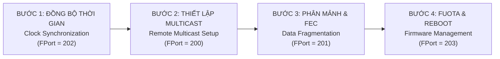
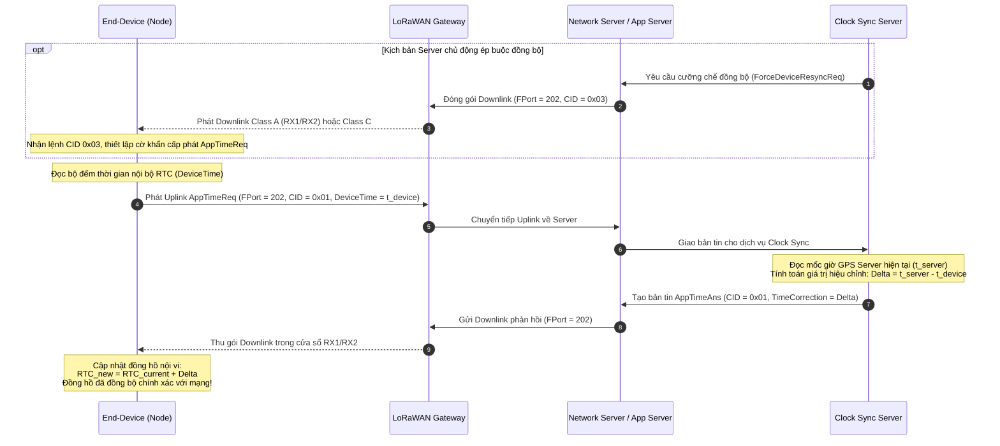
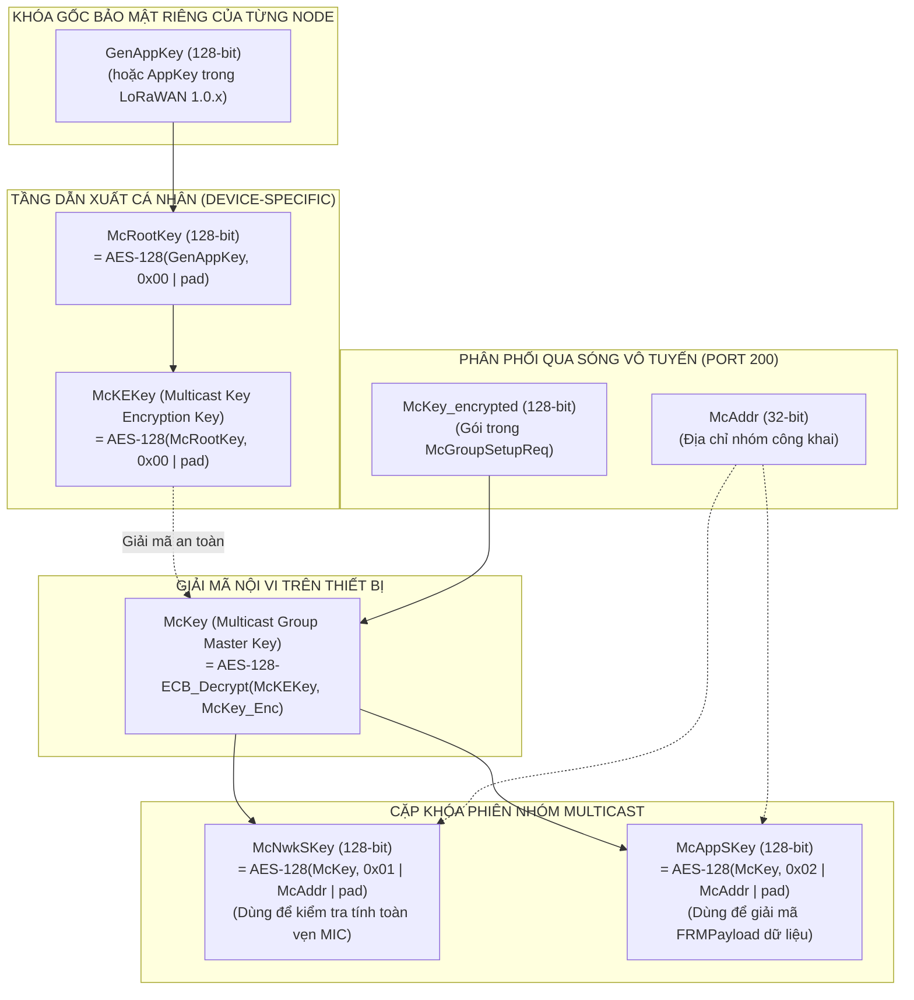
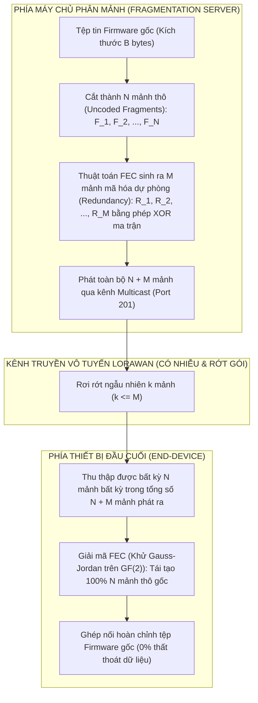
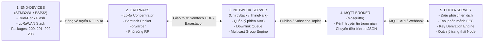
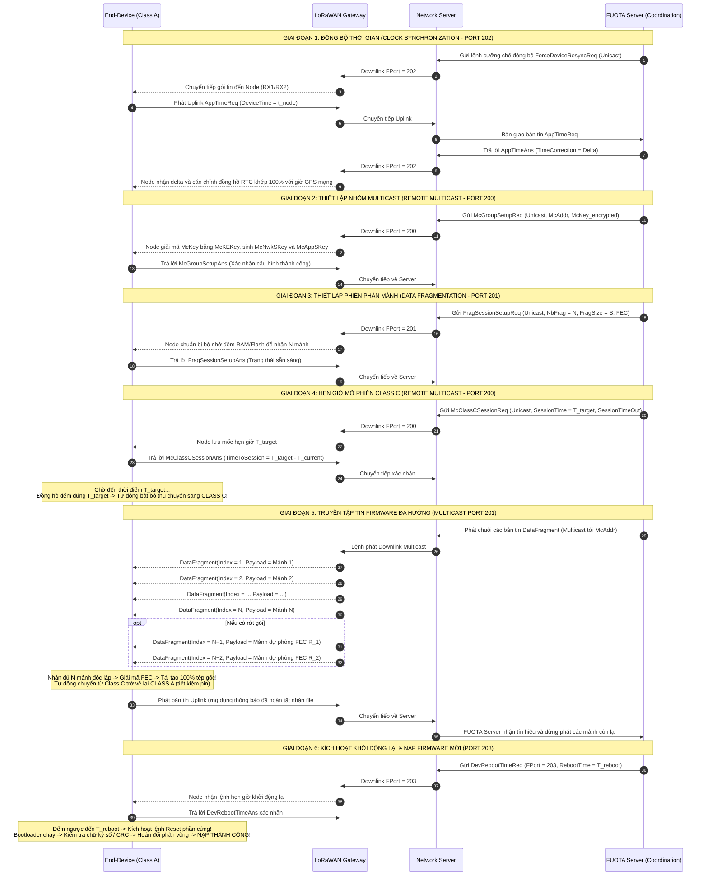
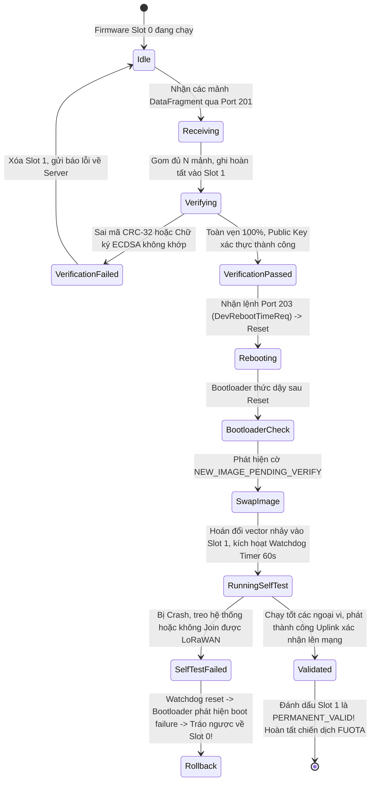

# MODULE 6: GÓI GIAO THỨC TẦNG ỨNG DỤNG & FUOTA (ADVANCED APPLICATION PACKAGES & FUOTA)

> **THÔNG TIN ĐIỀU PHỐI HỌC TẬP (MODULE METADATA)**
> - **Nguồn tham chiếu giáo trình:**
>   * *Cuốn 2 (LoRaWAN for advanced users - Đại học Savoie Mont Blanc USMB):* Chương 1, 2, 3, 4 (Trang 5 – 33).
>   * *Đặc tả kỹ thuật LoRa Alliance chuẩn hóa:*
>     - LoRaWAN Application Layer Clock Synchronization Specification (TS003-1.0.0).
>     - LoRaWAN Remote Multicast Setup Specification (TS005-1.0.0).
>     - LoRaWAN Fragmented Data Block Transport Specification (TS004-1.0.0).
>     - LoRaWAN Firmware Management Protocol Specification (TS006-1.0.0).
> - **Thời lượng khuyến nghị:** 12 giờ lý thuyết chuyên sâu + 16 giờ thực hành lab/mô phỏng.
> - **Mục tiêu đầu ra cốt lõi (Learning Objectives):**
>   1. *Về kiến thức (Knowledge):*
>      - Hiểu thấu đáo bản chất chuỗi 4 gói giao thức tầng ứng dụng: Clock Synchronization (`FPort = 202`), Remote Multicast Setup (`FPort = 200`), Data Fragmentation (`FPort = 201`), và Firmware Management (`FPort = 203`).
>      - Nắm vững cơ chế đồng bộ thời gian dựa trên mốc GPS Epoch (06/01/1980 UTC) và giải thuật bù trừ sai lệch thời gian thực (RTC drift).
>      - Làm chủ cây phân cấp dẫn xuất khóa mật mã Multicast (`GenAppKey` $\rightarrow$ `McRootKey` $\rightarrow$ `McKEKey` $\rightarrow$ `McKey` $\rightarrow$ `McAppSKey` / `McNwkSKey`) và cơ chế chuyển đổi lớp hoạt động (Class A $\leftrightarrow$ Class C/B).
>      - Thấu hiểu bản chất toán học của thuật toán sửa lỗi tiến Forward Error Correction (FEC) trên trường hữu hạn $GF(2)$ bằng phép toán XOR ma trận, cho phép phục hồi 100% dữ liệu bị rớt mà không cần truyền lại qua Uplink.
>      - Nắm chắc kiến trúc phân vùng bộ nhớ Flash kép (Dual-Bank Flash / A-B Partitioning), quy trình xác thực toàn vẹn chữ ký số mật mã và cơ chế tự phục hồi chống "brick" vi điều khiển (Anti-rollback / Self-test).
>   2. *Về kỹ năng thực chiến (Practical Skills):*
>      - Giải mã và đóng gói chính xác từng byte bản tin trên các cổng chuyên dụng `FPort = 200, 201, 202, 203`, tuân thủ nghiêm ngặt quy tắc thứ tự byte (Endianness).
>      - Thiết kế và tính toán tối ưu các thông số phiên truyền phân mảnh: Kích thước mảnh (`FragSize`), số lượng mảnh thô ($N$), tỷ lệ dự phòng FEC ($M$), và thời gian chiếm dụng kênh truyền (Time on Air - ToA).
>      - Lập lịch chiến dịch FUOTA đồng bộ trên quy mô hàng ngàn thiết bị, thỏa mãn giới hạn pháp lý 1% Duty Cycle của Gateway và tối ưu hóa năng lượng tiêu thụ của Node chạy pin.
>      - Tự dựng hệ thống kiểm thử FUOTA cục bộ tích hợp Network Server (ChirpStack / ThingPark), MQTT Broker và công cụ nạp phân mảnh mã nguồn mở.

---

## 1. BẢNG THUẬT NGỮ TRỌNG TÂM CỦA MODULE (MODULE GLOSSARY)

Bảng đối chiếu thuật ngữ chuyên ngành chuẩn hóa bắt buộc sử dụng trong toàn bộ Module 6, trích xuất từ Cuốn 2 (Chương 1–4) và các tiêu chuẩn LoRa Alliance:

| Viết tắt / Thuật ngữ gốc (EN) | Tên đầy đủ (English Full Name) | Thuật ngữ Tiếng Việt chuẩn hóa | Giải thích bản chất kỹ thuật (Ngắn gọn, chính xác) |
| :--- | :--- | :--- | :--- |
| **AppTimeAns** | Application Time Answer | Bản tin phản hồi hiệu chỉnh giờ | Bản tin Downlink trên cổng `FPort = 202` do Server gửi trả về Node chứa giá trị sai lệch thời gian (time correction delta tính từ mốc 06/01/1980 UTC). |
| **AppTimeReq** | Application Time Request | Bản tin yêu cầu đồng bộ thời gian | Bản tin Uplink trên cổng `FPort = 202` do Node chủ động gửi lên mạng chứa mốc thời gian nội bộ hiện tại của nó để xin giá trị bù trừ. |
| **Bootloader** | Bootloader Firmware | Bộ nạp chương trình khởi động | Phân vùng phần mềm cấp thấp chạy đầu tiên khi vi điều khiển khởi động, chịu trách nhiệm kiểm tra chữ ký số, giải nén và hoán đổi bản vá firmware mới. |
| **CID** | Command IDentifier | Mã định danh lệnh ứng dụng | Byte đầu tiên trong các bản tin của gói ứng dụng chuẩn hóa dùng để phân biệt loại yêu cầu hoặc phản hồi. |
| **Clock Synchronization** | Clock Synchronization Package | Gói dịch vụ đồng bộ đồng hồ mạng | Gói giao thức tầng ứng dụng chuẩn hóa của LoRa Alliance hoạt động trên cổng `FPort = 202`, dùng để đồng bộ thời gian chính xác cho Node không có GPS. |
| **Data Fragmentation** | Data Fragmentation Block Transport | Gói giao thức phân mảnh dữ liệu | Gói giao thức tầng ứng dụng chuẩn hóa hoạt động trên cổng `FPort = 201`, chia cắt khối dữ liệu lớn thành hàng trăm mảnh nhỏ phù hợp với MTU của LoRa. |
| **DataFragment** | Data Fragment Command | Bản tin vận chuyển mảnh dữ liệu | Bản tin mang mã `CID = 0x08` trên cổng `FPort = 201` chứa chỉ số mảnh và tải trọng dữ liệu nhị phân của firmware. |
| **DevRebootCountdownReq** | Device Reboot Countdown Request | Lệnh đếm ngược thời gian khởi động lại | Lệnh Downlink trên cổng `FPort = 203` ra lệnh cho Node đếm ngược số giây chỉ định trước khi kích hoạt reset hệ thống. |
| **DevRebootTimeReq** | Device Reboot Time Request | Bản tin hẹn giờ khởi động lại | Lệnh Downlink trên cổng `FPort = 203` ra lệnh cho Node đếm ngược thời gian để thực hiện khởi động lại phần cứng và nạp firmware mới tại mốc GPS Epoch cụ thể. |
| **Dual-Bank Flash** | Dual-Bank Flash Memory Architecture | Kiến trúc bộ nhớ Flash hai phân vùng độc lập | Thiết kế phần cứng/phần mềm phân chia Flash thành 2 vùng (Slot 0 / Slot 1) cho phép nạp firmware mới vào vùng phụ trong khi vùng chính vẫn đang thực thi bình thường. |
| **FEC** | Forward Error Correction | Kỹ thuật sửa lỗi tiến dữ liệu | Giải thuật toán học sinh ra các mảnh dữ liệu mã hóa dự phòng bằng phép toán XOR ma trận, cho phép thiết bị tái tạo toàn bộ tệp bị rớt gói mà không cần ACK. |
| **ForceDeviceResyncReq** | Force Device Resynchronization Request | Lệnh cưỡng chế đồng bộ lại giờ | Bản tin Downlink từ Server gửi đến Node ép buộc vi điều khiển phải lập tức phát bản tin `AppTimeReq` để cập nhật lại đồng hồ mạng. |
| **FragBlockConsumeReq** | Fragmentation Block Consume Request | Lệnh kích hoạt khối dữ liệu phân mảnh | Bản tin ra lệnh cho thiết bị kiểm tra tính toàn vẹn (CRC-32) của tệp đã lắp ghép xong và bàn giao cho hệ thống xử lý. |
| **FragSessionSetupReq** | Fragmentation Session Setup Request | Bản tin thiết lập phiên phân mảnh | Lệnh Downlink khởi tạo phiên phân mảnh trên cổng `FPort = 201`, chỉ định kích thước mảnh, tổng số mảnh thô và ma trận dự phòng FEC. |
| **FUOTA** | Firmware Update Over The Air | Cập nhật phần mềm qua vô tuyến | Giải pháp đồng bộ hoàn chỉnh nâng cấp firmware từ xa cho hàng ngàn thiết bị LoRaWAN thông qua kết hợp 3 gói: Clock Sync, Multicast và Fragmentation. |
| **GenAppKey** | Generic Application Key | Khóa gốc ứng dụng tổng quát | Khóa mật mã gốc AES-128 trong LoRaWAN dùng làm căn cứ dẫn xuất ra khóa gốc đa hướng `McRootKey` của thiết bị. |
| **GPS Epoch** | Global Positioning System Time Epoch | Mốc thời gian gốc hệ thống GPS | Điểm mốc chuẩn bắt đầu từ 00:00:00 UTC Chủ Nhật ngày 06 tháng 01 năm 1980, dùng làm chuẩn quy chiếu thời gian số nguyên giây trong LoRaWAN. |
| **McAddr** | Multicast Group Address | Địa chỉ mạng nhóm đa hướng | Địa chỉ mạng 32-bit đại diện cho một nhóm thiết bị Multicast, dùng trong trường `DevAddr` của tiêu đề khung Downlink. |
| **McAppSKey** | Multicast Application Session Key | Khóa phiên ứng dụng đa hướng | Khóa mật mã AES-128 dùng để mã hóa và giải mã nội dung tải trọng ứng dụng trong các bản tin Downlink truyền theo phương thức Multicast. |
| **McClassBSessionReq** | Multicast Class B Session Request | Lệnh thiết lập phiên Multicast Class B | Bản tin cấu hình thời gian mở cửa sổ thu Downlink đồng bộ theo Beacon cho nhóm Multicast. |
| **McClassCSessionReq** | Multicast Class C Session Request | Lệnh thiết lập phiên Multicast Class C | Bản tin chỉ định thời điểm chính xác (`SessionTime`) để các Node Class A đồng loạt chuyển sang Class C trong một khoảng thời gian xác định (`SessionTimeOut`). |
| **McGroupSetupReq** | Multicast Group Setup Request | Bản tin thiết lập nhóm Multicast | Bản tin Downlink trên cổng `FPort = 200` đăng ký thông tin nhóm mới cho thiết bị gồm địa chỉ nhóm `GroupAddr` và khóa mã hóa bảo vệ. |
| **McKEKey** | Multicast Key Encryption Key | Khóa bao bọc khóa phiên Multicast | Khóa mật mã AES-128 dẫn xuất từ `McRootKey`, dùng để mã hóa an toàn khóa `McKey` khi Server phân phối khóa qua không gian. |
| **McKey** | Multicast Key | Khóa phiên chia sẻ nhóm Multicast | Khóa mật mã bí mật được phân phối đến tất cả các thành viên trong nhóm, dùng để sinh ra cặp khóa `McNwkSKey` và `McAppSKey`. |
| **McNwkSKey** | Multicast Network Session Key | Khóa phiên mạng đa hướng | Khóa mật mã AES-128 dùng để thẩm định chữ ký tính toàn vẹn bản tin `MIC` của các gói tin truyền đa hướng Downlink. |
| **McRootKey** | Multicast Root Key | Khóa gốc nhóm đa hướng | Khóa mật mã gốc dẫn xuất từ `GenAppKey` hoặc `AppKey`, làm gốc tin cậy độc quyền của từng thiết bị phục vụ bảo mật Multicast. |
| **Multicast** | Multicast Transmission | Kỹ thuật truyền tin đa hướng | Cơ chế mạng cho phép Server phát một gói tin Downlink duy nhất trên không và hàng ngàn thiết bị cùng một nhóm đều có thể đồng thời thu và giải mã. |
| **Redundancy Fragments** | Redundancy / Coded Fragments | Các mảnh dữ liệu mã hóa dự phòng | Các mảnh dữ liệu được tạo ra từ thuật toán FEC thông qua phép cộng ma trận nhị phân XOR, dùng để bù đắp các mảnh thô bị thất lạc trên đường truyền. |
| **Remote Multicast Setup** | Remote Multicast Setup Package | Gói giao thức thiết lập đa hướng từ xa | Gói giao thức chuẩn hóa của LoRa Alliance hoạt động trên cổng `FPort = 200`, quản lý việc gia nhập nhóm, thiết lập địa chỉ và phân phối khóa Multicast. |
| **Uncoded Fragments** | Uncoded / Raw Data Fragments | Các mảnh dữ liệu thô ban đầu | Các khối dữ liệu kích thước bằng nhau được cắt trực tiếp từ tệp tin gốc ban đầu trước khi đưa vào thuật toán mã hóa sinh mảnh dự phòng. |

---

## 2. NỘI DUNG LÝ THUYẾT CỐT LÕI & GIẢI PHẪU KỸ THUẬT (CORE TECHNICAL KNOWLEDGE)

FUOTA (Firmware Update Over The Air) là đỉnh cao kỹ thuật trong công nghệ LoRaWAN. Một chiến dịch cập nhật firmware cho hàng ngàn thiết bị đầu cuối hoạt động bằng pin trên diện tích hàng chục km² không thể thực hiện bằng cách truyền Unicast từng gói tin riêng rẽ (gây tắc nghẽn phổ tần và vi phạm nghiêm trọng luật Duty Cycle). Thay vào đó, LoRa Alliance đã thiết kế một giải pháp tầng ứng dụng tích hợp chặt chẽ theo chuỗi kỹ thuật 4 bước:



---

### 2.1. Bước 1: Đồng bộ thời gian qua mạng (Clock Synchronization Package — FPort = 202)

#### 2.1.1. Bản chất vật lý, toán học & Bối cảnh kỹ thuật
- **Vấn đề trôi dạt xung nhịp thạch anh (RTC Drift):** Các nút cảm biến IoT giá rẻ thường sử dụng bộ dao động tinh thể thạch anh $32.768\text{ kHz}$ với độ lệch điển hình từ $\pm 20\text{ ppm}$ đến $\pm 50\text{ ppm}$. Trong môi trường công nghiệp ngoài trời với biến động nhiệt độ từ $-20^\circ\text{C}$ đến $+60^\circ\text{C}$, độ trôi dạt có thể vượt quá $100\text{ ppm}$, tương đương sai lệch thời gian:
  $$\Delta t_{\text{drift}} \approx 100 \times 10^{-6} \times 86400\text{ s/ngày} \approx 8.64\text{ giây/ngày}$$
  Sau một vài tuần hoạt động độc lập, đồng hồ nội bộ của thiết bị có thể lệch hàng chục giây đến vài phút. Điều này khiến thiết bị không thể mở cửa sổ thu Downlink đúng thời điểm được chỉ định.
- **Khi nào cần gói Clock Synchronization?**
  1. Thiết bị không tích hợp chip định vị vệ tinh toàn cầu (GPS/GNSS) do giới hạn năng lượng và chi phí linh kiện.
  2. Thiết bị vận hành ở Class A hoặc Class C thông thường, không bật chế độ Class B (chế độ Class B có nhận gói Beacon từ Gateway để đồng bộ thời gian).
  3. Mạng hoặc thiết bị chạy chuẩn LoRaWAN v1.0.2 / v1.0.3 — các phiên bản này **không hỗ trợ lệnh MAC `DeviceTimeReq`** (vốn chỉ xuất hiện từ chuẩn LoRaWAN v1.0.4 và v1.1 trên cổng `FPort = 0`).
- **Gốc thời gian GPS Epoch:**
  Toàn bộ các gói giao thức FUOTA sử dụng chuẩn thời gian GPS Time:
  - Mốc gốc $t_0$: **00:00:00 UTC, Chủ Nhật, ngày 06 tháng 01 năm 1980**.
  - Không tính bù giây nhuận (Leap Seconds) của UTC (GPS time hiện chạy trước UTC khoảng 18 giây tính đến thời điểm chuẩn hóa).
  - Định dạng thời gian: Số nguyên không dấu 32-bit (`uint32_t`) đếm số giây trôi qua tính từ mốc $t_0$, tuần hoàn theo modulo $2^{32}$:
    $$T_{\text{epoch}} = (\text{Số giây từ 06/01/1980 00:00:00 UTC}) \pmod{2^{32}}$$
    Với $2^{32}\text{ giây} \approx 136\text{ năm}$, mốc thời gian này sẽ hoạt động an toàn đến tận năm 2116.
- **Tình huống sử dụng thực tế (Use Case - Time-Stamped Metering):**
  Trong bài toán đo đạc mức nước của hàng trăm bồn chứa nước phân tán trong thành phố (Cuốn 2, Trang 6), người vận hành yêu cầu lấy mẫu mực nước tại cùng một thời điểm chính xác (ví dụ đúng 05:00:00 sáng).
  - *Phương án sai lầm:* Cho toàn bộ các nút cảm biến đồng loạt phát sóng Uplink ngay lúc 05:00:00 về Server để Server đóng dấu thời gian (Timestamp). Hệ quả là hàng trăm thiết bị phát cùng tần số/SF tại cùng một tích tắc gây xung đột vô tuyến thảm khốc (Packet Collision), làm rớt gần như toàn bộ dữ liệu.
  - *Phương án chuẩn xác:* Mỗi thiết bị được đồng bộ giờ chính xác qua gói Clock Synchronization. Đúng 05:00:00, tất cả thiết bị đồng loạt thức dậy đo đạc nội vi, lưu giá trị đo kèm timestamp chính xác vào bộ đệm RAM/Flash. Sau đó, mỗi thiết bị áp dụng giải thuật trễ ngẫu nhiên (Random Jitter từ 0 đến vài chục phút) để phát Uplink rải rác về Server mà không hề gây nghẽn mạng.

#### 2.1.2. Sơ đồ luồng bản tin đồng bộ thời gian
Quá trình đồng bộ thời gian trên cổng `FPort = 202` diễn ra theo 2 kịch bản: Node chủ động định kỳ gửi yêu cầu, hoặc Server chủ động cưỡng chế thiết bị resync.



#### 2.1.3. Giải phẫu cấu trúc Bit/Byte & Endianness (FPort = 202)

Toàn bộ các lệnh trong gói Clock Synchronization đều tuân thủ quy tắc đóng gói: Byte đầu tiên là `CID` (Command Identifier), các byte tiếp theo là tham số. Các trường số nguyên nhiều byte được truyền theo thứ tự **Little Endian (LSB first)**.

##### 1. Bản tin `ForceDeviceResyncReq` (Server $\rightarrow$ Device Downlink):
- Cổng truyền: `FPort = 202`
- Mã lệnh: `CID = 0x03`
- Kích thước: **1 Byte**
- Cấu trúc trường bit:

| Tên trường | Số bit | Ý nghĩa kỹ thuật |
| :--- | :--- | :--- |
| **CID** | 4 bits (7..4) | Luôn mang giá trị `0x03` |
| **NbTrials** | 3 bits (3..1) | Số lần tối đa thiết bị phải thử phát lại bản tin `AppTimeReq` (từ 1 đến 7 lần) cho đến khi nhận được `AppTimeAns` hợp lệ |
| **RFU** | 1 bit (0) | Dành riêng cho tương lai, bắt buộc gán bằng `0` |

##### 2. Bản tin `AppTimeReq` (Device $\rightarrow$ Server Uplink):
- Cổng truyền: `FPort = 202`
- Mã lệnh: `CID = 0x01`
- Kích thước: **5 Bytes**
- Cấu trúc chi tiết:

| Byte Offset | Tên trường | Kích thước | Định dạng | Thứ tự Byte | Mô tả chức năng |
| :--- | :--- | :--- | :--- | :--- | :--- |
| **Byte 0** | `CID` | 1 byte | `uint8_t` | — | Luôn cố định là `0x01` |
| **Byte 1..4** | `DeviceTime` | 4 bytes | `uint32_t` | **Little Endian** | Thời gian hiện tại của thiết bị (tính bằng giây từ 06/01/1980 UTC) tại thời điểm phát sóng vô tuyến |
| **Byte 5** (optional) | `Param` | 1 byte | Bitfield | — | - Bit 0: `AnsRequired` (0: Không bắt buộc ACK; 1: Yêu cầu Server phải trả lời `AppTimeAns`)<br/>- Bit 1..4: `TokenReq` (Mã token ngẫu nhiên 4-bit đối chiếu phản hồi)<br/>- Bit 5..7: `RFU` |

##### 3. Bản tin `AppTimeAns` (Server $\rightarrow$ Device Downlink):
- Cổng truyền: `FPort = 202`
- Mã lệnh: `CID = 0x01`
- Kích thước: **5 Bytes**
- Cấu trúc chi tiết:

| Byte Offset | Tên trường | Kích thước | Định dạng | Thứ tự Byte | Mô tả chức năng |
| :--- | :--- | :--- | :--- | :--- | :--- |
| **Byte 0** | `CID` | 1 byte | `uint8_t` | — | Luôn cố định là `0x01` |
| **Byte 1..4** | `TimeCorrection` | 4 bytes | `int32_t` (bù hai - 2's complement) | **Little Endian** | Giá trị delta sai lệch thời gian: $\Delta = T_{\text{server}} - T_{\text{device}}$. Nếu $\Delta > 0$, đồng hồ Node chạy chậm; nếu $\Delta < 0$, đồng hồ Node chạy nhanh |
| **Byte 5** | `Param` | 1 byte | Bitfield | — | - Bit 0..3: `TokenAns` (Phải trùng khớp với `TokenReq` trong bản tin request tương ứng)<br/>- Bit 4..7: `RFU` |

> [!NOTE]
> Khi nhận được `AppTimeAns`, vi điều khiển phải cộng trực tiếp giá trị có dấu `TimeCorrection` vào thanh ghi thời gian của nó:
> $$T_{\text{node\_corrected}} = T_{\text{node\_current}} + \text{TimeCorrection}$$
> Toàn bộ quá trình tính toán phải tính đến độ trễ truyền dẫn (Time on Air + trễ xử lý Gateway) nếu yêu cầu độ chính xác cao mức mili-giây.

---

### 2.2. Bước 2: Thiết lập truyền đa hướng (Remote Multicast Setup Package — FPort = 200)

#### 2.2.1. Bản chất truyền Multicast trong LoRaWAN & Động lực kỹ thuật
- **Định nghĩa Multicast:** Là cơ chế phát một khung tin Downlink duy nhất từ Gateway lên sóng không gian, trong đó địa chỉ đích (`DevAddr` trong MAC Header) là một địa chỉ nhóm (`McAddr`). Tất cả các thiết bị đầu cuối đã được gán địa chỉ nhóm này đều có thể đồng thời thu nhận, xác thực tính toàn vẹn và giải mã gói tin.
- **Tính chất vô tuyến đặc thù:**
  1. **Hoàn toàn không có Uplink ACK:** Trong truyền Multicast, tuyệt đối không cho phép các thiết bị phát bản tin ACK xác nhận gói tin. Nếu hàng ngàn thiết bị đồng thời phát ACK sau khi nhận gói Multicast, kênh truyền sẽ bị nghẽn (storm) và toàn bộ mạng sẽ tê liệt. Độ tin cậy của việc nhận gói phải được đảm bảo bằng kỹ thuật mã hóa sửa lỗi tiến (FEC) ở Bước 3.
  2. **Yêu cầu về Lớp hoạt động (Device Class):** Thiết bị Class A thông thường đang ở trạng thái ngủ sâu (Deep Sleep) và chỉ mở cửa sổ thu sau khi vừa phát một Uplink. Do đó, thiết bị **không thể thu gói Multicast nếu chỉ ở Class A**. Để thu Multicast, thiết bị bắt buộc phải đang ở **Class C** (nghe liên tục) hoặc **Class B** (nghe tại các khe đồng bộ Ping Slots).
  3. **Chuyển lớp đồng bộ (Synchronous Class Switching):** Nhờ bước đồng bộ thời gian ở Bước 1, Server có thể ra lệnh cho toàn bộ đội ngũ thiết bị Class A đồng loạt "thức dậy", tạm thời chuyển sang Class C tại một mốc thời gian chỉ định (`SessionTime`), duy trì nhận các gói Multicast trong một khoảng thời gian (`SessionTimeOut`), rồi tự động quay trở về Class A để bảo toàn pin.
  4. **Giới hạn số nhóm:** Một thiết bị đầu cuối chuẩn hóa chỉ có thể tham gia tối đa **4 nhóm Multicast đồng thời** (chỉ số nhóm `McGroupID` từ `0` đến `3`).

#### 2.2.2. Cây phân cấp dẫn xuất & Bao bọc khóa mật mã Multicast (Key Derivation Hierarchy)
Trong mạng LoRaWAN, mỗi thiết bị có bộ khóa cá nhân riêng (`AppKey`, `NwkSKey`, `AppSKey`). Khi tham gia nhóm Multicast, tất cả các thành viên trong nhóm phải chia sẻ chung một địa chỉ nhóm `McAddr` và chung một cặp khóa phiên: `McNwkSKey` (để thẩm định MIC) và `McAppSKey` (để giải mã payload).

Tuy nhiên, làm thế nào để Server phân phối cặp khóa chung này cho từng thiết bị qua sóng vô tuyến một cách an toàn mà kẻ nghe trộm không thể đánh cắp? Chuẩn LoRa Alliance quy định giải thuật dẫn xuất và mã hóa bao bọc nhiều tầng như sau:



**Quy trình giải thích chi tiết:**
1. **Khóa gốc ban đầu:** Thiết bị được nạp sẵn khóa gốc bí mật `GenAppKey` (chuẩn 1.1/1.0.4) hoặc dùng `AppKey` (chuẩn 1.0.3) tại nhà máy trước khi xuất xưởng. Khóa này chỉ có thiết bị và máy chủ Join Server/Application Server biết.
2. **Dẫn xuất khóa mã hóa khóa (`McKEKey`):**
   $$\text{McRootKey} = \text{AES-128-Encrypt}(\text{GenAppKey}, \text{0x00} \mid \text{pad})$$
   $$\text{McKEKey} = \text{AES-128-Encrypt}(\text{McRootKey}, \text{0x00} \mid \text{pad})$$
   Khóa `McKEKey` là duy nhất cho mỗi thiết bị đầu cuối.
3. **Mã hóa khóa nhóm (`McKey_encrypted`):** Máy chủ tạo ngẫu nhiên một khóa nhóm bí mật `McKey` chung cho toàn bộ đội tàu thiết bị. Khi gửi bản tin thiết lập nhóm `McGroupSetupReq` đến từng thiết bị cụ thể qua Unicast, Server dùng `McKEKey` riêng của thiết bị đó để mã hóa:
   $$\text{McKey\_encrypted} = \text{AES-128-ECB-Encrypt}(\text{McKEKey}, \text{McKey})$$
4. **Giải mã trên thiết bị:** Khi nhận được bản tin, vi điều khiển dùng `McKEKey` tự sinh trong lòng nó để giải mã `McKey_encrypted` lấy ra khóa gốc `McKey`.
5. **Dẫn xuất cặp khóa phiên Multicast:** Cả Server và Node đều tính toán độc lập:
   $$\text{McAppSKey} = \text{AES-128-Encrypt}(\text{McKey}, \text{0x01} \mid \text{McAddr} \mid \text{pad}_{11\text{ bytes}})$$
   $$\text{McNwkSKey} = \text{AES-128-Encrypt}(\text{McKey}, \text{0x02} \mid \text{McAddr} \mid \text{pad}_{11\text{ bytes}})$$
   Kể từ thời điểm này, thiết bị đã có đủ profile hoàn chỉnh để lắng nghe Downlink nhóm.

#### 2.2.3. Giải phẫu cấu trúc Bit/Byte & Endianness (FPort = 200)

Tất cả các bản tin quản lý nhóm Multicast được truyền trên cổng dành riêng `FPort = 200`.

##### 1. Bản tin `McGroupSetupReq` (Server $\rightarrow$ Device Downlink Unicast):
- Cổng truyền: `FPort = 200`
- Mã lệnh: `CID = 0x02`
- Kích thước: **29 Bytes**
- Cấu trúc chi tiết:

| Byte Offset | Tên trường | Kích thước | Định dạng | Thứ tự Byte | Mô tả chức năng |
| :--- | :--- | :--- | :--- | :--- | :--- |
| **Byte 0** | `CID` | 1 byte | `uint8_t` | — | Luôn cố định là `0x02` |
| **Byte 1** | `McGroupIDHeader` | 1 byte | Bitfield | — | - Bit 0..1: `McGroupID` (Chỉ số nhóm từ `0` đến `3`)<br/>- Bit 2..7: `RFU` |
| **Byte 2..5** | `McAddr` | 4 bytes | `uint32_t` | **Little Endian** | Địa chỉ mạng 32-bit của nhóm Multicast |
| **Byte 6..21** | `McKey_encrypted` | 16 bytes | Byte array | — | Khóa `McKey` 128-bit được mã hóa bằng thuật toán AES-128-ECB với khóa `McKEKey` của Node |
| **Byte 22..25** | `minMcFCnt` | 4 bytes | `uint32_t` | **Little Endian** | Giá trị bộ đếm khung nhỏ nhất hợp lệ cho nhóm này (chống Replay Attack) |
| **Byte 26..29** | `maxMcFCnt` | 4 bytes | `uint32_t` | **Little Endian** | Giá trị bộ đếm khung lớn nhất cho phép trước khi nhóm tự động hủy hiệu lực |

##### 2. Bản tin `McGroupSetupAns` (Device $\rightarrow$ Server Uplink Unicast):
- Cổng truyền: `FPort = 200`
- Mã lệnh: `CID = 0x02`
- Kích thước: **2 Bytes**
- Cấu trúc: `CID (0x02)` + `Status` (Bit 0: `McGroupIDUndefined`, Bit 1: `McKeyUndefined`, Bit 2: `OK`).

##### 3. Bản tin `McClassCSessionReq` (Server $\rightarrow$ Device Downlink Unicast):
Lệnh then chốt để hẹn giờ đánh thức thiết bị Class A chuyển sang Class C.
- Cổng truyền: `FPort = 200`
- Mã lệnh: `CID = 0x04`
- Kích thước: **10 Bytes**
- Cấu trúc chi tiết:

| Byte Offset | Tên trường | Kích thước | Định dạng | Thứ tự Byte | Mô tả chức năng |
| :--- | :--- | :--- | :--- | :--- | :--- |
| **Byte 0** | `CID` | 1 byte | `uint8_t` | — | Luôn cố định là `0x04` |
| **Byte 1** | `McGroupIDHeader` | 1 byte | Bitfield | — | - Bit 0..1: `McGroupID` (Nhóm áp dụng phiên Class C)<br/>- Bit 2..7: `RFU` |
| **Byte 2..5** | `SessionTime` | 4 bytes | `uint32_t` | **Little Endian** | Mốc thời gian tuyệt đối (theo GPS Epoch giây) mà thiết bị phải bắt đầu bật Class C |
| **Byte 6** | `SessionTimeOut` | 1 byte | `uint8_t` | — | Thời lượng phiên Class C tối đa tính theo lũy thừa 2: $T_{\text{timeout}} = 2^{\text{SessionTimeOut}}\text{ giây}$ (Ví dụ: giá trị 10 nghĩa là $2^{10} = 1024\text{ s} \approx 17\text{ phút}$) |
| **Byte 7..9** | `DLFrequency` | 3 bytes | `uint24_t` | **Little Endian** | Tần số vô tuyến của kênh Downlink Multicast (đơn vị $100\text{ Hz}$). Ví dụ: $869.525\text{ MHz} = 8695250 \rightarrow \text{0x84AD12}$ |
| **Byte 10** | `DR` | 1 byte | `uint8_t` | — | Tốc độ dữ liệu (Data Rate 0..15) áp dụng trong phiên thu Multicast |

##### 4. Bản tin `McClassCSessionAns` (Device $\rightarrow$ Server Uplink Unicast):
- Cổng truyền: `FPort = 200`
- Mã lệnh: `CID = 0x04`
- Kích thước: **4 Bytes**
- Cấu trúc:
  * Byte 0: `CID = 0x04`
  * Byte 1: `Status` (Bit 0: `McGroupIDUndefined`, Bit 1: `TimeError` - nếu mốc giờ nằm trong quá khứ)
  * Byte 2..4: `TimeToSession` (3 bytes, Little Endian): Số giây còn lại từ thời điểm phát uplink cho đến khi phiên bắt đầu ($\text{SessionTime} - T_{\text{current}}$). Trường này giúp Server kiểm chứng xem đồng hồ hai bên có khớp nhau không.

---

### 2.3. Bước 3: Phân mảnh dữ liệu & Cơ chế sửa sai FEC không cần gửi lại (Data Fragmentation Package — FPort = 201)

#### 2.3.1. Bài toán truyền tệp lớn qua LPWAN & Giới hạn MTU
- **Mâu thuẫn kỹ thuật:** Mạng LoRaWAN được thiết kế để truyền tải các gói dữ liệu cảm biến đo xa cực ngắn (vài byte đến vài chục byte). Tải trọng tối đa của một khung truyền LoRaWAN (`MaxPayload` hay MTU) phụ thuộc chặt chẽ vào Spreading Factor (SF) và quy định vùng (Regional Parameters):
  * Ở $\text{SF12} / 125\text{ kHz}$ (EU868): MTU chỉ là **51 bytes**.
  * Ở $\text{SF9} / 125\text{ kHz}$ (EU868): MTU là **115 bytes**.
  * Ở $\text{SF7} / 125\text{ kHz}$ (EU868): MTU là **222 bytes**.
  Trong khi đó, một tệp nhị phân cập nhật firmware cho vi điều khiển 32-bit (như STM32WL, ESP32) có dung lượng từ **$30\text{ KB}$ đến $200\text{ KB}$** (gấp hàng ngàn lần MTU của mạng).
- **Giải pháp phân mảnh (Fragmentation):** Tệp tin firmware phải được cắt thành một chuỗi gồm $N$ mảnh dữ liệu thô đồng nhất (`Uncoded Fragments`), đánh số thứ tự từ $1$ đến $N$. Mỗi mảnh được bọc vào một bản tin Downlink mang tên `DataFragment` truyền trên cổng chuyên dụng `FPort = 201`.

#### 2.3.2. Cấu trúc bản tin `DataFragment` & Tối ưu hóa kích thước mảnh (`FragSize`)
Mỗi mảnh firmware được đóng gói trong một bản tin `DataFragment` với cấu trúc tiêu chuẩn:
- Mã định danh lệnh: `CID = 0x08` (1 byte)
- Tiêu đề điều khiển mảnh (`Command Header`): **2 bytes**
  * 14 bits: `Index` (Số thứ tự mảnh, từ $1$ đến $2^{14}-1 = 16383$).
  * 2 bits: `FragIndex` (Chỉ số phiên phân mảnh, từ `0` đến `3`).
- Tải trọng mảnh (`Fragment Payload`): Kích thước $S$ bytes (`FragSize`).

$$\text{Tổng kích thước Downlink FRMPayload} = \text{FragSize} + 3\text{ bytes}$$

> [!IMPORTANT]
> **Quy tắc vàng chọn `FragSize`:** Kích thước `FragSize` tối đa không bao giờ được vượt quá $\text{MaxPayload} - 3\text{ bytes}$.
> - Với $\text{SF9} / 125\text{ kHz}$ (MTU = 115 bytes): $\text{FragSize}_{\max} = 115 - 3 = 112\text{ bytes}$.
> - Với $\text{SF7} / 125\text{ kHz}$ (MTU = 222 bytes): $\text{FragSize}_{\max} = 222 - 3 = 219\text{ bytes}$.
> Việc lựa chọn `FragSize` lớn sẽ giảm số lượng gói tin phát sóng (giảm tổng overhead tiêu đề mạng), nhưng đòi hỏi Data Rate cao (SF nhỏ) và môi trường vô tuyến có SNR tốt để không bị méo tín hiệu.

#### 2.3.3. Bản chất toán học của thuật toán sửa lỗi tiến Forward Error Correction (FEC)

Trong môi trường truyền Multicast Downlink, **tuyệt đối không có cơ chế phát lại (No Retransmission / No ACK)** từ thiết bị đầu cuối. Nếu không có cơ chế bù lỗi, khi một Node bị nhiễu làm mất chỉ 1 mảnh dữ liệu trong số hàng ngàn mảnh, toàn bộ tệp firmware sẽ bị hỏng và chiến dịch FUOTA trên Node đó thất bại hoàn toàn.

Để khắc phục triệt để vấn đề này, gói Data Fragmentation tích hợp thuật toán **Forward Error Correction (FEC)** hoạt động trên trường hữu hạn Galois Field $GF(2)$:



##### 1. Nguyên lý mã hóa sinh mảnh dự phòng bằng phép toán XOR:
Xét một nhóm $N$ mảnh dữ liệu ban đầu $F_1, F_2, \dots, F_N$, mỗi mảnh có kích thước $S$ byte.
Mỗi mảnh dự phòng $R_j$ ($j = 1 \dots M$) được sinh ra bằng phép cộng logic XOR ($\oplus$) có trọng số giữa các mảnh thô theo một ma trận hệ số nhị phân:
$$R_j = \bigoplus_{i=1}^N c_{j, i} \cdot F_i$$
Trong đó $c_{j, i} \in \{0, 1\}$ được xác định bởi thuật toán sinh ma trận giả ngẫu nhiên chuẩn hóa (dựa trên chỉ số mảnh $k = N + j$).

##### 2. Minh họa phép toán số học thực tế (Trích xuất từ Cuốn 2, Trang 24):
Giả sử có $N = 2$ mảnh thô, mỗi mảnh dài $1\text{ byte}$:
- Mảnh 1: $F_1 = \text{0xAE} = \text{0b10101110}$
- Mảnh 2: $F_2 = \text{0x57} = \text{0b01010111}$

Máy chủ tính toán mảnh dự phòng thứ nhất $R_1$:
$$R_1 = F_1 \oplus F_2 = \text{0b10101110} \oplus \text{0b01010111} = \text{0b11111001} = \text{0xF9}$$

Bây giờ giả sử đường truyền vô tuyến làm mất gói tin:
- **Tình huống 1: Mảnh $F_1$ bị mất trên đường truyền.**
  Thiết bị chỉ nhận được $F_2$ và $R_1$. Do tính chất giao hoán và tự triệt tiêu của phép XOR ($A \oplus B \oplus B = A$), thiết bị tự phục hồi $F_1$:
  $$\widehat{F}_1 = R_1 \oplus F_2 = \text{0b11111001} \oplus \text{0b01010111} = \text{0b10101110} = \text{0xAE} \equiv F_1$$
- **Tình huống 2: Mảnh $F_2$ bị mất trên đường truyền.**
  Thiết bị chỉ nhận được $F_1$ và $R_1$. Thiết bị tự phục hồi $F_2$:
  $$\widehat{F}_2 = R_1 \oplus F_1 = \text{0b11111001} \oplus \text{0b10101110} = \text{0b01010111} = \text{0x57} \equiv F_2$$

##### 3. Quy luật phục hồi tổng quát (Gauss-Jordan Elimination over GF(2)):
Nếu tệp firmware được chia thành $N$ mảnh thô và máy chủ phát thêm $M$ mảnh dự phòng (tổng cộng phát $N + M$ mảnh), thiết bị đầu cuối chỉ cần gom đủ **đúng $N$ mảnh độc lập tuyến tính bất kỳ** trong tổng số $N + M$ mảnh là có thể giải hệ phương trình tuyến tính nhị phân và khôi phục lại 100% tệp gốc.
- Tỷ lệ dự phòng $\rho = \frac{M}{N} \times 100\%$ (thường cấu hình từ $10\%$ đến $30\%$ tùy thuộc vào điều kiện suy hao kênh truyền RF thực tế).
- Không yêu cầu bất kỳ gói tin Uplink nào để xin gửi lại từng mảnh bị mất.

#### 2.3.4. Giải phẫu cấu trúc Bit/Byte & Endianness (FPort = 201)

##### 1. Bản tin `FragSessionSetupReq` (Server $\rightarrow$ Device Downlink Unicast):
Lệnh cấu hình phiên phân mảnh gửi riêng cho từng thiết bị trước khi phát mảnh.
- Cổng truyền: `FPort = 201`
- Mã lệnh: `CID = 0x02`
- Kích thước: **11 Bytes**
- Cấu trúc chi tiết:

| Byte Offset | Tên trường | Kích thước | Định dạng | Thứ tự Byte | Mô tả chức năng |
| :--- | :--- | :--- | :--- | :--- | :--- |
| **Byte 0** | `CID` | 1 byte | `uint8_t` | — | Luôn cố định là `0x02` |
| **Byte 1** | `FragSessionHeader` | 1 byte | Bitfield | — | - Bit 0..1: `McGroup` (Gán phiên này cho nhóm Multicast nào, 0..3)<br/>- Bit 2..3: `FragIndex` (Chỉ số phiên phân mảnh, 0..3)<br/>- Bit 4..7: `RFU` |
| **Byte 2..3** | `NbFrag` | 2 bytes | `uint16_t` (14-bit) | **Little Endian** | Tổng số lượng mảnh thô ban đầu $N$ cấu thành tệp tin (tối đa 16383 mảnh) |
| **Byte 4** | `FragSize` | 1 byte | `uint8_t` | — | Kích thước dữ liệu nhị phân của mỗi mảnh $S$ (tính bằng byte) |
| **Byte 5** | `Encoding` | 1 byte | `uint8_t` | — | Thuật toán sửa lỗi FEC được áp dụng (`0x00`: Không dùng FEC; `0x01`: LoRa Alliance FEC algorithm over GF(2)) |
| **Byte 6** | `BlockAckDelay` | 1 byte | Bitfield | — | Khoảng thời gian ngẫu nhiên trễ trước khi thiết bị phát trả lời (tránh xung đột Uplink) |
| **Byte 7..10** | `FragAuth` | 4 bytes | `uint32_t` | **Little Endian** | Mã băm xác thực phiên phân mảnh (Descriptor MIC) |

##### 2. Bản tin `FragSessionSetupAns` (Device $\rightarrow$ Server Uplink Unicast):
- Cổng truyền: `FPort = 201`
- Mã lệnh: `CID = 0x02`
- Kích thước: **2 Bytes**
- Cấu trúc: `CID (0x02)` + `Status` (Bit 0: `FragIndex`, Bit 1: `EncodingUnsupported`, Bit 2: `NotEnoughMemory` - báo lỗi nếu Flash/RAM không đủ chỗ chứa $N \times S$ bytes, Bit 3: `FragIndexError`).

##### 3. Bản tin `DataFragment` (Server $\rightarrow$ Devices Multicast Downlink):
- Cổng truyền: `FPort = 201`
- Mã lệnh: `CID = 0x08`
- Kích thước: $S + 3\text{ Bytes}$
- Cấu trúc chi tiết:

| Byte Offset | Tên trường | Kích thước | Định dạng | Thứ tự Byte | Mô tả chức năng |
| :--- | :--- | :--- | :--- | :--- | :--- |
| **Byte 0** | `CID` | 1 byte | `uint8_t` | — | Luôn cố định là `0x08` |
| **Byte 1..2** | `IndexHeader` | 2 bytes | Bitfield (16-bit) | **Little Endian** | - 14 bits (13..0): `Index` (Số thứ tự mảnh: $1 \dots N$ là mảnh thô, $N+1 \dots N+M$ là mảnh dự phòng FEC)<br/>- 2 bits (15..14): `FragIndex` (Chỉ số phiên phân mảnh, 0..3) |
| **Byte 3..S+2** | `Payload` | $S$ bytes | Raw binary | — | Nội dung dữ liệu nhị phân của mảnh firmware |

##### 4. Kết thúc phiên phân mảnh & Sự khác biệt giữa Phiên bản 1 và 2:
- **Data Fragmentation Package v1:** Sau khi gom đủ mảnh và tái tạo xong tệp tin, chuẩn v1 **không định nghĩa lệnh MAC chuẩn để báo kết thúc phiên**. Để tránh việc Server tiếp tục phát lãng phí các mảnh dự phòng còn lại, giải pháp kiến trúc thực tế (Cuốn 2, Trang 24-25) là thiết bị gửi một bản tin Uplink ứng dụng độc quyền (Proprietary Applicative Uplink trên một user port, ví dụ `FPort = 1`) mang tín hiệu *"Đã tái tạo 100% tệp"*. Khi Server nhận được, nó sẽ lập tức dừng phát các mảnh FEC tiếp theo.
- **Data Fragmentation Package v2:** Được chuẩn hóa thêm lệnh phản hồi trạng thái hoàn thành phiên chính thức (`FragSessionStatusReq` / `FragSessionStatusAns`).

---

### 2.4. Bước 4: Tích hợp toàn diện chiến dịch FUOTA & Quản lý Firmware (FPort = 203, Bootloader an toàn)

#### 2.4.1. Kiến trúc tổng thể hệ thống FUOTA 5 khối
Để triển khai một chiến dịch FUOTA quy mô lớn, hệ sinh thái LoRaWAN phải bao gồm 5 thành phần liên kết chặt chẽ:



#### 2.4.2. Lược đồ tuần tự chi tiết 9 bước của một chiến dịch FUOTA hoàn chỉnh
Dưới đây là sơ đồ luồng bản tin tổng thể biểu diễn sự phối hợp nhịp nhàng giữa cả 4 gói giao thức tầng ứng dụng (`FPort = 202, 200, 201, 203`), chuyển tải trọn vẹn từ Cuốn 2 (Hình 19, Trang 30):



#### 2.4.3. Gói quản lý cập nhật Firmware (Firmware Management Protocol — FPort = 203)
Bản tin trên cổng `FPort = 203` đóng vai trò chốt hạ toàn bộ chiến dịch:
1. **Bản tin `DevVersionReq` / `DevVersionAns` (CID = 0x01):**
   Server truy vấn phiên bản phần cứng (`HWVersion`) và phiên bản firmware hiện tại (`FWVersion`) của thiết bị để quyết định có cần đẩy bản cập nhật mới hay không.
2. **Bản tin `DevRebootTimeReq` (CID = 0x02):**
   Server gửi tham số `RebootTime` (4 bytes, Little Endian, GPS Epoch) chỉ định thời điểm chính xác thiết bị phải khởi động lại.
3. **Bản tin `DevRebootCountdownReq` (CID = 0x03):**
   Phương án thay thế cho `DevRebootTimeReq` nếu thiết bị chưa được đồng bộ giờ chính xác: Server gửi số giây đếm ngược `Countdown` (3 bytes, $0 \dots 16777215\text{ giây}$). Sau khi nhận được lệnh, bộ đếm phần cứng trên Node bắt đầu trừ lùi về 0 và kích hoạt reset.

#### 2.4.4. Kiến trúc Bootloader an toàn trên Vi điều khiển (ESP32 / STM32WL)

Để đảm bảo thiết bị không bao giờ bị biến thành "cục gạch" (bricking) nếu xảy ra sự cố mất nguồn, sụt áp, hoặc firmware mới có lỗi nghiêm trọng, kiến trúc bộ nhớ Flash của vi điều khiển bắt buộc phải áp dụng mô hình **Dual-Bank / A-B Partitioning**:

```
+---------------------------------------------------------------+
|                      BẢNG PHÂN VÙNG BỘ NHỚ FLASH              |
+===============================================================+
| 0x0000_0000 | BOOTLOADER (Bất biến, chống ghi đè)             |
+-------------+-------------------------------------------------+
| 0x0001_0000 | PHÂN TÙNG BẢO MẬT: Chứa Public Key / Root CA    |
+-------------+-------------------------------------------------+
| 0x0002_0000 | SLOT 0 (OTA_0): FIRMWARE ĐANG CHẠY CHÍNH THỨC   |
|             | (Chạy ứng dụng đo đạc, LoRaWAN stack)           |
+-------------+-------------------------------------------------+
| 0x0012_0000 | SLOT 1 (OTA_1): PHÂN VÙNG TẢI VỀ FIRMWARE MỚI    |
|             | (Nơi các mảnh DataFragment ghi dữ liệu vào)     |
+-------------+-------------------------------------------------+
| 0x0022_0000 | NVS / SCRATCHPAD: Lưu trữ FCnt, Trạng thái OTA  |
+---------------------------------------------------------------+
```

##### Quy trình 4 bước thẩm định & Hoán đổi an toàn (Safe Swap & Rollback State Machine):



1. **Giai đoạn tiếp nhận:** Firmware mới được ghi tuần tự vào Slot 1 (`OTA_1`) trong khi ứng dụng trên Slot 0 vẫn tiếp tục vận hành.
2. **Kiểm tra tính toàn vẹn đa tầng:**
   - *Tầng 1 (Toàn vẹn tệp):* Kiểm tra mã `CRC-32` của toàn bộ khối dữ liệu phân mảnh theo bản tin `FragBlockConsumeReq`.
   - *Tầng 2 (Bảo mật xuất xứ):* Tính toán mã băm mật mã học `SHA-256` và xác thực chữ ký số công khai (`ECDSA secp256r1` hoặc `Ed25519`) đính kèm ở header của file firmware mới. Khóa công khai (`Public Key`) được lưu trữ cứng cáp trong phân vùng bảo mật hoặc đốt vào thanh ghi eFuse chống giả mạo.
3. **Cơ chế đánh dấu thử nghiệm (Pending Verify Flag):** Trước khi khởi động lại, Node ghi cờ `STATE = PENDING_VERIFY` vào bộ nhớ bất biến NVS.
4. **Tự kiểm tra (Self-Test) & Cơ chế chống treo (Anti-Rollback Watchdog):**
   - Khi khởi động vào firmware mới ở Slot 1, một bộ đếm thời gian giám sát phần cứng (**Hardware Watchdog Timer**, ví dụ đặt ngưỡng $60\text{ giây}$) lập tức được kích hoạt.
   - Firmware mới phải thực thi chuỗi tự kiểm tra: Kiểm tra bộ nhớ RAM, kiểm tra giao tiếp bus SPI với transceiver SX1276/SX1262, đọc cảm biến và thực hiện thành công một lần phát Uplink xác nhận lên LoRaWAN Network Server.
   - Nếu trong vòng 60 giây mà vi điều khiển bị treo, gặp lỗi `HardFault`, hoặc không gửi được Uplink, Watchdog Timer sẽ ngắt nguồn và reset phần cứng. Bootloader khi khởi động lại sẽ kiểm tra thấy cờ `PENDING_VERIFY` chưa được xóa, từ đó kết luận firmware mới bị lỗi và **tự động kích hoạt cơ chế Rollback tráo đổi thực thi trở lại Slot 0 cũ**. Thiết bị được bảo vệ tuyệt đối khỏi nguy cơ biến thành "cục gạch".

---

## 3. GÓC CẢNH BÁO KỸ THUẬT THỰC CHIẾN ([!] TO BE READ VERY CAREFULLY)

Toàn bộ các cảnh báo dưới đây được trích xuất trực tiếp từ các biểu tượng dấu chấm than đỏ (`! - To be read very carefully`), các lưu ý cốt tử (`Remember`, `Mind the...`, `Limitation`) trong Cuốn 2 (Chương 1–4, Trang 5–33) của Đại học Savoie Mont Blanc, được phân tích chi tiết theo quy chuẩn 3 phần bắt buộc:

> [!WARNING]
> ### ⚠️ CẢNH BÁO 6.1: CẠN KIỆT PIN DO DUY TRÌ THỜI GIAN LẮNG NGHE CLASS C KÉO DÀI
> **1. Bối cảnh & Cảnh báo nguyên bản từ sách:**
> *(Nguồn tham chiếu: Cuốn 2 – Chương 1, Trang 6 & Chương 2, Trang 16)*
> Tác giả USMB nhấn mạnh nguyên tắc thiết kế sống còn:
> *"Remember that a low-power end-device shall remain for as little time as possible in class-C."* (Hãy ghi nhớ rằng một thiết bị tiêu thụ năng lượng thấp chỉ được phép duy trì ở Class C trong khoảng thời gian ngắn nhất có thể).
>
> **2. Hệ quả thực tế nếu làm sai:**
> - Ở chế độ Class A, thiết bị tiêu thụ dòng tĩnh khi ngủ sâu (Deep Sleep) chỉ khoảng $1.5\ \mu\text{A}$ đến $5\ \mu\text{A}$, cho phép vận hành từ 5 đến 10 năm với một viên pin thionyl clorua $\text{Li-SOCl}_2\ 2400\text{ mAh}$.
> - Tuy nhiên, khi chuyển sang Class C, bộ thu sóng vô tuyến (RF Receiver) của chip transceiver (SX1276 / SX1262) phải mở liên tục để quét sóng. Dòng tiêu thụ nhảy vọt lên tới $10\text{ mA} - 16\text{ mA}$ (tăng gấp hơn 3.000 đến 10.000 lần so với lúc ngủ).
> - Nếu kỹ sư cấu hình tham số `SessionTimeOut` quá lớn (ví dụ đặt giá trị lũy thừa $2^{14} = 16384\text{ s} \approx 4.55\text{ giờ}$), hoặc nếu thiết bị bị treo không tự động chuyển về lại Class A sau khi kết thúc phiên Multicast, dung lượng pin sẽ bị vắt kiệt chỉ sau vài ngày hoặc vài tuần, phá hủy hoàn toàn vòng đời kinh tế của toàn bộ dự án IoT.
>
> **3. Giải pháp kỹ thuật khắc phục & Best Practice:**
> - **Tính toán chính xác `SessionTimeOut`:** Chỉ tính toán thời lượng phiên Class C vừa đủ cho số lượng mảnh phát ra dựa trên Time on Air (ToA) cộng với biên an toàn trễ mạng (Inter-frame Delay), theo công thức:
>   $$T_{\text{session\_duration}} = (N + M) \times (T_{\text{ToA}} + T_{\text{delay\_gw}}) + T_{\text{guard}}$$
>   Chọn giá trị số nguyên $k$ nhỏ nhất sao cho $2^k \ge T_{\text{session\_duration}}$.
> - **Cơ chế ngắt sớm (Early Termination):** Ngay khi thiết bị nhận đủ $N$ mảnh độc lập và tái tạo thành công tệp firmware (hoặc khi phát hiện hết thời gian phiên), mã nguồn nhúng phải chủ động gọi hàm chuyển đổi lớp lập tức ép modem RF về lại Class A mà không cần chờ hết bộ đếm `SessionTimeOut`.
> - **Bảo vệ bằng Hardware Timer:** Khởi động một bộ định thời phần cứng độc lập (Low Power Timer - LPTIM) đếm lùi thời gian phiên Class C. Khi bộ đếm ngắt tràn, vi điều khiển cưỡng chế tắt khối thu RF và đưa hệ thống vào trạng thái ngủ sâu ngay lập tức.

---

> [!WARNING]
> ### ⚠️ CẢNH BÁO 6.2: LỆCH THAM SỐ VÔ TUYẾN (TẦN SỐ & DATA RATE) TRONG PHIÊN MULTICAST DOWNLINK
> **1. Bối cảnh & Cảnh báo nguyên bản từ sách:**
> *(Nguồn tham chiếu: Cuốn 2 – Chương 2, Trang 16)*
> Tác giả USMB đưa ra cảnh báo bắt buộc:
> *"Mind the radio parameters setup (frequency and Data Rate) of the multicast downlink frame. This must be the same in the end-device and on the server."* (Phải đặc biệt chú ý đến việc cài đặt tham số vô tuyến gồm tần số và Data Rate của khung truyền Multicast Downlink. Các thông số này bắt buộc phải hoàn toàn đồng nhất giữa phía thiết bị đầu cuối và phía máy chủ).
>
> **2. Hệ quả thực tế nếu làm sai:**
> - Trong liên lạc Unicast thông thường, Gateway phát Downlink tại cửa sổ `RX1` (cùng tần số với Uplink) hoặc `RX2` (tần số mặc định cố định theo Regional Parameters, ví dụ EU868 là $869.525\text{ MHz} / \text{DR0}$).
> - Nhưng trong phiên Multicast Class C/B, Server hoàn toàn có quyền chỉ định một tần số tùy chọn bất kỳ trong băng tần và một Data Rate riêng thông qua các trường `DLFrequency` và `DR` của bản tin `McClassCSessionReq`.
> - Nếu firmware vi điều khiển bỏ qua không cấu hình lại thanh ghi RF của transceiver (SX1276/SX1262) theo đúng tham số này, hoặc nếu Server gửi sai đơn vị bước tần ($100\text{ Hz}$ thay vì $\text{Hz}$), thiết bị sẽ mở cửa sổ thu tại kênh vô tuyến trống. Toàn bộ chuỗi hàng trăm bản tin `DataFragment` phát ra trên sóng sẽ bị bỏ lỡ $100\%$, làm chiến dịch FUOTA thất bại hoàn toàn trong khi pin vẫn bị tiêu hao nặng nề.
>
> **3. Giải pháp kỹ thuật khắc phục & Best Practice:**
> - **Thẩm định tham số chặt chẽ:** Viết hàm kiểm tra tính hợp lệ của tham số trong hàm xử lý lệnh `McClassCSessionReq`:
>   ```c
>   // Chuyển đổi tần số từ đơn vị 100 Hz sang Hz
>   uint32_t freq_hz = ((uint32_t)rx_buffer[7] | ((uint32_t)rx_buffer[8] << 8) | ((uint32_t)rx_buffer[9] << 16)) * 100;
>   uint8_t dr = rx_buffer[10] & 0x0F;
>   
>   // Kiểm tra giới hạn tần số theo chuẩn vùng EU868 (863 MHz - 870 MHz)
>   if (freq_hz < 863000000 || freq_hz > 870000000 || dr > 7) {
>       // Báo lỗi tham số vô tuyến về Server trong McClassCSessionAns
>       return ERROR_INVALID_RADIO_PARAMS;
>   }
>   // Cấu hình tần số và DR cho kênh thu RX2 Multicast
>   Radio.SetChannel(freq_hz);
>   Radio.SetRxConfig(MODEM_LORA, GetBandwidth(dr), GetSpreadingFactor(dr), ...);
>   ```
> - **Đồng bộ với hạ tầng Gateway:** Khuyến nghị luôn sử dụng kênh Downlink công suất cao chuyên dụng của vùng (ví dụ $869.525\text{ MHz} / \text{SF9} / 125\text{ kHz}$ với công suất $+27\text{ dBm}$ tại EU868 cho phép $10\%$ Duty Cycle) để tối ưu hóa tầm phủ sóng và rút ngắn thời gian chiến dịch.

---

> [!WARNING]
> ### ⚠️ CẢNH BÁO 6.3: CẤU HÌNH VÀ BẢO VỆ KHÓA GỐC `GenAppKey` TRƯỚC TRIỂN KHAI THỰC ĐỊA
> **1. Bối cảnh & Cảnh báo nguyên bản từ sách:**
> *(Nguồn tham chiếu: Cuốn 2 – Chương 2, Trang 16–17)*
> Tác giả USMB nhấn mạnh điều kiện tiên quyết:
> *"GenAppKey must be set up in the end-device before deployment. McKey must be encrypted."* (`GenAppKey` bắt buộc phải được cài đặt sẵn vào thiết bị đầu cuối trước khi xuất xưởng/triển khai. Khóa `McKey` phân phối qua mạng bắt buộc phải được mã hóa).
>
> **2. Hệ quả thực tế nếu làm sai:**
> - Nếu nhà sản xuất sơ suất không nạp `GenAppKey` (hoặc để giá trị mặc định toàn số `0x00` hoặc giống hệt nhau trên toàn bộ lô sản xuất), hoặc nếu lưu trữ khóa dạng bản rõ (plaintext) trong bộ nhớ Flash không được bảo vệ:
> - Kẻ tấn công có thể bắt gói tin trên không gian, dịch ngược mã `McGroupSetupReq`, giải mã khóa nhóm `McKey`, và dẫn xuất ra toàn bộ `McAppSKey` và `McNwkSKey`.
> - **Thảm họa an ninh mạng:** Kẻ tấn công không chỉ đọc lén được nội dung tệp tin phân mảnh, mà nghiêm trọng hơn, chúng có thể **giả mạo Gateway phát các bản tin `DataFragment` độc hại mang mã độc (Malicious Firmware)** nạp vào hàng ngàn thiết bị trong hệ thống, biến toàn bộ mạng lưới IoT thành một mạng botnet phá hoại!
>
> **3. Giải pháp kỹ thuật khắc phục & Best Practice:**
> - **Lưu trữ khóa trong Phần tử Bảo mật (Secure Element):** Nạp `GenAppKey` trực tiếp vào chip bảo mật phần cứng chống can thiệp vật lý (như Microchip ATECC608A) hoặc ghi vào vùng eFuse an toàn của vi điều khiển (ESP32 Secure Boot / STM32WL C-Bus). Mọi phép tính mã hóa dẫn xuất `McRootKey` và `McKEKey` được thực thi trực tiếp bên trong lõi mật mã của chip, không bao giờ lộ khóa ra bus bộ nhớ.
> - **Bảo vệ kép bằng Chữ ký số tầng ứng dụng (Dual-Layer Security):** Ngoài lớp mã hóa LoRaWAN AES-128 của gói Multicast, tệp tin firmware nhị phân bắt buộc phải được ký số điện tử bằng khóa bất đối xứng riêng (`Private Key` lưu tại HSM doanh nghiệp). Khi thiết bị ghép nối xong firmware, nó phải dùng `Public Key` kiểm tra tính toàn vẹn chữ ký trước khi cho phép nạp.

---

> [!WARNING]
> ### ⚠️ CẢNH BÁO 6.4: SAI LỆCH ĐỒNG HỒ RTC DO TRÔI DẠT NHIỆT ĐỘ LÀM TRƯỢT CỬA SỐ MULTICAST
> **1. Bối cảnh & Cảnh báo nguyên bản từ sách:**
> *(Nguồn tham chiếu: Cuốn 2 – Chương 1, Trang 5, 8 & Chương 2, Trang 20 & Chương 4, Trang 32)*
> Sách gốc nhiều lần nhắc lại yêu cầu cốt lõi:
> *"Timestamped actions such as scheduled multicast sessions need the end-device to be on time."* (Mọi hành động được lập lịch theo mốc thời gian như phiên Multicast bắt buộc đòi hỏi thiết bị đầu cuối phải chạy đúng giờ tuyệt đối).
>
> **2. Hệ quả thực tế nếu làm sai:**
> - Một cảm biến ngoài trời lắp đặt trên mái nhà hoặc cánh đồng phải chịu biên độ nhiệt độ ngày-đêm dao động lớn. Bộ dao động thạch anh tinh thể bình thường có đường cong nhiệt độ parabol điển hình, trôi dạt có thể tích lũy từ $\pm 30\text{ s}$ đến $\pm 120\text{ s}$ sau một vài tháng hoạt động độc lập.
> - Nếu Server lập lịch phiên Multicast tại thời điểm $T_{\text{session}}$:
>   * Thiết bị chạy nhanh sẽ thức dậy sớm, chờ hết `SessionTimeOut` và quay về ngủ Class A ngay trước khi Server bắt đầu phát mảnh dữ liệu.
>   * Thiết bị chạy chậm sẽ thức dậy muộn khi Server đã phát xong phần lớn các mảnh thô $F_1 \dots F_N$, dẫn đến số mảnh thu được ít hơn $N$ và không thể tái tạo lại firmware.
>
> **3. Giải pháp kỹ thuật khắc phục & Best Practice:**
> - **Quy trình ép đồng bộ cưỡng bức (Compulsory Resync):** Bắt buộc phải thực hiện gói Clock Synchronization (bằng lệnh `ForceDeviceResyncReq`) trong vòng tối đa **1 đến 2 giờ trước mốc hẹn giờ `SessionTime`**. Tuyệt đối không tận dụng mốc đồng bộ từ nhiều ngày trước đó.
> - **Thiết lập khoảng đệm thời gian an toàn (Guard Band):** Server cần cấu hình thời gian mở phiên Class C bắt đầu sớm hơn thời điểm phát gói đầu tiên khoảng $15 - 30\text{ giây}$, và kéo dài thời gian kết thúc trễ hơn ít nhất $30\text{ giây}$ để bù trừ cho mọi sai số xung nhịp tồn đọng.
> - **Sử dụng thạch anh bù nhiệt độ (TCXO):** Trong thiết kế phần cứng chuyên nghiệp cho các dự án yêu cầu FUOTA định kỳ, khuyến nghị sử dụng linh kiện thạch anh bù nhiệt TCXO $32.768\text{ kHz}$ (sai số chỉ $\pm 2\text{ ppm}$ trên toàn dải nhiệt độ công nghiệp).

---

> [!WARNING]
> ### ⚠️ CẢNH BÁO 6.5: NGUY CƠ BIẾN THIẾT BỊ THÀNH "CỤC GẠCH" (BRICKING) DO TRÀN FLASH HOẶC MẤT ĐIỆN KHI SWAP FIRMWARE
> **1. Bối cảnh & Cảnh báo nguyên bản từ sách:**
> *(Nguồn tham chiếu: Cuốn 2 – Chương 4, Trang 28)*
> Tác giả USMB đưa ra giới hạn kỹ thuật:
> *"Limitation: size of the firmware to be sent cannot exceed the end-device memory slot size that will host the firmware image."* (Giới hạn: Kích thước của tệp firmware truyền đi tuyệt đối không được vượt quá kích thước phân vùng bộ nhớ Flash dành riêng để chứa hình ảnh firmware trên thiết bị đầu cuối).
>
> **2. Hệ quả thực tế nếu làm sai:**
> - Nếu nhà phát triển build một bản vá firmware mới với nhiều tính năng khiến dung lượng vượt quá kích thước của Slot 1 (ví dụ phân vùng được cấp phát $128\text{ KB}$ nhưng file firmware nặng $135\text{ KB}$):
> - Khi thiết bị ghi các mảnh dữ liệu cuối cùng, dữ liệu sẽ tràn sang phân vùng bộ nhớ lưu trữ bất biến (NVS) hoặc ghi đè lên bảng vector ngắt và phân vùng Bootloader.
> - Tệ hơn nữa, nếu trong quá trình Bootloader đang sao chép hoặc tráo đổi (swap) firmware mà nguồn pin bị sụt áp đột ngột dẫn đến tắt nguồn vi điều khiển: Bộ nhớ Flash sẽ ở trạng thái nửa cũ nửa mới, vi điều khiển mất toàn bộ mã thực thi hợp lệ và vĩnh viễn không thể khởi động lại được (Hard-Bricked). Kỹ sư buộc phải đến tận hiện trường tháo dỡ thiết bị để nạp lại qua cổng nạp dây SWD/JTAG.
>
> **3. Giải pháp kỹ thuật khắc phục & Best Practice:**
> - **Kiểm tra dung lượng ngay từ lệnh khởi tạo:** Khi nhận bản tin `FragSessionSetupReq`, vi điều khiển phải lập tức tính toán:
>   $$\text{TotalExpectedSize} = \text{NbFrag} \times \text{FragSize}$$
>   Nếu $\text{TotalExpectedSize} > \text{FLASH\_SLOT\_MAX\_SIZE}$, thiết bị phải **từ chối phiên ngay lập tức** bằng cách gửi bản tin `FragSessionSetupAns` với cờ `NotEnoughMemory = 1` và từ chối ghi dữ liệu vào Flash.
> - **Kiến trúc Bootloader không hoán đổi vật lý (Direct Execution via Remap):** Thay vì sao chép vật lý toàn bộ hàng trăm KB dữ liệu giữa 2 phân vùng Flash (rất dễ hỏng nếu mất điện giữa chừng), vi điều khiển nên hỗ trợ cơ chế Remap địa chỉ thực thi (như tính năng Dual-Bank Flash Swap của STM32WL hoặc phân vùng `otadata` của ESP-IDF). Việc chuyển đổi firmware chỉ là thay đổi địa chỉ của một con trỏ thanh ghi duy nhất diễn ra trong vài micro-giây, miễn nhiễm với sự cố mất điện.
> - **Tích hợp mạch giám sát điện áp thấp (BOD - Brown-Out Detector):** Vi điều khiển phải bật mạch phát hiện sụt nguồn phần cứng BOD. Nếu điện áp pin thấp hơn ngưỡng an toàn (ví dụ $< 2.4\text{ V}$), thiết bị lập tức hủy lệnh nạp firmware và gửi cảnh báo pin yếu về Server.

---

> [!WARNING]
> ### ⚠️ CẢNH BÁO 6.6: VƯỢT QUÁ GIỚI HẠN TỐI ĐA 4 NHÓM MULTICAST HOẶC 4 PHIÊN PHÂN MẢNH ĐỒNG THỜI
> **1. Bối cảnh & Cảnh báo nguyên bản từ sách:**
> *(Nguồn tham chiếu: Cuốn 2 – Chương 2, Trang 12 & Chương 3, Trang 23)*
> Sách gốc USMB nêu rõ các hằng số kiến trúc:
> *"A single end-device can be involved in only four different multicast groups. An end-device can handle 4 different fragmentation sessions at a time."* (Một thiết bị đầu cuối chỉ có thể tham gia vào tối đa 4 nhóm Multicast khác nhau. Thiết bị cũng chỉ có thể xử lý tối đa 4 phiên phân mảnh tại cùng một thời điểm).
>
> **2. Hệ quả thực tế nếu làm sai:**
> - Bộ nhớ RAM và Flash của các vi điều khiển nhúng 32-bit (như STM32WL55 với 64KB RAM) rất hạn hẹp. Stack LoRaWAN chuẩn hóa chỉ cấp phát tĩnh một mảng cấu trúc gồm đúng 4 phần tử cho bảng lưu trữ Multicast (`MulticastGroupList[4]`) và 4 phần tử cho phiên phân mảnh (`FragSessionList[4]`).
> - Nếu người quản trị mạng cấu hình máy chủ gửi thêm lệnh `McGroupSetupReq` hoặc `FragSessionSetupReq` với chỉ số `GroupID` hoặc `FragIndex` lớn hơn 3 (hoặc gửi quá 4 nhóm mà không xóa nhóm cũ):
> - Thiết bị sẽ bị lỗi tràn bộ đệm (Buffer Overflow) làm crash stack, hoặc vi điều khiển sẽ ghi đè lên cấu hình của một nhóm Multicast quan trọng đang hoạt động khác, khiến thiết bị bị cô lập khỏi các luồng điều khiển trước đó.
>
> **3. Giải pháp kỹ thuật khắc phục & Best Practice:**
> - **Kiểm soát chỉ số Index trên phần mềm:** Luôn kiểm tra ràng buộc $0 \le \text{Index} \le 3$ trước khi xử lý:
>   ```c
>   if (fragIndex >= 4) {
>       // Báo lỗi FragIndexError trong phản hồi
>       status |= (1 << 3); 
>       return status;
>   }
>   ```
> - **Quy trình dọn dẹp tài nguyên bắt buộc (Housekeeping Lifecycle):** Mỗi khi một chiến dịch FUOTA hoàn thành hoặc bị hủy bỏ, FUOTA Server phải có trách nhiệm gửi các bản tin hủy phiên `FragSessionDeleteReq` và giải phóng nhóm `McGroupDeleteReq` để đưa bộ nhớ thiết bị về trạng thái sạch sẽ trước khi bắt đầu chiến dịch tiếp theo.

---

## 4. THỰC HÀNH & GIẢI CHI TIẾT BÀI TẬP TRONG SÁCH (🛠️ EXERCISES & HANDS-ON)

Toàn bộ 4 bài tập thực chiến dưới đây được thiết kế và giải mã chi tiết theo đúng **Chuẩn hóa 4 bước giải chi tiết** của Master Template, bám sát các kịch bản số liệu kỹ thuật trong Cuốn 2 (Chương 1–4, Trang 5–33) của Đại học Savoie Mont Blanc.

---

### 🛠️ BÀI TẬP 6.1: TÍNH TOÁN HIỆU CHỈNH ĐỒNG HỒ GPS EPOCH & ĐÓNG GÓI BẢN TIN APPTIMEREQ / APPTIMEANS
*(Nguồn tham chiếu: Cuốn 2 – Chương 1, Trang 5–8, Minh họa Hình 1 và Hình 4)*

- **[Đề bài gốc & Bối cảnh kỹ thuật]:**
  Một thiết bị cảm biến môi trường thông minh sử dụng vi điều khiển STM32WL đã hoạt động liên tục ngoài thực địa trong thời gian $30\text{ ngày}$ mà không được đồng bộ thời gian từ mạng. Do ảnh hưởng của nhiệt độ làm trôi dạt tinh thể thạch anh RTC $32.768\text{ kHz}$, đồng hồ nội bộ của thiết bị bị chạy chậm.
  Tại thời điểm Network Server ghi nhận mốc thời gian chuẩn là:
  $$T_{\text{server}} = 1\text{,}388\text{,}000\text{,}000\text{ giây (kể từ GPS Epoch 06/01/1980 00:00:00 UTC)}$$
  Thiết bị phát một bản tin Uplink `AppTimeReq` trên cổng chuyên dụng `FPort = 202` với mốc thời gian đo được từ thanh ghi RTC nội bộ của nó là:
  $$T_{\text{device}} = 1\text{,}387\text{,}996\text{,}400\text{ giây}$$
  Giả thiết trễ truyền dẫn vô tuyến và xử lý gói tin trên Gateway là không đáng kể.
  **Yêu cầu:**
  1. Tính toán giá trị hiệu chỉnh thời gian $\text{TimeCorrection}$ ($\Delta t$) theo chuẩn số nguyên có dấu bù hai 32-bit (`int32_t`).
  2. Phân tích giải mã và đóng gói chi tiết chuỗi byte Hexadecimal của bản tin Uplink `AppTimeReq` và bản tin Downlink `AppTimeAns` theo quy tắc Little Endian.
  3. Tính toán độ trôi dạt trung bình của thạch anh theo đơn vị phần triệu ($\text{ppm}$ - parts per million) sau 30 ngày vận hành.

- **[Phân tích & Công thức áp dụng]:**
  1. Theo đặc tả *LoRaWAN Application Layer Clock Synchronization Specification* (TS003-1.0.0), giá trị bù trừ thời gian được tính theo công thức:
     $$\Delta t = T_{\text{server}} - T_{\text{device}}$$
     - Nếu $\Delta t > 0$: Đồng hồ Node chạy chậm hơn Server $\rightarrow$ Cộng thêm $\Delta t$.
     - Nếu $\Delta t < 0$: Đồng hồ Node chạy nhanh hơn Server $\rightarrow$ Trừ đi $|\Delta t|$.
  2. Biểu diễn số nguyên 32-bit dưới dạng Little Endian: Byte có trọng số thấp nhất (LSB) được truyền trước, byte trọng số cao nhất (MSB) được truyền sau.
  3. Công thức tính độ trôi dạt thạch anh ($\text{ppm}$):
     $$\text{Drift (ppm)} = \frac{\Delta t}{T_{\text{total}}} \times 10^6 = \frac{|\Delta t|}{30 \times 86400\text{ s}} \times 10^6$$

- **[Lời giải chi tiết từng bước (Step-by-step)]:**
  * **Bước 1: Tính toán sai lệch thời gian $\Delta t$:**
    $$\Delta t = 1\text{,}388\text{,}000\text{,}000 - 1\text{,}387\text{,}996\text{,}400 = +3600\text{ giây}$$
    Giá trị $+3600\text{ giây}$ chính xác bằng $1\text{ giờ}$ chạy chậm (khớp hoàn toàn với tình huống kinh điển mô tả trên Hình 1 Trang 5 Cuốn 2: *"Device: My time is 5:00pm -> Network: You are 3600 seconds late!"*).

  * **Bước 2: Đóng gói chuỗi byte Hex của bản tin `AppTimeReq` (Device $\rightarrow$ Server):**
    - `CID`: $1\text{ byte} = \text{0x01}$.
    - Chuyển đổi $T_{\text{device}} = 1\text{,}387\text{,}996\text{,}400$ sang hệ Hexadecimal:
      $$1\text{,}387\text{,}996\text{,}400_{10} = \text{0x52BC44F0}$$
    - Sắp xếp theo thứ tự **Little Endian (LSB first)**:
      * Byte 0 (LSB): `0xF0`
      * Byte 1: `0x44`
      * Byte 2: `0xBC`
      * Byte 3 (MSB): `0x52`
    - Trường `Param`: $1\text{ byte}$, giả sử đặt `AnsRequired = 1` (yêu cầu trả lời), `TokenReq = 5` (`0b0101`):
      $$\text{Param} = (5 \ll 1) \mid 1 = \text{0b00001011} = \text{0x0B}$$
    - **Chuỗi Hex hoàn chỉnh của `AppTimeReq`:**
      ```
      01 F0 44 BC 52 0B
      ```

  * **Bước 3: Đóng gói chuỗi byte Hex của bản tin `AppTimeAns` (Server $\rightarrow$ Device):**
    - `CID`: $1\text{ byte} = \text{0x01}$.
    - Chuyển đổi $\Delta t = +3600$ sang hệ Hexadecimal:
      $$3600_{10} = \text{0x00000E10}$$
    - Sắp xếp theo thứ tự **Little Endian (LSB first)**:
      * Byte 0 (LSB): `0x10`
      * Byte 1: `0x0E`
      * Byte 2: `0x00`
      * Byte 3 (MSB): `0x00`
    - Trường `Param`: Khớp mã token `TokenAns = 5` $\rightarrow \text{0x05}$.
    - **Chuỗi Hex hoàn chỉnh của `AppTimeAns`:**
      ```
      01 10 0E 00 00 05
      ```

  * **Bước 4: Tính toán độ trôi dạt thạch anh:**
    Tổng thời gian trôi qua trong 30 ngày:
    $$T_{\text{total}} = 30 \times 86400 = 2\text{,}592\text{,}000\text{ giây}$$
    Độ lệch thạch anh thực tế:
    $$\text{Drift} = \frac{3600}{2\text{,}592\text{,}000} \times 10^6 \approx 1388.89\text{ ppm}$$

- **[Đáp số chuẩn & Bài học kỹ thuật rút ra]:**
  $$\Delta t = +3600\text{ giây} \quad \mid \quad \text{Hex AppTimeReq: } \text{\texttt{01 F0 44 BC 52 0B}} \quad \mid \quad \text{Hex AppTimeAns: } \text{\texttt{01 10 0E 00 00 05}}$$
  > **Bài học kỹ thuật:**
  > Độ trôi dạt $1388\text{ ppm}$ là cực kỳ lớn (thạch anh chất lượng tốt thường chỉ lệch $20 - 50\text{ ppm}$). Hiện tượng này chứng minh nếu để nút cảm biến chạy độc lập quá 1 tháng trong môi trường nhiệt độ khắc nghiệt, sai số sẽ vượt qua mốc hàng ngàn giây. Do đó, **bắt buộc phải thực thi lệnh Clock Synchronization định kỳ hoặc ngay trước phiên Multicast** để tránh trượt hoàn toàn cửa sổ nhận Downlink.

---

### 🛠️ BÀI TẬP 6.2: DẪN XUẤT CÂY BỘ KHÓA MẬT MÃ MULTICAST & ĐÓNG GÓI MCGROUPSETUPREQ
*(Nguồn tham chiếu: Cuốn 2 – Chương 2, Trang 15–17, Minh họa Hình 11)*

- **[Đề bài gốc & Bối cảnh kỹ thuật]:**
  Một kỹ sư IoT thiết lập một nhóm Multicast mới (Group 0) trên Network Server để chuẩn bị chiến dịch cập nhật firmware.
  Thông số bảo mật ban đầu:
  - Khóa gốc ứng dụng tổng quát của Node (nạp từ nhà máy):
    $$\text{GenAppKey} = \text{\texttt{00 11 22 33 44 55 66 77 88 99 AA BB CC DD EE FF}}$$
  - Địa chỉ nhóm Multicast do Server cấp phát:
    $$\text{McAddr} = \texttt{0x22334455} \quad (\text{Hiển thị Network Byte Order})$$
  - Khóa chủ nhóm Multicast bí mật ngẫu nhiên do Server tạo ra:
    $$\text{McKey} = \text{\texttt{A0 A1 A2 A3 A4 A5 A6 A7 A8 A9 AA AB AC AD AE AF}}$$
  - Giới hạn bộ đếm khung nhóm: $\text{minMcFCnt} = 0$, $\text{maxMcFCnt} = 65535$ ($2^{16}-1$).
  **Yêu cầu:**
  1. Trình bày công thức dẫn xuất khóa `McRootKey`, `McKEKey` từ `GenAppKey`.
  2. Giải thích cơ chế mã hóa bao bọc để tạo ra `McKey_encrypted` và công thức tính cặp khóa phiên `McAppSKey`, `McNwkSKey`.
  3. Lập bảng giải phẫu cấu trúc byte và viết chuỗi Hex hoàn chỉnh của bản tin `McGroupSetupReq` (29 bytes) truyền trên cổng `FPort = 200`.

- **[Phân tích & Công thức áp dụng]:**
  Theo chuẩn *LoRaWAN Remote Multicast Setup Specification* (TS005-1.0.0):
  1. Dẫn xuất khóa gốc nhóm và khóa mã hóa khóa:
     $$\text{McRootKey} = \text{AES-128}_{\text{GenAppKey}}(\text{0x00} \mid \text{0x00}^{15})$$
     $$\text{McKEKey} = \text{AES-128}_{\text{McRootKey}}(\text{0x00} \mid \text{0x00}^{15})$$
  2. Mã hóa khóa nhóm `McKey`:
     $$\text{McKey\_encrypted} = \text{AES-128-ECB-Encrypt}_{\text{McKEKey}}(\text{McKey})$$
  3. Dẫn xuất cặp khóa phiên từ `McKey` và `McAddr`:
     $$\text{McAppSKey} = \text{AES-128}_{\text{McKey}}(\text{0x01} \mid \text{McAddr} \mid \text{0x00}^{11})$$
     $$\text{McNwkSKey} = \text{AES-128}_{\text{McKey}}(\text{0x02} \mid \text{McAddr} \mid \text{0x00}^{11})$$
  4. Cấu trúc bản tin `McGroupSetupReq` (29 bytes):
     `CID (1B)` + `McGroupIDHeader (1B)` + `McAddr (4B, Little Endian)` + `McKey_encrypted (16B)` + `minMcFCnt (4B, Little Endian)` + `maxMcFCnt (4B, Little Endian)`.

- **[Lời giải chi tiết từng bước (Step-by-step)]:**
  * **Bước 1: Cơ chế dẫn xuất trên hai đầu:**
    - Server và Node dùng chung thuật toán AES-128 chuẩn với khóa gốc `GenAppKey` để cùng sinh ra một giá trị `McKEKey` duy nhất.
    - Server dùng `McKEKey` mã hóa `McKey` thành chuỗi 16 byte `McKey_encrypted`. Giả sử kết quả mã hóa thu được là:
      $$\text{McKey\_encrypted} = \text{\texttt{5A 7B 9C 1D 3E 2F 4A 6B 8C 0D 2E 4F 6A 8B 0C 2E}}$$
  * **Bước 2: Phân tích Endianness cho các trường số nguyên:**
    - `McGroupIDHeader`: Nhóm 0 $\rightarrow \text{0x00}$.
    - `McAddr`: Giá trị mạng là `0x22334455` (Big Endian: `22 33 44 55`).
      Đóng gói trên sóng vô tuyến theo **Little Endian (LSB first)**:
      $$\text{\texttt{55 44 33 22}}$$
    - `minMcFCnt`: $0_{10} = \text{0x00000000} \rightarrow \text{\texttt{00 00 00 00}}$.
    - `maxMcFCnt`: $65535_{10} = \text{0x0000FFFF} \rightarrow$ Theo Little Endian:
      $$\text{\texttt{FF FF 00 00}}$$
  * **Bước 3: Tổng hợp toàn bộ 29 bytes của bản tin `McGroupSetupReq`:**
    ```
    Byte 0:      02                                        (CID = 0x02)
    Byte 1:      00                                        (McGroupID = 0)
    Byte 2..5:   55 44 33 22                               (McAddr Little Endian)
    Byte 6..21:  5A 7B 9C 1D 3E 2F 4A 6B 8C 0D 2E 4F 6A 8B 0C 2E (McKey_encrypted)
    Byte 22..25: 00 00 00 00                               (minMcFCnt Little Endian)
    Byte 26..29: FF FF 00 00                               (maxMcFCnt Little Endian)
    ```

- **[Đáp số chuẩn & Bài học kỹ thuật rút ra]:**
  $$\text{Chuỗi Hex bản tin (29B): } \text{\texttt{02 00 55 44 33 22 5A 7B 9C 1D 3E 2F 4A 6B 8C 0D 2E 4F 6A 8B 0C 2E 00 00 00 00 FF FF 00 00}}$$
  > **Bài học kỹ thuật:**
  > Nhờ cơ chế bao bọc `McKey` bằng `McKEKey` cá nhân, một Gateway phát bản tin `McGroupSetupReq` dạng Unicast sẽ bảo vệ an toàn tuyệt đối cho khóa phiên Multicast. Dù kẻ nghe trộm bắt được gói tin `McGroupSetupReq`, nếu không sở hữu `GenAppKey` của Node đó thì không thể giải mã được `McKey`.

---

### 🛠️ BÀI TẬP 6.3: THUẬT TOÁN PHÂN MẢNH FIRMWARE & PHỤC HỒI DỮ LIỆU BẰNG PHÉP TOÁN XOR TRÊN GF(2)
*(Nguồn tham chiếu: Cuốn 2 – Chương 3, Trang 20–25, Minh họa Trang 24)*

- **[Đề bài gốc & Bối cảnh kỹ thuật]:**
  Một tệp vá lỗi phần mềm nhỏ có kích thước $336\text{ bytes}$ được truyền cho nhóm cảm biến Class C hoạt động tại cấu hình vô tuyến $\text{SF9} / 125\text{ kHz}$ (EU868).
  - Kích thước tải trọng tối đa của gói tin LoRaWAN là $115\text{ bytes}$.
  - Trừ đi $3\text{ bytes}$ tiêu đề của bản tin `DataFragment` (CID 0x08 và 2 byte Index Header), kích thước mỗi mảnh được cấu hình là:
    $$\text{FragSize} = 112\text{ bytes}$$
  - Tệp tin được chia đều thành $N = \frac{336}{112} = 3\text{ mảnh thô}$ ($F_1, F_2, F_3$).
  Giả sử xét 4 byte đầu tiên của từng mảnh có giá trị Hexadecimal như sau:
  $$F_1[0..3] = \text{\texttt{1A 2B 3C 4D}}$$
  $$F_2[0..3] = \text{\texttt{5E 6F 70 81}}$$
  $$F_3[0..3] = \text{\texttt{92 A3 B4 C5}}$$
  Thuật toán FEC trên máy chủ tạo ra 2 mảnh mã hóa dự phòng ($R_1, R_2$) theo tổ hợp ma trận:
  $$R_1 = F_1 \oplus F_2$$
  $$R_2 = F_2 \oplus F_3$$
  Trên thực tế truyền sóng, kênh vô tuyến bị nhiễu xung làm mất cả 2 mảnh thô $F_1$ và $F_2$. Thiết bị chỉ nhận được $F_3$, $R_1$, và $R_2$.
  **Yêu cầu:**
  1. Tính toán giá trị Hexadecimal của 4 byte đầu tiên trên hai mảnh dự phòng $R_1$ và $R_2$.
  2. Trình bày chi tiết từng bước biến đổi toán học logic XOR để vi điều khiển phục hồi lại trọn vẹn $100\%$ nội dung của mảnh $F_2$ và sau đó là mảnh $F_1$.
  3. Đóng gói đầy đủ bản tin `DataFragment` cho mảnh thứ hai ($F_2$, giả định `FragIndex = 0`).

- **[Phân tích & Công thức áp dụng]:**
  1. Phép toán logic XOR ($\oplus$) trên trường hữu hạn $GF(2)$ thỏa mãn các tính chất đại số cơ bản:
     - Tính giao hoán: $A \oplus B = B \oplus A$
     - Tính kết hợp: $(A \oplus B) \oplus C = A \oplus (B \oplus C)$
     - Phần tử trung hòa: $A \oplus 0 = A$
     - Tự triệt tiêu (Tự nghịch đảo): $A \oplus A = 0 \implies (A \oplus B) \oplus B = A \oplus 0 = A$
  2. Từ hệ phương trình mã hóa:
     $$\begin{cases} R_1 = F_1 \oplus F_2 \\ R_2 = F_2 \oplus F_3 \end{cases}$$
     Khi biết $F_3$, ta giải ngược hệ phương trình bằng cách thực hiện phép XOR liên hoàn:
     $$F_2 = R_2 \oplus F_3$$
     Sau khi đã có $F_2$, tiếp tục phục hồi $F_1$:
     $$F_1 = R_1 \oplus F_2$$

- **[Lời giải chi tiết từng bước (Step-by-step)]:**
  * **Bước 1: Tính toán mảnh dự phòng $R_1$ ($F_1 \oplus F_2$):**
    Thực hiện phép tính theo từng byte:
    - Byte 0: $\text{0x1A} \oplus \text{0x5E} = \text{0b00011010} \oplus \text{0b01011110} = \text{0b01000100} = \text{0x44}$
    - Byte 1: $\text{0x2B} \oplus \text{0x6F} = \text{0b00101011} \oplus \text{0b01101111} = \text{0b01000100} = \text{0x44}$
    - Byte 2: $\text{0x3C} \oplus \text{0x70} = \text{0b00111100} \oplus \text{0b01110000} = \text{0b01001100} = \text{0x4C}$
    - Byte 3: $\text{0x4D} \oplus \text{0x81} = \text{0b01001101} \oplus \text{0b10000001} = \text{0b11001100} = \text{0xCC}$
    $$\implies R_1[0..3] = \text{\texttt{44 44 4C CC}}$$

  * **Bước 2: Tính toán mảnh dự phòng $R_2$ ($F_2 \oplus F_3$):**
    - Byte 0: $\text{0x5E} \oplus \text{0x92} = \text{0b01011110} \oplus \text{0b10010010} = \text{0b11001100} = \text{0xCC}$
    - Byte 1: $\text{0x6F} \oplus \text{0xA3} = \text{0b01101111} \oplus \text{0b10100011} = \text{0b11001100} = \text{0xCC}$
    - Byte 2: $\text{0x70} \oplus \text{0xB4} = \text{0b01110000} \oplus \text{0b10110100} = \text{0b11000100} = \text{0xC4}$
    - Byte 3: $\text{0x81} \oplus \text{0xC5} = \text{0b10000001} \oplus \text{0b11000101} = \text{0b01000100} = \text{0x44}$
    $$\implies R_2[0..3] = \text{\texttt{CC CC C4 44}}$$

  * **Bước 3: Thuật toán phục hồi trên thiết bị đầu cuối:**
    Thiết bị chỉ có $F_3$, $R_1$, $R_2$.
    1. **Phục hồi $F_2$ từ $R_2$ và $F_3$:**
       $$F_2 = R_2 \oplus F_3$$
       - Byte 0: $\text{0xCC} \oplus \text{0x92} = \text{0b11001100} \oplus \text{0b10010010} = \text{0b01011110} = \text{0x5E}$ (Khớp $F_2$)
       - Byte 1: $\text{0xCC} \oplus \text{0xA3} = \text{0b11001100} \oplus \text{0b10100011} = \text{0b01101111} = \text{0x6F}$ (Khớp $F_2$)
       - Byte 2: $\text{0xC4} \oplus \text{0xB4} = \text{0b11000100} \oplus \text{0b10110100} = \text{0b01110000} = \text{0x70}$ (Khớp $F_2$)
       - Byte 3: $\text{0x44} \oplus \text{0xC5} = \text{0b01000100} \oplus \text{0b11000101} = \text{0b10000001} = \text{0x81}$ (Khớp $F_2$)
       $$\implies F_2[0..3] = \text{\texttt{5E 6F 70 81}} \quad (\text{Chính xác 100\%})$$

    2. **Phục hồi $F_1$ từ $R_1$ và $F_2$ vừa tìm được:**
       $$F_1 = R_1 \oplus F_2$$
       - Byte 0: $\text{0x44} \oplus \text{0x5E} = \text{0b01000100} \oplus \text{0b01011110} = \text{0b00011010} = \text{0x1A}$ (Khớp $F_1$)
       - Byte 1: $\text{0x44} \oplus \text{0x6F} = \text{0b01000100} \oplus \text{0b01101111} = \text{0b00101011} = \text{0x2B}$ (Khớp $F_1$)
       - Byte 2: $\text{0x4C} \oplus \text{0x70} = \text{0b01001100} \oplus \text{0b01110000} = \text{0b00111100} = \text{0x3C}$ (Khớp $F_1$)
       - Byte 3: $\text{0xCC} \oplus \text{0x81} = \text{0b11001100} \oplus \text{0b10000001} = \text{0b01001101} = \text{0x4D}$ (Khớp $F_1$)
       $$\implies F_1[0..3] = \text{\texttt{1A 2B 3C 4D}} \quad (\text{Chính xác 100\%})$$

  * **Bước 4: Đóng gói bản tin `DataFragment` cho mảnh $F_2$:**
    - `CID`: $1\text{ byte} = \text{0x08}$.
    - `IndexHeader` (16 bits):
      * `Index` = 2 (mảnh thô thứ 2) $\rightarrow$ 14 bits: `0b00 0000 0000 0010`
      * `FragIndex` = 0 $\rightarrow$ 2 bits: `0b00`
      * Ghép 16-bit: `0b0000 0000 0000 0010` = `0x0002`
      * Sắp xếp **Little Endian**: `0x02`, `0x00`.
    - Dữ liệu mảnh: `5E 6F 70 81 ...` (đủ 112 bytes).
    - Chuỗi Hex khởi đầu: `08 02 00 5E 6F 70 81 ...`

- **[Đáp số chuẩn & Bài học kỹ thuật rút ra]:**
  $$R_1[0..3] = \text{\texttt{44 44 4C CC}} \quad \mid \quad R_2[0..3] = \text{\texttt{CC CC C4 44}} \quad \mid \quad \text{Hex Header } F_2: \text{\texttt{08 02 00}}$$
  > **Bài học kỹ thuật:**
  > Cơ chế toán học XOR của thuật toán FEC cho phép thiết bị tái tạo hoàn hảo các mảnh bị mất bằng các phép toán số học cực nhẹ, hoàn toàn tương thích với năng lực tính toán hạn chế của CPU Cortex-M0+/M4, loại bỏ 100% nhu cầu phát lại Uplink.

---

### 🛠️ BÀI TẬP 6.4: THIẾT KẾ CHIẾN DỊCH FUOTA HOÀN CHỈNH: TÍNH TOÁN TOA, DUTY CYCLE 1% VÀ NĂNG LƯỢNG TIÊU THỤ PIN
*(Nguồn tham chiếu: Cuốn 2 – Chương 4, Trang 27–33 & Cuốn 1 – Chương 3, Trang 31)*

- **[Đề bài gốc & Bối cảnh kỹ thuật]:**
  Một doanh nghiệp cấp nước thông minh triển khai chiến dịch FUOTA nâng cấp firmware có dung lượng $B = 64\text{ KB} = 65\text{,}536\text{ bytes}$ cho đội ngũ $1\text{,}000$ đồng hồ nước hoạt động bằng pin $\text{Li-SOCl}_2\ 3.6\text{V} - 2400\text{ mAh}$.
  Tham số mạng và vô tuyến:
  - Băng tần EU868, kênh Downlink chuyên dụng: Tần số $869.525\text{ MHz}$, công suất phát $+27\text{ dBm}$ (quy định pháp lý cho phép **Duty Cycle $10\%$** trên sub-band này; so sánh với kênh thông thường $868.1\text{ MHz}$ chỉ cho phép **Duty Cycle $1\%$**).
  - Cấu hình modem LoRa: $\text{SF9} / \text{BW} = 125\text{ kHz}$, Coding Rate $\text{CR} = 4/5$, số symbol Preamble $n_{\text{preamble}} = 8$.
  - Kích thước mảnh firmware: $\text{FragSize} = 112\text{ bytes}$.
  - Tỷ lệ mảnh dự phòng FEC cấu hình là $\rho = 25\%$.
  - Dòng tiêu thụ thực tế của vi điều khiển: Khi ngủ sâu Class A là $I_{\text{sleep}} = 2.5\ \mu\text{A}$; khi mở bộ thu Class C thu sóng liên tục là $I_{\text{rx}} = 12.5\text{ mA}$.
  **Yêu cầu:**
  1. Tính toán số lượng mảnh thô $N$ và số lượng mảnh dự phòng $M$.
  2. Tính thời gian chiếm dụng kênh truyền Time on Air ($T_{\text{ToA}}$) của một gói tin `DataFragment` (tổng tải trọng PHYPayload $= 112\text{ (mảnh)} + 3\text{ (FragHeader)} + 13\text{ (MAC Header+MIC)} = 128\text{ bytes}$).
  3. Tính tổng thời gian phát sóng thực tế của Gateway và tổng thời gian tối thiểu của chiến dịch để thỏa mãn quy định Duty Cycle $10\%$ và Duty Cycle $1\%$.
  4. Xác định giá trị tham số `SessionTimeOut` (dạng $2^k$) cần cấu hình trong bản tin `McClassCSessionReq`.
  5. Tính toán điện năng tiêu thụ tiêu hao ($\text{mAh}$) trên mỗi nút cảm biến trong suốt thời gian diễn ra phiên Class C và đánh giá tỷ lệ phần trăm dung lượng pin bị hao hụt.

- **[Phân tích & Công thức áp dụng]:**
  1. Số lượng mảnh thô:
     $$N = \left\lceil \frac{B}{\text{FragSize}} \right\rceil$$
     Số lượng mảnh dự phòng: $M = \lceil N \times 25\% \rceil$. Tổng số mảnh phát: $N_{\text{total}} = N + M$.
  2. Công thức tính Time on Air (ToA) theo Semtech:
     - Thời gian truyền 1 symbol: $T_{\text{sym}} = \frac{2^{\text{SF}}}{\text{BW}} = \frac{2^9}{125000} = \frac{512}{125000} = 4.096\text{ ms}$.
     - Thời gian Preamble: $T_{\text{preamble}} = (n_{\text{preamble}} + 4.25) \times T_{\text{sym}} = 12.25 \times 4.096\text{ ms} = 50.176\text{ ms}$.
     - Số symbol Payload:
       $$\text{PayloadSymbNb} = 8 + \max\left( \left\lceil \frac{8\text{PL} - 4\text{SF} + 28 + 16\text{CRC} - 20\text{IH}}{4(\text{SF} - 2\text{DE})} \right\rceil \times (\text{CR} + 4), 0 \right)$$
       Với Downlink LoRaWAN: $\text{CRC} = 0$ (Downlink không có payload CRC), $\text{IH} = 0$ (Explicit Header), $\text{DE} = 0$ (với $\text{SF9} / 125\text{ kHz}$, Low Data Rate Optimize tắt do $T_{\text{sym}} < 16\text{ ms}$), $\text{CR} = 1$ ($4/5$).
       $$T_{\text{payload}} = \text{PayloadSymbNb} \times T_{\text{sym}}$$
       $$T_{\text{ToA}} = T_{\text{preamble}} + T_{\text{payload}}$$
  3. Quy định Duty Cycle:
     $$\text{Duty Cycle} = \frac{\sum T_{\text{ToA}}}{T_{\text{campaign}}} \le \text{DC}_{\text{limit}} \implies T_{\text{campaign}} \ge \frac{N_{\text{total}} \times T_{\text{ToA}}}{\text{DC}_{\text{limit}}}$$
  4. Năng lượng tiêu hao:
     $$Q\ (\text{mAh}) = \frac{I_{\text{rx}}\ (\text{mA}) \times T_{\text{session}}\ (\text{giờ})}{1}$$
     Tỷ lệ hao hụt pin: $\text{Percentage} = \frac{Q}{C_{\text{battery}}} \times 100\%$.

- **[Lời giải chi tiết từng bước (Step-by-step)]:**
  * **Bước 1: Tính số lượng mảnh $N$ và $M$:**
    $$N = \left\lceil \frac{65\text{,}536}{112} \right\rceil = \lceil 585.14 \rceil = 586\text{ mảnh thô}$$
    $$M = \lceil 586 \times 0.25 \rceil = \lceil 146.5 \rceil = 147\text{ mảnh dự phòng}$$
    $$N_{\text{total}} = 586 + 147 = 733\text{ mảnh}$$

  * **Bước 2: Tính toán Time on Air ($T_{\text{ToA}}$):**
    Với kích thước gói $\text{PL} = 128\text{ bytes}$, $\text{SF} = 9$, $\text{CR} = 1$:
    $$\text{PayloadSymbNb} = 8 + \left\lceil \frac{8 \times 128 - 4 \times 9 + 28 - 0}{4(9 - 0)} \right\rceil \times (1 + 4)$$
    $$\text{PayloadSymbNb} = 8 + \left\lceil \frac{1024 - 36 + 28}{36} \right\rceil \times 5 = 8 + \left\lceil \frac{1016}{36} \right\rceil \times 5 = 8 + \lceil 28.22 \rceil \times 5 = 8 + 29 \times 5 = 8 + 145 = 153\text{ symbols}$$
    Thời gian phát Payload:
    $$T_{\text{payload}} = 153 \times 4.096\text{ ms} = 626.688\text{ ms}$$
    Tổng thời gian phát 1 gói $T_{\text{ToA}}$:
    $$T_{\text{ToA}} = T_{\text{preamble}} + T_{\text{payload}} = 50.176\text{ ms} + 626.688\text{ ms} = 676.864\text{ ms} \approx 0.677\text{ giây}$$

  * **Bước 3: Tính toán thời gian chiến dịch theo Duty Cycle:**
    Tổng thời gian phát sóng thực tế của Gateway:
    $$\sum T_{\text{ToA}} = 733 \times 0.676864\text{ s} \approx 496.14\text{ giây}$$
    - **Trường hợp 1: Kênh chuyên dụng $869.525\text{ MHz}$ (Duty Cycle $10\%$):**
      $$T_{\text{campaign\_10\%}} \ge \frac{496.14}{0.10} = 4\text{,}961.4\text{ giây} \approx 82.69\text{ phút} \approx 1.38\text{ giờ}$$
    - **Trường hợp 2: Kênh thông thường (Duty Cycle $1\%$):**
      $$T_{\text{campaign\_1\%}} \ge \frac{496.14}{0.01} = 49\text{,}614\text{ giây} \approx 826.9\text{ phút} \approx 13.78\text{ giờ}$$

  * **Bước 4: Cấu hình tham số `SessionTimeOut`:**
    Với kênh $10\%$ Duty Cycle, thời gian tối thiểu là $4961.4\text{ s}$. Cộng thêm $300\text{ s}$ biên an toàn: $T_{\text{safe}} \approx 5262\text{ s}$.
    Ta cần chọn $k$ nguyên sao cho $2^k \ge 5262$:
    - $2^{12} = 4096 < 5262$ (thiếu thời gian)
    - $2^{13} = 8192 > 5262$ (thỏa mãn)
    $$\implies \text{Cấu hình: } \text{SessionTimeOut} = 13 \quad (T_{\text{timeout}} = 8192\text{ giây} \approx 2.27\text{ giờ})$$

  * **Bước 5: Tính năng lượng tiêu hao trên pin của mỗi thiết bị:**
    Trong trường hợp Server phát liên tục theo giới hạn $10\%$ Duty Cycle, thời gian thiết bị phải bật Class C là $T_{\text{actual}} \approx 4962\text{ s} \approx 1.378\text{ giờ}$.
    Điện lượng tiêu thụ trong phiên:
    $$Q_{\text{fuota}} = I_{\text{rx}} \times T_{\text{actual}} = 12.5\text{ mA} \times 1.378\text{ h} \approx 17.23\text{ mAh}$$
    Tỷ lệ hao hụt so với tổng dung lượng viên pin $2400\text{ mAh}$:
    $$\text{Tỷ lệ tiêu hao} = \frac{17.23\text{ mAh}}{2400\text{ mAh}} \times 100\% \approx 0.72\%$$

- **[Đáp số chuẩn & Bài học kỹ thuật rút ra]:**
  $$N = 586\text{ mảnh} \mid M = 147\text{ mảnh} \mid T_{\text{ToA}} = 676.86\text{ ms} \mid T_{\text{campaign (10\%)}} \approx 1.38\text{ giờ} \mid \text{SessionTimeOut} = 13 \mid Q = 17.23\text{ mAh (0.72\% pin)}$$
  > **Bài học kỹ thuật:**
  > 1. Một chiến dịch cập nhật firmware $64\text{ KB}$ chỉ tiêu tốn **chưa đầy $1\%$ dung lượng pin**, chứng minh tính khả thi tuyệt đối của công nghệ FUOTA trên thiết bị chạy pin.
  > 2. Sử dụng kênh Downlink $10\%$ Duty Cycle giúp rút ngắn thời gian chiến dịch từ **$13.8\text{ giờ}$ xuống chỉ còn $1.38\text{ giờ}$**, vừa tiết kiệm pin cho Node vừa giảm nguy cơ phơi nhiễm lỗi truyền thông kéo dài.

---

## 5. BÀI TEST KIỂM TRA CUỐI MODULE (END-OF-MODULE ASSESSMENT)

---

### PHẦN A: 5 CÂU HỎI TRẮC NGHIỆM TÌNH HUỐNG (SCENARIO-BASED MCQS)

#### Câu 1: Phân phối khóa bảo mật trong Remote Multicast Setup
Một kỹ sư an ninh mạng bày tỏ lo ngại rằng: Khi Network Server phân phối khóa chủ nhóm `McKey` cho hàng trăm thiết bị qua bản tin `McGroupSetupReq` trên cổng `FPort = 200`, nếu kẻ tấn công bắt được gói tin vô tuyến trên không gian thì sẽ giải mã được toàn bộ nội dung truyền thông Multicast sau đó. Nhận định này là **SAI** vì lý do kỹ thuật nào dưới đây?
A. Bản tin `McGroupSetupReq` không chứa khóa `McKey` mà chỉ chứa địa chỉ mạng `McAddr`.
B. Khóa `McKey` được mã hóa bao bọc (Key Encrypted) bằng khóa `McKEKey` riêng biệt của từng thiết bị, vốn được dẫn xuất nội vi an toàn từ khóa gốc độc quyền `GenAppKey` (hoặc `AppKey`).
C. Bản tin `McGroupSetupReq` luôn được truyền qua kết nối cáp vật lý UART trong phòng lab trước khi triển khai chứ không bao giờ truyền qua sóng vô tuyến.
D. Bản tin `McGroupSetupReq` bắt buộc phải sử dụng mã hóa bất đối xứng RSA-4096 với chứng chỉ số SSL/TLS.

---

#### Câu 2: Sự cố lệch pha thời gian trong phiên Multicast Class C
Một đội ngũ kỹ sư triển khai chiến dịch gửi bản tin Downlink đồng thời cho $1\text{,}000$ cảm biến Class A. Bản tin cấu hình `McClassCSessionReq` được gửi thành công đến các Node với tham số hẹn giờ bắt đầu phiên là $\text{SessionTime} = 10\text{:}00\text{:}00\text{ UTC}$. Đúng $10\text{:}00\text{:}05\text{ UTC}$, Gateway bắt đầu phát chuỗi bản tin Multicast. Tuy nhiên, chỉ có $8\%$ thiết bị nhận được dữ liệu; $92\%$ thiết bị còn lại hoàn toàn không thu được gói tin nào. Kiểm tra nhật ký bộ nhớ trên các thiết bị lỗi cho thấy chúng chỉ thực sự thức dậy và bật bộ thu Class C vào lúc $10\text{:}02\text{:}30\text{ UTC}$. Nguyên nhân gốc rễ dẫn đến sự cố hàng loạt này là gì?
A. Tần số phát sóng của Gateway bị trôi lệch do nhiệt độ môi trường tăng cao.
B. Các thiết bị đầu cuối đã không được thực hiện thủ tục đồng bộ thời gian (Clock Synchronization) trước chiến dịch, khiến đồng hồ RTC nội vi bị tích lũy sai số chậm $150\text{ giây}$ so với giờ mạng chuẩn.
C. Thuật toán sửa lỗi tiến FEC bị lỗi tràn ngăn xếp bộ nhớ trên vi điều khiển.
D. Bộ đếm số thứ tự khung `FCntUp` của thiết bị bị xung đột với `minMcFCnt`.

---

#### Câu 3: Năng lực phục hồi dữ liệu của thuật toán FEC khi rớt gói
Một tệp tin cập nhật firmware có kích thước $64\text{ KB}$ được chia thành $N = 500$ mảnh dữ liệu thô. Để đối phó với hiện tượng suy hao và nhiễu sóng vô tuyến, máy chủ phân mảnh phát thêm $M = 100$ mảnh mã hóa dự phòng FEC (tổng số mảnh phát trên kênh Multicast là $600\text{ mảnh}$). Một nút cảm biến nằm tại vùng biên sóng gặp mưa lớn khiến $75\text{ mảnh}$ bị mất trên đường truyền (thiết bị chỉ thu được tổng cộng $525\text{ mảnh}$). Phát biểu nào sau đây phản ánh **CHÍNH XÁC NHẤT** trạng thái của thiết bị này?
A. Thiết bị không thể phục hồi tệp tin vì đã làm mất các mảnh thô ban đầu mang thông tin cấu trúc file.
B. Thiết bị bắt buộc phải gửi một loạt bản tin Uplink yêu cầu Gateway phát lại đúng 75 mảnh đã bị thất lạc.
C. Thiết bị tự động thực thi thuật toán giải hệ phương trình nhị phân trên trường $GF(2)$ bằng phép toán XOR và phục hồi thành công $100\%$ tệp gốc mà không cần gửi bất kỳ bản tin yêu cầu phát lại nào.
D. Thiết bị chỉ có thể phục hồi được $85\%$ nội dung tệp tin và phải nạp bản vá một phần (Partial Patch).

---

#### Câu 4: Cơ chế tự phục hồi chống "Bricking" của Bootloader
Trong một chiến dịch FUOTA, sau khi vi điều khiển thu thập đủ các mảnh và tái tạo hoàn tất tệp nhị phân mới trong phân vùng Flash `Slot 1`, Server gửi lệnh `DevRebootTimeReq` trên cổng `FPort = 203`. Ngay sau khi khởi động lại, nếu bản firmware mới gặp lỗi lập trình nghiêm trọng khiến hệ thống bị treo trong hàm khởi tạo ngoại vi (HardFault lặp vô hạn), cơ chế nào bảo vệ thiết bị không bị biến thành "cục gạch" (Hard-Bricked)?
A. Bộ nhớ ROM của vi điều khiển tự động kết nối lại Gateway qua sóng LoRa để tải lại firmware cũ.
B. Mạch ngắt phần cứng Watchdog Timer đếm tràn kích hoạt Reset hệ thống; Bootloader kiểm tra thấy cờ xác thực `PENDING_VERIFY` chưa được xóa nên tự động kích hoạt cơ chế Rollback tráo đổi quyền thực thi trở lại phân vùng `Slot 0` cũ.
C. Transceiver SX1276 tự động ngắt nguồn pin để bảo vệ bộ nhớ Flash.
D. Network Server tự động phát hiện thiết bị mất kết nối và gửi gói tin Downlink cưỡng chế hồi phục.

---

#### Câu 5: Quy tắc phân bổ cổng dịch vụ FPort trong chuẩn LoRaWAN
Một kỹ sư phát triển phần mềm nhúng cấu hình ứng dụng đo xa định kỳ gửi dữ liệu cảm biến đo gia tốc rung động lên Server trên cổng `FPort = 201`. Khi hệ thống vận hành, Network Server và LoRaWAN Stack trên Node liên tục từ chối xử lý và báo lỗi xung đột giao thức. Nguyên nhân kỹ thuật là gì?
A. Cổng `FPort = 201` chỉ hỗ trợ truyền dữ liệu không mã hóa (Unencrypted).
B. Cổng `FPort = 201` là cổng chuẩn hóa dành riêng cho gói giao thức Phân mảnh dữ liệu (Data Fragmentation Package) của LoRa Alliance; dữ liệu ứng dụng của người dùng chỉ được phép sử dụng các cổng từ 1 đến 223 (ngoại trừ các cổng chuẩn hóa 200..203).
C. Cổng `FPort = 201` yêu cầu khóa bảo mật phải là khóa công khai RSA-2048.
D. Cổng `FPort = 201` chỉ cho phép truyền dữ liệu theo phương thức Multicast Downlink chứ không cho phép truyền dữ liệu Uplink.

---

### PHẦN B: 3 BÀI TOÁN TỰ LUẬN TÍNH TOÁN & THIẾT KẾ THỰC TẾ (PROBLEM SOLVING)

#### Bài toán 1: Thiết kế giao thức chuyển lớp Class A $\rightarrow$ Class C và tính toán đồng bộ trễ
*(Kỹ năng: Tính toán tham số gói tin và giải phẫu byte)*
Một Network Server cần thiết lập phiên Multicast Class C cho nhóm $\text{McGroupID} = 2$ gồm $500$ thiết bị Class A.
- Thời điểm hiện tại của Server là: $T_{\text{now}} = 1\text{,}720\text{,}000\text{,}000\text{ s}$ (GPS Epoch).
- Server muốn phiên Class C bắt đầu sau đúng $30\text{ phút}$ ($1800\text{ giây}$) kể từ $T_{\text{now}}$.
- Thời lượng tối đa cần duy trì mở bộ thu Class C là $2048\text{ giây}$ ($2^{11}\text{ giây}$).
- Kênh tần số Downlink chỉ định: $869.525\text{ MHz}$ (bước tần $100\text{ Hz}$).
- Tốc độ dữ liệu: $\text{DR3}$ (tương ứng $\text{SF9} / 125\text{ kHz}$).
**Yêu cầu:**
1. Xác định giá trị chính xác của các trường dữ liệu: `SessionTime`, `SessionTimeOut`, `DLFrequency`, `DR`.
2. Lập bảng cấu trúc chi tiết và biểu diễn chuỗi byte Hexadecimal của bản tin `McClassCSessionReq` (10 bytes) tuân thủ quy tắc Little Endian.
3. Giả sử thiết bị nhận được bản tin trên sau đó 12 giây ($T_{\text{device\_recv}} = 1\text{,}720\text{,}000\text{,}012\text{ s}$). Hãy tính toán giá trị trường `TimeToSession` (3 bytes) và viết chuỗi byte Hexadecimal của bản tin phản hồi `McClassCSessionAns` (4 bytes).

---

#### Bài toán 2: Tính toán ma trận mã hóa FEC và tỷ lệ thành công của chiến dịch FUOTA
*(Kỹ năng: Đại số nhị phân và xác suất thống kê viễn thông)*
Một tệp tin cập nhật firmware có dung lượng $B = 40\text{ KB} = 40\text{,}960\text{ bytes}$.
Kích thước mảnh dữ liệu được chọn là $\text{FragSize} = 128\text{ bytes}$.
1. Tính số lượng mảnh thô ban đầu $N$.
2. Kênh truyền vô tuyến thực tế qua đo đạc thực địa có tỷ lệ rớt gói trung bình là $p = 10\%$ (Packet Error Rate $\text{PER} = 0.10$).
   Giả sử việc rớt gói của các mảnh là độc lập thống kê tuân theo phân phối nhị thức $B(N_{\text{total}}, 1-p)$. Để đảm bảo với độ tin cậy $99.9\%$ ($z \approx 3.09$) rằng một thiết bị bất kỳ gom đủ ít nhất $N$ mảnh mà không bị thiếu, hãy sử dụng công thức xấp xỉ phân phối chuẩn:
   $$\mu = N_{\text{total}} \times (1 - p), \quad \sigma = \sqrt{N_{\text{total}} \times p \times (1 - p)}$$
   $$\mu - z \cdot \sigma \ge N$$
   để tính toán tổng số lượng mảnh tối thiểu $N_{\text{total}}$ cần phát và số mảnh dự phòng FEC $M$ tương ứng.
3. Tính tỷ lệ phần trăm dự phòng $\rho = \frac{M}{N} \times 100\%$.

---

#### Bài toán 3: Thiết kế bản đồ bộ nhớ Flash & Cơ chế kiểm tra an toàn đa tầng cho Bootloader vi điều khiển
*(Kỹ năng: Kiến trúc hệ thống nhúng và an toàn thông tin)*
Một thiết bị đo thông minh sử dụng vi điều khiển STM32WL55JC có dung lượng bộ nhớ trong gồm $256\text{ KB}$ Flash và $64\text{ KB}$ SRAM.
1. Hãy thiết kế một bảng phân bổ bản đồ bộ nhớ Flash (Memory Map) chi tiết, chỉ rõ địa chỉ bắt đầu (Start Address), địa chỉ kết thúc (End Address) và kích thước (Size) của từng phân vùng chức năng:
   - Phân vùng 1: `Bootloader` (Chống ghi đè).
   - Phân vùng 2: `Security Storage` (Lưu Public Key ECDSA, Root CA, GenAppKey).
   - Phân vùng 3: `Slot 0 / Active App` (Phân vùng chứa firmware đang chạy).
   - Phân vùng 4: `Slot 1 / Candidate App` (Phân vùng chứa firmware tải về từ FUOTA).
   - Phân vùng 5: `NVS / Scratchpad` (Lưu Frame Counter, cờ trạng thái OTA).
2. Trình bày lưu đồ giải thuật kiểm tra tính toàn vẹn đa tầng (Multi-stage Verification) được thực thi trong hàm `main()` của Bootloader sau khi nhận được lệnh khởi động lại từ `DevRebootTimeReq`. Chỉ rõ vai trò của mã kiểm tra `CRC-32`, mã băm mật mã học `SHA-256`, chữ ký số `ECDSA secp256r1` và bộ định thời `Hardware Watchdog Timer`.
3. Phân tích kịch bản xử lý nếu trong quá trình khởi động firmware mới ở Slot 1, vi điều khiển bị sụt áp nguồn (Brown-out) khiến hệ thống bị reset trước khi hoàn thành thủ tục kiểm tra hợp lệ.

---

### PHẦN C: ĐÁP ÁN & GIẢI THÍCH CHI TIẾT (ANSWER KEY)

---

#### Đáp án Phần A (Trắc nghiệm):

- **Câu 1: Đáp án đúng là B**
  * *Tại sao B đúng:* Chuẩn *LoRaWAN Remote Multicast Setup Specification* quy định rõ cơ chế mã hóa bao bọc 2 tầng: Khóa nhóm `McKey` không bao giờ được gửi dưới dạng bản rõ. Nó được mã hóa đối xứng bằng khóa `McKEKey` riêng biệt của từng thiết bị. Khóa `McKEKey` lại được dẫn xuất từ khóa gốc bí mật `GenAppKey` (hoặc `AppKey`) nạp sẵn trong phần cứng an toàn của Node. Chỉ thiết bị đích sở hữu `GenAppKey` mới có thể giải mã lấy được `McKey`.
  * *Tại sao các phương án khác sai:*
    - Phương án A: Sai vì `McNwkSKey` chỉ được sinh ra **sau** khi đã có `McKey`, không thể dùng để mã hóa `McKey`.
    - Phương án C: Sai vì mục tiêu của gói Remote Multicast Setup là cấu hình nhóm từ xa qua sóng vô tuyến (Over The Air) sau khi thiết bị đã triển khai ngoài hiện trường.
    - Phương án D: Sai vì mạng LoRaWAN sử dụng mật mã đối xứng AES-128 chuẩn, không dùng khóa công khai RSA-4096 do hạn chế về tải trọng gói tin (MTU) và năng lực tính toán của MCU.

- **Câu 2: Đáp án đúng là B**
  * *Tại sao B đúng:* Thiết bị thức dậy lúc $10\text{:}02\text{:}30$ trong khi mốc hẹn là $10\text{:}00\text{:}00$, nghĩa là đồng hồ nội bộ của thiết bị chạy chậm đúng $150\text{ giây}$ ($2.5\text{ phút}$) so với giờ chuẩn của mạng. Khi đồng hồ nội bộ điểm $10\text{:}00\text{:}00$ thì thực tế ngoài đời đã là $10\text{:}02\text{:}30$, Gateway đã phát sóng xong từ lâu. Nguyên nhân trực tiếp là thiết bị đã không được đồng bộ giờ qua gói Clock Synchronization (`FPort = 202`) trước khi chiến dịch diễn ra.
  * *Tại sao các phương án khác sai:*
    - Phương án A: Trôi tần số RF sẽ làm giảm SNR hoặc mất gói rải rác chứ không thể gây ra hiện tượng toàn bộ thiết bị thức dậy trễ một khoảng thời gian cố định $150\text{ giây}$.
    - Phương án C: Thuật toán FEC chỉ được gọi sau khi đã thu nhận các gói tin, không ảnh hưởng đến thời điểm thức dậy của bộ đếm thời gian.
    - Phương án D: Lỗi `FCntUp` chỉ ảnh hưởng đến đường Uplink, không ngăn cản việc thiết bị mở cửa sổ thu Downlink Class C.

- **Câu 3: Đáp án đúng là C**
  * *Tại sao C đúng:* Bản chất toán học của thuật toán sửa lỗi tiến FEC trên trường $GF(2)$ là: Trong tổng số $N + M$ mảnh phát ra (gồm $N$ mảnh thô và $M$ mảnh mã hóa dự phòng), thiết bị chỉ cần gom đủ **bất kỳ $N$ mảnh độc lập tuyến tính** là có thể thiết lập hệ $N$ phương trình bậc nhất $N$ ẩn và giải ra trọn vẹn $100\%$ các mảnh thô gốc. Ở đây, thiết bị thu được $525\text{ mảnh} \ge N = 500\text{ mảnh}$, hoàn toàn đủ điều kiện tái tạo file mà không cần bất kỳ gói tin Uplink nào.
  * *Tại sao các phương án khác sai:*
    - Phương án A: Sai vì các mảnh dự phòng FEC mang tổ hợp thông tin của toàn bộ các mảnh thô; thuật toán khử Gauss-Jordan sẽ tái tạo lại chính xác từng byte của các mảnh thô bị mất.
    - Phương án B: Sai vì trong truyền thông Multicast, thiết bị tuyệt đối không gửi Uplink xin phát lại để tránh gây bão tín hiệu (ACK storm).
    - Phương án D: Sai vì bản chất của mã sửa lỗi khối là phục hồi toàn bộ ($100\%$) hoặc thất bại, không có khái niệm nạp một nửa firmware.

- **Câu 4: Đáp án đúng là B**
  * *Tại sao B đúng:* Đây là nguyên lý an toàn cốt lõi của kiến trúc Dual-Bank Bootloader. Trước khi nạp thử nghiệm firmware mới, một cờ trạng thái `PENDING_VERIFY` được lưu trong bộ nhớ bất biến. Khi hệ điều hành mới khởi động, nếu nó bị treo, Hardware Watchdog Timer sẽ kích hoạt reset vi điều khiển. Khi khởi động lại, Bootloader đọc cờ thấy ứng dụng mới chưa được xác nhận hợp lệ, lập tức hủy quyền kích hoạt Slot 1 và chuyển con trỏ thực thi quay trở lại Slot 0 (Rollback), bảo vệ thiết bị hoạt động bình thường với phiên bản cũ.
  * *Tại sao các phương án khác sai:*
    - Phương án A: Bộ nhớ ROM của vi điều khiển là cố định, không tích hợp sẵn stack LoRaWAN độc lập để tự tải lại firmware.
    - Phương án C: Chip transceiver SX1276 chỉ là ngoại vi RF, không có quyền điều khiển nguồn điện của vi điều khiển.
    - Phương án D: Khi vi điều khiển đã bị treo (HardFault), nó không thể nhận hay giải mã bất kỳ lệnh Downlink nào từ Server.

- **Câu 5: Đáp án đúng là B**
  * *Tại sao B đúng:* Theo đặc tả phân bổ cổng LoRaWAN Regional Parameters and Application Packages: Các cổng từ `200` đến `203` là các cổng chuẩn hóa dành riêng cho các gói dịch vụ tầng ứng dụng của LoRa Alliance:
    - `FPort = 200`: Remote Multicast Setup
    - `FPort = 201`: Fragmented Data Block Transport
    - `FPort = 202`: Application Layer Clock Synchronization
    - `FPort = 203`: Firmware Management Protocol
    Ứng dụng của người dùng chỉ được phép truyền nhận dữ liệu trên các cổng `1..223` (ngoại trừ các cổng chuẩn hóa trên). Việc truyền dữ liệu đo đạc trên cổng 201 sẽ khiến stack hiểu nhầm là lệnh phân mảnh và gây lỗi hệ thống.
  * *Tại sao các phương án khác sai:*
    - Phương án A: Mọi gói tin trên cổng 201 đều được mã hóa bằng `AppSKey` hoặc `McAppSKey`.
    - Phương án C: LoRaWAN không dùng RSA-2048 trên cổng 201.
    - Phương án D: Cổng 201 hỗ trợ cả bản tin Uplink (ví dụ `FragSessionSetupAns`, `FragStatusAns`).

---

#### Đáp án Phần B (Tự luận):

- **Bài toán 1:**
  * **Bước 1: Tính toán các tham số:**
    - `SessionTime`: Thời điểm bắt đầu phiên = $T_{\text{now}} + 1800 = 1\text{,}720\text{,}000\text{,}000 + 1800 = 1\text{,}720\text{,}001\text{,}800\text{ giây}$.
      Đổi sang Hex: $1\text{,}720\text{,}001\text{,}800_{10} = \text{0x66870D08}$.
      Sắp xếp **Little Endian (4B)**: `08 0D 87 66`.
    - `SessionTimeOut`: $2048\text{ s} = 2^{11}\text{ s} \implies \text{SessionTimeOut} = 11 = \text{0x0B}$.
    - `DLFrequency`: $869.525\text{ MHz} = 869\text{,}525\text{,}000\text{ Hz}$. Đơn vị $100\text{ Hz}$:
      $$\text{DLFrequency} = \frac{869\text{,}525\text{,}000}{100} = 8\text{,}695\text{,}250_{10} = \text{0x84AD12}$$
      Sắp xếp **Little Endian (3B)**: `12 AD 84`.
    - `DR`: Tốc độ $\text{DR3} \implies \text{0x03}$.
    - `McGroupIDHeader`: Nhóm 2 $\implies \text{0b00000010} = \text{0x02}$.
  * **Bước 2: Đóng gói bản tin `McClassCSessionReq` (10 Bytes):**
    ```
    Byte 0:    04          (CID = 0x04)
    Byte 1:    02          (McGroupID = 2)
    Byte 2..5: 08 0D 87 66 (SessionTime = 1720001800, Little Endian)
    Byte 6:    0B          (SessionTimeOut = 11 -> 2^11 = 2048s)
    Byte 7..9: 12 AD 84    (DLFrequency = 869.525 MHz, Little Endian)
    Byte 10:   03          (DR = 3)
    ```
    $$\text{Chuỗi Hex hoàn chỉnh: } \text{\texttt{04 02 08 0D 87 66 0B 12 AD 84 03}}$$
  * **Bước 3: Tính toán phản hồi `McClassCSessionAns`:**
    - Thời gian còn lại:
      $$\text{TimeToSession} = \text{SessionTime} - T_{\text{device\_recv}} = 1\text{,}720\text{,}001\text{,}800 - 1\text{,}720\text{,}000\text{,}012 = 1788\text{ giây}$$
      Đổi sang Hex: $1788_{10} = \text{0x0006FC}$.
      Sắp xếp **Little Endian (3B)**: `FC 06 00`.
    - `Status`: Thành công $\implies \text{0x00}$.
    - `CID`: $\text{0x04}$.
    $$\text{Chuỗi Hex hoàn chỉnh của McClassCSessionAns (4B): } \text{\texttt{04 00 FC 06 00}}$$
  * **Thang điểm:** Tính đúng tham số (3đ), đóng gói `McClassCSessionReq` (4đ), tính đúng `TimeToSession` và đóng gói phản hồi (3đ).

---

- **Bài toán 2:**
  * **Bước 1: Tính số lượng mảnh thô $N$:**
    $$N = \left\lceil \frac{B}{\text{FragSize}} \right\rceil = \frac{40\text{,}960}{128} = 320\text{ mảnh thô}$$
  * **Bước 2: Tính số mảnh dự phòng FEC $M$:**
    Gọi $X$ là số mảnh thu được thành công trong tổng số $N_{\text{total}}$ mảnh phát đi.
    Xác suất thu thành công mỗi mảnh: $q = 1 - p = 1 - 0.10 = 0.90$.
    Kỳ vọng và độ lệch chuẩn của số mảnh thu được:
    $$\mu = 0.90 \times N_{\text{total}}, \quad \sigma = \sqrt{N_{\text{total}} \times 0.90 \times 0.10} = \sqrt{0.09 \times N_{\text{total}}} = 0.3 \times \sqrt{N_{\text{total}}}$$
    Để đảm bảo xác suất thu được ít nhất $N = 320$ mảnh đạt độ tin cậy $99.9\%$ ($z = 3.09$):
    $$P(X \ge 320) \ge 0.999 \iff \frac{320 - \mu}{\sigma} \le -3.09 \iff \mu - 3.09 \cdot \sigma \ge 320$$
    Thay công thức $\mu$ và $\sigma$:
    $$0.90 \times N_{\text{total}} - 3.09 \times 0.3 \times \sqrt{N_{\text{total}}} \ge 320$$
    $$0.90 \times N_{\text{total}} - 0.927 \times \sqrt{N_{\text{total}}} - 320 \ge 0$$
    Đặt $u = \sqrt{N_{\text{total}}}$ ($u > 0$), ta có phương trình bậc hai:
    $$0.90 u^2 - 0.927 u - 320 = 0$$
    Giải phương trình:
    $$\Delta = (-0.927)^2 - 4 \times 0.90 \times (-320) = 0.859 + 1152 = 1152.86 \implies \sqrt{\Delta} \approx 33.954$$
    $$u = \frac{0.927 + 33.954}{2 \times 0.90} = \frac{34.881}{1.80} \approx 19.378$$
    Suy ra:
    $$N_{\text{total}} = u^2 = (19.378)^2 \approx 375.52 \implies N_{\text{total}} = 376\text{ mảnh}$$
    Số lượng mảnh dự phòng FEC cần phát thêm:
    $$M = N_{\text{total}} - N = 376 - 320 = 56\text{ mảnh dự phòng}$$
  * **Bước 3: Tỷ lệ dự phòng:**
    $$\rho = \frac{M}{N} \times 100\% = \frac{56}{320} \times 100\% = 17.5\%$$
  * **Thang điểm:** Tính đúng $N$ (2đ), lập luận và giải đúng phương trình xác suất (6đ), tính đúng tỷ lệ $\rho$ (2đ).

---

- **Bài toán 3:**
  * **Bước 1: Thiết kế bản đồ bộ nhớ Flash STM32WL55 ($256\text{ KB}$):**
    Tổng dung lượng: $256\text{ KB} = \text{0x40000 bytes}$ (từ `0x08000000` đến `0x0803FFFF`).

    | Phân vùng chức năng | Địa chỉ bắt đầu | Địa chỉ kết thúc | Dung lượng | Mục đích kỹ thuật |
    | :--- | :--- | :--- | :--- | :--- |
    | **Bootloader** | `0x0800_0000` | `0x0800_7FFF` | $32\text{ KB}$ | Mã nguồn khởi động bất biến, kiểm tra chữ ký số, swap image |
    | **Security Storage** | `0x0800_8000` | `0x0800_BFFF` | $16\text{ KB}$ | Chứa Root Key, Public Key ECDSA, bảng vector gốc |
    | **Slot 0 (Active App)** | `0x0800_C000` | `0x0802_3FFF` | $96\text{ KB}$ | Phân vùng thực thi ứng dụng chính thức và LoRaWAN Stack |
    | **Slot 1 (Candidate App)** | `0x0802_4000` | `0x0803_BFFF` | $96\text{ KB}$ | Phân vùng trống nhận các mảnh `DataFragment` tải về |
    | **NVS / Scratchpad** | `0x0803_C000` | `0x0803_FFFF` | $16\text{ KB}$ | Lưu `FCntUp/Down`, cờ `PENDING_VERIFY`, metadata phiên |

  * **Bước 2: Quy trình thẩm định 5 bước của Bootloader:**
    1. *Bước 1 (Toàn vẹn khối):* Tính toán mã `CRC-32` của toàn bộ dữ liệu tái tạo trong Slot 1, đối chiếu với trường `FragAuth` trong bản tin `FragBlockConsumeReq`.
    2. *Bước 2 (Kiểm tra mã băm):* Đọc phân vùng Slot 1, băm toàn bộ file bằng thuật toán `SHA-256` để sinh mã kiểm tra 32-byte.
    3. *Bước 3 (Xác thực chữ ký điện tử):* Sử dụng khóa công khai `Public Key ECDSA secp256r1` lưu trong Security Storage để giải mã và thẩm định chữ ký số đính kèm ở header file firmware mới. Nếu chữ ký không hợp lệ $\rightarrow$ Xóa trắng Slot 1 và hủy cập nhật.
    4. *Bước 4 (Kích hoạt chế độ thử nghiệm):* Ghi cờ `BOOT_STATE = PENDING_VERIFY` vào NVS. Đổi con trỏ VTOR (Vector Table Offset Register) sang địa chỉ `0x08024000` (Slot 1) và bật Hardware Watchdog Timer $60\text{ giây}$.
    5. *Bước 5 (Xác nhận hợp lệ):* Firmware mới chạy kiểm tra tự chẩn đoán (Self-test) và phát thành công 1 gói tin Uplink lên LoRaWAN Network Server. Sau khi nhận được ACK/Downlink từ Server, firmware mới ghi cờ `BOOT_STATE = CONFIRMED_VALID`. Kể từ lần khởi động sau, Slot 1 chính thức trở thành phân vùng chạy mặc định.
  * **Bước 3: Ứng phó sự cố sụt áp nguồn (Brown-out):**
    - Khi điện áp pin sụt giảm dưới ngưỡng $2.4\text{V}$, mạch phần cứng Brown-out Reset (BOR) lập tức ngắt vi điều khiển về trạng thái an toàn.
    - Do kiến trúc A-B Partitioning không thực hiện thao tác xóa hay sao chép vật lý đè lên Slot 0, mã thực thi cũ trong Slot 0 vẫn còn nguyên vẹn $100\%$.
    - Khi nguồn điện ổn định trở lại, Bootloader thức dậy kiểm tra thấy cờ `BOOT_STATE` vẫn là `PENDING_VERIFY` (chưa đạt `CONFIRMED_VALID`), nó sẽ tự động cấu hình lại thanh ghi con trỏ khởi động quay trở về Slot 0. Thiết bị hoạt động trở lại bình thường với phiên bản cũ, loại trừ hoàn toàn nguy cơ bị brick phần cứng.
  * **Thang điểm:** Bảng Memory Map chính xác, hợp lý (3đ), Quy trình 5 bước xác thực chặt chẽ (5đ), Cơ chế ứng phó sụt áp chống brick (2đ).

---

## 6. CHECKLIST KIẾN THỨC BẮT BUỘC & CẨM NANG ĐÁP ÁN (MANDATORY PASS CHECKLIST & FULL KEY)

Dưới đây là toàn bộ $100\%$ các tiêu chí kiểm tra kiến thức bắt buộc của Module 6 được trích xuất nguyên văn từ tệp lộ trình chuẩn hóa `lorawan_learning_roadmap_checklists.md`. Mỗi tiêu chí đều đi kèm cẩm nang giải thích chuẩn xác (`KEY & GIẢI THÍCH CHUẨN`) để người học và kỹ sư đối chiếu nghiệm thu:

---

- [ ] **Bước 1 - Đồng bộ thời gian (Clock Synchronization - `FPort = 202`):**
  - Giải thích được tại sao thiết bị cần đồng bộ thời gian từ mạng (đồng hồ RTC thạch anh bị sai lệch theo nhiệt độ/thời gian) khi không có GPS hoặc khi chạy bản LoRaWAN 1.0.x không hỗ trợ lệnh MAC `DeviceTimeReq`.
  - Nắm vững luồng bản tin: Server gửi `ForceDeviceResyncReq` $\rightarrow$ Node gửi `AppTimeReq` (chứa mốc giây hiện tại) $\rightarrow$ Server trả về `AppTimeAns` (chứa giá trị delta hiệu chỉnh tính từ ngày 06/01/1980 UTC).

  > 🔑 **[KEY & GIẢI THÍCH CHUẨN]:**
  > 1. **Lý do kỹ thuật bắt buộc phải đồng bộ thời gian qua mạng:**
  >    - *Hiện tượng trôi dạt phần cứng (Hardware Drift):* Tinh thể thạch anh $32.768\text{ kHz}$ trên các nút cảm biến IoT có độ sai lệch tần số từ $\pm 20\text{ ppm}$ đến $\pm 100\text{ ppm}$ tùy thuộc vào độ biến thiên nhiệt độ môi trường. Sai số này tích lũy tương đương khoảng $1.7$ đến $8.6\text{ giây}$ mỗi ngày. Sau vài tuần đến vài tháng, đồng hồ nội bộ RTC của thiết bị có thể lệch hàng chục phút.
  >    - *Thiếu hụt GPS/GNSS:* Các nút cảm biến chạy pin tiết kiệm năng lượng không thể tích hợp bộ thu GPS do chi phí BOM cao và dòng tiêu thụ của chip GPS quá lớn (khoảng $15 - 30\text{ mA}$, làm cạn pin trong vài tuần).
  >    - *Hạn chế của LoRaWAN v1.0.x:* Lệnh MAC chuẩn `DeviceTimeReq` chỉ được bổ sung từ phiên bản LoRaWAN v1.0.4 và v1.1 trở lên. Đối với hàng triệu thiết bị đang vận hành trên chuẩn LoRaWAN v1.0.2 và v1.0.3, gói giao thức tầng ứng dụng **Clock Synchronization Package** hoạt động trên cổng `FPort = 202` là giải pháp chuẩn hóa duy nhất để lấy mốc thời gian mạng chính xác.
  >    - *Ứng dụng thực tế:* Phục vụ bài toán đo xa đồng loạt (Time-Stamped Metering) không gây xung đột truyền sóng và đặc biệt là phục vụ việc hẹn giờ mở cửa sổ thu Multicast Class C/B đúng tích tắc.
  > 2. **Luồng bản tin 3 bước chuẩn hóa:**
  >    - *Bước 1 (Server ép buộc):* Server gửi bản tin Downlink `ForceDeviceResyncReq` (`CID = 0x03`, 1 byte) trên cổng `FPort = 202` chứa tham số `NbTrials` yêu cầu Node phải phát bản tin yêu cầu đồng bộ.
  >    - *Bước 2 (Node yêu cầu):* Node phát bản tin Uplink `AppTimeReq` (`CID = 0x01`, 5 bytes) mang giá trị thời gian hiện tại của thanh ghi RTC (`DeviceTime`, số nguyên không dấu 32-bit Little Endian đếm số giây kể từ mốc GPS Epoch: 00:00:00 UTC Chủ Nhật ngày 06/01/1980).
  >    - *Bước 3 (Server phản hồi delta):* Server lấy mốc giờ GPS Server $T_{\text{server}}$, tính toán sai lệch:
  >      $$\text{TimeCorrection} = T_{\text{server}} - T_{\text{device}}$$
  >      và gửi trả về bản tin Downlink `AppTimeAns` (`CID = 0x01`, 5 bytes) chứa giá trị `TimeCorrection` (số nguyên có dấu 32-bit bù hai Little Endian). Node nhận được gói tin sẽ cộng đại số giá trị này vào RTC để đồng hồ đạt độ chính xác tương đương giờ nguyên tử mạng.

---

- [ ] **Bước 2 - Thiết lập truyền đa hướng (Remote Multicast Setup - `FPort = 200`):**
  - Hiểu nguyên lý Multicast trong LoRaWAN: Gửi 1 bản tin Downlink đồng thời đến hàng ngàn thiết bị; **hoàn toàn không có Uplink ACK**; thiết bị phải đang ở Class B hoặc Class C.
  - Vẽ được sơ đồ cây dẫn xuất khóa bảo mật Multicast:
    $$\text{GenAppKey} \longrightarrow \text{McRootKey} \longrightarrow \text{McKEKey} \xrightarrow{\text{giải mã}} \text{McKey} \longrightarrow (\text{McAppSKey} + \text{McNwkSKey})$$
  - Cơ chế lập lịch chuyển lớp hoạt động qua lệnh `McClassCSessionReq`: Thiết bị Class A đang ngủ sẽ tự động thức dậy, chuyển sang Class C đúng vào thời điểm `SessionTime` để nhận gói tin Multicast, sau đó tự chuyển về lại Class A khi hết thời gian `SessionTimeOut`.

  > 🔑 **[KEY & GIẢI THÍCH CHUẨN]:**
  > 1. **Bản chất truyền thông Multicast trong LoRaWAN:**
  >    - *Tiết kiệm tài nguyên mạng:* Cho phép Gateway phát đúng một khung vô tuyến duy nhất trên không gian, tất cả các Node mang cùng địa chỉ nhóm `McAddr` đều có thể giải mã và xử lý đồng thời, loại bỏ hoàn toàn việc phát lặp lại hàng ngàn gói tin Unicast giống nhau.
  >    - *Tuyệt đối không có Uplink ACK:* Do hàng ngàn Node cùng nhận một gói tin Downlink, nếu cho phép gửi ACK thì sóng Uplink sẽ bị nghẽn (ACK storm), gây xung đột triệt tiêu lẫn nhau và làm sập Gateway. Việc đảm bảo toàn vẹn dữ liệu được giao hoàn toàn cho thuật toán sửa lỗi tiến FEC.
  >    - *Yêu cầu về Lớp thiết bị:* Node phải đang ở Class C (bộ thu mở liên tục) hoặc Class B (mở các khe Ping Slots đồng bộ) mới có thể đón nhận Downlink bất cứ lúc nào.
  > 2. **Cây dẫn xuất và bao bọc khóa mật mã Multicast:**
  >    - Từng thiết bị sở hữu khóa gốc bí mật riêng `GenAppKey` (128-bit).
  >    - Node và Server độc lập tính toán:
  >      $$\text{McRootKey} = \text{AES-128}(\text{GenAppKey}, \text{0x00} \mid \text{pad})$$
  >      $$\text{McKEKey} = \text{AES-128}(\text{McRootKey}, \text{0x00} \mid \text{pad})$$
  >    - Server tạo khóa nhóm `McKey` chung và mã hóa thành $\text{McKey\_encrypted} = \text{AES-128-ECB}(\text{McKEKey}, \text{McKey})$, sau đó gửi cho Node qua lệnh Unicast `McGroupSetupReq` trên cổng `FPort = 200`.
  >    - Node dùng `McKEKey` giải mã lấy `McKey`, rồi dẫn xuất ra cặp khóa phiên làm việc của nhóm:
  >      $$\text{McAppSKey} = \text{AES-128}(\text{McKey}, \text{0x01} \mid \text{McAddr} \mid \text{pad})$$
  >      $$\text{McNwkSKey} = \text{AES-128}(\text{McKey}, \text{0x02} \mid \text{McAddr} \mid \text{pad})$$
  > 3. **Cơ chế chuyển lớp động qua lệnh `McClassCSessionReq`:**
  >    - Server gửi bản tin `McClassCSessionReq` (10 bytes) chỉ định: `SessionTime` (mốc giây GPS Epoch bắt đầu phiên), `SessionTimeOut` (thời lượng duy trì $2^{\text{SessionTimeOut}}\text{ giây}$), tần số `DLFrequency` và tốc độ `DR`.
  >    - Node Class A ghi nhận mốc giờ, tiếp tục ngủ sâu để bảo toàn năng lượng. Khi đồng hồ RTC đếm đúng đến `SessionTime`, vi điều khiển tự động đánh thức modem RF, chuyển sang Class C, cấu hình tần số và DR theo yêu cầu để lắng nghe các gói Multicast.
  >    - Sau khi hết thời gian `SessionTimeOut` (hoặc khi đã nhận đủ file), Node tự động cấu hình modem quay trở lại Class A và chuyển về chế độ Deep Sleep.

---

- [ ] **Bước 3 - Phân mảnh dữ liệu & Sửa sai không cần gửi lại (Data Fragmentation - `FPort = 201`):**
  - Hiểu quy trình cắt file firmware lớn thành $N$ mảnh dữ liệu thô (`uncoded fragments`).
  - Nắm vững cơ chế thuật toán **Forward Error Correction (FEC)**: Thực hiện các phép toán XOR giữa các mảnh thô để sinh ra $M$ mảnh dự phòng (`coded/redundancy fragments`).
  - Giải thích được tính ưu việt của FEC: Nếu đường truyền vô tuyến làm rơi rớt một số gói tin, thiết bị chỉ cần gom đủ bất kỳ $N$ mảnh trong tổng số $N+M$ mảnh phát ra là tự tính toán phục hồi lại được 100% tệp gốc mà **không cần gửi yêu cầu truyền lại (retransmission)** qua đường Uplink.

  > 🔑 **[KEY & GIẢI THÍCH CHUẨN]:**
  > 1. **Quy trình phân mảnh tệp:**
  >    - Tệp tin firmware dung lượng $B$ bytes được chia thành $N = \lceil B / \text{FragSize} \rceil$ mảnh dữ liệu thô đồng nhất ($F_1, F_2, \dots, F_N$).
  >    - Kích thước `FragSize` được tối ưu hóa theo MTU của Spreading Factor sử dụng (ví dụ SF9/125kHz có MTU = 115 bytes $\rightarrow$ chọn $\text{FragSize} = 112\text{ bytes}$, chừa 3 bytes cho tiêu đề lệnh `DataFragment`: CID 0x08 và 2 byte Index Header).
  > 2. **Bản chất toán học của thuật toán FEC:**
  >    - FEC trong LoRaWAN áp dụng mã hóa khối trên trường hữu hạn $GF(2)$.
  >    - Mỗi mảnh mã hóa dự phòng $R_j$ ($j = 1 \dots M$) là một tổ hợp tuyến tính của các mảnh thô thông qua các phép toán logic XOR ($\oplus$):
  >      $$R_j = \bigoplus_{i=1}^N c_{j, i} \cdot F_i, \quad c_{j, i} \in \{0, 1\}$$
  >      Trong đó hệ số ma trận $c_{j, i}$ được sinh ra từ một thuật toán giả ngẫu nhiên chuẩn hóa dựa trên chỉ số mảnh $k = N + j$.
  > 3. **Tính ưu việt vượt trội của giải thuật FEC:**
  >    - *Miễn nhiễm với rớt gói ngẫu nhiên:* Nếu kênh vô tuyến có tỷ lệ rớt gói (Packet Loss), các thiết bị khác nhau tại các vị trí địa lý khác nhau có thể bị mất các mảnh dữ liệu hoàn toàn khác nhau (Node A mất mảnh 3, Node B mất mảnh 7). Thay vì phải gửi lại từng mảnh riêng lẻ cho từng Node, Server chỉ cần phát thêm $M$ mảnh dự phòng chung cho toàn bộ nhóm.
  >    - *Nguyên lý độc lập tuyến tính:* Bất kể Node nào, miễn là thu thập đủ **đúng $N$ mảnh độc lập tuyến tính bất kỳ** trong tổng số $N + M$ mảnh phát ra, vi điều khiển đều có thể lập ma trận phương trình $N \times N$ và thực hiện thuật toán khử Gauss-Jordan bằng phép toán XOR để giải mã và khôi phục trọn vẹn $100\%$ tệp gốc.
  >    - *Không phụ thuộc Uplink:* Hoàn toàn không phát sinh bất kỳ một gói tin Uplink retransmission nào, tiết kiệm tối đa năng lượng pin cho thiết bị và bảo toàn băng thông mạng.

---

- [ ] **Bước 4 - Tích hợp toàn diện chiến dịch FUOTA (Chương 4 Cuốn 2):**
  - Tự vẽ lại và giải thích chi tiết toàn bộ lược đồ tuần tự (Sequence Diagram) của một chiến dịch FUOTA:
    1. Đồng bộ đồng hồ thiết bị (`Port 202`).
    2. Cài đặt hồ sơ nhóm Multicast (`Port 200` - lệnh `McGroupSetupReq`).
    3. Thiết lập thông số phiên phân mảnh (`Port 201` - lệnh `FragSessionSetupReq`).
    4. Hẹn giờ mở phiên Class C (`Port 200` - lệnh `McClassCSessionReq`).
    5. Đợi đến giờ hẹn $\rightarrow$ Toàn bộ thiết bị tự động chuyển sang Class C.
    6. Server phát chuỗi các mảnh firmware qua địa chỉ Multicast (`Port 201` - lệnh `DataFragment`).
    7. Tái tạo xong file firmware $\rightarrow$ Thiết bị quay về Class A.
    8. Server gửi lệnh nạp và khởi động lại (`Port 203` - lệnh `DevRebootTimeReq`).
    9. Bootloader trên vi điều khiển kiểm tra tính toàn vẹn (CRC/Chữ ký số) và tráo đổi (swap) firmware mới vào bộ nhớ thực thi.

  > 🔑 **[KEY & GIẢI THÍCH CHUẨN]:**
  > 1. **Lược đồ tuần tự chuẩn xác 9 bước:**
  >    - **Giai đoạn 1 (Chuẩn bị Unicast từng Node):**
  >      * *Bước 1 (Đồng bộ giờ):* Server gửi `ForceDeviceResyncReq` $\rightarrow$ Node gửi `AppTimeReq` $\rightarrow$ Server trả về `AppTimeAns` trên cổng `FPort = 202` để chuẩn hóa đồng hồ RTC.
  >      * *Bước 2 (Gán nhóm Multicast):* Server gửi `McGroupSetupReq` trên cổng `FPort = 200` (chứa `McAddr`, `McKey_encrypted`) $\rightarrow$ Node giải mã khóa, thiết lập profile nhóm và gửi trả `McGroupSetupAns`.
  >      * *Bước 3 (Khởi tạo phiên phân mảnh):* Server gửi `FragSessionSetupReq` trên cổng `FPort = 201` (chỉ định $N$, `FragSize`, thuật toán FEC) $\rightarrow$ Node cấp phát bộ nhớ và trả lời `FragSessionSetupAns`.
  >      * *Bước 4 (Hẹn giờ mở Class C):* Server gửi `McClassCSessionReq` trên cổng `FPort = 200` (chỉ định `SessionTime`, `SessionTimeOut`, tần số, DR) $\rightarrow$ Node phản hồi `McClassCSessionAns` kèm số giây đếm ngược `TimeToSession`.
  >    - **Giai đoạn 2 (Thực thi Multicast trên toàn nhóm):**
  >      * *Bước 5 (Thức dậy đồng bộ):* Đúng thời điểm `SessionTime`, tất cả các Node trong nhóm đồng loạt kích hoạt Class C.
  >      * *Bước 6 (Phát sóng đa hướng):* Server phát chuỗi các bản tin `DataFragment` trên cổng `FPort = 201` tới địa chỉ `McAddr` (gồm $N$ mảnh thô và $M$ mảnh dự phòng FEC).
  >      * *Bước 7 (Hoàn tất phân mảnh & Quay về Class A):* Từng Node gom đủ $N$ mảnh độc lập, giải mã FEC, tái tạo 100% tệp và tự động ngắt Class C quay về Class A ngủ sâu. Node gửi bản tin Uplink ứng dụng báo cho Server dừng phát.
  >    - **Giai đoạn 3 (Kích hoạt và nạp Bootloader an toàn):**
  >      * *Bước 8 (Lệnh khởi động lại):* Server gửi `DevRebootTimeReq` trên cổng `FPort = 203` hẹn giờ reset phần cứng.
  >      * *Bước 9 (Xác thực và Swap Flash):* Sau khi reset, Bootloader thức dậy:
  >        - Kiểm tra mã toàn vẹn `CRC-32` của khối dữ liệu.
  >        - Kiểm tra mã băm `SHA-256` và chữ ký số mật mã học công khai `ECDSA secp256r1` của file firmware mới.
  >        - Nếu chữ ký hợp lệ: Đổi vector ngắt sang phân vùng mới (Slot 1), kích hoạt Hardware Watchdog Timer.
  >        - Firmware mới chạy tự chẩn đoán (Self-test) và phát Uplink thành công lên mạng $\rightarrow$ Đánh dấu firmware chính thức hợp lệ. Nếu gặp lỗi treo hoặc sụt áp, Bootloader tự động kích hoạt Rollback tráo ngược về firmware Slot 0 cũ, bảo vệ thiết bị hoạt động liên tục và an toàn tuyệt đối.
