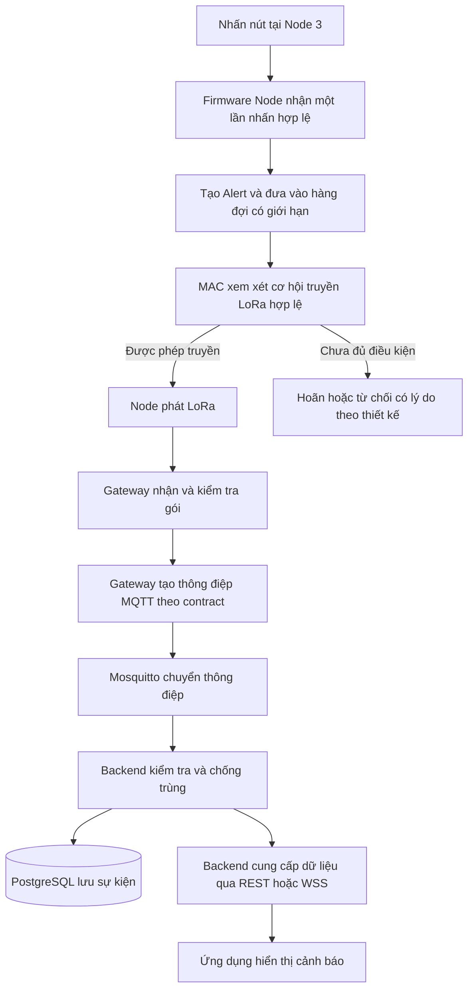

# Event Only và Priority Access — Giai đoạn 1 của Quân

**Trạng thái:** `DRAFT / LEARNING_STAGE_1 / NOT_VERIFIED`
**Người học và phụ trách:** Quân (`Quaan12`)
**Ngày khởi tạo:** 29/10/2026
**Issue thiết kế:** [#78](https://github.com/khanhpn308/LoRa-P2P-Hybrid-TDMA-MVP/issues/78)
**Issue liên quan:** [#17](https://github.com/khanhpn308/LoRa-P2P-Hybrid-TDMA-MVP/issues/17), chỉ giải thích ranh giới MQTT, chưa triển khai simulator.

## 1. Mục tiêu của giai đoạn này

Quân tự giải thích được đường đi của một cảnh báo từ nút nhấn đến ứng dụng, đầu vào/đầu ra của từng khối và phần việc thuộc #78 hoặc #17. Đây là bài học và bản nháp mở đầu cho tài liệu thiết kế #78, **chưa phải Algorithm Specification đầy đủ** và chưa đạt Definition of Done của #78/#17.

Ví dụ xuyên suốt: nhấn nút ở **Node số 3**, tạo cảnh báo quá nhiệt **giả lập 55°C**. Số Node và nhiệt độ này chỉ phục vụ giải thích theo Note.md; không phải sensor thật, threshold production, payload đã duyệt hoặc kết quả chạy thử.

Trong giai đoạn 1 chỉ đọc, vẽ, diễn giải và ghi câu hỏi. Không cần flash board, phát RF, chạy MQTT, đổi contract hoặc chọn thuật toán. Việc Quân chốt roadmap học không phải phê duyệt kỹ thuật cho một phương án MAC.

## 2. Bắt đầu học trong khoảng 60 đến 90 phút

Thời lượng dưới đây là gợi ý học, không phải timing của hệ thống.

| Bước | Quân thực hiện | Đầu ra có thể kiểm tra |
|---|---|---|
| 1 — Đọc sơ đồ, khoảng 10 phút | Đọc mục 3 và nói tên từng khối theo thứ tự. | Chỉ được đoạn LoRa và đoạn MQTT. |
| 2 — Theo một sự kiện, khoảng 20 phút | Đọc mục 4, kể lại lần nhấn ở Node 3. | Mô tả được đầu vào, xử lý và đầu ra từng bước. |
| 3 — Phân biệt bằng chứng, khoảng 15 phút | Đọc mục 5; trả lời vì sao phát xong chưa chắc đã lưu DB. | Tách được RF TX, ACK radio, MQTT PUBACK và DB commit. |
| 4 — Vẽ lại, khoảng 15 phút | Vẽ lại sơ đồ bằng giấy hoặc dùng Mermaid ở mục 3 làm khởi điểm. | Sơ đồ có Node, Gateway, Broker, Backend, DB và ứng dụng. |
| 5 — Tự diễn giải, khoảng 15 đến 30 phút | Điền mục 8 bằng lời của mình và bổ sung câu hỏi mục 7. | Bản cập nhật trên branch, có commit mô tả nội dung vừa học. |

## 3. Sơ đồ một sự kiện

Đây là sơ đồ khái niệm của nhánh thuận lợi, không phải trace đã đo và chưa bao quát mọi lỗi/recovery. Đường tới ứng dụng không ấn định transaction ordering mới; dữ liệu hiển thị và bằng chứng lưu DB phải được đối chiếu theo contract và implementation được review.

**Tách hai đường truyền:**

- **Node ↔ Gateway:** LoRa P2P với Custom MAC; #78 nghiên cứu điều kiện truy cập và ưu tiên trên đoạn này.
- **Gateway ↔ Mosquitto ↔ Backend:** MQTT 5.0/TLS theo trạng thái approval của contract; #17 giả lập vai Gateway trên đoạn này.
- **Ứng dụng ↔ Backend:** REST/WSS có xác thực; ứng dụng không kết nối trực tiếp broker hoặc Database.

Backend lập lịch tương lai; Gateway thực thi thời điểm RF tại thiết bị. Backend không gửi MQTT để bật/tắt TX/RX của từng slot. Sơ đồ này chỉ vẽ luồng cảnh báo; Beacon, Join và downlink không bị loại khỏi hệ thống khi Periodic OFF.

## 4. Theo dấu lần nhấn tại Node số 3

| Khối | Đầu vào | Xử lý cần hiểu | Đầu ra / giới hạn |
|---|---|---|---|
| Nút nhấn và firmware Node | Trạng thái nút vật lý. | Chống dội; nhận một lần nhấn hợp lệ; giữ nút không tự sinh vô hạn sự kiện theo bài toán demo. | Một lần kích hoạt logic; chưa chọn chân GPIO hoặc thời gian debounce. |
| Xử lý sự kiện tại Node | Lần kích hoạt hợp lệ. | Tạo Alert giả lập 55°C; đưa vào queue hữu hạn; phân biệt sự kiện mới với lần gửi lại. | Sự kiện chờ truyền. Cơ chế identity RF/reset chưa được chốt ở tài liệu này. |
| MAC tại Node | Alert chờ; trạng thái đồng bộ, lịch/epoch, radio và airtime admission. | Xét cơ hội truyền được phép; cần cơ chế giải quyết khi nhiều Node cạnh tranh. | Cơ hội TX, hoãn hoặc từ chối; không đồng nghĩa được phát ngay. Đây là trọng tâm #78. |
| SX1276 và đường LoRa | Yêu cầu TX hợp lệ và gói theo contract được duyệt. | Phát gói; nếu thiết kế yêu cầu ACK thì theo dõi ACK/timeout/retry hữu hạn. | TX done chỉ mô tả phát xong ở tầng radio. Không chốt wire format, timeout hoặc số retry. |
| Gateway nhận RF | Gói LoRa và ngữ cảnh nhận. | Kiểm tra theo contract; xử lý RF duplicate; giữ quyền điều khiển radio cục bộ; xếp dữ liệu vào buffer hữu hạn. | Bản ghi uplink chờ MQTT hoặc lý do reject/drop; ACK radio không chứng minh DB đã lưu. |
| Gateway gửi MQTT | Bản ghi uplink đã có nguồn gốc rõ. | Tạo envelope theo contract hiện hành; quản lý event identity ổn định khi MQTT retry/replay. | Thông điệp gửi vào topic của đúng Gateway. Không bịa trường trigger khi RF không cung cấp. |
| Mosquitto | Kết nối hợp lệ và thông điệp publish. | Thực thi TLS/ACL và chuyển đến subscriber theo cấu hình. | Giao nhận tại tầng MQTT; PUBACK không là DB commit. |
| Backend | Topic, payload và ngữ cảnh identity. | Validate schema/semantics; phát hiện trùng; lưu dữ liệu; phục vụ API/WSS. | Kết quả xử lý có thể đối chiếu; chi tiết transaction theo contract/implementation, không tự định nghĩa ở đây. |
| PostgreSQL | Yêu cầu ghi hợp lệ từ Backend. | Lưu và bảo vệ tính duy nhất theo thiết kế dữ liệu. | Bản ghi committed là bằng chứng lưu tại DB; không suy từ một log publish. |
| Ứng dụng | Dữ liệu từ Backend qua API/WSS. | Hiển thị Node, cảnh báo và thời gian có nguồn gốc rõ. | Hiển thị cho người dùng; chưa chứng minh push khi chạy nền. |

### Ba điều không nên gộp làm một

1. **Tạo sự kiện:** điều gì làm phát sinh một sự kiện mới? Retry không phải một lần nhấn mới.
2. **Truyền sự kiện:** Node được phát khi nào? Nếu ACK mất, thử lại thế nào và dừng lúc nào?
3. **Lưu sự kiện:** Backend xác định bản trùng bằng gì, và lấy đâu làm bằng chứng DB đã commit?

Đặc biệt, MQTT `event_id` do tầng Gateway quản lý theo draft contract không tự giải quyết việc nhận cùng một RF event hai lần. RF dedup và MQTT/DB dedup là hai lớp; cách liên hệ identity Node–Gateway còn cần đối chiếu #12/#14/#18. Không tự chọn SEQ_NUM 8-bit hoặc timestamp làm định danh đủ dùng.

## 5. Bốn mức xác nhận khác nhau

| Quan sát / bằng chứng | Cho biết điều gì? | Chưa chứng minh điều gì? |
|---|---|---|
| Node có TX done | Radio đã kết thúc lần phát theo trạng thái driver. | Gateway đã nhận đúng, Backend nhận, DB lưu hoặc ứng dụng hiển thị. |
| Node nhận ACK radio hợp lệ | Đã đạt ý nghĩa ACK được MAC contract định nghĩa ở tầng radio. | Database đã commit hoặc người dùng đã thấy cảnh báo. |
| MQTT QoS 1 PUBACK trên một hop | Bên nhận ở hop MQTT đó đã xác nhận theo giao thức MQTT. | Chống trùng ứng dụng, DB commit hoặc Node thực thi lệnh. |
| Backend có bản ghi DB committed được đối chiếu | Dữ liệu cụ thể đã được lưu theo transaction được kiểm chứng. | Mọi cảnh báo đều tới ứng dụng, độ trễ RF đạt mục tiêu hoặc không bao giờ mất dữ liệu. |

Không có mức nào trong bảng đã được chạy thử trong bài học này. Ghi chú của Quân cần tách **điều dự kiến xảy ra** và **điều đã quan sát bằng log/test**.

## 6. Đặt #78 và #17 đúng chỗ

| Câu hỏi | #78 — Thiết kế Priority Access | #17 — Gateway MQTT Simulator |
|---|---|---|
| Đoạn hệ thống | Điều phối truy cập LoRa giữa Node và Gateway; liên hệ lịch do Backend lập. | Giả lập Gateway trao đổi MQTT với Backend qua broker. |
| Câu hỏi chính | Khi có Alert, Node được truyền lúc nào và xử lý cạnh tranh thế nào? | Backend xử lý đúng dữ liệu, duplicate, reconnect và vòng đời lịch hay không? |
| Khi Periodic OFF | Vẫn giữ Alert, đồng bộ cần thiết, Join và control/downlink opportunities. | Scenario phải mô tả đúng dữ liệu/hành vi cần giả lập theo contract, không giả làm RF đã chạy. |
| Đầu ra đầy đủ về sau | ≥3 phương án, tradeoff, I/O/invariants, state machine, pseudocode, verification plan và review. | CLI 1/10/15 Node, seed, fixture/schema, scenario/lifecycle và bằng chứng tích hợp. |
| Bài học này đóng góp | Mở đầu problem context, boundaries và câu hỏi. | Hiểu ranh giới; chưa tạo file, code hoặc kết quả test của #17. |
| Không được kết luận | Thuật toán đã được chọn/duyệt, timing/RF đã PASS. | MQTT simulator chứng minh collision, ToA hoặc RF/HIL PASS. |

Các phần còn lại của Algorithm Specification sẽ được bổ sung ở giai đoạn sau; không đánh dấu hoàn tất AC #78 dựa trên tài liệu mở đầu này.

## 7. Sổ câu hỏi cần phối hợp

Các câu trả lời đều **đang chờ xác nhận**, không phải blocker khiến Quân không thể học luồng khái niệm. Không gửi yêu cầu review tự động chỉ vì một người xuất hiện trong bảng.

| ID | Câu hỏi | Người/nhóm phù hợp | Trạng thái |
|---|---|---|---|
| Q01 | Điều kiện nhận một lần nhấn hợp lệ và cách xử lý queue đầy cần được thiết kế ở đâu? | Quân, Phước; Khánh đối chiếu #77. | Chưa xác nhận. |
| Q02 | RF identity nào phân biệt sự kiện mới và retry qua reset? Gateway chống RF duplicate bằng gì? | Khánh, Phước, Node/MAC/Security (#12). | Chưa chốt tại đây; liên hệ D01/D11. |
| Q03 | ACK radio xác nhận tới bước nào? ACK mất nhưng Gateway đã nhận thì xử lý thế nào? | Node/Gateway MAC, Khánh và Phước. | Chưa xác nhận. |
| Q04 | Khi nhiều Node Alert đồng thời, những cơ hội truyền nào được phép ở ON/OFF? | Nhóm #78; người phụ trách RF, Node và Gateway. | Cần so sánh ≥3 phương án ở bước sau. |
| Q05 | Khi mất Wi-Fi, Gateway tiếp tục thế nào nếu active schedule còn an toàn và buffer đầy? | Gateway, Backend, RF/Security. | Đối chiếu ADR-0001, D12; không mặc định giữ mọi sự kiện vô hạn. |
| Q06 | MQTT contract #14 đang ở phiên bản/trạng thái approval nào? | Khánh, Gateway, Backend và Infra/Security. | Baseline hiện đọc là draft; cần cross-team review. |
| Q07 | Ai cung cấp bằng chứng Backend dedup và DB commit cho #17? | Người phụ trách #18; Quân/Phước phối hợp. | Chưa xác nhận tên người. |
| Q08 | Thời gian nào dùng hiển thị/thống kê khi occurrence time chưa biết? | Backend và người phụ trách ứng dụng. | Note.md chọn ingest time cho demo; giữ provenance, không thay thế ngầm observed_at. |
| Q09 | Demo chỉ hiển thị khi app mở hay còn push chạy nền? | Người phụ trách ứng dụng, Khánh/Project Owner. | Chưa xác nhận. |

## 8. Phần Quân tự điền sau khi học

Giữ nguyên ví dụ là dữ liệu minh họa. Chỉ điền những điều Quân thực sự hiểu/đã làm; checklist kiến thức không thay nghiệm thu kỹ thuật.

### 8.1. Kể lại bằng lời của tôi

> Chưa điền: Tôi nhấn nút tại Node 3. Firmware ... Sau đó MAC ... Gateway ... Broker ... Backend ... Database ... Ứng dụng ...

### 8.2. Tự trả lời năm câu

1. Gateway khác Backend ở đâu? **Trả lời của Quân:** chưa điền.
2. Vì sao TX done chưa chứng minh DB lưu? **Trả lời của Quân:** chưa điền.
3. Vì sao Periodic OFF vẫn phải có đường Alert? **Trả lời của Quân:** chưa điền.
4. #17 thay thế phần nào khi chưa có phần cứng? **Trả lời của Quân:** chưa điền.
5. Nếu ba Node cùng Alert, câu hỏi nào thuộc #78? **Trả lời của Quân:** chưa điền.

### 8.3. Checklist chuyển sang giai đoạn 2

- [ ] Tôi kể lại luồng một sự kiện mà không cần đọc nguyên văn bảng.
- [ ] Tôi chỉ được đầu vào/đầu ra và trách nhiệm từng khối.
- [ ] Tôi phân biệt tạo, truyền và lưu sự kiện.
- [ ] Tôi phân biệt ACK radio, MQTT PUBACK và DB commit.
- [ ] Tôi chỉ đúng ranh giới #78 và #17.
- [ ] Tôi đã bổ sung hoặc trả lời ít nhất một câu hỏi ở mục 7, có ghi nguồn nếu là quyết định của nhóm.
- [ ] Tôi đã vẽ lại sơ đồ và lưu bản mô tả hoặc chỉnh Mermaid trong chính tệp này.

### 8.4. Nhật ký học

| Ngày | Tôi vừa học/làm gì? | Điểm chưa hiểu / nguồn giải đáp |
|---|---|---|
| Chưa điền | Quân cập nhật sau buổi học đầu tiên. | Chưa điền. |

## 9. Cập nhật tài liệu trên GitHub

Repository lưu Markdown (`.md`) để dễ đọc trên web, xem thay đổi từng dòng và quản lý phiên bản. DOCX đã tạo trước đó có thể dùng đọc offline; tệp này là nơi thực hành và theo dõi giai đoạn 1.

1. Mở link tệp **trên branch của Draft PR giai đoạn 1**, kiểm tra branch là `codex/quan-stage1-event-flow`.
2. Chọn biểu tượng bút chì hoặc **Edit this file**. Nếu GitHub đề nghị nhánh khác, kiểm tra lại nhánh và PR đích trước khi lưu.
3. Tới mục 8, thay các chỗ “chưa điền” bằng lời của Quân. Thêm câu hỏi chưa hiểu vào mục 7. Chỉ tick khi đã tự kiểm tra.
4. Chọn **Preview** để xem bảng và Mermaid có hiển thị đúng. Sửa lỗi trong phần **Edit** rồi xem lại.
5. Chọn **Commit changes**, ghi thông điệp rõ như `docs: ghi lai bai hoc luong su kien cua Quan`. Commit vào cùng branch để Draft PR tự cập nhật; chưa merge vào main.
6. Mở tab **Files changed** của PR để xem những dòng vừa sửa. Tab **Commits** lưu các mốc chỉnh sửa. Lần sau tiếp tục trên cùng branch khi PR còn mở.
7. Khi tự hoàn thành checklist, dùng PR để nhóm review. Chưa đóng #78/#17: bài học này chỉ là một phần đầu vào. Việc yêu cầu reviewer hoặc merge do Quân/nhóm thực hiện theo quy trình dự án.

## 10. Nguồn và giới hạn

Baseline đối chiếu: commit `08e86af2fda8e40b89c0cf01b98e08311f03b7a9` trên main khi khởi tạo. Cần đọc trạng thái approval của mỗi nguồn, không coi mọi mô tả draft là quyết định production.

- [AGENTS.md](../../AGENTS.md): phạm vi công nghệ, ranh giới trách nhiệm và evidence.
- [ADR-0001](../adr/0001-hybrid-tdma.md): hướng Backend Planner / Gateway Executor đã accepted; các clarification và timing còn pending review/NOT_VERIFIED.
- [System overview](system-overview.md): `R1 DRAFT`, dùng định hướng đọc, không nâng lên authority mới.
- [MQTT topics](../../contracts/mqtt/topics.md) và [semantic rules](../../contracts/mqtt/semantic-rules.md): MQTT 5.0 owner-accepted; contract `DRAFT / PENDING CROSS-TEAM REVIEW`; đặc biệt event identity, timestamp provenance và ACK semantics.
- [Open decisions](../../contracts/OPEN_DECISIONS.md): D01–D05/D11/D12 và các phần chưa chốt; tài liệu này không sửa quyết định.
- Issue #78/#17 đang OPEN được đọc trên GitHub; ví dụ nút nhấn/55°C từ Note.md do Quân cung cấp. Không tự tải tài liệu cá nhân lên repo.

**Evidence:** chỉ tạo tài liệu học và kiểm tra tài liệu. Firmware build, MQTT integration, simulator, RF/HIL/timing và human technical sign-off: `NOT_RUN / NOT_VERIFIED`. Không chọn thông số RF, pin map, wire format, khóa, threshold, số retry hoặc thuật toán cuối cùng ở giai đoạn 1.
