# MAC ưu tiên cho Event-Only — Đề xuất thuật toán

**Issue #78 · Chỉ thiết kế · PROPOSED / NOT_APPROVED · RF, timing, security và HIL NOT_VERIFIED**

Tài liệu này đề xuất cách mạng LoRa P2P tùy biến truyền Priority Alert khi Periodic Reporting ở trạng thái OFF, đồng thời vẫn duy trì đồng bộ Beacon, Join/Discovery, control downlink và ACK trong các cơ hội được cho phép. Tài liệu không thay đổi MAC contract, wire format, RF profile, schedule hay production implementation. Các giới hạn dạng số về timing, retry, queue, airtime và fairness vẫn là `TBD` cho đến khi owner liên quan duyệt evidence.

## 1. Yêu cầu thuật toán

### Bài toán và phạm vi

Định nghĩa các cơ hội an toàn cho traffic đủ điều kiện trên một radio SX1276 half-duplex trong hai mode:

- **Periodic ON:** Gateway thực thi TDMA schedule cục bộ đang ACTIVE. Telemetry định kỳ dùng các cơ hội data được gán. Priority Alert được ưu tiên tại các priority opportunity được cho phép rõ ràng và chỉ được dùng data opportunity nếu active schedule cho phép.
- **Periodic OFF:** Node không gửi data định kỳ. Alert và event được cấu hình rõ ràng chỉ được tranh chấp tại event opportunity được cho phép. Beacon, Join/Discovery, control/provisioning downlink và tài nguyên ACK/retry đủ điều kiện vẫn được duy trì theo active schedule và airtime policy.

Priority Alert có scheduling priority cao nhất trong số normal event, telemetry và control work có thể trì hoãn đang chờ. Priority là quy tắc phân xử tại một cơ hội hợp lệ; nó không ngắt RF transmission đang diễn ra, không tạo thêm airtime, không bỏ qua authentication và không đảm bảo delivery hay latency.

### Input, output và điều kiện tiên quyết

| Mục | Định nghĩa |
|---|---|
| Input | Cấu hình Periodic ON/OFF theo từng Node; active schedule và epoch đã xác thực; độ tin cậy của Beacon/synchronization; pending queue có giới hạn; event class và event identity ổn định; trạng thái radio; kết quả airtime admission cục bộ; trạng thái ACK/retry; kết nối Backend và trạng thái schedule đang STAGED. |
| Output | `TX_GRANTED(opportunity, event)`, `DEFERRED(reason, next_eligible_condition)` hoặc `DENIED(reason)`; quyết định ACK/retry; counter quan sát được cho queue overflow, airtime bị từ chối, deferral, timeout và recovery. |
| Điều kiện tiên quyết | Radio owner của Gateway tuần tự hóa mọi truy cập SX1276; kiểm tra authentication/replay của schedule/version và event thành công; opportunity đang ACTIVE, chưa hết hạn theo policy đã duyệt và thuộc Node/class này; synchronization cần thiết hợp lệ; airtime admission thành công. |
| Giới hạn thời gian/RF | Mọi thời gian chờ, random backoff, queue capacity, retry và recovery timer phải hữu hạn và được owner duyệt. Gateway quyết định theo local timing; Backend/MQTT không định thời từng RF slot. Đề xuất này không phê duyệt giới hạn hay latency KPI nào. |

### Bất biến

1. Node chỉ truyền khi có schedule/epoch hợp lệ đã authentication và độ tin cậy synchronization đủ cho opportunity được duyệt. Nếu không, Node chỉ nghe hoặc vào recovery; không quay lại dùng periodic slot đã cũ.
2. Một radio owner của Gateway tuần tự hóa trạng thái TX/RX/SPI. TX không được chiếm quyền trước frame đang truyền. Beacon, downlink, contention, data, ACK/retry, Join và guard không được chồng lấn trái với half-duplex timeline đã duyệt, kể cả tại ranh giới superframe.
3. Mọi RF transmission, bao gồm Beacon, Join, ACK, Alert và retry, phải qua cùng local airtime/regulatory admission policy. Hết ngân sách thì deny/defer kèm lý do; không có emergency bypass.
4. CAD chỉ quan sát kênh. Kết quả CAD báo rỗi không chứng minh rằng sẽ không va chạm hoặc transmission được cho phép.
5. Retry phải hữu hạn và gắn với cùng logical event identity. Không nhận được ACK nghĩa là chưa rõ kết quả, không chứng minh có va chạm hay không delivery. Reception trùng lặp phải được xử lý idempotent theo security/session rules đã duyệt.
6. Queue có giới hạn và owner rõ ràng. Overflow phải quan sát được và tuân theo drop/retention policy đã duyệt; thiết kế không hứa lossless khi outage hoặc alert storm không giới hạn.
7. Gateway stage các thay đổi schedule và chỉ activate tại local boundary sau đủ số lần announcement hoàn chỉnh theo yêu cầu. `STAGE_ACK` không có nghĩa là đã activate hoặc mọi Node đều nhận thay đổi.

### Failure mode và kết quả an toàn

| Failure / ranh giới | Kết quả bắt buộc |
|---|---|
| Không có Beacon đã authentication, schedule mapping cũ/thiếu, epoch không hợp lệ hoặc synchronization confidence ngoài giới hạn đã duyệt | Node fail-closed đối với data/event TX bị ảnh hưởng; listen/recover và chỉ join lại qua opportunity được cho phép. |
| Radio Gateway bận hoặc đang transmission | Không ngắt transmission. Defer đến opportunity hợp lệ tiếp theo; giữ thứ tự class giữa các công việc đủ điều kiện đang chờ. |
| CAD báo bận, không có ACK hoặc có khả năng va chạm | Chỉ defer/retry trong policy hữu hạn đã duyệt và trong airtime budget. Không suy ra kênh rỗi từ CAD hoặc tuyên bố delivery chỉ dựa trên TX completion cục bộ. |
| Airtime bị từ chối hoặc policy không có/không hợp lệ | Deny/defer TX, lưu reason/counter và áp dụng queue policy đã duyệt. Không bypass cho Alert. |
| Queue đầy, nhiều Alert đồng thời lặp lại hoặc hết retry | Áp dụng overflow/retry policy có giới hạn; công khai event identity bị drop/hết hạn/chưa delivery cùng counter khi security policy cho phép. Không âm thầm báo thành công. |
| Gateway mất kết nối Backend | Chỉ tiếp tục schedule cục bộ đã authentication còn hiệu lực và policy vẫn an toàn. Không activate proposal cũ/đang STAGED hoặc phụ thuộc lệnh backend theo từng slot. |
| Node không nhận được chuyển đổi schedule | Node không đoán mode mới hoặc dùng lại slot đã thu hồi/cũ; chỉ listen đối với transmission bị ảnh hưởng cho đến khi có mapping hợp lệ. |

## 2. Thuật toán ứng viên và đánh đổi

Phần so sánh giả định **10–15 Node** và một radio Gateway half-duplex. Đây là phân tích đánh đổi, không phải kết quả đo. Mọi phương án vẫn cần opportunity được cho phép và airtime admission.

| Phương án | Cách hoạt động | Va chạm / hành vi với 10–15 Node | Đánh đổi half-duplex | Priority latency và reliability | Airtime, năng lượng, fairness và độ phức tạp |
|---|---|---|---|---|---|
| A. CAD + random backoff hữu hạn | Node đủ điều kiện thực hiện CAD; nếu kênh có vẻ rỗi, Node tranh chấp sau một random delay có giới hạn. ACK timeout có thể dẫn đến retry hữu hạn. | Giảm một số trường hợp bắt đầu chồng lấn, nhưng Node ẩn/đồng thời và CAD báo rỗi sai vẫn có thể va chạm. Xác suất va chạm tăng khi nhiều event đồng thời; không có cách phân giải xác định. | Node/Gateway phải ở trạng thái RX/listen để CAD và tranh chấp. Beacon, downlink, ACK hoặc TX khác của Gateway tạm thời chiếm mất cơ hội nhận đó; không thể ngắt TX đang chạy. | Có thể nhanh khi tải thấp; latency tăng khi tranh chấp và retry. Không đảm bảo delivery. | Ít overhead schedule; CAD và các lần thử lặp lại tiêu tốn ngân sách receive/năng lượng/RF. Vẫn có thể starvation nếu không có fairness policy được review. Độ phức tạp Node trung bình. |
| B. Priority window dành riêng | Schedule các Alert window tường minh (có thể tách theo Node/nhóm sở hữu); công việc không phải Alert dùng opportunity khác. | Giảm va chạm Alert nếu ownership và capacity đáp ứng tải; Alert vượt capacity hoặc đồng thời vẫn phải xếp hàng hay va chạm trong tài nguyên dùng chung. 10–15 Node cần mô hình phân bổ được review. | Window tường minh có thể tuần tự hóa RX/TX/ACK và bảo vệ ranh giới Beacon/guard, nhưng mọi reservation đều tranh chỗ trên cùng timeline một radio. Không được mặc định dùng lại reservation chưa dùng nếu schedule policy chưa cho phép. | Chỉ dự đoán được sau khi kiểm chứng slot/guard/ToA/HIL. Capacity dành riêng có thể giảm thời gian chờ Alert nhưng reservation chưa dùng gây lãng phí airtime. | Tốn overhead schedule và synchronization; có thể tăng latency của normal event. Fairness tùy quy tắc phân bổ/thu hồi. Schedule phức tạp hơn; reservation có thể vi phạm RF budget. |
| C. Tái phân bổ động kết hợp tranh chấp hữu hạn (**hướng đề xuất**) | Backend đề xuất phân bổ mode/tài nguyên; Gateway stage/announce/activate cục bộ. Chỉ schedule mới đã ACTIVE mới được thu hồi periodic data opportunity chưa dùng. Alert sau đó dùng priority opportunity được phép với contention/backoff hữu hạn và retry hữu hạn. | Tái phân bổ có thể tăng capacity cho event khi OFF; vẫn có thể va chạm khi tranh chấp, nhất là lúc burst Alert hoặc chuyển mode hỗn hợp. Không loại bỏ Node ẩn hay lỗi CAD. | Gateway phải xếp Beacon, schedule announcement, contention RX, event RX, ACK/downlink TX và guard vào local timeline không xung đột. Thu hồi động không được chồng với TX/RX đang hoạt động hoặc khiến Node dùng schedule cũ truyền vào slot đã thu hồi. | Giữ ưu tiên Priority Alert và có thể điều chỉnh capacity giữa các schedule version. Không đảm bảo latency; vẫn có trễ do chuyển mode và tranh chấp. | Tránh truyền telemetry định kỳ ở mode OFF; Beacon/announcement/các lần tranh chấp vẫn tiêu tốn airtime và năng lượng Node. Fairness và xử lý overload cần policy hữu hạn, tường minh. Phức tạp điều phối cao nhất. |

**Hướng đề xuất, chưa đóng băng:** Phương án C được đề xuất để owner review vì giữ thực thi cục bộ tại Gateway, cho phép thu hồi tài nguyên ở cấp schedule khi Periodic OFF và duy trì ưu tiên Priority Alert tại opportunity được phép. Thành phần contention chỉ là đề xuất dự phòng/phân xử, chưa phải CAD/window algorithm được duyệt. Phương án B có thể an toàn hơn khi đã biết capacity, nhưng chưa thể định cỡ trước G1/HIL; riêng phương án A không giải quyết được burst collision hay fairness. Reviewer có thể chọn phương án khác hoặc yêu cầu thiết kế lại.

### Giả định và TBD

- G1 phải đo/duyệt PHY profile và ToA của frame đã authentication đầy đủ, hành vi/giới hạn CAD, TX/RX turnaround, clock drift, guard, antenna/board và airtime policy áp dụng theo quy định. Tài liệu này không xác nhận candidate profile hiện có là hợp pháp hay khả thi.
- Số event đồng thời và độ dài burst, số Node đang hoạt động, kích thước packet gồm security overhead, ACK opportunity, retry policy và airtime budget từng Node cần được đo và owner quyết định.
- Tài liệu không định nghĩa giá trị số cho slot, window, superframe, guard, contention/backoff, queue, retry, holdover, activation horizon hay alarm latency. Không sao chép giá trị candidate trong `contracts/radio-mac/tdma-schedule.md` thành tham số đã duyệt.
- D01/D11 vẫn là blocker đối với frame identity đã authentication, nonce/replay/session và ánh xạ schedule epoch/version. Đề xuất này không chỉ định codec, key, counter width hay security mechanism.
- CAD báo rỗi sai, bắt đầu đồng thời, ảnh hưởng Node ẩn, biến thiên môi trường và trường hợp Gateway đang phát Beacon/downlink khi có Alert chờ phải được mô phỏng và đo bằng HIL/RF evidence.

## 3. Quyền sở hữu, mode và opportunity

### Ranh giới Node / Gateway / Backend

| Thành phần | Trách nhiệm | Không được làm |
|---|---|---|
| Node MAC | Phát hiện và enqueue event; xác minh trạng thái Beacon/schedule; phân xử bounded queue; chỉ yêu cầu/thử transmission tại opportunity được phép; duy trì retry state hữu hạn và công khai reason counter. | Ngắt RF; chọn slot chưa được gán; dùng schedule cũ sau khi phát hiện mismatch; vượt airtime/retry policy; xem CAD như đảm bảo kênh rỗi. |
| Gateway local executor | Cung cấp thời điểm Beacon/superframe cục bộ; tuần tự hóa radio operation; validate/stage schedule; phân xử receive/ACK/downlink theo local timeline; deduplicate event đã authentication; báo cáo activation/status thực tế. | Phụ thuộc Backend để định thời RF slot; activate ngay khi nhận MQTT; xác nhận schedule ACTIVE trước local activation; transmission khi half-duplex state không cho phép. |
| Backend planner | Lập kế hoạch và version hóa schedule/mode assignment tương lai; cho phép dispatch; reconcile status/report của Gateway với danh sách Node/mode. | Lập lịch từng thời điểm RF; suy ra mode ACTIVE từ publish/PUBACK/STAGE_ACK; giả định mọi Node đã nhận announcement. |

Mode được định nghĩa riêng cho từng Node trong active schedule. Vì vậy, một mạng mixed-mode có thể gồm Node gửi telemetry định kỳ và Node event-only trong cùng superframe, nhưng tất cả dùng chung radio timeline và Beacon/maintenance/control resource của Gateway. Gateway phải validate timeline và ownership tổng hợp như một half-duplex schedule duy nhất.

Gateway boot/recovery tách biệt với mode activation: chỉ restore trạng thái `ACTIVE` đã persist, authentication và integrity-check, khi xác minh được identity, epoch/version continuity, validity và local safety. Không tự promote proposal `STAGED`/shadow chỉ vì Gateway reboot. Nếu active state thiếu, corrupt, không rõ ràng hoặc không thể validate, hãy disable data/event TX bị ảnh hưởng và vào recovery/bootstrap procedure đã duyệt. Mọi Beacon/bootstrap transmission vẫn cần schedule/policy được duyệt và airtime admission. Quy tắc recovery và clock continuity cụ thể còn `TBD` theo D01/D11 và SYS-001/002.

### Bảng opportunity

“Có sẵn” chỉ có nghĩa là opportunity được nêu rõ trong active schedule hợp lệ, radio timeline và airtime policy; điều này không ngầm cấp production window.

| Traffic/resource | Periodic ON | Periodic OFF | Ràng buộc |
|---|---|---|---|
| Beacon synchronization | Duy trì | Duy trì | Gateway thực hiện cục bộ; Node dùng Beacon đã authentication và epoch hợp lệ. Beacon phải qua airtime admission. |
| Periodic telemetry | TDMA data opportunity được gán | **Không có periodic data TX** | Node mixed-mode theo assignment hợp lệ riêng. OFF không tắt Beacon hoặc control. |
| Priority Alert | Priority opportunity được cho phép; chỉ dùng opportunity khác nếu schedule cho phép rõ ràng | Event-only priority opportunity được cho phép | Class có priority cao nhất tại opportunity đủ điều kiện. Không ngắt transmission, bypass policy hay đảm bảo latency. |
| Normal event | Chỉ tại opportunity được gán/cho phép sau Alert đủ điều kiện | Event opportunity được cho phép sau Alert đủ điều kiện | Không suy ra có periodic event transmission. |
| Join / Discovery | Duy trì Join/Discovery opportunity được cho phép | Duy trì Join/Discovery opportunity được cho phép | Có rate/airtime control; Join không cấp quyền production TX cho đến khi schedule/session policy đã authentication cho phép. |
| Control / provisioning downlink | Duy trì Gateway downlink opportunity được cho phép | Duy trì Gateway downlink opportunity được cho phép | Backend cấp quyền; Gateway thực thi cục bộ; không chồng lấn RX/TX. |
| ACK / retry | Chỉ khi active schedule và airtime còn lại cho phép | Tương tự | Mất ACK không xác định được kết quả. Retry hữu hạn và tiêu tốn airtime. |
| Periodic capacity đã thu hồi | Không thu hồi khi ON trừ khi schedule mới quy định | Chỉ idle/có thể thu hồi sau khi schedule mới được stage, announce và activate | Không tự diễn giải lại data slot cũ hoặc để Node dùng mapping cũ transmission vào slot đã thu hồi. |

TDMA contract hiện tại mô tả timing Beacon, PCSS, data, downlink và Join như một **candidate profile**. Các chỗ nhắc đến PCSS bên dưới chỉ nói về một lớp opportunity để thảo luận; tài liệu này không phê chuẩn vị trí, thời lượng, chu kỳ hay việc đưa PCSS vào production schedule.

### Trạng thái mode và schedule

```mermaid
stateDiagram-v2
    [*] --> ListenOnly: khởi động / chưa xác minh active mapping
    ListenOnly --> Synchronized: Beacon đã authentication + active mapping hợp lệ
    Synchronized --> PeriodicOn: mode ACTIVE của Node = ON
    Synchronized --> EventOnly: mode ACTIVE của Node = OFF
    PeriodicOn --> ListenOnly: mất sync, epoch, mapping hoặc airtime safety
    EventOnly --> ListenOnly: mất sync, epoch, mapping hoặc airtime safety
    PeriodicOn --> StagedMode: nhận schedule tiếp theo hợp lệ
    EventOnly --> StagedMode: nhận schedule tiếp theo hợp lệ
    StagedMode --> PeriodicOn: schedule đã announce activate tại local boundary; mapping Node hợp lệ
    StagedMode --> EventOnly: schedule đã announce activate tại local boundary; mapping Node hợp lệ
    StagedMode --> ListenOnly: activation/mapping không chắc chắn hoặc bỏ lỡ announcement
    ListenOnly --> Synchronized: recovery hoàn tất theo policy đã duyệt
```



Vòng đời proposal của Gateway theo schedule contract hiện có: chỉ chuyển `PROPOSED → SENT → STAGED` sau khi validate và persist shadow bền vững; plan không hợp lệ/hết hạn/xung đột/không đáp ứng airtime sẽ bị reject; activation chỉ diễn ra tại local boundary đã lập kế hoạch sau đủ số **announcement hoàn chỉnh** theo yêu cầu; sau đó mới báo cáo activation thực tế. Backend phải reconcile report thực tế, không suy ra activation từ delivery ACK. Số announcement và activation horizon vẫn `TBD` theo D05 và review MAC-003.

Khi chuyển Periodic ON→OFF, periodic TX không tự dừng chỉ vì cờ UI/config cục bộ đổi: Gateway và từng Node chỉ chuyển mode khi có schedule/epoch mới hợp lệ đã authentication. Capacity được giải phóng vẫn không dùng theo schedule cũ cho đến activation. Khi chuyển OFF→ON, Node chưa có mapping mới phải listen-only đối với periodic TX. Mất Beacon, Gateway reset, Backend không sẵn sàng hoặc announcement bị gián đoạn không được promote shadow state hay cho phép dùng slot cũ; Gateway chỉ tiếp tục schedule ACTIVE đã authentication khi vẫn xác minh được validity và local safety.

## 4. Phân xử và pseudocode đề xuất

Pseudocode dưới đây nêu tên các policy parameter nhưng cố ý không đưa giá trị production. Mỗi parameter phải hữu hạn, được review và có evidence trước implementation. `TBD` nghĩa là chưa thể chấp nhận hoặc khẳng định behavior phụ thuộc tham số đó an toàn.

### Phân xử priority tại Node

```text
on_event(event):
    if not authenticated_local_event(event):
        return DENIED(INVALID_EVENT)
    if queue_full(event.class):
        record_overflow(event.identity, event.class)
        return DENIED(QUEUE_FULL)
    enqueue_bounded(event)

on_authorized_opportunity(opportunity):
    if not beacon_sync_valid() or not active_mapping_valid(opportunity):
        enter_listen_only()
        return DENIED(UNSYNCED_OR_STALE_SCHEDULE)
    if radio_owner_state() != RX_READY:
        return DEFERRED(RADIO_BUSY)

    event = oldest_eligible_by_class(
        priority_alerts_first,
        then_FIFO_within_class,
        then_normal_events,
        then_periodic_telemetry_if_ON_and_assigned)
    if no event:
        return DEFERRED(NO_PENDING_WORK)

    if event.attempts_used >= APPROVED_ATTEMPT_LIMIT or event_is_expired_under_approved_policy(event):
        mark_outcome_unknown_or_exhausted(event)
        dequeue_or_expire_under_approved_policy(event)
        return DENIED(ATTEMPT_LIMIT_OR_EVENT_EXPIRY)
    if not airtime_admit(event, opportunity, current_budget()):
        record_denial(event.identity, AIRTIME_DENIED)
        return DEFERRED(AIRTIME_DENIED)

    # Tính một attempt hữu hạn trước contention/TX để giới hạn các vòng thử lặp lại.
    event.attempts_used += 1
    if opportunity_uses_contention:
        wait(random_bounded_delay(APPROVED_BACKOFF_BOUND(event.retry_count)))
        if opportunity_expired() or radio_not_RX_READY():
            return finish_attempt_or_defer(event, OPPORTUNITY_EXPIRED_OR_BUSY)
        cad = observe_channel()
        if cad == BUSY:
            return finish_attempt_or_defer(event, CAD_BUSY)
        # CAD_CLEAR không chứng minh kênh sẽ không va chạm.

    if not revalidate_sync_schedule_and_airtime(event, opportunity):
        return DENIED(SAFETY_OR_AIRTIME_RECHECK_FAILED)
    tx_result = radio_owner_transmit(event)
    if tx_result != TX_DONE:
        return finish_attempt_or_defer(event, TX_FAILED)

    if not ack_is_authorized_and_budgeted(opportunity):
        mark_outcome_unknown(event)
        return finish_attempt_or_defer(event, ACK_NOT_AVAILABLE)
    ack = wait_for_authenticated_matching_ack(APPROVED_ACK_DEADLINE)
    if ack == MATCH:
        mark_delivered(event.identity)
        dequeue(event)
        return TX_GRANTED(ACKED)
    increment_finite_retry_state(event)
    return finish_attempt_or_defer(event, ACK_MISSING, outcome=UNKNOWN)
```

`finish_attempt_or_defer` là helper có giới hạn: nếu chạm attempt limit hoặc event-validity/queue-age limit đã duyệt, nó ghi trạng thái kết thúc `OUTCOME_UNKNOWN`/`EXHAUSTED` và áp dụng retention/drop policy đã review; nếu chưa, nó defer đến opportunity được phép tiếp theo. Nhờ đó, các vòng CAD báo bận, opportunity hết hạn sau contention, TX failure, mất ACK và TX không có ACK opportunity không thể vượt attempt bound. Airtime bị từ chối trước contention/TX không tính là một RF attempt nhưng vẫn phải quan sát được và không được kéo dài event validity quá giới hạn đã duyệt. Mọi limit đang `TBD` và phải hữu hạn trước implementation.

Trong một Node, các event đang chờ cùng class dùng thứ tự FIFO có giới hạn. Tại Gateway, đề xuất dùng bounded queue riêng cho từng Node đối với Alert đã nhận và authentication, cùng round-robin cursor luân phiên qua authenticated Node identity: phục vụ source đủ điều kiện tiếp theo sau cursor, rồi dịch cursor khi Alert đó có kết quả service cuối cùng (ACKed, hết hạn hoặc hết attempt). Trong cùng một source, giữ thứ tự Gateway nhận; không thêm wire field cho cursor. Cách này ngăn một source chiếm độc quyền service trong nhóm Alert Gateway đã nhận, tùy thuộc queue capacity/overflow policy. Nó không đảm bảo fair channel access giữa các Node có transmission đồng thời va chạm hoặc Alert chưa được nhận. Random backoff không tạo bảo đảm xác định về medium-access fairness hay starvation bound; đây vẫn là quyết định mở cần đo/review. Aging/quota không được âm thầm hạ Alert xuống dưới normal work. Nếu retry event có thể tạo delivery trùng, stable identity, authentication, replay protection và Gateway/backend deduplication phải được định nghĩa trong contract đã duyệt trước khi coding.

### Phân xử opportunity tại Gateway

```text
on_local_boundary_or_radio_event():
    if radio_owner_not_ready():
        defer_all_nonurgent_work_without_preemption()
        return
    candidates = eligible_work_for_current_active_opportunity()
    discard_or_defer_candidates_without_valid_identity_schedule_or_sync()
    if authenticated_pending_alerts_exist():
        candidate = next_gateway_alert_round_robin(cursor, per_node_bounded_fifo)
        candidates.prepend(candidate)
        # Dịch cursor sau khi Alert này có kết quả service cuối cùng.
    order candidates:
        1. mandatory Beacon / safety-critical timeline action
        2. authenticated Priority Alert ACK or receive handling when its legal window is active
        3. other eligible Alert handling
        4. Join / control / normal event / periodic data by reviewed opportunity policy
    for candidate in candidates:
        if timeline_conflicts(candidate) or not airtime_admit(candidate):
            record_defer_or_deny(candidate)
            continue
        execute_through_single_radio_owner(candidate)
        stop when opportunity ends or radio state disallows further work
```

Thứ tự này không được dịch Beacon bắt buộc hoặc TX đang hoạt động ra khỏi timeline đã duyệt. Priority chỉ có nghĩa là ưu tiên phục vụ trong số công việc mà opportunity hiện tại được phép xử lý; schedule owner phải định nghĩa resource reservation và ACK timing trước implementation. Gateway round-robin chỉ áp dụng sau khi nhận/authentication Alert; quy tắc này không đảm bảo fairness hoặc starvation bound cho contention phân tán.

### Contention, suy luận va chạm và retry

```text
attempt(event, attempt_index):
    require attempt_index < APPROVED_ATTEMPT_LIMIT
    require current authenticated schedule, sync, eligible opportunity
    require airtime_admit(event) else return DENIED(AIRTIME_DENIED)
    tính một attempt trước mọi hoạt động contention hoặc transmission
    if CAD is part of the approved opportunity:
        if CAD reports busy: finish_attempt_or_defer(event, CAD_BUSY)
    choose bounded backoff using approved bound and independent contender entropy
    if backoff would cross opportunity end: return DEFERRED(OPPORTUNITY_EXPIRED)
    transmit only through radio owner
    if matching authenticated ACK before approved deadline: return ACKED
    if TX failed or ACK is unavailable/not authorized/budgeted:
        mark outcome unknown when transmission may have occurred
        return finish_attempt_or_defer(event, TX_FAILED_OR_ACK_UNAVAILABLE)
    classify as OUTCOME_UNKNOWN (collision is one possible cause)
    if budget, retry limit, event validity, and a later authorized opportunity allow:
        retain same logical event identity and schedule a finite retry
    else:
        return DENIED(RETRY_OR_BUDGET_EXHAUSTED)
```

Event validity/queue-age expiry cũng phải hữu hạn và do owner duyệt, nhằm tránh event bị từ chối hoặc chưa từng được phục vụ tiếp tục đủ điều kiện vô thời hạn. Ngữ nghĩa event expiry cụ thể còn `TBD` và không được nhầm với schedule `expires_at`.

Entropy source và backoff distribution chưa được chỉ định: Security/Embedded review phải đảm bảo các Node đồng thời không bị đồng bộ vào cùng retry pattern, nhưng không tự đặt key hay nonce mechanism. Chỉ chấp nhận ACK khi nó authentication thành công và khớp session/event mong đợi theo MAC contract sẽ được duyệt. Retry, ACK và CAD listening đều tính vào RF/energy budget áp dụng.

### Thu hồi slot và chuyển mode

```text
backend_plan(mode_by_node, opportunity_map, version, expiry):
    validate theo policy input đã duyệt; không gán giá trị RF dạng số tại đây
    gửi proposal đến Gateway; không điều khiển từng thời điểm RF riêng lẻ

gateway_receive(proposal):
    validate identity, version/epoch, expiry, timeline đầy đủ, ownership,
            half-duplex conflict, airtime và policy
    nếu không hợp lệ hoặc chưa đủ activation lead time đã xác minh: reject kèm reason
    persist shadow đã authentication trước STAGE_ACK
    announce đầy đủ thông tin schedule qua số chu kỳ hoàn chỉnh được yêu cầu
    chỉ activate tại local boundary đã duyệt
    báo cáo version/epoch ACTIVE thực tế sau local activation

node_receive_beacon_or_announcement(message):
    authentication và validate version/epoch/mapping
    nếu mapping thiếu, cũ hoặc activation không chắc chắn: LISTEN_ONLY với TX bị ảnh hưởng
    nếu boundary đã thông báo chưa đến: chỉ giữ active mapping cũ đến boundary còn hiệu lực
    tại authenticated activation boundary: áp dụng mode và mapping mới theo từng Node

on_periodic_OFF_activation:
    tắt periodic telemetry TX cho Node ở mode OFF
    chỉ thu hồi periodic capacity cũ theo map mới đã ACTIVE
    không để Node ON hoặc Node có schedule cũ tự diễn giải lại capacity đã thu hồi

on_periodic_ON_activation:
    chỉ bật periodic telemetry cho Node có assignment mới hợp lệ
    Node chưa nhận schedule tiếp tục listen-only với periodic TX
```

Nếu Gateway mất kết nối Backend, Gateway chỉ được tiếp tục authenticated active schedule khi vẫn xác minh được validity, time confidence, local safety và airtime. Không được promote shadow schedule chưa announce hoặc chưa xác nhận. Nếu không xác minh được active validity, phải deny TX bị ảnh hưởng và ghi nhận recovery. Behavior khi proposal hết hạn, active lease/revocation và clock-domain discontinuity vẫn theo các open decision hiện có; đề xuất này không quyết định các điểm đó.

## 5. Kế hoạch simulation / verification (chưa chạy)

Chỉ chạy các scenario này sau khi requirements, security và schedule policy được duyệt. Thử 10–15 Node cùng các nhóm đối chứng nhỏ hơn, ở cả single mode và mixed mode. Ghi lại configuration, RF profile, số lượng/thời lượng mẫu, phiên bản tool/firmware, raw trace và nguồn gốc clock. Báo cáo P50/P95/P99 cho từng measurement endpoint đã định nghĩa; số event delivered/lost/duplicate; retry count; quan sát collision/ACK-missing; fairness theo Node; queue overflow; airtime sử dụng/bị từ chối; energy proxy và thời gian hội tụ khi chuyển mode. Không tự đặt pass threshold; owner phải xác định acceptance criteria trước khi đánh giá.

| Scenario | Bối cảnh / lỗi | Behavior cần quan sát | Traceability / evidence |
|---|---|---|---|
| Priority Alert đồng thời | 10–15 contender đã đồng bộ; lặp burst đồng thời với offered load thay đổi | Không preempt RF; attempt hữu hạn; ghi nhận collision/ACK-missing và event mất; priority work được phục vụ trước normal work đủ điều kiện; báo cáo fairness/starvation theo Node. | ALERT-001, MAC-005/006, FW-001/004; simulation, sau đó RF/HIL trace. |
| Periodic OFF, không có telemetry thường kỳ | Tất cả hoặc một số Node OFF trong khi application layer vẫn tạo periodic telemetry | Không có periodic data TX; Beacon và Join/control/Alert opportunity được cho phép vẫn tiếp tục; quan sát được counter periodic đã bị chặn. | MAC-002/005/006; Node/Gateway trace. |
| Node mixed ON/OFF | Xen kẽ Node có periodic assignment và Node event-only | Node ON chỉ truyền periodic data đã gán; Node OFF không gửi periodic data; timeline dùng chung không chồng lấn và Alert được ưu tiên tại opportunity hợp lệ. | MAC-001/005/006; schedule semantic test và HIL. |
| CAD báo rỗi sai / contender ẩn | Ép CAD báo rỗi khi contender khác bắt đầu hoặc bị ẩn | Quan sát được collision hoặc mất ACK; không xem CAD rỗi là cam kết kênh trống; chỉ retry hữu hạn. | ALERT-001, MAC-005; simulation và RF capture. |
| ACK mất / trễ / giả mạo | Drop, delay, duplicate, mismatch, forge và replay ACK | Chỉ ACK hợp lệ, khớp mới báo delivery; trường hợp khác cho kết quả chưa rõ; retry hữu hạn và hỗ trợ deduplicate. Frame giả mạo/replay không gây side effect. | SEC-001, MAC-006, DATA-001; contract/security và HIL trace. |
| Mất và bắt lại Beacon | Drop Beacon liên tiếp, gây lệch clock/drift, rồi khôi phục Beacon cùng epoch hoặc epoch mới | Khi confidence/mapping chưa đủ, Node dừng TX bị ảnh hưởng; chỉ resume sau điều kiện resynchronization/recovery đã duyệt. Không giả định ngưỡng mất Beacon dạng số. | MAC-002/004, SYS-001; simulation và timing HIL. |
| Thay đổi schedule ON→OFF và OFF→ON | Gửi proposal tại thời điểm khác nhau trong superframe; delay/drop announcement; reboot Node/Gateway trong lúc staging | Không thu hồi sớm hoặc diễn giải mode không đồng nhất; Gateway chỉ activate tại local boundary sau announcement hoàn chỉnh; Node thiếu mapping tiếp tục listen-only; reconcile status thực tế. | MAC-001/003, SYS-002; fault injection, MQTT trace, HIL. |
| Ranh giới ACK / retry | Đặt ACK gần Beacon/downlink/opportunity khác; thay đổi ToA và turnaround theo profile đã đo | Không half-duplex overlap hoặc tràn sang interval kế tiếp; ACK/retry bị deny/defer nếu airtime/timeline không đủ. | MAC-001/005/006; semantic validator và HIL timestamp. |
| Hết RF budget | Làm cạn airtime budget của Node/Gateway bằng Alert, Beacon, Join và retry | Mọi TX class, kể cả Priority Alert, bị deny/defer nhất quán; reason/counter khớp policy; không emergency bypass. | RF-001, MAC-006, ALERT-001; admission test và qualified RF measurement. |
| Queue bão hòa / Alert lặp lại | Làm đầy bounded queue; bơm lặp event identity giống và khác nhau; gây outage/reconnect | Overflow/drop/expiry được công khai; không allocation không giới hạn; identity trùng không bị âm thầm tính là delivery mới; recovery theo policy đã duyệt. | FW-001/004, DATA-001, SYS-001/002; stress và integration trace. |
| Gateway mất backhaul | Ngắt MQTT khi active schedule hợp lệ, sau đó làm mất local confidence hoặc schedule state | Chỉ tiếp tục local execution khi active validity và safety còn được xác minh; không chờ backend command theo slot hoặc activate proposal cũ; state không an toàn phải fail-closed. | ADR-0001, SYS-001/002; HIL và MQTT fault trace. |

### Phân biệt loại verification evidence

- **Unit/static:** kiểm tra schedule timeline/ownership và half-duplex semantics; bounded queue/retry/admission logic. Các kiểm tra này không xác nhận RF timing.
- **Contract/security:** chỉ kiểm tra version/epoch staging và event/ACK identity sau khi producer/consumer contract tương thích và quyết định security D01/D11 được duyệt. Issue này không sửa contract hay vector.
- **Simulation:** concurrency, random seed/distribution, mixed mode và fault; simulation không đồng nghĩa RF/HIL PASS.
- **HIL/RF:** đo ToA trên board/profile thực, behavior CAD, IRQ/turnaround, drift/guard, collision, airtime, mất Beacon và trace Alert đồng thời trong điều kiện pháp lý đã review.
- **Security:** review threat/replay/authentication và negative vector; CRC, CAD, MQTT TLS hoặc simulation thành công không thay thế RF authentication.
- **Kết quả hiện tại:** chưa chạy kiểm tra nào nêu trên cho thiết kế này. Tất cả là `NOT_RUN / NOT_VERIFIED` cho đến khi có evidence.

## 6. Dependency, quyết định và bàn giao

| Dependency / quyết định | Ảnh hưởng đến đề xuất | Việc owner cần làm trước implementation |
|---|---|---|
| Issue #11; D02–D04; RF-001, MAC-001/005/006 | ToA, CAD, turnaround, drift/guard, RF profile/legal policy và airtime capacity quyết định candidate opportunity nào an toàn, khả thi. | RF/Hardware + Embedded đo và duyệt G1 input; review tính áp dụng của quy định. |
| Issue #12; D01/D11; SEC-001 | Event/ACK/Beacon identity đã authentication, replay/session rule và ánh xạ schedule epoch/version quyết định retry và schedule adoption có an toàn hay không. | Security + Node/Gateway + Backend duyệt threat model, version mapping và vector tại G2. |
| Issue #13; MAC-002/004/005/006; FW-001–004 | Node queue/arbitration và single radio owner implementation cần bounded policy đã duyệt cùng HIL evidence. | Embedded/Node/Gateway review thuật toán, error code, queue/retry/fairness policy và quyền sở hữu execution. |
| Issue #19; MAC-003; ADR-0001; TDMA schedule contract; D05 | Planner đề xuất schedule tương lai; Gateway stage, announce và activate cục bộ; Backend reconcile report thực tế. Không thu hồi bằng MQTT control theo từng slot. | Backend Planner + Gateway TDMA review cách biểu diễn mode tương thích schema và vòng đời version/activation trong issue contract/implementation có scope riêng. |
| ALERT-001; DATA-001; SYS-001/002 | Characterization latency, xử lý duplicate, bounded buffer và behavior khi outage/reset định hình kỳ vọng và metric. | Backend + QA + RF/Gateway định nghĩa measurement endpoint, identity/dedup và recovery evidence mà không tuyên bố SLA. |

Issue thiết kế này không cho phép production coding, schema change, ADR change, đóng băng wire layout, phát RF hay chọn threshold. Chỉ bàn giao thiết kế đã duyệt sang các Issue có scope riêng về contract và implementation sau khi ghi nhận các review bên dưới.

## 7. Ghi nhận human technical review

Issue #78 yêu cầu owner RF/HIL, Gateway TDMA, Node MAC, Backend Planner và Security review. Hiện chưa có reviewer finding hay quyết định nào được cung cấp cho đề xuất này, vì vậy approval là **PENDING / NOT_RECORDED**; không được xem tài liệu là đã duyệt hoặc sẵn sàng coding.

| Reviewer bắt buộc | Quyết định | Finding / evidence |
|---|---|---|
| RF / HIL | PENDING | Chưa ghi nhận ToA/CAD/guard/drift/airtime evidence hoặc review. |
| Gateway TDMA / Embedded | PENDING | Cần review local arbitration, half-duplex timeline, activation và fail-closed behavior. |
| Node MAC / Embedded | PENDING | Cần review queue ordering, bounded backoff/retry, fairness, synchronization và reboot behavior. |
| Backend Planner | PENDING | Cần review mode assignment, schedule version/staging/activation và reconciliation compatibility. |
| Security | PENDING | Event/ACK identity, authentication/replay, entropy và stable retry identity phụ thuộc quyết định D01/D11. |

Mỗi owner cần ghi reviewer identity, ngày review, finding, evidence reference và một disposition: `APPROVE`, `REVISE` hoặc `BLOCKED`. Nếu `REVISE`, cập nhật phần liên quan của đề xuất. Chỉ sau khi có đủ approval và giải quyết blocker, một Issue bàn giao thiết kế đã duyệt riêng mới được cho phép thay đổi contract hoặc implementation.

## 8. Trạng thái approval và evidence

- Algorithm requirement, so sánh candidate, hướng đề xuất, I/O/invariant, state, pseudocode và verification matrix: **đã ghi thành đề xuất**.
- Giá trị số RF/timing/queue/retry/fairness/latency: **TBD**; chưa chọn production constant.
- Tính tương thích design/contract, kết quả G1 RF, G2 protocol/security, HIL và simulation: **NOT_VERIFIED / NOT_RUN**.
- Human technical review: **PENDING / NOT_RECORDED**.
- Bàn giao implementation: **BLOCKED cho đến khi owner review và có quyết định RF/security/contract bắt buộc**.
