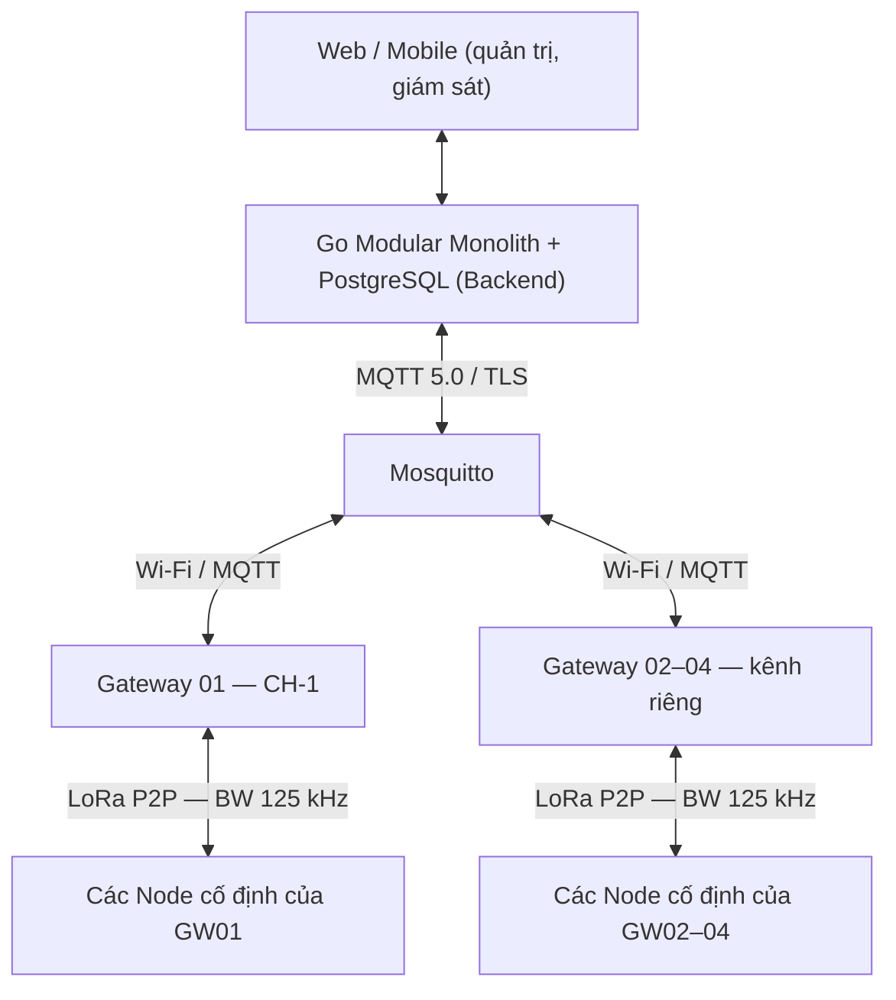

# Kiến trúc hệ thống LoRa P2P Hybrid TDMA — MVP

**Trạng thái:** Kiến trúc C01–C08 và nguyên tắc phạm vi C09 được **Project Owner phê duyệt** (2026-10-30). Chưa xác nhận `G0 PASS` hoặc kết quả đo RF/HIL/Timing/Security; những thông số giao thức cụ thể còn chờ G1–G5. Đây là tài liệu kiến trúc hiện hành, thay các giả định cũ không còn phù hợp.

## 1. Phạm vi và mô hình mạng

- **Multi-Gateway Star, LoRa P2P Custom Binary MAC:** MVP hỗ trợ **1–4 Gateway ESP32 + SX1276**, mỗi Gateway một bộ thu phát bán song công và các Node chỉ liên lạc **một chặng** với Gateway được gán cố định.
- **Kênh vô tuyến:** khi có bốn Gateway, mỗi Gateway sử dụng **một kênh riêng**, **BW 125 kHz**. Node cố định kênh theo Gateway của nó; không có tự động quét kênh, handover hoặc chuyển Gateway. Tần số trung tâm, công suất và điều kiện hợp quy Việt Nam phải được G1 thẩm định.
- **Định danh:** `node_id` 8-bit **duy nhất trong từng Gateway**; định danh logic theo `(gateway_id, node_id)`. Device UID 128-bit chỉ là đề xuất, không coi là quyết định đã duyệt. Định danh logic không thay thế xác thực mật mã.
- **Phạm vi MVP:** tất cả chức năng Owner yêu cầu phải được triển khai và nghiệm thu trong MVP. **Mesh tạm ngoài phạm vi**. Quy mô Node/ mỗi Gateway và toàn mạng còn chờ xác nhận; mô hình 1 Gateway/10–15 Node trong tài liệu cũ chỉ là cấu hình thử nghiệm, **không còn là giới hạn kiến trúc**.

Sơ đồ biểu diễn cấu hình tối đa bốn Gateway; một hệ thống ít Gateway hơn không bắt buộc có đủ bốn kênh đang hoạt động.

## 2. Phân quyền và trách nhiệm

| Thành phần | Trách nhiệm đã chốt |
|---|---|
| **Node** | Đọc cảm biến, phát hiện ngưỡng/cảnh báo tại chỗ, tạo mã sự kiện gốc ổn định qua retry, đồng bộ Beacon và chỉ phát trong cơ hội được cấp phép. **Periodic OFF không tắt cảnh báo**. |
| **Gateway** | TDMA Master cục bộ; kiểm tra danh tính/quyền, lịch, đồng bộ và airtime; lưu Active/Shadow; xử lý RX/TX SX1276 bán song công, ACK và buffer hữu hạn. **Không tự sửa hoặc cấp lại Slot Assignment**. |
| **Backend Go** | Lập kế hoạch và quản lý phiên bản lịch/kênh, quản lý trạng thái cấp quyền, đối soát Gateway, tiếp nhận dữ liệu và chống ghi trùng theo mã sự kiện Node, lưu PostgreSQL. |
| **User có quyền** | Phê duyệt lịch và khoảng thời gian kích hoạt trước khi phân phối; phân quyền được Backend kiểm tra, không chỉ ở giao diện. |
| **Web/Mobile** | Cấu hình, quản trị và hiển thị thông qua REST/WSS của Backend; không truy cập trực tiếp broker/DB. Công nghệ Mobile trong các tài liệu cũ chưa thống nhất (Flutter/Kotlin), cần quyết định riêng trước implementation. |

Dùng **ESP-IDF v6.1** cho Gateway/Node ([ADR-0003](../adr/0003-esp-idf-v6-1.md)), FreeRTOS/C và SX1276; Backend Go Modular Monolith + PostgreSQL, Mosquitto MQTT 5.0/TLS ([ADR-0002](../adr/0002-mqtt-5.md)). **Không sử dụng LoRaWAN MAC, OTAA/ADR/ChirpStack**.

## 3. Lịch TDMA và chuyển lịch (C03–C04)

1. **Backend tạo/phiên bản hóa** lịch. **User duyệt** lịch và khoảng được phép kích hoạt.
2. **Gateway kiểm tra** quyền, phiên bản, hết hạn, xung đột slot, đồng bộ và giới hạn phát. Kế hoạch không an toàn phải bị từ chối hoặc chặn TX; Gateway không thay trường phân bổ slot/kênh của lịch.
3. Gateway **lưu bền vững Shadow** trước khi báo `STAGE_ACK`; phát thông tin lịch mới và thu ACK chuẩn bị của các Node chịu ảnh hưởng. **Không** xem đủ ba Beacon là bằng chứng tất cả Node đã nhận lịch.
4. Gateway chỉ chuyển sang lịch mới tại **ranh giới Superframe bên trong cửa sổ đã duyệt**, khi quyền dùng khe cũ đã kết thúc an toàn. Không chắc chắn thì **không kích hoạt**, tiếp tục Active chỉ khi còn an toàn; nếu không thì dừng TX chịu ảnh hưởng.
5. Gateway phát `ACTIVE_REPORT` **sau khi thực sự kích hoạt**. `MQTT PUBACK` và `STAGE_ACK` không chứng minh lịch ACTIVE. Sau reboot, **không tự nâng Shadow thành Active**.

Gateway điều khiển mốc thời gian RF tại chỗ; Backend **không** kích hoạt TX/RX theo từng slot qua MQTT. Quy trình và phiên bản schema vẫn phải được các nhóm tích hợp kiểm tra tại G2/G4.

## 4. Dữ liệu, cảnh báo và xác nhận (C05/C08)

- **Sự kiện do Node tạo** mã định danh gốc; retry RF, gửi lại MQTT QoS 1, phát lại buffer hoặc reboot **không** tạo thêm một sự kiện nghiệp vụ. Gateway ghi nhận lần thu; Backend thực thi durable deduplication trong PostgreSQL. Định dạng Event ID, quy tắc reset và khóa duy nhất DB chưa chốt.
- Node ở `Periodic OFF` **không gửi telemetry định kỳ**, nhưng tiếp tục phát hiện và gửi Alert nếu quyền truy cập còn hợp lệ.
- Alert dùng **cửa sổ tranh chấp ưu tiên** với backoff hữu hạn; thất bại thì retry qua **cơ hội dự phòng thuộc lịch Backend/User đã duyệt**. Không giành khe DATA của Node khác hoặc tự thay lịch.
- Phải tách rõ **RF ACK**, xác nhận tiếp nhận/lưu bền vững ở Gateway và xác nhận lưu Backend. Không suy `BACKEND_STORED` từ RF ACK/MQTT PUBACK.
- CAD (Channel Activity Detection) không bảo đảm hết va chạm; TX, kể cả Beacon/ACK/Alert/retry, luôn tuân chính sách airtime và điều kiện hợp quy.

## 5. Quyền thiết bị và xử lý lỗi (C07)

- MVP hỗ trợ **tạm ngừng, khôi phục, thu hồi và cấp lại quyền Node**; khác với chế độ Periodic OFF. Backend quản lý quyền, Gateway thực thi và giữ trạng thái qua reboot khi có bằng chứng hợp lệ.
- **Mất Internet:** Gateway chỉ chấp nhận Node có quyền truy cập **còn hiệu lực và có thể xác minh**, **không tự gia hạn**. Nếu mất điều kiện an toàn, dừng nhận dữ liệu ứng dụng từ Node liên quan; các Node khác vẫn có thể hoạt động khi còn đủ điều kiện.
- **Mất đồng bộ/lịch hoặc phiên quyền không đáng tin:** không phát ứng dụng theo slot cũ. Active có thể chạy offline chỉ khi an toàn; buffer bị giới hạn và có xử lý tràn, không hứa lưu vô hạn.
- **Thu hồi quyền ≠ tái phân bổ khe:** quyền truy cập và Slot Lease tách biệt; khe chỉ được tái sử dụng theo chuyển lịch C04 an toàn. Node đã thu hồi không được tự tham gia lại bằng quyền cũ.
- CRC không phải xác thực mật mã. RF data/control cần xác thực và chống replay; chính sách khóa/nonce, thời hạn quyền và thời gian khôi phục còn chờ thiết kế G2/G3/G5.

## 6. Ranh giới chưa được khóa ở mức byte/thông số

| Miền | Điều kiện trước khi triển khai/đánh dấu đạt |
|---|---|
| **G1 — RF/Hardware** | Kênh trung tâm, SF/CR, công suất/antenna, airtime/ToA và áp dụng quy định Việt Nam: **OPEN / NOT_VERIFIED**. |
| **G2 — Protocol/Security** | Byte layout, event identity, epochs/versions, cipher/MIC/nonce/key lifecycle, frame authentication, ACK và codec golden vectors: **OPEN / NOT_VERIFIED**. |
| **G3 — Embedded/Timing** | Superframe/slot/guard, clock drift, ISR latency, queue/retry budgets, lease validity và reboot recovery: **OPEN / NOT_VERIFIED**. |
| **G4–G6 — Integration/Security/Pilot** | MQTT/API/DB contracts, migrations, Web/Mobile chức năng cụ thể, kiểm thử nhiều Node/Gateway, fault injection, thực địa: **chưa nghiệm thu**. |

Lịch mẫu `P-10S-15`, giá trị SLA/độ trễ và ví dụ tần số/duty trong tài liệu nháp **không phải thông số hoặc kết quả đo đã duyệt**. G0 chốt hướng kiến trúc, **chưa xác nhận danh mục chức năng đầy đủ hoặc Gate PASS**.

**Tài liệu liên quan:** [Requirements/RTM](../requirements/requirements.md) · [ADR-0001](../adr/0001-hybrid-tdma.md) · [Hợp đồng Radio MAC nháp](../../contracts/radio-mac/specification.md) · [Hợp đồng MQTT nháp](../../contracts/mqtt/semantic-rules.md) · [Acceptance Gates](../verification/acceptance-gates.md).
