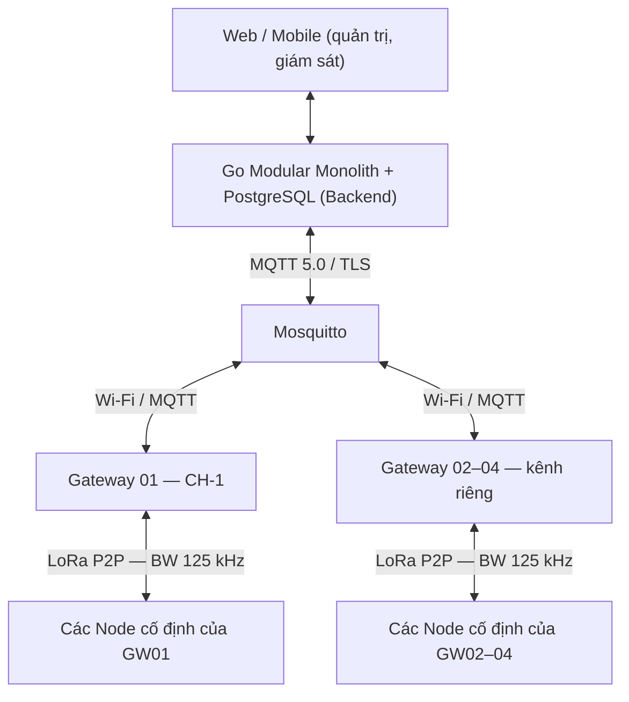

# Kiến trúc hệ thống LoRa P2P Hybrid TDMA — MVP

**Trạng thái:** `OWNER_APPROVED_DESIGN_DIRECTION`, 2026-11-04, [Issue #125](https://github.com/khanhpn308/LoRa-P2P-Hybrid-TDMA-MVP/issues/125), tài liệu trong [#126](https://github.com/khanhpn308/LoRa-P2P-Hybrid-TDMA-MVP/issues/126). Hướng hiện hành là **Local Alarm + Event-Only Remote Logging + Static TDMA + Maintenance Superframe**. Giữ các quyết định C01–C09 ngày 2026-10-30 không mâu thuẫn; các phần bị thay thế có lịch sử ở §7. Implementation, wire compatibility, RF/HIL/Timing/Security/CI và G0–G6 vẫn `NOT_VERIFIED`; phê duyệt hướng không đóng băng thông số giao thức.

## 1. Phạm vi và mô hình mạng

- **Multi-Gateway Star, LoRa P2P Custom Binary MAC:** MVP hỗ trợ **1–4 Gateway ESP32 + SX1276**, mỗi Gateway một bộ thu phát bán song công và các Node chỉ liên lạc **một chặng** với Gateway được gán cố định.
- **Kênh vô tuyến:** khi có bốn Gateway, mỗi Gateway sử dụng **một kênh riêng**, **BW 125 kHz**. Node cố định kênh theo Gateway của nó; không có tự động quét kênh, handover hoặc chuyển Gateway. Tần số trung tâm, công suất và điều kiện hợp quy Việt Nam phải được G1 thẩm định.
- **Định danh:** `node_id` 8-bit **duy nhất trong từng Gateway**; định danh logic theo `(gateway_id, node_id)`. Device UID 128-bit chỉ là đề xuất, không coi là quyết định đã duyệt. Định danh logic không thay thế xác thực mật mã.
- **Phạm vi MVP:** tất cả chức năng Owner yêu cầu phải được triển khai và nghiệm thu trong MVP. **Mesh tạm ngoài phạm vi**. Quy mô Node/ mỗi Gateway và toàn mạng còn chờ xác nhận; mô hình 1 Gateway/10–15 Node trong tài liệu cũ chỉ là cấu hình thử nghiệm, **không còn là giới hạn kiến trúc**.

Sơ đồ biểu diễn cấu hình tối đa bốn Gateway; một hệ thống ít Gateway hơn không bắt buộc có đủ bốn kênh đang hoạt động.

## 2. Phân quyền và trách nhiệm

| Thành phần | Trách nhiệm đã chốt |
|---|---|
| **Node** | Đọc cảm biến, phát hiện vi phạm và kích hoạt local alarm độc lập với RF; ghi Event vào persistent bounded FIFO, chỉ truyền Event đang chờ trong DATA slot được duyệt; nhận ACK trong slot và trả HEALTH_REPLY theo lịch Maintenance. |
| **Gateway** | TDMA Master cục bộ; kiểm tra danh tính/quyền, lịch, đồng bộ và airtime; lưu Active/Shadow; xử lý RX/TX SX1276 bán song công; persist Event trước ACK, giữ buffer hữu hạn và **cấp Event ID bền vững** khi nhận gói RF mới. **Không tự sửa hoặc cấp lại Slot Assignment**. |
| **Backend Go** | Lập kế hoạch và quản lý phiên bản lịch/kênh, quản lý trạng thái cấp quyền, đối soát Gateway, tiếp nhận dữ liệu và chống ghi trùng theo Event ID do Gateway cấp, lưu PostgreSQL. |
| **User có quyền** | Phê duyệt lịch và khoảng thời gian kích hoạt trước khi phân phối; phân quyền được Backend kiểm tra, không chỉ ở giao diện. |
| **Web/Mobile** | Cấu hình, quản trị và hiển thị thông qua REST/WSS của Backend; không truy cập trực tiếp broker/DB. Công nghệ presentation đã được chốt theo Quyết định Owner #111 / PR #112: Web dùng **Next.js + TypeScript**, Mobile dùng **Kotlin native Android**. Các tài liệu cũ nhắc đến Flutter là doc drift lịch sử, không dùng làm căn cứ triển khai. |

Dùng **ESP-IDF v6.1** cho Gateway/Node ([ADR-0003](../adr/0003-esp-idf-v6-1.md)), FreeRTOS/C và SX1276; Backend Go Modular Monolith + PostgreSQL, Mosquitto MQTT 5.0/TLS ([ADR-0002](../adr/0002-mqtt-5.md)). **Không sử dụng LoRaWAN MAC, OTAA/ADR/ChirpStack**.

## 3. Lịch TDMA và chuyển lịch (C03–C04)

1. **Backend tạo/phiên bản hóa** lịch. **User duyệt** lịch và khoảng được phép kích hoạt.
2. **Gateway kiểm tra** quyền, phiên bản, hết hạn, xung đột slot, đồng bộ và giới hạn phát. Kế hoạch không an toàn phải bị từ chối hoặc chặn TX; Gateway không thay trường phân bổ slot/kênh của lịch.
3. Gateway **lưu bền vững Shadow** trước khi báo `STAGE_ACK`. Quá trình chuyển lịch V2 bãi bỏ countdown 3→2→1 (theo Quyết định Owner #208 / PR #206), thực hiện giao dịch trong một Maintenance Superframe: Backend ký `DOWN_SCHED_PREPARE` (80B) $\to$ từng Node gửi `UP_SCHED_READY` (0x4C, 41B) $\to$ Backend xác minh độc lập 100% READY của mọi Node bị ảnh hưởng (kể cả Node offline) $\to$ Backend ký `DOWN_SCHED_DECISION` (80B) COMMIT tại $K_{\text{TARGET}}$. Node lỡ mất COMMIT phải tự động khóa câm phát sóng (`DATA_TX_DISABLED`) từ $K_{\text{TARGET}}$ để triệt tiêu xung đột khe.
4. Gateway chỉ chuyển sang lịch mới tại **ranh giới Superframe $K_{\text{TARGET}}$ bên trong cửa sổ đã duyệt**, khi quyền dùng khe cũ đã kết thúc an toàn. Không chắc chắn thì **không kích hoạt**, tiếp tục Active chỉ khi còn an toàn; nếu không thì dừng TX chịu ảnh hưởng.
5. Gateway phát `ACTIVE_REPORT` **sau khi thực sự kích hoạt**. `MQTT PUBACK` và `STAGE_ACK` không chứng minh lịch ACTIVE. Sau reboot, **không tự nâng Shadow thành Active**.

Gateway điều khiển mốc thời gian RF tại chỗ; Backend **không** kích hoạt TX/RX theo từng slot qua MQTT. Quy trình và phiên bản schema vẫn phải được các nhóm tích hợp kiểm tra tại G2/G4.

DATA Superframe chứa các DATA slot tĩnh theo Node. Maintenance Superframe được chèn giữa các DATA Superframe theo lịch Backend/User duyệt, với **mục tiêu heartbeat/sync 300 s**. Gateway phát authenticated `SYNC_BEACON`; mỗi Node trả `HEALTH_REPLY` trong khe quản trị riêng không chồng lấn. Gateway-only Beacon không chứng minh Node alive; chỉ phản hồi Node hợp lệ mới cung cấp bằng chứng hiện diện. Cách tính `last_seen`, ngưỡng offline, thời điểm đo interval và dung sai còn OPEN.

Validator phải xét toàn bộ DATA/ACK, SYNC_BEACON/HEALTH_REPLY, schedule/control, JOIN/RECOVERY và guard trên một radio half-duplex, kể cả qua ranh giới Superframe. Khoảng 300 s là target thiết kế; ToA SX1276, RX↔TX turnaround, jitter, clock drift/guard và HOLDOVER/UNSYNCED phải được tính và đo trước timing acceptance. Bãi bỏ countdown 3→2→1 (theo Quyết định Owner #208 / PR #206); việc chuyển lịch chỉ được kích hoạt tại $K_{\text{TARGET}}$ khi đã xác minh 100% READY của các Node bị ảnh hưởng.

## 4. Dữ liệu, cảnh báo và xác nhận (C05/C08)

- **Gateway tạo và persist Event ID gốc** sau khi xác thực/tiếp nhận frame RF mới; Node không truyền Event ID. Retry RF, MQTT QoS 1 replay, phát lại buffer hoặc reboot **không** tạo thêm một sự kiện nghiệp vụ: Gateway phải giữ ánh xạ `(gateway_id,node_id,security_session,frame_counter) → event_id` bền vững; Backend dedup theo `(gateway_id,event_id)` và phát hiện payload conflict. Định dạng Event ID, bảo vệ counter/nonce và khóa duy nhất DB còn G2/G4 OPEN.
- Node kích hoạt local alarm ngay khi phát hiện vi phạm, độc lập với kết nối/quyền truyền RF. Event được ghi vào persistent bounded FIFO; không có Event thì không phát application data. Maintenance/control theo lịch vẫn được phép khi đủ quyền và điều kiện an toàn.
- Node chỉ phát Event trong DATA slot tĩnh đã duyệt: `Event TX → ACK RX`; Gateway thực hiện `Event RX → durable acceptance → ACK TX` trong cùng slot. Không dùng Node broadcast để chặn mạng hoặc contention để giành khe.
- Không nhận ACK hợp lệ thì giữ **cùng Event**, retry tại slot hợp lệ kế tiếp của chính Node; không chiếm slot Node khác. Retry budget hữu hạn nhưng số lần/policy còn OPEN; hết budget vẫn giữ durable pending để recovery. Queue capacity, overflow/drop observability, retention và cách phục hồi phải được duyệt, không hứa lưu vô hạn.
- ACK chỉ xác nhận **Gateway durable acceptance**. Gateway idempotently ACK bản lặp đã tiếp nhận bền vững; ACK mất không được tạo thêm logical Event. Không suy Backend DB commit từ ACK hoặc MQTT PUBACK, không hứa exactly-once delivery.
- Gateway-origin Event ID/G06 vẫn giữ nguyên. Node FIFO phải giữ được cùng Event qua reboot/retry, nhưng identity/counter binding giữa FIFO và frame security context còn cần **versioned G2 compatibility review**; tài liệu này không thêm Node-origin Event ID, không tự chọn nonce/counter hoặc wire payload.
- Mọi TX, kể cả SYNC_BEACON, HEALTH_REPLY, Event, ACK, Join/Recovery và retry, đều qua airtime admission và điều kiện hợp quy. Độ trễ ghi nhận từ xa phụ thuộc TDMA/retry, khác với local alarm tại chỗ.

## 5. Quyền thiết bị và xử lý lỗi (C07)

- MVP hỗ trợ **tạm ngừng, khôi phục, thu hồi và cấp lại quyền Node**. Backend quản lý quyền RF, Gateway thực thi và giữ trạng thái qua reboot khi có bằng chứng hợp lệ; local alarm độc lập với quyền truyền.
- **Mất Internet:** Gateway chỉ chấp nhận Node có quyền truy cập **còn hiệu lực và có thể xác minh**, **không tự gia hạn**. Nếu mất điều kiện an toàn, dừng nhận dữ liệu ứng dụng từ Node liên quan; các Node khác vẫn có thể hoạt động khi còn đủ điều kiện.
- **Mất đồng bộ/lịch hoặc phiên quyền không đáng tin:** không phát ứng dụng theo slot cũ. Active có thể chạy offline chỉ khi an toàn; buffer bị giới hạn và có xử lý tràn, không hứa lưu vô hạn.
- **Thu hồi quyền ≠ tái phân bổ khe:** quyền truy cập và Slot Lease tách biệt; khe chỉ được tái sử dụng theo chuyển lịch C04 an toàn. Node đã thu hồi không được tự tham gia lại bằng quyền cũ.
- CRC không phải xác thực mật mã. RF data/control cần xác thực và chống replay; chính sách khóa/nonce, thời hạn quyền và thời gian khôi phục còn chờ thiết kế G2/G3/G5.

## 6. Ranh giới chưa được khóa ở mức byte/thông số

| Miền | Điều kiện trước khi triển khai/đánh dấu đạt |
|---|---|
| **G1 — RF/Hardware** | Kênh trung tâm, SF/CR, công suất/antenna, airtime/ToA và áp dụng quy định Việt Nam: **OPEN / NOT_VERIFIED**. |
| **G2 — Protocol/Security** | Giữ Gateway-origin Event ID; Node FIFO↔RF identity qua reboot/retry, UP_ALERT payload, Event ACK và UP_HEALTH_REPLY codepoint, Beacon/HMAC compatibility, epochs/versions, nonce/key lifecycle và golden vectors: **OPEN / NOT_VERIFIED**. |
| **G3 — Embedded/Timing** | DATA/Maintenance slot/guard, ToA/turnaround, clock drift qua mục tiêu 300 s, ISR latency, FIFO/retry budgets, holdover/offline thresholds, lease validity và reboot recovery: **OPEN / NOT_VERIFIED**. |
| **G4–G6 — Integration/Security/Pilot** | MQTT/API/DB contracts, migrations, Web/Mobile chức năng cụ thể, kiểm thử nhiều Node/Gateway, fault injection, thực địa: **chưa nghiệm thu**. |

Giá trị SLA/độ trễ và ví dụ tần số/duty trong tài liệu nháp không phải thông số hoặc kết quả đo đã duyệt. G0 chốt hướng kiến trúc, chưa xác nhận danh mục chức năng đầy đủ hoặc Gate PASS.

## 7. Lịch sử thay thế và phạm vi migration

Quyết định ngày 2026-11-04 trong #125 thay các phần sau ở tầng kiến trúc ứng dụng/MAC. Giữ lịch sử approval ngày 2026-10-30 để truy vết; bảng này không cấp approval cho wire mới.

| Quy tắc cũ / provenance | Disposition hiện hành |
|---|---|
| #77 optional periodic; `UP_TELEMETRY`, `TEMP_X10`, `uplink/telemetry` làm luồng nghiệp vụ mặc định | **SUPERSEDED_BY_EVENT_ONLY**; không còn application telemetry định kỳ. Topic/schema phải migration có version, không âm thầm tái dùng packet `0x26`. |
| `Periodic ON/OFF`, `SET_PERIODIC_MODE` và UI periodic controls | **SUPERSEDED**; không còn business operating mode. Cần migration MQTT/API/UI cùng examples/tests. |
| C08 / #78: Alert CAP/PCSS/priority contention, CAD/backoff làm đường Event thông thường | **SUPERSEDED_BY_STATIC_TDMA**; local alarm, quyền, airtime và các điều kiện an toàn vẫn giữ. |
| CT-01-ACK-01: Beacon `ACK_BITMAP` 16-bit/2B cho Telemetry, Beacon N+1 ACK kỳ N, không ACK Telemetry riêng | **SUPERSEDED semantics / NOT_APPLICABLE_TO_EVENT_ACK**. Lịch sử Owner approval giữ nguyên; không xóa/đổi trường, offset, HMAC transcript hoặc tái dùng `0x21` của Beacon 28B trước G2 compatibility review. |
| Beacon ở mỗi DATA SF với ACK bitmap nghiệp vụ; `P-10S-15`, 5 subframes/400 ms slots/PCSS | **OBSOLETE candidate** cho kiến trúc mới; phải suy timeline DATA/Maintenance từ ToA và phép đo. Schedule countdown/recovery safety vẫn giữ. |

Child #126 chỉ sửa kiến trúc/RTM/ADR trong năm tệp được phép, nối tiếp PR #116. Các active contract/schema/example/test còn mang thiết kế cũ phải được inventory và xử lý trong các child G2/G4/implementation của #125. Tài liệu này **không tuyên bố toàn repository đã migration**, cũng không thay approval của registry/Beacon auth/Join contracts.

**Tài liệu liên quan:** [Requirements/RTM](../requirements/requirements.md) · [ADR-0001](../adr/0001-hybrid-tdma.md) · [Hợp đồng Radio MAC nháp](../../contracts/radio-mac/specification.md) · [Hợp đồng MQTT nháp](../../contracts/mqtt/semantic-rules.md) · [Acceptance Gates](../verification/acceptance-gates.md).
