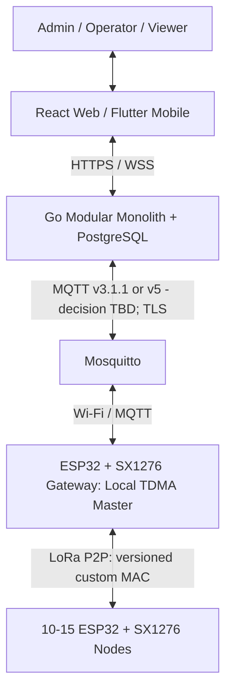

# System Architecture — Baseline 1.1 (DRAFT)

Status: DESIGN-READY FOR FEASIBILITY, **NOT RF CERTIFIED / NOT PERFORMANCE VERIFIED**.
Source of design intent: the team's Hybrid TDMA architecture; detailed numeric claims in the planning draft are hypotheses to test, not accepted baselines.

## Boundary and roles

The **Backend Go** plans future versioned schedules, APIs, alerts and records; it never sends individual slot start/stop commands.
The **Gateway** validates, stages, announces and activates a schedule at a safe superframe boundary. It independently controls half-duplex RF, beacon, ACK, local airtime enforcement and fallback schedule during Wi-Fi/MQTT failure.
The **Nodes** measure sensors, detect local alarms, synchronize to beacons, obey owned slots, and use a separately designed bounded priority-access mechanism.

## Five logical layers

1. Edge & RF: ESP-IDF/C, FreeRTOS, SX1276, custom LoRa P2P MAC and TDMA.
2. Transport: Wi-Fi/IP, Mosquitto MQTT secured with TLS/ACL outside a restricted local dev environment.
3. Application & data: Go modular monolith, PostgreSQL; Redis/InfluxDB not in initial scope.
4. Presentation: React/TypeScript initial target; Flutter mobile optional later.
5. Identity & governance: authn, server-side RBAC, audit and operational controls.

## Engineering invariants

- Single SX1276 transceiver is half-duplex; no simultaneous GW TX and RX.
- No blocking Wi-Fi/MQTT calls or SPI operations inside radio ISR.
- Backend schedules are **plans**; Gateway/Node execute local timing.
- A schedule is never activated mid-superframe. Missed announcements, resets and version wrap must fail safely.
- Every transmission obeys local airtime restrictions, including beacons, acknowledgments and retransmissions.
- LoRa P2P is **not LoRaWAN**, no ChirpStack, OTAA, Class A, LoRaWAN FPort or LoRaWAN FUOTA.
- CRC detects accidental corruption, not malicious modification. RF command authentication/anti-replay is mandatory design work before deploying outside controlled tests.

## Unverified design inputs (no hardcoded guarantees)

SF/BW/CR and frequency/channel, power/ERP/antenna, PHY payload sizes, 8-byte header, superframe 10 s, three 400 ms data slots per subframe, beacon 10 s, synchronization jitter +/-10 us, 1%/10% treatment and <3 s end-to-end alert are **TBD or targets** pending RF-regulatory and HIL evidence. Validate applicability of local 920–923 MHz LPWAN conditions based on actual device classifications.

## Review dependencies

See `docs/requirements/requirements.md`, `docs/verification/acceptance-gates.md`, `contracts/` and ADRs. Edits to a contract require Gateway, Node and/or Backend owners to review.
