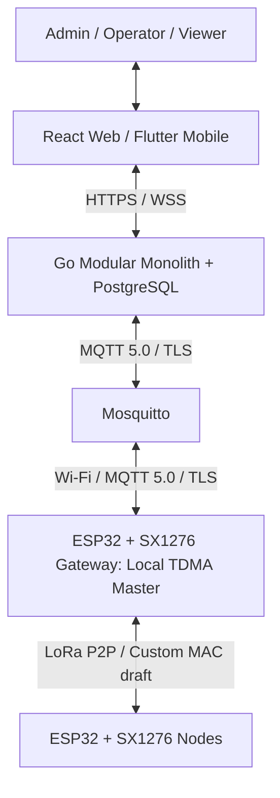

# Kiến trúc hệ thống, baseline R1

Status: `DRAFT / DESIGN-READY FOR FEASIBILITY`. RF, timing và HIL: `NOT_VERIFIED`. Remediation [#60](https://github.com/khanhpn308/LoRa-P2P-Hybrid-TDMA-MVP/issues/60) không chứng minh implementation. Firmware vẫn là scaffold theo [AGENTS.md](../../AGENTS.md).

## Quyết định và phạm vi

[ADR-0001](../adr/0001-hybrid-tdma.md) giữ hướng Gateway-local Hybrid TDMA với Custom LoRa P2P MAC. [ADR-0002](../adr/0002-mqtt-5.md) chọn MQTT 5.0 ở mức `OWNER_ACCEPTED`; cross-team review còn `PENDING`, implementation `NOT_VERIFIED`. [ADR-0003](../adr/0003-esp-idf-v6-1.md) ghi owner approval cho exact ESP-IDF `v6.1`, pin tại [esp-idf-version.txt](../../firmware/esp-idf-version.txt). Các approval này không phê duyệt toàn bộ system design.

Nguồn sơ đồ: ADR-0001/0002, [deployment contexts](deployment.md), [contract index](../../contracts/README.md). Quy mô thử nghiệm trong planning không phải capacity đã nghiệm thu; xem MAC-001 và ALERT-001 trong [RTM](../requirements/requirements.md#rtm).

## Ranh giới trách nhiệm

| Thành phần | Control plane | Data plane và recovery | Nguồn / RTM |
|---|---|---|---|
| Backend Go | Planner tạo, lưu, quản lý version/review của lịch tương lai; không bật/tắt TX/RX từng slot | Validate MQTT, dedup, lưu PostgreSQL; REST/WSS và reconcile sau reconnect | ADR-0001/0002; [MQTT semantics §§2–4](../../contracts/mqtt/semantic-rules.md); SYS-001, DATA-001, MAC-003 |
| Gateway | Executor validate, persist shadow, quảng bá và chọn local activation boundary | Single-radio half-duplex, Beacon/ACK, local airtime; tiếp tục active schedule còn an toàn khi mất backhaul; bounded buffer | [TDMA §§2–3](../../contracts/radio-mac/tdma-schedule.md); MAC-003/005/006, SYS-001/002 |
| Node | Xác thực Beacon/session/mapping; chỉ dùng slot/cửa sổ ưu tiên được phép | Đọc sensor, phát hiện alarm cục bộ, sync/holdover có điều kiện; ngừng periodic TX nếu không còn an toàn | [Radio MAC §§1/3/4](../../contracts/radio-mac/specification.md); MAC-002/004/007, SEC-001 |
| Mosquitto | Xác thực principal, topic ACL, session/expiry | QoS 1 vận chuyển; PUBACK không chứng minh DB commit hay Node execution | [topics §§1–4](../../contracts/mqtt/topics.md); SEC-002, DATA-001/002 |
| React / Flutter | Gửi yêu cầu qua Backend có server-side RBAC | Hiển thị, dedup và REST resync khi WSS mất continuity; không truy cập MQTT/DB trực tiếp | [API semantics](../../contracts/api/contract-semantics.md); INT-002 |

Đây là decomposition logic, không áp đặt tên task, core affinity hoặc stack/queue size từ planning. Firmware tách driver, MAC, TDMA và airtime policy theo [C Standard v2](../development/firmware/C_CODING_STANDARD_V2.md) (consultative Draft). Backend giữ modular monolith + PostgreSQL, không thêm Redis/InfluxDB/microservices theo ADR-0001 và AGENTS.md.

## Bất biến và giới hạn an toàn

- Gateway là local TDMA Master; MQTT không phải clock từng slot. Không activate giữa superframe. `STAGE_ACK` khác `ACTIVE_REPORT`; Backend kiểm actual report trước ACTIVE. Nguồn: ADR-0001, MQTT semantics §4; MAC-003.
- Một radio không TX/RX đồng thời. Single Radio Owner tuần tự hóa SPI/modem; ISR/timer chỉ timestamp và notify có giới hạn, không SPI hoặc blocking network. Nguồn: AGENTS.md, C Standard v2 (consultative Draft), Radio MAC §4; FW-002/003, MAC-005.
- Mọi TX gồm Beacon, ACK, retry, join và alarm đều qua local airtime admission. Profile/policy chưa được xác minh không tạo quyền TX. Nguồn: Radio MAC §4, [D03](../../contracts/OPEN_DECISIONS.md); RF-001, MAC-006.
- CRC không xác thực mật mã. TLS/MQTT identity không thay RF authentication, nonce uniqueness hoặc anti-replay. Không production codec trước security/wire approval. Nguồn: Radio MAC §§2–3, D01/D11; SEC-001/003/004.
- Backhaul mất không vô hiệu hóa local safety. Active chỉ tiếp tục nếu còn hợp lệ; shadow không tự activate sau reboot. Proposal `expires_at` không tự trở thành lease của active schedule. Nguồn: TDMA §3, MQTT semantics §4; SYS-001/002.

## Tham số chưa được nghiệm thu

| Miền | Trạng thái và hành động cần có theo nguồn |
|---|---|
| Frequency, SF/BW/CR, power/ERP, antenna, duty treatment | D03 `BLOCKED G1`; RF/Hardware xác minh silicon, front-end, board revision và điều kiện pháp lý cho thiết bị/kịch bản trước TX. Nhãn module không là approval. |
| Header, endianness, cipher/tag, nonce/session/key lifecycle | D01/D11 `BLOCKED G2`; Node/Gateway/Security/Backend review và golden C↔Go vectors trước freeze. |
| Superframe/slot/guard, IRQ jitter, drift, holdover/recovery threshold | D02/D04/D05 `CANDIDATE / NOT_VERIFIED`; đo riêng ToA RF, command-to-IRQ, IRQ-to-task và clock drift; owner chọn margin sau HIL. |
| Alarm latency | Research target, chưa là SLA; xác định endpoints, concurrent alarms, RF load và phân phối đo. Không gán hard real-time guarantee cho mobile push. |
| GPIO, task/core priorities, stack/queue sizes | Không kế thừa demo. Board mapping cần G1; resource budgets cần review và stress/HIL evidence. |

Nguồn: [OPEN_DECISIONS](../../contracts/OPEN_DECISIONS.md), [G1–G6](../verification/acceptance-gates.md), [Issue #11](https://github.com/khanhpn308/LoRa-P2P-Hybrid-TDMA-MVP/issues/11), [vector plan](../../contracts/radio-mac/test-vectors/README.md), C Standard v2 (consultative Draft). Profile `P-10S-15` và numeric examples trong TDMA §1 chỉ là candidate mock/simulation, không là production baseline. R1 không sửa contracts hoặc chốt tham số.

## Truy vết và nghiệm thu

Xem [RTM](../requirements/requirements.md#rtm), [interface ownership](interfaces.md), [ADR register](../adr/README.md), [contract verification](../../contracts/verification.md), [audit R1](../development/firmware/ARCHITECTURE_DOCUMENTATION_AUDIT.md). Theo acceptance gates và AGENTS.md, design approval độc lập với verification; syntax/schema/build/simulation không thay HIL/RF/security evidence. Closed Issue hoặc tài liệu tồn tại không đủ để gán PASS.
