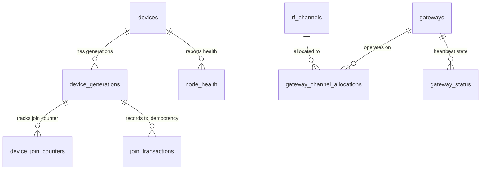

# Hướng Dẫn Thao Tác PostgreSQL — LoRa P2P Hybrid TDMA MVP

Tài liệu này cung cấp hướng dẫn toàn diện dành cho kỹ sư và lập trình viên khi thao tác, kiểm tra, vận hành và quản lý cơ sở dữ liệu **PostgreSQL** trong môi trường phát triển cục bộ (Local Development) và Docker của dự án.

---

## 1. Thông tin cấu hình CSDL

| Thông số | Giá trị mặc định trong Compose | Ghi chú |
| :--- | :--- | :--- |
| **DBMS Engine** | PostgreSQL 16 Alpine | Container: `deploy-postgres-1` |
| **Database Name** | `lora_tdma` | Cấu hình qua `POSTGRES_DB` trong file `.env` |
| **Database User** | `lora_local` | Cấu hình qua `POSTGRES_USER` trong file `.env` |
| **Port kết nối Host**| `127.0.0.1:5432` | Chỉ bind loopback trên máy phát triển |
| **Volume lưu trữ** | `pg_data` (Docker volume) | Dữ liệu bền vững qua các lần restart |
| **Migrations Path** | [`backend-go/migrations/`](../../backend-go/migrations/) | Quản lý bằng `golang-migrate` |

---

## 2. Cách kết nối vào CSDL từ Terminal

### 2.1. Mở cửa sổ tương tác (Interactive psql) qua Docker (Khuyên dùng)
Chạy lệnh sau trên Terminal máy host:
```bash
docker exec -it deploy-postgres-1 psql -U lora_local -d lora_tdma
```
Sau khi kết nối thành công, dấu nhắc lệnh chuyển thành `lora_tdma=#`. Bạn có thể gõ các câu lệnh SQL hoặc lệnh meta của `psql`.

### 2.2. Chạy câu lệnh SQL trực tiếp từ Terminal (1-liner, không cần vào shell)
Dùng tùy chọn `-c "<câu_lệnh_SQL>"`:
```bash
# Ví dụ: Liệt kê số lượng bản ghi trong bảng device_generations
docker exec -it deploy-postgres-1 psql -U lora_local -d lora_tdma -c "SELECT count(*) FROM device_generations;"
```

### 2.3. Kết nối từ máy Host bằng `psql` (nếu đã cài Postgres client)
```bash
psql -h 127.0.0.1 -p 5432 -U lora_local -d lora_tdma
```
*(Nhập `POSTGRES_PASSWORD` cấu hình trong `.env` khi được yêu cầu).*

### 2.4. Kết nối qua công cụ GUI (DBeaver, TablePlus, pgAdmin, DataGrip)
* **Host:** `127.0.0.1` (hoặc `localhost`)
* **Port:** `5432`
* **Database:** `lora_tdma`
* **Username:** `lora_local`
* **Password:** Giá trị `POSTGRES_PASSWORD` trong `.env`
* **SSL Mode:** `disable`

---

## 3. Bản đồ các bảng trong CSDL (Database Schema)

Hệ thống hiện tại gồm 14 bảng quan hệ được chia thành 5 nhóm nghiệp vụ chính:



### 3.1. Nhóm Quản lý thiết bị & Khóa bảo mật
* **`devices`**: Quản lý định danh thiết bị Node (`network_id`, `device_mac BYTEA`, `status`).
* **`device_generations`**: Lưu thế hệ khóa của thiết bị và khóa **$K_{join}$** (`k_join_wrapped BYTEA`, `generation`, `is_active`). Khóa được bọc bằng AES Key Wrap trước khi lưu.
* **`device_join_counters`**: Theo dõi bộ đếm tham gia mạng đơn điệu (`last_join_counter`) chống replay attack.
* **`join_transactions`**: Lưu log giao dịch cấp phát session key (outbox & idempotency).

> [!IMPORTANT]
> **Ràng buộc khóa ngoại (Foreign Keys):**
> * `device_generations` trỏ về `devices(network_id, device_mac)` với `ON DELETE CASCADE`.
> * `device_join_counters` và `join_transactions` trỏ về `device_generations` với `ON DELETE CASCADE`.
> * Khi xóa dữ liệu ở bảng cha, dữ liệu ở các bảng con sẽ tự động được dọn dẹp sạch sẽ.

### 3.2. Nhóm Yêu cầu gia nhập mạng (Join Requests Flow)
* **`device_join_requests`**: Bảng lưu lịch sử và hàng đợi các yêu cầu join từ Node (`device_mac`, `gateway_id`, `rssi`, `snr`, `status` IN `PENDING`, `APPROVED`, `REJECTED`). Bảng này phục vụ màn hình duyệt Node trên Web Dashboard.

### 3.3. Nhóm Gateway & Kênh RF
* **`gateways`**: Danh mục các Gateway trong hệ thống (`gateway_id`, `name`, `location`).
* **`gateway_status`**: Trạng thái kết nối thời gian thực của Gateway.
* **`rf_channels`**: Danh mục tần số, băng thông và tham số RF.
* **`gateway_channel_allocations`**: Phân bổ kênh RF cho từng Gateway.

### 3.4. Nhóm Dữ liệu sự kiện & Giám sát
* **`events`**: Nhật ký sự kiện đo đạc cảm biến và trạng thái gửi từ Node.
* **`event_quarantine`**: Vùng cách ly cho các gói tin hỏng, sai chữ ký HMAC hoặc lỗi giải mã.
* **`node_health`**: Chỉ số pin (`battery_mv`), RSSI/SNR và trạng thái hoạt động của Node.

### 3.5. Nhóm Hệ thống & Xác thực
* **`users`**: Tài khoản quản trị, vai trò RBAC (`ADMIN`, `OPERATOR`, `VIEWER`), password hash Argon2/Bcrypt.
* **`schema_migrations`**: Bảng do `golang-migrate` tự động quản lý để theo dõi phiên bản migration.

---

## 4. Truy vấn thường dùng khi Debug & Kiểm thử

Khi làm việc với các trường nhị phân như `BYTEA` (`device_mac`, `k_join_wrapped`), cần dùng hàm `encode(..., 'hex')` để hiển thị chuỗi HEX dễ đọc:

### 4.1. Xem danh sách thiết bị và khóa $K_{join}$
```sql
SELECT 
    network_id, 
    encode(device_mac, 'hex') AS mac_address, 
    generation, 
    encode(k_join_wrapped, 'hex') AS k_join_wrapped_hex, 
    is_active, 
    created_at 
FROM device_generations 
ORDER BY created_at DESC;
```

### 4.2. Xem các yêu cầu gia nhập mạng (Join Requests) mới nhất
```sql
SELECT 
    id, 
    device_mac, 
    gateway_id, 
    rssi, 
    snr, 
    status, 
    assigned_node_id, 
    created_at 
FROM device_join_requests 
ORDER BY created_at DESC 
LIMIT 10;
```

### 4.3. Kiểm tra số lượng dòng hiện có của tất cả các bảng
```sql
SELECT 
    table_name,
    (xpath('/row/cnt/text()', xml_count))[1]::text::int AS row_count
FROM (
    SELECT 
        table_name, 
        query_to_xml(format('SELECT count(*) AS cnt FROM %I', table_name), false, true, '') AS xml_count
    FROM information_schema.tables
    WHERE table_schema = 'public' AND table_type = 'BASE TABLE'
) sub
ORDER BY table_name;
```

### 4.4. Xem phiên bản Migration hiện tại
```sql
SELECT * FROM schema_migrations;
```

---

## 5. Quy trình Xóa trắng dữ liệu (Data Reset & Cleanup)

Trong quá trình test tính năng Join, Cấp phát thiết bị hoặc kiểm thử tải, việc xóa trắng bảng để chạy lại kịch bản là thao tác phổ biến:

### 5.1. Xóa toàn bộ dữ liệu $K_{join}$ và bộ đếm Join (Giữ nguyên danh sách Devices)
```sql
TRUNCATE TABLE device_generations CASCADE;
```
* **Kết quả:** Xóa trắng `device_generations`, đồng thời tự động cascade xóa sạch `device_join_counters` và `join_transactions`.

### 5.2. Xóa toàn bộ thiết bị Node (Reset sạch Device Registry)
```sql
TRUNCATE TABLE devices CASCADE;
```
* **Kết quả:** Xóa trắng toàn bộ Node trong bảng `devices`. Mọi thông tin phụ thuộc (`device_generations`, `device_join_counters`, `join_transactions`) bị xóa theo.

### 5.3. Xóa trắng danh sách yêu cầu tham gia mạng (Join Requests) và reset ID về 1
```sql
TRUNCATE TABLE device_join_requests RESTART IDENTITY;
```

### 5.4. Xóa trắng toàn bộ lịch sử sự kiện & đo đạc
```sql
TRUNCATE TABLE events, event_quarantine RESTART IDENTITY;
```

### 5.5. Script dọn dẹp toàn bộ dữ liệu động (Clean Test State)
Chạy trực tiếp từ Terminal để đưa database về trạng thái sạch ban đầu nhưng **vẫn giữ lại cấu hình cơ bản** (`rf_channels`, `gateways`, `users`, `schema_migrations`):

```bash
docker exec -it deploy-postgres-1 psql -U lora_local -d lora_tdma -c "
BEGIN;
TRUNCATE TABLE devices CASCADE;
TRUNCATE TABLE device_join_requests RESTART IDENTITY;
TRUNCATE TABLE events, event_quarantine RESTART IDENTITY;
TRUNCATE TABLE node_health CASCADE;
COMMIT;
"
```

---

## 6. Sao lưu & Phục hồi CSDL (Backup & Restore)

### 6.1. Sao lưu toàn bộ CSDL ra file `.sql`
```bash
docker exec deploy-postgres-1 pg_dump -U lora_local -d lora_tdma > backup_lora_tdma_$(date +%Y%m%d_%H%M%S).sql
```

### 6.2. Sao lưu chỉ dữ liệu (Data Only) hoặc chỉ cấu trúc (Schema Only)
* **Chỉ dữ liệu:** thêm cờ `-a` (`--data-only`).
* **Chỉ cấu trúc:** thêm cờ `-s` (`--schema-only`).

### 6.3. Phục hồi dữ liệu từ file backup
```bash
# Cảnh báo: Lệnh này sẽ nạp dữ liệu từ file sql vào database hiện tại
docker exec -i deploy-postgres-1 psql -U lora_local -d lora_tdma < backup_lora_tdma.sql
```

---

## 7. Bảng tra cứu phím tắt & Meta Commands của `psql`

Khi đang ở trong dấu nhắc lệnh `lora_tdma=#`:

| Lệnh | Ý nghĩa & Mô tả |
| :--- | :--- |
| `\dt` | Liệt kê tất cả các bảng trong schema hiện tại (`public`). |
| `\dt+` | Liệt kê các bảng kèm dung lượng ổ đĩa chiếm dụng. |
| `\d <ten_bang>` | Xem chi tiết cấu trúc bảng, kiểu dữ liệu các cột, index và khóa ngoại. |
| `\x` | **Bật / Tắt chế độ hiển thị mở rộng (Expanded Display)**. Rất tiện lợi khi kết quả query có nhiều cột dài như hex key. |
| `\dn` | Liệt kê danh sách Schemas. |
| `\du` | Liệt kê danh sách Database Users / Roles. |
| `\l` | Liệt kê tất cả các Database trong cụm PostgreSQL. |
| `\timing` | Bật hiển thị thời gian thực thi của mỗi câu lệnh SQL (ms). |
| `\?` | Xem hướng dẫn trợ giúp về các lệnh `\` của psql. |
| `\q` | **Thoát khỏi psql** để quay lại Terminal. |

---

## 8. Xử lý sự cố thường gặp (Troubleshooting)

### Lỗi 1: Migration bị "dirty"
Nếu một script migration bị gián đoạn hoặc lỗi cú pháp giữa chừng, `schema_migrations` sẽ bị đánh dấu `dirty = true`, ngăn cản Backend khởi động:
```sql
-- 1. Kiểm tra trạng thái dirty
SELECT version, dirty FROM schema_migrations;

-- 2. Khắc phục thủ công sau khi đã sửa lỗi SQL
UPDATE schema_migrations SET dirty = false WHERE version = <so_version_loi>;
```

### Lỗi 2: Không kết nối được do cổng 5432 bị chiếm dụng
Nếu máy host đã cài sẵn PostgreSQL local, Docker có thể không bind được cổng `5432:5432`. Kiểm tra tiến trình đang chiếm cổng:
```bash
sudo lsof -i :5432
# Dừng postgres local trên host nếu cần:
sudo systemctl stop postgresql
```

### Lỗi 3: Khóa ngoại ngăn xóa dòng (`update or delete on table ... violates foreign key constraint`)
Sử dụng mệnh đề `CASCADE` khi chạy `TRUNCATE` hoặc `DELETE` theo đúng thứ tự từ bảng con trước, bảng cha sau.
