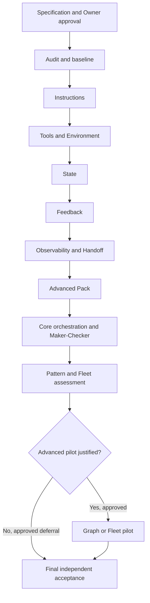

# Harness V2.0 — Master Plan

**Project:** `khanhpn308/LoRa-P2P-Hybrid-TDMA-MVP`  
**Version:** `0.2.0` · **Status:** `OWNER_APPROVED_DESIGN_BASELINE`  
**Date:** 2026-11-27 · **Current phase:** P00 — Design approved; repository publication pending  
**Normative companion:** [HARNESS_SPEC.md](HARNESS_SPEC.md)  
**Owner approval:** 2026-11-27 · ChatGPT project discussion; decision recorded in [Issue #413](https://github.com/khanhpn308/LoRa-P2P-Hybrid-TDMA-MVP/issues/413)  
**Implementation verification:** `NOT_VERIFIED` · OD-01…10 remain open; P01 audit execution not started.

## 1. Objective and execution boundary

Chuẩn hóa Harness theo Learn Harness Engineering (PDF 221 trang, 2026-11-27), từ Minimal Pack đến Advanced Pack có điều chỉnh cho Embedded/IoT. Thực hiện từng phase, mỗi phase một hoặc nhiều Issue/PR nhỏ có phạm vi rõ, không big-bang rewrite.

**P00 chỉ soạn và review hai tài liệu này.** Không được sửa AGENTS.md, scripts, policies, contracts, CI, source sản phẩm hoặc di chuyển/xóa tài liệu hiện hành. Không có lệnh đề xuất nào được xem là đã chạy. Owner đã duyệt design baseline v0.2.0 và cho phép publication docs-only theo Issue #413; không giải quyết OD-01…10 hoặc cấp quyền sửa implementation.

Đường dẫn publication được Owner cho phép: `docs/harness/HARNESS_SPEC.md` và `docs/harness/HARNESS_MASTER_PLAN.md`. Không tạo trước toàn bộ cây target. Lựa chọn file mới phải có lý do và mapping từ inventory.

## 2. Phase roadmap

| Phase | Workstream | Depends on | Exit result | Initial status |
|---|---|---|---|---|
| P00 | Specification & planning | — | Owner-approved SPEC and plan | DESIGN_APPROVED / PUBLICATION_PENDING |
| P01 | As-is audit, inventory, baseline | P00 approval | Frozen baseline, RTM, conflicts and migration map | NOT_STARTED |
| P02 | Instruction & knowledge architecture | P01 | Minimal root, authoritative routing, preserved G0 | NOT_STARTED |
| P03 | Initialization, tools & environment | P02 | Reproducible startup and role permission controls | NOT_STARTED |
| P04 | Feature state & session continuity | P03 | Trusted feature transitions, durable recovery | NOT_STARTED |
| P05 | Verification & feedback | P04 | Executable gates and scoped behavior validation | NOT_STARTED |
| P06 | Observability & clean handoff | P05 | Queryable evidence, restart and clean resume | NOT_STARTED |
| P07 | Advanced Pack integration | P06 | Quality/debt/reliability/security/product surfaces aligned | NOT_STARTED |
| P08 | Orchestrator & multi-round loop engineering | P07 | Core control plane, calibrated Maker-Checker and improvement pilot | NOT_STARTED |
| P09 | Pattern assessment; advanced graph / Fleet pilot conditional | P08 | Mandatory assessment + approved pilot or justified deferral | NOT_STARTED |
| P10 | Independent acceptance & continuous improvement | P08 + P09 disposition | Final RTM, keep/reject experiments, review-ready result | NOT_STARTED |

One active phase during migration. WIP=1 per execution/plan; no next feature activation until current slice verified or explicitly blocked with approved disposition. Existing production/product work, if separately approved, remains isolated; no global claim that all agents must run serially forever.

P02–P07 can reuse existing capabilities and define interfaces before their target implementation. Do not advertise a planned path or command as active; keep working legacy route until replacement passes. Interim phase acceptance is not system-wide acceptance. Dependency gaps block the specific slice or are explicitly deferred; if foundational safety defect prevents later work, create a separately authorized remediation slice and revise the plan.

## 3. P00 — Specification & Planning

**Inputs:** chosen coursebook, prior repository observations, existing project constraints. **Deliverables:** only this Master Plan and companion SPEC, both Owner-approved for design. Publication is a separate docs-only delivery under Issue #413; no implementation changes.

Acceptance for Owner review: five subsystem model agreed; requirement categories and authority agreed; Minimal/Advanced target functions mapped; phases, migration and rollback agreed; open decisions assigned due phase; metrics and independent evidence principles agreed; core Orchestrator, independent scoring, multi-round loop, Fleet conditional target, and meta-improvement boundaries agreed. Exit only after Owner approves version of both files. No runtime PASS claimed here.

## 4. P01 — Independent As-is Audit & Baseline

**Goal:** understand actual Harness before editing. This is read-only with respect to canonical repository. Use temporary disposable worktree/approved local test resources for execution; record any generated artifacts outside canonical source. No fixes mixed into audit.

Inputs: exact live `main` commit/tree SHA, branch/worktree state, approved SPEC, current Issue/ADR/contracts, executable code, CI settings and recent evidence where accessible. Prior review on 2026-11-27 is an observation, not current authority. Resolve active/superseded architecture first; ADR-0004 CAD/CSMA-CA vs TDMA docs is a known conflict candidate, not permission to rewrite product contracts.

Inventory at minimum: root/nested instructions, `.agent-harness/`, `.agents/`, `.github/instructions/`, relevant workflows, docs/dev SOPs, Harness scripts/tests, state stores, command entry points, toolchain locks, ADRs and product contracts used as context. For each, record path, owner, approval, callers/readers, behavior, duplicates/conflicts, security surface, evidence and suggested disposition. Check actual code/CLI/CI, not only README.

Logical outputs (may be sections of one `HARNESS_BASELINE_REPORT.md` plus machine-readable RTM; exact storage approved before writing): inventory, dependency map, conflict register, baseline/test report, gap/RTM, migration map and benchmark protocol. Avoid six duplicate reports when one structured artifact works.

Disposition: `KEEP`, `REFACTOR`, `CONSOLIDATE`, `RELOCATE`, `ADD`, `DEPRECATE`, `REMOVE`, `NOT_VERIFIED`. Removal needs caller/dependency proof, replacement mapping and regression evidence. Every decision names owner/approval.

Baseline tests: actual documented command discovery; structure/secret/scope checks; G0/selector/receipts/state/adapter/worktree tests; module-specific test/build/smoke where available; sandbox negative checks in safe fixtures. Record CI actual run result/settings only when accessible. Record unavailable hardware, credentials, tools, permission and dependencies as NOT_RUN/NOT_VERIFIED, not inferred FAIL/PASS. Do not use production services.

Benchmark protocol: select representative tasks (firmware, backend/DB, frontend, contract, docs/Harness), known correct outcomes and seeded failures, matched model/version/settings, identical task/snapshot/environment/oracle and repetition count. Freeze denominators, budgets and non-regression thresholds before P02. Measure SNR, discovery/rebuild cost, VCR, verification gap, tokens/time, defects, retries, complexity. Mandatory controls must not regress. Small pilot results are descriptive, not statistical proof. Resolve OD-06 and identify due decisions for later phases.

**Exit:** all scoped active entry points inventoried; all H2 requirements have as-is mapping or explicit gap/unknown; baseline evidence and blocker list available; proposed migration order reviewed; no source mutation. Owner approves P02 scope and critical conflict treatment. No blanket PASS if baseline cannot be reproduced.

### P01 orchestration and experiment audit (added in v0.2)

Inventory actual Coordinator/Host/MCP/runner dispatch, role isolation, routing, round persistence, receipt writer and failure paths; map every H2-ORC/FBK-10/11 ID to code/test or gap. Freeze matched benchmark cohort, human-labeled rubric cases and separate held-out tests; measure current review/merge conflict effort, dispatch latency, cost and verified throughput. Inspect existing loop/evaluator history for self-certification and repeat failures. No running real uncontrolled fleet or altering canonical evaluator. Record candidate L1–L5 capability per evidence, not based on file count. Decide OD-09/10 design inputs before implementation.

## 5. P02 — Instruction & Knowledge Architecture

**Scope:** H2-INS-01…07, governance traceability relevant to these changes. Sources L03/L04, ADV 188–196, SOP 215–219. First implementation phase; not redesigning tools, state, or product behavior.

Sequence:

1. Freeze existing instruction/rule coverage and callers of exact AGENTS.md/path/hash/size, G0, standards selector, worker/auditor prompts, CCARS/GOCARS and receipt schemas.
2. Reconcile active documentation authority through approved decisions. Mark superseded sources/redirect rather than silently change product contracts. Escalate actual product-design ambiguities separately.
3. Define logical domain map and routing, reusing ADR/requirements/contracts and existing engineering docs. Create only approved missing entry indexes (e.g. ARCHITECTURE.md); resolve OD-05 for this phase.
4. Map every old mandatory clause to retained root summary, scoped topic, or executable policy. Record source, applicability and review/expiry; deprecate duplicate wording only after mapping.
5. Refactor AGENTS.md to proposed 80–120 lines / ≤10 invariant groups if possible, with overview, authority, hard constraints, startup, selective context, routing, working contract, verification, DoD/handoff. No invented commands or broken links. Preserve legacy state/commands until P03–P04 replace them.
6. Run context/rule/authority/link/command regression, scoped retrieval and fresh-session routing tests on at least the representative task types fixed in P01. Full cross-session recovery is accepted later in P04/P06.

**Candidate paths (not an allowlist):** `AGENTS.md`, existing `.agent-harness/` role docs, related `.agents/` and `docs/development/` routing, `docs/adr/`, architecture indexes, relevant Harness regression tests. Changes to G0/selector implementation only if a separate approved compatibility slice is necessary; no broad refactor.

**Exit:** no mandatory rule loss; no broken active routes; authoritative current architecture discoverable; seeded conflict/missing context stops; G0/selector/receipt regression PASS; SNR and discovery comparison recorded, with no required-control regression. H2-INS-06 dependency-enforcement portion remains linked to P05; complete combined verification there. No AGENTS.md size reduction claim if not measured.

## 6. P03 — Initialization, Tools & Environment

**Scope:** H2-TOL-01…05, H2-ENV-01…05. Sources L02/L06, MIN/START, ADV SECURITY. Decide OD-01, OD-03 (startup part), OD-04.

- Inventory actual execution entry points and permissions; choose default workflow based on P01 evidence. Keep adapters/legacy paths during transition; avoid parallel policy implementations.
- Reuse `scripts/setup_harness.sh`, `harness_doctor.py`, existing runtime version files/lockfiles/Docker where valid. Proposed `init.sh` or unified command is a thin wrapper only if gap proven. Publish actual startup/setup/start/test/check interface gradually; full check selection finalized P05.
- Separate install/provision from diagnostic mode, require approval for side-effectful setup. Validate pinned toolchains and clean checkout; provide smoke tests and baseline handling.
- Enforce role-specific sandbox/capability boundaries, scope, process/network/secret limits, timeout and cleanup. Full Access plus post-diff check cannot satisfy least privilege. If native provider cannot supply required isolation, do not silently fall back to full access; report BLOCKED or approved bounded exception with limitation.

**Exit:** clean-checkout bootstrap + at least required smoke for supported profiles; version mismatch/baseline failure blocked; unauthorized write/network/credential fixture and auditor-mutation tests reject; process timeout/cleanup passes; actual supported adapters tested. State and feedback interfaces unchanged unless separately approved compatibility issue. Rollback keeps validated prior command route; no unsafe fallback.

## 7. P04 — Feature State & Session Continuity

**Scope:** H2-STA-01…06. Sources L05/L07/L08, MIN, ADV 197–203. Resolve OD-02, checkpoint part of OD-08.

- Specify state ownership: GitHub Issue for backlog/scope; versioned feature surface for active behavior/check/state/evidence; journal for execution/recovery; Git for revision; progress/plan for durable handoff. Choose one writer per field and documented sync direction. No independent duplicate backlog.
- Schema and state transition tests first. Map `in_progress`/`active` and existing states explicitly, avoid new status synonyms without need. Trusted Host gates `passing`; immutable historical evidence, current validity tied to exact candidate/revision; unauthorized mutation and stale receipts rejected.
- Enforce WIP=1 per execution; handle blocked dependency and authorized replan. Add session-start read, end-session write, atomic checkpoint and resume. Preserve existing SQLite journal if useful; prove recovery from durable repo artifacts with new session/machine when supported.
- Do not allow verifier acceptance definition to be rewritten by the Worker. Reconcile stale state after crashes or conflicting updates; no destructive reset of user work.

**Exit:** schema and transition negative tests PASS, WIP=1 enforced, interrupted-session restart recovers exact task and safe next action, no false PASS after revision drift, concurrent worktree isolation verified. State acceptance uses existing trusted gates until P05 unifies feedback. Missing evidence cannot become passing.

## 8. P05 — Verification & Feedback

**Scope:** H2-FBK-01…05, H2-ORC-02/04 and completion of H2-INS-06. Sources L09/L10/L11, SOP 218–219. Resolve OD-03 check interface and OD-07 bench conditions.

- Define impact-to-check matrix per domain and contract. Reuse `.github/workflows/`, `scripts/agent_harness/quality_gates.py`, existing suites and receipts. Audit whether CI actually executes advertised checks, not placeholders.
- Expose a unified stable check interface (possible `make check`, not yet selected) that executes mandatory selected tests and returns nonzero for failure/missing prerequisites; differentiate quick checks, full software, integration and authorized HIL. Do not confuse evidence validator with test runner.
- Add deterministic architecture/scope/security negative fixtures for high-value rules, actionable failures with rule/path/reason/remediation. Protect trusted scripts and test oracles from candidate self-certification, allow legitimate test changes only through scoped review.
- Preserve independent Auditor on frozen candidate, verify before and after, use rubric and findings; re-audit affected changes. Implement/extend structured six-dimension 0–2 rubric and ACCEPT/REVISE/BLOCK schema, with hard gates independent of score. Separate Planner/Maker/Host/Checker permissions. Calibrate against human-labeled cases (3–5 tuning rounds recommended, held-out validation); freeze version before P08. Reject forged/missing evidence and high score with blocking defect. Freeze required checks before implementation and recompute for actual diff through trusted policy.
- Exercise affected behavior end to end, with startup/restart/health where applicable. Product-wide RF/HIL claim only with actual bench evidence and approval; if absent, record NOT_VERIFIED and affected gate remains blocked.

**Exit:** required verification actually runs for supported profiles; false/stale/forged receipts, skipped checks and seeded dependency violation blocked; independent audit returns evidence-based verdict; role separation and rubric calibration evidence recorded; impacted integration/E2E paths tested. No mandatory release, safety or hardware evidence falsely substituted by software results.

## 9. P06 — Observability & Clean Handoff

**Scope:** H2-FBK-06 and integrated H2-GOV-03 verification. Sources L11/L12, SOP 213–214/220–221.

- Map runtime signals (UART, radio event, MQTT, DB/Go/API and UI as applicable) and process signals (task identity, gate, command, timestamps, candidate, finding). Use existing collectors and logs; add only missing signals. Redact secrets; bound log sizes/retention; no remote exposure by default.
- Define repeatable golden journeys and failure injection in approved dev/test environment. Trace evidence from failed behavior to responsible domain, repair and rerun. UI validation uses runtime before/after state rather than visual guess.
- Integrate clean-session close: update progress/feature via approved writer, clean only owned temporary artifacts, verify startup and safe checkpoint; preserve BLOCKED/PARTIAL work without marking done. Test restart across sessions and cleanup idempotence.

**Exit:** injected failure attributable from captured signals; same workload reruns; secrets absent from evidence; clean exit/restart and fresh-session 5/5 + executable resume verified. Product RF journey separately recorded when equipment available; no automatic flash/TX. Phase 07 may consolidate reliability docs, but working observability already proved here.

## 10. P07 — Advanced Pack Integration

**Scope:** H2-FBK-07 plus consistency of H2-INS-06/07, H2-STA-04/06 and H2-GOV-02. Sources ADV 185–212, MIN 171–173, SOP 215–221. Resolve remaining OD-05.

Implement or map logical Advanced Pack surfaces in SPEC §5.2: architecture/design/product indexes, plans lifecycle, debt, quality, reliability, security, frontend, generated DB schema and references. Do not create duplicate canonical docs; existing approved index accepted if discoverable and complete. Generated schema includes provenance and refresh check; no manual invented schema. Product priority/behavior comes from Owner-approved source, not Agent guesses.

Quality score A–D / NOT_VERIFIED, by domain/layer with evidence; independent evaluator rubric separate (six dimensions). Record technical debt, owner/trigger and Issue link. Add link/freshness checks and minimal SOP routing. No special score can override safety/verification failure.

**Exit:** every logical artifact mapped to a real authoritative path/function, no broken links/duplicated authority, example plan lifecycle and quality/debt update executed, generated metadata refreshed from actual source, rubric reviewed against human findings, Advanced Pack applicability reviewed. Any N/A must explain why domain/path is not applicable.

## 11. P08 — Orchestrator, Multi-Round Maker-Checker & Improvement Pilot

**Scope:** H2-FBK-09/10/11, H2-ORC-01/03/05/07, integrated H2-ORC-02/04 and H2-GOV-01. Sources L09/L11/L13, Project 07 pp.153–158, DAW pp.80–81, autoresearch pp.104–107. Resolve OD-08/09/10 before affected implementation. Separate small Issues in order, not one PR.

| Slice | Deliverable | Acceptance |
|---|---|---|
| P08-A | Role and control-plane contract; reuse existing Coordinator/Host | Admission, dispatch, routing, state, role ACL, approval/cancel/timeout negative tests |
| P08-B | Multi-round Maker-Checker loop with external round state | >=5 recorded pilot rounds; seeded fail→repair→reverify, independent rubric, ACCEPT/REVISE/BLOCK routing, budget/no-progress termination |
| P08-C | Recovery and orchestration observability | Interrupt/restart, duplicate dispatch, stale evidence and post-audit integrity tests; no invalid side effects |
| P08-D | Controlled meta-improvement experiment | Frozen baseline, hypothesis, fixed-budget comparison, holdout, independent assessment; demonstrate both KEEP and REJECT with safe recovery |
| P08-E | Overhead evaluation | Compare matched baseline vs orchestrated workflow: verified throughput, human review and reconciliation effort, tokens/cost, escaped defects; set concurrency ceiling |

Do not mandate five rounds on every Issue. Freeze N consecutive passes, max rounds/time/cost, failure repetition and escalation policy before run. Use test fixtures or controlled scenarios for pilot if ordinary task finishes early. Record round state and receipts under trusted writer; no fake failures to inflate rounds. Maker repairs only in approved scope; Checker cannot alter candidate. All failed/aborted experiments logged, never auto-merge. Research improvement experiments may propose prompt/selector/tool/feedback changes but cannot rewrite evaluation criteria in same experiment; independent human approval for promotion. No background autonomous execution without separately authorized runtime and budget.

**Exit:** reproducible bounded core orchestration and independent scoring verified; P08-A…E evidence linked to RTM; no unsafe escalation/infinite retry; at least one reject/rollback and one qualifying KEEP experiment on controlled fixture or representative task; if no real improvement found, record no gain and demonstrate KEEP routing with labeled fixture, not claim actual gain. Mandatory safety regression zero; human review stop preserved. Measure orchestration tax, not merely number of launched agents.

## 12. P09 — Pattern Assessment & Advanced Graph / Fleet Pilot (conditional implementation)

**Scope:** H2-ORC-06/08, graph portion of H2-FBK-09; L13 p.110, L14 pp.120–129, Project 08 pp.159–163, Symphony reference p.177, Claude Code reference p.111. Core orchestration from P08 is mandatory; only advanced graph/fleet implementation is conditional.

Evaluate five criteria: independent units, rollback/branches, valuable intermediate state, verifiable outputs, benefits exceed coordination costs. Compare simple sequential state machine, routing, orchestrator-workers and evaluator-optimizer; use parallelization only when justified. Assess Level 4 self-feeding selection from approved external state and Level 5 independent loops/shared memory separately. Do not add graph engine, Linear or new provider by default; use GitHub Issues and existing tooling where sufficient.

If approved: pilot explicit nodes/edges/routing, typed shared state, lease/ownership and dependency constraints, isolated worktrees, bounded queue/concurrency, fan-in, rollback and human approval nodes. Run independent non-overlapping slices, seed conflicting changes and stale state, reject conflicting writes, replay/recover state, serialize integration review. Measure actual coordination tax vs sequential baseline including review bandwidth. WIP=1 remains per execution, not unbounded fleet admission. Fleet may be deferred independently of graph pilot.

**Exit:** core orchestration pattern assessment mandatory. For advanced graph/fleet: verified pilot with measured benefits and independent review OR documented Owner-approved conditional deferral with rationale, risks, trigger to revisit. Do not claim L4/L5 capability without respective evidence. No automatic promotion or cross-branch destructive rollback.

## 13. P10 — Independent System Acceptance & Simplification

**Scope:** H2-FBK-08/10/11, H2-GOV-01…03, final all mandatory requirements including H2-ORC-01…08. Sources L01/L02/L04/L12 and Projects 01–06; benchmark protocol P01.

- Independent Auditor receives approved SPEC, frozen base/candidate, RTM and evidence, not Worker verdict as truth. Build independent checks, execute all required feasible paths, inspect status/provenance and coverage; negative tests for out-of-scope edits, stale evidence, false PASS, missing mandatory context, runtime permission escape and crash recovery.
- Run paired benchmark against P01 baseline with matched conditions. Report raw results, variability, cost and regressions; if conditions differ, disclose. No claims of improvement based solely on LOC/files reduced.
- Controlled simplification per component: test in isolated environment, prove caller replacement and guardrail coverage; approve before deleting or archiving. Preserve rollback checkpoint and history. May be done incrementally earlier with same criteria; final review verifies no orphaned paths.
- Re-evaluate Maker-Checker rubric and independent scores against held-out examples, run complete orchestration recovery and budget/permission tests, replay KEEP/REJECT experiment trail and compare guardrails; record advanced Fleet disposition and measured orchestration tax. Set next approved improvement cycle owner and trigger; do not autonomously change SPEC.
- Validate Fresh Session Test, entire approved Harness workflow to Draft PR and human review, clean restart and state recovery. Check required HIL/security/RF evidence by level, never infer from software tests.

Final verdict: `PASS` only all mandatory scoped requirements verified, no blocker; `PASS_WITH_LIMITATIONS` only for approved, nonblocking limitations or conditional exclusions, not for unmet mandatory requirements; `FAIL` if mandatory requirement fails/has insufficient evidence. Explicitly state product acceptance independent from Harness acceptance. Human approval remains required; no auto-merge.

## 14. Requirement ownership / RTM seed

This table covers all normative IDs in SPEC §4. P01 expands each ID to actual source path/revision, disposition, candidate implementation, verification command/test ID, evidence URI/hash, status, reviewer and blocker. Primary phase owns delivery; later phases can integrate or reverify. No row is marked verified in P00.

| Requirement | Primary phase | Integration/recheck | Initial status |
|---|---|---|---|
| H2-INS-01 | P02 | P10 | NOT_VERIFIED |
| H2-INS-02 | P02 | P10 | NOT_VERIFIED |
| H2-INS-03 | P02 | P10 | NOT_VERIFIED |
| H2-INS-04 | P02 | P10 | NOT_VERIFIED |
| H2-INS-05 | P02 | P10 | NOT_VERIFIED |
| H2-INS-06 | P02 | P05, P07, P10 | NOT_VERIFIED |
| H2-INS-07 | P02 | P07, P10 | NOT_VERIFIED |
| H2-TOL-01 | P03 | P10 | NOT_VERIFIED |
| H2-TOL-02 | P03 | P10 | NOT_VERIFIED |
| H2-TOL-03 | P03 | P10 | NOT_VERIFIED |
| H2-TOL-04 | P03 | P10 | NOT_VERIFIED |
| H2-TOL-05 | P03 | P10 | NOT_VERIFIED |
| H2-ENV-01 | P03 | P10 | NOT_VERIFIED |
| H2-ENV-02 | P03 | P10 | NOT_VERIFIED |
| H2-ENV-03 | P03 | P05, P10 | NOT_VERIFIED |
| H2-ENV-04 | P03 | P10 | NOT_VERIFIED |
| H2-ENV-05 | P03 | P10 | NOT_VERIFIED |
| H2-STA-01 | P04 | P10 | NOT_VERIFIED |
| H2-STA-02 | P04 | P10 | NOT_VERIFIED |
| H2-STA-03 | P04 | P10 | NOT_VERIFIED |
| H2-STA-04 | P04 | P07, P10 | NOT_VERIFIED |
| H2-STA-05 | P04 | P10 | NOT_VERIFIED |
| H2-STA-06 | P04 | P07, P10 | NOT_VERIFIED |
| H2-FBK-01 | P05 | P10 | NOT_VERIFIED |
| H2-FBK-02 | P05 | P10 | NOT_VERIFIED |
| H2-FBK-03 | P05 | P10 | NOT_VERIFIED |
| H2-FBK-04 | P05 | P10 | NOT_VERIFIED |
| H2-FBK-05 | P05 | P10 | NOT_VERIFIED |
| H2-FBK-06 | P06 | P10 | NOT_VERIFIED |
| H2-FBK-07 | P07 | P10 | NOT_VERIFIED |
| H2-FBK-08 | P10 | Final acceptance | NOT_VERIFIED |
| H2-FBK-09 | P08 | P09 conditional, P10 | NOT_VERIFIED |
| H2-GOV-01 | P08 | P10 | NOT_VERIFIED |
| H2-GOV-02 | P00–P01 | All phases, P10 | NOT_VERIFIED |
| H2-GOV-03 | P06 | P10 | NOT_VERIFIED |
| H2-ORC-01 | P08 | P10 | NOT_VERIFIED |
| H2-ORC-02 | P05 | P08, P10 | NOT_VERIFIED |
| H2-ORC-03 | P08 | P10 | NOT_VERIFIED |
| H2-ORC-04 | P05 | P08, P10 | NOT_VERIFIED |
| H2-ORC-05 | P08 | P04, P10 | NOT_VERIFIED |
| H2-ORC-06 | P09 | P08, P10 | NOT_VERIFIED |
| H2-ORC-07 | P08 | P09, P10 | NOT_VERIFIED |
| H2-ORC-08 | P09 | P10 (fleet pilot conditional) | NOT_VERIFIED |
| H2-FBK-10 | P08 | P10 | NOT_VERIFIED |
| H2-FBK-11 | P08 | P10 | NOT_VERIFIED |

## 15. Execution protocol for every implementation slice

| Stage | Required record / gate |
|---|---|
| Intake | Approved OPEN Issue, H2 IDs, acceptance criteria, non-goals, exact allowed paths, owner |
| Plan | Base SHA, dependency/caller map, proposed edits, baseline, commands, required evidence, rollback, risks, retry limits |
| Approve | Owner or authorized reviewer approves scope; no implied approval from this Master Plan |
| Implement | Isolated branch/worktree, G0 and mandatory standards, least-privilege tools; WIP=1 |
| Verify | Actual diff/scope; required test execution, evidence receipts and integrity; failure loops bounded |
| Audit | Fresh independent evaluation on frozen candidate; findings severity/location, test reproduction, verdict |
| Deliver | Post-audit verification, safe Conventional Commit, Draft PR linked to Issue when authorized |
| Accept | Human review, applicable CI and evidence, explicit exit status; no autonomous merge |
| Handoff | Update RTM/active plan, next action, blockers, checkpoint, quality/debt if changed |

Use existing G0–G6 Harness process until an approved migration. Phase labels P00–P10 are not Harness G0–G6 or product release G0–G6. Keep separate status fields. Branch naming follows project convention, e.g. `docs/<issue>-harness-v2-spec` for authorized docs-only slice. Actual branch/Issue number must be read from GitHub, not invented.

### 15.1 Phase gate rule

Each exit must have verified requirements in scope, no unresolved blocking finding, allowed-path compliance, migration/rollback evidence, independent review and Owner acceptance. Interim integration obligations may remain explicitly pending as scheduled; do not report full subsystem acceptance until all its mandatory obligations pass. A blocked phase requires remediation or explicit plan revision. Owner approval of a limitation cannot turn missing mandatory evidence into PASS. Do not move to next phase silently.

### 15.2 Compatibility, migration and rollback

For every replacement: inventory consumers → document old/new mapping → introduce in small slice → run parity/negative/regression tests → switch only approved consumers → mark old path deprecated → remove only after zero required callers and approval. Keep a verified last-known-good revision and explicit rollback method (typically reviewed revert on branch; no force-push/reset/clean of user work). Version changed receipt/state/schema formats, supply migration/recovery test and preserve historical evidence. No simultaneous breaking migration of policy, state and runner. If new path fails, route to previously verified permitted path or stop; never weaken security to restore throughput.

### 15.3 Risks and escalation

| Risk | Mitigation / stop condition |
|---|---|
| Architecture drift (legacy TDMA/old scaffold descriptions) | Approved authority audit; ambiguous contract issue separate; no implicit product changes |
| Removing AGENTS.md clauses breaks G0 or standards injection | Clause-to-rule coverage, exact SHA and prompt/receipt regression before cutover |
| Full Access disguised as least privilege | Runtime negative tests; block unsupported capabilities |
| Two mutable state sources | Single writer/authority per field; conflict and recovery test |
| Agent weakens verifier/tests | Trusted base policy, independent review, immutable acceptance identity |
| Premature PASS / missing physical evidence | Layer-specific receipts; NOT_VERIFIED for unavailable hardware; no false acceptance |
| Documentation proliferation | Map/reuse existing sources, measured need for new files, remove duplicates safely |
| Large PR or orchestration overhead | WIP=1 slice, bounded queue, measure review/conflict cost; conditional advanced graph/fleet only |
| Secret leakage or destructive cleanup | Redaction, explicit permission, disposable resources and owned cleanup |
| Baseline inaccessible or unrepresentative | Record missing evidence, freeze benchmark assumptions, stop claims of improvement |

## 16. Phase 00 review and next action

Owner review checklist (confirmed by Owner on 2026-11-27; design approval only):

- [x] Approve primary reference and five-subsystem architecture.
- [x] Approve SPEC requirements and project-specific extensions, including authority and preserved invariants.
- [x] Approve phased migration, Minimal/Advanced functional equivalence, mandatory core orchestration and conditional advanced graph/fleet.
- [x] Approve evidence model, independent review, safety and no false PASS policy.
- [x] Approve multi-round Maker-Checker, rubric calibration and controlled meta-improvement with frozen oracle and promotion gates.
- [x] Approve open decisions/due phases and read-only P01 scope.
- [x] Approve exact version of both documents for a docs-only Issue/PR if desired.

Next action: complete docs-only publication under Issue #413 with existing trusted Host G0 and human PR review; then create/authorize P01 audit Issue and freeze exact live baseline SHA, then inventory existing Harness; **do not begin P02 edits** until P01 findings and migration plan are accepted.

**Phase 00 limitations:** primary coursebook text and key template/SOP sections were inspected during drafting. Repository publication is tracked by Issue #413; no Harness runtime audit or build/test evidence is claimed. Existing-path examples must be validated P01. Numeric targets, naming conventions, phase order and project adaptations are Owner-approved design targets except explicitly open decisions; they are not official course requirements or active implementation policy.

**Revision 0.2.0-draft:** 45 requirement IDs in RTM; P01 adds orchestration inventory, P05 rubric/role calibration, P08 mandatory core orchestration and experiment loop, P09 conditional graph/fleet, P10 independent acceptance. No new phase or repository changes.

**Approval revision 0.2.0:** Owner-approved on 2026-11-27; approval/status/provenance only, no change to RTM, 11 phases or open decisions. See [Issue #413](https://github.com/khanhpn308/LoRa-P2P-Hybrid-TDMA-MVP/issues/413).
