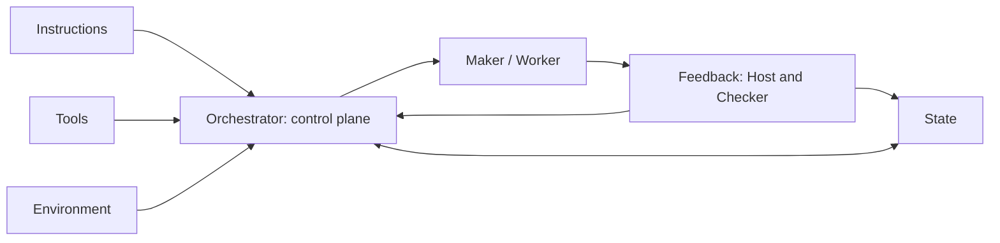
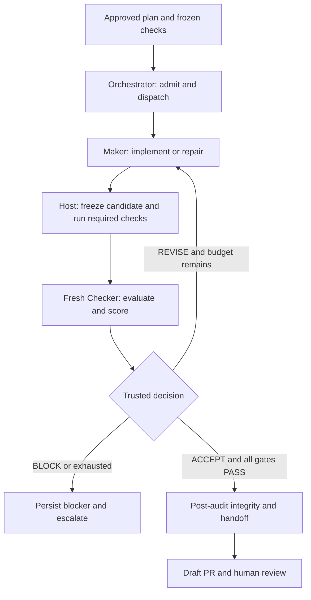

# Harness Engineering Specification

**Project:** `khanhpn308/LoRa-P2P-Hybrid-TDMA-MVP`  
**Version:** `0.2.0` · **Status:** `OWNER_APPROVED_DESIGN_BASELINE`  
**Date:** 2026-11-27 · **Target:** Governed Agent Harness V2.0  
**Companion:** [HARNESS_MASTER_PLAN.md](HARNESS_MASTER_PLAN.md)  
**Owner approval:** 2026-11-27 · ChatGPT project discussion; decision recorded in [Issue #413](https://github.com/khanhpn308/LoRa-P2P-Hybrid-TDMA-MVP/issues/413)  
**Implementation verification:** `NOT_VERIFIED` · OD-01…10 remain open; publication pending trusted Host G0 and human PR review.

## 1. Purpose and scope

Chuẩn hóa Harness hiện có thành một hệ thống tối giản, nhất quán, có khả năng thực thi, kiểm thử và tiếp tục công việc qua nhiều phiên. Đối tượng là môi trường phát triển monorepo Embedded/IoT, không phải thiết kế lại sản phẩm LoRa.

Mục tiêu: giảm instruction bloat, giảm chi phí khám phá và khôi phục context, loại bỏ nguồn quy tắc trùng lặp, giới hạn phạm vi Agent, tăng tỷ lệ hoàn thành đã xác minh và bảo toàn các cơ chế kiểm soát có giá trị. Không đặt mục tiêu tăng số file, Agent, gate hoặc framework.

**Non-goals:** thay đổi MAC, RF profile, PCB, crypto, API/MQTT/DB contracts hoặc technology stack của sản phẩm; tự động merge/deploy/flash/TX; xây dựng lại Harness từ đầu; mặc định phải dùng orchestration framework mới; coi phần mềm PASS là RF/HIL PASS.

## 2. Reference and requirement semantics

Nguồn tham chiếu chính do Owner lựa chọn: `learn-harness-engineering-en.pdf`, Learn Harness Engineering, English coursebook, 221 trang, generated 2026-11-27. SHA-256: `777e654c404c167020e29d0b0b4519e22c0c72bbcca383d83d873536cd012b67`. Số trang trong tài liệu này là số trang vật lý PDF (1-based), không phải số trang nội bộ từng bài giảng.

| Ref | Nội dung | Trang PDF |
|---|---|---:|
| L01 | Reliable execution, diagnostic loop | 7–12 |
| L02 | Five-subsystem model, ablation | 13–18 |
| L03 | Repository as system of record, fresh session | 19–25 |
| L04 | Split instructions, SNR, reveal on demand | 26–32 |
| L05 | Persistent state, handoff, rebuild cost | 33–40 |
| L06 | Dedicated initialization | 41–47 |
| L07 | WIP=1, task boundaries | 48–54 |
| L08 | Feature list, pass-state gating | 55–60 |
| L09 | Termination validation, independent evaluation | 61–67 |
| L10 | E2E and mechanical enforcement | 68–74 |
| L11 | Runtime/process observability | 75–82 |
| L12 | Clean handoff, quality, simplification | 83–90 |
| L13 | Loop engineering | 91–112 |
| L14 | Graph engineering | 113–132 |
| MIN | Resource Library, Template Guide | 164–173 |
| START | Startup Flow, Initializer Playbook, Method Map, Prompt Calibration | 174–175, 181–184 |
| ADV | Advanced Pack and repository templates | 185–212 |
| SOP | Chrome DevTools, knowledge capture, layered architecture, observability | 213–221 |
| LAB | Projects 01–08 | 135–163 |
| ORC | Orchestrator-Workers patterns, fleet ladder, orchestration tax | 110, 120–121, 127–129 |
| EXP | Autoresearch ratchet; Maker-Checker laboratory; DAW case | 104–107, 156–158, 80–81 |
| REF-ORC | Claude Code Dynamic Workflows and Orchestration; Symphony | 111, 177 |

Giáo trình là tài liệu hướng dẫn tổng hợp, không phải tiêu chuẩn chứng nhận chính thức của OpenAI/Anthropic. Nội dung ứng dụng mẫu (web app, OAuth, SQLAlchemy, lệnh npm/pytest, layer sequence) không tự động trở thành yêu cầu của LoRa.

- `R` — REFERENCE: yêu cầu chuyển hóa từ giáo trình, có nguồn trang.
- `X` — PROJECT_EXTENSION: bổ sung/điều chỉnh phù hợp dự án; cần Owner phê duyệt.
- `OD` — OPEN_DECISION: chưa chốt phương án; không được Agent tự suy diễn.
- `MUST` là tiêu chí bắt buộc sau khi SPEC được duyệt; `SHOULD` là mặc định có thể ngoại lệ bằng lý do được ghi nhận. Các requirement trong bản này là design baseline đã được Owner phê duyệt cho Harness V2.0; không tự thay thế active repository policy hoặc cấp quyền implementation trước approved phase/Issue.
- Namespace `H2-*` dành riêng cho Harness V2; không thay thế Rule ID của C/Go Standard hoặc contract hiện hành.

## 3. Architecture and design principles

Năm subsystem duy nhất: Instructions, Tools, Environment, State, Feedback (L02). Governance, Security, Observability và Orchestration là các trách nhiệm xuyên suốt, Orchestration MUST là control plane xuyên suốt năm subsystem, với trách nhiệm và interface xác định tại §6.4–6.6; không mặc định cần framework hoặc Agent mới. Mỗi subsystem có interface, owner và bằng chứng riêng.

Design principles: repository-local system of record; one authority per fact; map not manual; progressive disclosure; enforce invariants rather than micromanage implementation; least privilege; fail closed; evidence before acceptance; persistent state; reproducibility; small verified increments; preserve useful controls; simplify based on measured failures and regression evidence.

### 3.1 Authority model (project extension)

Không dùng một precedence order tuyệt đối cho mọi loại quyết định.

| Loại quyết định | Nguồn thẩm quyền |
|---|---|
| Scope/authorization | Owner-approved Issue, acceptance criteria, exact allowed paths |
| Product/architecture intent | Approved requirements, ADR và quyết định Owner được ghi nhận |
| Interfaces | Approved versioned contracts; nếu draft hoặc conflict thì không mặc định approved |
| Hardware / SDK facts | Manufacturer datasheet đúng revision / tài liệu API đúng phiên bản pinned |
| Engineering policy | Quy định đã được phê duyệt, mandatory Rule IDs áp dụng |
| Actual implementation / measured behavior | Code, tests và execution evidence tại revision cụ thể |
| Execution | Active plan trong giới hạn các nguồn trên |
| Supporting knowledge | Index, SOP, general docs và references, theo status |

Repository MUST lưu hoặc dẫn tới bản ghi quyết định bền vững có provenance. Chat hoặc plan không tự thay thế architecture/security/contract đã duyệt. Khi nguồn mâu thuẫn, ghi hai nguồn, revision, status, phạm vi tác động và `STOP_AND_REPORT` nếu ảnh hưởng công việc; chỉ Owner có thẩm quyền mới phê duyệt giải quyết. Code cũ mô tả thực trạng, không phải giấy phép để khôi phục thiết kế superseded.

### 3.2 Zero-tolerance invariants (proposed summary)

Các bất biến sau là bản tóm tắt dựa trên snapshot/ADR đã thảo luận trước đó; Phase 01 MUST đối chiếu nguyên văn source và status trước khi chuyển vào AGENTS.md. Không dùng bản tóm tắt này để phê duyệt thiết kế sản phẩm mới.

1. Custom LoRa P2P MAC V2, CAD/CSMA-CA, Gateway Continuous RX theo ADR-0004 đã được kiểm tra ở lượt trước; không phục hồi Hybrid TDMA/LoRaWAN đã bị loại khỏi phạm vi hiện hành.
2. Gateway sở hữu RF; Go Modular Monolith và PostgreSQL ở Backend; client qua authenticated REST/WSS, không truy cập trực tiếp DB/broker.
3. Một SX1276 Radio Owner, SPI serialized, ISR/timer nonblocking, bounded buffers và timeouts theo chuẩn đã duyệt.
4. Không thay đổi RF, pin map, cryptography, contracts, schema hoặc toolchain ngoài authorization; không tự flash/TX.
5. Bảo vệ secrets, key ownership, replay/nonce, server-side authorization, parameterized SQL; không tự thêm ORM.
6. Bảo toàn durable acceptance trước RF ACK, idempotent event ingestion; tách RF ACK/MQTT PUBACK/DB commit/UI acknowledgement.
7. Exact scope, WIP=1 theo execution, branch/worktree riêng; không edit main, auto-merge, destructive actions trái phép.
8. Không self-certify; thiếu evidence, approval hoặc authority thì không nâng trạng thái; phân biệt software, security, HIL, RF.

## 4. Functional requirements and verification contract

Mỗi dòng là một acceptance obligation. Phase phụ trách được chỉ định trong Master Plan; mọi kết quả ban đầu đều `NOT_VERIFIED`. Evidence của từng yêu cầu phải liên kết được với base/candidate revision và phương pháp xác minh. Chỉ các yêu cầu conditional được phép `N/A` khi ghi lý do và được review.

### 4.1 Instructions (INS)

| ID | Normative requirement | Source | Acceptance evidence |
|---|---|---|---|
| H2-INS-01 | MUST có root AGENTS.md: overview, stack/runtime thực, startup, hard constraints, routing, working contract, DoD, handoff. | R L02/L04, MIN, ADV 188–190 | Fresh agent tìm đúng stack và command từ root; paths được xác minh. |
| H2-INS-02 | SHOULD giữ AGENTS.md 80–120 dòng (target nội bộ), không quá 10 nhóm invariant; ưu tiên đầu/cuối file. Topic docs ngắn theo nhu cầu, không sao chép manual. | R L04 26–32; X ngân sách | Line/byte/token inventory; review mọi ngoại lệ; không mất mandatory rules. |
| H2-INS-03 | MUST có authority hierarchy theo loại quyết định, approval status và xử lý conflict; không dùng plan/code để vượt approved invariant. | R L03/L04; X §3.1 | Seeded TDMA/crypto/scope conflict bị phát hiện và chặn. |
| H2-INS-04 | MUST định tuyến bằng applicability; mỗi quy tắc có source, scope, expiry/review condition; không indiscriminate load docs. | R L04, START 184 | Link/path validation, scoped retrieval và SNR benchmark. |
| H2-INS-05 | MUST bảo toàn G0 và deterministic mandatory rule selection, partitions, pre/post selection/receipts theo chính sách đã duyệt; không hạ xuống chỉ dẫn tự giác. | X existing Harness; R L04 | So sánh coverage trước/sau; negative tests missing/stale rules, wrong SHA, expanded scope. |
| H2-INS-06 | MUST có architecture/domain map và approved dependency boundaries riêng cho firmware, Go, client; contract/requirements route rõ; tri thức nằm gần module khi thích hợp. | R L03, L10, ADV 191–196, SOP 218–219 | Agent xác định đúng owner/layer; dependency violations được guardrail phát hiện ở FBK-04. |
| H2-INS-07 | MUST encode approved unseen knowledge into repo; retire/mark superseded sources; cập nhật docs cùng thay đổi behavior. | R L03, SOP 215–216 | Conflict register đóng hoặc có route loại trừ; không active link tới superseded rule như current. |

### 4.2 Tools (TOL)

| ID | Normative requirement | Source | Acceptance evidence |
|---|---|---|---|
| H2-TOL-01 | MUST công bố capability, tool invocation, prerequisites, owner và quyền theo role; tái sử dụng tool registry hiện có nếu đủ. | R L02; X | Capability probe theo role; tool không có trả BLOCKED. |
| H2-TOL-02 | MUST enforce least privilege tại runtime: filesystem, process, network, credentials; Worker chỉ ghi candidate được cấp; Auditor không sửa candidate/evidence. | R L02, ADV 211; X | Negative tests ghi ngoài scope/sandbox, unauthorized network, secret, audit mutation; post-diff guard không thay sandbox. |
| H2-TOL-03 | MUST bảo toàn exact scope guard, trusted Host và integrity boundary; untrusted Issue/PR/tool output chỉ là data, không được tự nâng quyền. | X; R ADV 211 | Scope escape, symlink/path traversal, forged receipt, prompt injection fixtures bị chặn. |
| H2-TOL-04 | MUST quản lý timeout, cancellation và cleanup theo execution identity; không ảnh hưởng process/worktree của người khác. | X; R L11/L12 | Hung process, failed cleanup, concurrent workspace tests. |
| H2-TOL-05 | SHOULD hỗ trợ Codex/Antigravity qua interface chung ở mức cần thiết; MCP/provider-specific profiles không là nguồn policy độc lập. | X; R L13 | Contract tests từng adapter có sử dụng thực tế; không thêm adapter khi chưa có nhu cầu. |

### 4.3 Environment (ENV)

| ID | Normative requirement | Source | Acceptance evidence |
|---|---|---|---|
| H2-ENV-01 | MUST tách initialization khỏi feature implementation; có startup entry point thống nhất, kiểm tra repo, versions, deps và smoke test. | R L06, MIN, START | Clean-checkout bootstrap; lệnh có exit code thật; no feature edits. |
| H2-ENV-02 | MUST có runtime/toolchain pin, dependency locks và reproducible dev/test profile; Docker/devcontainer chỉ dùng khi phù hợp. | R L02; X | Version mismatch bị chặn; clean environment build/test có provenance. |
| H2-ENV-03 | MUST có standard commands cho bootstrap, start, test, check; mọi command trong AGENTS.md phải tồn tại và có documented scope/side effects. | R L02/L06 | Command validation + smoke; missing tool không bị coi PASS. |
| H2-ENV-04 | MUST kiểm tra baseline trước edit; baseline FAIL liên quan thì block. Chỉ sửa lỗi trong scope được duyệt hoặc Issue riêng. | R L06, START; X | Seeded baseline failure được ghi nhận, không sửa ngoài allowlist. |
| H2-ENV-05 | MUST tách dev/test/prod; bootstrap/verification mặc định không deploy, flash, RF TX, dùng production DB hoặc tự cài tool ngoài quyền. | X; R ADV 211 | Test-only targets, negative approval tests và isolated services. |

### 4.4 State (STA)

| ID | Normative requirement | Source | Acceptance evidence |
|---|---|---|---|
| H2-STA-01 | MUST có machine-readable feature surface versioned: stable ID, behavior, verification, state, evidence, dependency/scope. | R L07/L08, MIN 168–170 | Schema validation, unique IDs, missing fields fail. |
| H2-STA-02 | MUST enforce WIP=1 mỗi execution/active plan; chỉ activate unit sẵn sàng, current unit verified hoặc explicitly blocked theo authorization. | R L07/L08, START; X | Hai active units cùng execution bị từ chối; blocked transition có lý do. |
| H2-STA-03 | MUST để trusted verifier kiểm soát transition `passing`; Worker không tự đổi trạng thái hoặc acceptance checks. Evidence gắn với revision, stale/regression làm mất hiệu lực xác minh hiện hành, giữ lịch sử. | R L08 57–58; X revision handling | False PASS, stale SHA, modified tests, concurrent update bị reject; revalidation test. |
| H2-STA-04 | MUST duy trì execution plan lifecycle, durable progress/handoff, decision references, next action và blockers. | R L05, L12, ADV 197–203 | Fresh session resume từ repo và checkpoint không cần chat. |
| H2-STA-05 | MUST checkpoint an toàn, atomic verified unit; isolate worktree/agent; recovery giữ công việc dở dang, không merge hoặc reset phá hủy khi chưa duyệt. | R L03/L05/L12; X | Interrupted run/crash recovery, concurrent worktree, clean verified checkpoint. |
| H2-STA-06 | MUST có một source of truth cho mỗi loại state: Issues quản lý scope/backlog; feature evidence và runtime journal có ownership riêng; tránh đồng bộ hai chiều không kiểm soát. | X; R L03/L08 | Disagreement/replay/concurrency tests; durable exported handoff khôi phục được. |

### 4.5 Feedback (FBK)

| ID | Normative requirement | Source | Acceptance evidence |
|---|---|---|---|
| H2-FBK-01 | MUST có command interface test/check chạy được, selection theo impact và approved acceptance matrix; test bắt buộc không được skip để đạt PASS. | R L02/L09/L10; X | Static/unit/build, contract/integration/E2E paths theo scope; negative missing-check tests. |
| H2-FBK-02 | MUST có trusted deterministic validation/receipts: command identity, candidate SHA/diff, toolchain, exit status, log/hash; evidence không thể tự khai từ Worker. | X; R L09 | Stale/forged/missing/failed evidence chặn acceptance. |
| H2-FBK-03 | MUST độc lập evaluation cho delivery: frozen candidate, rubric, independent checks, findings, verdict; sửa code làm audit/evidence cũ hết hiệu lực khi bị ảnh hưởng. | R L09/L11, MIN 171–172; X | Auditor không ghi candidate; seeded defects được phát hiện; compare human judgment. |
| H2-FBK-04 | MUST chuyển recurring review failures thành mechanical checks nếu khả thi; enforce dependency boundaries, scope và security quan trọng; lỗi chỉ ra rule/location/why/fix. | R L10, SOP 218–219 | Ít nhất một high-cost boundary per applicable domain có negative fixture; không chỉ grep không đủ coverage. |
| H2-FBK-05 | MUST xác minh restart/health và full affected behavior path khi thay đổi runtime/lifecycle/cross-component; không đồng nhất unit/simulation/HIL/RF/security. | R L09/L10/L12; X | Golden journey thực thi và adverse cases; hardware evidence riêng hoặc NOT_VERIFIED. |
| H2-FBK-06 | MUST thu runtime/process signals có provenance và redaction, query được log/metrics/traces cần thiết; ưu tiên collector hiện có, không bắt buộc OpenTelemetry stack. | R L11, SOP 220–221; X | Inject failure, tìm đúng signal/owning layer, rerun workload; no secret leakage. |
| H2-FBK-07 | MUST có QUALITY_SCORE theo domain/layer, technical debt tracking và evaluator rubric riêng; chỉ chấm dựa evidence; cập nhật sau thay đổi đáng kể. | R L12, MIN 171–173, ADV 199/207–208 | Snapshot có revision/date/gaps/evidence; review debt trigger; không lấy điểm trung bình để bypass blocking failure. |
| H2-FBK-08 | MUST có controlled benchmark, failure attribution, regression protection và periodic simplification; không bỏ safety controls dựa trên benchmark thông thường. | R L01/L02/L04/L12; X | Paired baseline/candidate runs; ablation record; negative controls remain. |
| H2-FBK-09 | MUST có bounded diagnostic/repair/retest loop và external stop conditions; graph chỉ khi có lý do đo được và Owner duyệt. | R L13/L14; X | Retry/timeout/budget/approval stop tests; state recovery. |

### 4.6 Cross-cutting governance (GOV)

| ID | Normative requirement | Source | Acceptance evidence |
|---|---|---|---|
| H2-GOV-01 | MUST Issue → isolated branch → implementation → trusted verification → independent audit → Draft PR → human review; preserve existing valid G0–G6 semantics until migration approved. | X; R L07/L09 | One scoped delivery rehearsal, independent reviewer and no auto-merge. |
| H2-GOV-02 | MUST version spec/plan, classify proposed vs approved vs verified; trace every mandatory requirement to implementation/test/evidence; controlled changes/rollback. | X; R L03/L12 | Complete RTM, approved phase plan, rollback rehearsal, no dangling references. |
| H2-GOV-03 | MUST pass fresh-session and clean-handoff acceptance; preserve human approval for RF/security/contract/destructive/production actions. | R L03/L05/L12/START; X | Independent fresh agent and negative authorization/cleanup tests. |

### 4.7 Orchestration (ORC) — control plane

| ID | Normative requirement | Source | Acceptance evidence |
|---|---|---|---|
| H2-ORC-01 | MUST có logical Orchestrator sở hữu admission, task routing, lifecycle, handoff, budget, retry, cancellation và escalation; không sở hữu quyền tự phê duyệt scope hoặc verdict. Tái sử dụng Coordinator/Host hiện có nếu đủ. | R L13/L14; X role contract | Recorded dispatch/recovery trace; invalid transition, missing approval và budget exhaustion bị chặn. |
| H2-ORC-02 | MUST phân tách Planner, Maker, Checker/Evaluator, trusted verifier và Owner theo quyền; Checker fresh context, independent evidence; khác model là tùy chọn, không thay isolation. | R L09/L11/L14, EXP 80–81 | Role capability tests; checker không sửa candidate, maker không ghi verdict; seeded defect independent detection. |
| H2-ORC-03 | MUST có multi-round Maker-Checker loop, external state, structured feedback, immutable candidate per round, bounded termination. | R LAB 156–158; X | Pilot tối thiểu 5 round có record (không buộc mọi Issue chạy 5 round); fail→repair→reverify; timeout/no-progress/repeated failure/cancel tests. |
| H2-ORC-04 | MUST có structured evaluator rubric 6 chiều 0–2, ACCEPT/REVISE/BLOCK, explicit hard gates và calibration against human review. | R MIN 171–172, L11; X | Machine-readable result schema; 3–5 calibration rounds đề xuất; reject missing evidence, fabricated score và critical failure despite high total. |
| H2-ORC-05 | MUST có persistent run contract và restart reconciliation; orchestrator không tự chứng nhận PASS, không tái chạy side effect không idempotent một cách mù quáng. | R L05/L13/L14; X | Kill/restart mid-round, duplicate dispatch, stale candidate and receipt tests; safe resume. |
| H2-ORC-06 | MUST đánh giá pattern phù hợp: prompt chaining, routing, parallelization, orchestrator-workers, evaluator-optimizer; dynamic graph/fan-out chỉ triển khai nếu được duyệt và có lợi ích. | R L14 120–128; X | Explicit nodes/edges/owners or simple state machine; approved graph pilot hoặc N/A cho graph mở rộng, không N/A cho core orchestration. |
| H2-ORC-07 | MUST đo orchestration tax: review time, integration/merge conflict effort, retries, context/tokens, cost, throughput và escaped defects. Giới hạn concurrent work theo human review capacity. | R L14 127–129; X | Matched sequential vs orchestrated benchmark; report missing metrics; backlog/queue limit test. |
| H2-ORC-08 | MUST định nghĩa Fleet Orchestration như target maturity Level 5; execution song song và shared memory có điều kiện, isolated worktrees, dependency/ownership locks, versioned shared state và serialized integration approval. | R L13 110; X | Conditional pilot independent slices, conflict rejection, deterministic fan-in and recovery; hoặc Owner-approved deferred disposition; không claim Level 5 nếu chưa test. |

### 4.8 Harness improvement — Feedback extension (FBK)

| ID | Normative requirement | Source | Acceptance evidence |
|---|---|---|---|
| H2-FBK-10 | MUST có meta-improvement loop riêng: failure attribution → hypothesis → isolated experiment → matched evaluation → keep/reject → decision log; không tự sửa trusted evaluator/acceptance trong cùng thí nghiệm. | R L01/L02/L13, EXP 104–107; X | Baseline/candidate comparison, KEEP và REJECT paths verified (controlled fixture nếu chưa có cải thiện thật), full rollback/recovery evidence. |
| H2-FBK-11 | MUST chống Goodhart và self-modification drift: frozen benchmark/holdout, hard safety invariants, independent evaluation, explicit experiment budget, versioned promotion qua Owner review. | R L14 113–128; X | Seeded metric gaming/guardrail weakening rejected; held-out tests; no automatic promotion to main. |

## 5. Minimal and Advanced operating surfaces

### 5.1 Minimal Pack (functional baseline)

| Capability | Target logical artifact | Existing candidate (prior snapshot, recheck Phase 01) |
|---|---|---|
| Instructions | `AGENTS.md` | `AGENTS.md`, `agent_context.py`, `standards_policy.py` |
| Initialization | `init.sh` or equivalent entry point | `scripts/setup_harness.sh`, `scripts/harness_doctor.py` |
| Feature state | `feature_list.json` or versioned machine-readable equivalent | GitHub Issues + Host journal (equivalence NOT_VERIFIED) |
| Progress | `PROGRESS.md` or issue-local durable handoff | Git, Issue, `scripts/agent_harness/p1/state.py` (equivalence NOT_VERIFIED) |

Đề xuất dùng tên `PROGRESS.md` thay tên lịch sử `claude-progress.md`. Không cần tạo root file trùng với per-Issue state nếu chứng minh fresh agent sử dụng được state tương đương. Exact paths và state authority phải được chốt trước khi Phase 04 triển khai.

### 5.2 Advanced Pack (target information architecture)

Các đường dẫn dưới đây là logical target theo giáo trình, không phải claim file đã tồn tại. Ưu tiên tái sử dụng index/file hiện hành; nếu giữ tên khác phải có mapping rõ và link hợp lệ.

| Logical surface | Nội dung duy nhất / source | Existing candidate hoặc gap |
|---|---|---|
| `ARCHITECTURE.md` | Product domain/layer map, dependency rules | `docs/architecture/`, `docs/adr/`; root index đề xuất |
| `docs/design-docs/index.md`, `core-beliefs.md`, `DESIGN.md` | Design decision routing, principles, design entry | `docs/adr/`, architecture docs; không sao chép ADR |
| `docs/product-specs/index.md`, `PRODUCT_SENSE.md` | Current behavior, product priorities, acceptance | `docs/requirements/`, approved contracts/Owner decisions |
| `docs/PLANS.md`, `exec-plans/active/`, `completed/` | Plan policy, current progress, historical plans | GitHub Issues, Host journal; missing durable handoff needs audit |
| `exec-plans/tech-debt-tracker.md` | Acknowledged deferred debt: risk/trigger/owner/Issue | Issue labels/backlog; avoid second backlog |
| `docs/generated/db-schema.md` | Derived schema with generation command + revision | `backend-go/migrations/`; actual DB introspection if approved |
| `docs/references/` | Versioned/reference metadata, links to original material | Vendor datasheets and SDK docs; avoid unauthorized copies |
| `docs/QUALITY_SCORE.md` | Domain/layer quality, benchmark + simplification log | Verification reports, quality gates; grade surface proposed |
| `docs/RELIABILITY.md` | Startup, restart, golden journeys, runtime signals | deploy/test/verification docs |
| `docs/SECURITY.md` | Secrets, permissions, untrusted content, external actions | C/Go rules, contracts, deployment policy |
| `docs/FRONTEND.md` | UI, design/accessibility conventions | Web source/package and API contracts |
| `docs/TESTING.md` or equivalent | Command/acceptance routing | Harness Quality Gates, CI, test READMEs |
| Orchestration policy / role contracts | Dispatch, state machine, budgets, escalation; proposed logical `docs/harness/ORCHESTRATION.md` only if needed | Existing Coordinator SOP, runner, P1 Host; audit before adding |
| `evaluator-rubric.md` or equivalent | Six dimensions, anchors, verdict policy, calibration history | Existing Auditor schema and Quality Gates; extend instead of duplicate |
| `loop-state.md` or generated equivalent | Per-run round, findings, receipts, next action | Existing SQLite journal + durable per-Issue handoff |
| Experiment log / results table | Hypotheses, baseline/candidate, metrics, decision, revision | Versioned experiment plan and evidence; exact path OD-10 |

`docs/harness/` holds Harness spec/plan; product architecture remains distinct. `.agent-harness/`, `.agents/`, `scripts/agent_harness/`, `tests/agent_harness/` are existing candidates for role instructions, provider profiles, executable controls and regression tests; do not rename/move before dependency audit.

## 6. Lifecycle and ownership contracts

### 6.1 Startup

1. Resolve repo/branch/worktree/base SHA, trusted instructions, approved Issue/acceptance/allowed paths.
2. Read active feature/plan, durable progress and recent Git history; load relevant authority and mandatory rules through trusted G0.
3. Run approved bootstrap/doctor and relevant baseline smoke in isolated environment. Failure affecting verification blocks work; record baseline exceptions only with approval.
4. Select one ready feature slice. Freeze task scope, acceptance matrix, test identities and stop conditions before mutation.

### 6.2 Execution and termination

`Initialize → Select → Implement → Verify → Diagnose/Repair → Retest → Independent Audit → Post-audit integrity check → Handoff/Draft PR → Human review`.

Trusted Host owns verification and pass-state transition, Worker owns implementation, Auditor owns findings, Owner owns authorization/acceptance. Coordinator routes work, never fabricates evidence. A retry returns to the appropriate failed stage; changed candidate invalidates affected downstream evidence. Runtime permission enforcement is separate from semantic review.

Proposed feature states: `not_started`, `active`, `blocked`, `passing` (L08 terminology; template `in_progress` maps to `active`). `passing` is verified for a specific revision, not perpetual truth. Keep historical PASS immutable; current validity becomes stale/unverified when impacted. Worker cannot alter test or required-check selection to weaken criteria. Approved test changes require before/after behavior evidence and independent review.

DoD: all approved acceptance criteria and mandatory applicable checks PASS; no blocking findings/unresolved STOP; required restart/behavior checks run; affected docs and handoff current; exact evidence validated; safe commit and Draft PR when authorized. `DONE_FOR_REVIEW` does not mean merged/product accepted. If any required check cannot run, record `NOT_RUN`/`NOT_VERIFIED` and block affected acceptance; `N/A` needs rationale, not substitute PASS.

### 6.3 End of session

Record Issue, feature ID, base/head, worktree, changes, decision references, commands and outcomes, remaining work, blockers, risks, next action. Update feature state through verifier; clean only session-owned temporary debug files, secrets and unintended artifacts, preserve intentional logging and tracked debt. Checkpoint verified atomic work on authorized branch; incomplete work preserved in isolated recovery state marked PARTIAL/BLOCKED, not accepted or merged. Never discard user changes. Archive completed plans only after applicable acceptance. Update quality/debt when changed. Next session MUST revalidate baseline/evidence before resuming.

### 6.4 Orchestrator and role contracts

Orchestration là trách nhiệm điều phối; Orchestrator là logical runtime controller thực hiện trách nhiệm đó. Không bắt buộc một LLM riêng: deterministic Host có thể thực hiện admission, state transitions và gates; Coordinator/Planner agent đề xuất phân rã và routing trong policy đã duyệt. Mapping cụ thể OD-01/OD-09 sau audit. Tên Coordinator hiện hữu không tự chứng minh đầy đủ orchestration.

| Role | Responsibility | Prohibited |
|---|---|---|
| Owner | Scope, authority, approval, conflict resolution, merge | — |
| Planner | Behavior slice, dependencies, plan and proposed verification | Tự mở rộng quyền, đổi approved acceptance |
| Orchestrator | Select ready unit, dispatch roles, manage state/budget, route feedback, escalate, collect receipts | Self-certify, bypass Host or Owner |
| Maker / Worker / Generator | Implement and repair scoped candidate, run preliminary checks | Modify trusted oracle/verdict, self-approve |
| Trusted Host / Verifier | Execute approved checks, validate evidence and state transition | Accept stale/forged evidence |
| Checker / Evaluator / Auditor | Fresh independent assessment, execute authorized checks, structured findings and score | Modify candidate or acceptance criteria, merge |

Planner và Orchestrator có thể dùng chung Coordinator hiện có nếu responsibilities rõ; trusted verification và independent evaluation không được gộp với Maker. Fresh context chỉ nhận spec/acceptance, candidate, relevant sources và verified evidence; không lấy self-assessment của Maker làm sự thật. Checker có thể xem findings trước để recheck nhưng phải tái xác minh. Model khác hữu ích nhưng không bắt buộc.

### 6.5 Multi-Round Maker-Checker Loop (product delivery)

Run identity MUST include Issue/feature/run ID, base and candidate SHA/diff, policy/rubric version, round number, role, command receipts, score vector, findings with severity/path/reproduction/repair guidance, budgets consumed/remaining, decision, next action and checkpoint. Host records/validates transitions; restart reconciles ownership and candidate, prevents duplicate effects. Evidence invalidates when affected candidate/policy changes.

Termination: ACCEPT only after all mandatory checks pass, rubric meets approved criteria, no blocking finding, and post-audit integrity passes. Consecutive-pass count N, max rounds, wall time, token/cost budget, repeated identical failure threshold and cancel/approval behavior frozen per task (OD-08/09). Consecutive passes must be on same immutable candidate and relevant policy; fresh independent reruns where required. REVISE loops only for actionable in-scope repair; BLOCK on missing authorization, authority conflict, impossible prerequisite, exhausted budget or no progress. Human approval remains separate. Pilot records >=5 rounds as Project 07; use seeded failures and/or several controlled cases to cover transitions, not artificial failures or needless production rounds.

### 6.6 Fleet orchestration and meta-improvement

Course maturity ladder (L13 p.110): L1 Goal Runner; L2 Scheduled Single-Task; L3 Multi-Agent Loop; L4 Self-Feeding Loop; L5 Fleet Orchestration (independent parallel loops, shared memory layer). Target mandatory operational capability is L3 plus controlled improvement experiments; L4 automated selection and L5 fleet are explicitly planned conditional extensions, not asserted prerequisites or current achievements. Only ready approved work may be selected from external state. WIP=1 per execution; global concurrency cap set by Owner. Shared state means governed repo/Issue/journal/evidence interface, not uncontrolled shared writes or shared prompt history. Require lease/ownership, dependency ordering, separate worktrees, deterministic fan-in, conflict detection and serial human approval/integration. No autonomous production changes. Evaluate Symphony issue-tracker control-plane pattern and Claude Code orchestration as references, not mandatory products.

Separate **Harness Improvement Loop**: observe failures/metrics → attribute to subsystem → propose one hypothesis and experiment scope → baseline and candidate in disposable isolated branch/worktree → run identical fixed-budget evals and independent holdout/negative checks → keep candidate only if approved improvement threshold met and no mandatory regression → otherwise reject and restore experiment baseline → persist decision, logs, metric vector and commit → next authorized experiment. Borrow autoresearch's ratchet (pp.104–107), not its ML metric `val_bpb`, five-minute training time or destructive reset command. Use reviewed revert or discard only explicitly owned disposable experiment workspace under authorization; never reset user work or main. No experiment may edit trusted test oracle, rubric, required checks or protected policy to manufacture improvement. Changes to evaluator itself require separate calibration experiment with frozen human-labeled reference and independent approval. An experimental KEEP is not deployment/merge; promotion requires normal Issue/PR/CI/human gates.

## 7. Verification and evaluation

### 7.1 Evidence matrix

| Level | Typical check | Claim permitted |
|---|---|---|
| V1 Static | format, lint, type, structure, scope, secrets | Static checks passed only |
| V2 Software | unit, contract, build, startup/smoke | Tested software behavior only |
| V3 Integration/E2E | real boundary, DB/broker, full affected flow, restart | Tested integrated behavior only |
| V4 Hardware/security | instrumented HIL/RF/timing/security tests and human review | Only specific verified bench/security scope |

Verification selection is frozen from scope before edits, recomputed by trusted policy for actual diff. No test required for an unrelated domain solely because the repository is large; no skipping a required higher layer for affected behavior. For documentation-only changes, runnable evidence means link/command/rule/fixture checks, not fabricated runtime behavior. Distinguish Harness G0–G6 from product Release Gates G0–G6. Preserve exact existing gate/receipt formats until an approved migration.

Candidate golden journey (design, NOT_VERIFIED): button press → Node durable event → CAD/CSMA-CA → Gateway durable acceptance/RF ACK → MQTT QoS1 → Go validation/PostgreSQL dedup → Web event. Verify software segments in isolation/integration; RF/HIL only on authorized bench. Negative journeys include duplicate/replay, crash/restart, missing config and rejected access. UI validation uses reproducible runtime interaction and before/after evidence when relevant (SOP 213–214).

### 7.2 Fresh Session Test

A fresh Agent with only repo/task artifacts and no prior chat must correctly identify (1) system, (2) organization, (3) startup, (4) verification, (5) current state and next action. Answers require source paths, correct approval status, actual command paths; then perform allowed smoke/resume. Expected 5/5 with no critical error, not just reading AGENTS.md (L03 20–25; START 182). Full resume acceptance after State phase; early Instruction phase measures partial baseline without pretending state is complete.

### 7.3 Measurement and grading

Baseline and candidate comparisons MUST hold model/version, reasoning setting, task prompt, starting product revision, environment and test oracle constant as far as feasible. Record deviations and repeated trials; no performance percentage claim without raw data. Initial pilot task types: firmware, backend/database, frontend, contract, docs/Harness. Exact samples/repeats/budgets chosen in Phase 01 before implementation.

| Metric | Definition |
|---|---|
| Instruction SNR | Relevant loaded instruction units / all loaded units, per task; freeze rubric for relevance |
| Discovery cost | Time, tool calls, input tokens to retrieve necessary source (report unavailable separately) |
| Knowledge visibility gap | Missing required knowledge items / enumerated required items |
| Rebuild cost | Time/tool calls/tokens from fresh session to correctly identify next executable step |
| VCR | Verified activated feature slices / all activated slices within fixed evaluation cohort |
| Verification gap | False completion claims / all completion claims; denominator zero = N/A |
| Time to first passing test | Time from clean startup to first required smoke PASS |
| Reliability and cost | Failure class, retries, escaped defects, duration, tokens/cost if available |
| Complexity | Active entry points, duplicate rules, dependencies, manual steps and maintenance burden |

Quality grades per product domain and architecture layer: A = verified/legible/stable/boundaries enforced; B = working with minor gaps; C = partial or unstable; D = broken/unsafe/structurally unclear; `NOT_VERIFIED` added for missing evidence (ADV 207–208). Include key gaps, last update, revision, evidence and owner. Evaluator rubric is separate: correctness, verification, scope discipline, reliability, maintainability, handoff readiness, each 0–2 (MIN 171); Accept/Revise/Block. No total score overrides a mandatory failure. Tune rubric against human review (3–5 rounds recommended by course p.172; exact pilot budget OD-06).

Rubric contract (project extension): 0 = failed/missing required evidence; 1 = partial or material gap; 2 = criterion met with evidence. For each of six dimensions output score, rationale, evidence refs and findings. Total 0–12 is diagnostic only; provisional default ACCEPT = 12/12 and all hard gates PASS; REVISE = actionable in-scope deficiencies; BLOCK = fundamental prerequisite/security/scope/authority failure or exhausted budget. Exact acceptance thresholds and legitimate N/A semantics require Owner approval OD-06/09; no silent score normalization. Record evaluator version, model, candidate SHA, required check outcomes, verdict and calibration disagreements. Maker self-checks allowed but never final scoring authority. Calibrate on human-labeled positive/negative examples (course recommends 3–5 tuning rounds); preserve blind holdout.

Additional metrics: round count to accepted result, checker defect recall/false acceptance against labeled cases, score/verdict agreement with human review, orchestration overhead (coordination time plus human review and integration/conflict effort; record wall-clock and person-time separately), throughput of verified slices, experiment keep/reject ratio, holdout regression and total cost including rejected experiments. No aggregate score offsets hard gate failures.

Simplification: measure current variant, change one component in isolated experiment, rerun matched tasks, compare regressions/cost, retain/restore or consolidate with approval. Safety/security authorization remains enforced even in comparisons; test those controls with controlled fixtures. Add smallest artifact that fixes observed failure (START 183).

## 8. Open decisions before affected phases

| ID | Decision | Default recommendation / guard | Due |
|---|---|---|---|
| OD-01 | Native Fast Lane vs P1/MCP execution ownership | Inventory actual callers, select default only after evidence; preserve working path | P01/P03 |
| OD-02 | Feature/progress source, storage and writer | Issue backlog authority; per-Issue versioned state/Host receipts, generated projection only if useful | P04 |
| OD-03 | Exact bootstrap/check CLI and profile matrix | Reuse scripts; thin wrapper only if needed; no fictitious `make check` | P03/P05 |
| OD-04 | Runtime sandbox capabilities across providers | Fail closed if required isolation unavailable; explicit approved exception never mislabeled least privilege | P03 |
| OD-05 | Exact Advanced Pack file names vs existing indexes | Equivalent function accepted with traceable mapping; minimize files and aliases | P02/P07 |
| OD-06 | Benchmark tasks/repetitions, costs, thresholds and rubric | Freeze before implementation; mandatory guardrail regression zero tolerance | P01 |
| OD-07 | HIL/RF equipment and external service access | Dedicated approved bench workflow; NOT_VERIFIED if unavailable | P05/P06 |
| OD-08 | Retry budgets, checkpoint format, approval/recovery and graph necessity | Finite per-task budget; no new engine by default | P04/P08/P09 |
| OD-09 | Orchestrator control-plane implementation, role mapping, rubric decision thresholds, stop policy and concurrency | Reuse current Coordinator/Host; mandatory independent checker; bounded sequential default; fleet pilot only with approval and benefit | P01/P05/P08/P09 |
| OD-10 | Harness self-improvement experiment protocol, metric/holdout, budget and promotion | One change per experiment; frozen oracle, no autonomous main promotion; keep/reject and safe rollback | P01/P08/P10 |

## 9. Acceptance and change control

Phase 00 approval freezes this design basis, not implementation readiness. Phase 01 produces actual inventory/RTM, resolves or raises conflicts, sets baseline. Each subsequent phase has authorized scope, tests, rollback and independent review; no removal of existing mandatory behavior without evidence and approval. Final acceptance requires all mandatory H2 requirements verified at the applicable level, approved conditional exclusions, no unresolved blocking findings, verified recovery, real permission tests and fresh-session test; core orchestration, multi-round independent evaluation, calibrated rubric, restart reconciliation and controlled Harness improvement loop verified. Fleet/advanced graph capability requires separate evidence; approved deferral does not count as achieving Level 5. An unavailable hardware/tool capability remains an explicit limitation; do not claim complete product verification or Harness capability that was not exercised.

Change this SPEC only through versioned review and Owner approval. New rules must cite source, applicability, enforcement and removal/review condition. The companion Master Plan defines sequencing. Runtime implementation, test results, sandbox capability and subsequent phase completion remain **NOT_VERIFIED**. P00 design approval is not runtime acceptance.

**Revision 0.2.0-draft:** giữ 35 IDs cũ, thêm 8 ORC và 2 FBK IDs (45 total); bổ sung explicit control plane, multi-round scoring, Fleet maturity, orchestration tax và bounded meta-improvement. No implementation authorization.

**Approval revision 0.2.0:** Owner-approved on 2026-11-27; approval/status/provenance only, no change to 45 normative requirements or open decisions. See [Issue #413](https://github.com/khanhpn308/LoRa-P2P-Hybrid-TDMA-MVP/issues/413).
