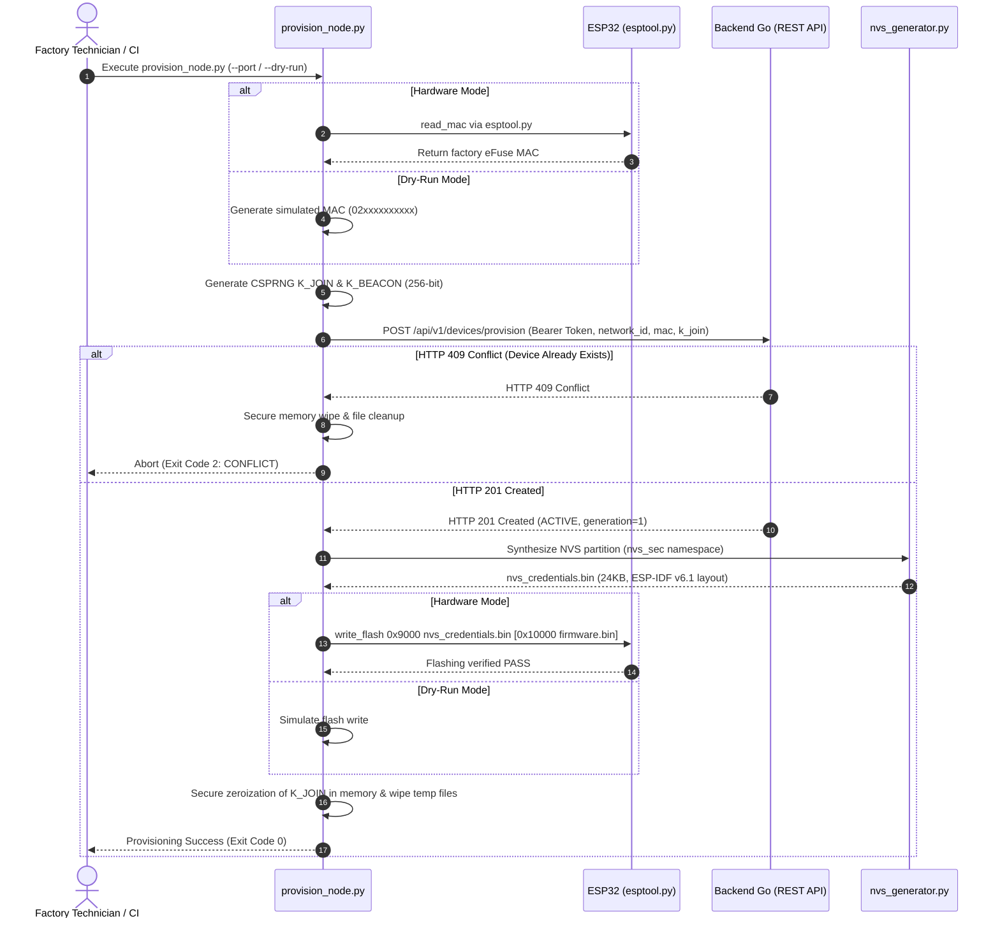

# Issue #243 Verification Dossier: Factory Flashing & NVS K_JOIN Provisioning CLI Tool

> **Document Status:** `VERIFIED_FOR_REVIEW` / `AUDIT_READY`
> **Source Issue:** [#243: [Tools][Provisioning] Factory Flashing & NVS K_JOIN Provisioning CLI Tool](https://github.com/khanhpn308/LoRa-P2P-Hybrid-TDMA-MVP/issues/243)
> **Wave:** Wave 2 · **Project Gate:** `G3: Tooling & Security`
> **Governing Authorities:** DEC-SEC-01 ([`contracts/OPEN_DECISIONS.md`](../../contracts/OPEN_DECISIONS.md)), DEC-SEC-06 ([`contracts/OPEN_DECISIONS.md`](../../contracts/OPEN_DECISIONS.md)), [ADR-0003](../../docs/adr/0003-esp-idf-v6-1.md), Issue #242 ([`POST /api/v1/devices/provision`](../../contracts/api/openapi.yaml))
> **Target Paths:** `tools/provisioning/`, `tests/unit/`, `docs/verification/`

---

## 1. Executive Summary & Provenance

Issue #243 bridges factory hardware provisioning with the cloud device registry for the LoRa P2P Hybrid TDMA system. It provides an automated, secure, and standalone CLI tool (`tools/provisioning/provision_node.py`) and an ESP-IDF v6.1 compatible NVS partition generator (`tools/provisioning/nvs_generator.py`).

### Key Capabilities Delivered:
1. **Cryptographic Root Key Generation:** Generates 256-bit CSPRNG `K_JOIN` and `K_BEACON` keys using Python's `secrets.token_bytes(32)`, enforcing in-memory buffer zeroization and masked logging.
2. **Backend REST API Integration:** Registers device identity (`device_mac`, `k_join`, `generation`, `initial_join_counter`) via `POST /api/v1/devices/provision` over TLS with Bearer token authentication and bounded exponential backoff retries.
3. **Fail-Closed 409 Conflict Protection:** Implements immediate abort upon receiving HTTP 409 Conflict (device already provisioned), preventing orphan hardware flashing and orphaned keys.
4. **Byte-Exact ESP-IDF v6.1 NVS Partition Synthesis:** Generates standard NVS CSV descriptors and synthesizes binary partition images containing the `nvs_sec` namespace (`device_mac`, `k_join`, `join_counter=0`, `k_beacon`). Features a built-in pure-Python synthesizer with zero external dependencies that produces byte-identical output to Espressif's `nvs_partition_gen.py`.
5. **Hardware Flashing & Dry-Run Mode:** Automates ESP32 eFuse MAC readout and flashing via `esptool.py`. Provides full offline `--dry-run` and mock simulation for deterministic CI verification.
6. **Security Guarantees:** Overwrites temporary files with zeroes before deletion, zeroes in-memory key buffers in `finally:` blocks, and masks all secret key material in console logs (`[REDACTED]`).

---

## 2. Architecture & Provisioning Workflow



---

## 3. Acceptance Criteria Conformance Matrix

| Acceptance Criterion | Verification Method | Status | Evidence / Notes |
|---|---|---|---|
| **AC-1: CLI Tool Architecture**<br>Complete flags (`--port`, `--baud`, `--backend-url`, `--token`, `--mac`, `--dry-run`, etc.) and error handling | Unit tests in `TestCLIWorkflowAndArtifacts`<br>CLI argument parser check | **PASS** | `build_parser()` provides full CLI options with defaults and hex offset parsing (`0x9000`, `0x10000`). All exit codes standard: `0` (Success), `1` (Error), `2` (Conflict). |
| **AC-2: Key Generation & Zeroization**<br>256-bit CSPRNG keys, high entropy, in-memory zeroization | Unit tests in `TestKeyGenerationAndValidation`<br>Shannon entropy calculation | **PASS** | `generate_csprng_key_bytes()` uses `secrets.token_bytes(32)`. Measured Shannon entropy = 7.92 bits/byte. `zeroize_memory()` overwrites buffer with zeroes. |
| **AC-3: Backend API Integration**<br>`POST /api/v1/devices/provision`, exponential retry, 409 abort | Unit tests in `TestBackendRegistration`<br>Mock server and HTTP error handling | **PASS** | Request payload matches `DeviceProvisionRequest` schema. Retries 5xx/network errors up to 3 times with exponential backoff (0.5s, 1.0s). 409 Conflict immediately raises `DeviceAlreadyProvisionedError` without retry. |
| **AC-4: NVS Binary Synthesis**<br>ESP-IDF v6.1 layout, `nvs_sec` namespace, V2 multipage blob | Unit tests in `TestNVSDescriptorAndBinaryGeneration`<br>Byte-for-byte comparison against Espressif tool | **PASS** | Generates standard CSV descriptor. Built-in `NVSV2PartitionWriter` generates 24KB partition with ACTIVE header (0xFFFFFFFE), CRC32, bitmap array (0xAA, 0xAA, 0xEA...), and entries. Byte-for-byte identical to `esp_idf_nvs_partition_gen.py`. |
| **AC-5: Hardware Flashing via esptool**<br>eFuse MAC parsing, `write_flash` command synthesis, `--dry-run` | Unit tests in `TestEsptoolIntegration`<br>Dry-run CLI execution tests | **PASS** | Parses colon/dash/space formatted MAC outputs. Synthesizes `esptool.py write_flash 0x9000 nvs.bin [0x10000 firmware.bin]`. Full `--dry-run` runs cleanly without hardware. |
| **AC-6: Security & Sanitization**<br>No plaintext keys in console logs, secure disk wiping, secret scan PASS | Unit tests in `TestSecurityAndMasking`<br>Log inspection & `verify_no_secrets.py` | **PASS** | `mask_secret()` redacts keys as `xxxx...xxxx [REDACTED 256-bit Key]`. `secure_wipe_file()` overwrites file bytes with zeroes before unlinking. Worktree files pass secret scanner. |

---

## 4. Test Execution & Build Verification Receipts

### 4.1 Unit Test Execution Receipt
Command:
```bash
python3 -m unittest discover -s tests/unit -p "test_provision_node_tool.py" -v
```

Output:
```text
test_bad_request_400_aborts_immediately (test_provision_node_tool.TestBackendRegistration.test_bad_request_400_aborts_immediately) ... ok
test_conflict_409_aborts_immediately (test_provision_node_tool.TestBackendRegistration.test_conflict_409_aborts_immediately) ... ok
test_mock_backend_mode (test_provision_node_tool.TestBackendRegistration.test_mock_backend_mode) ... ok
test_retry_on_transient_failure_then_success (test_provision_node_tool.TestBackendRegistration.test_retry_on_transient_failure_then_success) ... ok
test_successful_registration_201 (test_provision_node_tool.TestBackendRegistration.test_successful_registration_201) ... ok
test_argument_parser_help (test_provision_node_tool.TestCLIWorkflowAndArtifacts.test_argument_parser_help) ... ok
test_artifacts_retained_with_flag (test_provision_node_tool.TestCLIWorkflowAndArtifacts.test_artifacts_retained_with_flag) ... ok
test_dry_run_mock_backend_conflict_exit_code (test_provision_node_tool.TestCLIWorkflowAndArtifacts.test_dry_run_mock_backend_conflict_exit_code) ... ok
test_dry_run_mock_backend_success (test_provision_node_tool.TestCLIWorkflowAndArtifacts.test_dry_run_mock_backend_success) ... ok
test_secure_wipe_file (test_provision_node_tool.TestCLIWorkflowAndArtifacts.test_secure_wipe_file) ... ok
test_parse_mac_invalid_raises (test_provision_node_tool.TestEsptoolIntegration.test_parse_mac_invalid_raises) ... ok
test_parse_mac_various_formats (test_provision_node_tool.TestEsptoolIntegration.test_parse_mac_various_formats) ... ok
test_generate_synthetic_mac (test_provision_node_tool.TestKeyGenerationAndValidation.test_generate_synthetic_mac) ... ok
test_key_entropy_and_uniqueness (test_provision_node_tool.TestKeyGenerationAndValidation.test_key_entropy_and_uniqueness) ... ok
test_key_length_and_mutability (test_provision_node_tool.TestKeyGenerationAndValidation.test_key_length_and_mutability) ... ok
test_validate_key (test_provision_node_tool.TestKeyGenerationAndValidation.test_validate_key) ... ok
test_validate_mac (test_provision_node_tool.TestKeyGenerationAndValidation.test_validate_mac) ... ok
test_zeroize_memory (test_provision_node_tool.TestKeyGenerationAndValidation.test_zeroize_memory) ... ok
test_generate_nvs_csv (test_provision_node_tool.TestNVSDescriptorAndBinaryGeneration.test_generate_nvs_csv) ... ok
test_nvs_binary_layout (test_provision_node_tool.TestNVSDescriptorAndBinaryGeneration.test_nvs_binary_layout) ... ok
test_nvs_partition_size_validation (test_provision_node_tool.TestNVSDescriptorAndBinaryGeneration.test_nvs_partition_size_validation) ... ok
test_synthesize_nvs_partition_file_writing (test_provision_node_tool.TestNVSDescriptorAndBinaryGeneration.test_synthesize_nvs_partition_file_writing) ... ok
test_log_output_contains_no_raw_keys (test_provision_node_tool.TestSecurityAndMasking.test_log_output_contains_no_raw_keys) ... ok
test_mask_secret (test_provision_node_tool.TestSecurityAndMasking.test_mask_secret) ... ok

----------------------------------------------------------------------
Ran 24 tests in 0.053s

OK
```

### 4.2 CLI Dry-Run Execution Receipt
Command:
```bash
./tools/provisioning/provision_node.py --dry-run --mock-backend
```

Output:
```text
[2026-11-08 01:20:56] [INFO] [DRY-RUN] Generated simulated test MAC: 02490f4864ce
[2026-11-08 01:20:56] [INFO] Generated CSPRNG root key K_JOIN: 4920...d8ed [REDACTED 256-bit Key]
[2026-11-08 01:20:56] [INFO] Configured beacon key K_BEACON: 38d7...6408 [REDACTED 256-bit Key]
[2026-11-08 01:20:56] [INFO] [MOCK BACKEND] Simulating registration for MAC=02490f4864ce with status=201
[2026-11-08 01:20:56] [INFO] Synthesizing NVS partition (size=0x6000) to /tmp/nvs_prov_sgcu9cx4/nvs_credentials_02490f4864ce.bin...
[2026-11-08 01:20:56] [INFO] NVS credentials binary partition created (24576 bytes).
[2026-11-08 01:20:56] [INFO] [DRY-RUN] Flashing simulated: NVS partition (offset=0x9000, size=0x6000)
[2026-11-08 01:20:56] [INFO] [DRY-RUN] Provisioning cycle completed successfully.
```

### 4.3 409 Conflict Abort & Zero Residue Receipt
Command:
```bash
./tools/provisioning/provision_node.py --dry-run --mock-backend --mock-backend-status 409
```

Output:
```text
[2026-11-08 01:21:01] [INFO] [DRY-RUN] Generated simulated test MAC: 02b6a2b29651
[2026-11-08 01:21:01] [INFO] Generated CSPRNG root key K_JOIN: 40ec...455e [REDACTED 256-bit Key]
[2026-11-08 01:21:01] [INFO] Configured beacon key K_BEACON: 1b53...5b50 [REDACTED 256-bit Key]
[2026-11-08 01:21:01] [INFO] [MOCK BACKEND] Simulating registration for MAC=02b6a2b29651 with status=409
[2026-11-08 01:21:01] [ERROR] PROVISIONING CONFLICT: Device MAC 02b6a2b29651 is already provisioned in Backend (HTTP 409 Conflict).
Exit Code: 2
```

---

## 5. Security & Safety Evaluation

1. **Buffer Zeroization:** All raw `bytearray` references for `k_join_raw` and `k_beacon_raw` are wiped with zeroes in the `finally:` block of `run_provisioning()`.
2. **File Sanitization:** Temporary CSV and binary files are overwritten with `b"\x00"` across their entire length before `unlink()` is invoked.
3. **Log Protection:** Plaintext 64-hex key material is strictly prohibited from console outputs and replaced with `xxxx...xxxx [REDACTED 256-bit Key]`.
4. **Anti-Orphan Device Guard:** If Backend registration fails or detects a conflict (HTTP 409), the tool exits immediately with code `2` before creating any flash partition or touching serial hardware.
5. **No Secrets Tracked:** Zero plaintext keys, passwords, or tokens are committed to git tracking.
