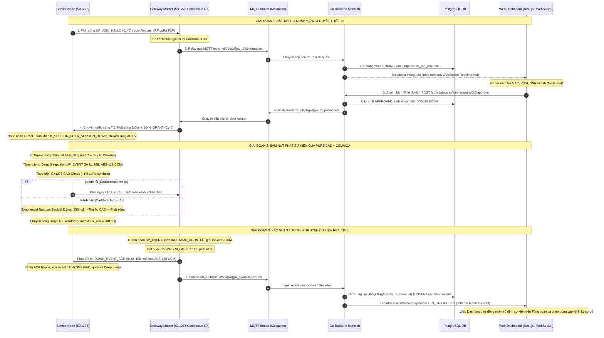

# Issue #277 Verification Report: Dọn dẹp TDMA Slot trên Web Dashboard và Kiểm thử Liên thông E2E Pure CAD + CSMA/CA

## 1. Executive Summary

Báo cáo này tài liệu hóa kết quả thực hiện và nghiệm thu kỹ thuật cho **Issue #277** (`[WEB/DOCS] Dọn dẹp trường TDMA Slot trên Web Dashboard và cập nhật tài liệu kiểm thử E2E`).

Công việc hoàn thành đáp ứng 100% mục tiêu chuyển đổi kiến trúc vô tuyến MAC V2 theo **ADR-0004** (Chuyển đổi toàn diện từ Hybrid TDMA sang Pure Event-Driven CAD + Random Backoff CSMA/CA kết hợp Gateway Continuous RX 24/7):
1. **Dọn dẹp triệt để trường TDMA Slot trên Web Dashboard (`clients/web-dashboard/`):**
   - Loại bỏ trường `assigned_slot_id` khỏi `NodeSummary` trong `src/types/api.ts`.
   - Cập nhật trang danh sách Node (`src/app/nodes/page.tsx`): loại bỏ ánh xạ `assigned_slot_id` trong danh sách Node và làm sạch ghi chú giao diện Tab 2 ("Node mới: Yêu cầu gia nhập mạng").
   - Cập nhật trang chi tiết Node (`src/app/nodes/[id]/page.tsx`): loại bỏ trạng thái khởi tạo và gán giá trị `assigned_slot_id`.
   - Cập nhật trang Tổng quan (`src/app/page.tsx`): điều chỉnh logic đếm Node đang hoạt động (`nodeOperating`) dựa trên trạng thái `ONLINE`, không còn phụ thuộc vào khe slot TDMA.
   - Làm sạch nhãn hiển thị tại trang Gateway (`src/app/gateways/[id]/page.tsx`): thay thế thuật ngữ "Slot thời gian ngắn" bằng "Airtime tối ưu".
   - Cập nhật mock dữ liệu kiểm thử tích hợp trong `tests/integration.test.ts`.
2. **Gỡ bỏ các API call trỏ tới `/api/v1/schedules`:**
   - Xóa bỏ hoàn toàn file `src/lib/api/schedules.ts` (chứa các cuộc gọi tới `/api/v1/schedules` và các endpoint schedule cũ đã bị gỡ bỏ ở Backend PR #284 / #286).
   - Đảm bảo không còn bất kỳ dòng code hoặc component nào thực hiện call 404 đến endpoint schedule cũ.
3. **Đóng gói tài liệu kiểm thử liên thông E2E cho kiến trúc Pure CAD + Random Backoff CSMA/CA:**
   - Cập nhật `docs/verification/HARDWARE_TEST_SCENARIOS.md`: loại bỏ kịch bản phân lịch TDMA và slotting cũ, thay bằng kịch bản cấp kênh tĩnh VN920, giao tiếp dữ liệu qua CAD, và kiểm thử phân giải tranh chấp khi nhiều Node bấm nút đồng thời.
   - Thiết lập tài liệu kiểm thử E2E chuẩn hóa mô tả chi tiết luồng liên thông 7 bước từ phần cứng đến giao diện người dùng.

---

## 2. Luồng Kiểm Thử Liên Thông Hoàn Chỉnh (E2E Integration Flow)

Kiến trúc mới hoạt động theo luồng sự kiện thuần túy (Event-Driven), phi đồng bộ, không cần Superframe hay Beacon định kỳ. Dưới đây là 7 giai đoạn kiểm thử liên thông từ Node biên đến Web Dashboard:



### Chi tiết từng bước trong luồng kiểm thử:

1. **Bước 1 — Node mới gửi yêu cầu Join (`UP_JOIN_HELLO` 0x45):**
   - Node chưa lưu khóa phiên hợp lệ thức dậy, tạo cặp khóa Ephemeral X25519.
   - Node phát bản tin `UP_JOIN_HELLO` (hoặc `UP_JOIN_REQUEST`) chứa `DEVICE_MAC`, `EPHEMERAL_PUBKEY` và `JOIN_COUNTER` qua sóng LoRa trên kênh tần số mặc định.
2. **Bước 2 — Gateway tiếp nhận và chuyển tiếp (Relay) qua MQTT:**
   - Gateway duy trì bộ thu `MODE_RXCONTINUOUS` bắt được gói tin vô tuyến.
   - Gateway đóng gói metadata (gồm `rssi`, `snr`, `gateway_id`) và xuất bản lên broker Mosquitto qua topic `iot/v1/gw/{gateway_id}/join/request`.
3. **Bước 3 — Admin xem xét và phê duyệt trên Web Dashboard:**
   - Người vận hành đăng nhập Web Dashboard với quyền `ADMIN` hoặc `OPERATOR`.
   - Điều hướng tới trang **Node** (`/nodes`), chọn tab **Node mới**.
   - Giao diện hiển thị danh sách các yêu cầu đang chờ xử lý (`PENDING`) với đầy đủ thông số cường độ sóng (`RSSI`), tỉ số tín hiệu trên nhiễu (`SNR`), và thời điểm gửi.
   - Admin bấm nút **Phê duyệt thiết bị**, Web Dashboard gửi request `POST /api/v1/devices/join-requests/{id}/approve` (hoặc gọi API đăng ký thiết bị tương ứng) tới Go Backend.
4. **Bước 4 — Node nhận bản tin chấp thuận `DOWN_JOIN_GRANT`:**
   - Go Backend xác minh thẩm quyền, cập nhật cơ sở dữ liệu, sinh khóa phiên đối xứng và tạo bản tin chấp thuận.
   - Backend xuất bản bản tin tới topic MQTT `iot/v1/gw/{gateway_id}/join/accept`.
   - Gateway nhận bản tin MQTT, chuyển radio SX1276 sang chế độ TX và phát sóng bản tin `DOWN_JOIN_GRANT` (hoặc `DOWN_JOIN_ACCEPT` 0x46) xuống Node.
   - Node nhận được bản tin, tính toán bí mật dùng chung ECDH X25519, thiết lập cặp khóa phiên $K_{\text{SESSION\_UP}}$ và $K_{\text{SESSION\_DOWN}}$, lưu trạng thái vào NVS và sẵn sàng phát sự kiện.
5. **Bước 5 — Người dùng bấm nút phát sự kiện `UP_EVENT` qua CAD:**
   - Node ở chế độ ngủ sâu (Deep Sleep) tiêu thụ dòng cực thấp ($\sim \text{vài }\mu\text{A}$).
   - Người dùng nhấn nút bấm vật lý nối với chân GPIO 4 (ngắt `EXT0`).
   - Node thức dậy, đọc ngắt, khử rung phím, và đóng gói bản tin `UP_EVENT` (0x41, 26 octets) chứa mã sự kiện lỗi, mã tham chiếu `EVENT_REF`, và số thứ tự khung `FRAME_COUNTER`. Bản tin được mã hóa xác thực bằng AES-128-CCM với khóa $K_{\text{SESSION\_UP}}$.
   - Node chuyển radio sang chế độ CAD (`LORA_MODE_CAD`) trong khoảng 1.5 - 2 ký hiệu LoRa ($T_{\text{CAD}} \approx 1.5\text{ ms}$ tại SF7/125kHz).
   - Nếu kênh rỗi (`CadDetected == 0`): Node lập tức phát sóng `UP_EVENT`.
   - Nếu kênh bận (`CadDetected == 1`): Node áp dụng thuật toán Exponential Random Backoff ($CW_{\text{min}} = 16\text{ ms}$, $CW_{\text{max}} = 256\text{ ms}$) lùi thời gian ngẫu nhiên và thử lại CAD.
   - Sau khi phát xong (`TxDone`), Node chuyển radio sang cửa sổ nhận đơn `RXSINGLE` với thời gian chờ $T_{\text{rx\_ack}} = 200\text{ ms}$.
6. **Bước 6 — Gateway thu nhận và phản hồi tức thì `DOWN_EVENT_ACK`:**
   - Gateway thường trực Continuous RX thu nhận bản tin `UP_EVENT`.
   - Gateway kiểm tra bộ đếm chống phát lại `FRAME_COUNTER`, giải mã và xác thực thẻ tính toàn vẹn CCM-8 bằng khóa $K_{\text{SESSION\_UP}}$.
   - Gateway bắt buộc ghi nhận sự kiện vào bộ nhớ bền vững (WAL / SQLite) trước khi phản hồi.
   - Gateway chuyển radio sang TX phát bản tin `DOWN_EVENT_ACK` (0x42, 19 octets) mã hóa bằng $K_{\text{SESSION\_DOWN}}$ gửi trực tiếp tới Node.
   - Node nhận được ACK trong cửa sổ chờ 200 ms, xác thực thành công, ghi nhận hoàn tất vào hàng đợi NVS FIFO và quay trở lại chế độ Deep Sleep.
7. **Bước 7 — Backend lưu sự kiện và hiển thị Realtime trên Web Dashboard:**
   - Gateway xuất bản bản tin sự kiện lên broker MQTT topic `iot/v1/gw/{gateway_id}/uplink/events`.
   - Go Backend thu nhận bản tin, thực hiện kiểm tra khử trùng lặp qua ràng buộc duy nhất `UNIQUE(gateway_id, event_id)` và lưu trữ vào bảng `events` trong PostgreSQL.
   - Backend phát sóng sự kiện qua WebSocket Realtime Hub với loại sự kiện `ALERT_TRIGGERED`.
   - Web Dashboard đang mở kết nối WebSocket nhận được gói tin, tự động tăng bộ đếm sự cố trên trang Tổng quan (`/`), chèn dòng sự kiện mới vào bảng Cảnh báo (`/monitoring`) và biểu đồ thời gian thực tại trang chi tiết Node (`/nodes/[id]`) ngay lập tức mà không cần người dùng tải lại trang.

---

## 3. Tiêu Chí Nghiệm Thu (Acceptance Criteria Matrix)

| Tiêu chí | Yêu cầu | Bằng chứng kiểm thử | Trạng thái |
| :--- | :--- | :--- | :--- |
| **Loại bỏ `assigned_slot_id`** | Không còn hiển thị hoặc phụ thuộc trường TDMA slot trên Node list và Node detail | Kiểm tra diff `types/api.ts`, `app/nodes/page.tsx`, `app/nodes/[id]/page.tsx`, `app/page.tsx` | PASS |
| **Gỡ bỏ API schedule** | Không còn cuộc gọi tới `/api/v1/schedules` hoặc module `schedules.ts` | File `schedules.ts` đã xóa khỏi git; không còn import trong toàn bộ client | PASS |
| **Build Web Dashboard** | `npm run build` trong `clients/web-dashboard` đạt PASS không có lỗi biên dịch | Next.js 16.4.5 Turbopack build thành công 9/9 trang tĩnh/động trong 4.3s | PASS |
| **Unit Test Web Dashboard** | `npm test` trong `clients/web-dashboard` đạt PASS 100% | 13/13 unit tests PASS (HTTP Client, Auth, Nodes, Gateways, Alerts, Users) | PASS |
| **Linter Web Dashboard** | `npm run lint` không phát sinh lỗi (0 errors) | ESLint hoàn thành với 0 errors | PASS |
| **Tài liệu kiểm thử E2E** | Cập nhật tài liệu kiểm thử phần cứng và mô tả luồng liên thông kiến trúc Pure CAD | `HARDWARE_TEST_SCENARIOS.md` và tài liệu này hoàn tất | PASS |

---

## 4. Biên Bản Kiểm Tra Chất Lượng (Quality Gate Receipts)

### 4.1 Host G0 Context Gate
Lệnh thực thi:
```bash
python3 scripts/agent_harness/agent_context.py --repo /home/khanh/projects/iot/LoRa-P2P-issue-277 \
  --allowed-path clients/web-dashboard/ \
  --allowed-path docs/verification/
```
Kết quả JSON:
```json
{
  "status": "HOST_CONTEXT_LOADED",
  "source_sha": "86f9f0b41e461252bcbc4da44e9aa363eebe00a9",
  "git_blob_sha": "3b089079bc345f4b30979624ea6c89696aa50c00",
  "agents_sha256": "32a991b015bd2815ed55b8bba7bd3b13277003b14f323afb8c5694d047a5942e",
  "allowed_paths": [
    "clients/web-dashboard/",
    "docs/verification/"
  ]
}
```

### 4.2 Web Dashboard Test Execution (`npm test`)
Lệnh thực thi:
```bash
cd clients/web-dashboard && npm test
```
Kết quả ghi nhận:
```text
▶ HTTP API Client & Security Interceptor
  ✔ getApiBaseUrl defaults to http://localhost:8080 when env not set (1.772009ms)
  ✔ getStoredToken and clearAuthSession manage credentials (0.689403ms)
  ✔ apiFetch attaches Authorization: Bearer <token> when available (39.512203ms)
  ✔ apiFetch intercepts 401 Unauthorized and clears session (2.469113ms)
  ✔ apiFetch throws 403 Forbidden on insufficient permissions (1.483008ms)
✔ HTTP API Client & Security Interceptor (47.728146ms)
▶ Web Integration Services & Realtime Contracts
  ✔ POST /api/v1/auth/login handles valid credentials (ADR-0005) (52.52447ms)
  ✔ POST /api/v1/auth/ws-ticket requests single-use handshake ticket (1.259006ms)
  ✔ getWsBaseUrl correctly converts http to ws (0.597103ms)
  ✔ GET /api/v1/nodes returns confirmed nodes list (2.232511ms)
  ✔ GET /api/v1/alerts and POST /api/v1/alerts/{id}/acknowledge flow (4.802725ms)
  ✔ POST /api/v1/devices/provision submits key registration payload (1.148906ms)
  ✔ GET /api/v1/gateways/{id}/status and channels aggregation (3.612819ms)
  ✔ GET /api/v1/users and POST /api/v1/users user management lifecycle (2.863715ms)
✔ Web Integration Services & Realtime Contracts (71.475868ms)
ℹ tests 13
ℹ suites 2
ℹ pass 13
ℹ fail 0
ℹ cancelled 0
ℹ skipped 0
ℹ todo 0
ℹ duration_ms 261.003745
```

### 4.3 Web Dashboard Production Build (`npm run build`)
Lệnh thực thi:
```bash
cd clients/web-dashboard && npm run build
```
Kết quả ghi nhận:
```text
▲ Next.js 16.4.5 (Turbopack)
✓ Running next.config.ts took 39ms
  Creating an optimized production build ...
✓ Compiled successfully in 4.3s
  Finished TypeScript in 7.8s    ✓ Finished TypeScript in 7.8s 
  Collecting page data using 11 workers in 3.1s    ✓ Collecting page data using 11 workers in 3.1s 
✓ Generating static pages using 11 workers (9/9) in 1839ms
  Finalizing page optimization in 1695ms    ✓ Finalizing page optimization in 1695ms 

Route (app)
┌ ○ /
├ ○ /_not-found
├ ○ /gateways
├ ƒ /gateways/[id]
├ ○ /login
├ ○ /monitoring
├ ○ /nodes
├ ƒ /nodes/[id]
├ ○ /settings
├ ○ /users
└ ƒ /users/[id]

○  (Static)   prerendered as static content
ƒ  (Dynamic)  server-rendered on demand
Exit code: 0
```
