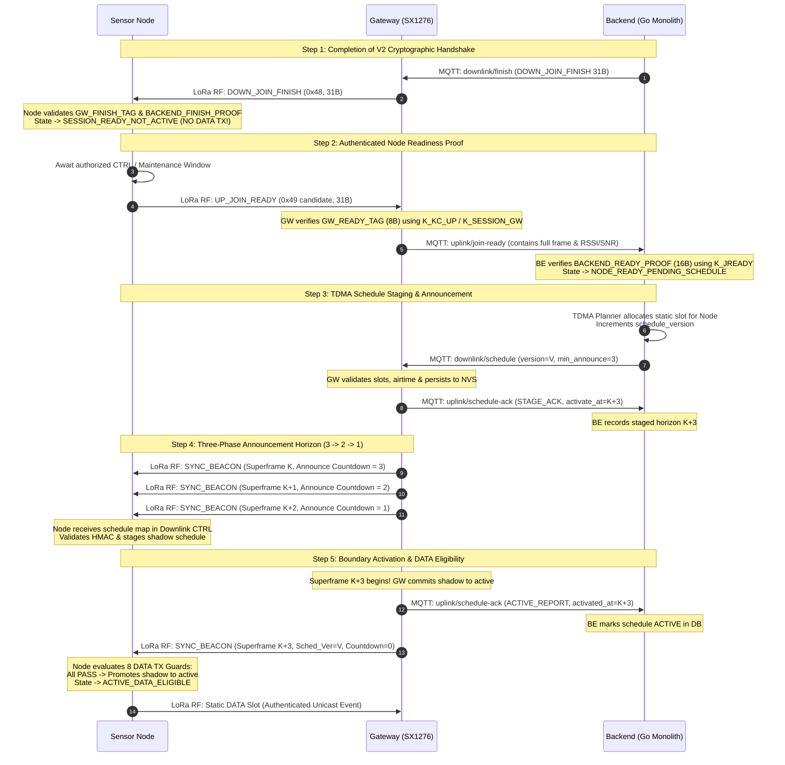

# LP2P V2 Post-Join Design: Node READY → TDMA Schedule → Activation

**Document ID:** `DOC-JOIN-V2-READY-ACT-001`
**Status:** `DRAFT_FOR_OWNER_REVIEW` · `IMPLEMENTATION_READY=NO` · `G2=NOT_VERIFIED`
**Parent / Tracking:** Issue #136, Umbrella #125, G2 MAC compatibility #127 (blocked for wire implementation).
**Related Documents:** [ADR-0001 (Hybrid TDMA)](../adr/0001-hybrid-tdma.md), [ADR-0002 (MQTT 5.0)](../adr/0002-mqtt-5.md), [Radio MAC Specification](../../contracts/radio-mac/specification.md), [TDMA Schedule Contract](../../contracts/radio-mac/tdma-schedule.md), [Open Decisions](../../contracts/OPEN_DECISIONS.md), [MQTT Topics](../../contracts/mqtt/topics.md), [MQTT Semantic Rules](../../contracts/mqtt/semantic-rules.md), [Schedule Schema](../../contracts/mqtt/schemas/schedule.schema.json), [Schedule-Ack Schema](../../contracts/mqtt/schemas/schedule-ack.schema.json).

---

## 1. Executive Summary & Purpose

The LoRa-P2P-Hybrid-TDMA-MVP project utilizes a custom LoRa P2P MAC layer. In Radio MAC V2, four cryptographic handshake frames are locked at the design level by Owner decisions in Issue #127:
1. `UP_JOIN_HELLO` (0x45, 68B, [Comment 6628167582](https://github.com/khanhpn308/LoRa-P2P-Hybrid-TDMA-MVP/issues/127#issuecomment-6628167582))
2. `DOWN_JOIN_GRANT` (0x46, 66B, [Comment 6629863066](https://github.com/khanhpn308/LoRa-P2P-Hybrid-TDMA-MVP/issues/127#issuecomment-6629863066))
3. `UP_JOIN_KEY_CONFIRM` (0x47, 31B, [Comment 6630055809](https://github.com/khanhpn308/LoRa-P2P-Hybrid-TDMA-MVP/issues/127#issuecomment-6630055809))
4. `DOWN_JOIN_FINISH` (0x48, 31B, [Comment 6630280648](https://github.com/khanhpn308/LoRa-P2P-Hybrid-TDMA-MVP/issues/127#issuecomment-6630280648))

While these four packet designs resolve mutual cryptographic authentication between Node, Gateway, and Backend, they terminate with the dispatch of `DOWN_JOIN_FINISH`. This creates a critical post-join operational gap:
- **The Circular Dependency Trap:** A Node cannot transmit DATA packets without an assigned TDMA slot; however, the Backend Planner cannot safely activate a TDMA schedule containing that slot until it receives verifiable proof that the Node actually received and validated `DOWN_JOIN_FINISH`.
- **The Delivery Uncertainty Problem:** Downlink RF packets over LoRa are lossy. If `DOWN_JOIN_FINISH` is lost in transit, the Backend must not assume the Node is active, nor can the Gateway allocate precious superframe airtime to a non-listening Node.
- **The Untrusted Gateway Boundary:** The Gateway is an edge relay that may be physically accessible or compromised. The Backend must receive cryptographically authenticated proof directly originating from the Node (bound to the Node's private pre-shared key `K_JOIN` or derived session key) before granting DATA transmission authorization.
- **The Half-Duplex Contention Hazard:** An unscheduled Node cannot use DATA slots 1..15 to transmit its readiness indication. Doing so would cause catastrophic collisions with incumbent active nodes. Readiness signaling must occur strictly within an authorized Contention/Control/Maintenance window.

This document specifies the formal three-party state machine, cryptographic evidence transcripts, TDMA schedule staging and announcement countdown (3→2→1), fail-closed DATA TX guards, and SX1276 physical radio timing models to bridge the gap from `DOWN_JOIN_FINISH` to deterministic network activation.

> [!IMPORTANT]
> This specification represents a **design dossier for technical and Owner review**. It does not constitute approval to modify production wire schemas, database structures, or firmware implementations without subsequent approved follow-up PRs.

---

## 2. Threat Model & Trust Boundaries

```
 +-----------------------------------------------------------------------------------------+
 |                                    BACKEND (Cloud / Server)                             |
 | - Holds K_JOIN (Provisioned PSK) for all devices                                        |
 | - Owns TDMA Schedule Planning (schedule_version, lease_duration)                         |
 | - Validates BACKEND_PROOF & issues DOWN_JOIN_FINISH                                     |
 +-----------------------------------------------------------------------------------------+
                                      ▲                             ▲
                                      │ TLS / MQTT 5.0              │ TLS / MQTT 5.0
                                      │ downlink/schedule           │ uplink/schedule-ack
                                      │ downlink/finish             │ uplink/join-ready
                                      ▼                             ▼
 +-----------------------------------------------------------------------------------------+
 |                                  GATEWAY (Edge SX1276 Host)                             |
 | - Semi-trusted edge hardware; possesses K_SESSION_GW and ephemeral X25519 key           |
 | - DOES NOT possess K_JOIN; cannot forge Backend authentication proofs                   |
 | - Executes local TDMA superframe, broadcasts SYNC_BEACON, enforces half-duplex RF       |
 +-----------------------------------------------------------------------------------------+
                                      ▲                             ▲
                                      │ RF (LoRa P2P 920-923 MHz)   │ RF (LoRa P2P 920-923 MHz)
                                      │ DOWN_JOIN_FINISH (0x48)     │ UP_JOIN_READY (0x49 candidate)
                                      │ SYNC_BEACON (3->2->1)       │ Static TDMA DATA Slots 1..15
                                      ▼                             ▼
 +-----------------------------------------------------------------------------------------+
 |                                  SENSOR NODE (ESP32-WROOM-32E)                          |
 | - Holds provisioned K_JOIN in secure NVS; maintains monotonic JOIN_COUNTER              |
 | - Computes ephemeral ECDH Z = X25519(priv, pub); zeroizes private key after confirm     |
 | - Strictly fail-closed: NO DATA TX until 8-fold DATA TX guard is completely satisfied   |
 +-----------------------------------------------------------------------------------------+
```

### 2.1 Threat Vector Mitigation

| Threat Vector | Description | Architectural Mitigation |
|---|---|---|
| **T1: Rogue Gateway Impersonation** | Compromised Gateway attempts to fabricate Node readiness to claim slots or trigger billing. | Node READY includes `BACKEND_READY_PROOF` (HMAC under key known only to Node and Backend). Gateway cannot forge this proof. |
| **T2: Replayed READY Transmissions** | Attacker sniffs an old `UP_JOIN_READY` packet and replays it during a subsequent session. | Transcripts bind unique `JOIN_COUNTER`, fresh `NODE_NONCE`, `GW_NONCE`, and `SESSION_SEL`. High-water mark validation at Backend rejects duplicates. |
| **T3: Stale Schedule Desynchronization** | Gateway activates a schedule before a Node receives it, causing slot overlap. | Mandatory `3→2→1` announcement horizon across complete superframes. Gateway stages shadow; Node syncs shadow; activation occurs strictly on superframe boundary `K+H`. |
| **T4: Half-Duplex Collision** | Unscheduled Node transmits READY during an active DATA slot, colliding with incumbent sensor data. | Node READY transmission is restricted strictly to the designated `CTRL_WINDOW` within the Maintenance/Subframe 4 boundary. |
| **T5: Clock Drift Phase-Slip** | Node clock drifts due to crystal frequency error (e.g. ±30 ppm) over extended intervals, drifting into adjacent slot. | Max drift guard `tau_drift = delta_t * ppm <= 25 ms`. Node requires periodic Beacon sync. Loss of 3 consecutive Beacons revokes DATA TX rights. |

---

## 3. Formal Three-Party State Machines

To ensure deterministic lifecycle reconciliation, the states of Node, Gateway, and Backend are formally defined below.

### 3.1 State Definitions

#### Sensor Node Lifecycle States
- `NODE_UNJOINED`: Factory state or post-wipe. Possesses provisioned `K_JOIN`, `DEVICE_MAC`, `DEVICE_GENERATION`. No session, no TDMA slot.
- `NODE_JOINING`: Handshake active. Has sent `UP_JOIN_HELLO` or `UP_JOIN_KEY_CONFIRM`, awaiting downlink.
- `NODE_SESSION_READY_NOT_ACTIVE`: Has received and cryptographically verified `DOWN_JOIN_FINISH`. Holds active session keys (`K_SESSION_ROOT`, `K_SESSION_GW`, `K_SESSION_BE`), assigned `NODE_ID`, and `SESSION_SEL`. **DATA transmission is strictly prohibited.**
- `NODE_SCHEDULE_STAGED`: Has received Beacon/Downlink containing new `schedule_version` allocating Slot $S$. Staged in memory/NVS; activation pending superframe horizon.
- `NODE_ACTIVE_DATA_ELIGIBLE`: Schedule activated at superframe boundary; all 8 DATA TX guards satisfied. Permitted to transmit event/telemetry in assigned slot $S$.
- `NODE_RECOVERY_HOLD`: Beacon sync lost, lease expired, or schedule mismatch detected. Transmission inhibited; listening for Beacon or Downlink CTRL.

#### Gateway Lifecycle States
- `GW_INIT`: Hardware boot, NVS state inspection. Loads last validated active schedule from NVS.
- `GW_ONLINE_IDLE`: Connected to MQTT broker; running TDMA superframe engine; broadcasting periodic `SYNC_BEACON`.
- `GW_FINISH_DISPATCHED_AWAIT_READY`: Has transmitted `DOWN_JOIN_FINISH` on RF; running timer $T_{\text{await\_ready}}$.
- `GW_SCHEDULE_STAGING`: Has received `downlink/schedule` from Backend; validated semantics and persistence; publishing `STAGE_ACK`; broadcasting $3 \to 2 \to 1$ countdown in Beacons.
- `GW_SCHEDULE_COMMITTED`: Transitioned active schedule at boundary superframe $K_{\text{target}}$; published `ACTIVE_REPORT` to Backend.

#### Backend Lifecycle States
- `BE_SESSION_PENDING`: Received `UP_JOIN_HELLO`; issued `DOWN_JOIN_GRANT`; awaiting `UP_JOIN_KEY_CONFIRM`.
- `BE_FINISH_ISSUED_AWAIT_NODE_READY`: Validated Key Confirm; issued `DOWN_JOIN_FINISH` to Gateway; waiting for proof of Node readiness.
- `BE_NODE_READY_PENDING_SCHEDULE`: Validated `UP_JOIN_READY` from Node. Node is marked eligible in database, queued for slot allocation in next TDMA Planner run.
- `BE_SCHEDULE_PROPOSED`: Planner created new schedule revision $V_{\text{new}}$; published `downlink/schedule` via MQTT 5.0.
- `BE_SCHEDULE_STAGED`: Received `STAGE_ACK` from Gateway with planned activation boundary $K_{\text{target}}$.
- `BE_SCHEDULE_ACTIVE`: Received `ACTIVE_REPORT` from Gateway matching $K_{\text{target}}$. Marked live in database.

---

### 3.2 State Transition Matrix

| Entity | Current State | Trigger Event | Guard Conditions | Actions / Output | Next State |
|---|---|---|---|---|---|
| **Node** | `JOINING` | Rx `DOWN_JOIN_FINISH` (0x48) | `GW_FINISH_TAG` valid $\land$ `BACKEND_FINISH_PROOF` valid $\land$ `JOIN_COUNTER` match | Store session keys; zeroize ECDH priv; start $T_{\text{ready\_window}}$ | `SESSION_READY_NOT_ACTIVE` |
| **Node** | `SESSION_READY_NOT_ACTIVE` | $T_{\text{ready\_window}}$ reached in CTRL window | SX1276 idle $\land$ RF channel clear $\land$ duty cycle budget $> 0$ | Transmit `UP_JOIN_READY` (0x49); arm $T_{\text{sched\_listen}}$ | `SESSION_READY_NOT_ACTIVE` |
| **Node** | `SESSION_READY_NOT_ACTIVE` | Rx Beacon with new `SCHED_VER` | Beacon HMAC valid $\land$ Node has slot in mapping $\land$ Horizon $\ge 1$ | Store shadow schedule; arm activation counter | `SCHEDULE_STAGED` |
| **Node** | `SCHEDULE_STAGED` | Superframe sequence reaches $K_{\text{target}}$ | All 8 DATA TX guards evaluate TRUE | Promote shadow schedule to active; enable DATA slot timer | `ACTIVE_DATA_ELIGIBLE` |
| **Node** | `ACTIVE_DATA_ELIGIBLE` | 3 consecutive Beacons lost | Clock drift $\tau_{\text{drift}} > T_{\text{guard}}$ or $N_{\text{lost}} \ge 3$ | Inhibit RF PA; preserve Event queue in flash; switch to RX recovery | `RECOVERY_HOLD` |
| **Gateway** | `ONLINE_IDLE` | Downlink Finish received via MQTT | Transaction pending $\land$ RF queue space available | Transmit `DOWN_JOIN_FINISH` (0x48) on RF; arm $T_{\text{await\_ready}}$ | `FINISH_DISPATCHED_AWAIT_READY` |
| **Gateway** | `FINISH_DISPATCHED` | Rx `UP_JOIN_READY` (0x49) on RF | In CTRL window $\land$ `GW_READY_TAG` valid $\land$ matches pending Node | Publish `uplink/join-ready` to Backend; disarm $T_{\text{await\_ready}}$ | `ONLINE_IDLE` |
| **Gateway** | `FINISH_DISPATCHED` | $T_{\text{await\_ready}}$ expires | No valid READY received from Node | Publish `join-aborted` to Backend; purge staging context | `ONLINE_IDLE` |
| **Gateway** | `ONLINE_IDLE` | Rx `downlink/schedule` via MQTT | Schema valid $\land$ `created_at < expires_at` $\land$ non-overlapping slots $\land$ valid NVS persist | Write shadow to NVS; publish `STAGE_ACK`; set horizon $H \ge 3$ | `SCHEDULE_STAGING` |
| **Gateway** | `SCHEDULE_STAGING` | Superframe seq reaches $K_{\text{target}}$ | Beacon broadcast completed for $H$ superframes | Commit shadow to active; publish `ACTIVE_REPORT` via MQTT | `SCHEDULE_COMMITTED` |
| **Backend** | `SESSION_PENDING` | Rx `UP_JOIN_KEY_CONFIRM` | `BACKEND_PROOF` valid $\land$ `JOIN_COUNTER` monotonic | Compute session keys; publish `DOWN_JOIN_FINISH`; arm $T_{\text{node\_ready}}$ | `FINISH_ISSUED_AWAIT_NODE_READY` |
| **Backend** | `FINISH_ISSUED` | Rx `uplink/join-ready` via MQTT | `BACKEND_READY_PROOF` valid $\land$ matches pending transaction | Mark Node READY in DB; trigger TDMA schedule recalculation | `NODE_READY_PENDING_SCHEDULE` |
| **Backend** | `NODE_READY` | Planner generates schedule | New version $V_{k+1} > V_k \land$ all nodes accommodated | Publish `downlink/schedule` (QoS 1, retain=false, expiry); arm $T_{\text{stage\_ack}}$ | `SCHEDULE_PROPOSED` |
| **Backend** | `SCHEDULE_PROPOSED` | Rx `STAGE_ACK` via MQTT | `request_id` match $\land$ `reason_code == NONE` $\land K_{\text{target}} > K_{\text{current}}$ | Record planned activation boundary $K_{\text{target}}$ | `SCHEDULE_STAGED` |
| **Backend** | `SCHEDULE_STAGED` | Rx `ACTIVE_REPORT` via MQTT | `activated_at_superframe_seq == K_{\text{target}}` $\land$ version match | Mark schedule ACTIVE in DB; update node states to ACTIVE | `SCHEDULE_ACTIVE` |
| **Backend** | Any staging state | Timeout or `VERIFY_NACK` | Rejection or timeout reached | Abort proposal; keep prior active schedule; raise alert | Reconciliation / Abort |

---

### 3.3 End-to-End Sequence Diagram



---

## 4. Cryptographic Proofs & Candidate Frame Formats

### 4.1 Candidate `UP_JOIN_READY` Frame (0x49, 31 Bytes)

To resolve the circular dependency without using unauthorized DATA slots, a dedicated readiness packet is specified.

> [!CAUTION]
> **Status:** `CANDIDATE_FOR_OWNER_DECISION`. This byte layout is proposed to the project Owner as candidate `0x49`. It is **NOT** yet an approved wire standard.

#### Frame Layout (Total: 31 Octets)
| Offset | Field Name | Width | Type / Endianness | Constraint / Purpose |
|---|---|---:|---|---|
| `0` | `VER_TYPE` | 1 | `uint8` | `0x49` (Proto V2: bits 7..5 = `010b`; Type = `01001b`) |
| `1` | `GW_ID` | 1 | `uint8` | Target Gateway ID matching the authorized Join transaction |
| `2` | `NODE_ID` | 1 | `uint8` | Assigned Node ID from `DOWN_JOIN_GRANT` |
| `3..6` | `JOIN_COUNTER` | 4 | `uint32_t` BE | Exact monotonic counter from current Join transaction |
| `7..14` | `GW_READY_TAG` | 8 | `byte[8]` | First 8 bytes of HMAC-SHA256 under `K_KC_UP` |
| `15..30` | `BACKEND_READY_PROOF` | 16 | `byte[16]` | First 16 bytes of HMAC-SHA256 under `K_JREADY` |

#### Exact Cryptographic Derivation
The derivations rely strictly on the pre-shared secret $K_{\text{JOIN}}$ and ephemeral ECDH shared secret $Z$:
```text
NETWORK4     = uint32_be(NETWORK_ID)
GEN2         = uint16_be(DEVICE_GENERATION)
MAC6         = HELLO68[1..6]

# 1. Backend-bound verification key
SALT_JOIN    = ASCII("LP2P/V2/JOIN-ROOT") || NETWORK4 || MAC6 || GEN2
PRK_JOIN     = HKDF-Extract-SHA256(salt=SALT_JOIN, IKM=K_JOIN)
K_JREADY     = HKDF-Expand-SHA256(PRK_JOIN, info=ASCII("LP2P/V2/JOIN-READY"), L=32)

# 2. Gateway-bound verification key (derived from ephemeral session secret)
TH           = SHA256(ASCII("LP2P/V2/TH-JOIN") || NETWORK4 || HELLO68 || GRANT66)
Z            = X25519(local_ephemeral_private, peer_ephemeral_public)  # must reject all-zero
PRK_SESSION  = HKDF-Extract-SHA256(salt=TH, IKM=Z)
K_KC_UP      = HKDF-Expand-SHA256(PRK_SESSION, info=ASCII("LP2P/V2/KC-UP"), L=32)

# 3. Payload Prefix
READY_PREFIX7 = 0x49 || GW_ID1 || NODE_ID1 || JOIN_COUNTER_BE4

# 4. Gateway Tag calculation (8 octets)
M_GW_READY    = ASCII("LP2P/V2/M-GW-READY") || TH || FINISH31 || READY_PREFIX7
GW_READY_TAG8 = HMAC-SHA256(K_KC_UP, M_GW_READY)[0..7]

# 5. Backend Proof calculation (16 octets)
M_BE_READY    = ASCII("LP2P/V2/M-BACKEND-READY") || NETWORK4 || TH || FINISH31 || READY_PREFIX7 || GW_READY_TAG8
BACKEND_READY_PROOF16 = HMAC-SHA256(K_JREADY, M_BE_READY)[0..15]

# Final Frame
UP_JOIN_READY = READY_PREFIX7 || GW_READY_TAG8 || BACKEND_READY_PROOF16  # 31 bytes
```

### 4.2 Security Properties of `UP_JOIN_READY`
1. **End-to-End Authenticity:** The Backend verifies `BACKEND_READY_PROOF16` using $K_{\text{JREADY}}$. Since $K_{\text{JOIN}}$ is never disclosed to the Gateway, an untrusted or compromised Gateway cannot fabricate this proof.
2. **Immediate Edge Verification:** The Gateway verifies `GW_READY_TAG8` using $K_{\text{KC\_UP}}$. This allows the Gateway to drop invalid packets at the radio layer immediately without wasting cellular/Ethernet uplink bandwidth.
3. **Transcript Binding:** The inclusion of `TH` (transcript hash of Hello and Grant) and `FINISH31` binds the readiness confirmation inextricably to the exact handshake instance. Any replay of an old confirmation against a new session will produce an HMAC mismatch.

---

## 5. TDMA Schedule Staging & Activation Mechanics

### 5.1 Staging and the $3 \to 2 \to 1$ Announcement Horizon

When the Backend Planner emits a new schedule revision via MQTT `downlink/schedule`:
1. **Gateway Semantic Validation:** The Gateway checks JSON schema, verifying `created_at < expires_at`, monotonic `schedule_version > active_version`, and non-overlapping slot allocations.
2. **Shadow Persistence:** The validated schedule is committed to local NVS as `SHADOW_SCHEDULE`.
3. **Horizon Selection:** The Gateway inspects its local superframe sequencer. If the current superframe sequence is $K_{\text{now}}$, the Gateway selects activation boundary:
   $$K_{\text{target}} \ge K_{\text{now}} + \max(3, \text{min\_announce\_superframes})$$
   This guarantees that at least three complete superframe announcements occur before the schedule switches.
4. **MQTT Acknowledgment:** The Gateway immediately responds with `STAGE_ACK` specifying `activate_at_superframe_seq = K_target`.

### 5.2 Superframe Announcement Cycle
During superframes $K_{\text{target}}-3$, $K_{\text{target}}-2$, and $K_{\text{target}}-1$, the Gateway broadcasts the schedule countdown in the `SYNC_BEACON`:
- In superframe $K_{\text{target}}-3$: Beacon announces `PENDING_VERSION = V_new`, `COUNTDOWN = 3`.
- In superframe $K_{\text{target}}-2$: Beacon announces `PENDING_VERSION = V_new`, `COUNTDOWN = 2`.
- In superframe $K_{\text{target}}-1$: Beacon announces `PENDING_VERSION = V_new`, `COUNTDOWN = 1`.
- In superframe $K_{\text{target}}$: Gateway promotes `SHADOW_SCHEDULE` to `ACTIVE_SCHEDULE`, sets `ACTIVE_VERSION = V_new`, `COUNTDOWN = 0`, and emits MQTT `ACTIVE_REPORT`.

### 5.3 Deterministic Abort and Re-plan Rules

The activation pipeline MUST abort deterministically under any of the following conditions:
1. **Expired Proposal:** If `expires_at` is reached before the Gateway receives all necessary stage confirmations.
2. **Re-ordered / Conflicting MQTT Message:** If a newer `downlink/schedule` arrives while a previous schedule is staging, the prior staging pipeline is aborted, and the newer schedule is evaluated fresh.
3. **Gateway Power Loss / Reboot during Staging:** On reboot, the Gateway invalidates `SHADOW_SCHEDULE` unless its activation horizon is still safely in the future relative to a battery-backed trusted RTC. If clock validity cannot be proven, the Gateway fails closed, loads only `ACTIVE_SCHEDULE`, and reports `VERIFY_NACK` with `reason_code = UNTRUSTED_CLOCK`.
4. **Missing Node READY:** If a newly assigned Node fails to deliver `UP_JOIN_READY` within $T_{\text{await\_ready}}$, the Backend Planner aborts the proposed schedule revision and issues a re-plan excluding the delinquent node.

---

## 6. The 8-Fold Fail-Closed Node DATA TX Guard

A Sensor Node is legally permitted to key its RF transmitter for a DATA packet **if and only if all eight of the following independent guards evaluate to TRUE**. If any guard fails, transmission is inhibited immediately.

```
       +-----------------------------------------------------------+
       |                  DATA TRANSMISSION INHIBIT                |
       +-----------------------------------------------------------+
                                     ▲
             ANY GUARD FAILS         │  ALL GUARDS PASS
         (Fail-Closed, Queue Event)  │  (Enable PA, TX DATA)
                                     │
   +---------------------------------+---------------------------------+
   |                                                                   |
   |   [G1] JOIN_COMPLETED == TRUE (Valid DOWN_JOIN_FINISH validated)  |
   |   [G2] KEY_CONFIRMATIONS_VALID == TRUE (Dual tags verified)       |
   |   [G3] SCHEDULE_AUTHENTIC == TRUE (Valid schedule map & HMAC)     |
   |   [G4] LEASE_ACTIVE == TRUE (now_ms < lease_expires_ms)           |
   |   [G5] TIMING_DRIFT_SAFE == TRUE (drift <= 25ms, lost_beacons < 3)|
   |   [G6] SLOT_OWNERSHIP_EXCLUSIVE == TRUE (slot == assigned_slot)   |
   |   [G7] REGULATORY_AIRTIME_BUDGET > 0 (Node duty cycle <= 1.0%)    |
   |   [G8] REPLAY_MONOTONIC_VALID == TRUE (FCnt_UP < 2^32 - 1)        |
   +-------------------------------------------------------------------+
```

### Detailed Guard Specifications

1. **Guard 1 (Join Completion):** Node must have processed `DOWN_JOIN_FINISH` with matching `JOIN_COUNTER` and valid cryptographic tags.
2. **Guard 2 (Dual Key Confirmation):** Both Gateway and Backend confirmation tags must have evaluated valid during handshake; session keys are derived and non-zero.
3. **Guard 3 (Authentic Schedule):** Node must possess a complete, verified schedule mapping containing its assigned `NODE_ID`. The schedule version must match the active version announced in the latest `SYNC_BEACON`.
4. **Guard 4 (Active Session Lease):** Current monotonic time must not exceed session lease expiration ($T_{\text{now}} < T_{\text{lease\_expiry}}$).
5. **Guard 5 (Timing and Clock Drift Guard):**
   - The Node must have synchronized with a valid `SYNC_BEACON` within the last $N_{\text{beacon\_timeout}} = 2$ superframes.
   - Cumulative clock drift since last valid sync:
     $$\tau_{\text{drift}} = \Delta t \times \epsilon_{\text{crystal}} \le T_{\text{guard\_lead}} \quad (\text{e.g. } \le 25\text{ ms})$$
   - If 3 consecutive Beacons are missed, Guard 5 evaluates FALSE.
6. **Guard 6 (Exclusive Slot Ownership):** The current superframe slot index must match the Node's allocated static DATA slot (1..15). Transmission is strictly constrained to the slot interval:
   $$t \in \left[ T_{\text{slot\_start}} + T_{\text{guard\_lead}},\, T_{\text{slot\_start}} + T_{\text{guard\_lead}} + T_{\text{tx\_budget}} \right]$$
7. **Guard 7 (Airtime Regulatory Budget):** Rolling 1-hour airtime accumulation must satisfy the 1.0% duty cycle regulatory cap:
   $$\sum \text{ToA}_{\text{last\_hour}} + \text{ToA}_{\text{candidate}} \le 36{,}000\text{ ms}$$
8. **Guard 8 (Anti-Replay / Monotonicity):** Unicast frame counter `FCnt_UP` must be strictly increasing. If `FCnt_UP` approaches $2^{32}-1$, the Node must halt transmission and trigger a re-keying handshake.

---

## 7. SX1276 Half-Duplex Physical Timeline Modeling

The SX1276 is a single-channel, half-duplex transceiver. The TDMA superframe profile `P-10S-15` defines nominal timing parameters.

> [!NOTE]
> All timing values in this section are **CALCULATED BASELINE ESTIMATES** for simulator modeling. They do not represent verified RF/HIL empirical measurements (marked `NOT_VERIFIED` per G1/G2 gates).

### 7.1 Superframe Budget Allocation (Nominal $T_{\text{SF}} = 10{,}000\text{ ms}$)

A superframe comprises 5 Subframes of 2,000 ms each.

```
Superframe (10,000 ms)
+---------------------------------------------------------------------------------------------------+
| Subframe 0 (2000ms) | Subframe 1 (2000ms) | Subframe 2 (2000ms) | Subframe 3 (2000ms) | Subframe 4 (2000ms) |
+---------------------------------------------------------------------------------------------------+

Subframe Breakdown (2000 ms):
+---------------------------------------------------------------------------------------------------+
| 0..250ms      | 250..650ms    | 650..1050ms   | 1050..1450ms  | 1450..1850ms  | 1850..2000ms      |
| DL / Beacon   | PCSS / CTRL   | DATA Slot A   | DATA Slot B   | DATA Slot C   | Guard / Turnaround|
+---------------------------------------------------------------------------------------------------+
```

- **Subframe 0:**
  - `0..250 ms`: `SYNC_BEACON` (Gateway TX, all Nodes RX).
  - `250..650 ms`: Priority Contention / Control Slot (PCSS).
  - `650..1050 ms`: DATA Slot #1 (Node 1 TX, Gateway RX $\to$ Gateway ACK).
  - `1050..1450 ms`: DATA Slot #2 (Node 2 TX, Gateway RX $\to$ Gateway ACK).
  - `1450..1850 ms`: DATA Slot #3 (Node 3 TX, Gateway RX $\to$ Gateway ACK).
  - `1850..2000 ms`: Subframe Guard (150 ms idle).
- **Subframes 1, 2, 3:** Follow identical structure with Downlink in `0..250 ms` and Slots #4..#12.
- **Subframe 4:**
  - `0..250 ms`: Downlink Slot.
  - `250..650 ms`: PCSS.
  - `650..1050 ms`: DATA Slot #13.
  - `1050..1450 ms`: DATA Slot #14.
  - `1450..1850 ms`: DATA Slot #15.
  - `1850..2000 ms`: **CTRL / Join Window (150 ms)**. Reserved for `UP_JOIN_READY`, re-association, and maintenance requests.

### 7.2 Detailed 400 ms Slot Breakdown

```
Single 400 ms DATA Slot:
+---------------------------------------------------------------------------------------------------+
| 0..25ms       | 25..125ms             | 125..145ms      | 145..245ms          | 245..400ms        |
| Leading Guard | Node TX Window (ToA)  | Radio Turnaround| Gateway ACK Window  | Trailing Guard    |
| (Drift margin)| (Max 100 ms ToA)      | (TX->RX / RX->TX)| (Max 100 ms ToA)   | (Processing/Slack)|
+---------------------------------------------------------------------------------------------------+
```

| Window | Duration | Node Radio State | Gateway Radio State | Description |
|---|---:|---|---|---|
| **Leading Guard** | 25 ms | Standby / Wait | RX Continuous | Absorbs worst-case clock jitter and crystal drift. |
| **Node TX** | 100 ms | TX (LoRa PA on) | RX Continuous | Node transmits unicast event payload. |
| **Radio Turnaround** | 20 ms | TX $\to$ RX transition | RX $\to$ TX transition | SPI register reprogramming and PLL lock. |
| **Gateway ACK** | 100 ms | RX Single Window | TX (LoRa PA on) | Gateway transmits unicast ACK/MIC. |
| **Trailing Guard** | 155 ms | Standby / Sleep | RX Standby | Baseband parsing, event dispatch to buffer. |

### 7.3 Maintenance Superframe Profile

To prevent clock drift divergence over prolonged idle periods:
- **Target Period:** Approximately once every 300 seconds (every 30th superframe), a **Maintenance Superframe** is scheduled by the Gateway.
- **Maintenance Actions:**
  - Extended SYNC_BEACON with frequency error correction (PPM estimate).
  - Exchange of health / RSSI telemetry.
  - Lease renewal confirmations.
  - No application DATA packets are scheduled during Maintenance Superframe to guarantee contention-free network synchronization.

---

## 8. Failure Modes, Edge Cases & Recovery

```
+-------------------------------------------------------------------------------------------------------+
| Scenario              | Failure Trigger                 | System Behavior & Safe State                |
+-------------------------------------------------------------------------------------------------------+
| F1: Lost DOWN_FINISH  | Downlink RF loss on 0x48        | Node remains in SESSION_PENDING. Timeout     |
|                       |                                 | triggers retransmission of Key Confirm      |
|                       |                                 | (same nonce/counter). Backend replays Finish|
+-------------------------------------------------------------------------------------------------------+
| F2: Lost UP_READY     | Uplink RF loss on 0x49          | Gateway disarms T_await_ready on expiry.     |
|                       |                                 | Node retries in next CTRL window. Backend   |
|                       |                                 | does not allocate slot until valid receipt. |
+-------------------------------------------------------------------------------------------------------+
| F3: Lost Beacon       | Interference during Beacon slot | Node holds over timing if lost count < 3    |
|                       |                                 | and drift <= 25ms. If 3 consecutive lost:   |
|                       |                                 | Fail-closed: DATA TX disabled; enter RECOVERY|
+-------------------------------------------------------------------------------------------------------+
| F4: Node Reboot       | Brownout / Watchdog Reset       | RAM keys zeroized. Node wakes in UNJOINED.  |
|                       |                                 | Must NOT reuse old session keys. Performs   |
|                       |                                 | fresh V2 Join with incremented JOIN_COUNTER |
+-------------------------------------------------------------------------------------------------------+
| F5: Gateway Reboot    | Power cycle during staging      | Staged shadow discarded. Loads active       |
|                       |                                 | schedule from NVS. MQTT connects with       |
|                       |                                 | clean_start=1. Publishes status with new    |
|                       |                                 | gateway_epoch UUID. Backend reconciles state|
+-------------------------------------------------------------------------------------------------------+
| F6: Stale MQTT Msg    | Retained / delayed schedule msg | Gateway checks Message Expiry & expires_at. |
|                       |                                 | If now >= expires_at, rejects with          |
|                       |                                 | VERIFY_NACK (reason = EXPIRED).             |
+-------------------------------------------------------------------------------------------------------+
| F7: Key Rotation Bump | DEVICE_GENERATION incremented   | Backend rejects old JOIN_COUNTER & GEN.     |
|                       | in registry                     | Node receives invalid tag; alerts technician|
+-------------------------------------------------------------------------------------------------------+
```

---

## 9. Producer / Consumer Impact & Repository Audit

The introduction of the V2 Post-Join Activation design impacts multiple modules across the monorepo. This table defines the boundaries and necessary follow-up work items.

| Component | Target File | Impact Type | Required Modifications / Actions | Follow-up Issue |
|---|---|---|---|---|
| **Contracts** | `contracts/radio-mac/specification.md` | Producer | Document candidate `0x49 UP_JOIN_READY` codepoint and transcripts. | #127 |
| **Contracts** | `contracts/radio-mac/tdma-schedule.md` | Consumer | Formalize $3 \to 2 \to 1$ superframe announcement countdown. | #127 |
| **Contracts** | `contracts/mqtt/schemas/schedule-ack.schema.json` | Consumer | Reconcile `activate_at_superframe_seq` validation rules. | #128 |
| **Contracts** | `contracts/OPEN_DECISIONS.md` | Governance | Register new open design decisions D14..D20. | #136 |
| **Backend (Go)** | `backend-go/internal/service/scheduler/` | Producer | Implement schedule planner with $H \ge 3$ horizon and staging state. | #132 |
| **Backend (Go)** | `backend-go/internal/service/join/` | Consumer | Implement `UP_JOIN_READY` authentication and idempotent DB updates. | #135 |
| **Firmware Node** | `firmware/` (Sensor Node) | Consumer | Implement 8-fold fail-closed guard; $3 \to 2 \to 1$ horizon sync logic. | Follow-up HW Issue |
| **Firmware GW** | `firmware/` (Gateway Bench) | Consumer | Implement SX1276 half-duplex sequencer and shadow schedule NVS commit. | Follow-up HW Issue |
| **Testing / QA** | `tests/sim/` & HIL | Verification | Implement 25-case test suite for activation and drift boundaries. | #130 |

---

## 10. Open Decisions Register

The following items are unresolved design and policy decisions requiring Owner sign-off before implementation:

| Decision ID | Summary | Options Considered | Recommended Resolution | Blocking Severity |
|---|---|---|---|---|
| **D14** | `UP_JOIN_READY` Codepoint & Size | Option A: 31B (0x49) matching Key Confirm layout.<br>Option B: Piggyback on first DATA slot. | **Option A (31B Candidate 0x49):** Eliminates circular dependency and avoids data slot contention. | **P0 (Critical)** |
| **D15** | READY Transmission Window | Option A: In Subframe 4 CTRL window [1850..2000ms].<br>Option B: In any PCSS window. | **Option A:** Dedicated CTRL window minimizes contention with priority alerts. | **P1 (High)** |
| **D16** | Announcement Horizon Depth | Option A: Fixed $H = 3$ superframes.<br>Option B: Dynamic $H \in [3, 10]$ based on network size. | **Option A ($H = 3$):** Provides deterministic 30-second staging window while bounding latency. | **P1 (High)** |
| **D17** | Clock Drift Recovery Threshold | Option A: 3 lost beacons.<br>Option B: Calculated $\tau_{\text{drift}} > 25\text{ ms}$. | **Combine Both:** Fail-closed if either $\tau_{\text{drift}} > 25\text{ ms}$ OR lost beacons $\ge 3$. | **P1 (High)** |
| **D18** | Maintenance Superframe Frequency | Option A: Fixed 300s period.<br>Option B: On-demand scheduled by Backend. | **Option A (Nominal 300s):** Simple local execution without requiring real-time Backend command. | **P2 (Medium)** |
| **D19** | Multi-Gateway Roaming Eligibility | Option A: Strict single-gateway lock.<br>Option B: Dynamic handover via Backend re-join. | **Option A:** Single-gateway static TDMA for MVP; dynamic handover deferred to V3. | **P2 (Medium)** |
| **D20** | Airtime Accumulator Storage | Option A: Ephemeral RAM rolling buffer.<br>Option B: Periodic NVS checkpoint. | **Option A:** RAM with conservative power-on penalty to avoid NVS wear. | **P2 (Medium)** |
